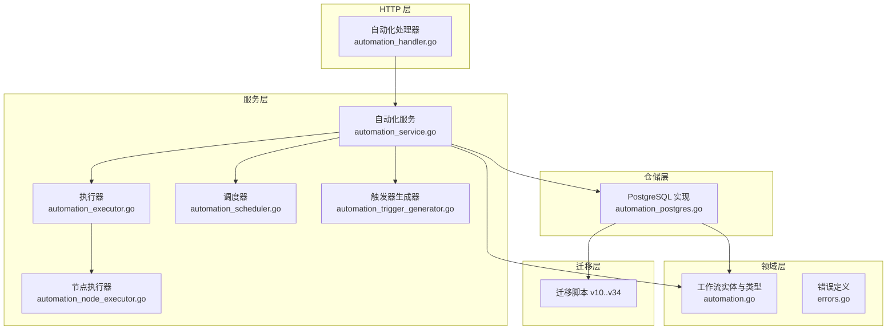
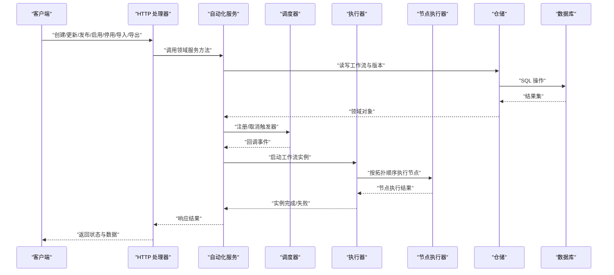
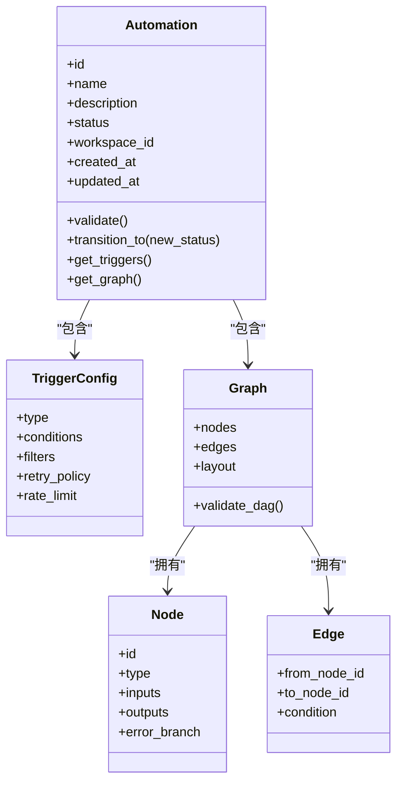
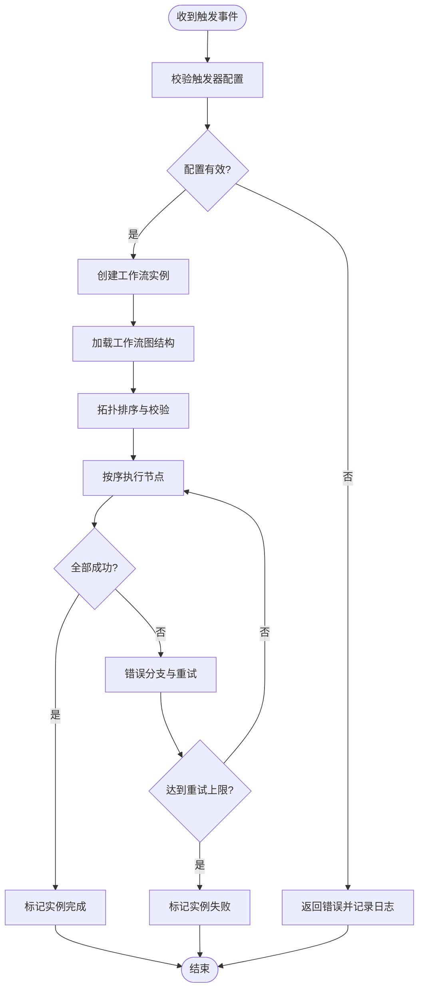
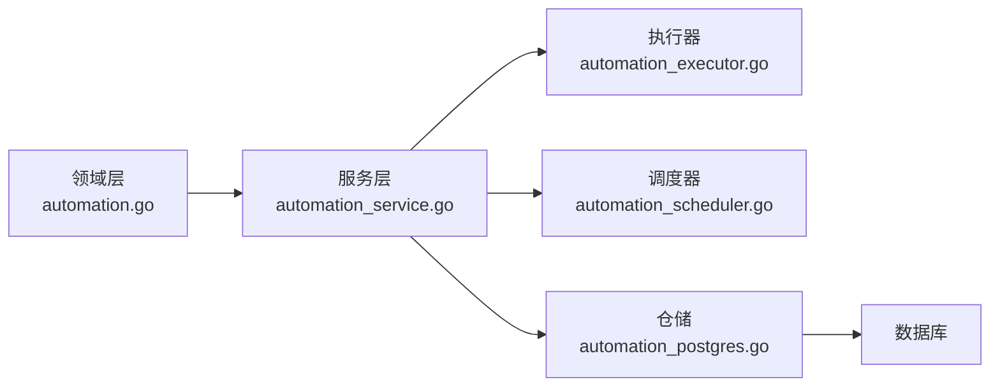

# 工作流模型

<cite>
**本文引用的文件**   
- [automation.go](file://notifuse/internal/domain/automation.go)
- [automation_test.go](file://notifuse/internal/domain/automation_test.go)
- [automation_handler.go](file://notifuse/internal/http/automation_handler.go)
- [automation_handler_test.go](file://notifuse/internal/http/automation_handler_test.go)
- [automation_postgres.go](file://notifuse/internal/repository/automation_postgres.go)
- [automation_service.go](file://notifuse/internal/service/automation_service.go)
- [automation_executor.go](file://notifuse/internal/service/automation_executor.go)
- [automation_node_executor.go](file://notifuse/internal/service/automation_node_executor.go)
- [automation_scheduler.go](file://notifuse/internal/service/automation_scheduler.go)
- [automation_trigger_generator.go](file://notifuse/internal/service/automation_trigger_generator.go)
- [v10.go](file://notifuse/internal/migrations/v10.go)
- [v11.go](file://notifuse/internal/migrations/v11.go)
- [v12.go](file://notifuse/internal/migrations/v12.go)
- [v13.go](file://notifuse/internal/migrations/v13.go)
- [v14.go](file://notifuse/internal/migrations/v14.go)
- [v15.go](file://notifuse/internal/migrations/v15.go)
- [v16.go](file://notifuse/internal/migrations/v16.go)
- [v17.go](file://notifuse/internal/migrations/v17.go)
- [v18.go](file://notifuse/internal/migrations/v18.go)
- [v19.go](file://notifuse/internal/migrations/v19.go)
- [v20.go](file://notifuse/internal/migrations/v20.go)
- [v21.go](file://notifuse/internal/migrations/v21.go)
- [v22.go](file://notifuse/internal/migrations/v22.go)
- [v23.go](file://notifuse/internal/migrations/v23.go)
- [v24.go](file://notifuse/internal/migrations/v24.go)
- [v25.go](file://notifuse/internal/migrations/v25.go)
- [v26.go](file://notifuse/internal/migrations/v26.go)
- [v27.go](file://notifuse/internal/migrations/v27.go)
- [v28.go](file://notifuse/internal/migrations/v28.go)
- [v29.go](file://notifuse/internal/migrations/v29.go)
- [v30.go](file://notifuse/internal/migrations/v30.go)
- [v31.go](file://notifuse/internal/migrations/v31.go)
- [v32.go](file://notifuse/internal/migrations/v32.go)
- [v33.go](file://notifuse/internal/migrations/v33.go)
- [v34.go](file://notifuse/internal/migrations/v34.go)
- [errors.go](file://notifuse/internal/domain/errors.go)
</cite>

## 目录
1. [简介](#简介)
2. [项目结构](#项目结构)
3. [核心组件](#核心组件)
4. [架构总览](#架构总览)
5. [详细组件分析](#详细组件分析)
6. [依赖关系分析](#依赖关系分析)
7. [性能考虑](#性能考虑)
8. [故障排查指南](#故障排查指南)
9. [结论](#结论)
10. [附录](#附录)

## 简介
本文件为 Notifuse 平台的自动化工作流实体提供数据模型文档。围绕工作流的定义、可视化设计器数据结构（节点与边）、版本控制与生命周期管理、模板复用机制、验证规则与错误处理策略，以及导入导出格式规范进行系统化说明，帮助开发者与产品人员准确理解并扩展工作流能力。

## 项目结构
Notifuse 的自动化工作流相关代码主要分布在以下层次：
- 领域层：定义工作流实体、状态机、触发器配置等核心数据结构与校验逻辑
- 服务层：编排工作流调度、执行、节点执行器、触发器生成器等
- 仓储层：持久化工作流及其元数据、版本历史、运行记录等
- HTTP 层：暴露工作流 CRUD、发布、启用/停用、导入导出等接口
- 迁移层：数据库 schema 演进，确保字段与约束随版本迭代

图表来源
- [automation_handler.go](file://notifuse/internal/http/automation_handler.go)
- [automation_service.go](file://notifuse/internal/service/automation_service.go)
- [automation_executor.go](file://notifuse/internal/service/automation_executor.go)
- [automation_node_executor.go](file://notifuse/internal/service/automation_node_executor.go)
- [automation_scheduler.go](file://notifuse/internal/service/automation_scheduler.go)
- [automation_trigger_generator.go](file://notifuse/internal/service/automation_trigger_generator.go)
- [automation.go](file://notifuse/internal/domain/automation.go)
- [automation_postgres.go](file://notifuse/internal/repository/automation_postgres.go)
- [v10.go](file://notifuse/internal/migrations/v10.go)

章节来源
- [automation.go](file://notifuse/internal/domain/automation.go)
- [automation_handler.go](file://notifuse/internal/http/automation_handler.go)
- [automation_service.go](file://notifuse/internal/service/automation_service.go)
- [automation_postgres.go](file://notifuse/internal/repository/automation_postgres.go)
- [v10.go](file://notifuse/internal/migrations/v10.go)

## 核心组件
本节聚焦工作流实体的核心字段与行为，包括基础属性、状态机、触发器配置、可视化设计器数据结构、版本控制与生命周期、模板系统、验证与错误处理、导入导出。

- 工作流基础属性
  - ID：全局唯一标识，用于引用与关联
  - 名称：可读标题，便于检索与管理
  - 描述：可选说明文本，承载业务上下文
  - 状态：工作流生命周期状态（如草稿、已发布、已停用）
  - 创建/更新时间戳：审计追踪
  - 工作空间归属：多租户隔离维度
  - 标签/分类：便于组织与筛选

- 触发器配置
  - 触发源类型：如 Webhook、定时任务、外部事件等
  - 触发条件：表达式或规则集
  - 过滤与转换：入参清洗、字段映射
  - 重试与退避：失败重试策略
  - 速率限制：防止过载

- 可视化工作流设计器数据结构
  - 节点(Node)：表示一个步骤或动作，包含类型、输入参数、输出绑定、异常分支等
  - 边(Edge)：连接两个节点的有向关系，表达执行顺序与条件分支
  - 布局信息：节点坐标、分组、折叠状态等，仅用于 UI 展示
  - 图完整性：无环、连通性、入口/出口节点校验

- 版本控制与生命周期
  - 版本：每次发布产生新版本号，支持回滚与对比
  - 生命周期：草稿 → 已发布 → 已停用；支持热切换
  - 变更审计：谁在何时修改了哪些字段

- 模板系统与复用
  - 模板：可复用的工作流骨架，支持占位符与默认值
  - 实例化：从模板创建工作流副本，继承结构与默认配置
  - 模板更新：可选择是否同步到已有实例

- 验证规则与错误处理
  - 前置校验：必填字段、格式、依赖存在性
  - 运行时校验：节点参数合法性、资源权限
  - 错误分类：参数错误、资源不存在、权限不足、执行失败
  - 错误码与消息：面向前端与调用方清晰反馈

- 导入导出格式
  - 导出：JSON/YAML 序列化，包含节点、边、触发器、版本元数据
  - 导入：增量合并策略、冲突检测、幂等写入
  - 兼容性：跨版本兼容与降级提示

章节来源
- [automation.go](file://notifuse/internal/domain/automation.go)
- [automation_test.go](file://notifuse/internal/domain/automation_test.go)
- [errors.go](file://notifuse/internal/domain/errors.go)

## 架构总览
下图展示了工作流从请求到执行的端到端流程，涵盖 HTTP 接口、服务编排、调度与执行、节点执行器与持久化。

图表来源
- [automation_handler.go](file://notifuse/internal/http/automation_handler.go)
- [automation_service.go](file://notifuse/internal/service/automation_service.go)
- [automation_scheduler.go](file://notifuse/internal/service/automation_scheduler.go)
- [automation_executor.go](file://notifuse/internal/service/automation_executor.go)
- [automation_node_executor.go](file://notifuse/internal/service/automation_node_executor.go)
- [automation_postgres.go](file://notifuse/internal/repository/automation_postgres.go)

## 详细组件分析

### 工作流实体与类型（领域层）
- 职责
  - 定义工作流的核心数据结构与不变式
  - 提供状态转换与校验方法
  - 封装触发器配置与可视化图结构
- 关键概念
  - 状态机：明确允许的状态转移路径
  - 触发器：声明式配置，支持多种事件源
  - 图结构：节点与边的集合，含布局元数据
- 复杂度
  - 校验通常为 O(n) 遍历节点与边
  - 状态检查为常数时间
- 优化点
  - 缓存热点工作流的结构与触发器索引
  - 延迟加载大型图结构

图表来源
- [automation.go](file://notifuse/internal/domain/automation.go)

章节来源
- [automation.go](file://notifuse/internal/domain/automation.go)
- [automation_test.go](file://notifuse/internal/domain/automation_test.go)

### HTTP 接口层（控制器）
- 职责
  - 接收并解析请求参数
  - 调用服务层执行业务逻辑
  - 统一错误包装与响应格式
- 典型接口
  - 工作流 CRUD
  - 发布/启用/停用
  - 导入/导出
  - 版本列表与回滚
- 安全与鉴权
  - 基于工作空间的访问控制
  - 操作审计日志

章节来源
- [automation_handler.go](file://notifuse/internal/http/automation_handler.go)
- [automation_handler_test.go](file://notifuse/internal/http/automation_handler_test.go)

### 服务层（编排与协调）
- 自动化服务
  - 负责工作流的生命周期管理与事务边界
  - 协调调度器、执行器、触发器生成器
- 执行器
  - 根据图的拓扑顺序执行节点
  - 处理并行度、超时、重试与熔断
- 节点执行器
  - 针对具体节点类型的执行实现
  - 参数注入、上下文传递、结果聚合
- 调度器
  - 监听触发器事件，创建工作流实例
  - 支持定时与事件驱动两种模式
- 触发器生成器
  - 将声明式触发器配置转换为运行时订阅
  - 动态注册/注销触发器

图表来源
- [automation_service.go](file://notifuse/internal/service/automation_service.go)
- [automation_executor.go](file://notifuse/internal/service/automation_executor.go)
- [automation_node_executor.go](file://notifuse/internal/service/automation_node_executor.go)
- [automation_scheduler.go](file://notifuse/internal/service/automation_scheduler.go)
- [automation_trigger_generator.go](file://notifuse/internal/service/automation_trigger_generator.go)

章节来源
- [automation_service.go](file://notifuse/internal/service/automation_service.go)
- [automation_executor.go](file://notifuse/internal/service/automation_executor.go)
- [automation_node_executor.go](file://notifuse/internal/service/automation_node_executor.go)
- [automation_scheduler.go](file://notifuse/internal/service/automation_scheduler.go)
- [automation_trigger_generator.go](file://notifuse/internal/service/automation_trigger_generator.go)

### 仓储层（持久化）
- 职责
  - 工作流实体、版本、运行记录的增删改查
  - 图结构的序列化存储与读取
  - 触发器配置的持久化与索引
- 性能要点
  - 批量写入与分页查询
  - 对高频字段建立索引
  - 大对象分片存储

章节来源
- [automation_postgres.go](file://notifuse/internal/repository/automation_postgres.go)

### 迁移层（Schema 演进）
- 职责
  - 维护数据库表结构与约束的演进历史
  - 保证向后兼容与平滑升级
- 版本范围
  - 覆盖 v10 至 v34 的多次迭代，逐步完善工作流字段与索引

章节来源
- [v10.go](file://notifuse/internal/migrations/v10.go)
- [v11.go](file://notifuse/internal/migrations/v11.go)
- [v12.go](file://notifuse/internal/migrations/v12.go)
- [v13.go](file://notifuse/internal/migrations/v13.go)
- [v14.go](file://notifuse/internal/migrations/v14.go)
- [v15.go](file://notifuse/internal/migrations/v15.go)
- [v16.go](file://notifuse/internal/migrations/v16.go)
- [v17.go](file://notifuse/internal/migrations/v17.go)
- [v18.go](file://notifuse/internal/migrations/v18.go)
- [v19.go](file://notifuse/internal/migrations/v19.go)
- [v20.go](file://notifuse/internal/migrations/v20.go)
- [v21.go](file://notifuse/internal/migrations/v21.go)
- [v22.go](file://notifuse/internal/migrations/v22.go)
- [v23.go](file://notifuse/internal/migrations/v23.go)
- [v24.go](file://notifuse/internal/migrations/v24.go)
- [v25.go](file://notifuse/internal/migrations/v25.go)
- [v26.go](file://notifuse/internal/migrations/v26.go)
- [v27.go](file://notifuse/internal/migrations/v27.go)
- [v28.go](file://notifuse/internal/migrations/v28.go)
- [v29.go](file://notifuse/internal/migrations/v29.go)
- [v30.go](file://notifuse/internal/migrations/v30.go)
- [v31.go](file://notifuse/internal/migrations/v31.go)
- [v32.go](file://notifuse/internal/migrations/v32.go)
- [v33.go](file://notifuse/internal/migrations/v33.go)
- [v34.go](file://notifuse/internal/migrations/v34.go)

## 依赖关系分析
- 耦合与内聚
  - 服务层对执行器与调度器的依赖体现高内聚低耦合的设计
  - 领域层独立于 I/O，便于测试与替换实现
- 外部依赖
  - 数据库：PostgreSQL，通过仓储层抽象
  - 触发器源：Webhook、定时任务、外部事件
- 潜在循环依赖
  - 当前分层清晰，未发现直接循环依赖
- 接口契约
  - 服务层对外暴露稳定的方法签名，内部实现可替换

图表来源
- [automation.go](file://notifuse/internal/domain/automation.go)
- [automation_service.go](file://notifuse/internal/service/automation_service.go)
- [automation_executor.go](file://notifuse/internal/service/automation_executor.go)
- [automation_scheduler.go](file://notifuse/internal/service/automation_scheduler.go)
- [automation_postgres.go](file://notifuse/internal/repository/automation_postgres.go)

章节来源
- [automation.go](file://notifuse/internal/domain/automation.go)
- [automation_service.go](file://notifuse/internal/service/automation_service.go)
- [automation_postgres.go](file://notifuse/internal/repository/automation_postgres.go)

## 性能考虑
- 图结构计算
  - 拓扑排序与环检测应在发布前完成，避免运行时开销
- 并发执行
  - 节点级并行度需受控，避免资源争用
- 触发器订阅
  - 动态注册/注销应去重与批量化
- 存储优化
  - 大对象分片、冷热分离、索引优化
- 监控与度量
  - 关键路径埋点，统计成功率、耗时、重试次数

[本节为通用指导，不直接分析具体文件]

## 故障排查指南
- 常见错误分类
  - 参数错误：字段缺失、格式非法、依赖不存在
  - 资源错误：工作流或节点资源未找到
  - 权限错误：跨工作空间访问
  - 执行错误：节点执行失败、外部依赖不可用
- 定位步骤
  - 查看工作流状态与最近运行记录
  - 检查触发器配置与订阅状态
  - 核对节点参数与上下文变量
  - 审查错误码与堆栈信息
- 恢复策略
  - 修正配置后重新发布
  - 使用版本回滚恢复到稳定版本
  - 临时禁用触发器，避免雪崩

章节来源
- [errors.go](file://notifuse/internal/domain/errors.go)

## 结论
Notifuse 的工作流模型以领域驱动为核心，结合清晰的层级划分与可扩展的节点执行器体系，提供了完整的可视化设计、版本控制、生命周期管理与模板复用能力。通过严格的验证与错误处理策略，保障了系统的稳定性与可运维性。建议在生产环境中加强监控与容量规划，持续优化图计算与并发执行策略。

[本节为总结性内容，不直接分析具体文件]

## 附录

### 工作流字段定义（摘要）
- 基础字段
  - ID、名称、描述、状态、工作空间ID、创建/更新时间戳
- 触发器字段
  - 类型、条件、过滤器、重试策略、速率限制
- 图结构字段
  - 节点集合、边集合、布局信息
- 版本字段
  - 版本号、发布人、发布时间、变更摘要

章节来源
- [automation.go](file://notifuse/internal/domain/automation.go)

### 可视化设计器数据结构（摘要）
- 节点
  - 唯一ID、类型、输入/输出绑定、错误分支
- 边
  - 起点/终点节点ID、条件表达式
- 布局
  - 坐标、分组、折叠状态（仅UI用途）

章节来源
- [automation.go](file://notifuse/internal/domain/automation.go)

### 版本控制与生命周期（摘要）
- 状态转移
  - 草稿 → 已发布 → 已停用
- 版本管理
  - 每次发布生成新版本，支持回滚与对比
- 审计
  - 记录变更人与时间

章节来源
- [automation.go](file://notifuse/internal/domain/automation.go)

### 模板系统与复用（摘要）
- 模板定义
  - 可复用的工作流骨架与默认值
- 实例化
  - 从模板创建实例，支持选择性覆盖
- 模板更新
  - 可选择是否同步到现有实例

章节来源
- [automation.go](file://notifuse/internal/domain/automation.go)

### 验证规则与错误处理（摘要）
- 前置校验
  - 必填字段、格式、依赖存在性
- 运行时校验
  - 节点参数合法性、资源权限
- 错误分类与编码
  - 面向调用方的清晰错误码与消息

章节来源
- [errors.go](file://notifuse/internal/domain/errors.go)

### 导入导出格式规范（摘要）
- 导出
  - JSON/YAML，包含节点、边、触发器、版本元数据
- 导入
  - 增量合并、冲突检测、幂等写入
- 兼容性
  - 跨版本兼容与降级提示

章节来源
- [automation_handler.go](file://notifuse/internal/http/automation_handler.go)
- [automation_service.go](file://notifuse/internal/service/automation_service.go)