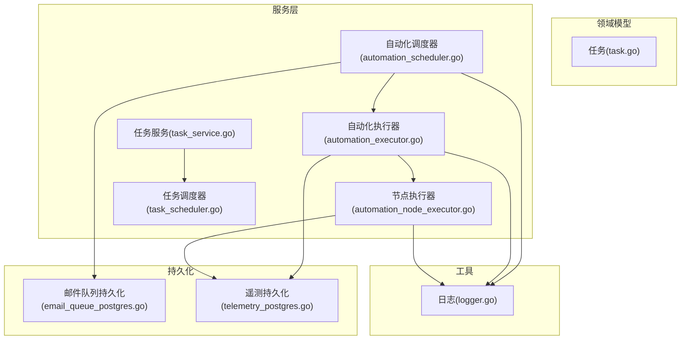
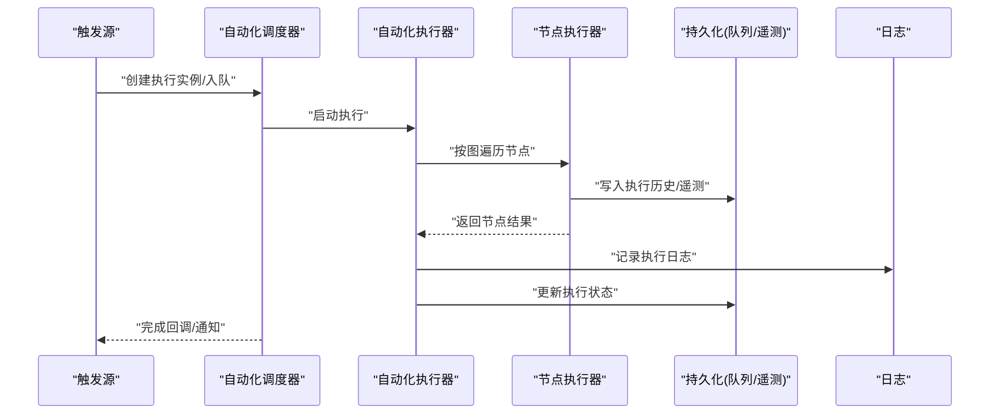
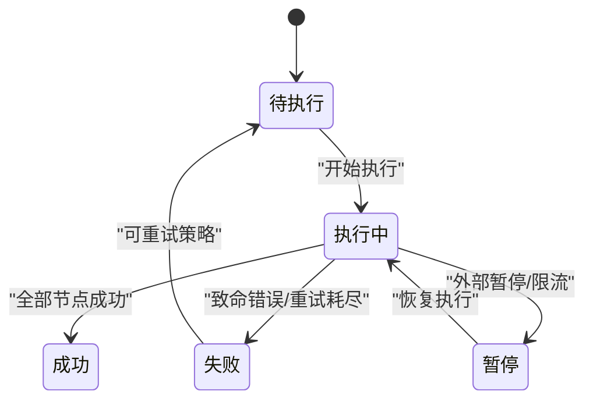
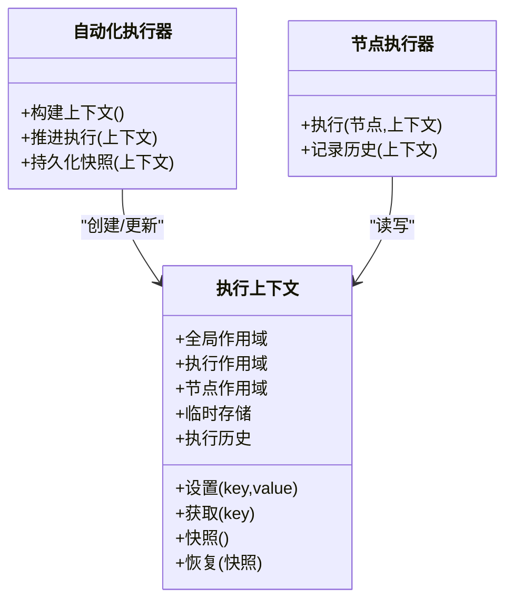
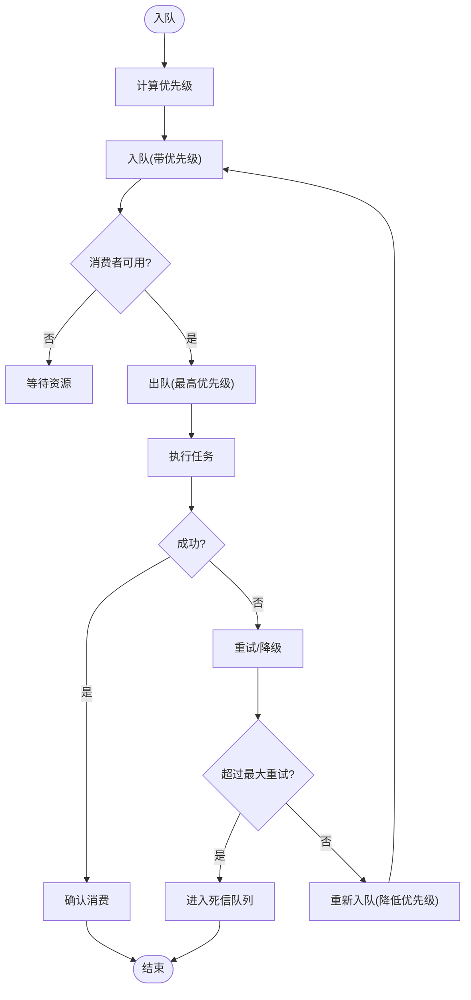
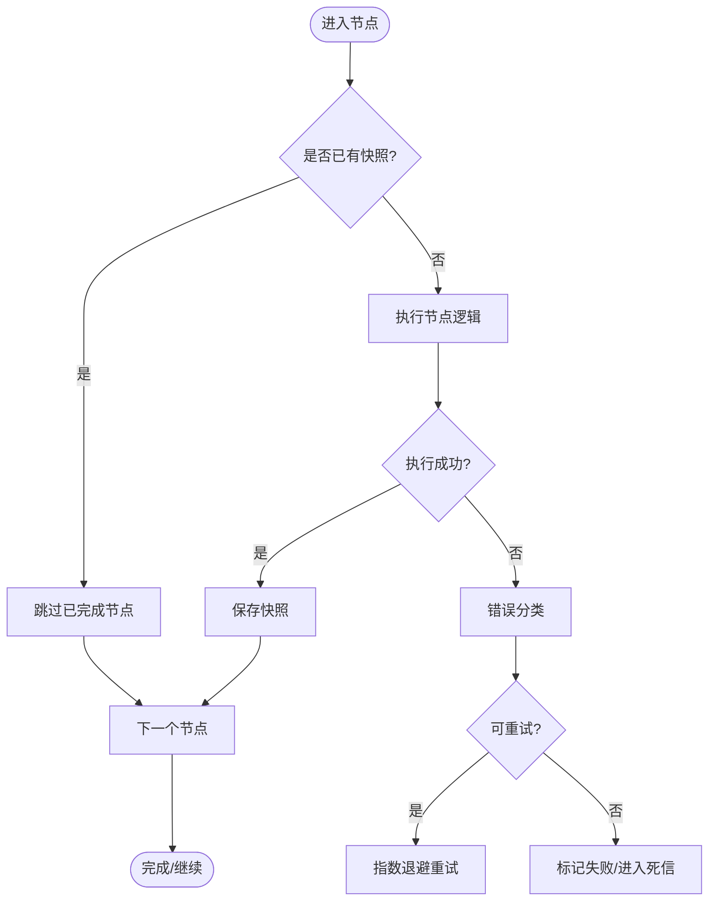
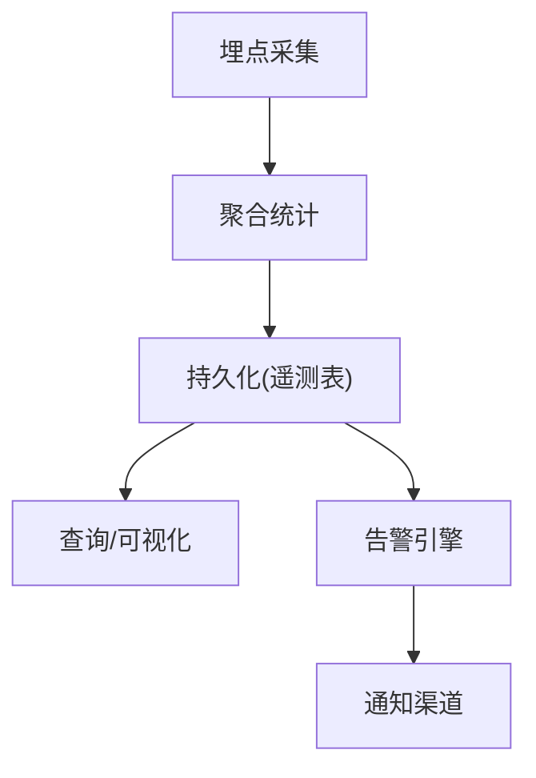
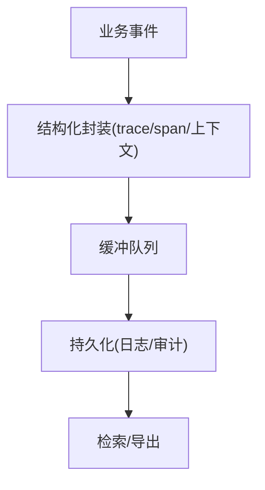
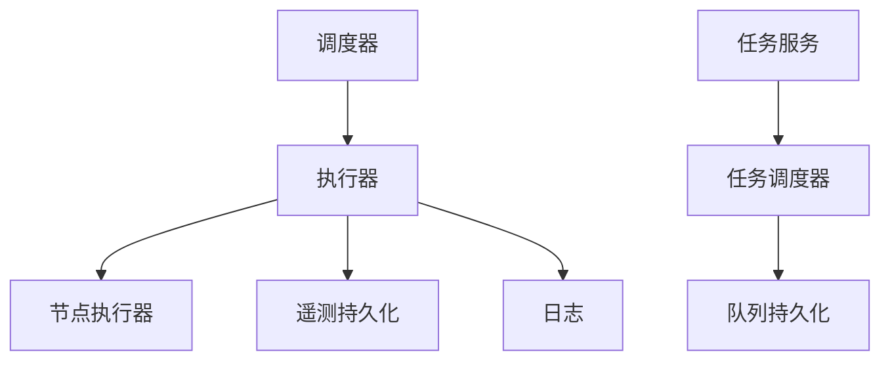

# 执行模型

<cite>
**本文引用的文件**   
- [automation_executor.go](file://notifuse/internal/service/automation_executor.go)
- [automation_node_executor.go](file://notifuse/internal/service/automation_node_executor.go)
- [automation_scheduler.go](file://notifuse/internal/service/automation_scheduler.go)
- [task_service.go](file://notifuse/internal/service/task_service.go)
- [task_scheduler.go](file://notifuse/internal/service/task_scheduler.go)
- [task.go](file://notifuse/internal/domain/task.go)
- [email_queue_postgres.go](file://notifuse/internal/repository/email_queue_postgres.go)
- [telemetry_postgres.go](file://notifuse/internal/repository/telemetry_postgres.go)
- [logger.go](file://notifuse/pkg/logger/logger.go)
</cite>

## 目录
1. [引言](#引言)
2. [项目结构](#项目结构)
3. [核心组件](#核心组件)
4. [架构总览](#架构总览)
5. [详细组件分析](#详细组件分析)
6. [依赖分析](#依赖分析)
7. [性能考虑](#性能考虑)
8. [故障排查指南](#故障排查指南)
9. [结论](#结论)
10. [附录](#附录)

## 引言
本文件面向Notifuse平台的自动化执行实体，聚焦于“执行实例”的数据模型与运行时行为。文档覆盖以下关键主题：
- 执行实例状态机定义（待执行、执行中、成功、失败、暂停）及转换规则
- 执行上下文数据结构（变量作用域、临时存储、执行历史）
- 任务队列管理策略（优先级调度、并发控制、负载均衡）
- 错误恢复机制与断点续传
- 执行性能指标收集与监控告警
- 执行日志记录与审计追踪方案

## 项目结构
围绕自动化执行的核心代码主要分布在 internal/service 与 internal/domain 两个层次：
- domain 层定义领域模型（如任务、执行相关类型）
- service 层实现调度器、执行器、节点执行器等运行时逻辑
- repository 层提供持久化能力（队列、遥测等）
- pkg/logger 提供结构化日志能力

图表来源
- [automation_scheduler.go](file://notifuse/internal/service/automation_scheduler.go)
- [automation_executor.go](file://notifuse/internal/service/automation_executor.go)
- [automation_node_executor.go](file://notifuse/internal/service/automation_node_executor.go)
- [task_service.go](file://notifuse/internal/service/task_service.go)
- [task_scheduler.go](file://notifuse/internal/service/task_scheduler.go)
- [email_queue_postgres.go](file://notifuse/internal/repository/email_queue_postgres.go)
- [telemetry_postgres.go](file://notifuse/internal/repository/telemetry_postgres.go)
- [logger.go](file://notifuse/pkg/logger/logger.go)

章节来源
- [automation_scheduler.go](file://notifuse/internal/service/automation_scheduler.go)
- [automation_executor.go](file://notifuse/internal/service/automation_executor.go)
- [automation_node_executor.go](file://notifuse/internal/service/automation_node_executor.go)
- [task_service.go](file://notifuse/internal/service/task_service.go)
- [task_scheduler.go](file://notifuse/internal/service/task_scheduler.go)
- [email_queue_postgres.go](file://notifuse/internal/repository/email_queue_postgres.go)
- [telemetry_postgres.go](file://notifuse/internal/repository/telemetry_postgres.go)
- [logger.go](file://notifuse/pkg/logger/logger.go)

## 核心组件
- 自动化调度器：负责触发自动化流程的编排、生命周期管理与资源协调
- 自动化执行器：负责将自动化流程分解为可执行的步骤并驱动执行
- 节点执行器：负责具体节点（动作/条件/分支等）的执行与结果聚合
- 任务服务与任务调度器：提供通用任务的创建、调度与重试能力
- 持久化：队列与遥测数据的数据库存取
- 日志：结构化输出与审计追踪的基础设施

章节来源
- [automation_scheduler.go](file://notifuse/internal/service/automation_scheduler.go)
- [automation_executor.go](file://notifuse/internal/service/automation_executor.go)
- [automation_node_executor.go](file://notifuse/internal/service/automation_node_executor.go)
- [task_service.go](file://notifuse/internal/service/task_service.go)
- [task_scheduler.go](file://notifuse/internal/service/task_scheduler.go)
- [email_queue_postgres.go](file://notifuse/internal/repository/email_queue_postgres.go)
- [telemetry_postgres.go](file://notifuse/internal/repository/telemetry_postgres.go)
- [logger.go](file://notifuse/pkg/logger/logger.go)

## 架构总览
下图展示了从触发到执行、再到持久化的端到端流程，以及错误处理与遥测采集的关键路径。

图表来源
- [automation_scheduler.go](file://notifuse/internal/service/automation_scheduler.go)
- [automation_executor.go](file://notifuse/internal/service/automation_executor.go)
- [automation_node_executor.go](file://notifuse/internal/service/automation_node_executor.go)
- [email_queue_postgres.go](file://notifuse/internal/repository/email_queue_postgres.go)
- [telemetry_postgres.go](file://notifuse/internal/repository/telemetry_postgres.go)
- [logger.go](file://notifuse/pkg/logger/logger.go)

## 详细组件分析

### 执行实例状态机
- 状态集合
  - 待执行：实例已创建，等待调度或资源可用
  - 执行中：正在运行，包含节点级进度
  - 成功：所有节点执行完毕且无错误
  - 失败：出现不可恢复错误或达到最大重试次数
  - 暂停：因外部信号或策略被挂起，支持恢复
- 转换规则
  - 待执行 → 执行中：调度器分配工作单元并开始执行
  - 执行中 → 成功：全部节点执行成功
  - 执行中 → 失败：发生致命错误或重试耗尽
  - 执行中 ↔ 暂停：允许暂停/恢复；恢复后继续执行
  - 失败 → 待执行：在具备重试策略时，失败可回退至待执行进行重试
- 状态持久化
  - 通过持久化层保存当前状态与元数据，确保进程重启后可恢复

图表来源
- [automation_executor.go](file://notifuse/internal/service/automation_executor.go)
- [automation_scheduler.go](file://notifuse/internal/service/automation_scheduler.go)
- [task_service.go](file://notifuse/internal/service/task_service.go)

章节来源
- [automation_executor.go](file://notifuse/internal/service/automation_executor.go)
- [automation_scheduler.go](file://notifuse/internal/service/automation_scheduler.go)
- [task_service.go](file://notifuse/internal/service/task_service.go)

### 执行上下文数据结构
- 变量作用域
  - 全局作用域：跨节点共享的只读配置与常量
  - 执行作用域：本次执行实例的输入参数与中间结果
  - 节点作用域：单个节点内的局部变量，避免污染其他节点
- 临时存储
  - 内存缓存：用于短生命周期数据（如HTTP响应、模板渲染中间态）
  - 持久化快照：用于断点续传的中间状态（例如已完成的节点ID列表、部分输出）
- 执行历史
  - 节点级记录：进入时间、退出时间、输入、输出、错误信息
  - 事件级记录：关键里程碑（开始、暂停、恢复、重试、完成）
  - 审计字段：操作者、来源触发、关联业务标识

图表来源
- [automation_executor.go](file://notifuse/internal/service/automation_executor.go)
- [automation_node_executor.go](file://notifuse/internal/service/automation_node_executor.go)

章节来源
- [automation_executor.go](file://notifuse/internal/service/automation_executor.go)
- [automation_node_executor.go](file://notifuse/internal/service/automation_node_executor.go)

### 任务队列管理策略
- 优先级调度
  - 基于任务属性（如权重、SLA、标签）计算优先级
  - 高优先级任务优先出队，低优先级任务在资源空闲时消费
- 并发控制
  - 每类任务维护独立的工作池大小上限
  - 使用令牌桶或信号量限制并发度，防止过载
- 负载均衡
  - 多消费者实例间通过分布式锁或队列分区均衡负载
  - 根据节点健康度动态调整分发比例
- 可靠性
  - 幂等消费：重复投递不产生副作用
  - 死信队列：长期失败的任务转入隔离区人工干预

图表来源
- [task_service.go](file://notifuse/internal/service/task_service.go)
- [task_scheduler.go](file://notifuse/internal/service/task_scheduler.go)
- [email_queue_postgres.go](file://notifuse/internal/repository/email_queue_postgres.go)

章节来源
- [task_service.go](file://notifuse/internal/service/task_service.go)
- [task_scheduler.go](file://notifuse/internal/service/task_scheduler.go)
- [email_queue_postgres.go](file://notifuse/internal/repository/email_queue_postgres.go)

### 错误恢复机制与断点续传
- 错误分类
  - 可重试错误：网络抖动、第三方限流、短暂资源不可用
  - 不可重试错误：参数非法、权限不足、业务校验失败
- 恢复策略
  - 指数退避重试：结合抖动因子避免雪崩
  - 熔断与降级：连续失败触发熔断，切换到备用路径或返回兜底结果
  - 补偿事务：对已完成但副作用未落盘的操作进行补偿
- 断点续传
  - 在执行关键点生成快照（包括已完成的节点、中间变量、游标）
  - 重启后加载快照，跳过已完成节点，从断点继续执行
  - 快照需幂等与一致性保证，避免重复执行造成副作用

图表来源
- [automation_executor.go](file://notifuse/internal/service/automation_executor.go)
- [automation_node_executor.go](file://notifuse/internal/service/automation_node_executor.go)
- [telemetry_postgres.go](file://notifuse/internal/repository/telemetry_postgres.go)

章节来源
- [automation_executor.go](file://notifuse/internal/service/automation_executor.go)
- [automation_node_executor.go](file://notifuse/internal/service/automation_node_executor.go)
- [telemetry_postgres.go](file://notifuse/internal/repository/telemetry_postgres.go)

### 性能指标收集与监控告警
- 指标维度
  - 吞吐：每秒执行任务数、队列长度、消费者利用率
  - 延迟：端到端耗时、节点平均耗时、P95/P99分位
  - 质量：成功率、失败率、重试率、超时率
  - 资源：CPU/内存占用、连接池使用率
- 采集与上报
  - 在关键路径埋点，聚合为时序指标
  - 持久化至遥测表，供查询与分析
- 告警策略
  - 阈值告警：失败率、延迟、队列积压超过阈值
  - 趋势告警：环比/同比异常波动
  - 组合告警：多个指标联合判断，减少误报

图表来源
- [telemetry_postgres.go](file://notifuse/internal/repository/telemetry_postgres.go)
- [automation_executor.go](file://notifuse/internal/service/automation_executor.go)
- [automation_node_executor.go](file://notifuse/internal/service/automation_node_executor.go)

章节来源
- [telemetry_postgres.go](file://notifuse/internal/repository/telemetry_postgres.go)
- [automation_executor.go](file://notifuse/internal/service/automation_executor.go)
- [automation_node_executor.go](file://notifuse/internal/service/automation_node_executor.go)

### 执行日志记录与审计追踪
- 日志规范
  - 结构化字段：trace_id、span_id、执行实例ID、节点ID、级别、消息、键值对
  - 敏感信息脱敏：密钥、令牌、个人信息等
- 审计追踪
  - 记录关键操作的发起者、时间、变更前后值
  - 与执行历史关联，形成可追溯链路
- 存储与检索
  - 本地缓冲+异步落盘，避免阻塞主流程
  - 索引关键字段（trace_id、实例ID、时间范围），支持快速回溯

图表来源
- [logger.go](file://notifuse/pkg/logger/logger.go)
- [automation_executor.go](file://notifuse/internal/service/automation_executor.go)
- [automation_node_executor.go](file://notifuse/internal/service/automation_node_executor.go)

章节来源
- [logger.go](file://notifuse/pkg/logger/logger.go)
- [automation_executor.go](file://notifuse/internal/service/automation_executor.go)
- [automation_node_executor.go](file://notifuse/internal/service/automation_node_executor.go)

## 依赖分析
- 组件耦合
  - 调度器依赖执行器与持久化层
  - 执行器依赖节点执行器与遥测/日志
  - 任务服务与调度器解耦，通过队列交互
- 外部依赖
  - 数据库：PostgreSQL（队列、遥测、审计）
  - 日志系统：结构化日志库
- 潜在循环依赖
  - 通过接口抽象与分层设计避免直接循环引用

图表来源
- [automation_scheduler.go](file://notifuse/internal/service/automation_scheduler.go)
- [automation_executor.go](file://notifuse/internal/service/automation_executor.go)
- [automation_node_executor.go](file://notifuse/internal/service/automation_node_executor.go)
- [task_service.go](file://notifuse/internal/service/task_service.go)
- [task_scheduler.go](file://notifuse/internal/service/task_scheduler.go)
- [email_queue_postgres.go](file://notifuse/internal/repository/email_queue_postgres.go)
- [telemetry_postgres.go](file://notifuse/internal/repository/telemetry_postgres.go)
- [logger.go](file://notifuse/pkg/logger/logger.go)

章节来源
- [automation_scheduler.go](file://notifuse/internal/service/automation_scheduler.go)
- [automation_executor.go](file://notifuse/internal/service/automation_executor.go)
- [automation_node_executor.go](file://notifuse/internal/service/automation_node_executor.go)
- [task_service.go](file://notifuse/internal/service/task_service.go)
- [task_scheduler.go](file://notifuse/internal/service/task_scheduler.go)
- [email_queue_postgres.go](file://notifuse/internal/repository/email_queue_postgres.go)
- [telemetry_postgres.go](file://notifuse/internal/repository/telemetry_postgres.go)
- [logger.go](file://notifuse/pkg/logger/logger.go)

## 性能考虑
- 批处理与合并：批量写入遥测与日志，减少IO开销
- 连接池与复用：数据库连接、HTTP客户端连接复用
- 背压与限流：在高负载下主动降速，保护下游服务
- 并行度调优：根据CPU与I/O特性调整并发度
- 缓存热点：对频繁读取的配置与字典进行缓存

[本节为通用指导，无需特定文件来源]

## 故障排查指南
- 常见问题定位
  - 执行卡住：检查队列堆积、消费者健康度、锁竞争
  - 频繁失败：查看错误分类与重试策略，确认是否为可重试错误
  - 延迟升高：观察P95/P99指标与资源使用率
- 诊断手段
  - 通过trace_id串联日志与遥测，还原完整执行链路
  - 对比快照与执行历史，定位断点位置
  - 启用更详细的日志级别，关注关键节点出入参

章节来源
- [automation_executor.go](file://notifuse/internal/service/automation_executor.go)
- [automation_node_executor.go](file://notifuse/internal/service/automation_node_executor.go)
- [telemetry_postgres.go](file://notifuse/internal/repository/telemetry_postgres.go)
- [logger.go](file://notifuse/pkg/logger/logger.go)

## 结论
Notifuse平台的自动化执行模型以清晰的状态机、完善的执行上下文、稳健的队列管理与强大的错误恢复能力为核心，辅以全面的性能指标与审计追踪，支撑高可靠、可扩展的自动化执行场景。建议在生产环境中持续优化并发与批处理策略，完善告警体系，并结合业务特征定制快照粒度与重试策略。

[本节为总结性内容，无需特定文件来源]

## 附录
- 术语
  - 执行实例：一次自动化流程的运行载体
  - 节点：流程图中的最小执行单元
  - 快照：用于断点续传的中间状态序列化
  - 死信队列：长期失败任务的隔离区
- 参考文件
  - 领域模型：[task.go](file://notifuse/internal/domain/task.go)
  - 服务层：[automation_scheduler.go](file://notifuse/internal/service/automation_scheduler.go)、[automation_executor.go](file://notifuse/internal/service/automation_executor.go)、[automation_node_executor.go](file://notifuse/internal/service/automation_node_executor.go)、[task_service.go](file://notifuse/internal/service/task_service.go)、[task_scheduler.go](file://notifuse/internal/service/task_scheduler.go)
  - 持久化：[email_queue_postgres.go](file://notifuse/internal/repository/email_queue_postgres.go)、[telemetry_postgres.go](file://notifuse/internal/repository/telemetry_postgres.go)
  - 工具：[logger.go](file://notifuse/pkg/logger/logger.go)