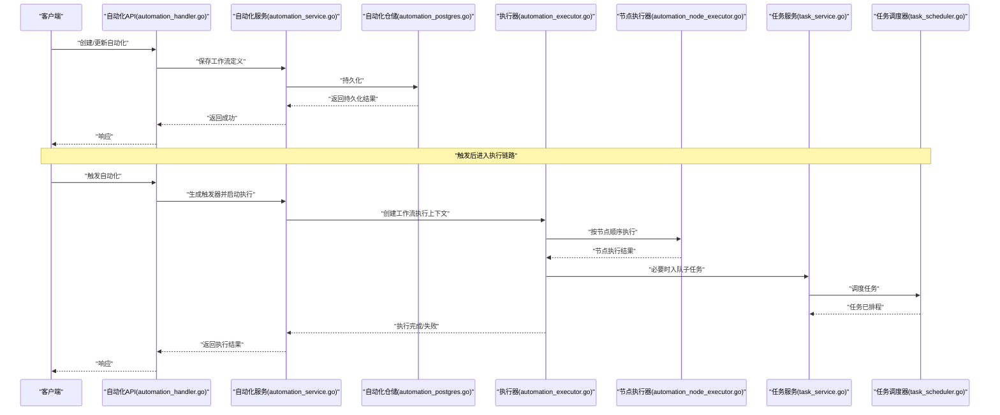
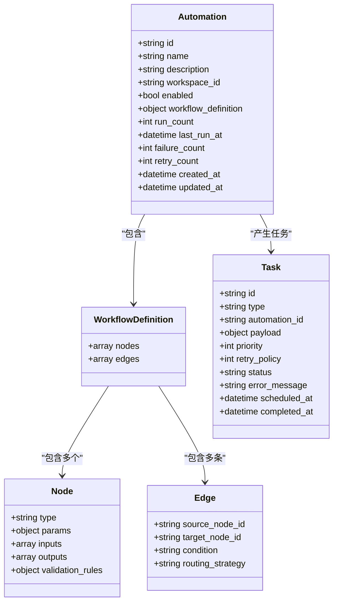
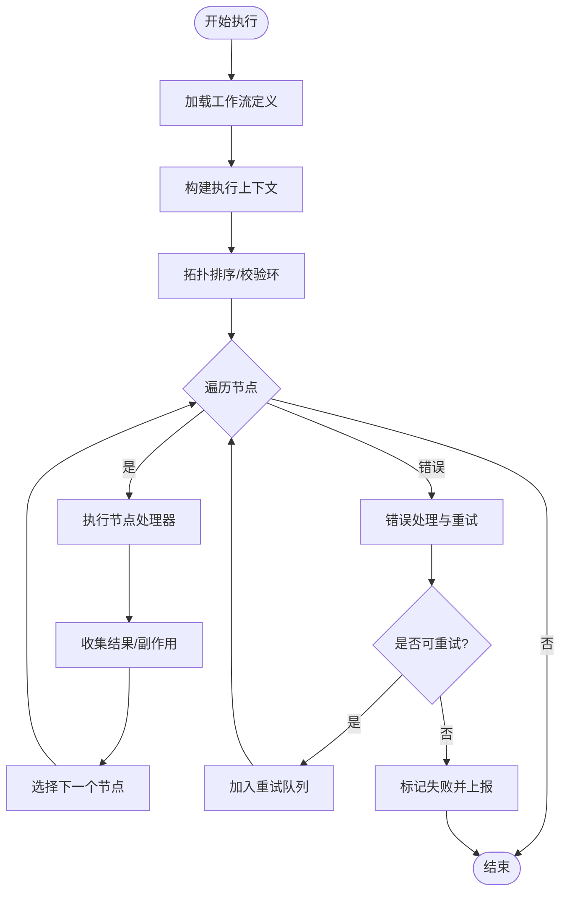
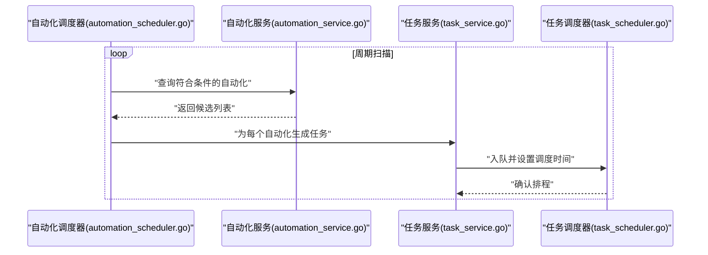
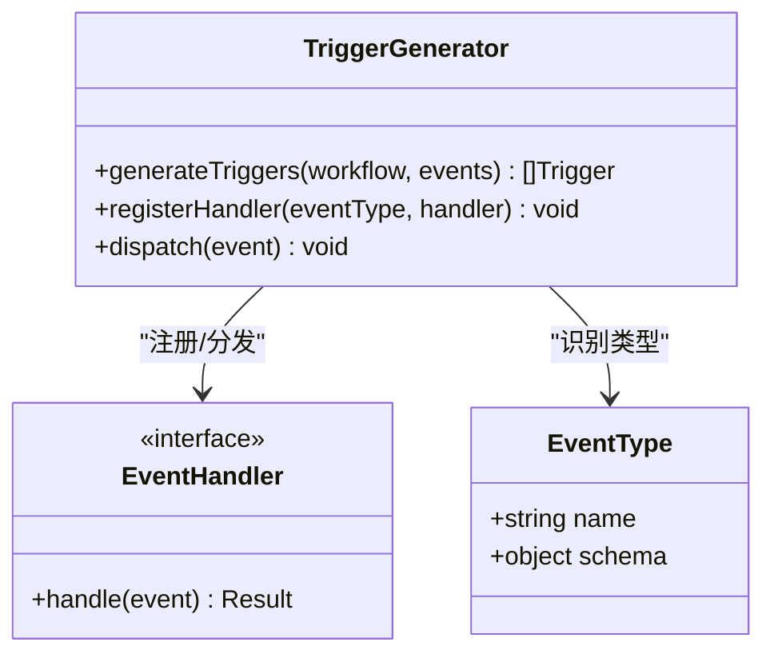
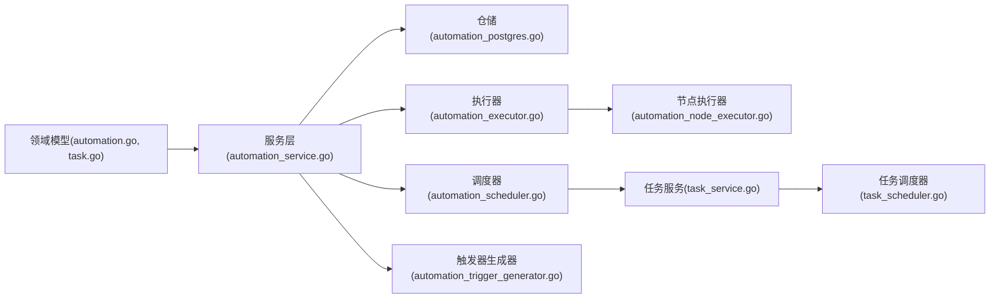

# 自动化模型

<cite>
**本文引用的文件**   
- [automation.go](file://notifuse/internal/domain/automation.go)
- [automation_test.go](file://notifuse/internal/domain/automation_test.go)
- [automation_service.go](file://notifuse/internal/service/automation_service.go)
- [automation_executor.go](file://notifuse/internal/service/automation_executor.go)
- [automation_node_executor.go](file://notifuse/internal/service/automation_node_executor.go)
- [automation_scheduler.go](file://notifuse/internal/service/automation_scheduler.go)
- [automation_trigger_generator.go](file://notifuse/internal/service/automation_trigger_generator.go)
- [automation_handler.go](file://notifuse/internal/http/automation_handler.go)
- [automation_postgres.go](file://notifuse/internal/repository/automation_postgres.go)
- [task.go](file://notifuse/internal/domain/task.go)
- [task_service.go](file://notifuse/internal/service/task_service.go)
- [task_scheduler.go](file://notifuse/internal/service/task_scheduler.go)
- [errors.go](file://notifuse/internal/domain/errors.go)
</cite>

## 目录
1. [简介](#简介)
2. [项目结构](#项目结构)
3. [核心组件](#核心组件)
4. [架构总览](#架构总览)
5. [详细组件分析](#详细组件分析)
6. [依赖关系分析](#依赖关系分析)
7. [性能考虑](#性能考虑)
8. [故障排查指南](#故障排查指南)
9. [结论](#结论)
10. [附录](#附录)

## 简介
本文件面向 Notifuse 平台的“自动化(Automation)”实体，系统化梳理其数据模型、可视化工作流设计器数据结构（节点与边）、执行引擎状态管理与错误处理、事件驱动架构（事件类型与处理器注册）、调度与任务队列策略，以及监控与调试工具的设计要点。文档以代码仓库中的领域模型与服务实现为依据，确保内容可追溯、可落地。

## 项目结构
自动化相关代码主要分布在以下层次：
- 领域层(domain)：定义自动化实体、任务实体、错误类型等核心数据模型与不变式约束
- 服务层(service)：编排自动化生命周期、触发器生成、节点执行、调度与任务管理
- 存储层(repository)：持久化自动化与工作流定义
- 接口层(http)：暴露自动化相关的 HTTP API
- 基础设施：数据库迁移、配置、日志与追踪等

```mermaid
graph TB
subgraph "领域层"
A["自动化(automation.go)"]
T["任务(task.go)"]
E["错误(errors.go)"]
end
subgraph "服务层"
Svc["自动化服务(automation_service.go)"]
Exec["执行器(automation_executor.go)"]
NodeExec["节点执行器(automation_node_executor.go)")
Sched["调度器(automation_scheduler.go)"]
TriggerGen["触发器生成器(automation_trigger_generator.go)"]
TaskSvc["任务服务(task_service.go)"]
TaskSched["任务调度器(task_scheduler.go)"]
end
subgraph "存储层"
Repo["自动化仓储(automation_postgres.go)"]
end
subgraph "接口层"
API["自动化API(automation_handler.go)"]
end
API --> Svc
Svc --> Repo
Svc --> Exec
Exec --> NodeExec
Svc --> Sched
Sched --> TaskSvc
TaskSvc --> TaskSched
Svc --> TriggerGen
A --> Svc
T --> TaskSvc
E --> Svc
```

图表来源
- [automation.go:1-200](file://notifuse/internal/domain/automation.go#L1-L200)
- [automation_service.go:1-200](file://notifuse/internal/service/automation_service.go#L1-L200)
- [automation_executor.go:1-200](file://notifuse/internal/service/automation_executor.go#L1-L200)
- [automation_node_executor.go:1-200](file://notifuse/internal/service/automation_node_executor.go#L1-L200)
- [automation_scheduler.go:1-200](file://notifuse/internal/service/automation_scheduler.go#L1-L200)
- [automation_trigger_generator.go:1-200](file://notifuse/internal/service/automation_trigger_generator.go#L1-L200)
- [automation_handler.go:1-200](file://notifuse/internal/http/automation_handler.go#L1-L200)
- [automation_postgres.go:1-200](file://notifuse/internal/repository/automation_postgres.go#L1-L200)
- [task.go:1-200](file://notifuse/internal/domain/task.go#L1-L200)
- [task_service.go:1-200](file://notifuse/internal/service/task_service.go#L1-L200)
- [task_scheduler.go:1-200](file://notifuse/internal/service/task_scheduler.go#L1-L200)
- [errors.go:1-200](file://notifuse/internal/domain/errors.go#L1-L200)

章节来源
- [automation.go:1-200](file://notifuse/internal/domain/automation.go#L1-L200)
- [automation_service.go:1-200](file://notifuse/internal/service/automation_service.go#L1-L200)
- [automation_executor.go:1-200](file://notifuse/internal/service/automation_executor.go#L1-L200)
- [automation_node_executor.go:1-200](file://notifuse/internal/service/automation_node_executor.go#L1-L200)
- [automation_scheduler.go:1-200](file://notifuse/internal/service/automation_scheduler.go#L1-L200)
- [automation_trigger_generator.go:1-200](file://notifuse/internal/service/automation_trigger_generator.go#L1-L200)
- [automation_handler.go:1-200](file://notifuse/internal/http/automation_handler.go#L1-L200)
- [automation_postgres.go:1-200](file://notifuse/internal/repository/automation_postgres.go#L1-L200)
- [task.go:1-200](file://notifuse/internal/domain/task.go#L1-L200)
- [task_service.go:1-200](file://notifuse/internal/service/task_service.go#L1-L200)
- [task_scheduler.go:1-200](file://notifuse/internal/service/task_scheduler.go#L1-L200)
- [errors.go:1-200](file://notifuse/internal/domain/errors.go#L1-L200)

## 核心组件
本节聚焦自动化实体的字段定义、工作流结构与关键行为。

- 自动化实体
  - 标识与元信息：唯一ID、名称、描述、所属工作区、启用/禁用标记、创建/更新时间戳等
  - 工作流定义：包含触发器集合、条件分支、动作序列；支持可视化设计器的节点与边映射
  - 运行态上下文：最近一次运行结果、运行计数、失败重试次数、最后触发时间等
  - 权限与可见性：工作区级隔离、访问控制标签等

- 工作流定义（可视化设计器）
  - 节点(Node)：表示触发器、条件判断、动作执行等单元；包含节点类型、参数、输入输出端口、校验规则
  - 边(Edge)：连接节点的有向关系，表达控制流或数据流；包含源节点、目标节点、条件表达式
  - 根入口：通常由一个触发器节点作为入口，后续通过条件分支与动作串联形成完整流程

- 任务实体
  - 用于承载异步执行单元，包括任务类型、关联的自动化ID、执行参数、优先级、重试策略、状态机（待执行/执行中/成功/失败/取消）等

- 错误类型
  - 定义领域级错误分类（如验证错误、运行时错误、外部依赖错误），便于统一处理与上报

章节来源
- [automation.go:1-200](file://notifuse/internal/domain/automation.go#L1-L200)
- [task.go:1-200](file://notifuse/internal/domain/task.go#L1-L200)
- [errors.go:1-200](file://notifuse/internal/domain/errors.go#L1-L200)

## 架构总览
自动化系统采用分层与事件驱动相结合的设计：
- 领域层提供不可变的数据模型与业务不变式
- 服务层协调触发器生成、工作流执行、调度与任务编排
- 存储层负责持久化工作流定义与运行记录
- 接口层对外暴露 RESTful API，供控制台与第三方集成调用



图表来源
- [automation_handler.go:1-200](file://notifuse/internal/http/automation_handler.go#L1-L200)
- [automation_service.go:1-200](file://notifuse/internal/service/automation_service.go#L1-L200)
- [automation_postgres.go:1-200](file://notifuse/internal/repository/automation_postgres.go#L1-L200)
- [automation_executor.go:1-200](file://notifuse/internal/service/automation_executor.go#L1-L200)
- [automation_node_executor.go:1-200](file://notifuse/internal/service/automation_node_executor.go#L1-L200)
- [task_service.go:1-200](file://notifuse/internal/service/task_service.go#L1-L200)
- [task_scheduler.go:1-200](file://notifuse/internal/service/task_scheduler.go#L1-L200)

## 详细组件分析

### 领域模型：自动化与工作流
- 自动化实体字段
  - 标识与元信息：ID、名称、描述、工作区ID、是否启用、时间戳
  - 工作流定义：JSON/结构化对象，包含节点列表与边列表
  - 运行统计：运行次数、最近运行时间、失败次数、重试次数
  - 版本与变更：版本号、变更记录、审计字段
- 工作流定义结构
  - 节点(Node)
    - 类型：触发器、条件、动作、延迟、并行等
    - 参数：各节点特定配置（如HTTP请求头、模板变量、阈值等）
    - 端口：输入/输出端口，用于数据传递
    - 校验：前端/后端双重校验规则
  - 边(Edge)
    - 源节点ID、目标节点ID、条件表达式、权重/路由策略
- 任务实体字段
  - 类型、关联自动化ID、执行参数、优先级、重试策略、状态、错误信息、时间戳



图表来源
- [automation.go:1-200](file://notifuse/internal/domain/automation.go#L1-L200)
- [task.go:1-200](file://notifuse/internal/domain/task.go#L1-L200)

章节来源
- [automation.go:1-200](file://notifuse/internal/domain/automation.go#L1-L200)
- [task.go:1-200](file://notifuse/internal/domain/task.go#L1-L200)

### 服务层：自动化服务与执行器
- 自动化服务
  - 职责：工作流定义的CRUD、触发器生成、执行编排、状态聚合、与仓储交互
  - 关键方法：创建/更新自动化、获取工作流、触发执行、查询运行历史
- 执行器
  - 职责：解析工作流定义、构建执行上下文、按拓扑顺序执行节点、收集中间结果、处理异常与重试
  - 状态管理：维护执行上下文（开始时间、当前节点、累计耗时、错误栈、指标采集点）
- 节点执行器
  - 职责：针对不同类型节点的具体执行逻辑（如HTTP调用、模板渲染、条件判断、延时等待）
  - 扩展机制：基于节点类型的注册表，新增节点类型只需实现对应处理器并注册



图表来源
- [automation_service.go:1-200](file://notifuse/internal/service/automation_service.go#L1-L200)
- [automation_executor.go:1-200](file://notifuse/internal/service/automation_executor.go#L1-L200)
- [automation_node_executor.go:1-200](file://notifuse/internal/service/automation_node_executor.go#L1-L200)

章节来源
- [automation_service.go:1-200](file://notifuse/internal/service/automation_service.go#L1-L200)
- [automation_executor.go:1-200](file://notifuse/internal/service/automation_executor.go#L1-L200)
- [automation_node_executor.go:1-200](file://notifuse/internal/service/automation_node_executor.go#L1-L200)

### 调度与任务队列
- 自动化调度器
  - 职责：周期性扫描待执行的自动化、根据触发器规则生成任务、将任务投递到任务服务
- 任务服务与任务调度器
  - 职责：任务的持久化、优先级队列、并发消费、重试与退避、失败告警
  - 策略：支持固定间隔、cron表达式、事件驱动三种触发方式；具备幂等键以避免重复执行



图表来源
- [automation_scheduler.go:1-200](file://notifuse/internal/service/automation_scheduler.go#L1-L200)
- [automation_service.go:1-200](file://notifuse/internal/service/automation_service.go#L1-L200)
- [task_service.go:1-200](file://notifuse/internal/service/task_service.go#L1-L200)
- [task_scheduler.go:1-200](file://notifuse/internal/service/task_scheduler.go#L1-L200)

章节来源
- [automation_scheduler.go:1-200](file://notifuse/internal/service/automation_scheduler.go#L1-L200)
- [task_service.go:1-200](file://notifuse/internal/service/task_service.go#L1-L200)
- [task_scheduler.go:1-200](file://notifuse/internal/service/task_scheduler.go#L1-L200)

### 触发器生成器与事件驱动
- 触发器生成器
  - 职责：根据工作流定义与外部事件（如定时、Webhook、自定义事件）生成可执行的触发器实例
  - 事件类型：内置事件（定时、系统通知）、平台事件（联系人变更、邮件发送结果）、自定义事件（用户定义的事件名与载荷）
- 事件处理器注册机制
  - 通过注册表模式集中管理事件类型与处理器映射；新增事件类型仅需实现处理器接口并注册
  - 支持多消费者订阅同一事件，具备去重与幂等保障



图表来源
- [automation_trigger_generator.go:1-200](file://notifuse/internal/service/automation_trigger_generator.go#L1-L200)

章节来源
- [automation_trigger_generator.go:1-200](file://notifuse/internal/service/automation_trigger_generator.go#L1-L200)

### 接口层：自动化API
- 提供RESTful端点用于：
  - 工作流定义的创建、更新、删除、查询
  - 手动触发执行、查看运行历史与结果
  - 批量启停、导入导出工作流
- 鉴权与限流：工作区级权限校验、速率限制、审计日志

章节来源
- [automation_handler.go:1-200](file://notifuse/internal/http/automation_handler.go#L1-L200)

### 存储层：自动化仓储
- 负责工作流定义与运行记录的持久化
- 提供事务性写入、索引优化、分页查询、软删除等能力
- 与领域模型保持一一对应，避免泄露实现细节

章节来源
- [automation_postgres.go:1-200](file://notifuse/internal/repository/automation_postgres.go#L1-L200)

## 依赖关系分析
- 低耦合高内聚
  - 领域模型独立于服务与存储，保证业务不变式清晰
  - 服务层通过接口依赖仓储与执行器，便于替换实现与测试
- 直接依赖
  - 自动化服务依赖自动化仓储、执行器、触发器生成器、任务服务
  - 执行器依赖节点执行器与任务服务
  - 调度器依赖任务调度器
- 潜在循环依赖
  - 通过接口抽象与依赖注入避免循环引用
- 外部依赖
  - 数据库（PostgreSQL）、消息队列/任务队列（内部实现或外部中间件）、外部HTTP服务（动作节点）



图表来源
- [automation.go:1-200](file://notifuse/internal/domain/automation.go#L1-L200)
- [task.go:1-200](file://notifuse/internal/domain/task.go#L1-L200)
- [automation_service.go:1-200](file://notifuse/internal/service/automation_service.go#L1-L200)
- [automation_postgres.go:1-200](file://notifuse/internal/repository/automation_postgres.go#L1-L200)
- [automation_executor.go:1-200](file://notifuse/internal/service/automation_executor.go#L1-L200)
- [automation_node_executor.go:1-200](file://notifuse/internal/service/automation_node_executor.go#L1-L200)
- [automation_scheduler.go:1-200](file://notifuse/internal/service/automation_scheduler.go#L1-L200)
- [task_service.go:1-200](file://notifuse/internal/service/task_service.go#L1-L200)
- [task_scheduler.go:1-200](file://notifuse/internal/service/task_scheduler.go#L1-L200)
- [automation_trigger_generator.go:1-200](file://notifuse/internal/service/automation_trigger_generator.go#L1-L200)

## 性能考虑
- 工作流执行
  - 拓扑排序与并行执行：对无依赖节点进行并行处理，缩短整体时延
  - 中间结果缓存：在节点间复用计算结果，减少重复IO
  - 超时与熔断：为外部调用设置超时与熔断策略，防止雪崩
- 调度与队列
  - 优先级队列与公平调度：高优先级任务优先执行，同时保障低优先级任务不被饿死
  - 批处理与背压：大批量任务分批提交，避免内存峰值
  - 幂等与去重：使用幂等键避免重复执行，降低外部系统压力
- 存储与查询
  - 索引优化：对常用查询字段建立复合索引
  - 分页与游标：大数据集分页查询，避免全表扫描
  - 归档与冷热分离：历史运行记录定期归档，提升热数据查询性能

[本节为通用指导，不直接分析具体文件]

## 故障排查指南
- 常见错误分类
  - 验证错误：工作流定义不完整、节点参数缺失、边指向无效节点
  - 运行时错误：外部服务不可用、网络超时、权限不足
  - 调度错误：任务重复、队列积压、调度器宕机
- 定位步骤
  - 检查自动化运行历史与错误堆栈
  - 查看任务状态与重试次数，确认是否达到最大重试上限
  - 核对触发器规则与事件匹配情况，确认事件类型是否正确注册
  - 审查节点执行日志，定位具体失败节点与参数
- 恢复策略
  - 修正工作流定义并重新发布
  - 清理阻塞任务并重启调度器
  - 增加重试退避与告警阈值

章节来源
- [errors.go:1-200](file://notifuse/internal/domain/errors.go#L1-L200)
- [automation_executor.go:1-200](file://notifuse/internal/service/automation_executor.go#L1-L200)
- [task_service.go:1-200](file://notifuse/internal/service/task_service.go#L1-L200)

## 结论
Notifuse 的自动化模型以清晰的领域模型为基础，结合服务层的编排与调度、存储层的持久化与接口层的易用性，构建了可扩展、可观测、可运维的工作流执行体系。通过事件驱动的触发器生成与节点执行器注册机制，平台能够灵活扩展新的触发与动作类型，满足多样化的自动化场景需求。

## 附录
- 术语
  - 自动化：一组可执行的工作流定义及其运行状态
  - 工作流：由节点与边构成的有向图，描述执行流程
  - 触发器：启动工作流的条件或事件
  - 节点：工作流中的最小执行单元
  - 边：节点之间的连接与控制流
  - 任务：异步执行单元，承载工作流的某一部分或整个流程
- 最佳实践
  - 在设计工作流时尽量保持节点单一职责，便于测试与维护
  - 为外部调用设置合理的超时与重试策略
  - 使用幂等键与去重机制，确保系统在异常恢复后的正确性
  - 为关键路径添加埋点与指标，便于性能分析与问题定位