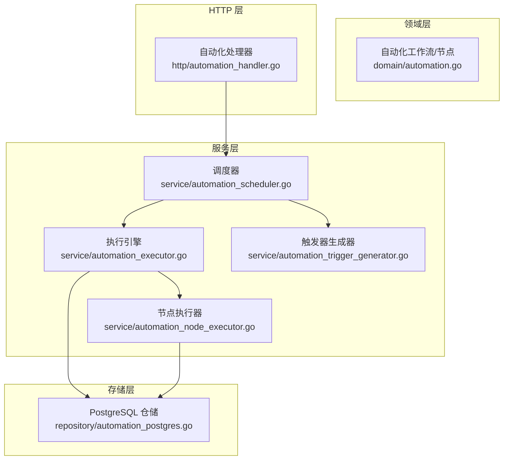
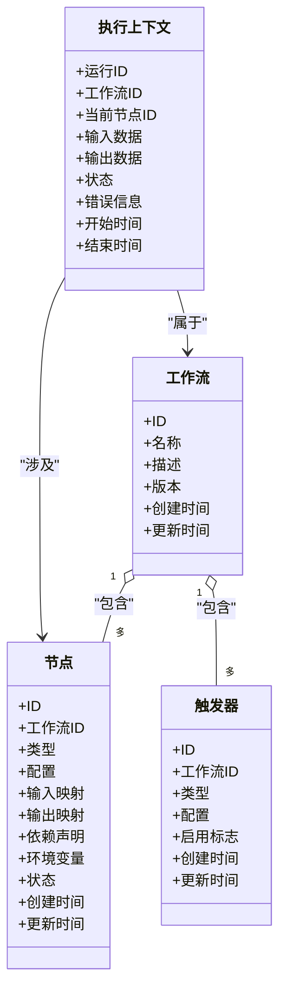
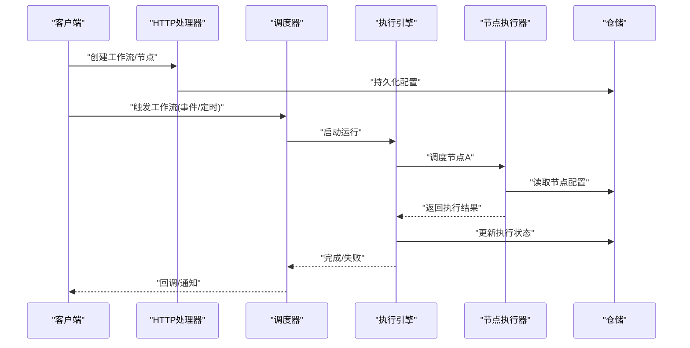
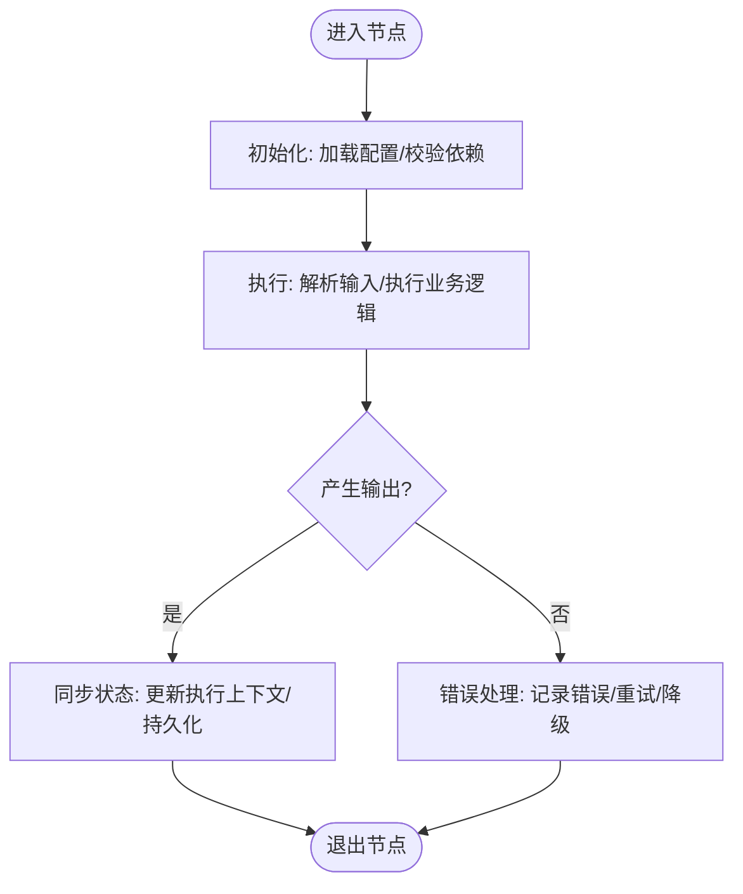
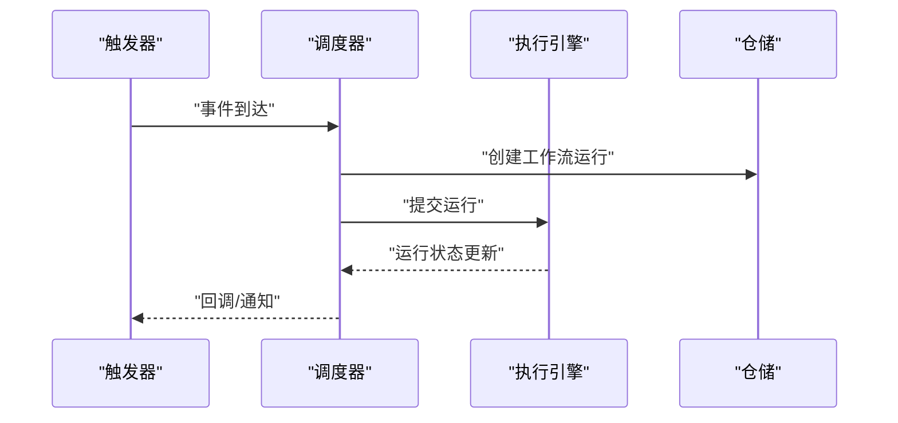
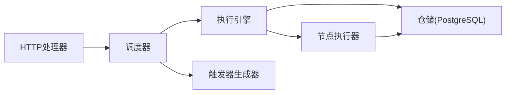

# 节点模型

<cite>
**本文引用的文件**   
- [automation.go](file://notifuse/internal/domain/automation.go)
- [automation_test.go](file://notifuse/internal/domain/automation_test.go)
- [automation_executor.go](file://notifuse/internal/service/automation_executor.go)
- [automation_node_executor.go](file://notifuse/internal/service/automation_node_executor.go)
- [automation_scheduler.go](file://notifuse/internal/service/automation_scheduler.go)
- [automation_trigger_generator.go](file://notifuse/internal/service/automation_trigger_generator.go)
- [automation_handler.go](file://notifuse/internal/http/automation_handler.go)
- [automation_postgres.go](file://notifuse/internal/repository/automation_postgres.go)
</cite>

## 目录
1. [简介](#简介)
2. [项目结构](#项目结构)
3. [核心组件](#核心组件)
4. [架构总览](#架构总览)
5. [详细组件分析](#详细组件分析)
6. [依赖分析](#依赖分析)
7. [性能考虑](#性能考虑)
8. [故障排查指南](#故障排查指南)
9. [结论](#结论)
10. [附录](#附录)

## 简介
本文件面向 Notifuse 平台的自动化“节点”实体，系统化梳理节点数据模型、类型定义、配置参数结构（输入输出、环境变量、依赖声明）、生命周期管理（初始化、执行、错误处理、状态同步）、节点间通信协议与数据传递机制，并提供扩展接口与自定义节点开发指南，以及性能监控与调试工具使用说明。文档以代码仓库中的领域模型与服务实现为依据，确保与实际实现一致。

## 项目结构
与节点模型直接相关的代码主要分布在以下模块：
- 领域层：定义自动化工作流、节点、触发器、执行上下文等核心数据结构
- 服务层：负责调度、执行、节点编排、触发器生成
- HTTP 层：提供工作流与节点的 API 入口
- 存储层：持久化工作流与节点配置

图表来源
- [automation.go:1-200](file://notifuse/internal/domain/automation.go#L1-L200)
- [automation_scheduler.go:1-200](file://notifuse/internal/service/automation_scheduler.go#L1-L200)
- [automation_executor.go:1-200](file://notifuse/internal/service/automation_executor.go#L1-L200)
- [automation_node_executor.go:1-200](file://notifuse/internal/service/automation_node_executor.go#L1-L200)
- [automation_trigger_generator.go:1-200](file://notifuse/internal/service/automation_trigger_generator.go#L1-L200)
- [automation_handler.go:1-200](file://notifuse/internal/http/automation_handler.go#L1-L200)
- [automation_postgres.go:1-200](file://notifuse/internal/repository/automation_postgres.go#L1-L200)

章节来源
- [automation.go:1-200](file://notifuse/internal/domain/automation.go#L1-L200)
- [automation_scheduler.go:1-200](file://notifuse/internal/service/automation_scheduler.go#L1-L200)
- [automation_executor.go:1-200](file://notifuse/internal/service/automation_executor.go#L1-L200)
- [automation_node_executor.go:1-200](file://notifuse/internal/service/automation_node_executor.go#L1-L200)
- [automation_trigger_generator.go:1-200](file://notifuse/internal/service/automation_trigger_generator.go#L1-L200)
- [automation_handler.go:1-200](file://notifuse/internal/http/automation_handler.go#L1-L200)
- [automation_postgres.go:1-200](file://notifuse/internal/repository/automation_postgres.go#L1-L200)

## 核心组件
本节聚焦节点数据模型与关键类型，包括工作流、节点、触发器、执行上下文等，并说明其职责与关系。

- 工作流与工作流版本
  - 工作流定义一组节点及其连接关系；版本用于记录变更历史与可回滚能力
- 节点
  - 节点是工作流的最小执行单元，包含类型标识、配置参数、输入输出映射、依赖声明、环境变量等
- 触发器
  - 触发器驱动工作流启动，如 Webhook、定时任务、外部事件等
- 执行上下文
  - 在一次运行中为节点提供运行时数据、状态、日志与追踪信息

图表来源
- [automation.go:1-200](file://notifuse/internal/domain/automation.go#L1-L200)

章节来源
- [automation.go:1-200](file://notifuse/internal/domain/automation.go#L1-L200)

## 架构总览
从请求到执行的端到端流程如下：
- HTTP 层接收工作流与节点的 CRUD 请求
- 调度器根据触发器或外部事件启动工作流
- 执行引擎按拓扑顺序调度节点执行
- 节点执行器加载节点配置、解析输入输出、调用具体逻辑
- 仓储层持久化工作流、节点与执行状态

图表来源
- [automation_handler.go:1-200](file://notifuse/internal/http/automation_handler.go#L1-L200)
- [automation_scheduler.go:1-200](file://notifuse/internal/service/automation_scheduler.go#L1-L200)
- [automation_executor.go:1-200](file://notifuse/internal/service/automation_executor.go#L1-L200)
- [automation_node_executor.go:1-200](file://notifuse/internal/service/automation_node_executor.go#L1-L200)
- [automation_postgres.go:1-200](file://notifuse/internal/repository/automation_postgres.go#L1-L200)

## 详细组件分析

### 节点类型与配置参数结构
- 节点类型
  - 触发器节点：驱动工作流启动，通常由外部事件或定时任务触发
  - 条件分支节点：基于输入数据进行判断，决定后续路径
  - 执行动作节点：执行具体业务逻辑，如发送消息、调用 API、数据处理等
- 配置参数结构
  - 输入映射：将上游节点输出或上下文变量映射到当前节点输入
  - 输出映射：将当前节点处理结果映射到下游节点输入
  - 环境变量：在运行时注入敏感或环境相关配置
  - 依赖声明：声明外部服务或资源依赖，便于校验与准备
- 字段语义
  - 类型标识：区分不同节点行为
  - 配置对象：JSON 或结构化配置，随节点类型变化
  - 状态：记录节点实例的运行状态（待执行、执行中、成功、失败）

章节来源
- [automation.go:1-200](file://notifuse/internal/domain/automation.go#L1-L200)

### 节点生命周期管理
- 初始化
  - 加载节点配置与环境变量
  - 校验依赖与前置条件
  - 建立必要的运行时资源（如连接池、缓存）
- 执行
  - 解析输入数据
  - 执行业务逻辑
  - 产出输出数据并写入执行上下文
- 错误处理
  - 捕获异常并转换为标准化错误
  - 记录错误信息与堆栈
  - 支持重试策略与降级路径
- 状态同步
  - 实时更新节点运行状态
  - 持久化执行结果与中间状态
  - 支持断点续跑与审计追踪

图表来源
- [automation_executor.go:1-200](file://notifuse/internal/service/automation_executor.go#L1-L200)
- [automation_node_executor.go:1-200](file://notifuse/internal/service/automation_node_executor.go#L1-L200)

章节来源
- [automation_executor.go:1-200](file://notifuse/internal/service/automation_executor.go#L1-L200)
- [automation_node_executor.go:1-200](file://notifuse/internal/service/automation_node_executor.go#L1-L200)

### 节点间通信协议与数据传递机制
- 通信协议
  - 内部采用统一的执行上下文作为数据总线，节点通过输入/输出映射进行数据交换
- 数据传递
  - 上游节点输出经映射后成为下游节点输入
  - 环境变量在节点初始化阶段注入，供执行时使用
  - 依赖声明用于在运行前检查外部资源可用性
- 一致性保障
  - 执行上下文在节点间共享，保证数据一致性
  - 状态同步确保每个节点的执行结果可追溯

章节来源
- [automation.go:1-200](file://notifuse/internal/domain/automation.go#L1-L200)
- [automation_executor.go:1-200](file://notifuse/internal/service/automation_executor.go#L1-L200)
- [automation_node_executor.go:1-200](file://notifuse/internal/service/automation_node_executor.go#L1-L200)

### 触发器与工作流启动
- 触发器类型
  - Webhook：接收外部 HTTP 事件
  - 定时任务：按 Cron 表达式周期性触发
  - 外部事件：来自其他系统的事件推送
- 启动流程
  - 触发器监听事件
  - 生成工作流运行实例
  - 调度器将运行提交给执行引擎

图表来源
- [automation_trigger_generator.go:1-200](file://notifuse/internal/service/automation_trigger_generator.go#L1-L200)
- [automation_scheduler.go:1-200](file://notifuse/internal/service/automation_scheduler.go#L1-L200)
- [automation_executor.go:1-200](file://notifuse/internal/service/automation_executor.go#L1-L200)
- [automation_postgres.go:1-200](file://notifuse/internal/repository/automation_postgres.go#L1-L200)

章节来源
- [automation_trigger_generator.go:1-200](file://notifuse/internal/service/automation_trigger_generator.go#L1-L200)
- [automation_scheduler.go:1-200](file://notifuse/internal/service/automation_scheduler.go#L1-L200)

### 扩展接口与自定义节点开发指南
- 扩展点
  - 节点执行器接口：定义统一的生命周期方法（初始化、执行、清理）
  - 配置解析器：针对不同节点类型的配置结构进行解析与校验
  - 依赖管理器：统一管理外部依赖的可用性与健康检查
- 开发步骤
  - 定义新节点类型与配置结构
  - 实现节点执行器，遵循生命周期约定
  - 注册节点类型到执行器工厂
  - 编写单元测试覆盖正常与异常路径
- 最佳实践
  - 保持幂等性，避免重复执行导致副作用
  - 使用环境变量注入敏感配置
  - 明确输入输出契约，便于上下游对接

章节来源
- [automation_node_executor.go:1-200](file://notifuse/internal/service/automation_node_executor.go#L1-L200)
- [automation_executor.go:1-200](file://notifuse/internal/service/automation_executor.go#L1-L200)

### 性能监控与调试工具
- 监控指标
  - 节点执行耗时、成功率、失败率
  - 工作流吞吐与延迟分布
  - 依赖服务调用次数与错误码分布
- 调试手段
  - 执行上下文快照：记录每次运行的输入输出与状态
  - 链路追踪：跨节点追踪一次运行的完整路径
  - 日志聚合：集中收集节点日志，支持按运行 ID 检索
- 优化建议
  - 对热点节点引入缓存与批处理
  - 合理设置超时与重试策略
  - 异步化非关键路径操作

章节来源
- [automation_executor.go:1-200](file://notifuse/internal/service/automation_executor.go#L1-L200)
- [automation_node_executor.go:1-200](file://notifuse/internal/service/automation_node_executor.go#L1-L200)

## 依赖分析
- 组件耦合
  - HTTP 处理器仅依赖调度器，降低对外部实现的耦合
  - 调度器依赖执行引擎与触发器生成器，职责清晰
  - 执行引擎与节点执行器协作，关注编排与生命周期
  - 仓储层提供统一的持久化接口，屏蔽底层数据库细节
- 外部依赖
  - PostgreSQL：持久化工作流、节点与执行状态
  - 外部事件源：Webhook、定时任务、第三方系统事件

图表来源
- [automation_handler.go:1-200](file://notifuse/internal/http/automation_handler.go#L1-L200)
- [automation_scheduler.go:1-200](file://notifuse/internal/service/automation_scheduler.go#L1-L200)
- [automation_executor.go:1-200](file://notifuse/internal/service/automation_executor.go#L1-L200)
- [automation_node_executor.go:1-200](file://notifuse/internal/service/automation_node_executor.go#L1-L200)
- [automation_trigger_generator.go:1-200](file://notifuse/internal/service/automation_trigger_generator.go#L1-L200)
- [automation_postgres.go:1-200](file://notifuse/internal/repository/automation_postgres.go#L1-L200)

章节来源
- [automation_handler.go:1-200](file://notifuse/internal/http/automation_handler.go#L1-L200)
- [automation_scheduler.go:1-200](file://notifuse/internal/service/automation_scheduler.go#L1-L200)
- [automation_executor.go:1-200](file://notifuse/internal/service/automation_executor.go#L1-L200)
- [automation_node_executor.go:1-200](file://notifuse/internal/service/automation_node_executor.go#L1-L200)
- [automation_trigger_generator.go:1-200](file://notifuse/internal/service/automation_trigger_generator.go#L1-L200)
- [automation_postgres.go:1-200](file://notifuse/internal/repository/automation_postgres.go#L1-L200)

## 性能考虑
- 并发控制
  - 限制同时运行的工作流数量，避免资源耗尽
  - 节点级别并行执行，提升吞吐
- 资源管理
  - 连接池复用，减少外部服务握手开销
  - 缓存热点数据，降低 I/O 压力
- 容错与弹性
  - 指数退避重试，避免雪崩效应
  - 熔断与降级，保护关键路径
- 观测性
  - 采集关键指标，建立告警规则
  - 分布式追踪，快速定位瓶颈

[本节为通用指导，不直接分析具体文件]

## 故障排查指南
- 常见问题
  - 节点执行失败：检查输入映射与依赖声明是否正确
  - 工作流卡住：确认调度器与执行引擎状态，查看运行实例
  - 外部服务不可用：验证依赖健康检查与重试策略
- 诊断步骤
  - 通过运行 ID 检索执行上下文快照
  - 查看节点日志与错误堆栈
  - 检查仓储层的状态更新是否成功
- 恢复措施
  - 修正配置后重新触发运行
  - 启用重试与补偿逻辑
  - 必要时回滚工作流版本

章节来源
- [automation_executor.go:1-200](file://notifuse/internal/service/automation_executor.go#L1-L200)
- [automation_node_executor.go:1-200](file://notifuse/internal/service/automation_node_executor.go#L1-L200)
- [automation_postgres.go:1-200](file://notifuse/internal/repository/automation_postgres.go#L1-L200)

## 结论
Notifuse 的节点模型围绕工作流与节点展开，通过清晰的类型定义、配置结构与生命周期管理，实现了可扩展、可观测、可运维的自动化执行平台。借助统一的执行上下文与输入输出映射，节点间通信简洁高效；通过调度器与执行引擎的解耦设计，系统具备良好的扩展性与稳定性。建议在自定义节点时严格遵循接口约定，完善监控与调试能力，以提升整体可靠性与可维护性。

[本节为总结性内容，不直接分析具体文件]

## 附录
- 术语表
  - 工作流：一组节点的有序集合，表示一个完整的业务流程
  - 节点：工作流中的最小执行单元
  - 触发器：驱动工作流启动的外部事件或定时任务
  - 执行上下文：一次运行中的运行时数据与状态载体
- 参考实现
  - 领域模型与测试用例
  - 服务层调度与执行逻辑
  - HTTP 接口与仓储持久化

章节来源
- [automation_test.go:1-200](file://notifuse/internal/domain/automation_test.go#L1-L200)
- [automation.go:1-200](file://notifuse/internal/domain/automation.go#L1-L200)
- [automation_scheduler.go:1-200](file://notifuse/internal/service/automation_scheduler.go#L1-L200)
- [automation_executor.go:1-200](file://notifuse/internal/service/automation_executor.go#L1-L200)
- [automation_node_executor.go:1-200](file://notifuse/internal/service/automation_node_executor.go#L1-L200)
- [automation_trigger_generator.go:1-200](file://notifuse/internal/service/automation_trigger_generator.go#L1-L200)
- [automation_handler.go:1-200](file://notifuse/internal/http/automation_handler.go#L1-L200)
- [automation_postgres.go:1-200](file://notifuse/internal/repository/automation_postgres.go#L1-L200)