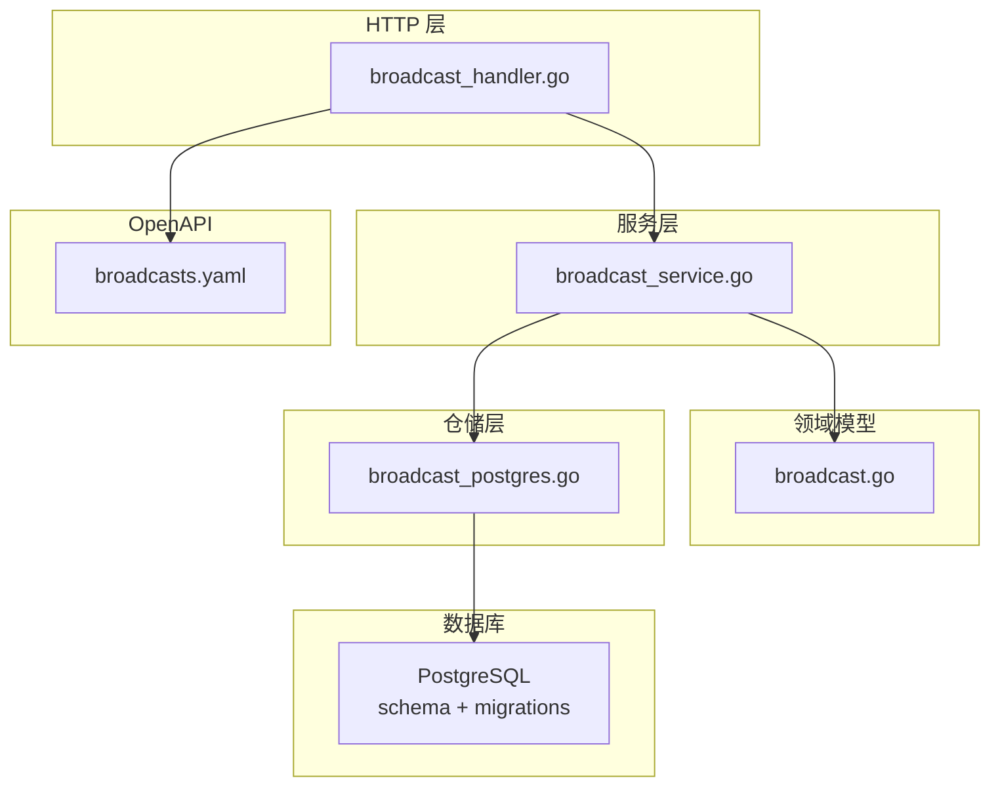
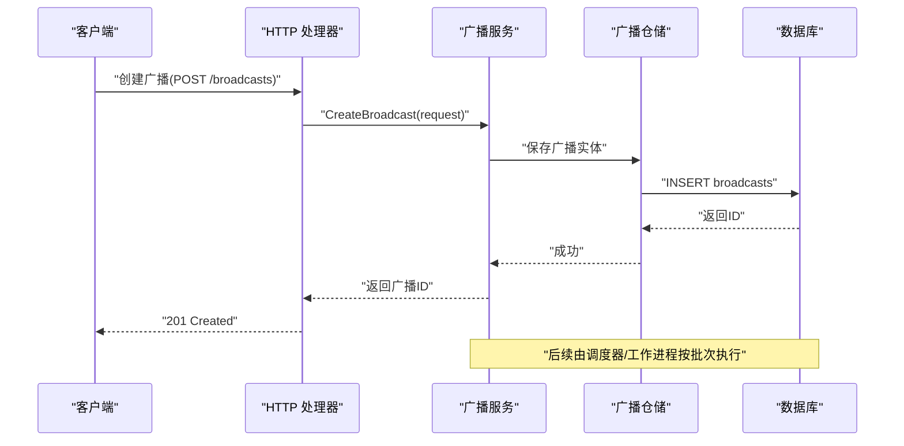
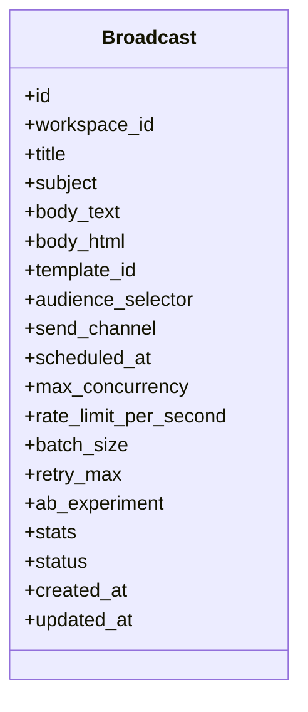
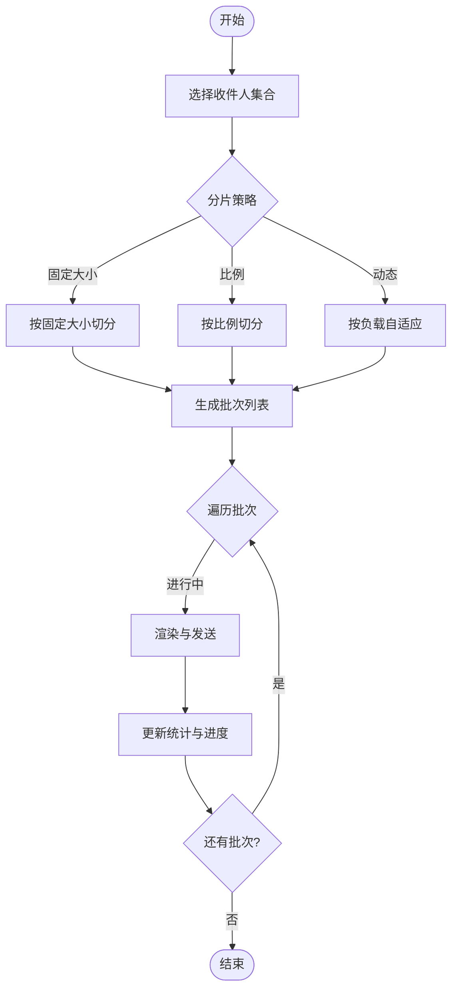
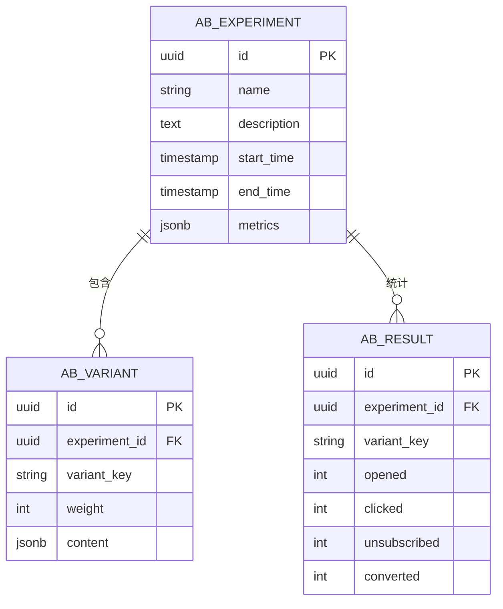
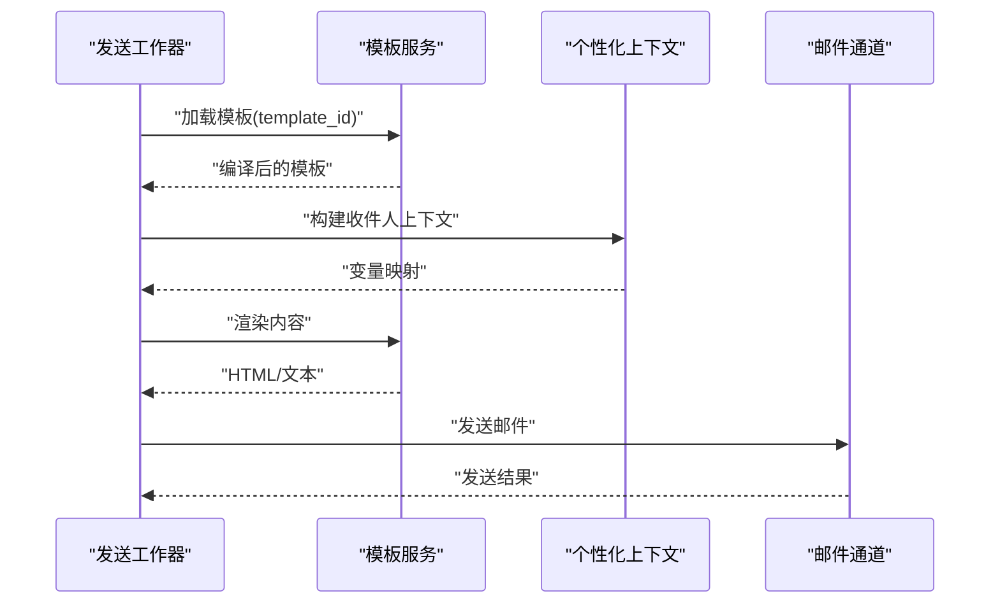
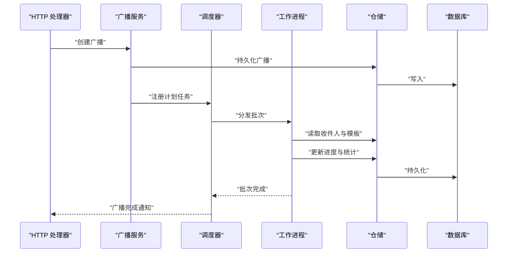
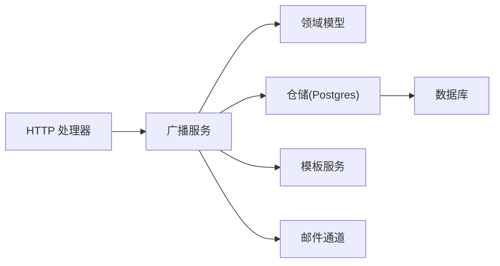

# 广播模型

<cite>
**本文引用的文件**   
- [internal/domain/broadcast.go](file://notifuse/internal/domain/broadcast.go)
- [internal/repository/broadcast_postgres.go](file://notifuse/internal/repository/broadcast_postgres.go)
- [internal/service/broadcast_service.go](file://notifuse/internal/service/broadcast_service.go)
- [internal/http/broadcast_handler.go](file://notifuse/internal/http/broadcast_handler.go)
- [internal/database/schema/001_init.sql](file://notifuse/internal/database/schema/001_init.sql)
- [internal/migrations/v29.go](file://notifuse/internal/migrations/v29.go)
- [internal/migrations/v30.go](file://notifuse/internal/migrations/v30.go)
- [internal/migrations/v31.go](file://notifuse/internal/migrations/v31.go)
- [internal/migrations/v32.go](file://notifuse/internal/migrations/v32.go)
- [internal/migrations/v33.go](file://notifuse/internal/migrations/v33.go)
- [internal/migrations/v34.go](file://notifuse/internal/migrations/v34.go)
- [openapi/paths/broadcasts.yaml](file://notifuse/openapi/paths/broadcasts.yaml)
- [pkg/templates/supabase_email_change.go](file://notifuse/pkg/templates/supabase_email_change.go)
</cite>

## 目录
1. [简介](#简介)
2. [项目结构](#项目结构)
3. [核心组件](#核心组件)
4. [架构总览](#架构总览)
5. [详细组件分析](#详细组件分析)
6. [依赖关系分析](#依赖关系分析)
7. [性能考虑](#性能考虑)
8. [故障排查指南](#故障排查指南)
9. [结论](#结论)
10. [附录](#附录)

## 简介
本文件为 Notifuse 平台的“广播批量发送系统”的数据模型与流程文档，聚焦于 Broadcast 实体的设计、批次管理（分片策略、进度跟踪、断点续传）、A/B 测试数据模型、模板渲染与个性化内容处理机制，以及批量发送的性能优化、监控告警与故障恢复策略。文档以代码仓库中的领域模型、仓储实现、服务层、HTTP 处理器与数据库迁移为依据，确保内容与实现一致。

## 项目结构
围绕广播能力的相关代码主要分布在以下层次：
- 领域模型：定义广播实体、状态、统计字段等
- 仓储层：PostgreSQL 持久化实现
- 服务层：编排创建、调度、执行、统计等业务流程
- HTTP 层：对外 API 暴露
- 数据库迁移：表结构与字段的演进
- OpenAPI：接口契约
- 模板：内置模板示例与扩展点

图表来源
- [internal/http/broadcast_handler.go](file://notifuse/internal/http/broadcast_handler.go)
- [internal/service/broadcast_service.go](file://notifuse/internal/service/broadcast_service.go)
- [internal/domain/broadcast.go](file://notifuse/internal/domain/broadcast.go)
- [internal/repository/broadcast_postgres.go](file://notifuse/internal/repository/broadcast_postgres.go)
- [openapi/paths/broadcasts.yaml](file://notifuse/openapi/paths/broadcasts.yaml)

章节来源
- [internal/domain/broadcast.go](file://notifuse/internal/domain/broadcast.go)
- [internal/repository/broadcast_postgres.go](file://notifuse/internal/repository/broadcast_postgres.go)
- [internal/service/broadcast_service.go](file://notifuse/internal/service/broadcast_service.go)
- [internal/http/broadcast_handler.go](file://notifuse/internal/http/broadcast_handler.go)
- [openapi/paths/broadcasts.yaml](file://notifuse/openapi/paths/broadcasts.yaml)

## 核心组件
- Broadcast 实体：承载一次广播任务的核心信息，包括标题、主题、正文、目标受众选择方式、发送渠道、计划时间、并发与速率限制、重试策略、A/B 实验配置、统计指标、状态机与审计字段等。
- 批次与分片：将大规模收件人集合切分为多个批次，支持按固定大小或比例分片；每个批次独立跟踪进度与结果。
- 进度与断点续传：通过持久化的批次状态与游标记录，支持失败重试与从上次位置继续执行。
- A/B 测试：在广播中定义实验分组与分流比例，收集并聚合各组的打开、点击、退订等指标进行对比分析。
- 模板与个性化：基于模板引擎渲染邮件内容，支持变量替换与条件逻辑，结合联系人属性生成个性化内容。
- 性能与可靠性：并发控制、速率限制、错误隔离、幂等写入、可观测性埋点与告警。

章节来源
- [internal/domain/broadcast.go](file://notifuse/internal/domain/broadcast.go)
- [internal/repository/broadcast_postgres.go](file://notifuse/internal/repository/broadcast_postgres.go)
- [internal/service/broadcast_service.go](file://notifuse/internal/service/broadcast_service.go)

## 架构总览
广播批量发送的整体流程如下：
- 创建广播：通过 HTTP API 接收请求，校验参数，持久化广播实体，初始化批次与统计。
- 调度与执行：根据计划时间与并发/速率策略，将收件人集合分片为批次，逐个或并行推进。
- 渲染与发送：加载模板，注入个性化上下文，调用邮件通道发送。
- 进度与统计：每批次完成后更新进度与统计指标，支持查询与导出。
- 异常与恢复：对失败批次进行重试与补偿，保证最终一致性。

图表来源
- [internal/http/broadcast_handler.go](file://notifuse/internal/http/broadcast_handler.go)
- [internal/service/broadcast_service.go](file://notifuse/internal/service/broadcast_service.go)
- [internal/repository/broadcast_postgres.go](file://notifuse/internal/repository/broadcast_postgres.go)

## 详细组件分析

### Broadcast 实体与数据模型
- 标识与归属
  - ID、工作区标识、创建者、版本等基础字段
- 元数据
  - 标题、主题、摘要、标签、描述、语言、时区等
- 目标受众
  - 列表/分段/自定义筛选条件，用于确定收件人集合
- 内容与模板
  - 文本/HTML 正文、模板ID、变量映射、附件引用
- 发送策略
  - 发送渠道、计划时间、延迟队列、重试次数、退避策略
- 并发与限流
  - 最大并发数、每秒速率上限、批大小
- A/B 实验
  - 实验ID、分组比例、变体内容、评估指标
- 进度与统计
  - 已发送、成功、失败、待处理、取消、完成等计数与百分比
- 状态与审计
  - 状态枚举、错误码、最后错误、开始/结束时间、更新时间戳

图表来源
- [internal/domain/broadcast.go](file://notifuse/internal/domain/broadcast.go)

章节来源
- [internal/domain/broadcast.go](file://notifuse/internal/domain/broadcast.go)

### 批次管理与分片策略
- 分片策略
  - 固定大小分片：按每批 N 个收件人切分
  - 比例分片：按百分比切分，便于灰度发布
  - 动态分片：根据负载与错误率自适应调整批大小
- 批次状态
  - 新建、排队、进行中、已完成、失败、取消
- 进度跟踪
  - 批次级与全局级进度，包含已处理数量、成功/失败计数、错误详情
- 断点续传
  - 记录游标与偏移量，失败后可从上次位置继续执行
  - 幂等写入避免重复发送

图表来源
- [internal/service/broadcast_service.go](file://notifuse/internal/service/broadcast_service.go)
- [internal/repository/broadcast_postgres.go](file://notifuse/internal/repository/broadcast_postgres.go)

章节来源
- [internal/service/broadcast_service.go](file://notifuse/internal/service/broadcast_service.go)
- [internal/repository/broadcast_postgres.go](file://notifuse/internal/repository/broadcast_postgres.go)

### A/B 测试数据模型
- 实验定义
  - 实验ID、名称、描述、开始/结束时间、评估指标
- 分组与分流
  - 组别标识、权重比例、样本量阈值
- 变体内容
  - 不同版本的标题、正文、CTA 按钮等
- 结果收集
  - 按组别统计打开、点击、退订、转化等事件
- 统计分析
  - 显著性检验、置信区间、排名与推荐

图表来源
- [internal/domain/broadcast.go](file://notifuse/internal/domain/broadcast.go)

章节来源
- [internal/domain/broadcast.go](file://notifuse/internal/domain/broadcast.go)

### 模板渲染与个性化内容
- 模板来源
  - 内置模板与用户自定义模板
- 渲染引擎
  - 支持变量替换、条件分支、循环与函数调用
- 个性化上下文
  - 联系人属性、行为历史、偏好设置
- 安全与沙箱
  - 限制危险操作，防止模板注入

图表来源
- [pkg/templates/supabase_email_change.go](file://notifuse/pkg/templates/supabase_email_change.go)
- [internal/service/broadcast_service.go](file://notifuse/internal/service/broadcast_service.go)

章节来源
- [pkg/templates/supabase_email_change.go](file://notifuse/pkg/templates/supabase_email_change.go)
- [internal/service/broadcast_service.go](file://notifuse/internal/service/broadcast_service.go)

### 批量发送的执行流程
- 创建阶段
  - 校验输入、生成唯一ID、初始化统计与批次
- 调度阶段
  - 根据计划时间入队，工作进程拉取任务
- 执行阶段
  - 分片、渲染、发送、落盘统计
- 收尾阶段
  - 汇总结果、更新状态、触发回调与通知

图表来源
- [internal/http/broadcast_handler.go](file://notifuse/internal/http/broadcast_handler.go)
- [internal/service/broadcast_service.go](file://notifuse/internal/service/broadcast_service.go)
- [internal/repository/broadcast_postgres.go](file://notifuse/internal/repository/broadcast_postgres.go)

章节来源
- [internal/http/broadcast_handler.go](file://notifuse/internal/http/broadcast_handler.go)
- [internal/service/broadcast_service.go](file://notifuse/internal/service/broadcast_service.go)
- [internal/repository/broadcast_postgres.go](file://notifuse/internal/repository/broadcast_postgres.go)

## 依赖关系分析
- 模块耦合
  - HTTP 层依赖服务层，服务层依赖领域模型与仓储层
  - 仓储层直接依赖数据库，负责 SQL 与事务
- 外部依赖
  - 邮件通道（SMTP/SES/SendGrid 等）
  - 模板引擎与 MJML 转换（可选）
  - 缓存与限流组件（可选）
- 潜在循环依赖
  - 服务层不应反向依赖 HTTP 层；仓储层仅依赖数据库抽象

图表来源
- [internal/http/broadcast_handler.go](file://notifuse/internal/http/broadcast_handler.go)
- [internal/service/broadcast_service.go](file://notifuse/internal/service/broadcast_service.go)
- [internal/repository/broadcast_postgres.go](file://notifuse/internal/repository/broadcast_postgres.go)

章节来源
- [internal/http/broadcast_handler.go](file://notifuse/internal/http/broadcast_handler.go)
- [internal/service/broadcast_service.go](file://notifuse/internal/service/broadcast_service.go)
- [internal/repository/broadcast_postgres.go](file://notifuse/internal/repository/broadcast_postgres.go)

## 性能考虑
- 并发控制
  - 基于广播级别的 max_concurrency 限制同时处理的批次数量
  - 使用信号量或池化 goroutine 控制资源占用
- 速率限制
  - rate_limit_per_second 控制每秒发送上限，避免被上游通道限流
- 批大小调优
  - batch_size 影响内存与网络开销，需根据收件人属性大小与通道吞吐权衡
- 错误隔离
  - 批次级错误不影响其他批次；失败批次单独重试与降级
- 幂等与去重
  - 发送前检查是否已发送，避免重复投递
- 缓存与预渲染
  - 对静态片段与公共变量进行缓存，减少渲染成本
- 资源限制
  - CPU/内存配额、连接池上限、超时与熔断策略

[本节提供通用指导，不直接分析具体文件]

## 故障排查指南
- 常见问题
  - 创建失败：检查必填字段、权限与工作区绑定
  - 调度未执行：确认计划时间与调度器健康状态
  - 发送失败：查看通道日志、认证与域名验证
  - 进度停滞：检查批次状态与重试策略
- 定位步骤
  - 查询广播状态与统计字段
  - 查看最近错误与堆栈
  - 核对批次游标与偏移量
  - 检查模板渲染与上下文变量
- 恢复策略
  - 手动重试失败批次
  - 调整并发与速率后重新执行
  - 回滚到上一个稳定版本

章节来源
- [internal/repository/broadcast_postgres.go](file://notifuse/internal/repository/broadcast_postgres.go)
- [internal/service/broadcast_service.go](file://notifuse/internal/service/broadcast_service.go)

## 结论
Notifuse 的广播批量发送系统以 Broadcast 实体为核心，结合批次管理与 A/B 实验数据模型，提供了高可扩展、可观测且可靠的批量发送能力。通过合理的分片策略、进度跟踪与断点续传机制，系统在大规模场景下仍能保持稳定与高效。模板渲染与个性化内容增强了用户体验，而并发控制、速率限制与错误隔离则保障了系统的鲁棒性与可维护性。

[本节为总结性内容，不直接分析具体文件]

## 附录

### 数据库迁移与字段演进
- v29-v34 系列迁移文件定义了广播相关表结构与字段的演进，包括新增统计字段、索引与约束变更
- schema/001_init.sql 提供初始建表语句，作为后续迁移的基础

章节来源
- [internal/migrations/v29.go](file://notifuse/internal/migrations/v29.go)
- [internal/migrations/v30.go](file://notifuse/internal/migrations/v30.go)
- [internal/migrations/v31.go](file://notifuse/internal/migrations/v31.go)
- [internal/migrations/v32.go](file://notifuse/internal/migrations/v32.go)
- [internal/migrations/v33.go](file://notifuse/internal/migrations/v33.go)
- [internal/migrations/v34.go](file://notifuse/internal/migrations/v34.go)
- [internal/database/schema/001_init.sql](file://notifuse/internal/database/schema/001_init.sql)

### OpenAPI 接口契约
- broadcasts.yaml 定义了广播相关的 REST API 路径、请求/响应结构与状态码，便于前后端协作与自动化测试

章节来源
- [openapi/paths/broadcasts.yaml](file://notifuse/openapi/paths/broadcasts.yaml)