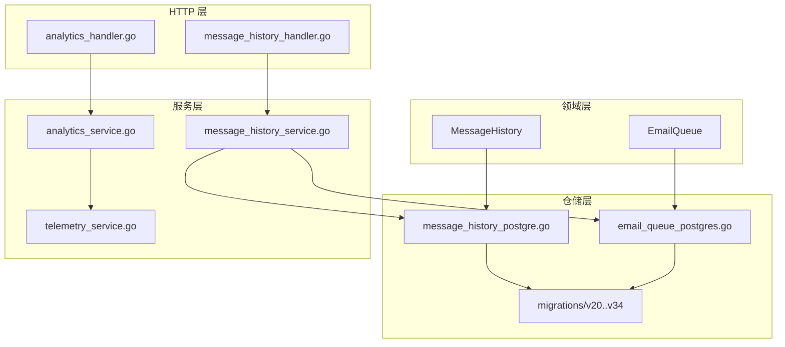
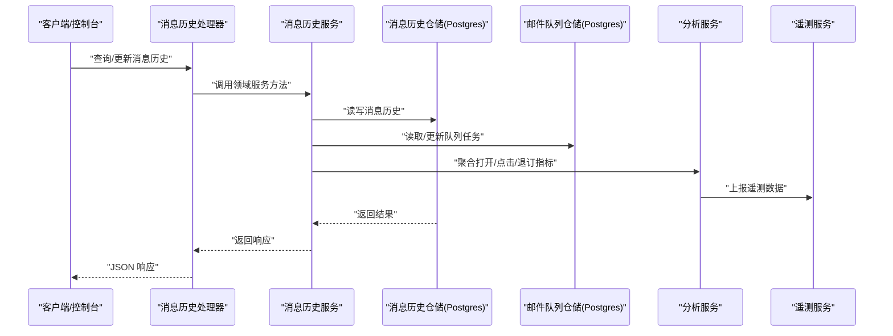
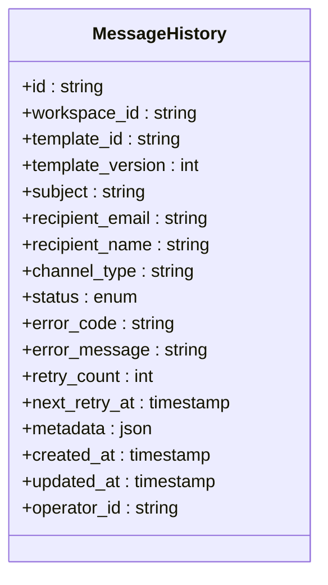
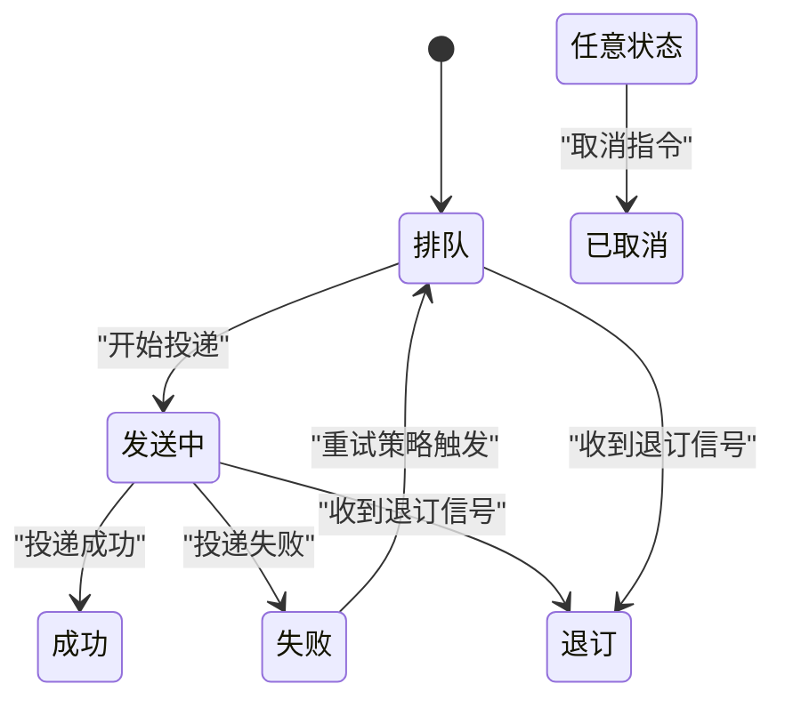
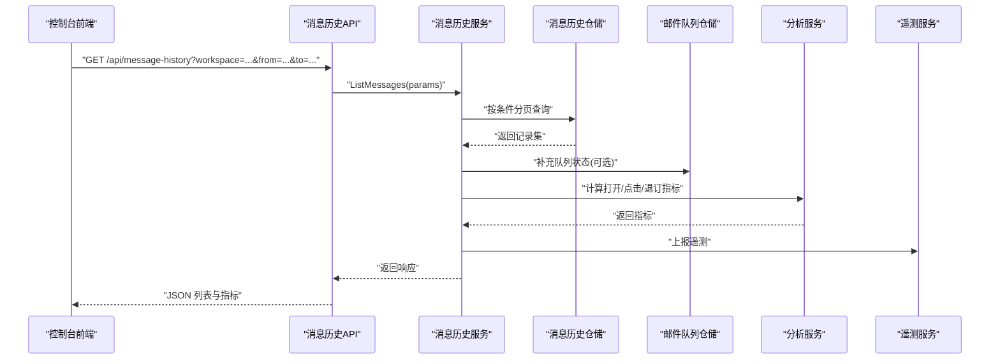
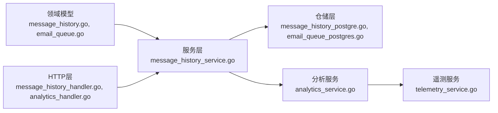

# 消息历史模型

<cite>
**本文引用的文件**   
- [message_history.go](file://notifuse/internal/domain/message_history.go)
- [message_history_test.go](file://notifuse/internal/domain/message_history_test.go)
- [message_history_postgre.go](file://notifuse/internal/repository/message_history_postgre.go)
- [message_history_handler.go](file://notifuse/internal/http/message_history_handler.go)
- [message_history_service.go](file://notifuse/internal/service/message_history_service.go)
- [email_queue.go](file://notifuse/internal/domain/email_queue.go)
- [email_queue_postgres.go](file://notifuse/internal/repository/email_queue_postgres.go)
- [analytics_handler.go](file://notifuse/internal/http/analytics_handler.go)
- [analytics_service.go](file://notifuse/internal/service/analytics_service.go)
- [telemetry_service.go](file://notifuse/internal/service/telemetry_service.go)
- [v20.go](file://notifuse/internal/migrations/v20.go)
- [v21.go](file://notifuse/internal/migrations/v21.go)
- [v22.go](file://notifuse/internal/migrations/v22.go)
- [v23.go](file://notifuse/internal/migrations/v23.go)
- [v24.go](file://notifuse/internal/migrations/v24.go)
- [v25.go](file://notifuse/internal/migrations/v25.go)
- [v26.go](file://notifuse/internal/migrations/v26.go)
- [v27.go](file://notifuse/internal/migrations/v27.go)
- [v28.go](file://notifuse/internal/migrations/v28.go)
- [v29.go](file://notifuse/internal/migrations/v29.go)
- [v30.go](file://notifuse/internal/migrations/v30.go)
- [v31.go](file://notifuse/internal/migrations/v31.go)
- [v32.go](file://notifuse/internal/migrations/v32.go)
- [v33.go](file://notifuse/internal/migrations/v33.go)
- [v34.go](file://notifuse/internal/migrations/v34.go)
</cite>

## 目录
1. [简介](#简介)
2. [项目结构](#项目结构)
3. [核心组件](#核心组件)
4. [架构总览](#架构总览)
5. [详细组件分析](#详细组件分析)
6. [依赖关系分析](#依赖关系分析)
7. [性能与索引优化](#性能与索引优化)
8. [大规模数据归档方案](#大规模数据归档方案)
9. [隐私保护与数据脱敏](#隐私保护与数据脱敏)
10. [故障排查指南](#故障排查指南)
11. [结论](#结论)

## 简介
本文件为 Notifuse 平台“消息历史记录系统”的数据模型文档，聚焦 MessageHistory 实体及其相关领域模型、仓储实现、HTTP 接口与服务编排。内容涵盖：
- 完整审计日志结构与事件追踪机制
- 发送状态生命周期（排队、发送中、成功、失败）及转换规则
- 送达报告与分析指标收集（打开率、点击率、退订统计）
- 历史数据查询优化与索引策略
- 大规模数据的存储与归档方案
- 隐私保护与数据脱敏处理机制

## 项目结构
围绕消息历史的核心代码分布在以下模块：
- 领域层：定义 MessageHistory 及相关枚举、值对象
- 仓储层：PostgreSQL 持久化实现与迁移脚本
- 服务层：编排业务逻辑、状态更新与指标聚合
- HTTP 层：对外暴露查询与分析接口
- 队列与投递：EmailQueue 与邮件队列持久化

图表来源
- [message_history.go](file://notifuse/internal/domain/message_history.go)
- [email_queue.go](file://notifuse/internal/domain/email_queue.go)
- [message_history_postgre.go](file://notifuse/internal/repository/message_history_postgre.go)
- [email_queue_postgres.go](file://notifuse/internal/repository/email_queue_postgres.go)
- [message_history_handler.go](file://notifuse/internal/http/message_history_handler.go)
- [analytics_handler.go](file://notifuse/internal/http/analytics_handler.go)
- [message_history_service.go](file://notifuse/internal/service/message_history_service.go)
- [analytics_service.go](file://notifuse/internal/service/analytics_service.go)
- [telemetry_service.go](file://notifuse/internal/service/telemetry_service.go)
- [v20.go](file://notifuse/internal/migrations/v20.go)
- [v21.go](file://notifuse/internal/migrations/v21.go)
- [v22.go](file://notifuse/internal/migrations/v22.go)
- [v23.go](file://notifuse/internal/migrations/v23.go)
- [v24.go](file://notifuse/internal/migrations/v24.go)
- [v25.go](file://notifuse/internal/migrations/v25.go)
- [v26.go](file://notifuse/internal/migrations/v26.go)
- [v27.go](file://notifuse/internal/migrations/v27.go)
- [v28.go](file://notifuse/internal/migrations/v28.go)
- [v29.go](file://notifuse/internal/migrations/v29.go)
- [v30.go](file://notifuse/internal/migrations/v30.go)
- [v31.go](file://notifuse/internal/migrations/v31.go)
- [v32.go](file://notifuse/internal/migrations/v32.go)
- [v33.go](file://notifuse/internal/migrations/v33.go)
- [v34.go](file://notifuse/internal/migrations/v34.go)

章节来源
- [message_history.go](file://notifuse/internal/domain/message_history.go)
- [message_history_postgre.go](file://notifuse/internal/repository/message_history_postgre.go)
- [message_history_handler.go](file://notifuse/internal/http/message_history_handler.go)
- [message_history_service.go](file://notifuse/internal/service/message_history_service.go)
- [email_queue.go](file://notifuse/internal/domain/email_queue.go)
- [email_queue_postgres.go](file://notifuse/internal/repository/email_queue_postgres.go)
- [analytics_handler.go](file://notifuse/internal/http/analytics_handler.go)
- [analytics_service.go](file://notifuse/internal/service/analytics_service.go)
- [telemetry_service.go](file://notifuse/internal/service/telemetry_service.go)
- [v20.go](file://notifuse/internal/migrations/v20.go)
- [v21.go](file://notifuse/internal/migrations/v21.go)
- [v22.go](file://notifuse/internal/migrations/v22.go)
- [v23.go](file://notifuse/internal/migrations/v23.go)
- [v24.go](file://notifuse/internal/migrations/v24.go)
- [v25.go](file://notifuse/internal/migrations/v25.go)
- [v26.go](file://notifuse/internal/migrations/v26.go)
- [v27.go](file://notifuse/internal/migrations/v27.go)
- [v28.go](file://notifuse/internal/migrations/v28.go)
- [v29.go](file://notifuse/internal/migrations/v29.go)
- [v30.go](file://notifuse/internal/migrations/v30.go)
- [v31.go](file://notifuse/internal/migrations/v31.go)
- [v32.go](file://notifuse/internal/migrations/v32.go)
- [v33.go](file://notifuse/internal/migrations/v33.go)
- [v34.go](file://notifuse/internal/migrations/v34.go)

## 核心组件
- MessageHistory 实体：承载单条消息的完整审计轨迹，包括关联工作区、模板、收件人、投递通道、状态、时间戳、错误信息、扩展元数据等。
- EmailQueue 实体：与消息历史紧密协作，记录待投递任务、重试次数、下次投递时间等。
- 仓储实现：基于 PostgreSQL 的持久化与查询封装，提供按工作区、时间范围、状态、渠道等多维筛选能力。
- 服务编排：负责状态机推进、指标计算、上报遥测数据。
- HTTP 接口：面向控制台与外部系统的查询与分析端点。

章节来源
- [message_history.go](file://notifuse/internal/domain/message_history.go)
- [email_queue.go](file://notifuse/internal/domain/email_queue.go)
- [message_history_postgre.go](file://notifuse/internal/repository/message_history_postgre.go)
- [message_history_service.go](file://notifuse/internal/service/message_history_service.go)
- [message_history_handler.go](file://notifuse/internal/http/message_history_handler.go)

## 架构总览
下图展示了从 HTTP 请求到持久化与指标上报的整体流程，以及关键组件间的依赖关系。

图表来源
- [message_history_handler.go](file://notifuse/internal/http/message_history_handler.go)
- [message_history_service.go](file://notifuse/internal/service/message_history_service.go)
- [message_history_postgre.go](file://notifuse/internal/repository/message_history_postgre.go)
- [email_queue_postgres.go](file://notifuse/internal/repository/email_queue_postgres.go)
- [analytics_handler.go](file://notifuse/internal/http/analytics_handler.go)
- [analytics_service.go](file://notifuse/internal/service/analytics_service.go)
- [telemetry_service.go](file://notifuse/internal/service/telemetry_service.go)

## 详细组件分析

### MessageHistory 实体设计
- 标识与归属
  - 主键与工作区分片：用于多租户隔离与分片路由
  - 唯一业务键：如模板版本+收件人+批次号，避免重复投递
- 内容与上下文
  - 模板ID/版本、主题、正文摘要（可选）、附件清单
  - 收件人地址、姓名、语言偏好、时区
- 投递与状态
  - 渠道类型（SMTP、SES、SendGrid、Mailgun、Postmark、SparkPost 等）
  - 状态机：排队、发送中、成功、失败、退订、已取消
  - 错误码与错误信息、重试次数、下次投递时间
- 审计与追踪
  - 创建/更新时间、操作者ID（系统或用户）
  - 扩展元数据（JSON），用于存放第三方回调、跟踪ID、A/B测试分组等
- 隐私字段
  - 敏感字段（如邮箱地址、IP）在内部以脱敏形式存储或加密存储，对外接口默认返回脱敏视图

图表来源
- [message_history.go](file://notifuse/internal/domain/message_history.go)

章节来源
- [message_history.go](file://notifuse/internal/domain/message_history.go)
- [message_history_test.go](file://notifuse/internal/domain/message_history_test.go)

### 发送状态生命周期与转换
状态机包含以下阶段与典型转换：
- 排队 → 发送中：调度器取出任务并标记为发送中
- 发送中 → 成功：渠道返回成功回执
- 发送中 → 失败：渠道返回失败或超时；根据错误分类决定是否重试
- 失败 → 排队：重试策略生效，更新重试次数与下次投递时间
- 任意状态 → 退订：收到退订信号后终止后续投递
- 任意状态 → 已取消：管理员或系统主动取消

图表来源
- [message_history.go](file://notifuse/internal/domain/message_history.go)
- [email_queue.go](file://notifuse/internal/domain/email_queue.go)
- [message_history_service.go](file://notifuse/internal/service/message_history_service.go)

章节来源
- [message_history.go](file://notifuse/internal/domain/message_history.go)
- [email_queue.go](file://notifuse/internal/domain/email_queue.go)
- [message_history_service.go](file://notifuse/internal/service/message_history_service.go)

### 仓储与数据库映射
- 表结构演进：通过迁移脚本逐步完善字段与索引，确保向后兼容
- 关键字段映射：
  - workspace_id、template_id、recipient_email、status、created_at、updated_at
  - metadata（JSONB）用于灵活扩展
- 常用查询路径：
  - 按工作区与时间范围分页
  - 按状态、渠道、模板维度过滤
  - 按收件人聚合打开/点击/退订指标

章节来源
- [message_history_postgre.go](file://notifuse/internal/repository/message_history_postgre.go)
- [v20.go](file://notifuse/internal/migrations/v20.go)
- [v21.go](file://notifuse/internal/migrations/v21.go)
- [v22.go](file://notifuse/internal/migrations/v22.go)
- [v23.go](file://notifuse/internal/migrations/v23.go)
- [v24.go](file://notifuse/internal/migrations/v24.go)
- [v25.go](file://notifuse/internal/migrations/v25.go)
- [v26.go](file://notifuse/internal/migrations/v26.go)
- [v27.go](file://notifuse/internal/migrations/v27.go)
- [v28.go](file://notifuse/internal/migrations/v28.go)
- [v29.go](file://notifuse/internal/migrations/v29.go)
- [v30.go](file://notifuse/internal/migrations/v30.go)
- [v31.go](file://notifuse/internal/migrations/v31.go)
- [v32.go](file://notifuse/internal/migrations/v32.go)
- [v33.go](file://notifuse/internal/migrations/v33.go)
- [v34.go](file://notifuse/internal/migrations/v34.go)

### HTTP 接口与服务编排
- 消息历史查询接口：支持分页、排序、多维过滤
- 分析接口：返回打开率、点击率、退订率等聚合指标
- 服务编排：
  - 校验权限与工作区隔离
  - 组合消息历史与队列信息
  - 调用分析服务进行指标计算
  - 上报遥测数据用于监控与告警

图表来源
- [message_history_handler.go](file://notifuse/internal/http/message_history_handler.go)
- [message_history_service.go](file://notifuse/internal/service/message_history_service.go)
- [message_history_postgre.go](file://notifuse/internal/repository/message_history_postgre.go)
- [email_queue_postgres.go](file://notifuse/internal/repository/email_queue_postgres.go)
- [analytics_handler.go](file://notifuse/internal/http/analytics_handler.go)
- [analytics_service.go](file://notifuse/internal/service/analytics_service.go)
- [telemetry_service.go](file://notifuse/internal/service/telemetry_service.go)

章节来源
- [message_history_handler.go](file://notifuse/internal/http/message_history_handler.go)
- [message_history_service.go](file://notifuse/internal/service/message_history_service.go)
- [analytics_handler.go](file://notifuse/internal/http/analytics_handler.go)
- [analytics_service.go](file://notifuse/internal/service/analytics_service.go)
- [telemetry_service.go](file://notifuse/internal/service/telemetry_service.go)

### 送达报告与分析指标收集
- 打开率：基于打开事件计数与投递成功数计算
- 点击率：基于点击事件计数与打开事件计数计算
- 退订统计：基于退订事件计数与投递成功数计算
- 数据来源：
  - 渠道回调（Webhook、SDK 回传）
  - 自定义事件与遥测上报
- 聚合维度：工作区、模板、渠道、时间段、地域等

章节来源
- [analytics_handler.go](file://notifuse/internal/http/analytics_handler.go)
- [analytics_service.go](file://notifuse/internal/service/analytics_service.go)
- [telemetry_service.go](file://notifuse/internal/service/telemetry_service.go)

## 依赖关系分析
- 低耦合高内聚：领域模型独立于仓储与HTTP层，便于替换实现与单元测试
- 仓储抽象：通过接口屏蔽底层数据库差异，当前实现为 PostgreSQL
- 服务编排：集中处理状态机、指标计算与跨域协调
- 外部依赖：邮件渠道 SDK、遥测后端、缓存（可选）

图表来源
- [message_history.go](file://notifuse/internal/domain/message_history.go)
- [email_queue.go](file://notifuse/internal/domain/email_queue.go)
- [message_history_service.go](file://notifuse/internal/service/message_history_service.go)
- [message_history_postgre.go](file://notifuse/internal/repository/message_history_postgre.go)
- [email_queue_postgres.go](file://notifuse/internal/repository/email_queue_postgres.go)
- [analytics_handler.go](file://notifuse/internal/http/analytics_handler.go)
- [analytics_service.go](file://notifuse/internal/service/analytics_service.go)
- [telemetry_service.go](file://notifuse/internal/service/telemetry_service.go)

章节来源
- [message_history.go](file://notifuse/internal/domain/message_history.go)
- [email_queue.go](file://notifuse/internal/domain/email_queue.go)
- [message_history_service.go](file://notifuse/internal/service/message_history_service.go)
- [message_history_postgre.go](file://notifuse/internal/repository/message_history_postgre.go)
- [email_queue_postgres.go](file://notifuse/internal/repository/email_queue_postgres.go)
- [analytics_handler.go](file://notifuse/internal/http/analytics_handler.go)
- [analytics_service.go](file://notifuse/internal/service/analytics_service.go)
- [telemetry_service.go](file://notifuse/internal/service/telemetry_service.go)

## 性能与索引优化
- 分区策略
  - 按时间（月/季度）对消息历史表进行分区，降低热点写入与扫描成本
  - 按工作区哈希分片，提升并发写入与查询并行度
- 索引建议
  - 复合索引：(workspace_id, created_at)、(workspace_id, status, created_at)
  - 覆盖索引：(workspace_id, template_id, recipient_email, status, created_at)
  - JSONB 索引：对 metadata 中的高频查询键建立 GIN 索引
- 查询优化
  - 使用物化视图或汇总表预计算打开/点击/退订指标
  - 分页采用游标式分页替代偏移量，避免深分页性能问题
- 连接池与批处理
  - 合理设置连接池大小与最大空闲连接
  - 批量写入与批量更新减少事务开销

章节来源
- [message_history_postgre.go](file://notifuse/internal/repository/message_history_postgre.go)
- [v20.go](file://notifuse/internal/migrations/v20.go)
- [v21.go](file://notifuse/internal/migrations/v21.go)
- [v22.go](file://notifuse/internal/migrations/v22.go)
- [v23.go](file://notifuse/internal/migrations/v23.go)
- [v24.go](file://notifuse/internal/migrations/v24.go)
- [v25.go](file://notifuse/internal/migrations/v25.go)
- [v26.go](file://notifuse/internal/migrations/v26.go)
- [v27.go](file://notifuse/internal/migrations/v27.go)
- [v28.go](file://notifuse/internal/migrations/v28.go)
- [v29.go](file://notifuse/internal/migrations/v29.go)
- [v30.go](file://notifuse/internal/migrations/v30.go)
- [v31.go](file://notifuse/internal/migrations/v31.go)
- [v32.go](file://notifuse/internal/migrations/v32.go)
- [v33.go](file://notifuse/internal/migrations/v33.go)
- [v34.go](file://notifuse/internal/migrations/v34.go)

## 大规模数据归档方案
- 冷热分层
  - 热数据：最近 N 个月保留在主库，保证低延迟查询
  - 冷数据：超过阈值的记录归档至对象存储或列式仓库（如 BigQuery、ClickHouse）
- 归档流程
  - 定时任务扫描过期分区
  - 压缩与去重后导出为 Parquet/CSV
  - 写入对象存储并生成索引元数据
  - 清理主库旧分区，释放空间
- 查询回溯
  - 控制台提供“历史归档查询”入口，按需拉取冷数据
  - 分析报表支持跨热冷数据聚合

章节来源
- [message_history_postgre.go](file://notifuse/internal/repository/message_history_postgre.go)
- [v20.go](file://notifuse/internal/migrations/v20.go)
- [v21.go](file://notifuse/internal/migrations/v21.go)
- [v22.go](file://notifuse/internal/migrations/v22.go)
- [v23.go](file://notifuse/internal/migrations/v23.go)
- [v24.go](file://notifuse/internal/migrations/v24.go)
- [v25.go](file://notifuse/internal/migrations/v25.go)
- [v26.go](file://notifuse/internal/migrations/v26.go)
- [v27.go](file://notifuse/internal/migrations/v27.go)
- [v28.go](file://notifuse/internal/migrations/v28.go)
- [v29.go](file://notifuse/internal/migrations/v29.go)
- [v30.go](file://notifuse/internal/migrations/v30.go)
- [v31.go](file://notifuse/internal/migrations/v31.go)
- [v32.go](file://notifuse/internal/migrations/v32.go)
- [v33.go](file://notifuse/internal/migrations/v33.go)
- [v34.go](file://notifuse/internal/migrations/v34.go)

## 隐私保护与数据脱敏
- 脱敏策略
  - 邮箱地址：仅显示域名部分或掩码中间字符
  - IP 地址：仅保留网段或哈希化
  - 设备指纹：使用不可逆哈希
- 加密存储
  - 敏感字段使用 KMS 管理的密钥进行加密
  - 密钥轮换与访问审计
- 最小可见性
  - 默认接口返回脱敏视图，需显式授权才返回明文
  - 审计日志记录敏感字段访问行为
- 合规与留存
  - 遵循 GDPR/CCPA 等法规，提供删除与导出能力
  - 设定数据留存周期与自动清理策略

章节来源
- [message_history.go](file://notifuse/internal/domain/message_history.go)
- [message_history_handler.go](file://notifuse/internal/http/message_history_handler.go)
- [message_history_service.go](file://notifuse/internal/service/message_history_service.go)

## 故障排查指南
- 常见问题定位
  - 状态卡滞：检查重试策略与渠道健康状态
  - 指标异常：核对打开/点击/退订事件是否上报完整
  - 查询缓慢：确认索引命中与分区裁剪是否生效
- 诊断工具
  - 启用慢查询日志与执行计划分析
  - 使用遥测服务查看端到端耗时与错误分布
- 恢复策略
  - 失败任务重新入队与幂等重试
  - 归档数据恢复与一致性校验

章节来源
- [message_history_service.go](file://notifuse/internal/service/message_history_service.go)
- [analytics_service.go](file://notifuse/internal/service/analytics_service.go)
- [telemetry_service.go](file://notifuse/internal/service/telemetry_service.go)

## 结论
MessageHistory 实体作为 Notifuse 消息历史记录系统的核心，提供了完整的审计日志与事件追踪能力。通过清晰的状态机、完善的仓储与索引策略、可扩展的分析与遥测体系，以及严格的隐私保护与归档方案，系统在可观测性、性能与合规方面均具备良好基础。建议在持续迭代中关注：
- 指标计算的准确性与实时性
- 冷热数据切换的平滑性与一致性
- 隐私字段的最小可见与可审计
- 大规模场景下的弹性扩容与成本控制