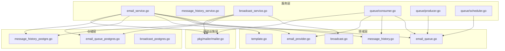
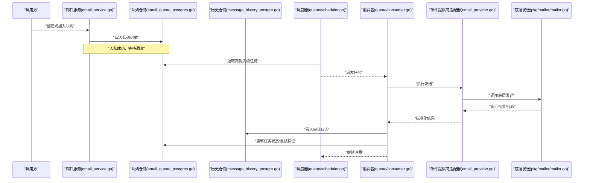
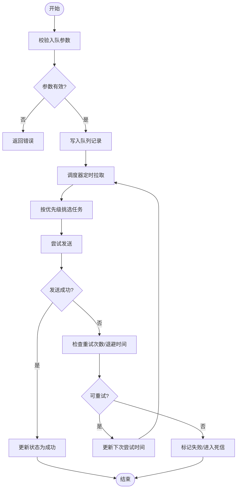
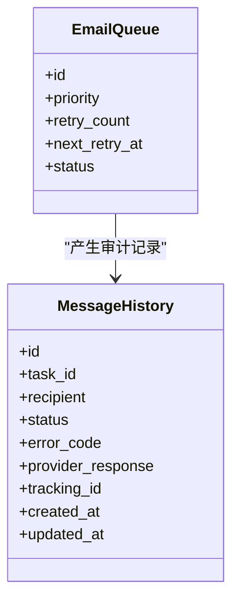
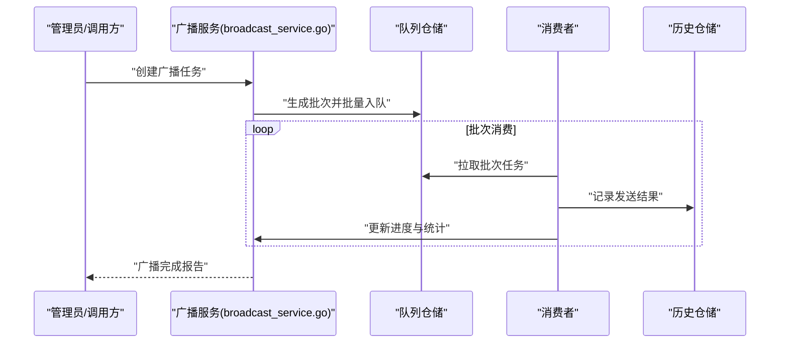
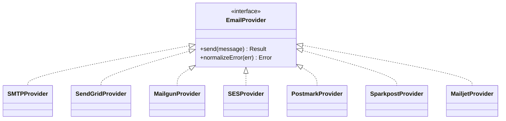
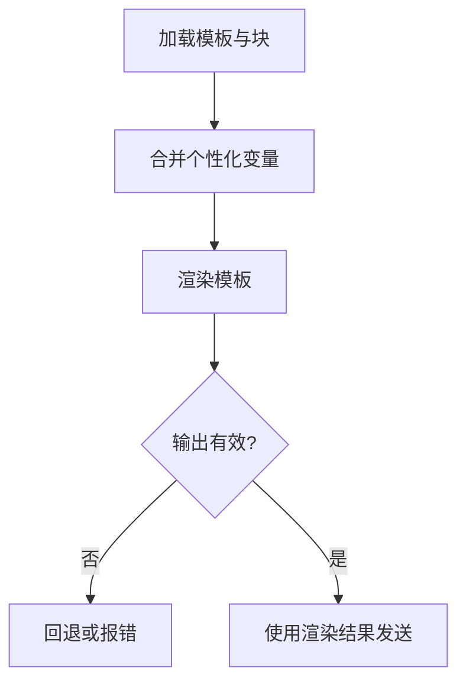
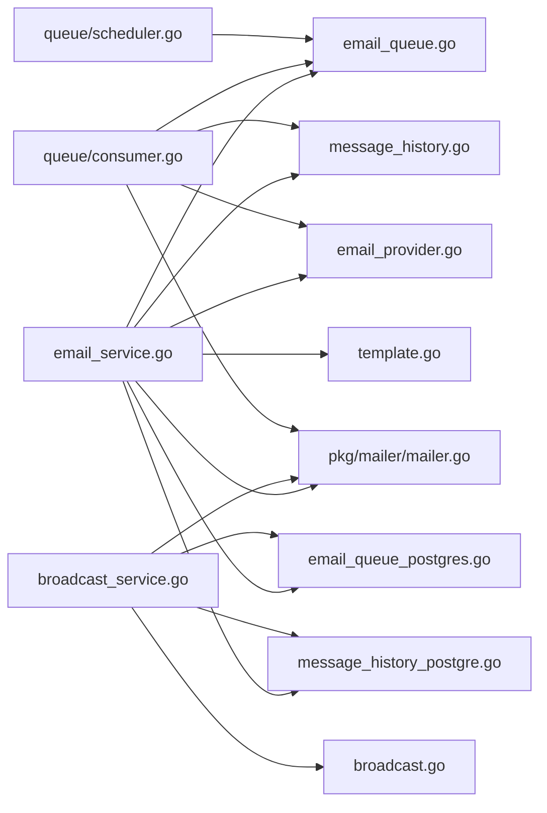

# 邮件模型

<cite>
**本文引用的文件**   
- [internal/domain/email_queue.go](file://notifuse/internal/domain/email_queue.go)
- [internal/domain/message_history.go](file://notifuse/internal/domain/message_history.go)
- [internal/domain/broadcast.go](file://notifuse/internal/domain/broadcast.go)
- [internal/domain/email_provider.go](file://notifuse/internal/domain/email_provider.go)
- [internal/domain/template.go](file://notifuse/internal/domain/template.go)
- [internal/repository/email_queue_postgres.go](file://notifuse/internal/repository/email_queue_postgres.go)
- [internal/repository/message_history_postgre.go](file://notifuse/internal/repository/message_history_postgre.go)
- [internal/repository/broadcast_postgres.go](file://notifuse/internal/repository/broadcast_postgres.go)
- [internal/service/email_service.go](file://notifuse/internal/service/email_service.go)
- [internal/service/message_history_service.go](file://notifuse/internal/service/message_history_service.go)
- [internal/service/broadcast_service.go](file://notifuse/internal/service/broadcast_service.go)
- [internal/service/queue/consumer.go](file://notifuse/internal/service/queue/consumer.go)
- [internal/service/queue/producer.go](file://notifuse/internal/service/queue/producer.go)
- [internal/service/queue/scheduler.go](file://notifuse/internal/service/queue/scheduler.go)
- [pkg/mailer/mailer.go](file://notifuse/pkg/mailer/mailer.go)
</cite>

## 目录
1. [简介](#简介)
2. [项目结构](#项目结构)
3. [核心组件](#核心组件)
4. [架构总览](#架构总览)
5. [详细组件分析](#详细组件分析)
6. [依赖分析](#依赖分析)
7. [性能考虑](#性能考虑)
8. [故障排查指南](#故障排查指南)
9. [结论](#结论)
10. [附录](#附录)

## 简介
本文件聚焦 Notifuse 平台的“邮件相关实体”的数据模型与处理机制，覆盖以下关键主题：
- 邮件队列(Message Queue)的优先级调度、重试与失败处理
- 消息历史记录(Message History)的完整审计日志（发送状态、送达报告与分析指标）
- 广播(Broadcast)批量发送任务的批次管理、进度跟踪与统计收集
- 邮件提供商适配器的抽象设计与统一接口规范
- 邮件模板渲染与个性化内容处理机制
- 邮件发送的性能优化与并发控制策略

## 项目结构
围绕邮件能力的相关代码主要分布在以下层次：
- 领域层(domain)：定义邮件队列、消息历史、广播、模板、邮件提供商等核心数据模型与行为契约
- 仓储层(repository)：提供持久化实现（PostgreSQL），将领域模型映射到数据库表
- 服务层(service)：编排业务逻辑，协调队列、模板、提供商与服务间交互
- 基础设施层(pkg/mailer)：封装底层邮件发送能力，屏蔽具体协议差异

图表来源
- [internal/domain/email_queue.go](file://notifuse/internal/domain/email_queue.go)
- [internal/domain/message_history.go](file://notifuse/internal/domain/message_history.go)
- [internal/domain/broadcast.go](file://notifuse/internal/domain/broadcast.go)
- [internal/domain/email_provider.go](file://notifuse/internal/domain/email_provider.go)
- [internal/domain/template.go](file://notifuse/internal/domain/template.go)
- [internal/repository/email_queue_postgres.go](file://notifuse/internal/repository/email_queue_postgres.go)
- [internal/repository/message_history_postgre.go](file://notifuse/internal/repository/message_history_postgre.go)
- [internal/repository/broadcast_postgres.go](file://notifuse/internal/repository/broadcast_postgres.go)
- [internal/service/email_service.go](file://notifuse/internal/service/email_service.go)
- [internal/service/message_history_service.go](file://notifuse/internal/service/message_history_service.go)
- [internal/service/broadcast_service.go](file://notifuse/internal/service/broadcast_service.go)
- [internal/service/queue/consumer.go](file://notifuse/internal/service/queue/consumer.go)
- [internal/service/queue/producer.go](file://notifuse/internal/service/queue/producer.go)
- [internal/service/queue/scheduler.go](file://notifuse/internal/service/queue/scheduler.go)
- [pkg/mailer/mailer.go](file://notifuse/pkg/mailer/mailer.go)

章节来源
- [internal/domain/email_queue.go](file://notifuse/internal/domain/email_queue.go)
- [internal/domain/message_history.go](file://notifuse/internal/domain/message_history.go)
- [internal/domain/broadcast.go](file://notifuse/internal/domain/broadcast.go)
- [internal/domain/email_provider.go](file://notifuse/internal/domain/email_provider.go)
- [internal/domain/template.go](file://notifuse/internal/domain/template.go)
- [internal/repository/email_queue_postgres.go](file://notifuse/internal/repository/email_queue_postgres.go)
- [internal/repository/message_history_postgre.go](file://notifuse/internal/repository/message_history_postgre.go)
- [internal/repository/broadcast_postgres.go](file://notifuse/internal/repository/broadcast_postgres.go)
- [internal/service/email_service.go](file://notifuse/internal/service/email_service.go)
- [internal/service/message_history_service.go](file://notifuse/internal/service/message_history_service.go)
- [internal/service/broadcast_service.go](file://notifuse/internal/service/broadcast_service.go)
- [internal/service/queue/consumer.go](file://notifuse/internal/service/queue/consumer.go)
- [internal/service/queue/producer.go](file://notifuse/internal/service/queue/producer.go)
- [internal/service/queue/scheduler.go](file://notifuse/internal/service/queue/scheduler.go)
- [pkg/mailer/mailer.go](file://notifuse/pkg/mailer/mailer.go)

## 核心组件
本节概述与邮件相关的核心数据模型及其职责边界。

- 邮件队列(Email Queue)
  - 负责承载待发送的邮件任务，包含目标收件人、主题、正文、附件、模板上下文、优先级、重试次数、下次尝试时间等字段
  - 支持按优先级调度与退避重试；记录失败原因与错误分类
  - 与仓储层协作完成入队、出队、更新状态与审计落盘

- 消息历史(Message History)
  - 作为不可变审计日志，记录每次投递尝试的结果、状态码、提供商返回信息、追踪ID、时间戳等
  - 支撑送达报告、点击/打开等分析指标采集与查询

- 广播(Broadcast)
  - 描述一次批量发送任务，包含受众范围、模板、变量、计划发送时间、批次大小、并发度、进度与统计汇总
  - 通过批次管理与进度跟踪，确保大规模发送的可观测性与可控性

- 邮件提供商适配器(Email Provider Adapter)
  - 定义统一的发送接口，屏蔽不同供应商(SMTP、SendGrid、Mailgun、SES、Postmark、SparkPost、Mailjet等)的差异
  - 提供错误归一化与元数据提取，便于统一记录与告警

- 模板与个性化(Template & Personalization)
  - 模板定义与块组合，支持变量注入与条件渲染
  - 在发送前对模板进行编译与渲染，生成最终可投递内容

章节来源
- [internal/domain/email_queue.go](file://notifuse/internal/domain/email_queue.go)
- [internal/domain/message_history.go](file://notifuse/internal/domain/message_history.go)
- [internal/domain/broadcast.go](file://notifuse/internal/domain/broadcast.go)
- [internal/domain/email_provider.go](file://notifuse/internal/domain/email_provider.go)
- [internal/domain/template.go](file://notifuse/internal/domain/template.go)

## 架构总览
下图展示了从业务调用到实际投递的关键路径，以及各组件间的依赖关系。

图表来源
- [internal/service/email_service.go](file://notifuse/internal/service/email_service.go)
- [internal/repository/email_queue_postgres.go](file://notifuse/internal/repository/email_queue_postgres.go)
- [internal/repository/message_history_postgre.go](file://notifuse/internal/repository/message_history_postgre.go)
- [internal/service/queue/scheduler.go](file://notifuse/internal/service/queue/scheduler.go)
- [internal/service/queue/consumer.go](file://notifuse/internal/service/queue/consumer.go)
- [internal/domain/email_provider.go](file://notifuse/internal/domain/email_provider.go)
- [pkg/mailer/mailer.go](file://notifuse/pkg/mailer/mailer.go)

## 详细组件分析

### 邮件队列(Email Queue)数据模型与调度
- 设计要点
  - 优先级调度：根据优先级字段选择任务，优先处理紧急或重要邮件
  - 重试机制：基于指数退避与最大重试次数，避免雪崩与重复风暴
  - 失败处理：记录错误类型与原因，支持死信或人工干预入口
  - 幂等与去重：通过唯一键或事务保证重复入队的幂等性
- 关键流程
  - 入队：校验参数、计算下次尝试时间、写入队列
  - 出队：按优先级扫描可执行任务，加锁或原子更新
  - 重试：根据上次失败时间与退避策略决定是否再次尝试
  - 完成：更新状态为成功并归档审计日志

图表来源
- [internal/domain/email_queue.go](file://notifuse/internal/domain/email_queue.go)
- [internal/repository/email_queue_postgres.go](file://notifuse/internal/repository/email_queue_postgres.go)
- [internal/service/queue/scheduler.go](file://notifuse/internal/service/queue/scheduler.go)
- [internal/service/queue/consumer.go](file://notifuse/internal/service/queue/consumer.go)

章节来源
- [internal/domain/email_queue.go](file://notifuse/internal/domain/email_queue.go)
- [internal/repository/email_queue_postgres.go](file://notifuse/internal/repository/email_queue_postgres.go)
- [internal/service/queue/scheduler.go](file://notifuse/internal/service/queue/scheduler.go)
- [internal/service/queue/consumer.go](file://notifuse/internal/service/queue/consumer.go)

### 消息历史记录(Message History)审计日志
- 设计要点
  - 不可变记录：每条投递尝试对应一条记录，包含时间戳、状态、错误码、提供商响应摘要、追踪ID等
  - 送达报告：聚合打开、点击、退信等事件，形成可分析的指标
  - 查询与导出：支持按任务ID、收件人、时间范围、状态等多维度检索
- 关键流程
  - 发送后回调或轮询获取状态，写入历史
  - 异常时记录错误详情与堆栈摘要
  - 定期归档冷数据，保持热表规模可控

图表来源
- [internal/domain/message_history.go](file://notifuse/internal/domain/message_history.go)
- [internal/domain/email_queue.go](file://notifuse/internal/domain/email_queue.go)
- [internal/repository/message_history_postgre.go](file://notifuse/internal/repository/message_history_postgre.go)

章节来源
- [internal/domain/message_history.go](file://notifuse/internal/domain/message_history.go)
- [internal/repository/message_history_postgre.go](file://notifuse/internal/repository/message_history_postgre.go)
- [internal/service/message_history_service.go](file://notifuse/internal/service/message_history_service.go)

### 广播(Broadcast)批量发送任务
- 设计要点
  - 批次管理：将大任务拆分为多个批次，每批包含固定数量的收件人或分片
  - 进度跟踪：维护已发送、成功、失败、重试中、待处理的计数与百分比
  - 统计收集：汇总到达率、打开率、点击率、退信率等指标
- 关键流程
  - 创建广播任务，解析受众与模板变量
  - 生成批次并写入队列
  - 消费者按批次消费，更新进度与统计
  - 完成后输出总结报告

图表来源
- [internal/domain/broadcast.go](file://notifuse/internal/domain/broadcast.go)
- [internal/repository/broadcast_postgres.go](file://notifuse/internal/repository/broadcast_postgres.go)
- [internal/service/broadcast_service.go](file://notifuse/internal/service/broadcast_service.go)
- [internal/service/queue/consumer.go](file://notifuse/internal/service/queue/consumer.go)
- [internal/repository/message_history_postgre.go](file://notifuse/internal/repository/message_history_postgre.go)

章节来源
- [internal/domain/broadcast.go](file://notifuse/internal/domain/broadcast.go)
- [internal/repository/broadcast_postgres.go](file://notifuse/internal/repository/broadcast_postgres.go)
- [internal/service/broadcast_service.go](file://notifuse/internal/service/broadcast_service.go)

### 邮件提供商适配器抽象与统一接口
- 设计要点
  - 统一接口：定义发送方法、错误类型与元数据返回
  - 多实现：针对 SMTP、SendGrid、Mailgun、SES、Postmark、SparkPost、Mailjet 等提供具体实现
  - 错误归一化：将不同供应商的错误码映射为内部标准错误，便于重试与告警
- 关键流程
  - 选择提供商实例
  - 调用统一接口发送
  - 捕获并转换错误
  - 返回标准化结果与追踪信息

图表来源
- [internal/domain/email_provider.go](file://notifuse/internal/domain/email_provider.go)

章节来源
- [internal/domain/email_provider.go](file://notifuse/internal/domain/email_provider.go)

### 模板渲染与个性化内容
- 设计要点
  - 模板定义：支持基础模板与块组合，变量占位符与条件渲染
  - 渲染引擎：在发送前将模板与上下文合并，生成最终文本/HTML
  - 安全与性能：限制危险函数、缓存编译结果、避免重复渲染
- 关键流程
  - 加载模板与块
  - 填充个性化变量
  - 渲染并校验输出
  - 将渲染结果用于构建邮件消息

图表来源
- [internal/domain/template.go](file://notifuse/internal/domain/template.go)

章节来源
- [internal/domain/template.go](file://notifuse/internal/domain/template.go)

## 依赖分析
- 组件耦合
  - 服务层依赖领域模型与仓储接口，降低对外部实现的直接耦合
  - 消费者与调度器解耦于具体提供商，通过适配器统一发送
- 外部依赖
  - 数据库(PostgreSQL)：队列、历史、广播等持久化
  - 邮件提供商API/SMTP：实际投递通道
- 潜在循环依赖
  - 通过接口与分层隔离避免循环引用
- 集成点
  - 模板服务、认证与权限、监控与追踪

图表来源
- [internal/service/email_service.go](file://notifuse/internal/service/email_service.go)
- [internal/service/broadcast_service.go](file://notifuse/internal/service/broadcast_service.go)
- [internal/service/queue/consumer.go](file://notifuse/internal/service/queue/consumer.go)
- [internal/service/queue/scheduler.go](file://notifuse/internal/service/queue/scheduler.go)
- [internal/domain/email_queue.go](file://notifuse/internal/domain/email_queue.go)
- [internal/domain/message_history.go](file://notifuse/internal/domain/message_history.go)
- [internal/domain/broadcast.go](file://notifuse/internal/domain/broadcast.go)
- [internal/domain/email_provider.go](file://notifuse/internal/domain/email_provider.go)
- [internal/domain/template.go](file://notifuse/internal/domain/template.go)
- [internal/repository/email_queue_postgres.go](file://notifuse/internal/repository/email_queue_postgres.go)
- [internal/repository/message_history_postgre.go](file://notifuse/internal/repository/message_history_postgre.go)
- [pkg/mailer/mailer.go](file://notifuse/pkg/mailer/mailer.go)

章节来源
- [internal/service/email_service.go](file://notifuse/internal/service/email_service.go)
- [internal/service/broadcast_service.go](file://notifuse/internal/service/broadcast_service.go)
- [internal/service/queue/consumer.go](file://notifuse/internal/service/queue/consumer.go)
- [internal/service/queue/scheduler.go](file://notifuse/internal/service/queue/scheduler.go)
- [internal/domain/email_queue.go](file://notifuse/internal/domain/email_queue.go)
- [internal/domain/message_history.go](file://notifuse/internal/domain/message_history.go)
- [internal/domain/broadcast.go](file://notifuse/internal/domain/broadcast.go)
- [internal/domain/email_provider.go](file://notifuse/internal/domain/email_provider.go)
- [internal/domain/template.go](file://notifuse/internal/domain/template.go)
- [internal/repository/email_queue_postgres.go](file://notifuse/internal/repository/email_queue_postgres.go)
- [internal/repository/message_history_postgre.go](file://notifuse/internal/repository/message_history_postgre.go)
- [pkg/mailer/mailer.go](file://notifuse/pkg/mailer/mailer.go)

## 性能考虑
- 并发控制
  - 消费者并发度可调，结合令牌桶或信号量限制并发，避免压垮下游提供商
  - 批次大小与并行度需平衡吞吐与内存占用
- 优先级调度
  - 高优先级任务优先出队，保障关键通知时效性
- 重试与退避
  - 指数退避减少瞬时拥塞，设置最大重试上限防止无限重试
- 模板渲染优化
  - 预编译模板、缓存渲染结果，避免重复计算
- 存储与索引
  - 为队列与历史表建立合适索引，提升查询与出队效率
- 背压与限流
  - 当下游提供商限流或错误率升高时，自动降速或暂停消费

[本节为通用指导，不直接分析具体文件]

## 故障排查指南
- 常见问题定位
  - 队列积压：检查调度器与消费者健康状态、并发度与退避策略
  - 发送失败：查看消息历史中的错误码与提供商响应摘要
  - 模板渲染错误：确认变量存在且类型正确，检查模板语法
  - 提供商限流：调整速率限制与重试间隔
- 诊断建议
  - 启用追踪ID并在历史中记录，便于端到端追踪
  - 对高频错误进行分类与告警，快速定位问题源
  - 定期归档历史数据，保持系统稳定

章节来源
- [internal/service/message_history_service.go](file://notifuse/internal/service/message_history_service.go)
- [internal/repository/message_history_postgre.go](file://notifuse/internal/repository/message_history_postgre.go)
- [internal/service/email_service.go](file://notifuse/internal/service/email_service.go)

## 结论
Notifuse 的邮件子系统以清晰的领域模型与分层架构为基础，实现了可扩展的队列调度、完善的审计日志、可观测的广播任务与统一的提供商适配。通过优先级调度、重试与失败处理、模板渲染与个性化、以及并发与限流策略，平台能够在高负载场景下保持稳定与高效。

[本节为总结性内容，不直接分析具体文件]

## 附录
- 术语说明
  - 优先级：数值越小优先级越高（或反之，依实现而定）
  - 退避：重试间隔随失败次数递增的策略
  - 死信：无法重试的任务进入特殊队列供人工处理
- 扩展建议
  - 增加更多提供商实现
  - 引入更细粒度的指标采集与可视化
  - 增强模板版本管理与灰度发布

[本节为补充说明，不直接分析具体文件]