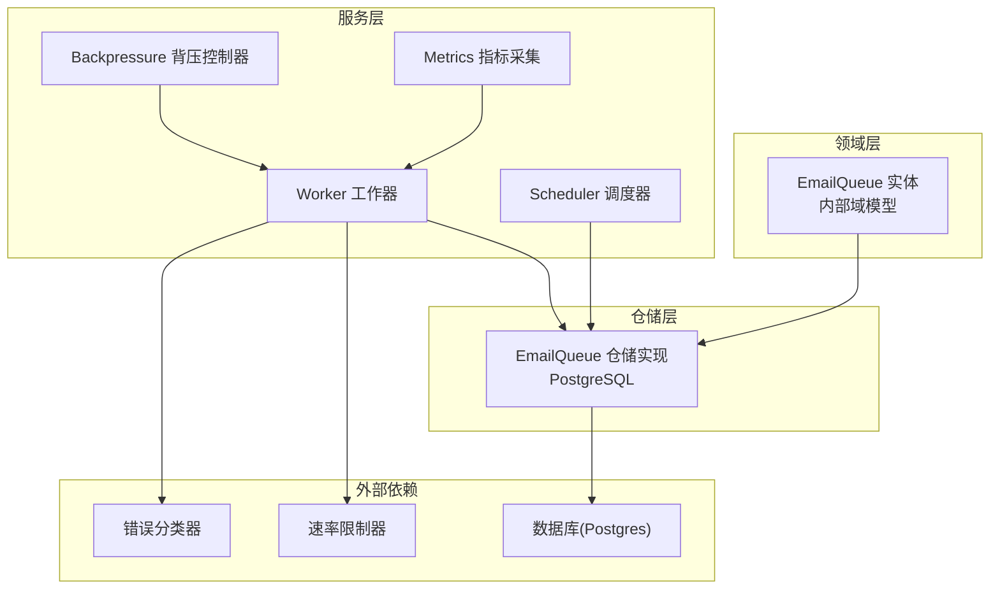
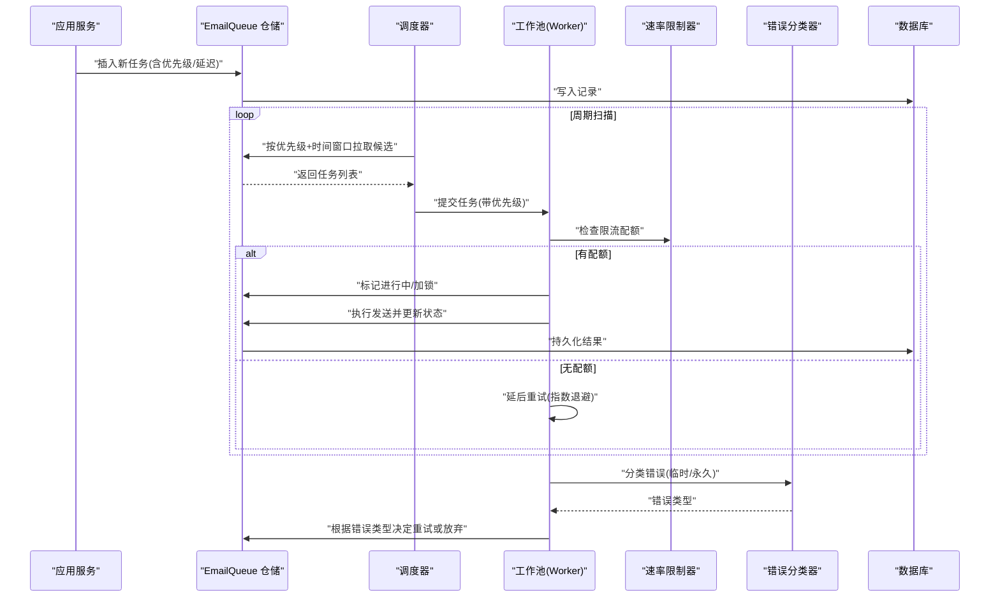
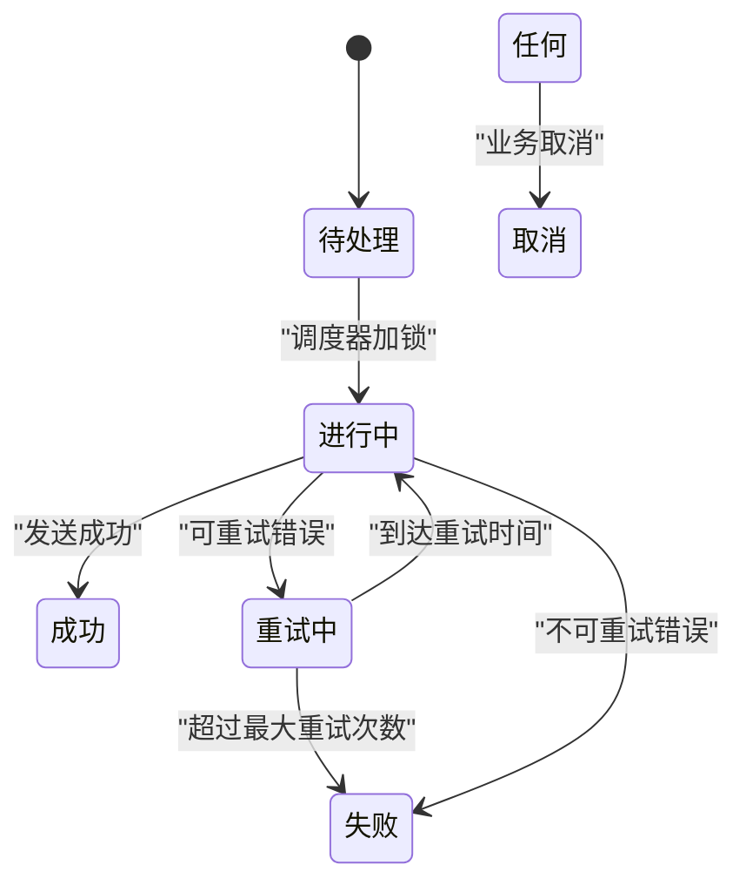
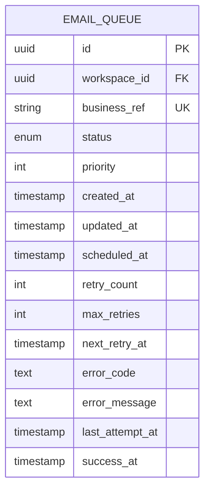
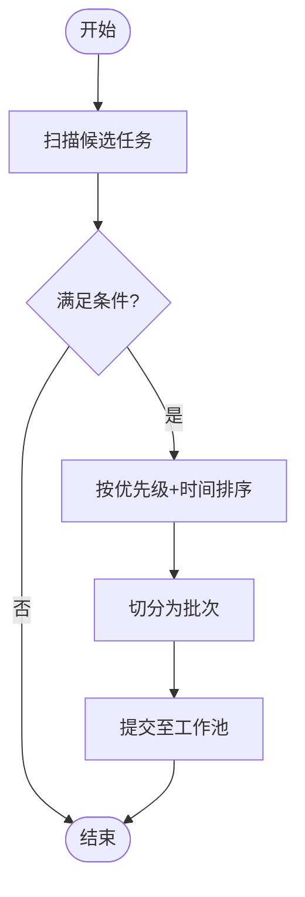
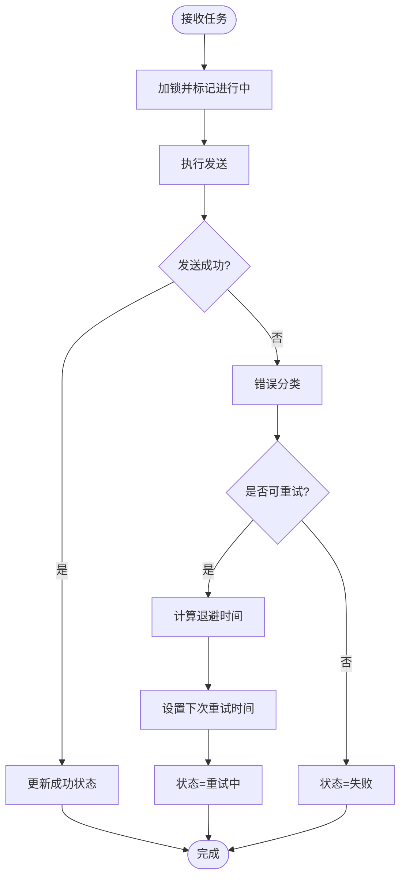
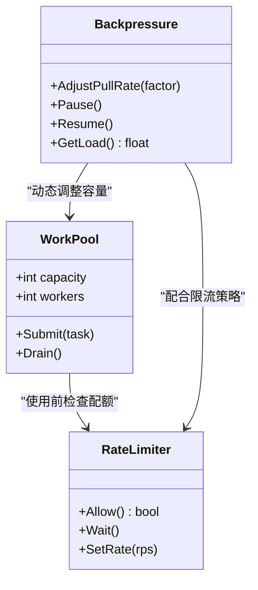
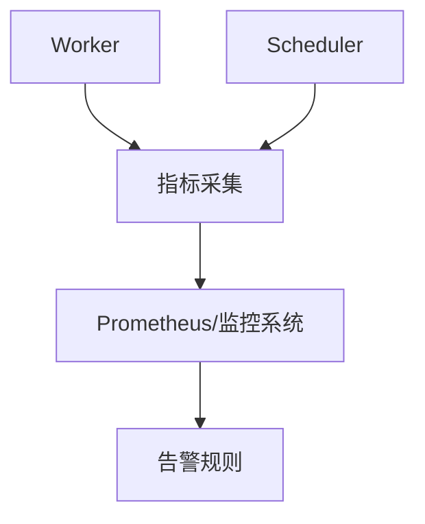
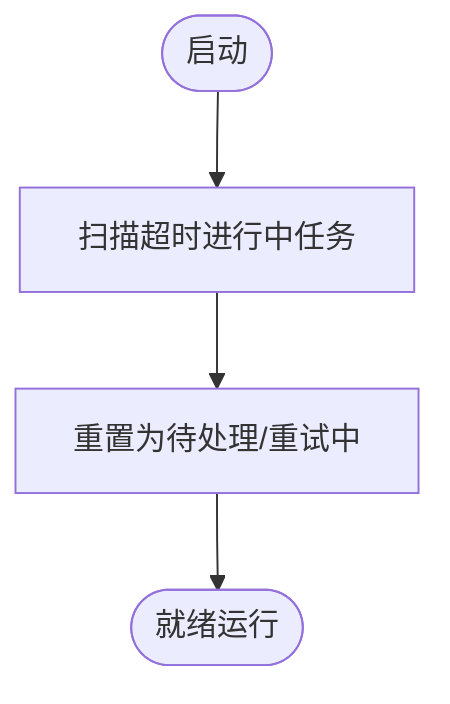
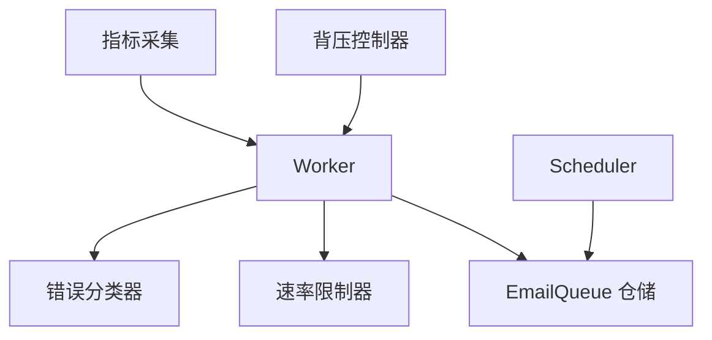

# 邮件队列模型

<cite>
**本文引用的文件**   
- [internal/domain/email_queue.go](file://notifuse/internal/domain/email_queue.go)
- [internal/repository/email_queue_postgres.go](file://notifuse/internal/repository/email_queue_postgres.go)
- [internal/service/queue/email_worker.go](file://notifuse/internal/service/queue/email_worker.go)
- [internal/service/queue/email_scheduler.go](file://notifuse/internal/service/queue/email_scheduler.go)
- [internal/service/queue/email_backpressure.go](file://notifuse/internal/service/queue/email_backpressure.go)
- [internal/service/queue/email_metrics.go](file://notifuse/internal/service/queue/email_metrics.go)
- [pkg/emailerror/classifier.go](file://notifuse/pkg/emailerror/classifier.go)
- [pkg/ratelimiter/ratelimiter.go](file://notifuse/pkg/ratelimiter/ratelimiter.go)
</cite>

## 目录
1. [简介](#简介)
2. [项目结构](#项目结构)
3. [核心组件](#核心组件)
4. [架构总览](#架构总览)
5. [详细组件分析](#详细组件分析)
6. [依赖关系分析](#依赖关系分析)
7. [性能考量](#性能考量)
8. [故障排查指南](#故障排查指南)
9. [结论](#结论)
10. [附录](#附录)

## 简介
本文件为 Notifuse 平台的邮件队列系统提供数据模型与实现文档，聚焦 EmailQueue 实体的设计、优先级调度算法、任务状态管理与重试机制；说明并发控制策略（工作池配置、限流与背压）；文档化失败处理与错误分类（临时错误与永久错误区分）；阐述性能优化（批量处理、连接池与内存优化）；并给出监控指标收集与持久化恢复机制的实现细节。

## 项目结构
邮件队列相关代码主要分布在以下模块：
- 领域模型与枚举：internal/domain/email_queue.go
- 持久化接口与实现：internal/repository/email_queue_postgres.go
- 队列运行时：internal/service/queue 下的 worker、scheduler、backpressure、metrics 等

图表来源
- [internal/domain/email_queue.go](file://notifuse/internal/domain/email_queue.go)
- [internal/repository/email_queue_postgres.go](file://notifuse/internal/repository/email_queue_postgres.go)
- [internal/service/queue/email_worker.go](file://notifuse/internal/service/queue/email_worker.go)
- [internal/service/queue/email_scheduler.go](file://notifuse/internal/service/queue/email_scheduler.go)
- [internal/service/queue/email_backpressure.go](file://notifuse/internal/service/queue/email_backpressure.go)
- [internal/service/queue/email_metrics.go](file://notifuse/internal/service/queue/email_metrics.go)
- [pkg/ratelimiter/ratelimiter.go](file://notifuse/pkg/ratelimiter/ratelimiter.go)
- [pkg/emailerror/classifier.go](file://notifuse/pkg/emailerror/classifier.go)

章节来源
- [internal/domain/email_queue.go](file://notifuse/internal/domain/email_queue.go)
- [internal/repository/email_queue_postgres.go](file://notifuse/internal/repository/email_queue_postgres.go)
- [internal/service/queue/email_worker.go](file://notifuse/internal/service/queue/email_worker.go)
- [internal/service/queue/email_scheduler.go](file://notifuse/internal/service/queue/email_scheduler.go)
- [internal/service/queue/email_backpressure.go](file://notifuse/internal/service/queue/email_backpressure.go)
- [internal/service/queue/email_metrics.go](file://notifuse/internal/service/queue/email_metrics.go)
- [pkg/ratelimiter/ratelimiter.go](file://notifuse/pkg/ratelimiter/ratelimiter.go)
- [pkg/emailerror/classifier.go](file://notifuse/pkg/emailerror/classifier.go)

## 核心组件
- EmailQueue 实体：定义邮件任务的领域模型、状态机与优先级字段，用于描述待发送、进行中、成功、失败、重试中、取消等生命周期阶段。
- 仓储实现：负责将 EmailQueue 持久化到 PostgreSQL，并提供按优先级、状态、时间窗口的查询与更新能力。
- Worker 工作器：从队列拉取任务，执行发送逻辑，处理结果并更新状态，支持重试与退避。
- Scheduler 调度器：周期性扫描可执行任务，考虑优先级与延迟时间，生成可调度批次。
- Backpressure 背压控制器：根据系统负载与下游限流反馈，动态调整拉取速率与工作池大小。
- Metrics 指标采集：暴露队列长度、吞吐、延迟、错误率、重试次数等关键指标。

章节来源
- [internal/domain/email_queue.go](file://notifuse/internal/domain/email_queue.go)
- [internal/repository/email_queue_postgres.go](file://notifuse/internal/repository/email_queue_postgres.go)
- [internal/service/queue/email_worker.go](file://notifuse/internal/service/queue/email_worker.go)
- [internal/service/queue/email_scheduler.go](file://notifuse/internal/service/queue/email_scheduler.go)
- [internal/service/queue/email_backpressure.go](file://notifuse/internal/service/queue/email_backpressure.go)
- [internal/service/queue/email_metrics.go](file://notifuse/internal/service/queue/email_metrics.go)

## 架构总览
下图展示了从任务入队到出队、发送、结果回写的全链路流程，以及优先级调度、重试与错误分类的交互点。

图表来源
- [internal/repository/email_queue_postgres.go](file://notifuse/internal/repository/email_queue_postgres.go)
- [internal/service/queue/email_scheduler.go](file://notifuse/internal/service/queue/email_scheduler.go)
- [internal/service/queue/email_worker.go](file://notifuse/internal/service/queue/email_worker.go)
- [pkg/ratelimiter/ratelimiter.go](file://notifuse/pkg/ratelimiter/ratelimiter.go)
- [pkg/emailerror/classifier.go](file://notifuse/pkg/emailerror/classifier.go)

## 详细组件分析

### EmailQueue 实体与状态机
- 字段与属性
  - 标识与元数据：任务唯一ID、关联业务ID、工作区ID、创建时间、更新时间等。
  - 投递信息：收件人、主题、内容、模板变量、附件引用等。
  - 调度与优先级：优先级数值、计划发送时间、重试次数、最大重试次数、下次重试时间。
  - 状态与结果：当前状态、错误码、错误消息、最后尝试时间、成功时间等。
- 状态机
  - 典型状态包括：待处理、进行中、成功、失败、重试中、取消。
  - 转换规则：
    - 待处理 -> 进行中：调度器选中并加锁。
    - 进行中 -> 成功：发送成功后更新。
    - 进行中 -> 失败：发送失败且不可重试或达到最大重试次数。
    - 进行中 -> 重试中：发送失败但允许重试，计算下次重试时间。
    - 任意 -> 取消：业务侧主动取消。
- 优先级调度算法
  - 基于数值优先级的排序策略，结合计划发送时间与重试时间窗口进行筛选。
  - 在相同优先级下，采用先进先出（FIFO）保证公平性。
  - 支持“紧急”通道的高优先级快速通道。

图表来源
- [internal/domain/email_queue.go](file://notifuse/internal/domain/email_queue.go)

章节来源
- [internal/domain/email_queue.go](file://notifuse/internal/domain/email_queue.go)

### 持久化与索引策略
- 表结构与约束
  - 主键：任务唯一ID。
  - 唯一约束：业务ID与工作区组合唯一，避免重复入队。
  - 外键：可选关联工作区、模板等。
- 索引设计
  - 按状态+优先级+计划时间的复合索引，加速调度器拉取。
  - 按重试次数+下次重试时间的索引，提升重试扫描效率。
  - 按工作区+状态的索引，便于多租户隔离查询。
- 事务与一致性
  - 入队与状态更新使用事务包裹，确保幂等与一致性。
  - 加锁采用行级锁或乐观锁，防止重复消费。

图表来源
- [internal/repository/email_queue_postgres.go](file://notifuse/internal/repository/email_queue_postgres.go)

章节来源
- [internal/repository/email_queue_postgres.go](file://notifuse/internal/repository/email_queue_postgres.go)

### 调度器与优先级选择
- 扫描策略
  - 周期扫描“待处理”和“重试中”的任务。
  - 条件过滤：计划时间<=当前时间，且未超过最大重试次数。
  - 排序策略：按优先级降序，同优先级按时间升序。
- 批处理
  - 每次拉取固定大小的批次，减少数据库往返。
  - 批次大小受背压控制器与工作池容量影响。
- 幂等与去重
  - 通过业务ID与工作区组合的唯一约束，避免重复入队。
  - 加锁时采用“SELECT FOR UPDATE SKIP LOCKED”模式，提高并发安全。

图表来源
- [internal/service/queue/email_scheduler.go](file://notifuse/internal/service/queue/email_scheduler.go)
- [internal/repository/email_queue_postgres.go](file://notifuse/internal/repository/email_queue_postgres.go)

章节来源
- [internal/service/queue/email_scheduler.go](file://notifuse/internal/service/queue/email_scheduler.go)
- [internal/repository/email_queue_postgres.go](file://notifuse/internal/repository/email_queue_postgres.go)

### Worker 工作器与重试机制
- 拉取与执行
  - 从工作池获取任务，标记为“进行中”，调用发送器。
  - 发送完成后根据结果更新状态与时间戳。
- 重试策略
  - 指数退避：根据重试次数计算等待时间，设置下次重试时间。
  - 抖动因子：加入随机抖动，避免雪崩效应。
  - 最大重试次数：超过阈值则转为“失败”。
- 错误分类
  - 临时错误：网络抖动、超时、限流、SMTP 暂时拒绝等，触发重试。
  - 永久错误：无效邮箱、域名不存在、权限不足等，直接失败。
  - 分类器依据错误码与消息模式进行分类决策。

图表来源
- [internal/service/queue/email_worker.go](file://notifuse/internal/service/queue/email_worker.go)
- [pkg/emailerror/classifier.go](file://notifuse/pkg/emailerror/classifier.go)

章节来源
- [internal/service/queue/email_worker.go](file://notifuse/internal/service/queue/email_worker.go)
- [pkg/emailerror/classifier.go](file://notifuse/pkg/emailerror/classifier.go)

### 并发控制：工作池、限流与背压
- 工作池配置
  - 并发度：可配置的 Worker 数量，控制同时处理的邮件数。
  - 队列容量：缓冲任务上限，超出时触发背压。
- 限流控制
  - 基于令牌桶或漏桶算法，限制单位时间内的发送量。
  - 针对 SMTP 提供商或目标域名的细粒度限流。
- 背压处理
  - 当工作池饱和或限流器拒绝时，降低拉取速率或暂停调度。
  - 动态调整批次大小与 Worker 数量，平滑峰值流量。

图表来源
- [internal/service/queue/email_worker.go](file://notifuse/internal/service/queue/email_worker.go)
- [internal/service/queue/email_backpressure.go](file://notifuse/internal/service/queue/email_backpressure.go)
- [pkg/ratelimiter/ratelimiter.go](file://notifuse/pkg/ratelimiter/ratelimiter.go)

章节来源
- [internal/service/queue/email_worker.go](file://notifuse/internal/service/queue/email_worker.go)
- [internal/service/queue/email_backpressure.go](file://notifuse/internal/service/queue/email_backpressure.go)
- [pkg/ratelimiter/ratelimiter.go](file://notifuse/pkg/ratelimiter/ratelimiter.go)

### 监控与指标收集
- 指标维度
  - 队列长度：按状态分组的任务计数。
  - 吞吐：每秒成功/失败/重试任务数。
  - 延迟：从入队到成功的平均/分位延迟。
  - 错误率：按错误分类统计的比例。
  - 重试次数分布：各重试次数的任务占比。
- 采集方式
  - 在 Worker 与 Scheduler 的关键路径埋点。
  - 聚合指标并暴露给监控系统（如 Prometheus）。
- 告警规则
  - 队列积压超过阈值。
  - 错误率异常升高。
  - 重试次数过多导致资源占用。

图表来源
- [internal/service/queue/email_metrics.go](file://notifuse/internal/service/queue/email_metrics.go)

章节来源
- [internal/service/queue/email_metrics.go](file://notifuse/internal/service/queue/email_metrics.go)

### 持久化与恢复机制
- 持久化
  - 所有状态变更均落库，确保进程重启后可恢复。
  - 使用事务保证状态更新的原子性。
- 恢复
  - 启动时扫描“进行中”且超时的任务，将其重置为“待处理”或“重试中”。
  - 清理僵尸锁：长时间未释放的行级锁任务被回收。
- 迁移与版本管理
  - 通过迁移脚本演进表结构，保持向后兼容。

图表来源
- [internal/repository/email_queue_postgres.go](file://notifuse/internal/repository/email_queue_postgres.go)

章节来源
- [internal/repository/email_queue_postgres.go](file://notifuse/internal/repository/email_queue_postgres.go)

## 依赖关系分析
- 组件耦合
  - Worker 依赖仓储、限流器与错误分类器。
  - Scheduler 依赖仓储与指标采集。
  - Backpressure 协调 Worker 与限流器行为。
- 外部依赖
  - 数据库：PostgreSQL，提供高可用与事务保障。
  - 限流器：可插拔实现，支持不同策略。
  - 错误分类器：基于错误码与消息模式的规则引擎。

图表来源
- [internal/service/queue/email_worker.go](file://notifuse/internal/service/queue/email_worker.go)
- [internal/service/queue/email_scheduler.go](file://notifuse/internal/service/queue/email_scheduler.go)
- [internal/service/queue/email_backpressure.go](file://notifuse/internal/service/queue/email_backpressure.go)
- [internal/service/queue/email_metrics.go](file://notifuse/internal/service/queue/email_metrics.go)
- [internal/repository/email_queue_postgres.go](file://notifuse/internal/repository/email_queue_postgres.go)
- [pkg/ratelimiter/ratelimiter.go](file://notifuse/pkg/ratelimiter/ratelimiter.go)
- [pkg/emailerror/classifier.go](file://notifuse/pkg/emailerror/classifier.go)

章节来源
- [internal/service/queue/email_worker.go](file://notifuse/internal/service/queue/email_worker.go)
- [internal/service/queue/email_scheduler.go](file://notifuse/internal/service/queue/email_scheduler.go)
- [internal/service/queue/email_backpressure.go](file://notifuse/internal/service/queue/email_backpressure.go)
- [internal/service/queue/email_metrics.go](file://notifuse/internal/service/queue/email_metrics.go)
- [internal/repository/email_queue_postgres.go](file://notifuse/internal/repository/email_queue_postgres.go)
- [pkg/ratelimiter/ratelimiter.go](file://notifuse/pkg/ratelimiter/ratelimiter.go)
- [pkg/emailerror/classifier.go](file://notifuse/pkg/emailerror/classifier.go)

## 性能考量
- 批量处理
  - 调度器按批次拉取，减少数据库往返与锁竞争。
  - 批大小根据背压与工作池容量动态调整。
- 连接池管理
  - 复用数据库连接，避免频繁建立/关闭连接。
  - 合理设置最大连接数与空闲超时。
- 内存优化
  - 任务对象按需加载，避免一次性加载大量任务。
  - 及时释放大对象引用，减少 GC 压力。
- 索引与查询优化
  - 复合索引覆盖常见查询路径，避免全表扫描。
  - 分页与游标式拉取，降低单次查询开销。

[本节为通用性能建议，不直接分析具体文件]

## 故障排查指南
- 常见问题
  - 队列积压：检查背压策略与工作池容量，确认限流器是否过于严格。
  - 重试风暴：观察重试次数与退避策略，必要时增加抖动因子。
  - 错误率高：查看错误分类结果，定位临时错误与永久错误比例。
- 诊断步骤
  - 查看指标：队列长度、吞吐、延迟、错误率。
  - 检查日志：Worker 与 Scheduler 的关键路径日志。
  - 验证索引：确认调度查询命中预期索引。
- 恢复操作
  - 手动重置卡住的任务状态。
  - 调整限流与工作池参数，观察效果。

章节来源
- [internal/service/queue/email_worker.go](file://notifuse/internal/service/queue/email_worker.go)
- [internal/service/queue/email_metrics.go](file://notifuse/internal/service/queue/email_metrics.go)
- [pkg/emailerror/classifier.go](file://notifuse/pkg/emailerror/classifier.go)

## 结论
Notifuse 的邮件队列系统以 EmailQueue 为核心实体，结合优先级调度、状态机与重试机制，实现了高可靠与高吞吐的邮件发送能力。通过工作池、限流与背压的协同控制，系统在峰值场景下保持稳定；错误分类与监控指标为运维提供了清晰的观测面；持久化与恢复机制确保了数据的强一致性与容错性。

[本节为总结性内容，不直接分析具体文件]

## 附录
- 术语
  - 临时错误：可自动恢复的错误，适合重试。
  - 永久错误：不可自动恢复的错误，应尽快失败并上报。
  - 背压：当系统过载时，主动降低输入速率以避免崩溃。
- 最佳实践
  - 合理设置优先级与最大重试次数。
  - 定期审查错误分类规则，保持准确性。
  - 持续监控指标，及时调整参数。

[本节为补充信息，不直接分析具体文件]