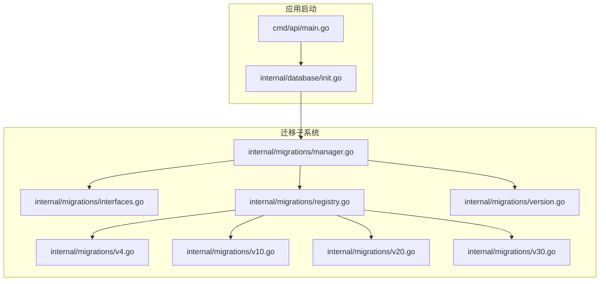
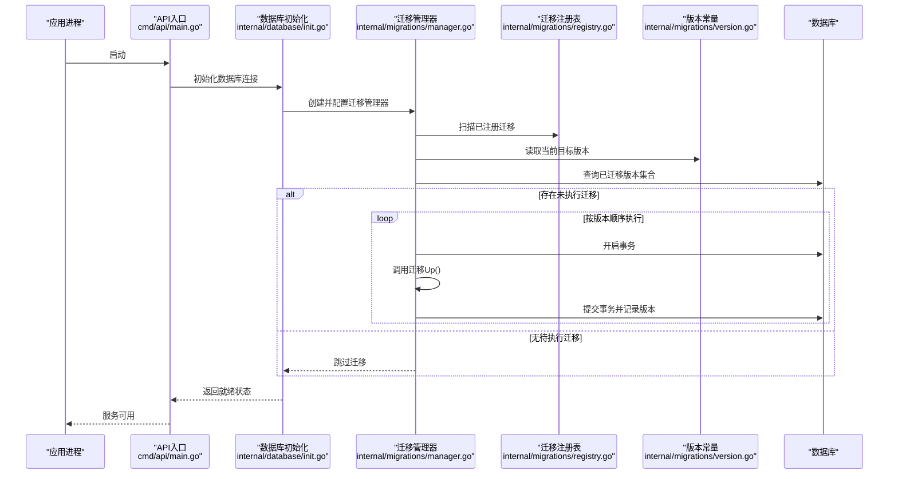
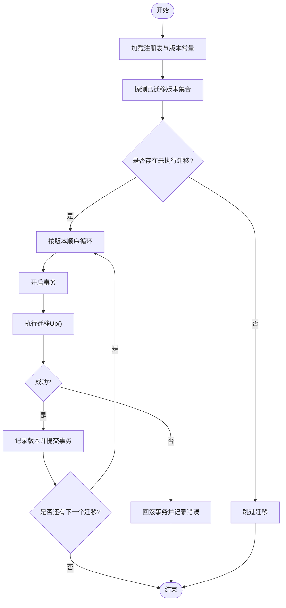
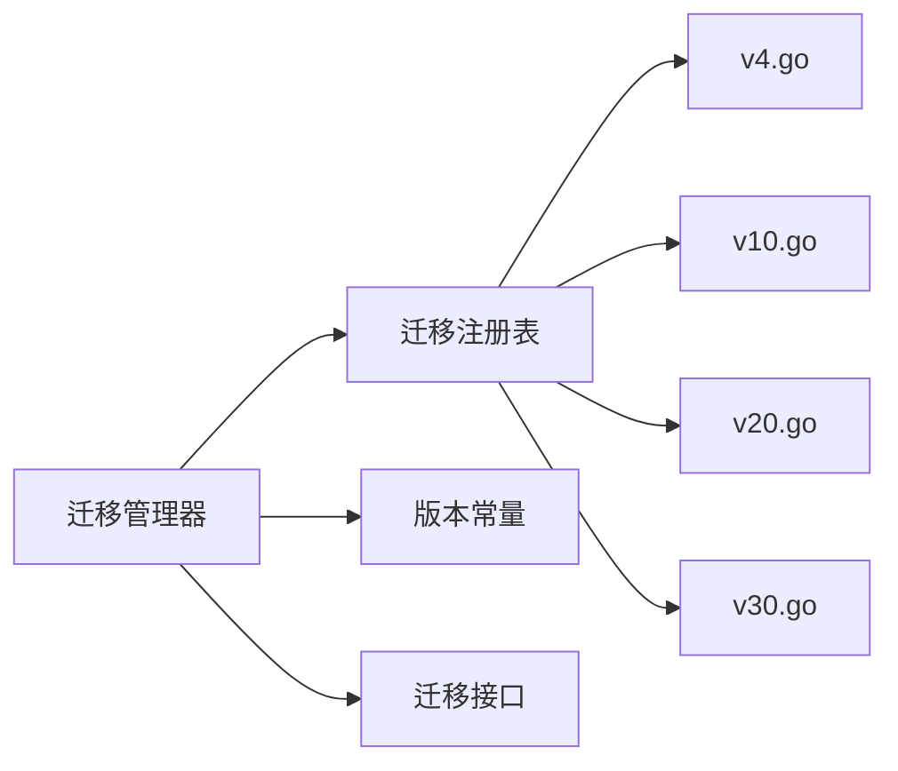

# 迁移策略

<cite>
**本文引用的文件**   
- [notifuse/internal/migrations/interfaces.go](file://notifuse/internal/migrations/interfaces.go)
- [notifuse/internal/migrations/manager.go](file://notifuse/internal/migrations/manager.go)
- [notifuse/internal/migrations/registry.go](file://notifuse/internal/migrations/registry.go)
- [notifuse/internal/migrations/version.go](file://notifuse/internal/migrations/version.go)
- [notifuse/internal/database/init.go](file://notifuse/internal/database/init.go)
- [notifuse/cmd/api/main.go](file://notifuse/cmd/api/main.go)
- [notifuse/internal/migrations/v4.go](file://notifuse/internal/migrations/v4.go)
- [notifuse/internal/migrations/v10.go](file://notifuse/internal/migrations/v10.go)
- [notifuse/internal/migrations/v20.go](file://notifuse/internal/migrations/v20.go)
- [notifuse/internal/migrations/v30.go](file://notifuse/internal/migrations/v30.go)
</cite>

## 目录
1. [简介](#简介)
2. [项目结构](#项目结构)
3. [核心组件](#核心组件)
4. [架构总览](#架构总览)
5. [详细组件分析](#详细组件分析)
6. [依赖关系分析](#依赖关系分析)
7. [性能考量](#性能考量)
8. [故障排查指南](#故障排查指南)
9. [结论](#结论)
10. [附录](#附录)

## 简介
本文件为 Notifuse 平台制定基于 Go 的数据库迁移系统策略与实施规范，覆盖迁移文件命名、版本管理、依赖处理、执行流程、事务与回滚、增量/批量/条件迁移实现方式、测试策略与模拟环境、生产部署与灰度发布、监控告警、冲突解决、数据修复脚本与紧急回滚方案，以及最佳实践与常见陷阱规避。

## 项目结构
Notifuse 的迁移子系统位于 internal/migrations 包内，采用“接口 + 管理器 + 注册表 + 版本”的分层设计；应用启动时通过 database 初始化模块加载并执行迁移；API 入口负责组装应用上下文并触发迁移流程。

图表来源
- [notifuse/cmd/api/main.go](file://notifuse/cmd/api/main.go)
- [notifuse/internal/database/init.go](file://notifuse/internal/database/init.go)
- [notifuse/internal/migrations/interfaces.go](file://notifuse/internal/migrations/interfaces.go)
- [notifuse/internal/migrations/manager.go](file://notifuse/internal/migrations/manager.go)
- [notifuse/internal/migrations/registry.go](file://notifuse/internal/migrations/registry.go)
- [notifuse/internal/migrations/version.go](file://notifuse/internal/migrations/version.go)
- [notifuse/internal/migrations/v4.go](file://notifuse/internal/migrations/v4.go)
- [notifuse/internal/migrations/v10.go](file://notifuse/internal/migrations/v10.go)
- [notifuse/internal/migrations/v20.go](file://notifuse/internal/migrations/v20.go)
- [notifuse/internal/migrations/v30.go](file://notifuse/internal/migrations/v30.go)

章节来源
- [notifuse/cmd/api/main.go](file://notifuse/cmd/api/main.go)
- [notifuse/internal/database/init.go](file://notifuse/internal/database/init.go)
- [notifuse/internal/migrations/interfaces.go](file://notifuse/internal/migrations/interfaces.go)
- [notifuse/internal/migrations/manager.go](file://notifuse/internal/migrations/manager.go)
- [notifuse/internal/migrations/registry.go](file://notifuse/internal/migrations/registry.go)
- [notifuse/internal/migrations/version.go](file://notifuse/internal/migrations/version.go)

## 核心组件
- 迁移接口：定义迁移单元的最小契约（版本号、描述、Up/Down 方法），用于统一调度与生命周期管理。
- 迁移管理器：负责发现、排序、执行、记录版本、事务控制、错误处理与回滚。
- 迁移注册表：集中注册所有迁移实现，提供按版本查找与遍历能力。
- 版本常量：维护当前最高版本与迁移元信息，确保向前兼容与可观测性。
- 具体迁移实现：每个 vN.go 对应一个迁移步骤，包含 Up/Down 逻辑与必要的幂等检查。

章节来源
- [notifuse/internal/migrations/interfaces.go](file://notifuse/internal/migrations/interfaces.go)
- [notifuse/internal/migrations/manager.go](file://notifuse/internal/migrations/manager.go)
- [notifuse/internal/migrations/registry.go](file://notifuse/internal/migrations/registry.go)
- [notifuse/internal/migrations/version.go](file://notifuse/internal/migrations/version.go)

## 架构总览
下图展示了从应用启动到迁移执行的端到端流程，包括连接建立、版本探测、增量执行、事务边界与失败回滚路径。

图表来源
- [notifuse/cmd/api/main.go](file://notifuse/cmd/api/main.go)
- [notifuse/internal/database/init.go](file://notifuse/internal/database/init.go)
- [notifuse/internal/migrations/manager.go](file://notifuse/internal/migrations/manager.go)
- [notifuse/internal/migrations/registry.go](file://notifuse/internal/migrations/registry.go)
- [notifuse/internal/migrations/version.go](file://notifuse/internal/migrations/version.go)

## 详细组件分析

### 迁移接口与实现约定
- 版本标识：使用递增整数或语义化版本字符串作为唯一键，禁止重复。
- 幂等性：Up/Down 必须幂等，支持重放与回滚。
- 事务边界：单个迁移在独立事务中执行，失败自动回滚。
- 依赖声明：若存在跨迁移依赖，应在 Up 中进行前置校验或在注册表中声明依赖顺序。
- 文档化：每个迁移需附带变更说明、影响范围与回滚策略。

章节来源
- [notifuse/internal/migrations/interfaces.go](file://notifuse/internal/migrations/interfaces.go)

### 迁移管理器（执行引擎）
- 职责：
  - 发现与排序：依据注册表与版本常量确定执行序列。
  - 版本探测：读取数据库中的已迁移版本集合。
  - 事务编排：逐条开启事务、执行 Up、落盘版本、失败则回滚。
  - 错误处理：捕获异常、记录日志、终止后续迁移。
  - 回滚支持：按需执行 Down 进行逆向操作。
- 关键行为：
  - 增量执行：仅执行高于当前版本的迁移。
  - 批量执行：对多个连续迁移在同一会话中串行执行，保证一致性。
  - 条件迁移：在执行前根据数据库特性或业务开关决定是否跳过。

章节来源
- [notifuse/internal/migrations/manager.go](file://notifuse/internal/migrations/manager.go)

### 迁移注册表（版本发现）
- 职责：
  - 集中注册所有 vN.go 实现。
  - 提供按版本查找、全量遍历、去重与排序能力。
  - 暴露迁移元信息（名称、描述、依赖）。
- 扩展点：
  - 新增迁移只需在注册表中登记，无需修改其他组件。

章节来源
- [notifuse/internal/migrations/registry.go](file://notifuse/internal/migrations/registry.go)

### 版本常量（目标版本）
- 职责：
  - 维护当前最高版本，驱动管理器决定“需要执行哪些迁移”。
  - 提供可读的版本信息与变更记录入口。
- 注意事项：
  - 升级时需同步更新版本常量与注册表。
  - 避免在运行期动态修改版本常量。

章节来源
- [notifuse/internal/migrations/version.go](file://notifuse/internal/migrations/version.go)

### 典型迁移示例（v4/v10/v20/v30）
- v4：早期基础结构迁移，展示最小可用 Up/Down 范式。
- v10：引入新表与索引，演示 DDL 与约束变更。
- v20：数据填充与历史数据迁移，强调幂等与分批处理。
- v30：复杂业务变更，包含多表关联与条件分支。

章节来源
- [notifuse/internal/migrations/v4.go](file://notifuse/internal/migrations/v4.go)
- [notifuse/internal/migrations/v10.go](file://notifuse/internal/migrations/v10.go)
- [notifuse/internal/migrations/v20.go](file://notifuse/internal/migrations/v20.go)
- [notifuse/internal/migrations/v30.go](file://notifuse/internal/migrations/v30.go)

### 迁移执行流程图

图表来源
- [notifuse/internal/migrations/manager.go](file://notifuse/internal/migrations/manager.go)

## 依赖关系分析
- 组件耦合：
  - 管理器强依赖注册表与版本常量，弱依赖数据库连接。
  - 具体迁移仅依赖数据库接口，不感知管理器内部细节。
- 外部依赖：
  - 数据库驱动与连接池由 database 初始化模块提供。
- 潜在环依赖：
  - 通过接口隔离与单向依赖（管理器→注册表/版本）避免循环。

图表来源
- [notifuse/internal/migrations/manager.go](file://notifuse/internal/migrations/manager.go)
- [notifuse/internal/migrations/registry.go](file://notifuse/internal/migrations/registry.go)
- [notifuse/internal/migrations/version.go](file://notifuse/internal/migrations/version.go)
- [notifuse/internal/migrations/interfaces.go](file://notifuse/internal/migrations/interfaces.go)
- [notifuse/internal/migrations/v4.go](file://notifuse/internal/migrations/v4.go)
- [notifuse/internal/migrations/v10.go](file://notifuse/internal/migrations/v10.go)
- [notifuse/internal/migrations/v20.go](file://notifuse/internal/migrations/v20.go)
- [notifuse/internal/migrations/v30.go](file://notifuse/internal/migrations/v30.go)

章节来源
- [notifuse/internal/migrations/manager.go](file://notifuse/internal/migrations/manager.go)
- [notifuse/internal/migrations/registry.go](file://notifuse/internal/migrations/registry.go)
- [notifuse/internal/migrations/version.go](file://notifuse/internal/migrations/version.go)

## 性能考量
- 大表 DDL：优先使用在线 DDL 工具或分阶段变更（先加列/索引，再回填数据，最后切换默认值）。
- 数据回填：分批处理，设置合理批次大小与重试退避。
- 事务粒度：尽量缩小事务范围，避免长事务锁竞争。
- 并发控制：迁移期间限制写并发，必要时暂停后台任务。
- 索引重建：评估统计信息与索引选择性的影响，必要时重建索引。
- 资源限额：结合数据库超时与连接池参数，防止 OOM 或连接耗尽。

## 故障排查指南
- 常见问题定位：
  - 版本不一致：核对数据库版本表与代码版本常量。
  - 幂等失败：检查 Up/Down 的条件判断与去重逻辑。
  - 事务回滚：查看错误日志与最近一次失败的迁移编号。
  - 锁等待：观察数据库锁与长事务，必要时终止阻塞会话。
- 诊断手段：
  - 启用详细日志与追踪 ID，关联每次迁移执行。
  - 导出数据库快照与慢查询日志进行分析。
  - 在预发环境复现问题，逐步缩小范围。
- 恢复步骤：
  - 针对单条迁移失败，修复后重新执行。
  - 对于大范围损坏，使用 Down 回滚至稳定版本，再逐步推进。

章节来源
- [notifuse/internal/migrations/manager.go](file://notifuse/internal/migrations/manager.go)

## 结论
本迁移策略以接口抽象为核心，通过管理器统一编排、注册表集中管理、版本常量驱动执行，形成高内聚、低耦合的迁移体系。配合幂等设计、事务保障与完善的测试与发布流程，可在保证一致性与可回滚的前提下，安全高效地演进数据库结构。

## 附录

### 迁移文件命名规范
- 文件名格式：v{序号}.go（如 v4.go、v10.go），序号严格递增且不可复用。
- 内容组织：每个文件只包含单一迁移，Up/Down 成对出现。
- 注释要求：文件头部注明变更目的、影响范围、风险等级与回滚策略。

章节来源
- [notifuse/internal/migrations/v4.go](file://notifuse/internal/migrations/v4.go)
- [notifuse/internal/migrations/v10.go](file://notifuse/internal/migrations/v10.go)
- [notifuse/internal/migrations/v20.go](file://notifuse/internal/migrations/v20.go)
- [notifuse/internal/migrations/v30.go](file://notifuse/internal/migrations/v30.go)

### 版本管理与依赖关系处理
- 版本管理：
  - 通过版本常量指定目标版本，管理器据此计算待执行集合。
  - 禁止在运行期修改版本常量，避免漂移。
- 依赖处理：
  - 显式依赖：在注册表中声明依赖链，管理器按拓扑序执行。
  - 隐式依赖：在 Up 中检测前置条件，不满足则提前退出并报错。

章节来源
- [notifuse/internal/migrations/version.go](file://notifuse/internal/migrations/version.go)
- [notifuse/internal/migrations/registry.go](file://notifuse/internal/migrations/registry.go)
- [notifuse/internal/migrations/manager.go](file://notifuse/internal/migrations/manager.go)

### 增量迁移、批量迁移与条件迁移
- 增量迁移：仅执行高于当前版本的迁移，确保幂等与可重入。
- 批量迁移：将多个相关迁移合并为一个事务批次，提升一致性。
- 条件迁移：根据数据库特性、租户标志或功能开关决定是否执行。

章节来源
- [notifuse/internal/migrations/manager.go](file://notifuse/internal/migrations/manager.go)

### 事务处理与错误回滚机制
- 事务边界：每条迁移独立事务，失败即回滚，不影响其他迁移。
- 错误分类：区分可重试错误与不可恢复错误，采取不同策略。
- 回滚策略：提供 Down 实现，支持一键回滚至上一稳定版本。

章节来源
- [notifuse/internal/migrations/manager.go](file://notifuse/internal/migrations/manager.go)

### 迁移测试策略、模拟环境与测试数据管理
- 单元测试：
  - 验证 Up/Down 幂等性与边界条件。
  - 使用内存数据库或轻量级 SQL 引擎进行快速断言。
- 集成测试：
  - 在真实数据库实例上执行完整迁移链路。
  - 准备种子数据覆盖关键路径与异常分支。
- 模拟环境：
  - 使用容器化数据库与固定镜像，确保环境一致性。
  - 提供一键清理与重建脚本，缩短测试周期。

章节来源
- [notifuse/internal/migrations/manager.go](file://notifuse/internal/migrations/manager.go)

### 生产环境迁移部署流程、灰度发布与监控告警
- 部署流程：
  - 预发验证 → 灰度发布（小流量） → 全量发布。
  - 发布前备份数据库，发布后执行健康检查。
- 灰度策略：
  - 按租户或地域分批滚动，观察错误率与延迟指标。
- 监控告警：
  - 记录迁移开始/结束时间、耗时、失败次数与回滚事件。
  - 对长时间未完成的迁移与高频失败触发告警。

章节来源
- [notifuse/internal/database/init.go](file://notifuse/internal/database/init.go)
- [notifuse/cmd/api/main.go](file://notifuse/cmd/api/main.go)

### 迁移冲突解决、数据修复脚本与紧急回滚方案
- 冲突解决：
  - 锁定同一时刻仅允许一个迁移进程执行。
  - 对并发写入热点表采用排队与重试机制。
- 数据修复：
  - 编写一次性修复脚本，明确输入输出与回滚路径。
  - 在预发环境充分验证后再在生产执行。
- 紧急回滚：
  - 优先回滚应用版本，再执行 Down 迁移。
  - 若 Down 不可用，使用快照恢复与补丁脚本组合修复。

章节来源
- [notifuse/internal/migrations/manager.go](file://notifuse/internal/migrations/manager.go)

### 迁移最佳实践与常见陷阱
- 最佳实践：
  - 保持幂等与可重入；拆分大事务；详尽日志与追踪。
  - 变更前评估影响面，提供回滚方案与演练计划。
- 常见陷阱：
  - 非幂等 Up/Down 导致重复执行失败。
  - 长事务引发锁竞争与超时。
  - 忽略索引与统计信息变化导致的性能退化。
  - 未考虑空库与已有数据的差异路径。