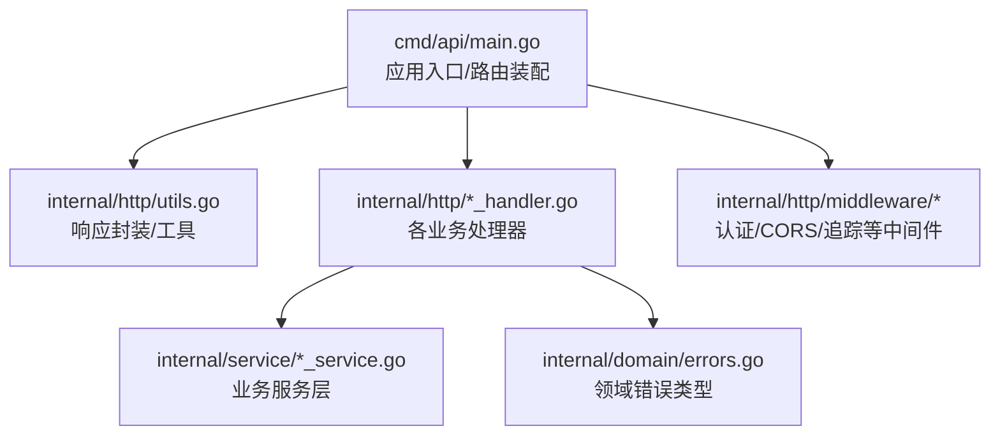
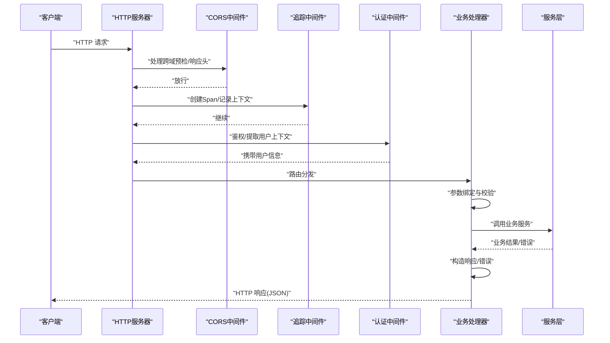
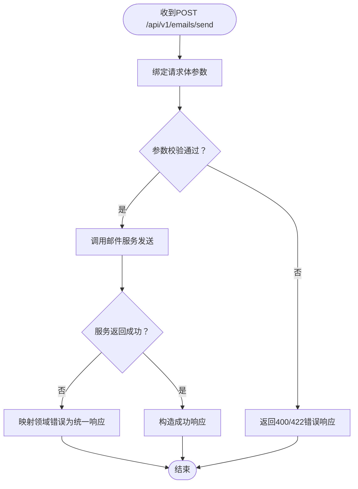
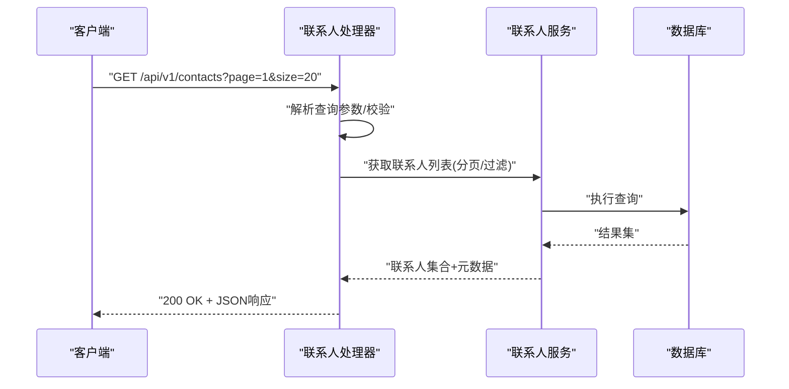
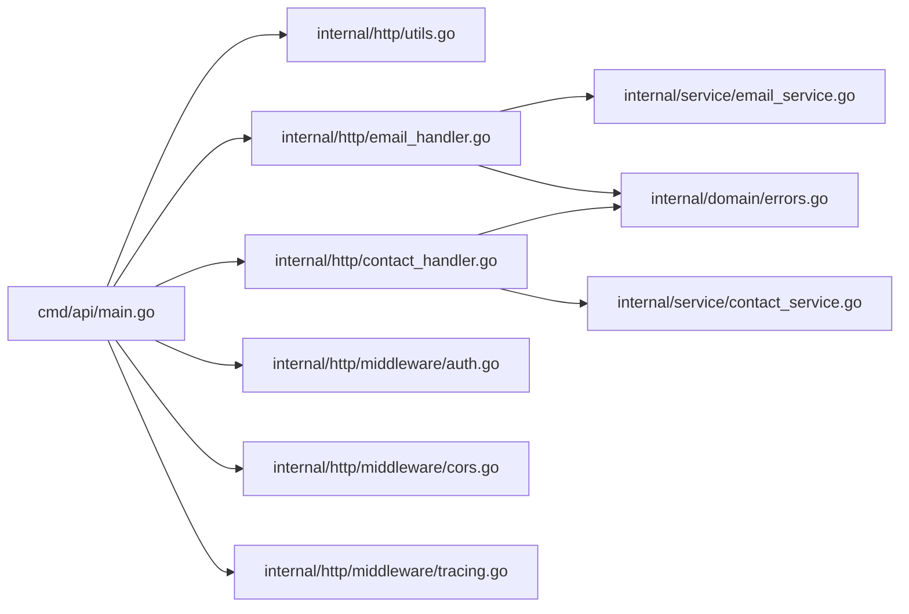

# HTTP处理器层

<cite>
**本文引用的文件**   
- [cmd/api/main.go](file://notifuse/cmd/api/main.go)
- [internal/http/utils.go](file://notifuse/internal/http/utils.go)
- [internal/http/middleware/auth.go](file://notifuse/internal/http/middleware/auth.go)
- [internal/http/middleware/cors.go](file://notifuse/internal/http/middleware/cors.go)
- [internal/http/middleware/tracing.go](file://notifuse/internal/http/middleware/tracing.go)
- [internal/http/email_handler.go](file://notifuse/internal/http/email_handler.go)
- [internal/http/contact_handler.go](file://notifuse/internal/http/contact_handler.go)
- [internal/service/email_service.go](file://notifuse/internal/service/email_service.go)
- [internal/service/contact_service.go](file://notifuse/internal/service/contact_service.go)
- [internal/domain/errors.go](file://notifuse/internal/domain/errors.go)
</cite>

## 目录
1. [简介](#简介)
2. [项目结构](#项目结构)
3. [核心组件](#核心组件)
4. [架构总览](#架构总览)
5. [详细组件分析](#详细组件分析)
6. [依赖关系分析](#依赖关系分析)
7. [性能考虑](#性能考虑)
8. [故障排查指南](#故障排查指南)
9. [结论](#结论)
10. [附录](#附录)

## 简介
本章节面向Notifuse平台的HTTP处理器层，聚焦于请求路由、参数验证、响应格式化与错误处理等职责；说明认证、CORS、追踪等中间件的配置与使用方式；定义RESTful API端点的设计规范（URL命名约定、HTTP方法使用、数据格式标准）；并梳理从请求接收到响应返回的完整生命周期。文档同时给出邮件发送与联系人管理等核心API的处理示例路径，以及统一的状态码与错误响应格式规范。

## 项目结构
HTTP处理器位于 internal/http 目录，按领域划分多个 handler 文件；中间件位于 internal/http/middleware；服务调用通过 internal/service 完成；通用工具与响应封装在 internal/http/utils.go；应用入口在 cmd/api/main.go 中组装路由与中间件。

图表来源
- [cmd/api/main.go](file://notifuse/cmd/api/main.go)
- [internal/http/utils.go](file://notifuse/internal/http/utils.go)
- [internal/http/email_handler.go](file://notifuse/internal/http/email_handler.go)
- [internal/http/contact_handler.go](file://notifuse/internal/http/contact_handler.go)
- [internal/service/email_service.go](file://notifuse/internal/service/email_service.go)
- [internal/service/contact_service.go](file://notifuse/internal/service/contact_service.go)
- [internal/domain/errors.go](file://notifuse/internal/domain/errors.go)
- [internal/http/middleware/auth.go](file://notifuse/internal/http/middleware/auth.go)
- [internal/http/middleware/cors.go](file://notifuse/internal/http/middleware/cors.go)
- [internal/http/middleware/tracing.go](file://notifuse/internal/http/middleware/tracing.go)

章节来源
- [cmd/api/main.go](file://notifuse/cmd/api/main.go)
- [internal/http/utils.go](file://notifuse/internal/http/utils.go)

## 核心组件
- 应用入口与路由装配：负责注册中间件链、挂载路由组与具体处理器，统一设置全局行为（如CORS、追踪）。
- 处理器（Handler）：每个领域一个处理器文件，实现REST端点的请求解析、参数校验、调用服务层、构造响应与错误。
- 中间件：认证、CORS、追踪等横切关注点，以函数式组合方式注入到路由链。
- 响应封装：统一的JSON响应结构与状态码映射，确保客户端一致性。
- 错误模型：领域错误类型用于区分可预期错误与系统异常，便于上层统一处理。

章节来源
- [cmd/api/main.go](file://notifuse/cmd/api/main.go)
- [internal/http/utils.go](file://notifuse/internal/http/utils.go)
- [internal/domain/errors.go](file://notifuse/internal/domain/errors.go)

## 架构总览
下图展示了典型REST请求的生命周期：客户端请求进入HTTP服务器，依次经过CORS、追踪、认证等中间件，随后路由到具体处理器；处理器进行参数绑定与校验，调用服务层执行业务逻辑，最后通过响应封装返回JSON结果或错误。

图表来源
- [cmd/api/main.go](file://notifuse/cmd/api/main.go)
- [internal/http/middleware/cors.go](file://notifuse/internal/http/middleware/cors.go)
- [internal/http/middleware/tracing.go](file://notifuse/internal/http/middleware/tracing.go)
- [internal/http/middleware/auth.go](file://notifuse/internal/http/middleware/auth.go)
- [internal/http/utils.go](file://notifuse/internal/http/utils.go)

## 详细组件分析

### 应用入口与路由装配
- 职责：初始化HTTP服务器、加载配置、注册中间件链、挂载路由组与处理器、启动监听。
- 关键点：
  - 中间件顺序：通常先CORS，再追踪，后认证，最后到达处理器。
  - 路由分组：按资源维度组织（如 /api/v1/emails、/api/v1/contacts），便于权限控制与版本管理。
  - 全局错误处理：将处理器抛出的错误转换为统一JSON格式与HTTP状态码。

章节来源
- [cmd/api/main.go](file://notifuse/cmd/api/main.go)

### 响应封装与工具
- 职责：提供统一的JSON响应结构、成功/失败构造器、分页与元数据包装、状态码映射。
- 关键点：
  - 成功响应：包含数据体与可选元数据（如分页信息）。
  - 错误响应：包含错误码、消息、详情（调试用）等字段。
  - 便捷方法：根据领域错误自动选择状态码与响应体。

章节来源
- [internal/http/utils.go](file://notifuse/internal/http/utils.go)

### 中间件：认证、CORS、追踪
- CORS中间件：
  - 作用：允许跨域访问，设置Access-Control-*头，处理OPTIONS预检请求。
  - 配置项：允许的源、方法、头部、是否允许凭据、最大缓存时间等。
- 追踪中间件：
  - 作用：为每个请求生成唯一追踪ID，注入上下文，记录耗时与关键事件，便于链路追踪。
- 认证中间件：
  - 作用：从请求头或Cookie中提取令牌，校验有效性，并将用户上下文注入请求。
  - 策略：支持Bearer Token、OIDC/JWT等；对未认证请求返回401/403。

章节来源
- [internal/http/middleware/cors.go](file://notifuse/internal/http/middleware/cors.go)
- [internal/http/middleware/tracing.go](file://notifuse/internal/http/middleware/tracing.go)
- [internal/http/middleware/auth.go](file://notifuse/internal/http/middleware/auth.go)

### RESTful API设计规范
- URL命名约定：
  - 使用小写英文单词与连字符分隔，资源名词复数形式，层级不超过三层。
  - 示例：/api/v1/contacts、/api/v1/contacts/{id}、/api/v1/emails/send。
- HTTP方法使用：
  - GET：查询资源列表或详情。
  - POST：创建资源或触发动作（如发送邮件）。
  - PUT/PATCH：更新资源（全量/增量）。
  - DELETE：删除资源。
- 数据格式标准：
  - 请求/响应默认使用application/json。
  - 统一响应结构：{code, message, data, meta}。
  - 分页：使用page、pageSize、total等字段。
- 查询参数：
  - 使用query string传递过滤、排序、分页参数，保持幂等。
- 版本化：
  - 通过URL前缀（/api/v1）进行API版本控制。

[本节为概念性规范说明，不直接分析具体文件]

### 邮件发送处理器（Email Handler）
- 职责：接收邮件发送请求，校验参数，调用邮件服务，返回发送结果。
- 流程要点：
  - 参数绑定：主题、收件人、正文模板变量、附件等。
  - 参数校验：必填字段、邮箱格式、大小限制等。
  - 业务调用：委托给邮件服务执行队列写入或即时发送。
  - 响应：返回任务ID或发送结果，必要时附带重试建议。

图表来源
- [internal/http/email_handler.go](file://notifuse/internal/http/email_handler.go)
- [internal/service/email_service.go](file://notifuse/internal/service/email_service.go)
- [internal/http/utils.go](file://notifuse/internal/http/utils.go)
- [internal/domain/errors.go](file://notifuse/internal/domain/errors.go)

章节来源
- [internal/http/email_handler.go](file://notifuse/internal/http/email_handler.go)
- [internal/service/email_service.go](file://notifuse/internal/service/email_service.go)
- [internal/http/utils.go](file://notifuse/internal/http/utils.go)
- [internal/domain/errors.go](file://notifuse/internal/domain/errors.go)

### 联系人管理处理器（Contact Handler）
- 职责：提供联系人的增删改查、批量导入、标签/列表关联等操作。
- 流程要点：
  - 列表查询：支持分页、过滤、排序。
  - 单条操作：创建、更新、删除需校验工作区权限与资源存在性。
  - 批量操作：事务性写入，失败回滚与部分成功统计。
  - 响应：返回资源对象或集合，附带分页元数据。

图表来源
- [internal/http/contact_handler.go](file://notifuse/internal/http/contact_handler.go)
- [internal/service/contact_service.go](file://notifuse/internal/service/contact_service.go)
- [internal/http/utils.go](file://notifuse/internal/http/utils.go)

章节来源
- [internal/http/contact_handler.go](file://notifuse/internal/http/contact_handler.go)
- [internal/service/contact_service.go](file://notifuse/internal/service/contact_service.go)
- [internal/http/utils.go](file://notifuse/internal/http/utils.go)

### 统一错误处理与状态码规范
- 状态码：
  - 2xx：成功（200、201、204等）。
  - 4xx：客户端错误（400参数错误、401未认证、403无权限、404不存在、422校验失败）。
  - 5xx：服务端错误（500内部错误、503服务不可用）。
- 错误响应格式：
  - code：业务错误码（字符串）。
  - message：人类可读的错误描述。
  - details：调试信息（可选，生产环境谨慎暴露）。
- 映射规则：
  - 领域错误 -> 对应HTTP状态码与错误响应。
  - 未知异常 -> 500 + 通用错误消息。

章节来源
- [internal/domain/errors.go](file://notifuse/internal/domain/errors.go)
- [internal/http/utils.go](file://notifuse/internal/http/utils.go)

## 依赖关系分析
- 低耦合高内聚：处理器仅负责HTTP边界职责，业务逻辑下沉至服务层。
- 中间件可插拔：认证、CORS、追踪等以函数式组合注入，易于扩展。
- 错误模型集中：领域错误与服务层异常统一收敛到HTTP层进行格式化。

图表来源
- [cmd/api/main.go](file://notifuse/cmd/api/main.go)
- [internal/http/utils.go](file://notifuse/internal/http/utils.go)
- [internal/http/email_handler.go](file://notifuse/internal/http/email_handler.go)
- [internal/http/contact_handler.go](file://notifuse/internal/http/contact_handler.go)
- [internal/service/email_service.go](file://notifuse/internal/service/email_service.go)
- [internal/service/contact_service.go](file://notifuse/internal/service/contact_service.go)
- [internal/domain/errors.go](file://notifuse/internal/domain/errors.go)
- [internal/http/middleware/auth.go](file://notifuse/internal/http/middleware/auth.go)
- [internal/http/middleware/cors.go](file://notifuse/internal/http/middleware/cors.go)
- [internal/http/middleware/tracing.go](file://notifuse/internal/http/middleware/tracing.go)

章节来源
- [cmd/api/main.go](file://notifuse/cmd/api/main.go)
- [internal/http/utils.go](file://notifuse/internal/http/utils.go)
- [internal/http/email_handler.go](file://notifuse/internal/http/email_handler.go)
- [internal/http/contact_handler.go](file://notifuse/internal/http/contact_handler.go)
- [internal/service/email_service.go](file://notifuse/internal/service/email_service.go)
- [internal/service/contact_service.go](file://notifuse/internal/service/contact_service.go)
- [internal/domain/errors.go](file://notifuse/internal/domain/errors.go)
- [internal/http/middleware/auth.go](file://notifuse/internal/http/middleware/auth.go)
- [internal/http/middleware/cors.go](file://notifuse/internal/http/middleware/cors.go)
- [internal/http/middleware/tracing.go](file://notifuse/internal/http/middleware/tracing.go)

## 性能考虑
- 中间件开销最小化：避免在中间件中执行重IO或复杂计算。
- 连接复用与超时：合理设置HTTP客户端与服务端超时，避免长尾请求阻塞。
- 批量接口优化：使用事务与批量写入减少往返次数。
- 分页与索引：列表接口强制分页，配合数据库索引提升查询性能。
- 缓存策略：对热点只读数据采用缓存，注意失效与一致性。

[本节为通用指导，不直接分析具体文件]

## 故障排查指南
- 常见问题定位：
  - 401/403：检查认证中间件配置与令牌有效性。
  - 422：检查请求体字段校验规则与前端传参。
  - 500：查看追踪中间件生成的Span与日志，定位服务层异常。
- 日志与追踪：
  - 使用追踪中间件输出的请求ID关联日志。
  - 在服务层关键路径埋点，记录输入输出摘要。
- 错误响应一致性：
  - 确认所有处理器均通过统一响应封装返回错误。
  - 领域错误码与HTTP状态码映射清晰且稳定。

章节来源
- [internal/http/middleware/tracing.go](file://notifuse/internal/http/middleware/tracing.go)
- [internal/http/utils.go](file://notifuse/internal/http/utils.go)
- [internal/domain/errors.go](file://notifuse/internal/domain/errors.go)

## 结论
Notifuse的HTTP处理器层遵循清晰的职责分离与统一的响应/错误规范，借助中间件实现横切关注点解耦，并通过服务层承载核心业务。遵循本文档的路由设计、参数校验、响应格式与错误处理规范，有助于提升API的一致性与可维护性。

[本节为总结性内容，不直接分析具体文件]

## 附录
- 示例路径参考：
  - 邮件发送：处理器与服务的代码片段路径见“邮件发送处理器”章节来源。
  - 联系人管理：处理器与服务的代码片段路径见“联系人管理处理器”章节来源。
- 相关OpenAPI定义：
  - 可在 openapi/paths 下查阅各资源的端点定义与数据结构，辅助前后端协作。

[本节为指引性内容，不直接分析具体文件]