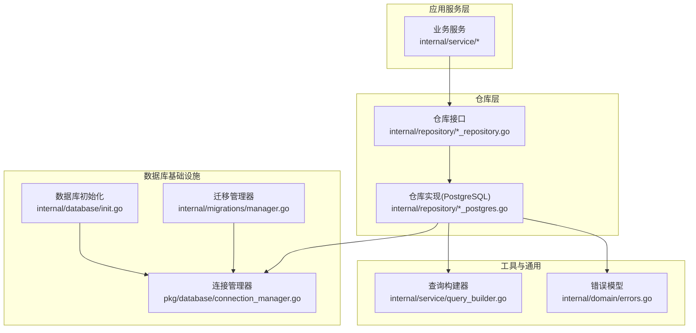
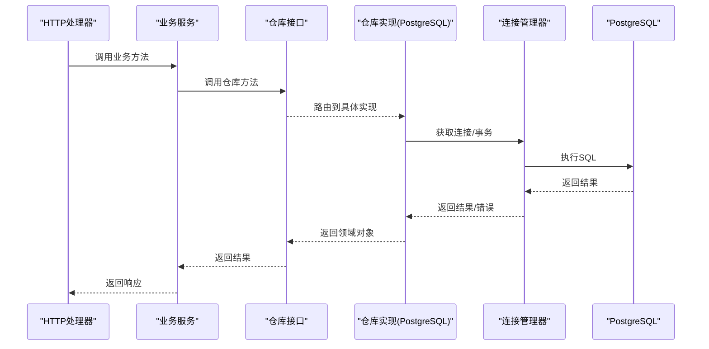
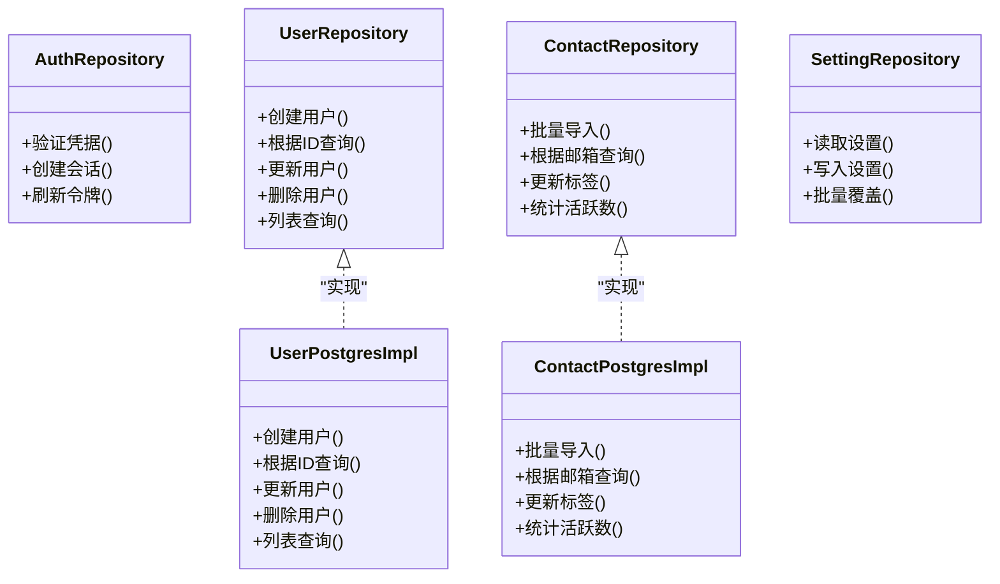
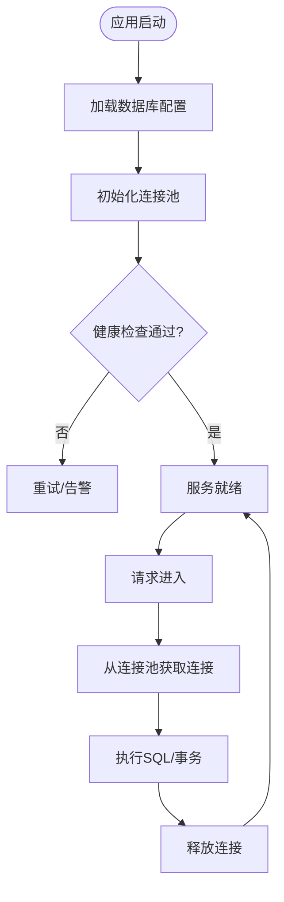
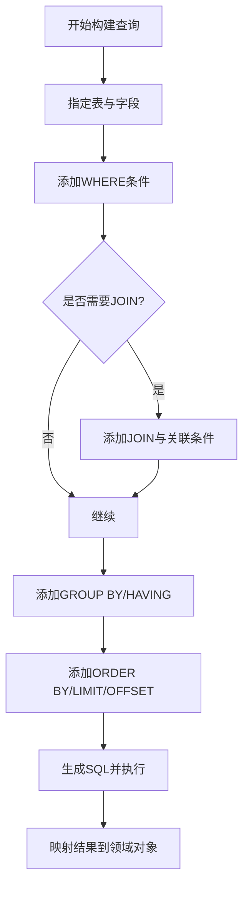
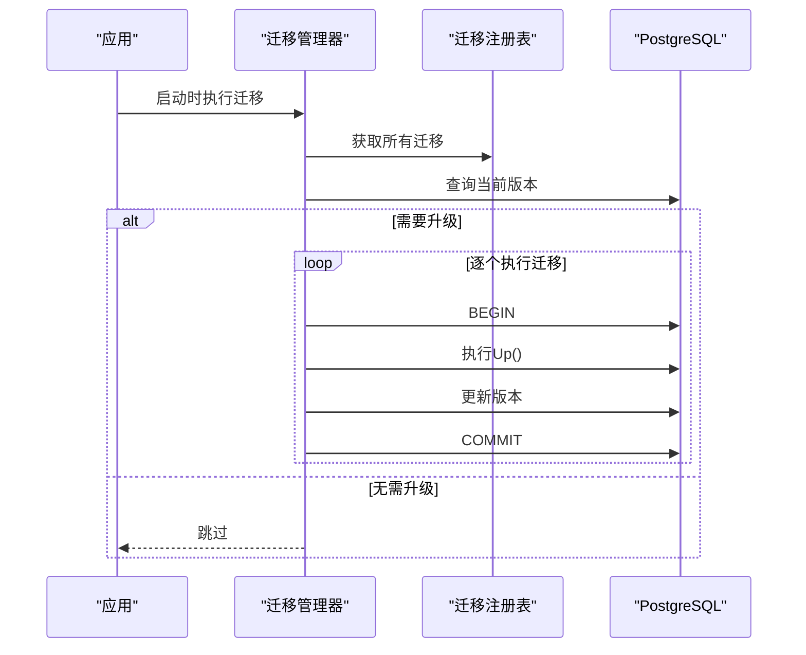
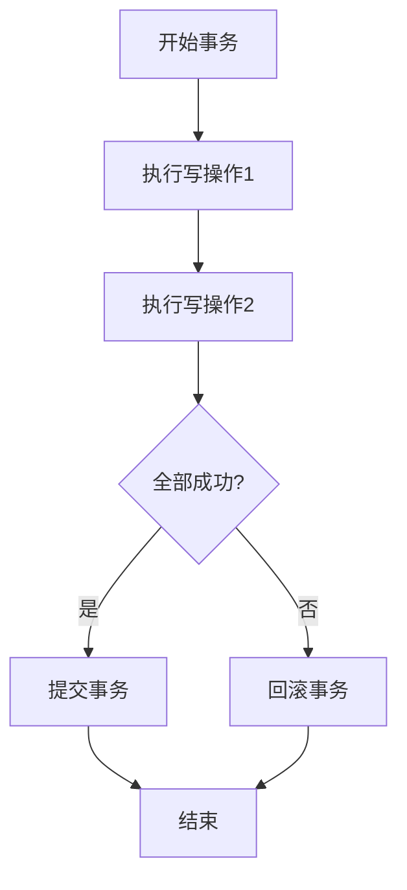
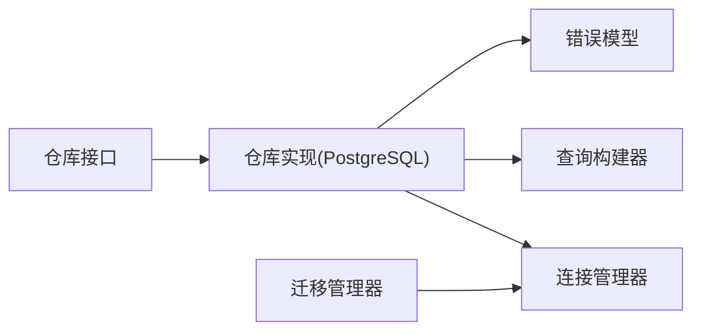

# 仓库数据访问层

<cite>
**本文引用的文件**   
- [internal/database/init.go](file://internal/database/init.go)
- [pkg/database/connection_manager.go](file://pkg/database/connection_manager.go)
- [internal/migrations/manager.go](file://internal/migrations/manager.go)
- [internal/migrations/interfaces.go](file://internal/migrations/interfaces.go)
- [internal/migrations/version.go](file://internal/migrations/version.go)
- [internal/repository/auth_repository.go](file://internal/repository/auth_repository.go)
- [internal/repository/user_postgres.go](file://internal/repository/user_postgres.go)
- [internal/repository/contact_postgres.go](file://internal/repository/contact_postgres.go)
- [internal/repository/setting_repository.go](file://internal/repository/setting_repository.go)
- [internal/service/query_builder.go](file://internal/service/query_builder.go)
- [internal/domain/errors.go](file://internal/domain/errors.go)
</cite>

## 目录
1. [简介](#简介)
2. [项目结构](#项目结构)
3. [核心组件](#核心组件)
4. [架构总览](#架构总览)
5. [详细组件分析](#详细组件分析)
6. [依赖关系分析](#依赖关系分析)
7. [性能考虑](#性能考虑)
8. [故障排查指南](#故障排查指南)
9. [结论](#结论)
10. [附录](#附录)

## 简介
本文件面向Notifuse平台的仓库数据访问层，系统性说明仓库模式（Repository Pattern）的实现原理与接口抽象、数据库连接管理与连接池配置、查询构建器的使用方式与复杂查询实现模式、数据迁移管理机制与版本控制策略，并给出CRUD操作、复杂查询与事务处理的示例路径。同时涵盖缓存策略在数据访问层的应用与一致性保证，以及索引优化与性能调优的最佳实践。

## 项目结构
仓库数据访问层主要分布在以下模块：
- 数据库初始化与连接管理：负责PostgreSQL连接建立、连接池参数设置与生命周期管理
- 迁移系统：负责数据库版本管理与迁移执行
- 仓库接口与实现：定义领域实体的统一数据访问抽象，并提供基于PostgreSQL的具体实现
- 查询构建器：提供链式API以构造复杂SQL查询
- 错误模型：为数据访问层提供统一的错误类型

图表来源
- [internal/database/init.go](file://internal/database/init.go)
- [pkg/database/connection_manager.go](file://pkg/database/connection_manager.go)
- [internal/migrations/manager.go](file://internal/migrations/manager.go)
- [internal/service/query_builder.go](file://internal/service/query_builder.go)
- [internal/domain/errors.go](file://internal/domain/errors.go)

章节来源
- [internal/database/init.go](file://internal/database/init.go)
- [pkg/database/connection_manager.go](file://pkg/database/connection_manager.go)
- [internal/migrations/manager.go](file://internal/migrations/manager.go)
- [internal/service/query_builder.go](file://internal/service/query_builder.go)
- [internal/domain/errors.go](file://internal/domain/errors.go)

## 核心组件
- 仓库接口抽象：通过接口定义领域实体（如用户、联系人、设置等）的CRUD与查询能力，屏蔽底层持久化细节
- PostgreSQL实现：针对每个仓库接口提供基于PostgreSQL的具体实现，封装SQL语句、参数绑定与结果映射
- 连接管理器：集中管理数据库连接与连接池配置，提供健康检查、上下文传播与事务支持
- 迁移管理器：维护数据库版本，按序执行迁移脚本，确保环境一致性与可回滚性
- 查询构建器：提供链式API用于组合条件、排序、分页与聚合，降低手写SQL复杂度
- 错误模型：定义数据访问层的错误分类与包装，便于上层统一处理

章节来源
- [internal/repository/auth_repository.go](file://internal/repository/auth_repository.go)
- [internal/repository/user_postgres.go](file://internal/repository/user_postgres.go)
- [internal/repository/contact_postgres.go](file://internal/repository/contact_postgres.go)
- [internal/repository/setting_repository.go](file://internal/repository/setting_repository.go)
- [pkg/database/connection_manager.go](file://pkg/database/connection_manager.go)
- [internal/migrations/manager.go](file://internal/migrations/manager.go)
- [internal/service/query_builder.go](file://internal/service/query_builder.go)
- [internal/domain/errors.go](file://internal/domain/errors.go)

## 架构总览
仓库模式将业务逻辑与数据持久化解耦，上层仅依赖接口，具体实现可替换或扩展。连接管理器作为基础设施，向上层暴露一致的数据库会话与事务边界；迁移管理器保障数据库结构与版本同步；查询构建器提升复杂查询的可读性与可维护性。

图表来源
- [internal/repository/auth_repository.go](file://internal/repository/auth_repository.go)
- [internal/repository/user_postgres.go](file://internal/repository/user_postgres.go)
- [pkg/database/connection_manager.go](file://pkg/database/connection_manager.go)

## 详细组件分析

### 仓库接口与实现（PostgreSQL）
- 接口设计原则
  - 单一职责：每个仓库接口聚焦一个领域实体
  - 输入输出清晰：方法签名明确参数与返回值，避免泄露底层类型
  - 错误语义化：通过错误模型区分“未找到”、“冲突”、“系统错误”等
- 典型仓库接口
  - 认证仓库：提供凭据校验、令牌管理等能力
  - 用户仓库：提供用户的增删改查与关联查询
  - 联系人仓库：提供批量导入、去重、更新与统计
  - 设置仓库：提供键值型配置的读写与默认值处理
- PostgreSQL实现要点
  - 使用连接管理器提供的会话与事务
  - 结合查询构建器组装动态条件
  - 对常见查询进行索引友好设计（等值、范围、前缀匹配）
  - 对写操作采用幂等与冲突检测（例如唯一约束）

图表来源
- [internal/repository/auth_repository.go](file://internal/repository/auth_repository.go)
- [internal/repository/user_postgres.go](file://internal/repository/user_postgres.go)
- [internal/repository/contact_postgres.go](file://internal/repository/contact_postgres.go)
- [internal/repository/setting_repository.go](file://internal/repository/setting_repository.go)

章节来源
- [internal/repository/auth_repository.go](file://internal/repository/auth_repository.go)
- [internal/repository/user_postgres.go](file://internal/repository/user_postgres.go)
- [internal/repository/contact_postgres.go](file://internal/repository/contact_postgres.go)
- [internal/repository/setting_repository.go](file://internal/repository/setting_repository.go)

### 数据库连接管理与连接池配置
- 连接生命周期
  - 启动时初始化连接池，加载配置项（主机、端口、用户名、密码、数据库名、SSL模式等）
  - 提供健康检查与重试机制，失败时快速失败并记录日志
  - 支持上下文传播，确保超时与取消信号正确传递
- 连接池关键参数（建议）
  - 最大空闲连接数：根据并发读多场景调整
  - 最大打开连接数：根据CPU核数与I/O能力设定上限
  - 连接最大生存时间：防止长连接资源泄漏
  - 连接空闲超时：及时回收闲置连接
  - 查询超时：保护数据库免受慢查询影响
- 事务支持
  - 提供Begin/Commit/Rollback封装，确保错误路径自动回滚
  - 嵌套事务通过保存点模拟（若需要）

图表来源
- [internal/database/init.go](file://internal/database/init.go)
- [pkg/database/connection_manager.go](file://pkg/database/connection_manager.go)

章节来源
- [internal/database/init.go](file://internal/database/init.go)
- [pkg/database/connection_manager.go](file://pkg/database/connection_manager.go)

### 查询构建器与复杂查询模式
- 设计目标
  - 链式API组合条件、排序、分页与聚合
  - 自动生成安全SQL，避免拼接注入风险
  - 提供常用谓词与函数（如LIKE、IN、BETWEEN、JSON提取）
- 使用模式
  - 基础查询：选择字段、过滤条件、排序与分页
  - 复杂查询：多表JOIN、子查询、分组聚合、窗口函数
  - 动态条件：根据入参决定是否追加WHERE片段
  - 事务内查询：在同一事务中多次查询，保证一致性
- 示例路径（不展示代码内容）
  - 基础CRUD：参考用户仓库与联系人仓库的查询与写入方法
  - 复杂查询：参考查询构建器的测试用例与示例用法

图表来源
- [internal/service/query_builder.go](file://internal/service/query_builder.go)

章节来源
- [internal/service/query_builder.go](file://internal/service/query_builder.go)

### 数据迁移管理与版本控制
- 迁移接口
  - 定义Up/Down方法，分别表示升级与回滚逻辑
  - 提供元数据记录当前版本，确保幂等执行
- 迁移管理器
  - 扫描已注册迁移，比较当前版本与目标版本
  - 按顺序执行缺失的迁移，记录执行时间与状态
  - 支持事务包裹，失败时整体回滚
- 版本策略
  - 版本号递增且不可重复
  - 变更需具备幂等性，避免重复执行导致异常
  - 大表变更建议分阶段迁移（先加列，再填充，最后约束）

图表来源
- [internal/migrations/manager.go](file://internal/migrations/manager.go)
- [internal/migrations/interfaces.go](file://internal/migrations/interfaces.go)
- [internal/migrations/version.go](file://internal/migrations/version.go)

章节来源
- [internal/migrations/manager.go](file://internal/migrations/manager.go)
- [internal/migrations/interfaces.go](file://internal/migrations/interfaces.go)
- [internal/migrations/version.go](file://internal/migrations/version.go)

### 事务处理与一致性保证
- 事务边界
  - 写操作必须包裹在事务中，确保原子性
  - 读多写少场景可使用只读事务减少锁竞争
- 错误处理
  - 捕获数据库错误并转换为领域错误
  - 在错误路径自动回滚，避免部分提交
- 示例路径
  - 用户创建与关联初始化：参考用户仓库的事务方法
  - 联系人批量导入：参考联系人仓库的事务方法

图表来源
- [pkg/database/connection_manager.go](file://pkg/database/connection_manager.go)
- [internal/repository/user_postgres.go](file://internal/repository/user_postgres.go)
- [internal/repository/contact_postgres.go](file://internal/repository/contact_postgres.go)

章节来源
- [pkg/database/connection_manager.go](file://pkg/database/connection_manager.go)
- [internal/repository/user_postgres.go](file://internal/repository/user_postgres.go)
- [internal/repository/contact_postgres.go](file://internal/repository/contact_postgres.go)

### 缓存策略与一致性保证
- 缓存位置
  - 在仓库层之上引入缓存（如内存缓存或分布式缓存），对热点数据进行缓存
- 一致性策略
  - 写穿透：写库后更新或删除缓存
  - 失效策略：TTL过期与主动失效相结合
  - 幂等更新：避免并发写导致的脏写
- 示例路径
  - 设置仓库的读取路径可结合缓存，提高配置访问性能
  - 用户信息缓存可按用户ID维度组织

章节来源
- [internal/repository/setting_repository.go](file://internal/repository/setting_repository.go)
- [internal/repository/user_postgres.go](file://internal/repository/user_postgres.go)

## 依赖关系分析
仓库层依赖连接管理器与查询构建器，迁移系统独立于仓库但共享连接管理器。错误模型贯穿各层，提供统一的错误语义。

图表来源
- [internal/repository/auth_repository.go](file://internal/repository/auth_repository.go)
- [internal/repository/user_postgres.go](file://internal/repository/user_postgres.go)
- [internal/repository/contact_postgres.go](file://internal/repository/contact_postgres.go)
- [internal/repository/setting_repository.go](file://internal/repository/setting_repository.go)
- [pkg/database/connection_manager.go](file://pkg/database/connection_manager.go)
- [internal/service/query_builder.go](file://internal/service/query_builder.go)
- [internal/domain/errors.go](file://internal/domain/errors.go)
- [internal/migrations/manager.go](file://internal/migrations/manager.go)

章节来源
- [internal/repository/auth_repository.go](file://internal/repository/auth_repository.go)
- [internal/repository/user_postgres.go](file://internal/repository/user_postgres.go)
- [internal/repository/contact_postgres.go](file://internal/repository/contact_postgres.go)
- [internal/repository/setting_repository.go](file://internal/repository/setting_repository.go)
- [pkg/database/connection_manager.go](file://pkg/database/connection_manager.go)
- [internal/service/query_builder.go](file://internal/service/query_builder.go)
- [internal/domain/errors.go](file://internal/domain/errors.go)
- [internal/migrations/manager.go](file://internal/migrations/manager.go)

## 性能考虑
- 连接池调优
  - 根据并发量与数据库容量设置最大连接数与空闲连接数
  - 启用连接复用，避免频繁创建销毁连接
- SQL优化
  - 优先使用等值与范围查询，避免全表扫描
  - 合理使用索引（主键、唯一键、复合索引）
  - 分页使用游标或基于键的分页替代OFFSET深分页
- 查询构建器
  - 避免过度动态拼接导致无法利用计划缓存
  - 对热点查询固定SQL文本，减少解析开销
- 事务与锁
  - 缩短事务持续时间，减少锁持有时间
  - 避免跨表大范围更新，必要时分批提交
- 监控与诊断
  - 记录慢查询与错误率，定期分析执行计划
  - 使用指标面板观察连接池利用率与等待事件

[本节为通用指导，不直接分析具体文件]

## 故障排查指南
- 常见问题
  - 连接失败：检查网络连通性、认证信息与SSL配置
  - 连接池耗尽：增加最大连接数或优化慢查询
  - 迁移失败：确认版本记录与迁移幂等性
  - 查询缓慢：查看执行计划，补充合适索引
- 错误模型
  - 使用统一错误类型区分“未找到”、“冲突”、“系统错误”，便于上层处理与告警
- 调试建议
  - 开启详细日志，记录SQL与参数
  - 使用事务边界日志定位问题步骤

章节来源
- [internal/domain/errors.go](file://internal/domain/errors.go)
- [pkg/database/connection_manager.go](file://pkg/database/connection_manager.go)
- [internal/migrations/manager.go](file://internal/migrations/manager.go)

## 结论
仓库数据访问层通过清晰的接口抽象与PostgreSQL实现，有效解耦了业务逻辑与持久化细节。连接管理器与迁移系统提供了稳定的基础设施支撑，查询构建器提升了复杂查询的可维护性。配合合理的缓存策略、索引优化与性能调优，可在高并发与大数据量场景下保持良好稳定性与性能表现。

## 附录
- 示例路径（不展示代码内容）
  - CRUD操作：参考用户仓库与联系人仓库的创建、查询、更新与删除方法
  - 复杂查询：参考查询构建器的链式API与测试用例
  - 事务处理：参考用户与联系人仓库中的事务方法
- 最佳实践清单
  - 接口先行，实现可替换
  - 错误语义化，统一处理
  - 索引驱动设计，避免盲目优化
  - 迁移幂等，版本可控
  - 缓存与一致性权衡，按需取舍