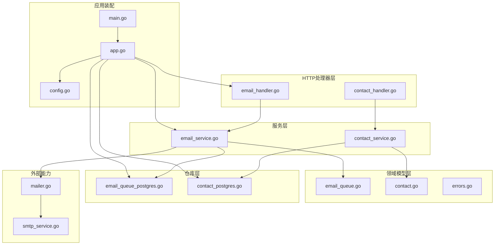
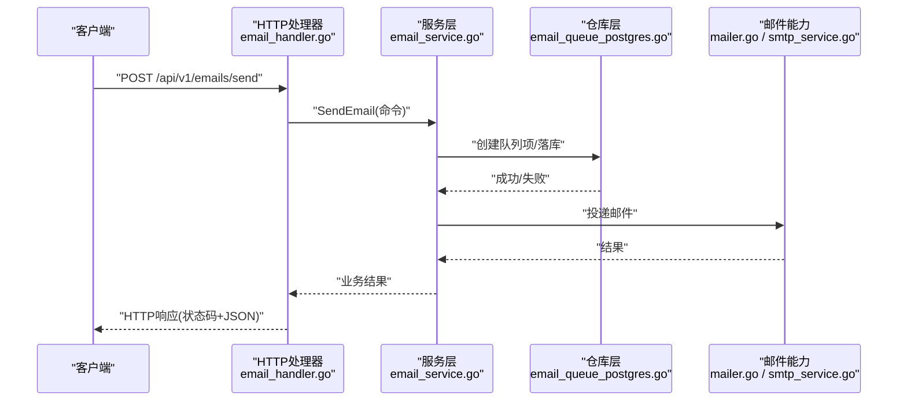
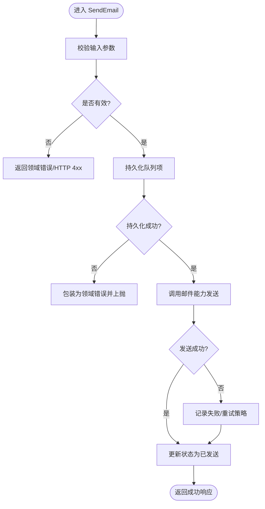
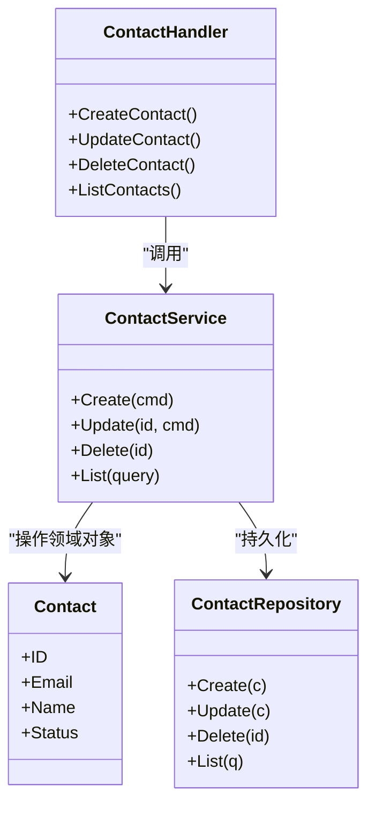
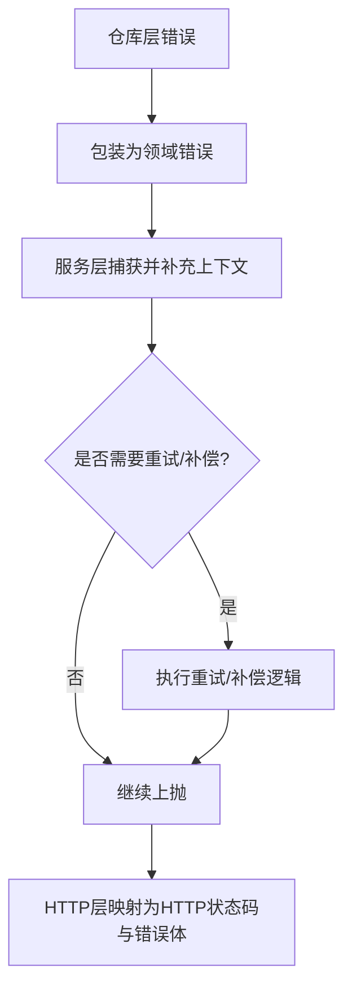
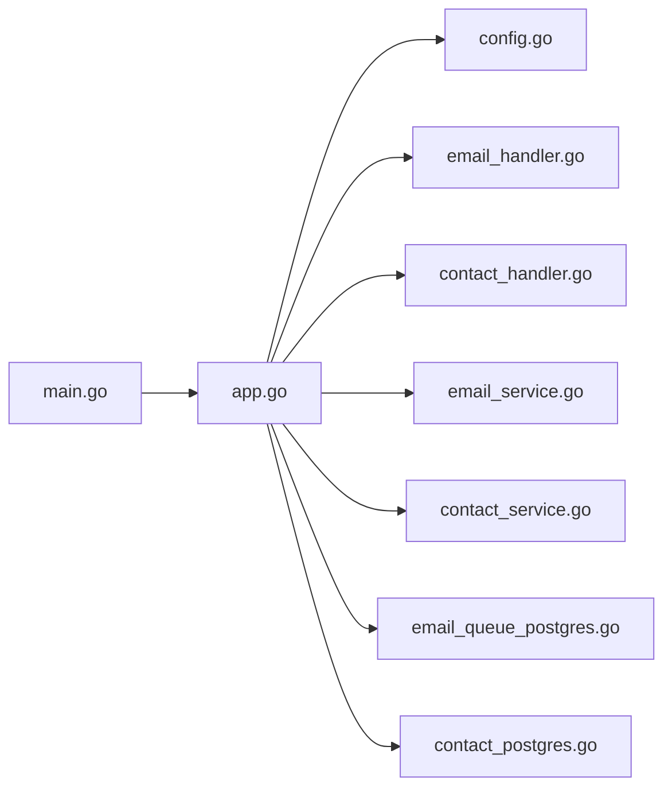
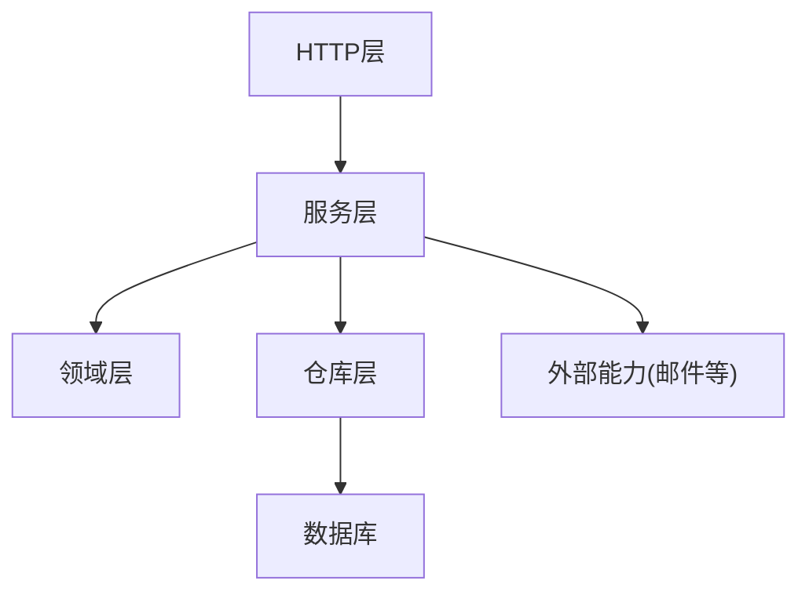

# 分层架构模式

<cite>
**本文引用的文件**   
- [cmd/api/main.go](file://notifuse/cmd/api/main.go)
- [internal/app/app.go](file://notifuse/internal/app/app.go)
- [config/config.go](file://notifuse/config/config.go)
- [internal/http/email_handler.go](file://notifuse/internal/http/email_handler.go)
- [internal/service/email_service.go](file://notifuse/internal/service/email_service.go)
- [internal/domain/email_queue.go](file://notifuse/internal/domain/email_queue.go)
- [internal/repository/email_queue_postgres.go](file://notifuse/internal/repository/email_queue_postgres.go)
- [internal/domain/errors.go](file://notifuse/internal/domain/errors.go)
- [pkg/mailer/mailer.go](file://notifuse/pkg/mailer/mailer.go)
- [internal/service/smtp_service.go](file://notifuse/internal/service/smtp_service.go)
- [internal/http/contact_handler.go](file://notifuse/internal/http/contact_handler.go)
- [internal/service/contact_service.go](file://notifuse/internal/service/contact_service.go)
- [internal/domain/contact.go](file://notifuse/internal/domain/contact.go)
- [internal/repository/contact_postgres.go](file://notifuse/internal/repository/contact_postgres.go)
</cite>

## 目录
1. [简介](#简介)
2. [项目结构](#项目结构)
3. [核心组件](#核心组件)
4. [架构总览](#架构总览)
5. [详细组件分析](#详细组件分析)
6. [依赖关系分析](#依赖关系分析)
7. [性能考虑](#性能考虑)
8. [故障排查指南](#故障排查指南)
9. [结论](#结论)
10. [附录](#附录)

## 简介
本文件面向Notifuse平台，系统化阐述其分层架构模式与职责边界，重点覆盖HTTP处理器层、服务层、领域模型层、仓库层的协作方式。文档同时说明错误处理在各层的传播机制（异常类型定义与错误码规范）、依赖注入的使用方式与配置管理策略，并以“邮件发送”和“联系人管理”两个核心功能为例，给出端到端调用流程与关键实现位置指引。

## 项目结构
Notifuse后端采用清晰的分层组织：
- HTTP处理器层：负责请求解析、鉴权上下文提取、参数校验、响应封装与状态码映射。
- 服务层：编排业务用例，协调领域对象与仓库访问，承载事务与跨域逻辑。
- 领域模型层：定义核心实体、值对象、领域事件与领域错误类型。
- 仓库层：抽象数据访问接口，提供持久化实现（如PostgreSQL）。
- 应用装配与配置：负责依赖注入、中间件注册、配置加载与启动引导。

图表来源
- [cmd/api/main.go:1-200](file://notifuse/cmd/api/main.go#L1-L200)
- [internal/app/app.go:1-200](file://notifuse/internal/app/app.go#L1-L200)
- [config/config.go:1-200](file://notifuse/config/config.go#L1-L200)
- [internal/http/email_handler.go:1-200](file://notifuse/internal/http/email_handler.go#L1-L200)
- [internal/service/email_service.go:1-200](file://notifuse/internal/service/email_service.go#L1-L200)
- [internal/domain/email_queue.go:1-200](file://notifuse/internal/domain/email_queue.go#L1-L200)
- [internal/repository/email_queue_postgres.go:1-200](file://notifuse/internal/repository/email_queue_postgres.go#L1-L200)
- [internal/domain/contact.go:1-200](file://notifuse/internal/domain/contact.go#L1-L200)
- [internal/repository/contact_postgres.go:1-200](file://notifuse/internal/repository/contact_postgres.go#L1-L200)
- [pkg/mailer/mailer.go:1-200](file://notifuse/pkg/mailer/mailer.go#L1-L200)
- [internal/service/smtp_service.go:1-200](file://notifuse/internal/service/smtp_service.go#L1-L200)

章节来源
- [cmd/api/main.go:1-200](file://notifuse/cmd/api/main.go#L1-L200)
- [internal/app/app.go:1-200](file://notifuse/internal/app/app.go#L1-L200)
- [config/config.go:1-200](file://notifuse/config/config.go#L1-L200)

## 核心组件
- HTTP处理器层
  - 职责：接收HTTP请求，解析路径/查询/体，绑定到领域DTO或命令对象；读取鉴权上下文；调用服务层；统一返回JSON并设置状态码。
  - 典型文件：[email_handler.go](file://notifuse/internal/http/email_handler.go)、[contact_handler.go](file://notifuse/internal/http/contact_handler.go)。
- 服务层
  - 职责：编排业务流程，组合多个仓库与外部能力（如邮件发送），保证一致性、幂等性与可观测性。
  - 典型文件：[email_service.go](file://notifuse/internal/service/email_service.go)、[contact_service.go](file://notifuse/internal/service/contact_service.go)。
- 领域模型层
  - 职责：定义实体、值对象、领域规则与领域错误类型；不包含I/O细节。
  - 典型文件：[email_queue.go](file://notifuse/internal/domain/email_queue.go)、[contact.go](file://notifuse/internal/domain/contact.go)、[errors.go](file://notifuse/internal/domain/errors.go)。
- 仓库层
  - 职责：抽象数据访问接口并提供具体实现（如PostgreSQL）；屏蔽SQL细节与连接管理。
  - 典型文件：[email_queue_postgres.go](file://notifuse/internal/repository/email_queue_postgres.go)、[contact_postgres.go](file://notifuse/internal/repository/contact_postgres.go)。
- 外部能力与基础设施
  - 邮件发送：通过[pkg/mailer/mailer.go](file://notifuse/pkg/mailer/mailer.go)抽象，由[smtp_service.go](file://notifuse/internal/service/smtp_service.go)等实现对接不同SMTP/第三方服务。
- 应用装配与配置
  - 依赖注入与应用初始化：[internal/app/app.go](file://notifuse/internal/app/app.go)、[cmd/api/main.go](file://notifuse/cmd/api/main.go)。
  - 配置加载：[config/config.go](file://notifuse/config/config.go)。

章节来源
- [internal/http/email_handler.go:1-200](file://notifuse/internal/http/email_handler.go#L1-L200)
- [internal/service/email_service.go:1-200](file://notifuse/internal/service/email_service.go#L1-L200)
- [internal/domain/email_queue.go:1-200](file://notifuse/internal/domain/email_queue.go#L1-L200)
- [internal/repository/email_queue_postgres.go:1-200](file://notifuse/internal/repository/email_queue_postgres.go#L1-L200)
- [internal/domain/contact.go:1-200](file://notifuse/internal/domain/contact.go#L1-L200)
- [internal/repository/contact_postgres.go:1-200](file://notifuse/internal/repository/contact_postgres.go#L1-L200)
- [pkg/mailer/mailer.go:1-200](file://notifuse/pkg/mailer/mailer.go#L1-L200)
- [internal/service/smtp_service.go:1-200](file://notifuse/internal/service/smtp_service.go#L1-L200)
- [internal/app/app.go:1-200](file://notifuse/internal/app/app.go#L1-L200)
- [cmd/api/main.go:1-200](file://notifuse/cmd/api/main.go#L1-L200)
- [config/config.go:1-200](file://notifuse/config/config.go#L1-L200)

## 架构总览
下图展示从HTTP入口到仓库与外部能力的完整调用链，体现分层依赖方向：HTTP→服务→领域→仓库→外部系统。

图表来源
- [internal/http/email_handler.go:1-200](file://notifuse/internal/http/email_handler.go#L1-L200)
- [internal/service/email_service.go:1-200](file://notifuse/internal/service/email_service.go#L1-L200)
- [internal/repository/email_queue_postgres.go:1-200](file://notifuse/internal/repository/email_queue_postgres.go#L1-L200)
- [pkg/mailer/mailer.go:1-200](file://notifuse/pkg/mailer/mailer.go#L1-L200)
- [internal/service/smtp_service.go:1-200](file://notifuse/internal/service/smtp_service.go#L1-L200)

## 详细组件分析

### 邮件发送（端到端流程）
- 请求处理
  - 解析请求体、校验必填字段、提取工作区/用户上下文。
  - 将请求转换为领域命令或DTO后调用服务层。
  - 参考：[email_handler.go](file://notifuse/internal/http/email_handler.go)。
- 业务编排
  - 校验收件人、模板渲染、构建邮件消息、写入队列或直接发送。
  - 协调仓库与邮件能力。
  - 参考：[email_service.go](file://notifuse/internal/service/email_service.go)。
- 领域模型
  - 定义邮件队列项、发送状态、重试策略等。
  - 参考：[email_queue.go](file://notifuse/internal/domain/email_queue.go)。
- 数据访问
  - 持久化队列项、更新状态、分页查询历史。
  - 参考：[email_queue_postgres.go](file://notifuse/internal/repository/email_queue_postgres.go)。
- 外部能力
  - 通过[pkg/mailer/mailer.go](file://notifuse/pkg/mailer/mailer.go)抽象，由[smtp_service.go](file://notifuse/internal/service/smtp_service.go)等实现对接SMTP/第三方服务。

图表来源
- [internal/service/email_service.go:1-200](file://notifuse/internal/service/email_service.go#L1-L200)
- [internal/repository/email_queue_postgres.go:1-200](file://notifuse/internal/repository/email_queue_postgres.go#L1-L200)
- [pkg/mailer/mailer.go:1-200](file://notifuse/pkg/mailer/mailer.go#L1-L200)
- [internal/service/smtp_service.go:1-200](file://notifuse/internal/service/smtp_service.go#L1-L200)

章节来源
- [internal/http/email_handler.go:1-200](file://notifuse/internal/http/email_handler.go#L1-L200)
- [internal/service/email_service.go:1-200](file://notifuse/internal/service/email_service.go#L1-L200)
- [internal/domain/email_queue.go:1-200](file://notifuse/internal/domain/email_queue.go#L1-L200)
- [internal/repository/email_queue_postgres.go:1-200](file://notifuse/internal/repository/email_queue_postgres.go#L1-L200)
- [pkg/mailer/mailer.go:1-200](file://notifuse/pkg/mailer/mailer.go#L1-L200)
- [internal/service/smtp_service.go:1-200](file://notifuse/internal/service/smtp_service.go#L1-L200)

### 联系人管理（CRUD与列表）
- 请求处理
  - 解析路径参数与查询条件，调用服务层进行增删改查。
  - 参考：[contact_handler.go](file://notifuse/internal/http/contact_handler.go)。
- 业务编排
  - 校验邮箱格式、去重、批量导入、标签/分组关联等。
  - 参考：[contact_service.go](file://notifuse/internal/service/contact_service.go)。
- 领域模型
  - 定义联系人实体、属性、状态等。
  - 参考：[contact.go](file://notifuse/internal/domain/contact.go)。
- 数据访问
  - 提供联系人的CRUD与分页查询实现。
  - 参考：[contact_postgres.go](file://notifuse/internal/repository/contact_postgres.go)。

图表来源
- [internal/http/contact_handler.go:1-200](file://notifuse/internal/http/contact_handler.go#L1-L200)
- [internal/service/contact_service.go:1-200](file://notifuse/internal/service/contact_service.go#L1-L200)
- [internal/domain/contact.go:1-200](file://notifuse/internal/domain/contact.go#L1-L200)
- [internal/repository/contact_postgres.go:1-200](file://notifuse/internal/repository/contact_postgres.go#L1-L200)

章节来源
- [internal/http/contact_handler.go:1-200](file://notifuse/internal/http/contact_handler.go#L1-L200)
- [internal/service/contact_service.go:1-200](file://notifuse/internal/service/contact_service.go#L1-L200)
- [internal/domain/contact.go:1-200](file://notifuse/internal/domain/contact.go#L1-L200)
- [internal/repository/contact_postgres.go:1-200](file://notifuse/internal/repository/contact_postgres.go#L1-L200)

### 错误处理与各层传播机制
- 领域错误类型
  - 在领域层集中定义错误类型与错误码，便于上层统一识别与转换。
  - 参考：[errors.go](file://notifuse/internal/domain/errors.go)。
- 仓库层
  - 将底层数据库错误包装为领域错误，避免泄露实现细节。
  - 参考：[email_queue_postgres.go](file://notifuse/internal/repository/email_queue_postgres.go)、[contact_postgres.go](file://notifuse/internal/repository/contact_postgres.go)。
- 服务层
  - 捕获并转换错误，补充业务上下文（如工作区ID、联系人ID），决定重试或降级策略。
  - 参考：[email_service.go](file://notifuse/internal/service/email_service.go)、[contact_service.go](file://notifuse/internal/service/contact_service.go)。
- HTTP层
  - 将领域错误映射为HTTP状态码与错误响应体，确保对外一致的错误格式。
  - 参考：[email_handler.go](file://notifuse/internal/http/email_handler.go)、[contact_handler.go](file://notifuse/internal/http/contact_handler.go)。

图表来源
- [internal/domain/errors.go:1-200](file://notifuse/internal/domain/errors.go#L1-L200)
- [internal/repository/email_queue_postgres.go:1-200](file://notifuse/internal/repository/email_queue_postgres.go#L1-L200)
- [internal/repository/contact_postgres.go:1-200](file://notifuse/internal/repository/contact_postgres.go#L1-L200)
- [internal/service/email_service.go:1-200](file://notifuse/internal/service/email_service.go#L1-L200)
- [internal/service/contact_service.go:1-200](file://notifuse/internal/service/contact_service.go#L1-L200)
- [internal/http/email_handler.go:1-200](file://notifuse/internal/http/email_handler.go#L1-L200)
- [internal/http/contact_handler.go:1-200](file://notifuse/internal/http/contact_handler.go#L1-L200)

章节来源
- [internal/domain/errors.go:1-200](file://notifuse/internal/domain/errors.go#L1-L200)
- [internal/repository/email_queue_postgres.go:1-200](file://notifuse/internal/repository/email_queue_postgres.go#L1-L200)
- [internal/repository/contact_postgres.go:1-200](file://notifuse/internal/repository/contact_postgres.go#L1-L200)
- [internal/service/email_service.go:1-200](file://notifuse/internal/service/email_service.go#L1-L200)
- [internal/service/contact_service.go:1-200](file://notifuse/internal/service/contact_service.go#L1-L200)
- [internal/http/email_handler.go:1-200](file://notifuse/internal/http/email_handler.go#L1-L200)
- [internal/http/contact_handler.go:1-200](file://notifuse/internal/http/contact_handler.go#L1-L200)

### 依赖注入与配置管理
- 依赖注入
  - 应用启动时组装各层实例，将仓库与服务注入到HTTP处理器中，形成单向依赖。
  - 参考：[internal/app/app.go](file://notifuse/internal/app/app.go)、[cmd/api/main.go](file://notifuse/cmd/api/main.go)。
- 配置管理
  - 集中加载环境变量与配置文件，提供强类型配置对象供各层使用。
  - 参考：[config/config.go](file://notifuse/config/config.go)。

图表来源
- [cmd/api/main.go:1-200](file://notifuse/cmd/api/main.go#L1-L200)
- [internal/app/app.go:1-200](file://notifuse/internal/app/app.go#L1-L200)
- [config/config.go:1-200](file://notifuse/config/config.go#L1-L200)
- [internal/http/email_handler.go:1-200](file://notifuse/internal/http/email_handler.go#L1-L200)
- [internal/http/contact_handler.go:1-200](file://notifuse/internal/http/contact_handler.go#L1-L200)
- [internal/service/email_service.go:1-200](file://notifuse/internal/service/email_service.go#L1-L200)
- [internal/service/contact_service.go:1-200](file://notifuse/internal/service/contact_service.go#L1-L200)
- [internal/repository/email_queue_postgres.go:1-200](file://notifuse/internal/repository/email_queue_postgres.go#L1-L200)
- [internal/repository/contact_postgres.go:1-200](file://notifuse/internal/repository/contact_postgres.go#L1-L200)

章节来源
- [internal/app/app.go:1-200](file://notifuse/internal/app/app.go#L1-L200)
- [cmd/api/main.go:1-200](file://notifuse/cmd/api/main.go#L1-L200)
- [config/config.go:1-200](file://notifuse/config/config.go#L1-L200)

## 依赖关系分析
- 依赖方向
  - HTTP处理器仅依赖服务层接口；服务层依赖领域模型与仓库接口；仓库实现依赖数据库驱动；外部能力通过抽象接口解耦。
- 耦合与内聚
  - 每层内部高内聚，层间通过接口契约低耦合；领域层不感知I/O，仓库层不暴露业务语义。
- 循环依赖
  - 通过接口与依赖注入避免循环引用；服务层不反向依赖HTTP层。

图表来源
- [internal/http/email_handler.go:1-200](file://notifuse/internal/http/email_handler.go#L1-L200)
- [internal/service/email_service.go:1-200](file://notifuse/internal/service/email_service.go#L1-L200)
- [internal/domain/email_queue.go:1-200](file://notifuse/internal/domain/email_queue.go#L1-L200)
- [internal/repository/email_queue_postgres.go:1-200](file://notifuse/internal/repository/email_queue_postgres.go#L1-L200)
- [pkg/mailer/mailer.go:1-200](file://notifuse/pkg/mailer/mailer.go#L1-L200)

章节来源
- [internal/http/email_handler.go:1-200](file://notifuse/internal/http/email_handler.go#L1-L200)
- [internal/service/email_service.go:1-200](file://notifuse/internal/service/email_service.go#L1-L200)
- [internal/domain/email_queue.go:1-200](file://notifuse/internal/domain/email_queue.go#L1-L200)
- [internal/repository/email_queue_postgres.go:1-200](file://notifuse/internal/repository/email_queue_postgres.go#L1-L200)
- [pkg/mailer/mailer.go:1-200](file://notifuse/pkg/mailer/mailer.go#L1-L200)

## 性能考虑
- 批处理与分页
  - 联系人批量导入应分批提交，避免单次事务过大；列表查询支持分页与索引优化。
- 异步与队列
  - 邮件发送建议入队异步处理，结合重试与退避策略，降低请求延迟。
- 连接池与超时
  - 合理配置数据库连接池大小、读写超时与重试次数，避免雪崩。
- 缓存
  - 对热点只读数据（如模板、配置）引入缓存层，减少DB压力。
- 监控与追踪
  - 关键路径埋点与指标上报，便于定位瓶颈与异常。

## 故障排查指南
- 常见错误分类
  - 参数校验失败：HTTP 4xx，提示缺失或非法字段。
  - 资源不存在：HTTP 404，检查ID与工作区权限。
  - 重复冲突：HTTP 409，例如重复的联系人邮箱。
  - 服务不可用：HTTP 5xx，如SMTP/第三方服务异常。
- 定位步骤
  - 查看HTTP层日志，确认请求体与上下文是否正确。
  - 在服务层检查领域错误类型与错误码，判断业务失败原因。
  - 在仓库层核对SQL与约束，确认是否为数据完整性问题。
  - 在外部能力层检查认证、限流与网络连通性。
- 参考实现位置
  - 领域错误定义：[errors.go](file://notifuse/internal/domain/errors.go)
  - 仓库错误包装：[email_queue_postgres.go](file://notifuse/internal/repository/email_queue_postgres.go)、[contact_postgres.go](file://notifuse/internal/repository/contact_postgres.go)
  - 服务层错误处理：[email_service.go](file://notifuse/internal/service/email_service.go)、[contact_service.go](file://notifuse/internal/service/contact_service.go)
  - HTTP层错误映射：[email_handler.go](file://notifuse/internal/http/email_handler.go)、[contact_handler.go](file://notifuse/internal/http/contact_handler.go)

章节来源
- [internal/domain/errors.go:1-200](file://notifuse/internal/domain/errors.go#L1-L200)
- [internal/repository/email_queue_postgres.go:1-200](file://notifuse/internal/repository/email_queue_postgres.go#L1-L200)
- [internal/repository/contact_postgres.go:1-200](file://notifuse/internal/repository/contact_postgres.go#L1-L200)
- [internal/service/email_service.go:1-200](file://notifuse/internal/service/email_service.go#L1-L200)
- [internal/service/contact_service.go:1-200](file://notifuse/internal/service/contact_service.go#L1-L200)
- [internal/http/email_handler.go:1-200](file://notifuse/internal/http/email_handler.go#L1-L200)
- [internal/http/contact_handler.go:1-200](file://notifuse/internal/http/contact_handler.go#L1-L200)

## 结论
Notifuse采用清晰的四层架构，通过严格的职责分离与依赖注入，实现了高内聚、低耦合的可维护系统。领域错误类型与统一的错误传播机制保障了跨层一致的错误语义；以邮件发送与联系人管理为代表的核心功能展示了从HTTP到仓库与外部能力的端到端流程。建议在后续演进中持续完善接口契约、增强可观测性与性能调优。

## 附录
- 关键实现位置速查
  - HTTP处理器：[email_handler.go](file://notifuse/internal/http/email_handler.go)、[contact_handler.go](file://notifuse/internal/http/contact_handler.go)
  - 服务层：[email_service.go](file://notifuse/internal/service/email_service.go)、[contact_service.go](file://notifuse/internal/service/contact_service.go)
  - 领域模型：[email_queue.go](file://notifuse/internal/domain/email_queue.go)、[contact.go](file://notifuse/internal/domain/contact.go)、[errors.go](file://notifuse/internal/domain/errors.go)
  - 仓库实现：[email_queue_postgres.go](file://notifuse/internal/repository/email_queue_postgres.go)、[contact_postgres.go](file://notifuse/internal/repository/contact_postgres.go)
  - 外部能力：[mailer.go](file://notifuse/pkg/mailer/mailer.go)、[smtp_service.go](file://notifuse/internal/service/smtp_service.go)
  - 应用装配与配置：[app.go](file://notifuse/internal/app/app.go)、[main.go](file://notifuse/cmd/api/main.go)、[config.go](file://notifuse/config/config.go)