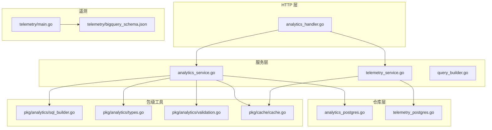
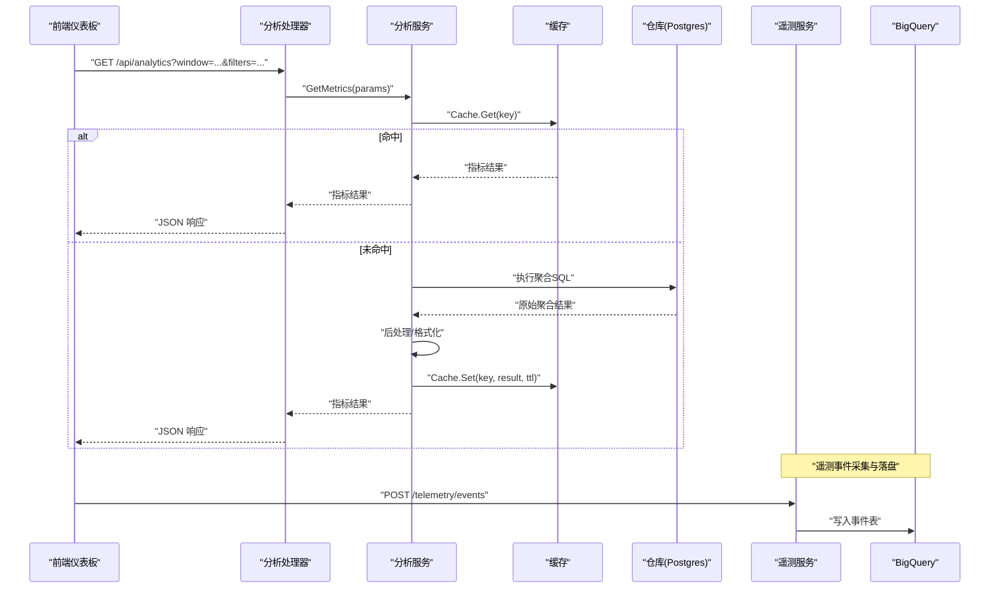
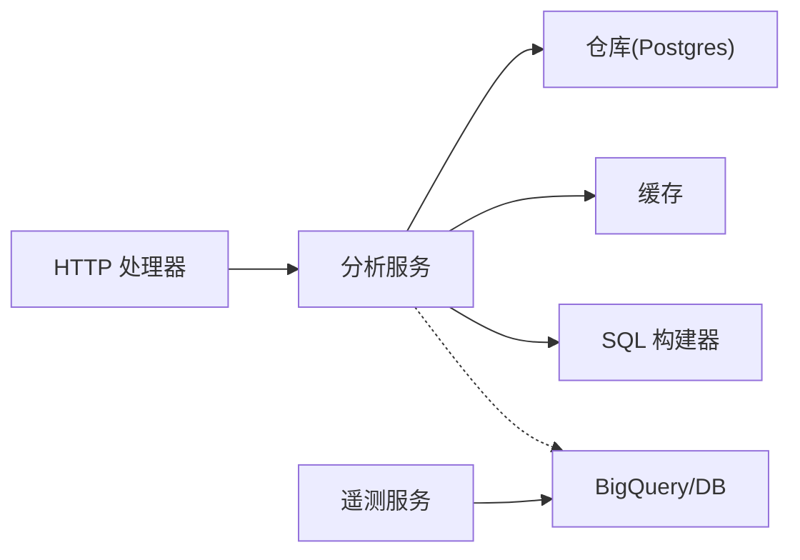
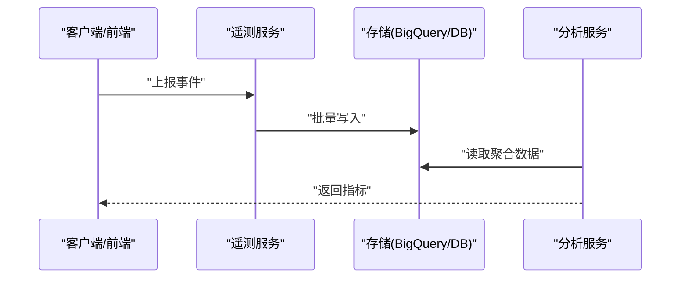

# 分析服务

<cite>
**本文引用的文件**   
- [analytics_handler.go](file://notifuse/internal/http/analytics_handler.go)
- [analytics_service.go](file://notifuse/internal/service/analytics_service.go)
- [analytics_postgres.go](file://notifuse/internal/repository/analytics_postgres.go)
- [sql_builder.go](file://notifuse/pkg/analytics/sql_builder.go)
- [types.go](file://notifuse/pkg/analytics/types.go)
- [validation.go](file://notifuse/pkg/analytics/validation.go)
- [telemetry_service.go](file://notifuse/internal/service/telemetry_service.go)
- [telemetry_postgres.go](file://notifuse/internal/repository/telemetry_postgres.go)
- [telemetry.go](file://notifuse/internal/domain/telemetry.go)
- [query_builder.go](file://notifuse/internal/service/query_builder.go)
- [cache.go](file://notifuse/pkg/cache/cache.go)
- [bigquery_schema.json](file://notifuse/telemetry/bigquery_schema.json)
- [main.go](file://notifuse/telemetry/main.go)
</cite>

## 目录
1. [简介](#简介)
2. [项目结构](#项目结构)
3. [核心组件](#核心组件)
4. [架构总览](#架构总览)
5. [详细组件分析](#详细组件分析)
6. [依赖关系分析](#依赖关系分析)
7. [性能考虑](#性能考虑)
8. [故障排查指南](#故障排查指南)
9. [结论](#结论)
10. [附录](#附录)

## 简介
本文件面向 Notifuse 平台的“分析服务”，聚焦以下目标：
- 邮件性能统计、用户行为追踪、实时指标收集与报表生成
- 遥测数据的采集与处理流程
- SQL 查询构建器的设计与动态查询生成
- 聚合计算与缓存策略
- 自定义指标的添加与分析查询示例（以路径引用形式）
- 大数据量下的性能优化与索引策略
- 与前端仪表板的集成和数据格式规范

## 项目结构
分析相关代码主要分布在如下模块：
- HTTP 层：分析接口处理器，负责接收请求、参数校验、调用服务层并返回结果
- 服务层：分析业务编排、指标聚合、缓存命中/回源、调用仓库层
- 仓库层：PostgreSQL 数据访问实现，封装 SQL 执行与映射
- 包级工具：SQL 查询构建器、类型定义、参数校验
- 遥测子系统：事件上报、存储与 BigQuery 模式定义
- 通用缓存：内存缓存抽象，供分析服务使用

图表来源
- [analytics_handler.go](file://notifuse/internal/http/analytics_handler.go)
- [analytics_service.go](file://notifuse/internal/service/analytics_service.go)
- [analytics_postgres.go](file://notifuse/internal/repository/analytics_postgres.go)
- [sql_builder.go](file://notifuse/pkg/analytics/sql_builder.go)
- [types.go](file://notifuse/pkg/analytics/types.go)
- [validation.go](file://notifuse/pkg/analytics/validation.go)
- [telemetry_service.go](file://notifuse/internal/service/telemetry_service.go)
- [telemetry_postgres.go](file://notifuse/internal/repository/telemetry_postgres.go)
- [cache.go](file://notifuse/pkg/cache/cache.go)
- [main.go](file://notifuse/telemetry/main.go)
- [bigquery_schema.json](file://notifuse/telemetry/bigquery_schema.json)

章节来源
- [analytics_handler.go](file://notifuse/internal/http/analytics_handler.go)
- [analytics_service.go](file://notifuse/internal/service/analytics_service.go)
- [analytics_postgres.go](file://notifuse/internal/repository/analytics_postgres.go)
- [sql_builder.go](file://notifuse/pkg/analytics/sql_builder.go)
- [types.go](file://notifuse/pkg/analytics/types.go)
- [validation.go](file://notifuse/pkg/analytics/validation.go)
- [telemetry_service.go](file://notifuse/internal/service/telemetry_service.go)
- [telemetry_postgres.go](file://notifuse/internal/repository/telemetry_postgres.go)
- [cache.go](file://notifuse/pkg/cache/cache.go)
- [main.go](file://notifuse/telemetry/main.go)
- [bigquery_schema.json](file://notifuse/telemetry/bigquery_schema.json)

## 核心组件
- 分析处理器：暴露 REST 接口，解析查询参数（时间窗口、维度过滤、分页等），调用分析服务获取指标。
- 分析服务：组合缓存、SQL 构建器、仓库层，完成指标聚合、去重、排序与分页；对热点指标进行缓存。
- 仓库实现：基于 PostgreSQL 的 SQL 执行与结果映射，支持按工作区隔离的数据访问。
- SQL 构建器：提供链式 API 构建 SELECT/FROM/WHERE/GROUP BY/ORDER BY/LIMIT/OFFSET，避免拼接错误与注入风险。
- 类型与校验：统一指标类型、维度枚举、时间范围与分页参数的校验规则。
- 遥测服务：接收事件上报、持久化到数据库或外部系统（如 BigQuery），并提供查询接口。
- 缓存：内存缓存，支持 TTL、键空间与命中率统计，用于热点指标加速。

章节来源
- [analytics_handler.go](file://notifuse/internal/http/analytics_handler.go)
- [analytics_service.go](file://notifuse/internal/service/analytics_service.go)
- [analytics_postgres.go](file://notifuse/internal/repository/analytics_postgres.go)
- [sql_builder.go](file://notifuse/pkg/analytics/sql_builder.go)
- [types.go](file://notifuse/pkg/analytics/types.go)
- [validation.go](file://notifuse/pkg/analytics/validation.go)
- [telemetry_service.go](file://notifuse/internal/service/telemetry_service.go)
- [telemetry_postgres.go](file://notifuse/internal/repository/telemetry_postgres.go)
- [cache.go](file://notifuse/pkg/cache/cache.go)

## 架构总览
分析服务采用分层架构：HTTP 层仅做协议适配与参数校验，核心逻辑在服务层，数据访问在仓库层，SQL 构建作为可复用工具。遥测子系统独立部署，将事件写入 BigQuery 或本地库，再由分析服务读取。

图表来源
- [analytics_handler.go](file://notifuse/internal/http/analytics_handler.go)
- [analytics_service.go](file://notifuse/internal/service/analytics_service.go)
- [analytics_postgres.go](file://notifuse/internal/repository/analytics_postgres.go)
- [cache.go](file://notifuse/pkg/cache/cache.go)
- [telemetry_service.go](file://notifuse/internal/service/telemetry_service.go)
- [telemetry_postgres.go](file://notifuse/internal/repository/telemetry_postgres.go)
- [main.go](file://notifuse/telemetry/main.go)
- [bigquery_schema.json](file://notifuse/telemetry/bigquery_schema.json)

## 详细组件分析

### 分析处理器（HTTP 层）
职责
- 解析查询参数：时间窗口、维度筛选、分页、排序字段
- 调用分析服务获取指标
- 统一错误码与响应体结构

关键流程
- 参数校验失败直接返回 4xx
- 调用服务层后，根据状态码返回 200/5xx
- 为前端提供一致的 JSON 结构

章节来源
- [analytics_handler.go](file://notifuse/internal/http/analytics_handler.go)

### 分析服务（业务编排）
职责
- 组装缓存键（包含时间窗口、维度、过滤条件）
- 优先从缓存读取，未命中则调用仓库层执行聚合
- 对结果进行标准化与分页裁剪
- 控制缓存 TTL 与失效策略

关键流程
- 构建缓存键 -> 尝试命中 -> 未命中则构建查询 -> 执行 -> 回填缓存 -> 返回

章节来源
- [analytics_service.go](file://notifuse/internal/service/analytics_service.go)
- [cache.go](file://notifuse/pkg/cache/cache.go)

### 仓库层（PostgreSQL）
职责
- 执行分析 SQL，映射为结构化结果
- 支持按工作区隔离与权限控制
- 提供批量/分页能力

关键流程
- 接收服务层传入的 SQL 与参数
- 执行查询并转换为领域对象
- 返回给服务层进行后续处理

章节来源
- [analytics_postgres.go](file://notifuse/internal/repository/analytics_postgres.go)

### SQL 查询构建器（动态查询）
设计要点
- 链式 API：选择列、指定表、追加 WHERE、GROUP BY、ORDER BY、LIMIT/OFFSET
- 参数绑定：防止 SQL 注入
- 空值安全：当无过滤条件时不附加多余 AND
- 组合性：可复用片段，便于扩展新指标

典型用法（路径引用）
- 构建基础查询：[sql_builder.go](file://notifuse/pkg/analytics/sql_builder.go)
- 增加过滤条件：[sql_builder.go](file://notifuse/pkg/analytics/sql_builder.go)
- 分组与排序：[sql_builder.go](file://notifuse/pkg/analytics/sql_builder.go)
- 分页限制：[sql_builder.go](file://notifuse/pkg/analytics/sql_builder.go)

章节来源
- [sql_builder.go](file://notifuse/pkg/analytics/sql_builder.go)

### 类型与校验
职责
- 统一定义指标类型、维度枚举、时间窗口、分页参数
- 校验输入合法性，拒绝非法组合

常见校验
- 时间窗口起止顺序与最大跨度
- 维度白名单校验
- 分页大小上限

章节来源
- [types.go](file://notifuse/pkg/analytics/types.go)
- [validation.go](file://notifuse/pkg/analytics/validation.go)

### 遥测服务（采集与处理）
职责
- 接收前端/客户端上报的事件
- 持久化到数据库或 BigQuery
- 提供查询接口供分析服务消费

采集流程
- 前端发送事件 -> 遥测函数/服务 -> 写入 BigQuery/DB -> 分析服务定时或按需拉取

章节来源
- [telemetry_service.go](file://notifuse/internal/service/telemetry_service.go)
- [telemetry_postgres.go](file://notifuse/internal/repository/telemetry_postgres.go)
- [telemetry.go](file://notifuse/internal/domain/telemetry.go)
- [main.go](file://notifuse/telemetry/main.go)
- [bigquery_schema.json](file://notifuse/telemetry/bigquery_schema.json)

### 缓存策略
策略
- 键空间：按“指标+时间窗口+维度+过滤”生成唯一键
- TTL：短周期指标设置较短 TTL，长周期指标较长 TTL
- 失效：按维度或时间窗口前缀清理
- 降级：缓存不可用时直接回源 DB

章节来源
- [cache.go](file://notifuse/pkg/cache/cache.go)
- [analytics_service.go](file://notifuse/internal/service/analytics_service.go)

## 依赖关系分析
- HTTP 层依赖服务层，不直接访问数据库
- 服务层依赖仓库层、缓存与 SQL 构建器
- 仓库层依赖数据库连接与驱动
- 遥测服务独立于分析服务，通过 BigQuery/DB 共享数据

图表来源
- [analytics_handler.go](file://notifuse/internal/http/analytics_handler.go)
- [analytics_service.go](file://notifuse/internal/service/analytics_service.go)
- [analytics_postgres.go](file://notifuse/internal/repository/analytics_postgres.go)
- [sql_builder.go](file://notifuse/pkg/analytics/sql_builder.go)
- [telemetry_service.go](file://notifuse/internal/service/telemetry_service.go)
- [telemetry_postgres.go](file://notifuse/internal/repository/telemetry_postgres.go)
- [main.go](file://notifuse/telemetry/main.go)
- [bigquery_schema.json](file://notifuse/telemetry/bigquery_schema.json)

章节来源
- [analytics_handler.go](file://notifuse/internal/http/analytics_handler.go)
- [analytics_service.go](file://notifuse/internal/service/analytics_service.go)
- [analytics_postgres.go](file://notifuse/internal/repository/analytics_postgres.go)
- [sql_builder.go](file://notifuse/pkg/analytics/sql_builder.go)
- [telemetry_service.go](file://notifuse/internal/service/telemetry_service.go)
- [telemetry_postgres.go](file://notifuse/internal/repository/telemetry_postgres.go)
- [main.go](file://notifuse/telemetry/main.go)
- [bigquery_schema.json](file://notifuse/telemetry/bigquery_schema.json)

## 性能考虑
- 索引建议
  - 时间戳列建立分区或索引，按天/周分区可显著降低扫描成本
  - 常用过滤维度（如工作区 ID、模板 ID、渠道）建立复合索引
  - 聚合列（如状态、地区）加入覆盖索引以减少回表
- 查询优化
  - 使用 SQL 构建器生成的参数化查询，避免全表扫描
  - 合理设置 LIMIT/OFFSET，或使用游标分页
  - 对热点指标启用缓存，缩短 P95 延迟
- 批处理与异步
  - 遥测事件批量写入，减少 I/O 次数
  - 报表生成走后台任务，避免阻塞在线请求
- 资源隔离
  - 读写分离：分析查询走只读副本
  - 限流与熔断：保护后端数据库

## 故障排查指南
常见问题
- 缓存未命中导致抖动：检查缓存键一致性、TTL 配置与缓存可用性
- 查询超时：确认索引是否生效、时间窗口是否过大、是否使用了分页
- 遥测数据缺失：检查遥测函数/服务健康状态、BigQuery 写入配额与权限
- 参数校验失败：核对维度白名单与时间窗口约束

定位步骤
- 查看 HTTP 层日志中的请求参数与响应码
- 在服务层打印缓存命中/未命中与回源耗时
- 在仓库层记录慢查询与执行计划
- 在遥测侧检查事件入库成功率与延迟

章节来源
- [analytics_handler.go](file://notifuse/internal/http/analytics_handler.go)
- [analytics_service.go](file://notifuse/internal/service/analytics_service.go)
- [analytics_postgres.go](file://notifuse/internal/repository/analytics_postgres.go)
- [telemetry_service.go](file://notifuse/internal/service/telemetry_service.go)
- [telemetry_postgres.go](file://notifuse/internal/repository/telemetry_postgres.go)

## 结论
分析服务通过清晰的分层与可复用的 SQL 构建器，实现了高性能、可扩展的指标聚合与报表能力。结合缓存与合理的索引策略，可在大数据量下保持稳定吞吐与低延迟。遥测子系统独立运行，确保事件采集的高可用与可观测性。

## 附录

### 自定义指标添加步骤（路径引用）
- 定义指标类型与维度：参考 [types.go](file://notifuse/pkg/analytics/types.go)
- 新增参数校验规则：参考 [validation.go](file://notifuse/pkg/analytics/validation.go)
- 使用 SQL 构建器拼装查询：参考 [sql_builder.go](file://notifuse/pkg/analytics/sql_builder.go)
- 在服务层编排缓存与回源逻辑：参考 [analytics_service.go](file://notifuse/internal/service/analytics_service.go)
- 在仓库层实现 SQL 执行与映射：参考 [analytics_postgres.go](file://notifuse/internal/repository/analytics_postgres.go)
- 在处理器中暴露接口：参考 [analytics_handler.go](file://notifuse/internal/http/analytics_handler.go)

### 遥测数据采集与处理流程（序列图）

图表来源
- [main.go](file://notifuse/telemetry/main.go)
- [bigquery_schema.json](file://notifuse/telemetry/bigquery_schema.json)
- [telemetry_service.go](file://notifuse/internal/service/telemetry_service.go)
- [telemetry_postgres.go](file://notifuse/internal/repository/telemetry_postgres.go)
- [analytics_service.go](file://notifuse/internal/service/analytics_service.go)

### 前端仪表板集成与数据格式规范
- 请求参数
  - 时间窗口：开始/结束时间或相对窗口
  - 维度：如渠道、模板、地区等
  - 过滤：工作区 ID、标签、状态等
  - 分页：页码、每页条数、排序字段
- 响应结构
  - 指标列表：包含名称、数值、单位、时间粒度
  - 元信息：时间范围、维度说明、数据来源
  - 错误信息：错误码、消息、建议操作
- 最佳实践
  - 前端对大时间窗口自动分页或降采样
  - 对热点指标开启本地短时缓存
  - 展示加载态与重试机制

章节来源
- [analytics_handler.go](file://notifuse/internal/http/analytics_handler.go)
- [analytics_service.go](file://notifuse/internal/service/analytics_service.go)
- [types.go](file://notifuse/pkg/analytics/types.go)
- [validation.go](file://notifuse/pkg/analytics/validation.go)