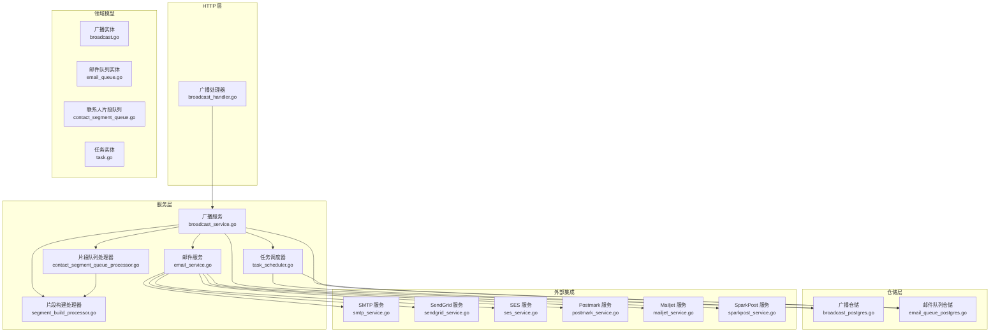
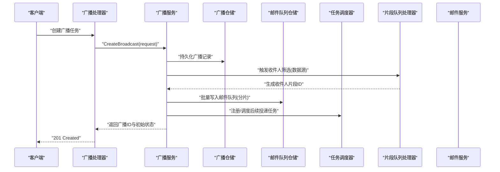
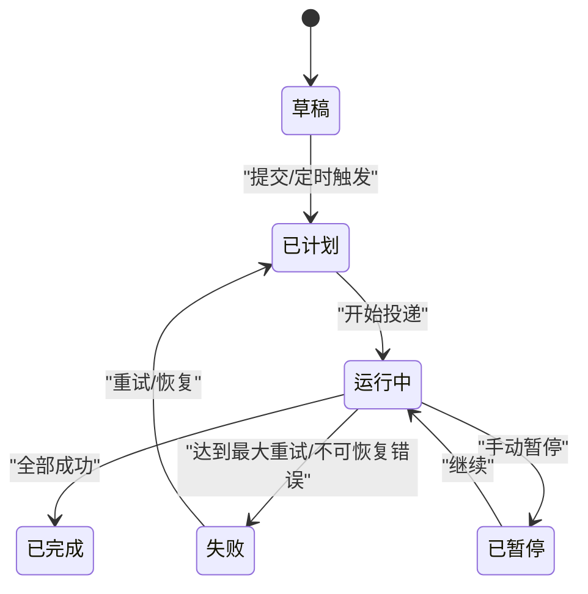
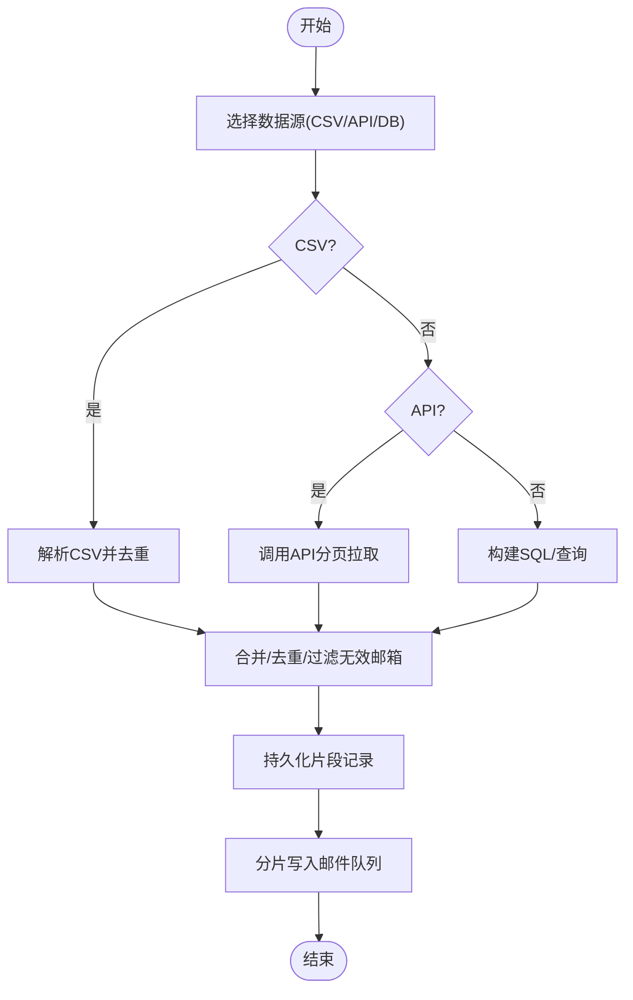
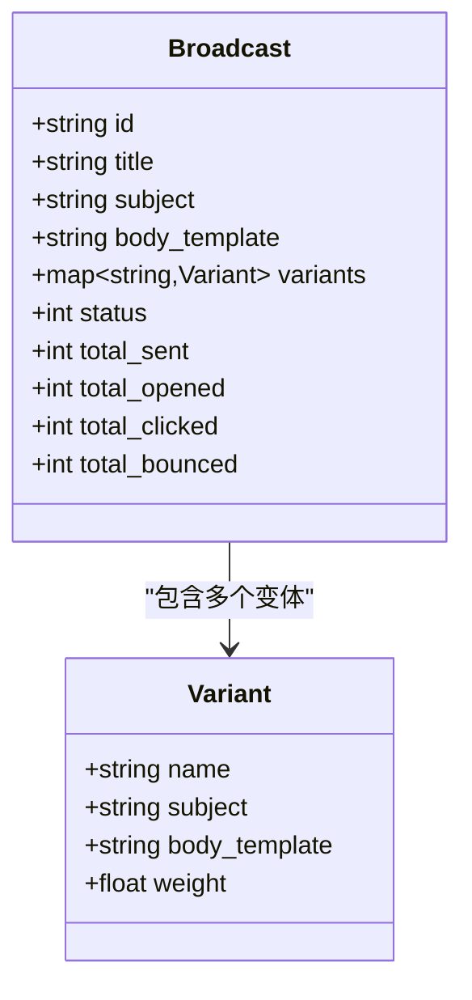
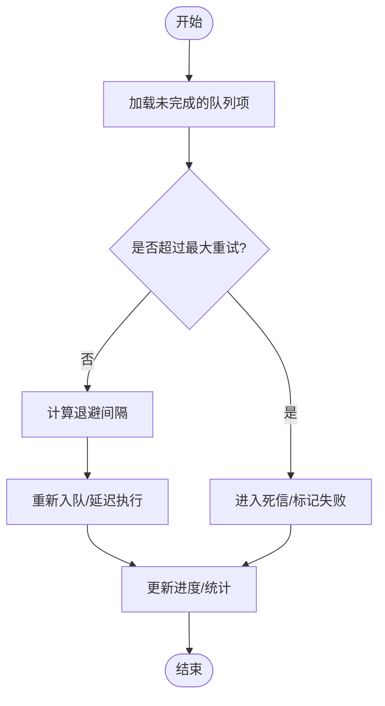
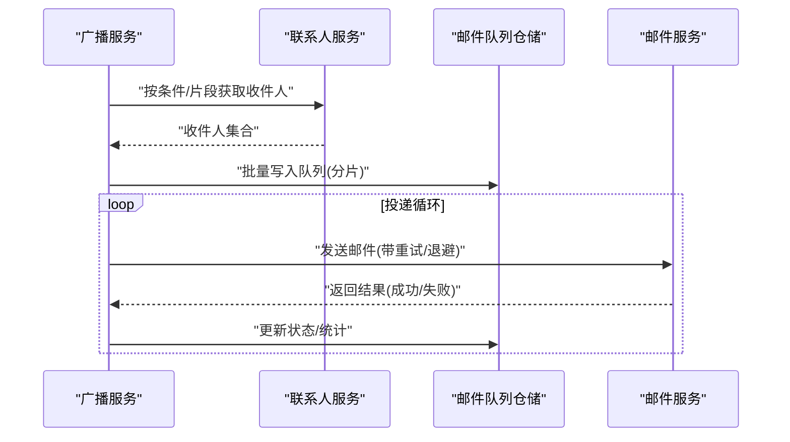
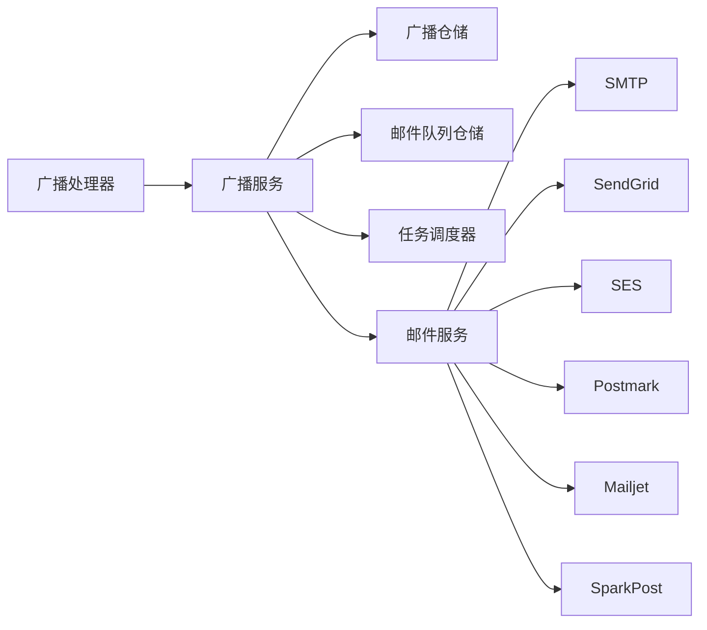

# 广播服务

<cite>
**本文引用的文件**   
- [broadcast.go](file://notifuse/internal/domain/broadcast.go)
- [broadcast_handler.go](file://notifuse/internal/http/broadcast_handler.go)
- [broadcast_service.go](file://notifuse/internal/service/broadcast_service.go)
- [broadcast_postgres.go](file://notifuse/internal/repository/broadcast_postgres.go)
- [email_queue.go](file://notifuse/internal/domain/email_queue.go)
- [email_queue_postgres.go](file://notifuse/internal/repository/email_queue_postgres.go)
- [contact_segment_queue.go](file://notifuse/internal/domain/contact_segment_queue.go)
- [contact_segment_queue_processor.go](file://notifuse/internal/service/contact_segment_queue_processor.go)
- [segment_build_processor.go](file://notifuse/internal/service/segment_build_processor.go)
- [task.go](file://notifuse/internal/domain/task.go)
- [task_scheduler.go](file://notifuse/internal/service/task_scheduler.go)
- [task_service.go](file://notifuse/internal/service/task_service.go)
- [query_builder.go](file://notifuse/internal/service/query_builder.go)
- [smtp_service.go](file://notifuse/internal/service/smtp_service.go)
- [sendgrid_service.go](file://notifuse/internal/service/sendgrid_service.go)
- [ses_service.go](file://notifuse/internal/service/ses_service.go)
- [postmark_service.go](file://notifuse/internal/service/postmark_service.go)
- [mailjet_service.go](file://notifuse/internal/service/mailjet_service.go)
- [sparkpost_service.go](file://notifuse/internal/service/sparkpost_service.go)
- [email_provider.go](file://notifuse/internal/domain/email_provider.go)
- [email_provider_smtp.go](file://notifuse/internal/domain/email_provider_smtp.go)
- [email_provider_sendgrid.go](file://notifuse/internal/domain/email_provider_sendgrid.go)
- [email_provider_ses.go](file://notifuse/internal/domain/email_provider_ses.go)
- [email_provider_postmark.go](file://notifuse/internal/domain/email_provider_postmark.go)
- [email_provider_mailjet.go](file://notifuse/internal/domain/email_provider_mailjet.go)
- [email_provider_sparkpost.go](file://notifuse/internal/domain/email_provider_sparkpost.go)
- [email_service.go](file://notifuse/internal/service/email_service.go)
- [broadcast_test.go](file://notifuse/internal/domain/broadcast_test.go)
- [broadcast_handler_test.go](file://notifuse/internal/http/broadcast_handler_test.go)
- [broadcast_service_test.go](file://notifuse/internal/service/broadcast_service_test.go)
</cite>

## 目录
1. [简介](#简介)
2. [项目结构](#项目结构)
3. [核心组件](#核心组件)
4. [架构总览](#架构总览)
5. [详细组件分析](#详细组件分析)
6. [依赖关系分析](#依赖关系分析)
7. [性能考虑](#性能考虑)
8. [故障排查指南](#故障排查指南)
9. [结论](#结论)
10. [附录](#附录)

## 简介
本文件为 Notifuse 平台的“广播服务”提供系统化文档，聚焦批量邮件发送的核心能力与编排机制。内容覆盖：
- 广播任务创建、收件人筛选、A/B 测试支持与进度监控
- 广播编排器设计与微服务模式
- 数据源集成（CSV、API、数据库查询）
- 批量处理优化（分片、并发、内存管理）
- 失败重试与断点续传
- 与邮件服务、联系人服务的协作模式

## 项目结构
广播相关代码主要分布在以下层次：
- HTTP 层：接收请求、参数校验、返回结果
- 领域模型：广播、队列、任务等实体定义
- 服务层：编排流程、策略控制、状态推进
- 仓储层：持久化访问（PostgreSQL）
- 外部集成：邮件提供商、联系人/片段构建、任务调度

图表来源
- [broadcast_handler.go](file://notifuse/internal/http/broadcast_handler.go)
- [broadcast_service.go](file://notifuse/internal/service/broadcast_service.go)
- [broadcast_postgres.go](file://notifuse/internal/repository/broadcast_postgres.go)
- [email_queue_postgres.go](file://notifuse/internal/repository/email_queue_postgres.go)
- [task_scheduler.go](file://notifuse/internal/service/task_scheduler.go)
- [contact_segment_queue_processor.go](file://notifuse/internal/service/contact_segment_queue_processor.go)
- [segment_build_processor.go](file://notifuse/internal/service/segment_build_processor.go)
- [email_service.go](file://notifuse/internal/service/email_service.go)
- [smtp_service.go](file://notifuse/internal/service/smtp_service.go)
- [sendgrid_service.go](file://notifuse/internal/service/sendgrid_service.go)
- [ses_service.go](file://notifuse/internal/service/ses_service.go)
- [postmark_service.go](file://notifuse/internal/service/postmark_service.go)
- [mailjet_service.go](file://notifuse/internal/service/mailjet_service.go)
- [sparkpost_service.go](file://notifuse/internal/service/sparkpost_service.go)

章节来源
- [broadcast_handler.go](file://notifuse/internal/http/broadcast_handler.go)
- [broadcast_service.go](file://notifuse/internal/service/broadcast_service.go)
- [broadcast_postgres.go](file://notifuse/internal/repository/broadcast_postgres.go)
- [email_queue_postgres.go](file://notifuse/internal/repository/email_queue_postgres.go)
- [task_scheduler.go](file://notifuse/internal/service/task_scheduler.go)
- [contact_segment_queue_processor.go](file://notifuse/internal/service/contact_segment_queue_processor.go)
- [segment_build_processor.go](file://notifuse/internal/service/segment_build_processor.go)
- [email_service.go](file://notifuse/internal/service/email_service.go)

## 核心组件
- 广播实体：承载广播任务元信息、目标范围、模板、A/B 配置、状态与统计等
- 邮件队列实体：承载待投递的邮件消息、优先级、重试计数、错误信息等
- 联系人片段队列：承载基于条件或列表计算的收件人群体生成任务
- 任务实体与调度器：负责周期性扫描、拉取并执行广播子任务
- 广播服务：编排创建、收件人筛选、分片入队、进度更新、A/B 分流、重试与恢复
- 邮件服务：统一封装各邮件提供商接口，驱动实际投递
- 仓储实现：PostgreSQL 持久化广播、队列、任务等

章节来源
- [broadcast.go](file://notifuse/internal/domain/broadcast.go)
- [email_queue.go](file://notifuse/internal/domain/email_queue.go)
- [contact_segment_queue.go](file://notifuse/internal/domain/contact_segment_queue.go)
- [task.go](file://notifuse/internal/domain/task.go)
- [broadcast_service.go](file://notifuse/internal/service/broadcast_service.go)
- [email_service.go](file://notifuse/internal/service/email_service.go)
- [broadcast_postgres.go](file://notifuse/internal/repository/broadcast_postgres.go)
- [email_queue_postgres.go](file://notifuse/internal/repository/email_queue_postgres.go)

## 架构总览
广播服务采用分层与微服务风格组合：
- HTTP 入口仅做参数校验与响应包装，业务编排下沉至服务层
- 服务层通过仓储访问数据库，并通过任务调度器将长耗时工作解耦为可重试的任务
- 收件人筛选由片段构建与队列处理器完成，支持 CSV、API、SQL 等多种数据源
- 投递阶段由邮件服务统一抽象，屏蔽不同提供商差异
- A/B 测试在广播实体中声明，服务层按策略拆分流量并分别入队

图表来源
- [broadcast_handler.go](file://notifuse/internal/http/broadcast_handler.go)
- [broadcast_service.go](file://notifuse/internal/service/broadcast_service.go)
- [broadcast_postgres.go](file://notifuse/internal/repository/broadcast_postgres.go)
- [email_queue_postgres.go](file://notifuse/internal/repository/email_queue_postgres.go)
- [contact_segment_queue_processor.go](file://notifuse/internal/service/contact_segment_queue_processor.go)
- [task_scheduler.go](file://notifuse/internal/service/task_scheduler.go)
- [email_service.go](file://notifuse/internal/service/email_service.go)

## 详细组件分析

### 广播实体与状态机
- 关键字段：标题、主题、正文模板、发件人、回复地址、附件、目标范围、A/B 变体、状态、统计指标、错误信息、时间戳等
- 状态流转：草稿 -> 已计划/运行中 -> 已完成/失败；支持暂停与恢复
- A/B 支持：定义多个变体及权重，服务层按权重分流到不同队列或批次

图表来源
- [broadcast.go](file://notifuse/internal/domain/broadcast.go)

章节来源
- [broadcast.go](file://notifuse/internal/domain/broadcast.go)
- [broadcast_test.go](file://notifuse/internal/domain/broadcast_test.go)

### 收件人筛选与数据源集成
- 数据源类型：
  - CSV 文件：上传后解析为联系人集合
  - API 接口：调用外部系统获取联系人列表
  - 数据库查询：使用 SQL 或查询构建器动态生成收件人集
- 片段构建：将筛选结果持久化为“联系人片段”，供后续批量入队
- 队列处理器：消费片段任务，分批产出收件人并写入邮件队列

图表来源
- [contact_segment_queue_processor.go](file://notifuse/internal/service/contact_segment_queue_processor.go)
- [segment_build_processor.go](file://notifuse/internal/service/segment_build_processor.go)
- [query_builder.go](file://notifuse/internal/service/query_builder.go)
- [contact_segment_queue.go](file://notifuse/internal/domain/contact_segment_queue.go)

章节来源
- [contact_segment_queue_processor.go](file://notifuse/internal/service/contact_segment_queue_processor.go)
- [segment_build_processor.go](file://notifuse/internal/service/segment_build_processor.go)
- [query_builder.go](file://notifuse/internal/service/query_builder.go)
- [contact_segment_queue.go](file://notifuse/internal/domain/contact_segment_queue.go)

### A/B 测试与分流
- 在广播实体中声明多个变体（如不同主题/正文），并设置权重
- 服务层根据权重计算分流比例，将同一批收件人拆分为多组，分别进入对应队列
- 统计维度包含每个变体的打开率、点击率、退信率等，便于对比分析

图表来源
- [broadcast.go](file://notifuse/internal/domain/broadcast.go)

章节来源
- [broadcast.go](file://notifuse/internal/domain/broadcast.go)

### 进度监控与统计
- 实时统计：已发送、已打开、已点击、退信数、失败数等
- 进度计算：基于队列长度与广播总量估算完成度
- 事件上报：关键节点（开始、完成、失败）写入日志与遥测

章节来源
- [broadcast.go](file://notifuse/internal/domain/broadcast.go)
- [broadcast_service.go](file://notifuse/internal/service/broadcast_service.go)

### 失败重试与断点续传
- 重试策略：指数退避、最大重试次数、死信队列（可选）
- 断点续传：以广播ID+收件人为粒度记录投递状态，重启后可从上次位置继续
- 幂等性：对重复投递进行去重，避免重复发送

图表来源
- [email_queue.go](file://notifuse/internal/domain/email_queue.go)
- [email_queue_postgres.go](file://notifuse/internal/repository/email_queue_postgres.go)
- [task_scheduler.go](file://notifuse/internal/service/task_scheduler.go)

章节来源
- [email_queue.go](file://notifuse/internal/domain/email_queue.go)
- [email_queue_postgres.go](file://notifuse/internal/repository/email_queue_postgres.go)
- [task_scheduler.go](file://notifuse/internal/service/task_scheduler.go)

### 与邮件服务和联系人服务的协作
- 邮件服务：统一抽象 SMTP、SendGrid、SES、Postmark、Mailjet、SparkPost 等提供商
- 联系人服务：提供列表、标签、片段等能力，用于精准筛选
- 协作模式：广播服务调用联系人服务获取目标集，再交由邮件服务投递

图表来源
- [email_service.go](file://notifuse/internal/service/email_service.go)
- [email_queue_postgres.go](file://notifuse/internal/repository/email_queue_postgres.go)
- [broadcast_service.go](file://notifuse/internal/service/broadcast_service.go)

章节来源
- [email_service.go](file://notifuse/internal/service/email_service.go)
- [email_queue_postgres.go](file://notifuse/internal/repository/email_queue_postgres.go)
- [broadcast_service.go](file://notifuse/internal/service/broadcast_service.go)

## 依赖关系分析
- 低耦合：HTTP 层不直接操作仓储，服务层聚合仓储与外部服务
- 明确边界：领域模型与服务职责清晰，仓储仅负责数据存取
- 可扩展：邮件提供商通过统一接口扩展，新增供应商无需改动上层逻辑

图表来源
- [broadcast_handler.go](file://notifuse/internal/http/broadcast_handler.go)
- [broadcast_service.go](file://notifuse/internal/service/broadcast_service.go)
- [broadcast_postgres.go](file://notifuse/internal/repository/broadcast_postgres.go)
- [email_queue_postgres.go](file://notifuse/internal/repository/email_queue_postgres.go)
- [task_scheduler.go](file://notifuse/internal/service/task_scheduler.go)
- [email_service.go](file://notifuse/internal/service/email_service.go)
- [smtp_service.go](file://notifuse/internal/service/smtp_service.go)
- [sendgrid_service.go](file://notifuse/internal/service/sendgrid_service.go)
- [ses_service.go](file://notifuse/internal/service/ses_service.go)
- [postmark_service.go](file://notifuse/internal/service/postmark_service.go)
- [mailjet_service.go](file://notifuse/internal/service/mailjet_service.go)
- [sparkpost_service.go](file://notifuse/internal/service/sparkpost_service.go)

章节来源
- [broadcast_handler.go](file://notifuse/internal/http/broadcast_handler.go)
- [broadcast_service.go](file://notifuse/internal/service/broadcast_service.go)
- [broadcast_postgres.go](file://notifuse/internal/repository/broadcast_postgres.go)
- [email_queue_postgres.go](file://notifuse/internal/repository/email_queue_postgres.go)
- [task_scheduler.go](file://notifuse/internal/service/task_scheduler.go)
- [email_service.go](file://notifuse/internal/service/email_service.go)

## 性能考虑
- 分片处理：将大批量收件人切分为固定大小的分片，降低单次处理压力
- 并发控制：限制并发投递数量，避免压垮下游邮件服务
- 内存管理：流式读取与写入，避免一次性加载全量数据到内存
- 批量写入：使用事务或批量插入减少数据库往返
- 退避与限流：对失败请求实施指数退避与速率限制，保护系统稳定性

[本节为通用指导，不直接分析具体文件]

## 故障排查指南
- 常见问题定位：
  - 收件人筛选失败：检查 CSV 格式、API 返回结构、SQL 语法与权限
  - 投递失败：查看队列错误字段与重试计数，确认邮件提供商认证与配额
  - 进度停滞：核对任务调度器是否正常运行、队列是否有积压
- 建议步骤：
  - 查看广播状态与统计指标，定位失败阶段
  - 检查队列项的重试次数与错误信息
  - 验证数据源连通性与权限
  - 调整并发与分片大小，观察吞吐变化

章节来源
- [broadcast_handler_test.go](file://notifuse/internal/http/broadcast_handler_test.go)
- [broadcast_service_test.go](file://notifuse/internal/service/broadcast_service_test.go)

## 结论
广播服务通过清晰的层级划分与微服务模式，实现了高可靠、可扩展的批量邮件发送能力。其核心优势在于：
- 灵活的数据源接入与片段化收件人生成
- 完善的 A/B 测试与进度监控
- 健壮的重试与断点续传机制
- 统一的邮件服务抽象，便于快速接入新提供商

## 附录

### 数据源配置示例（路径指引）
- CSV 数据源：参考片段构建处理器与队列处理器中的解析与入队逻辑
  - [contact_segment_queue_processor.go](file://notifuse/internal/service/contact_segment_queue_processor.go)
  - [segment_build_processor.go](file://notifuse/internal/service/segment_build_processor.go)
- API 数据源：参考片段构建处理器对外部接口的调用与分页处理
  - [segment_build_processor.go](file://notifuse/internal/service/segment_build_processor.go)
- 数据库查询：参考查询构建器与片段构建处理器中的 SQL 组装与执行
  - [query_builder.go](file://notifuse/internal/service/query_builder.go)
  - [segment_build_processor.go](file://notifuse/internal/service/segment_build_processor.go)

### 邮件提供商集成示例（路径指引）
- SMTP：
  - [smtp_service.go](file://notifuse/internal/service/smtp_service.go)
  - [email_provider_smtp.go](file://notifuse/internal/domain/email_provider_smtp.go)
- SendGrid：
  - [sendgrid_service.go](file://notifuse/internal/service/sendgrid_service.go)
  - [email_provider_sendgrid.go](file://notifuse/internal/domain/email_provider_sendgrid.go)
- SES：
  - [ses_service.go](file://notifuse/internal/service/ses_service.go)
  - [email_provider_ses.go](file://notifuse/internal/domain/email_provider_ses.go)
- Postmark：
  - [postmark_service.go](file://notifuse/internal/service/postmark_service.go)
  - [email_provider_postmark.go](file://notifuse/internal/domain/email_provider_postmark.go)
- Mailjet：
  - [mailjet_service.go](file://notifuse/internal/service/mailjet_service.go)
  - [email_provider_mailjet.go](file://notifuse/internal/domain/email_provider_mailjet.go)
- SparkPost：
  - [sparkpost_service.go](file://notifuse/internal/service/sparkpost_service.go)
  - [email_provider_sparkpost.go](file://notifuse/internal/domain/email_provider_sparkpost.go)
- 统一接口：
  - [email_provider.go](file://notifuse/internal/domain/email_provider.go)
  - [email_service.go](file://notifuse/internal/service/email_service.go)