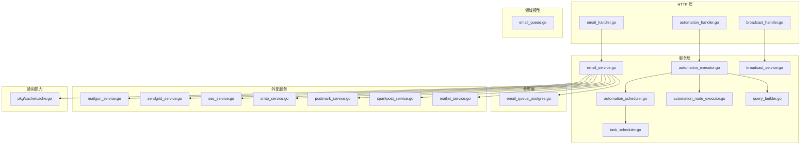
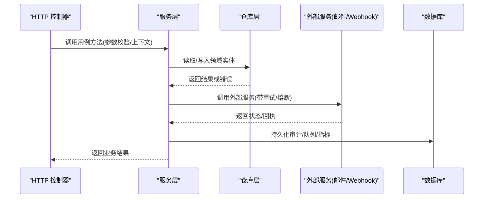
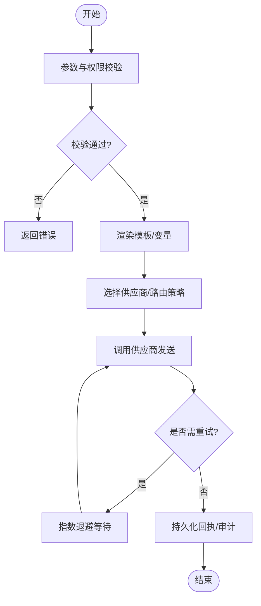
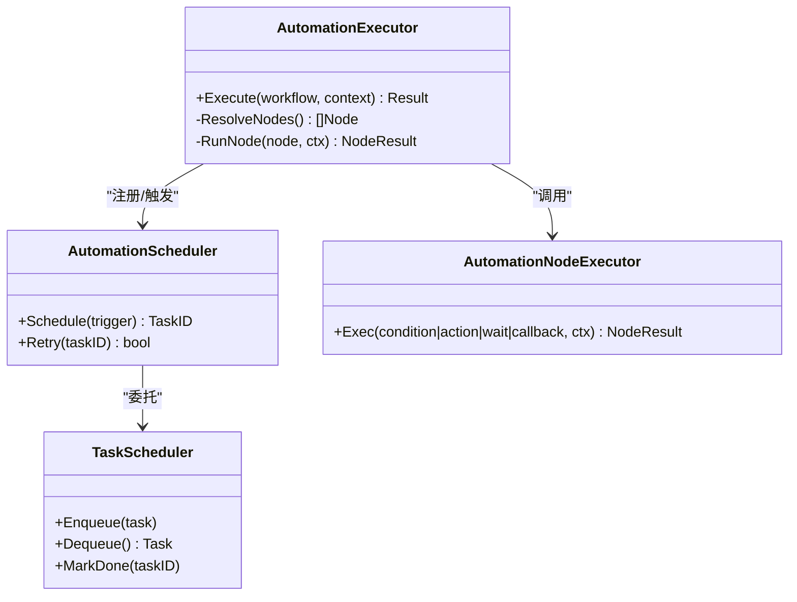
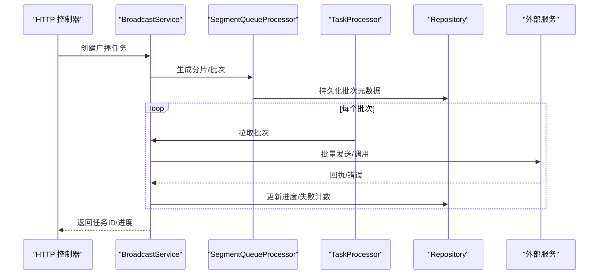
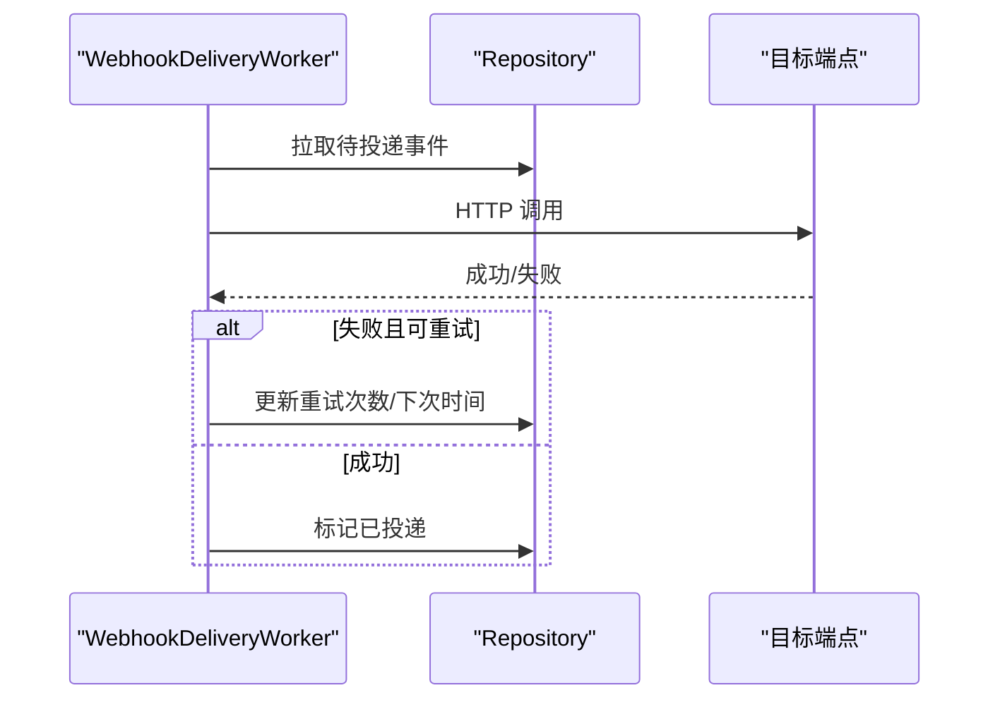
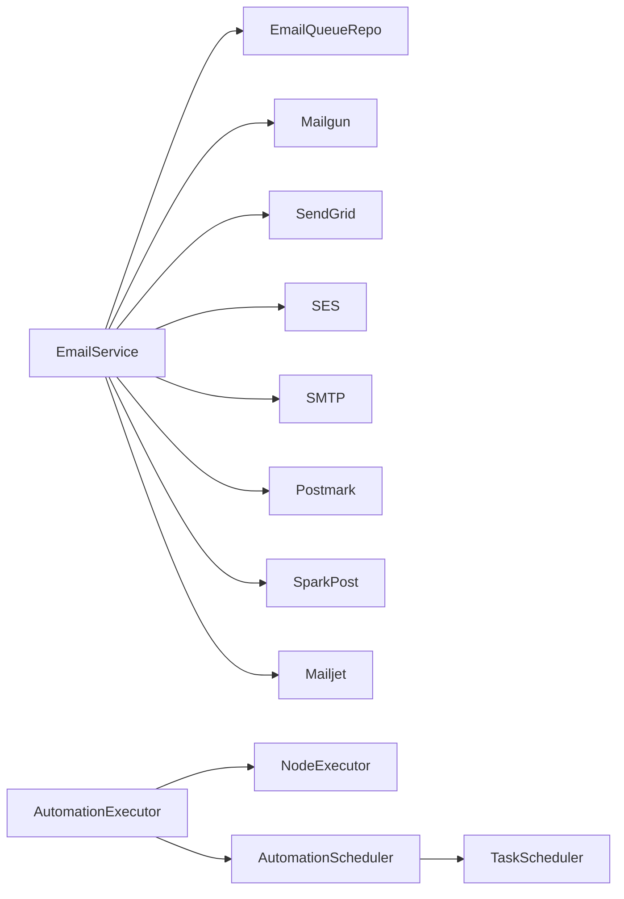

# 服务层

<cite>
**本文引用的文件**   
- [internal/app/app.go](file://notifuse/internal/app/app.go)
- [internal/service/email_service.go](file://notifuse/internal/service/email_service.go)
- [internal/service/automation_executor.go](file://notifuse/internal/service/automation_executor.go)
- [internal/service/automation_scheduler.go](file://notifuse/internal/service/automation_scheduler.go)
- [internal/service/automation_node_executor.go](file://notifuse/internal/service/automation_node_executor.go)
- [internal/service/broadcast_service.go](file://notifuse/internal/service/broadcast_service.go)
- [internal/service/contact_segment_queue_processor.go](file://notifuse/internal/service/contact_segment_queue_processor.go)
- [internal/service/contact_segment_queue_task_processor.go](file://notifuse/internal/service/contact_segment_queue_task_processor.go)
- [internal/service/task_scheduler.go](file://notifuse/internal/service/task_scheduler.go)
- [internal/service/query_builder.go](file://notifuse/internal/service/query_builder.go)
- [internal/repository/email_queue_postgres.go](file://notifuse/internal/repository/email_queue_postgres.go)
- [internal/domain/email_queue.go](file://notifuse/internal/domain/email_queue.go)
- [pkg/cache/cache.go](file://notifuse/pkg/cache/cache.go)
- [internal/service/mailgun_service.go](file://notifuse/internal/service/mailgun_service.go)
- [internal/service/sendgrid_service.go](file://notifuse/internal/service/sendgrid_service.go)
- [internal/service/ses_service.go](file://notifuse/internal/service/ses_service.go)
- [internal/service/smtp_service.go](file://notifuse/internal/service/smtp_service.go)
- [internal/service/postmark_service.go](file://notifuse/internal/service/postmark_service.go)
- [internal/service/sparkpost_service.go](file://notifuse/internal/service/sparkpost_service.go)
- [internal/service/mailjet_service.go](file://notifuse/internal/service/mailjet_service.go)
- [internal/service/webhook_delivery_worker.go](file://notifuse/internal/service/webhook_delivery_worker.go)
- [internal/service/transactional_service.go](file://notifuse/internal/service/transactional_service.go)
- [internal/http/email_handler.go](file://notifuse/internal/http/email_handler.go)
- [internal/http/automation_handler.go](file://notifuse/internal/http/automation_handler.go)
- [internal/http/broadcast_handler.go](file://notifuse/internal/http/broadcast_handler.go)
</cite>

## 目录
1. [简介](#简介)
2. [项目结构](#项目结构)
3. [核心组件](#核心组件)
4. [架构总览](#架构总览)
5. [详细组件分析](#详细组件分析)
6. [依赖关系分析](#依赖关系分析)
7. [性能考虑](#性能考虑)
8. [故障排查指南](#故障排查指南)
9. [结论](#结论)
10. [附录](#附录)

## 简介
本文件聚焦 Notifuse 平台的服务层设计与实现，围绕职责边界、业务逻辑封装模式（事务管理、规则验证、跨领域协调）、接口设计原则与依赖注入方式展开。文档同时覆盖关键业务流程：邮件发送流程、自动化工作流执行、批量操作处理；并说明服务层如何协调多个仓库与外部服务调用、错误处理与重试机制，以及缓存策略在 service 层的应用与性能优化要点。

## 项目结构
Notifuse 采用分层架构：HTTP 控制器负责请求解析与响应编排，service 层承载业务编排与规则校验，repository 层负责数据访问，domain 定义领域模型，pkg 提供通用能力（缓存、日志、安全客户端等）。服务层通过依赖注入获取仓库与外部服务实现，对外暴露面向用例的接口方法。

图表来源
- [internal/http/email_handler.go](file://notifuse/internal/http/email_handler.go)
- [internal/service/email_service.go](file://notifuse/internal/service/email_service.go)
- [internal/service/automation_executor.go](file://notifuse/internal/service/automation_executor.go)
- [internal/service/automation_scheduler.go](file://notifuse/internal/service/automation_scheduler.go)
- [internal/service/automation_node_executor.go](file://notifuse/internal/service/automation_node_executor.go)
- [internal/service/broadcast_service.go](file://notifuse/internal/service/broadcast_service.go)
- [internal/service/task_scheduler.go](file://notifuse/internal/service/task_scheduler.go)
- [internal/service/query_builder.go](file://notifuse/internal/service/query_builder.go)
- [internal/repository/email_queue_postgres.go](file://notifuse/internal/repository/email_queue_postgres.go)
- [internal/domain/email_queue.go](file://notifuse/internal/domain/email_queue.go)
- [pkg/cache/cache.go](file://notifuse/pkg/cache/cache.go)
- [internal/service/mailgun_service.go](file://notifuse/internal/service/mailgun_service.go)
- [internal/service/sendgrid_service.go](file://notifuse/internal/service/sendgrid_service.go)
- [internal/service/ses_service.go](file://notifuse/internal/service/ses_service.go)
- [internal/service/smtp_service.go](file://notifuse/internal/service/smtp_service.go)
- [internal/service/postmark_service.go](file://notifuse/internal/service/postmark_service.go)
- [internal/service/sparkpost_service.go](file://notifuse/internal/service/sparkpost_service.go)
- [internal/service/mailjet_service.go](file://notifuse/internal/service/mailjet_service.go)

章节来源
- [internal/app/app.go](file://notifuse/internal/app/app.go)

## 核心组件
- 邮件服务：统一封装多供应商投递、队列持久化、模板渲染与重试策略，向上为 HTTP 层与事务性服务提供发送能力。
- 自动化执行器：解析工作流定义、调度节点执行、编排条件分支与并行任务，并与任务调度器协作。
- 广播服务：面向大规模触达的批量发送编排，结合分片、限流与失败重试。
- 查询构建器：在服务层组合复杂查询条件，避免将 SQL 拼装下沉到控制器或泄露到上层。
- 任务调度器：集中管理定时任务与延迟任务，支撑自动化与工作流的重试与周期性执行。

章节来源
- [internal/service/email_service.go](file://notifuse/internal/service/email_service.go)
- [internal/service/automation_executor.go](file://notifuse/internal/service/automation_executor.go)
- [internal/service/automation_scheduler.go](file://notifuse/internal/service/automation_scheduler.go)
- [internal/service/automation_node_executor.go](file://notifuse/internal/service/automation_node_executor.go)
- [internal/service/broadcast_service.go](file://notifuse/internal/service/broadcast_service.go)
- [internal/service/query_builder.go](file://notifuse/internal/service/query_builder.go)
- [internal/service/task_scheduler.go](file://notifuse/internal/service/task_scheduler.go)

## 架构总览
服务层作为“业务编排中心”，对上承接 HTTP 控制器的用例入口，对下聚合仓库与外部服务，并通过领域模型与通用能力（如缓存）提升一致性与性能。

图表来源
- [internal/http/email_handler.go](file://notifuse/internal/http/email_handler.go)
- [internal/service/email_service.go](file://notifuse/internal/service/email_service.go)
- [internal/repository/email_queue_postgres.go](file://notifuse/internal/repository/email_queue_postgres.go)
- [internal/service/mailgun_service.go](file://notifuse/internal/service/mailgun_service.go)
- [internal/service/sendgrid_service.go](file://notifuse/internal/service/sendgrid_service.go)
- [internal/service/ses_service.go](file://notifuse/internal/service/ses_service.go)
- [internal/service/smtp_service.go](file://notifuse/internal/service/smtp_service.go)
- [internal/service/postmark_service.go](file://notifuse/internal/service/postmark_service.go)
- [internal/service/sparkpost_service.go](file://notifuse/internal/service/sparkpost_service.go)
- [internal/service/mailjet_service.go](file://notifuse/internal/service/mailjet_service.go)

## 详细组件分析

### 邮件发送流程
- 职责边界
  - 输入校验与模板渲染由服务层完成；具体投递协议细节由各供应商服务实现。
  - 队列持久化与重试由仓库与调度器配合完成。
- 关键流程
  - 接收发送请求 -> 校验参数与权限 -> 渲染模板 -> 选择供应商 -> 入队/直发 -> 记录回执与审计。
- 错误处理与重试
  - 可识别瞬时错误进行指数退避重试；不可恢复错误直接落库并告警。
- 缓存策略
  - 模板编译结果、供应商配置等热点数据可缓存，减少重复计算与 I/O。

图表来源
- [internal/service/email_service.go](file://notifuse/internal/service/email_service.go)
- [internal/repository/email_queue_postgres.go](file://notifuse/internal/repository/email_queue_postgres.go)
- [internal/domain/email_queue.go](file://notifuse/internal/domain/email_queue.go)
- [internal/service/mailgun_service.go](file://notifuse/internal/service/mailgun_service.go)
- [internal/service/sendgrid_service.go](file://notifuse/internal/service/sendgrid_service.go)
- [internal/service/ses_service.go](file://notifuse/internal/service/ses_service.go)
- [internal/service/smtp_service.go](file://notifuse/internal/service/smtp_service.go)
- [internal/service/postmark_service.go](file://notifuse/internal/service/postmark_service.go)
- [internal/service/sparkpost_service.go](file://notifuse/internal/service/sparkpost_service.go)
- [internal/service/mailjet_service.go](file://notifuse/internal/service/mailjet_service.go)

章节来源
- [internal/service/email_service.go](file://notifuse/internal/service/email_service.go)
- [internal/repository/email_queue_postgres.go](file://notifuse/internal/repository/email_queue_postgres.go)
- [internal/domain/email_queue.go](file://notifuse/internal/domain/email_queue.go)
- [internal/service/mailgun_service.go](file://notifuse/internal/service/mailgun_service.go)
- [internal/service/sendgrid_service.go](file://notifuse/internal/service/sendgrid_service.go)
- [internal/service/ses_service.go](file://notifuse/internal/service/ses_service.go)
- [internal/service/smtp_service.go](file://notifuse/internal/service/smtp_service.go)
- [internal/service/postmark_service.go](file://notifuse/internal/service/postmark_service.go)
- [internal/service/sparkpost_service.go](file://notifuse/internal/service/sparkpost_service.go)
- [internal/service/mailjet_service.go](file://notifuse/internal/service/mailjet_service.go)

### 自动化工作流执行
- 职责边界
  - 执行器负责解析工作流定义、调度节点执行、条件分支与并发控制；调度器负责触发与重试。
- 关键流程
  - 触发事件/定时任务 -> 加载工作流 -> 按拓扑顺序执行节点 -> 收集结果与错误 -> 更新状态。
- 节点执行
  - 不同节点类型（条件、动作、等待、回调）由节点执行器统一抽象，便于扩展。
- 与任务调度器协作
  - 长耗时或需要延后的步骤交由任务调度器异步执行，保障主流程响应性。

图表来源
- [internal/service/automation_executor.go](file://notifuse/internal/service/automation_executor.go)
- [internal/service/automation_scheduler.go](file://notifuse/internal/service/automation_scheduler.go)
- [internal/service/automation_node_executor.go](file://notifuse/internal/service/automation_node_executor.go)
- [internal/service/task_scheduler.go](file://notifuse/internal/service/task_scheduler.go)

章节来源
- [internal/service/automation_executor.go](file://notifuse/internal/service/automation_executor.go)
- [internal/service/automation_scheduler.go](file://notifuse/internal/service/automation_scheduler.go)
- [internal/service/automation_node_executor.go](file://notifuse/internal/service/automation_node_executor.go)
- [internal/service/task_scheduler.go](file://notifuse/internal/service/task_scheduler.go)

### 批量操作处理（广播/分片）
- 职责边界
  - 广播服务负责大批量触达的编排：分片、限速、去重、失败重试与进度追踪。
- 关键流程
  - 创建广播任务 -> 生成批次 -> 逐个批次提交 -> 监控回执与失败 -> 汇总报告。
- 与队列处理器协作
  - 联系人分片队列处理器与任务处理器协同，确保高吞吐与幂等性。

图表来源
- [internal/service/broadcast_service.go](file://notifuse/internal/service/broadcast_service.go)
- [internal/service/contact_segment_queue_processor.go](file://notifuse/internal/service/contact_segment_queue_processor.go)
- [internal/service/contact_segment_queue_task_processor.go](file://notifuse/internal/service/contact_segment_queue_task_processor.go)

章节来源
- [internal/service/broadcast_service.go](file://notifuse/internal/service/broadcast_service.go)
- [internal/service/contact_segment_queue_processor.go](file://notifuse/internal/service/contact_segment_queue_processor.go)
- [internal/service/contact_segment_queue_task_processor.go](file://notifuse/internal/service/contact_segment_queue_task_processor.go)

### 事务管理与一致性
- 服务层在涉及多写操作的用例中，使用事务包裹仓库调用，保证原子性与一致性。
- 典型场景：发送前持久化审计与队列记录、工作流状态机推进、广播批次的创建与分配。
- 建议模式：以用例为单位开启事务，异常时回滚；对于跨进程/跨服务的最终一致性，采用补偿与重试。

章节来源
- [internal/service/email_service.go](file://notifuse/internal/service/email_service.go)
- [internal/service/automation_executor.go](file://notifuse/internal/service/automation_executor.go)
- [internal/service/broadcast_service.go](file://notifuse/internal/service/broadcast_service.go)

### 业务规则验证与跨领域协调
- 输入校验：服务层对入参进行完整性、合法性与权限校验，拒绝非法请求尽早失败。
- 跨领域协调：例如在用户变更时同步联系人列表、在工作流触发时更新通知中心等，通过服务层编排多个仓库与外部服务调用。
- 查询构建：复杂筛选条件在服务层通过查询构建器组装，避免 SQL 泄漏到上层。

章节来源
- [internal/service/query_builder.go](file://notifuse/internal/service/query_builder.go)
- [internal/service/automation_executor.go](file://notifuse/internal/service/automation_executor.go)
- [internal/service/email_service.go](file://notifuse/internal/service/email_service.go)

### 依赖注入与服务接口设计
- 接口设计原则
  - 面向用例的接口：方法签名表达业务意图，而非技术细节。
  - 最小暴露：仅暴露必要方法与参数，隐藏内部实现与第三方 SDK。
  - 可测试性：通过接口与依赖注入，便于单元测试替换仓库与外部服务。
- 依赖注入实现
  - 应用初始化阶段装配服务与其依赖（仓库、外部服务、缓存、调度器等），注入到 HTTP 控制器或服务间调用。

章节来源
- [internal/app/app.go](file://notifuse/internal/app/app.go)
- [internal/http/email_handler.go](file://notifuse/internal/http/email_handler.go)
- [internal/http/automation_handler.go](file://notifuse/internal/http/automation_handler.go)
- [internal/http/broadcast_handler.go](file://notifuse/internal/http/broadcast_handler.go)

### Webhook 投递与重试
- 职责边界
  - 交付工作者负责将事件可靠投递到订阅端点，支持重试、退避与失败归档。
- 关键流程
  - 事件入队 -> 拉取待投递 -> 调用目标端点 -> 记录回执/错误 -> 重试或归档。

图表来源
- [internal/service/webhook_delivery_worker.go](file://notifuse/internal/service/webhook_delivery_worker.go)

章节来源
- [internal/service/webhook_delivery_worker.go](file://notifuse/internal/service/webhook_delivery_worker.go)

### 事务性消息与模板
- 事务性服务用于与业务强一致的短流程（如账户设置变更、密码重置等），通常包含模板渲染与通知发送。
- 模板服务负责模板版本、渲染与缓存，提高复用与性能。

章节来源
- [internal/service/transactional_service.go](file://notifuse/internal/service/transactional_service.go)

## 依赖关系分析
- 耦合与内聚
  - 服务层对仓库与外部服务存在明确依赖，但通过接口隔离，保持高内聚低耦合。
- 循环依赖
  - 服务层之间应避免直接循环依赖，必要时引入事件或任务调度解耦。
- 外部依赖
  - 邮件供应商、Webhook 端点、缓存等均为外部依赖，应通过适配器/包装器屏蔽差异。

图表来源
- [internal/service/email_service.go](file://notifuse/internal/service/email_service.go)
- [internal/repository/email_queue_postgres.go](file://notifuse/internal/repository/email_queue_postgres.go)
- [internal/service/automation_executor.go](file://notifuse/internal/service/automation_executor.go)
- [internal/service/automation_scheduler.go](file://notifuse/internal/service/automation_scheduler.go)
- [internal/service/automation_node_executor.go](file://notifuse/internal/service/automation_node_executor.go)
- [internal/service/task_scheduler.go](file://notifuse/internal/service/task_scheduler.go)
- [internal/service/mailgun_service.go](file://notifuse/internal/service/mailgun_service.go)
- [internal/service/sendgrid_service.go](file://notifuse/internal/service/sendgrid_service.go)
- [internal/service/ses_service.go](file://notifuse/internal/service/ses_service.go)
- [internal/service/smtp_service.go](file://notifuse/internal/service/smtp_service.go)
- [internal/service/postmark_service.go](file://notifuse/internal/service/postmark_service.go)
- [internal/service/sparkpost_service.go](file://notifuse/internal/service/sparkpost_service.go)
- [internal/service/mailjet_service.go](file://notifuse/internal/service/mailjet_service.go)

章节来源
- [internal/service/email_service.go](file://notifuse/internal/service/email_service.go)
- [internal/service/automation_executor.go](file://notifuse/internal/service/automation_executor.go)
- [internal/service/automation_scheduler.go](file://notifuse/internal/service/automation_scheduler.go)
- [internal/service/automation_node_executor.go](file://notifuse/internal/service/automation_node_executor.go)
- [internal/service/task_scheduler.go](file://notifuse/internal/service/task_scheduler.go)

## 性能考虑
- 缓存策略
  - 模板编译结果、供应商配置、字典表等热点数据在服务层进行缓存，降低重复计算与 I/O。
  - 合理设置过期时间与失效策略，避免脏读与雪崩。
- 批量与分片
  - 广播与分片队列处理器采用分批拉取与并发控制，平衡吞吐与资源占用。
- 超时与限流
  - 对外部服务调用设置超时与速率限制，防止级联故障。
- 连接池与复用
  - 数据库与 HTTP 客户端连接池调优，减少握手开销。

章节来源
- [pkg/cache/cache.go](file://notifuse/pkg/cache/cache.go)
- [internal/service/broadcast_service.go](file://notifuse/internal/service/broadcast_service.go)
- [internal/service/contact_segment_queue_processor.go](file://notifuse/internal/service/contact_segment_queue_processor.go)
- [internal/service/contact_segment_queue_task_processor.go](file://notifuse/internal/service/contact_segment_queue_task_processor.go)

## 故障排查指南
- 常见问题定位
  - 发送失败：检查供应商回执、重试次数与错误分类；查看队列与审计记录。
  - 工作流卡住：确认触发源、节点执行日志与任务调度器状态。
  - 批量堆积：观察批次大小、并发度与下游处理能力。
- 日志与追踪
  - 建议在关键路径埋点，输出结构化日志与追踪 ID，便于链路追踪。
- 重试与补偿
  - 区分瞬时错误与永久错误，配置合适的重试策略与补偿动作。

章节来源
- [internal/service/email_service.go](file://notifuse/internal/service/email_service.go)
- [internal/service/automation_executor.go](file://notifuse/internal/service/automation_executor.go)
- [internal/service/webhook_delivery_worker.go](file://notifuse/internal/service/webhook_delivery_worker.go)

## 结论
服务层在 Notifuse 中承担业务编排、规则校验与跨域协调的核心职责。通过清晰的接口设计与依赖注入，服务层有效隔离了外部差异与底层复杂性，并以事务、重试、缓存等手段保障可靠性与性能。后续可在更多领域引入统一的错误模型、可观测性与弹性策略，进一步提升系统韧性。

## 附录
- 示例参考路径（不展示代码内容）
  - 邮件发送用例入口与编排：[internal/http/email_handler.go](file://notifuse/internal/http/email_handler.go)、[internal/service/email_service.go](file://notifuse/internal/service/email_service.go)
  - 自动化工作流执行与调度：[internal/http/automation_handler.go](file://notifuse/internal/http/automation_handler.go)、[internal/service/automation_executor.go](file://notifuse/internal/service/automation_executor.go)、[internal/service/automation_scheduler.go](file://notifuse/internal/service/automation_scheduler.go)
  - 广播批量发送：[internal/http/broadcast_handler.go](file://notifuse/internal/http/broadcast_handler.go)、[internal/service/broadcast_service.go](file://notifuse/internal/service/broadcast_service.go)
  - 查询构建与复杂筛选：[internal/service/query_builder.go](file://notifuse/internal/service/query_builder.go)
  - 事务性消息与模板：[internal/service/transactional_service.go](file://notifuse/internal/service/transactional_service.go)
  - Webhook 投递与重试：[internal/service/webhook_delivery_worker.go](file://notifuse/internal/service/webhook_delivery_worker.go)
  - 缓存能力：[pkg/cache/cache.go](file://notifuse/pkg/cache/cache.go)