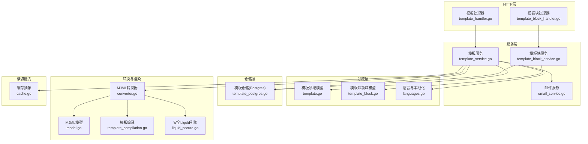
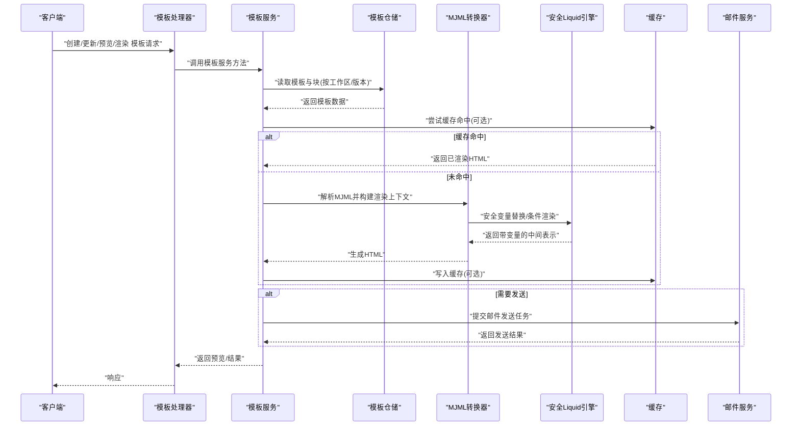
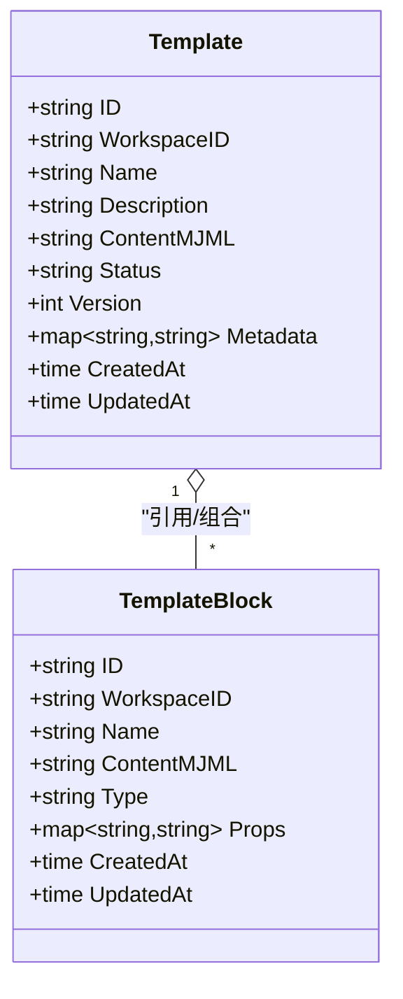
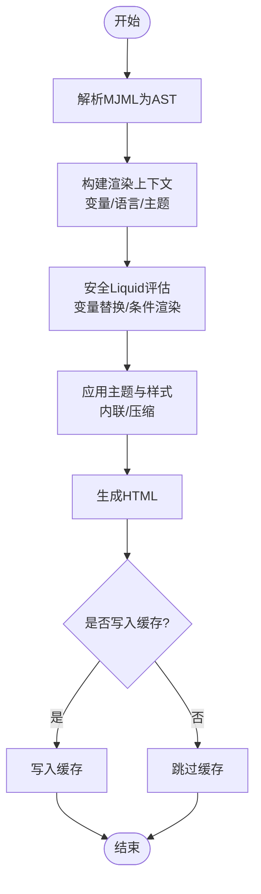
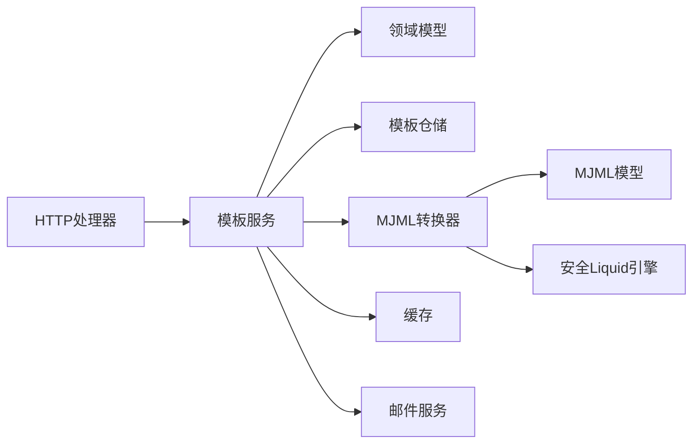

# 模板服务

<cite>
**本文引用的文件**   
- [internal/domain/template.go](file://notifuse/internal/domain/template.go)
- [internal/domain/template_block.go](file://notifuse/internal/domain/template_block.go)
- [internal/service/template_service.go](file://notifuse/internal/service/template_service.go)
- [internal/service/template_block_service.go](file://notifuse/internal/service/template_block_service.go)
- [internal/repository/template_postgres.go](file://notifuse/internal/repository/template_postgres.go)
- [internal/http/handlers/template_handler.go](file://notifuse/internal/http/handlers/template_handler.go)
- [internal/http/handlers/template_block_handler.go](file://notifuse/internal/http/handlers/template_block_handler.go)
- [pkg/notifuse_mjml/converter.go](file://notifuse/pkg/notifuse_mjml/converter.go)
- [pkg/notifuse_mjml/model.go](file://notifuse/pkg/notifuse_mjml/model.go)
- [pkg/notifuse_mjml/template_compilation.go](file://notifuse/pkg/notifuse_mjml/template_compilation.go)
- [pkg/notifuse_mjml/liquid_secure.go](file://notifuse/pkg/notifuse_mjml/liquid_secure.go)
- [pkg/cache/cache.go](file://notifuse/pkg/cache/cache.go)
- [internal/service/email_service.go](file://notifuse/internal/service/email_service.go)
- [internal/domain/languages.go](file://notifuse/internal/domain/languages.go)
</cite>

## 目录
1. [简介](#简介)
2. [项目结构](#项目结构)
3. [核心组件](#核心组件)
4. [架构总览](#架构总览)
5. [详细组件分析](#详细组件分析)
6. [依赖关系分析](#依赖关系分析)
7. [性能与缓存策略](#性能与缓存策略)
8. [故障排查指南](#故障排查指南)
9. [结论](#结论)
10. [附录：自定义模板块开发示例](#附录自定义模板块开发示例)

## 简介
本文件面向Notifuse平台的“模板服务”，聚焦邮件模板管理、MJML解析与HTML转换、预览生成、多语言支持、模板块系统设计与组件化架构、版本控制与协作编辑机制、变量替换与渲染流程、缓存与性能优化，以及与邮件发送服务的集成方式。文档以代码级事实为依据，辅以可视化图示，帮助开发者快速理解并扩展模板能力。

## 项目结构
模板服务在Notifuse中采用分层架构：HTTP层暴露REST接口，服务层编排业务逻辑，领域层定义数据模型与规则，仓储层负责持久化，转换与渲染由独立的MJML引擎模块提供，缓存与国际化等横切能力通过共享包复用。

图表来源
- [internal/http/handlers/template_handler.go](file://notifuse/internal/http/handlers/template_handler.go)
- [internal/http/handlers/template_block_handler.go](file://notifuse/internal/http/handlers/template_block_handler.go)
- [internal/service/template_service.go](file://notifuse/internal/service/template_service.go)
- [internal/service/template_block_service.go](file://notifuse/internal/service/template_block_service.go)
- [internal/domain/template.go](file://notifuse/internal/domain/template.go)
- [internal/domain/template_block.go](file://notifuse/internal/domain/template_block.go)
- [internal/repository/template_postgres.go](file://notifuse/internal/repository/template_postgres.go)
- [pkg/notifuse_mjml/converter.go](file://notifuse/pkg/notifuse_mjml/converter.go)
- [pkg/notifuse_mjml/model.go](file://notifuse/pkg/notifuse_mjml/model.go)
- [pkg/notifuse_mjml/template_compilation.go](file://notifuse/pkg/notifuse_mjml/template_compilation.go)
- [pkg/notifuse_mjml/liquid_secure.go](file://notifuse/pkg/notifuse_mjml/liquid_secure.go)
- [pkg/cache/cache.go](file://notifuse/pkg/cache/cache.go)
- [internal/service/email_service.go](file://notifuse/internal/service/email_service.go)
- [internal/domain/languages.go](file://notifuse/internal/domain/languages.go)

章节来源
- [internal/http/handlers/template_handler.go](file://notifuse/internal/http/handlers/template_handler.go)
- [internal/http/handlers/template_block_handler.go](file://notifuse/internal/http/handlers/template_block_handler.go)
- [internal/service/template_service.go](file://notifuse/internal/service/template_service.go)
- [internal/service/template_block_service.go](file://notifuse/internal/service/template_block_service.go)
- [internal/domain/template.go](file://notifuse/internal/domain/template.go)
- [internal/domain/template_block.go](file://notifuse/internal/domain/template_block.go)
- [internal/repository/template_postgres.go](file://notifuse/internal/repository/template_postgres.go)
- [pkg/notifuse_mjml/converter.go](file://notifuse/pkg/notifuse_mjml/converter.go)
- [pkg/notifuse_mjml/model.go](file://notifuse/pkg/notifuse_mjml/model.go)
- [pkg/notifuse_mjml/template_compilation.go](file://notifuse/pkg/notifuse_mjml/template_compilation.go)
- [pkg/notifuse_mjml/liquid_secure.go](file://notifuse/pkg/notifuse_mjml/liquid_secure.go)
- [pkg/cache/cache.go](file://notifuse/pkg/cache/cache.go)
- [internal/service/email_service.go](file://notifuse/internal/service/email_service.go)
- [internal/domain/languages.go](file://notifuse/internal/domain/languages.go)

## 核心组件
- 模板领域模型：定义模板实体、版本、可见性、内容（含MJML）、元数据与状态。
- 模板块领域模型：定义可复用的UI/样式/片段块，支持组合与引用。
- 模板服务：提供模板的CRUD、版本化、预览、渲染、发布与协作相关能力。
- 模板块服务：提供块的CRUD、组合、权限校验与复用统计。
- MJML转换器：将MJML转换为HTML，处理变量注入、样式内联与预览生成。
- 安全Liquid引擎：用于安全的变量替换与条件渲染，避免任意执行。
- 模板仓储：基于PostgreSQL实现模板与块的持久化、查询与迁移兼容。
- 缓存抽象：对渲染产物或编译结果进行缓存，降低重复计算开销。
- 邮件服务：与外部邮件发送服务对接，完成最终投递。

章节来源
- [internal/domain/template.go](file://notifuse/internal/domain/template.go)
- [internal/domain/template_block.go](file://notifuse/internal/domain/template_block.go)
- [internal/service/template_service.go](file://notifuse/internal/service/template_service.go)
- [internal/service/template_block_service.go](file://notifuse/internal/service/template_block_service.go)
- [pkg/notifuse_mjml/converter.go](file://notifuse/pkg/notifuse_mjml/converter.go)
- [pkg/notifuse_mjml/liquid_secure.go](file://notifuse/pkg/notifuse_mjml/liquid_secure.go)
- [internal/repository/template_postgres.go](file://notifuse/internal/repository/template_postgres.go)
- [pkg/cache/cache.go](file://notifuse/pkg/cache/cache.go)
- [internal/service/email_service.go](file://notifuse/internal/service/email_service.go)

## 架构总览
模板服务的关键调用链如下：HTTP请求进入模板处理器，服务层进行参数校验、权限检查、版本控制与渲染；渲染阶段使用MJML转换器与安全Liquid引擎完成变量替换与HTML生成；必要时读取缓存命中结果；最终通过邮件服务投递或返回预览。

图表来源
- [internal/http/handlers/template_handler.go](file://notifuse/internal/http/handlers/template_handler.go)
- [internal/service/template_service.go](file://notifuse/internal/service/template_service.go)
- [internal/repository/template_postgres.go](file://notifuse/internal/repository/template_postgres.go)
- [pkg/notifuse_mjml/converter.go](file://notifuse/pkg/notifuse_mjml/converter.go)
- [pkg/notifuse_mjml/liquid_secure.go](file://notifuse/pkg/notifuse_mjml/liquid_secure.go)
- [pkg/cache/cache.go](file://notifuse/pkg/cache/cache.go)
- [internal/service/email_service.go](file://notifuse/internal/service/email_service.go)

## 详细组件分析

### 模板领域模型与版本控制
- 模板实体包含标识、名称、描述、可见性、内容（MJML）、元数据、状态与时间戳。
- 版本控制：每次变更产生新版本，保留历史版本以供回滚与审计。
- 协作编辑：通过工作区隔离与可见性控制，结合版本差异与锁定机制（若实现）保障多人协作一致性。

图表来源
- [internal/domain/template.go](file://notifuse/internal/domain/template.go)
- [internal/domain/template_block.go](file://notifuse/internal/domain/template_block.go)

章节来源
- [internal/domain/template.go](file://notifuse/internal/domain/template.go)
- [internal/domain/template_block.go](file://notifuse/internal/domain/template_block.go)

### 模板服务与模板块服务
- 模板服务：
  - 提供模板的创建、更新、删除、查询、版本切换与发布。
  - 渲染入口：接收模板ID、变量集、语言与预览标志，输出HTML或预览URL。
  - 缓存策略：对渲染结果或编译中间态进行缓存，键空间按工作区+模板+版本+语言+变量摘要组织。
  - 多语言：根据语言选择对应文案与占位符，结合安全Liquid引擎进行替换。
- 模板块服务：
  - 提供块的创建、更新、删除、查询与复用统计。
  - 组合渲染：在服务层组装多个块为完整模板，或在MJML层通过引用语法组合。

章节来源
- [internal/service/template_service.go](file://notifuse/internal/service/template_service.go)
- [internal/service/template_block_service.go](file://notifuse/internal/service/template_block_service.go)

### MJML到HTML转换与样式处理
- 转换器职责：
  - 解析MJML AST，应用主题与全局样式。
  - 注入变量与动态内容，执行条件渲染与循环。
  - 生成响应式HTML，并进行必要的样式内联与兼容性处理。
- 安全Liquid引擎：
  - 提供白名单变量访问与受限表达式，防止任意代码执行。
  - 支持字符串插值、条件判断与简单函数调用。

图表来源
- [pkg/notifuse_mjml/converter.go](file://notifuse/pkg/notifuse_mjml/converter.go)
- [pkg/notifuse_mjml/model.go](file://notifuse/pkg/notifuse_mjml/model.go)
- [pkg/notifuse_mjml/template_compilation.go](file://notifuse/pkg/notifuse_mjml/template_compilation.go)
- [pkg/notifuse_mjml/liquid_secure.go](file://notifuse/pkg/notifuse_mjml/liquid_secure.go)

章节来源
- [pkg/notifuse_mjml/converter.go](file://notifuse/pkg/notifuse_mjml/converter.go)
- [pkg/notifuse_mjml/model.go](file://notifuse/pkg/notifuse_mjml/model.go)
- [pkg/notifuse_mjml/template_compilation.go](file://notifuse/pkg/notifuse_mjml/template_compilation.go)
- [pkg/notifuse_mjml/liquid_secure.go](file://notifuse/pkg/notifuse_mjml/liquid_secure.go)

### 预览生成与协作编辑
- 预览生成：
  - 支持沙箱环境渲染，返回HTML片段或完整页面。
  - 可附加调试信息（如变量清单、渲染耗时）。
- 协作编辑：
  - 基于工作区与可见性的权限控制。
  - 版本分支与合并策略（若实现），确保多人同时编辑不冲突。

章节来源
- [internal/service/template_service.go](file://notifuse/internal/service/template_service.go)
- [internal/http/handlers/template_handler.go](file://notifuse/internal/http/handlers/template_handler.go)

### 多语言支持
- 语言资源：
  - 通过语言域对象维护翻译键与默认值。
  - 模板变量中包含语言选择，渲染时加载对应文案。
- 变量替换：
  - 使用安全Liquid引擎进行文本替换与格式化。

章节来源
- [internal/domain/languages.go](file://notifuse/internal/domain/languages.go)
- [pkg/notifuse_mjml/liquid_secure.go](file://notifuse/pkg/notifuse_mjml/liquid_secure.go)

### 与邮件发送服务的集成
- 模板渲染完成后，服务层将HTML与收件人、主题、附件等信息封装为发送请求。
- 邮件服务负责与外部提供商（SMTP、SendGrid、SES等）对接，并记录发送历史与状态。

章节来源
- [internal/service/email_service.go](file://notifuse/internal/service/email_service.go)
- [internal/service/template_service.go](file://notifuse/internal/service/template_service.go)

## 依赖关系分析
- HTTP层依赖服务层，服务层依赖领域模型、仓储、转换与渲染模块、缓存与邮件服务。
- MJML转换器依赖模型与安全Liquid引擎。
- 仓储层仅依赖数据库驱动与领域模型。

图表来源
- [internal/http/handlers/template_handler.go](file://notifuse/internal/http/handlers/template_handler.go)
- [internal/service/template_service.go](file://notifuse/internal/service/template_service.go)
- [internal/domain/template.go](file://notifuse/internal/domain/template.go)
- [internal/repository/template_postgres.go](file://notifuse/internal/repository/template_postgres.go)
- [pkg/notifuse_mjml/converter.go](file://notifuse/pkg/notifuse_mjml/converter.go)
- [pkg/notifuse_mjml/model.go](file://notifuse/pkg/notifuse_mjml/model.go)
- [pkg/notifuse_mjml/liquid_secure.go](file://notifuse/pkg/notifuse_mjml/liquid_secure.go)
- [pkg/cache/cache.go](file://notifuse/pkg/cache/cache.go)
- [internal/service/email_service.go](file://notifuse/internal/service/email_service.go)

章节来源
- [internal/http/handlers/template_handler.go](file://notifuse/internal/http/handlers/template_handler.go)
- [internal/service/template_service.go](file://notifuse/internal/service/template_service.go)
- [internal/domain/template.go](file://notifuse/internal/domain/template.go)
- [internal/repository/template_postgres.go](file://notifuse/internal/repository/template_postgres.go)
- [pkg/notifuse_mjml/converter.go](file://notifuse/pkg/notifuse_mjml/converter.go)
- [pkg/notifuse_mjml/model.go](file://notifuse/pkg/notifuse_mjml/model.go)
- [pkg/notifuse_mjml/liquid_secure.go](file://notifuse/pkg/notifuse_mjml/liquid_secure.go)
- [pkg/cache/cache.go](file://notifuse/pkg/cache/cache.go)
- [internal/service/email_service.go](file://notifuse/internal/service/email_service.go)

## 性能与缓存策略
- 渲染缓存：
  - 键设计：工作区ID + 模板ID + 版本 + 语言 + 变量摘要（哈希）。
  - 失效策略：模板更新或块变更时主动失效相关缓存。
  - 容量与淘汰：LRU或TTL策略，避免内存膨胀。
- 编译缓存：
  - 对MJML AST或中间表示进行缓存，减少重复解析成本。
- 并发与锁：
  - 并发渲染时使用细粒度锁保护同一模板版本的写入。
- 批量渲染：
  - 对大批量发送场景，预编译模板并按批次渲染，降低CPU峰值。

章节来源
- [pkg/cache/cache.go](file://notifuse/pkg/cache/cache.go)
- [pkg/notifuse_mjml/template_compilation.go](file://notifuse/pkg/notifuse_mjml/template_compilation.go)
- [internal/service/template_service.go](file://notifuse/internal/service/template_service.go)

## 故障排查指南
- 渲染失败：
  - 检查MJML语法与变量是否存在于上下文中。
  - 查看安全Liquid引擎的白名单配置与错误日志。
- 缓存异常：
  - 验证缓存键是否稳定且唯一。
  - 确认缓存失效时机是否正确触发。
- 权限问题：
  - 检查工作区与可见性设置。
  - 确认用户角色与操作权限。
- 发送失败：
  - 核对邮件服务配置与凭据。
  - 查看发送历史与错误分类器反馈。

章节来源
- [pkg/notifuse_mjml/liquid_secure.go](file://notifuse/pkg/notifuse_mjml/liquid_secure.go)
- [pkg/cache/cache.go](file://notifuse/pkg/cache/cache.go)
- [internal/service/email_service.go](file://notifuse/internal/service/email_service.go)

## 结论
模板服务通过清晰的分层与模块化设计，实现了MJML模板的高效解析与HTML转换、安全的变量替换、预览与多语言支持、版本化与协作编辑、以及可扩展的模板块体系。配合缓存与批处理策略，可在高并发场景下保持稳定的性能表现。建议在生产环境中完善缓存失效策略与监控告警，持续优化渲染路径与资源占用。

## 附录：自定义模板块开发示例
以下示例展示如何新增一个自定义模板块并在模板中引用：

- 步骤一：定义块领域模型字段
  - 在模板块领域模型中添加新类型与属性映射，确保序列化与反序列化正确。
  - 参考路径：[internal/domain/template_block.go](file://notifuse/internal/domain/template_block.go)

- 步骤二：实现块的渲染逻辑
  - 在MJML转换器或模板编译模块中，针对新块类型添加渲染分支，生成对应的MJML片段。
  - 参考路径：[pkg/notifuse_mjml/converter.go](file://notifuse/pkg/notifuse_mjml/converter.go)、[pkg/notifuse_mjml/template_compilation.go](file://notifuse/pkg/notifuse_mjml/template_compilation.go)

- 步骤三：注册块类型与属性校验
  - 在服务层或转换器中注册新块类型，并对输入属性进行校验，保证安全性与一致性。
  - 参考路径：[internal/service/template_block_service.go](file://notifuse/internal/service/template_block_service.go)

- 步骤四：在模板中使用块
  - 在模板内容中以引用语法引入块，并提供必要变量。
  - 参考路径：[internal/domain/template.go](file://notifuse/internal/domain/template.go)

- 步骤五：测试与缓存更新
  - 编写单元测试覆盖渲染路径与边界情况。
  - 更新缓存键策略，确保块变更能正确失效相关缓存。
  - 参考路径：[pkg/cache/cache.go](file://notifuse/pkg/cache/cache.go)

章节来源
- [internal/domain/template_block.go](file://notifuse/internal/domain/template_block.go)
- [pkg/notifuse_mjml/converter.go](file://notifuse/pkg/notifuse_mjml/converter.go)
- [pkg/notifuse_mjml/template_compilation.go](file://notifuse/pkg/notifuse_mjml/template_compilation.go)
- [internal/service/template_block_service.go](file://notifuse/internal/service/template_block_service.go)
- [internal/domain/template.go](file://notifuse/internal/domain/template.go)
- [pkg/cache/cache.go](file://notifuse/pkg/cache/cache.go)