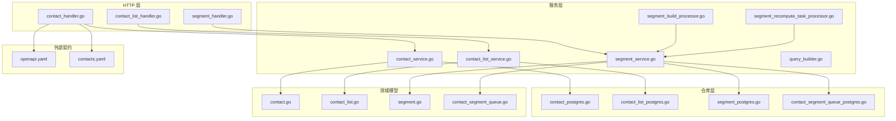
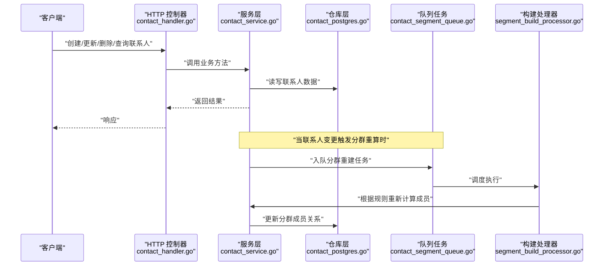
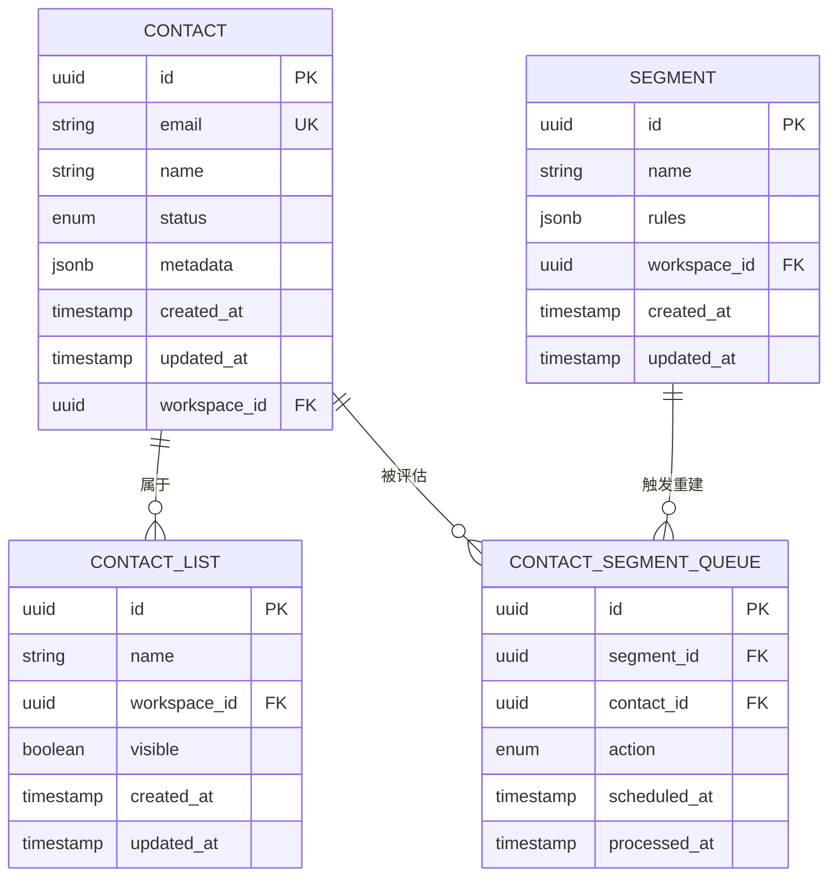
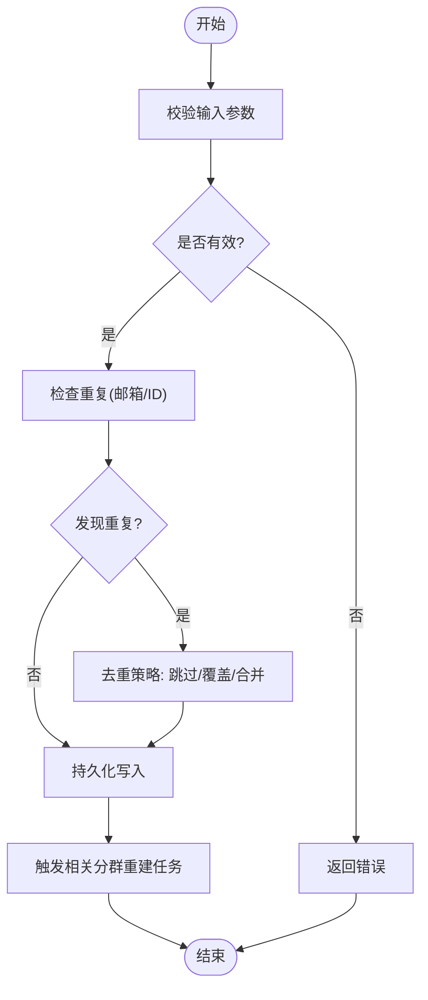
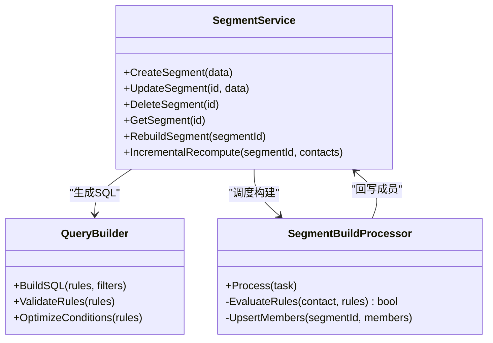
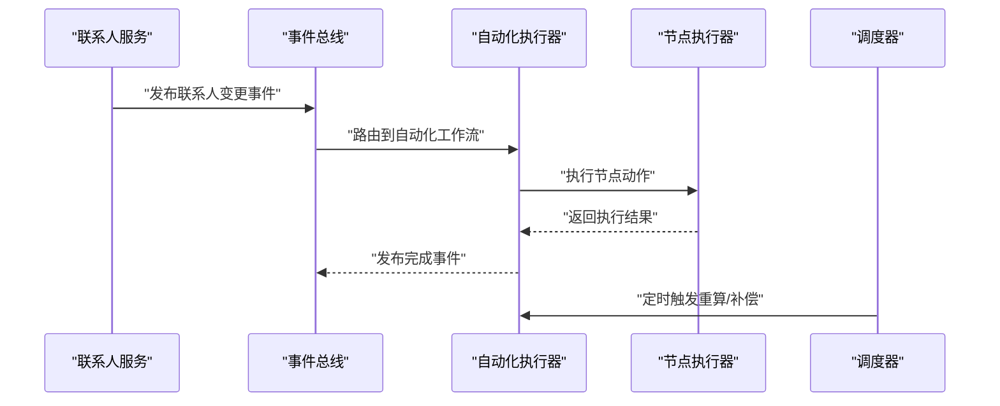
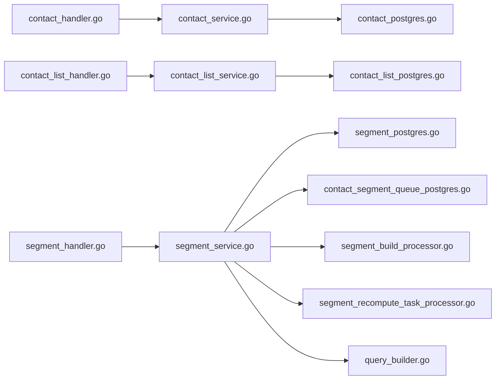

# 联系人服务

<cite>
**本文引用的文件**   
- [contact.go](file://notifuse/internal/domain/contact.go)
- [contact_list.go](file://notifuse/internal/domain/contact_list.go)
- [segment.go](file://notifuse/internal/domain/segment.go)
- [contact_segment_queue.go](file://notifuse/internal/domain/contact_segment_queue.go)
- [contact_handler.go](file://notifuse/internal/http/contact_handler.go)
- [contact_list_handler.go](file://notifuse/internal/http/contact_list_handler.go)
- [segment_handler.go](file://notifuse/internal/http/segment_handler.go)
- [contact_service.go](file://notifuse/internal/service/contact_service.go)
- [contact_list_service.go](file://notifuse/internal/service/contact_list_service.go)
- [segment_service.go](file://notifuse/internal/service/segment_service.go)
- [segment_build_processor.go](file://notifuse/internal/service/segment_build_processor.go)
- [segment_recompute_task_processor.go](file://notifuse/internal/service/segment_recompute_task_processor.go)
- [contact_postgres.go](file://notifuse/internal/repository/contact_postgres.go)
- [contact_list_postgres.go](file://notifuse/internal/repository/contact_list_postgres.go)
- [segment_postgres.go](file://notifuse/internal/repository/segment_postgres.go)
- [contact_segment_queue_postgres.go](file://notifuse/internal/repository/contact_segment_queue_postgres.go)
- [query_builder.go](file://notifuse/internal/service/query_builder.go)
- [automation_executor.go](file://notifuse/internal/service/automation_executor.go)
- [automation_node_executor.go](file://notifuse/internal/service/automation_node_executor.go)
- [automation_scheduler.go](file://notifuse/internal/service/automation_scheduler.go)
- [openapi.yaml](file://notifuse/openapi/openapi.yaml)
- [contacts.yaml](file://notifuse/openapi/paths/contacts.yaml)
</cite>

## 目录
1. [简介](#简介)
2. [项目结构](#项目结构)
3. [核心组件](#核心组件)
4. [架构总览](#架构总览)
5. [详细组件分析](#详细组件分析)
6. [依赖关系分析](#依赖关系分析)
7. [性能考量](#性能考量)
8. [故障排查指南](#故障排查指南)
9. [结论](#结论)
10. [附录](#附录)

## 简介
本文件为 Notifuse 平台的“联系人服务”提供系统化、可落地的技术文档。内容覆盖：
- 联系人 CRUD、批量导入导出、动态分群与标签管理
- 联系人数据模型设计与关系映射
- 分群规则引擎（条件判断、逻辑运算、实时计算）
- 联系人列表管理与权限控制机制
- 复杂查询与批量操作的代码示例路径
- 数据验证规则与去重策略
- 与自动化工作流的集成方式与事件驱动架构

## 项目结构
联系人服务采用分层架构：HTTP 层暴露接口，Service 层封装业务逻辑，Repository 层负责持久化，Domain 层定义领域模型与队列任务，OpenAPI 描述对外契约。

图表来源
- [contact_handler.go:1-200](file://notifuse/internal/http/contact_handler.go#L1-L200)
- [contact_service.go:1-200](file://notifuse/internal/service/contact_service.go#L1-L200)
- [contact_postgres.go:1-200](file://notifuse/internal/repository/contact_postgres.go#L1-L200)
- [contact.go:1-200](file://notifuse/internal/domain/contact.go#L1-L200)
- [segment_handler.go:1-200](file://notifuse/internal/http/segment_handler.go#L1-L200)
- [segment_service.go:1-200](file://notifuse/internal/service/segment_service.go#L1-L200)
- [segment_postgres.go:1-200](file://notifuse/internal/repository/segment_postgres.go#L1-L200)
- [segment.go:1-200](file://notifuse/internal/domain/segment.go#L1-L200)
- [openapi.yaml:1-200](file://notifuse/openapi/openapi.yaml#L1-L200)
- [contacts.yaml:1-200](file://notifuse/openapi/paths/contacts.yaml#L1-L200)

章节来源
- [contact_handler.go:1-200](file://notifuse/internal/http/contact_handler.go#L1-L200)
- [contact_service.go:1-200](file://notifuse/internal/service/contact_service.go#L1-L200)
- [contact_postgres.go:1-200](file://notifuse/internal/repository/contact_postgres.go#L1-L200)
- [contact.go:1-200](file://notifuse/internal/domain/contact.go#L1-L200)
- [segment_handler.go:1-200](file://notifuse/internal/http/segment_handler.go#L1-L200)
- [segment_service.go:1-200](file://notifuse/internal/service/segment_service.go#L1-L200)
- [segment_postgres.go:1-200](file://notifuse/internal/repository/segment_postgres.go#L1-L200)
- [segment.go:1-200](file://notifuse/internal/domain/segment.go#L1-L200)
- [openapi.yaml:1-200](file://notifuse/openapi/openapi.yaml#L1-L200)
- [contacts.yaml:1-200](file://notifuse/openapi/paths/contacts.yaml#L1-L200)

## 核心组件
- 联系人实体与列表：定义联系人基础属性、分组归属、标签集合等；支持按工作区隔离与软删除。
- 动态分群：以规则表达式描述筛选条件，支持多字段比较、逻辑组合与时间范围过滤。
- 分群构建与重算：异步构建与增量重算，通过队列任务驱动，避免阻塞主流程。
- 查询构建器：将规则表达式转换为 SQL，优化分页、排序与聚合。
- HTTP 接口：遵循 OpenAPI 规范，提供联系人增删改查、批量导入导出、分群管理等能力。
- 仓库实现：PostgreSQL 持久化，包含索引与约束设计，保障查询性能与一致性。

章节来源
- [contact.go:1-200](file://notifuse/internal/domain/contact.go#L1-L200)
- [contact_list.go:1-200](file://notifuse/internal/domain/contact_list.go#L1-L200)
- [segment.go:1-200](file://notifuse/internal/domain/segment.go#L1-L200)
- [contact_segment_queue.go:1-200](file://notifuse/internal/domain/contact_segment_queue.go#L1-L200)
- [query_builder.go:1-200](file://notifuse/internal/service/query_builder.go#L1-L200)
- [contact_handler.go:1-200](file://notifuse/internal/http/contact_handler.go#L1-L200)
- [segment_handler.go:1-200](file://notifuse/internal/http/segment_handler.go#L1-L200)
- [contact_service.go:1-200](file://notifuse/internal/service/contact_service.go#L1-L200)
- [segment_service.go:1-200](file://notifuse/internal/service/segment_service.go#L1-L200)
- [contact_postgres.go:1-200](file://notifuse/internal/repository/contact_postgres.go#L1-L200)
- [segment_postgres.go:1-200](file://notifuse/internal/repository/segment_postgres.go#L1-L200)

## 架构总览
联系人服务在请求链路中遵循“HTTP -> Service -> Repository -> Domain/Queue”的调用顺序，并通过事件与任务处理器完成分群的异步构建与重算。

图表来源
- [contact_handler.go:1-200](file://notifuse/internal/http/contact_handler.go#L1-L200)
- [contact_service.go:1-200](file://notifuse/internal/service/contact_service.go#L1-L200)
- [contact_postgres.go:1-200](file://notifuse/internal/repository/contact_postgres.go#L1-L200)
- [contact_segment_queue.go:1-200](file://notifuse/internal/domain/contact_segment_queue.go#L1-L200)
- [segment_build_processor.go:1-200](file://notifuse/internal/service/segment_build_processor.go#L1-L200)

## 详细组件分析

### 联系人数据模型与关系映射
- 联系人实体包含唯一标识、邮箱、姓名、状态、元数据、标签集合、所属列表与工作区等字段。
- 联系人列表用于组织联系人，支持可见性与权限控制。
- 分群规则以结构化表达式存储，运行时由查询构建器生成 SQL。
- 分群成员关系通过队列任务维护，支持增量重算。

图表来源
- [contact.go:1-200](file://notifuse/internal/domain/contact.go#L1-L200)
- [contact_list.go:1-200](file://notifuse/internal/domain/contact_list.go#L1-L200)
- [segment.go:1-200](file://notifuse/internal/domain/segment.go#L1-L200)
- [contact_segment_queue.go:1-200](file://notifuse/internal/domain/contact_segment_queue.go#L1-L200)

章节来源
- [contact.go:1-200](file://notifuse/internal/domain/contact.go#L1-L200)
- [contact_list.go:1-200](file://notifuse/internal/domain/contact_list.go#L1-L200)
- [segment.go:1-200](file://notifuse/internal/domain/segment.go#L1-L200)
- [contact_segment_queue.go:1-200](file://notifuse/internal/domain/contact_segment_queue.go#L1-L200)

### 联系人 CRUD 与批量操作
- 单条创建/更新/删除：校验邮箱唯一性、必填字段与格式；支持软删除与审计字段。
- 批量导入：解析 CSV/JSON，进行行级校验、去重与事务写入；失败行记录错误并继续处理。
- 批量导出：基于查询条件流式输出，避免内存溢出。
- 复杂查询：支持多条件组合、分页、排序与统计计数。

图表来源
- [contact_service.go:1-200](file://notifuse/internal/service/contact_service.go#L1-L200)
- [contact_postgres.go:1-200](file://notifuse/internal/repository/contact_postgres.go#L1-L200)
- [contact_segment_queue.go:1-200](file://notifuse/internal/domain/contact_segment_queue.go#L1-L200)

章节来源
- [contact_service.go:1-200](file://notifuse/internal/service/contact_service.go#L1-L200)
- [contact_postgres.go:1-200](file://notifuse/internal/repository/contact_postgres.go#L1-L200)

### 动态分群系统与规则引擎
- 规则表达式：支持字段比较（等于、不等于、包含、正则、范围）、布尔组合（与、或、非）、时间窗口与自定义函数。
- 查询构建器：将规则表达式编译为 SQL，结合索引优化扫描范围；对 JSONB 字段使用 GIN 索引。
- 实时计算：联系人变更时入队重建任务，后台处理器按规则重新计算成员集，支持增量更新。
- 重算任务：支持全量重建与增量重算，具备重试与幂等保证。

图表来源
- [segment_service.go:1-200](file://notifuse/internal/service/segment_service.go#L1-L200)
- [query_builder.go:1-200](file://notifuse/internal/service/query_builder.go#L1-L200)
- [segment_build_processor.go:1-200](file://notifuse/internal/service/segment_build_processor.go#L1-L200)

章节来源
- [segment_service.go:1-200](file://notifuse/internal/service/segment_service.go#L1-L200)
- [query_builder.go:1-200](file://notifuse/internal/service/query_builder.go#L1-L200)
- [segment_build_processor.go:1-200](file://notifuse/internal/service/segment_build_processor.go#L1-L200)
- [segment_recompute_task_processor.go:1-200](file://notifuse/internal/service/segment_recompute_task_processor.go#L1-L200)

### 标签管理
- 标签作为联系人的键值集合，支持快速检索与过滤。
- 标签变更会触发相关分群的重建任务，确保动态分群结果一致。
- 标签命名空间与工作区隔离，避免跨租户污染。

章节来源
- [contact.go:1-200](file://notifuse/internal/domain/contact.go#L1-L200)
- [contact_segment_queue.go:1-200](file://notifuse/internal/domain/contact_segment_queue.go#L1-L200)

### 联系人列表管理与权限控制
- 列表可见性与访问控制：仅允许工作区内授权用户访问与修改。
- 列表级权限：管理员、编辑者、查看者角色区分，限制写入与删除操作。
- 审计日志：记录关键变更，便于追踪与合规。

章节来源
- [contact_list.go:1-200](file://notifuse/internal/domain/contact_list.go#L1-L200)
- [contact_list_handler.go:1-200](file://notifuse/internal/http/contact_list_handler.go#L1-L200)
- [contact_list_service.go:1-200](file://notifuse/internal/service/contact_list_service.go#L1-L200)

### 与自动化工作流的集成与事件驱动
- 联系人事件：创建、更新、删除、标签变更、分群成员变化等事件发布。
- 自动化节点：监听联系人事件，触发后续动作（如发送通知、更新 CRM、调用外部 API）。
- 调度器：周期性任务与延迟任务，支撑定时重算与补偿。

图表来源
- [automation_executor.go:1-200](file://notifuse/internal/service/automation_executor.go#L1-L200)
- [automation_node_executor.go:1-200](file://notifuse/internal/service/automation_node_executor.go#L1-L200)
- [automation_scheduler.go:1-200](file://notifuse/internal/service/automation_scheduler.go#L1-L200)

章节来源
- [automation_executor.go:1-200](file://notifuse/internal/service/automation_executor.go#L1-L200)
- [automation_node_executor.go:1-200](file://notifuse/internal/service/automation_node_executor.go#L1-L200)
- [automation_scheduler.go:1-200](file://notifuse/internal/service/automation_scheduler.go#L1-L200)

## 依赖关系分析
- 控制器依赖服务层，服务层依赖仓库层与领域模型。
- 分群构建与重算通过队列任务解耦，降低耦合度与提升吞吐。
- 查询构建器与规则引擎形成内聚模块，便于扩展新条件类型。

图表来源
- [contact_handler.go:1-200](file://notifuse/internal/http/contact_handler.go#L1-L200)
- [contact_service.go:1-200](file://notifuse/internal/service/contact_service.go#L1-L200)
- [contact_postgres.go:1-200](file://notifuse/internal/repository/contact_postgres.go#L1-L200)
- [contact_list_handler.go:1-200](file://notifuse/internal/http/contact_list_handler.go#L1-L200)
- [contact_list_service.go:1-200](file://notifuse/internal/service/contact_list_service.go#L1-L200)
- [contact_list_postgres.go:1-200](file://notifuse/internal/repository/contact_list_postgres.go#L1-L200)
- [segment_handler.go:1-200](file://notifuse/internal/http/segment_handler.go#L1-L200)
- [segment_service.go:1-200](file://notifuse/internal/service/segment_service.go#L1-L200)
- [segment_postgres.go:1-200](file://notifuse/internal/repository/segment_postgres.go#L1-L200)
- [contact_segment_queue_postgres.go:1-200](file://notifuse/internal/repository/contact_segment_queue_postgres.go#L1-L200)
- [segment_build_processor.go:1-200](file://notifuse/internal/service/segment_build_processor.go#L1-L200)
- [segment_recompute_task_processor.go:1-200](file://notifuse/internal/service/segment_recompute_task_processor.go#L1-L200)
- [query_builder.go:1-200](file://notifuse/internal/service/query_builder.go#L1-L200)

章节来源
- [contact_handler.go:1-200](file://notifuse/internal/http/contact_handler.go#L1-L200)
- [contact_service.go:1-200](file://notifuse/internal/service/contact_service.go#L1-L200)
- [contact_postgres.go:1-200](file://notifuse/internal/repository/contact_postgres.go#L1-L200)
- [contact_list_handler.go:1-200](file://notifuse/internal/http/contact_list_handler.go#L1-L200)
- [contact_list_service.go:1-200](file://notifuse/internal/service/contact_list_service.go#L1-L200)
- [contact_list_postgres.go:1-200](file://notifuse/internal/repository/contact_list_postgres.go#L1-L200)
- [segment_handler.go:1-200](file://notifuse/internal/http/segment_handler.go#L1-L200)
- [segment_service.go:1-200](file://notifuse/internal/service/segment_service.go#L1-L200)
- [segment_postgres.go:1-200](file://notifuse/internal/repository/segment_postgres.go#L1-L200)
- [contact_segment_queue_postgres.go:1-200](file://notifuse/internal/repository/contact_segment_queue_postgres.go#L1-L200)
- [segment_build_processor.go:1-200](file://notifuse/internal/service/segment_build_processor.go#L1-L200)
- [segment_recompute_task_processor.go:1-200](file://notifuse/internal/service/segment_recompute_task_processor.go#L1-L200)
- [query_builder.go:1-200](file://notifuse/internal/service/query_builder.go#L1-L200)

## 性能考量
- 索引策略：对邮箱、工作区 ID、状态、更新时间建立复合索引；JSONB 字段使用 GIN 索引加速标签与元数据查询。
- 分页与游标：大列表采用游标分页，减少深翻页开销。
- 批量写入：使用事务与批量插入，降低锁竞争与网络往返。
- 异步构建：分群重建走队列，避免同步阻塞；支持限流与退避重试。
- 查询优化：规则编译阶段进行条件剪枝与下推，减少无效扫描。

[本节为通用指导，不直接分析具体文件]

## 故障排查指南
- 常见错误：
  - 邮箱重复：检查唯一约束与去重策略配置。
  - 规则语法错误：使用规则校验器定位非法条件。
  - 队列堆积：监控任务积压与失败率，调整并发与重试策略。
- 诊断步骤：
  - 查看联系人变更记录与审计日志。
  - 检查分群重建任务的状态与错误信息。
  - 分析查询构建生成的 SQL，确认索引命中情况。
- 恢复建议：
  - 清理失败任务并重试。
  - 修正规则后触发增量重算。
  - 对热点表进行统计信息更新与索引重建。

章节来源
- [contact_service.go:1-200](file://notifuse/internal/service/contact_service.go#L1-L200)
- [segment_build_processor.go:1-200](file://notifuse/internal/service/segment_build_processor.go#L1-L200)
- [segment_recompute_task_processor.go:1-200](file://notifuse/internal/service/segment_recompute_task_processor.go#L1-L200)
- [query_builder.go:1-200](file://notifuse/internal/service/query_builder.go#L1-L200)

## 结论
联系人服务通过清晰的分层架构、强大的规则引擎与异步构建机制，实现了高效、可扩展的联系人管理与动态分群能力。配合完善的权限控制、数据验证与去重策略，以及与自动化工作流的深度集成，能够满足复杂业务场景下的实时性与一致性需求。

[本节为总结，不直接分析具体文件]

## 附录

### API 契约与示例路径
- 联系人接口定义参考 OpenAPI 文档：
  - [openapi.yaml](file://notifuse/openapi/openapi.yaml)
  - [contacts.yaml](file://notifuse/openapi/paths/contacts.yaml)
- 控制器实现参考：
  - [contact_handler.go](file://notifuse/internal/http/contact_handler.go)
- 服务层实现参考：
  - [contact_service.go](file://notifuse/internal/service/contact_service.go)
- 仓库层实现参考：
  - [contact_postgres.go](file://notifuse/internal/repository/contact_postgres.go)

章节来源
- [openapi.yaml:1-200](file://notifuse/openapi/openapi.yaml#L1-L200)
- [contacts.yaml:1-200](file://notifuse/openapi/paths/contacts.yaml#L1-L200)
- [contact_handler.go:1-200](file://notifuse/internal/http/contact_handler.go#L1-L200)
- [contact_service.go:1-200](file://notifuse/internal/service/contact_service.go#L1-L200)
- [contact_postgres.go:1-200](file://notifuse/internal/repository/contact_postgres.go#L1-L200)