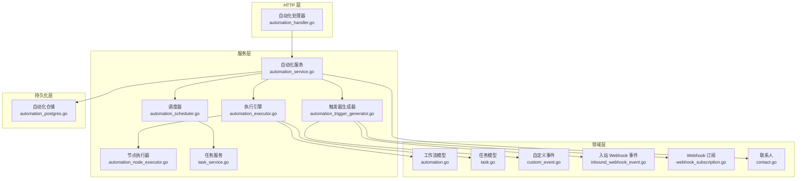
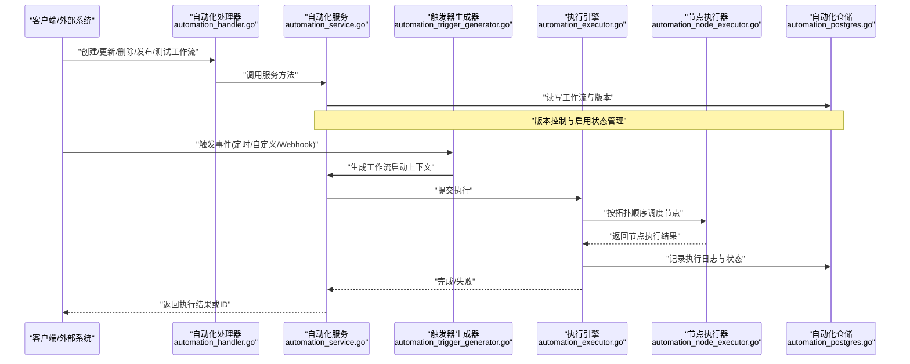
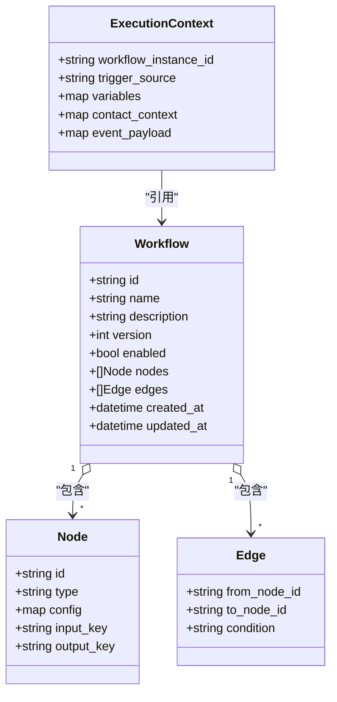
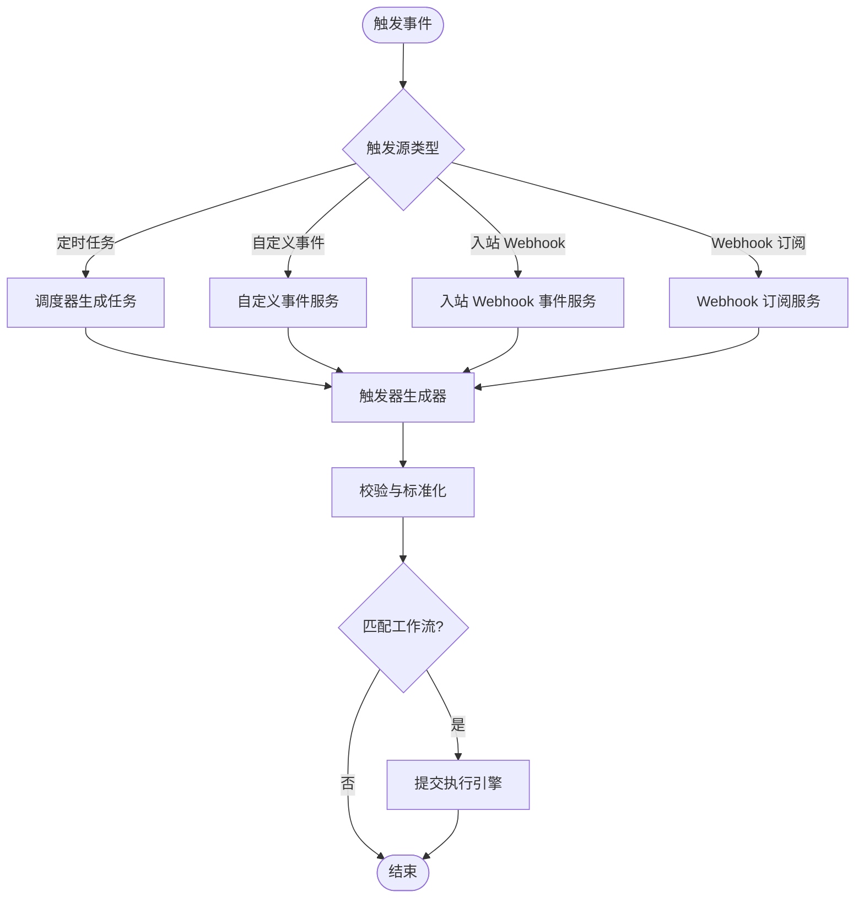
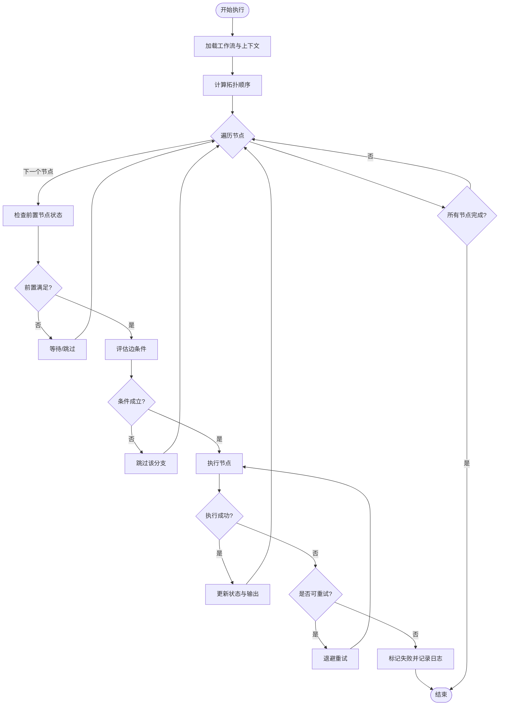
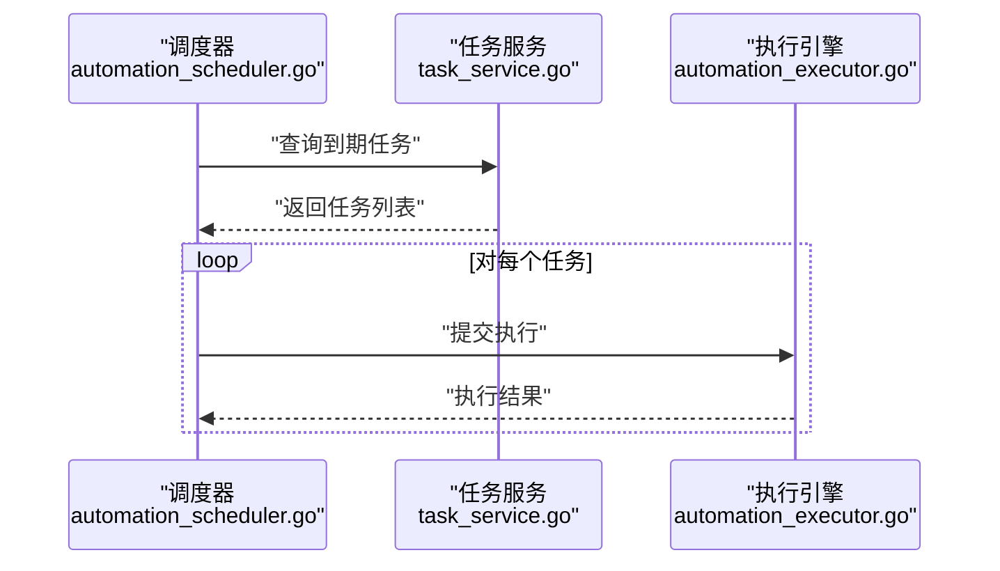
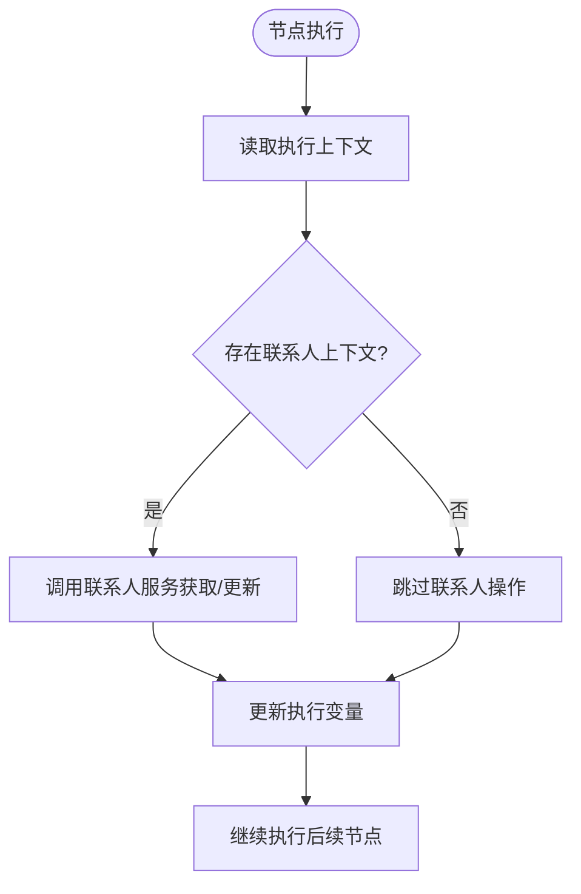
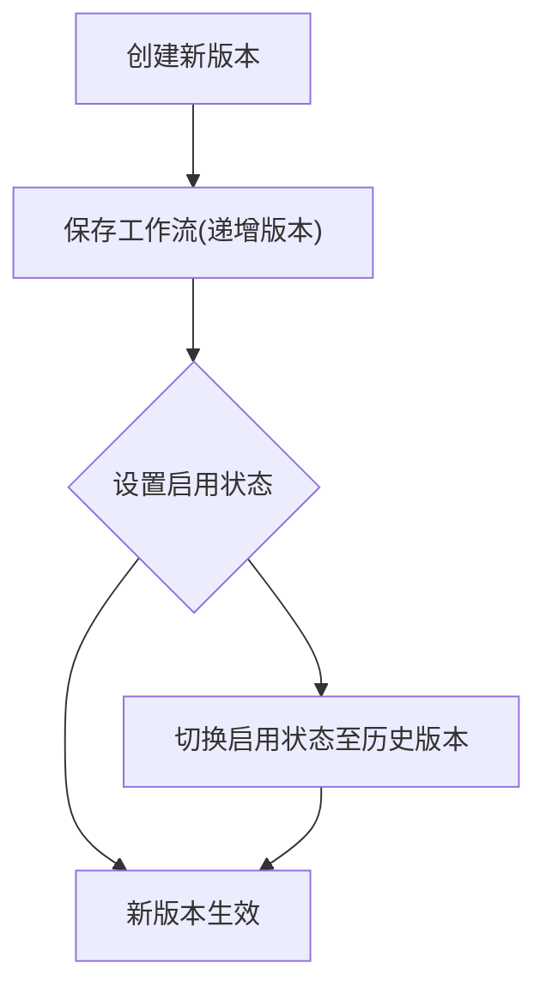
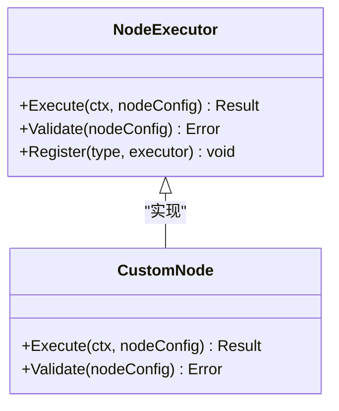
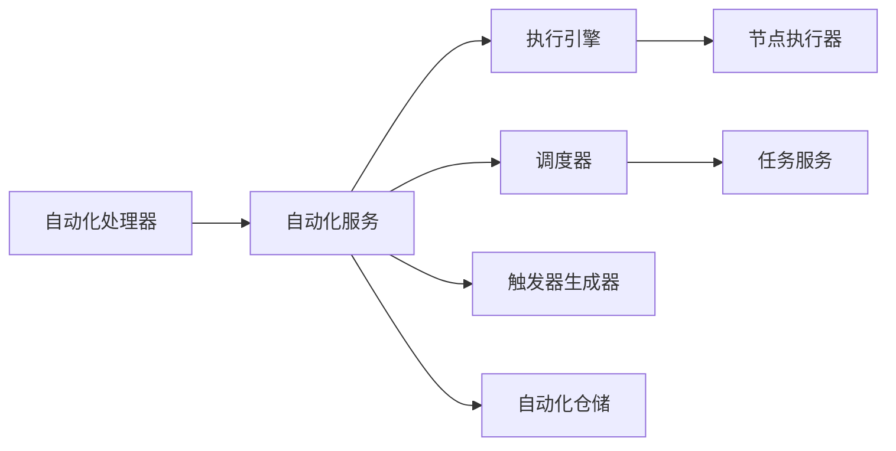

# 自动化服务

<cite>
**本文引用的文件**   
- [automation.go](file://notifuse/internal/domain/automation.go)
- [automation_handler.go](file://notifuse/internal/http/automation_handler.go)
- [automation_service.go](file://notifuse/internal/service/automation_service.go)
- [automation_executor.go](file://notifuse/internal/service/automation_executor.go)
- [automation_node_executor.go](file://notifuse/internal/service/automation_node_executor.go)
- [automation_scheduler.go](file://notifuse/internal/service/automation_scheduler.go)
- [automation_trigger_generator.go](file://notifuse/internal/service/automation_trigger_generator.go)
- [task.go](file://notifuse/internal/domain/task.go)
- [task_service.go](file://notifuse/internal/service/task_service.go)
- [task_scheduler.go](file://notifuse/internal/service/task_scheduler.go)
- [contact.go](file://notifuse/internal/domain/contact.go)
- [contact_service.go](file://notifuse/internal/service/contact_service.go)
- [custom_event.go](file://notifuse/internal/domain/custom_event.go)
- [custom_event_service.go](file://notifuse/internal/service/custom_event_service.go)
- [inbound_webhook_event.go](file://notifuse/internal/domain/inbound_webhook_event.go)
- [inbound_webhook_event_service.go](file://notifuse/internal/service/inbound_webhook_event_service.go)
- [webhook_subscription.go](file://notifuse/internal/domain/webhook_subscription.go)
- [webhook_subscription_service.go](file://notifuse/internal/service/webhook_subscription_service.go)
- [automation_postgres.go](file://notifuse/internal/repository/automation_postgres.go)
</cite>

## 目录
1. [简介](#简介)
2. [项目结构](#项目结构)
3. [核心组件](#核心组件)
4. [架构总览](#架构总览)
5. [详细组件分析](#详细组件分析)
6. [依赖关系分析](#依赖关系分析)
7. [性能考虑](#性能考虑)
8. [故障排查指南](#故障排查指南)
9. [结论](#结论)
10. [附录](#附录)

## 简介
本文件面向 Notifuse 平台的“自动化服务”，聚焦以下目标：
- 可视化工作流设计器、触发器系统、条件分支与执行引擎的核心能力说明
- 工作流节点类型与连接关系的数据结构定义
- 执行引擎的实现要点：节点调度、状态管理、错误恢复
- 定时任务与事件驱动的触发机制
- 自定义节点的扩展开发方式（含代码示例路径）
- 工作流版本控制与回滚机制
- 与联系人系统的集成及数据传递机制

## 项目结构
自动化相关代码主要分布在 internal 域内，采用分层组织：
- domain：领域模型与实体定义（工作流、任务、事件、联系人等）
- service：业务编排与服务实现（调度、执行、触发器生成、任务调度等）
- http：HTTP 接口层（工作流 CRUD、触发、测试运行等）
- repository：持久化实现（PostgreSQL 存储）
- cmd/api：应用入口（承载 HTTP 服务与后台任务）

图表来源
- [automation_handler.go](file://notifuse/internal/http/automation_handler.go)
- [automation_service.go](file://notifuse/internal/service/automation_service.go)
- [automation_executor.go](file://notifuse/internal/service/automation_executor.go)
- [automation_node_executor.go](file://notifuse/internal/service/automation_node_executor.go)
- [automation_scheduler.go](file://notifuse/internal/service/automation_scheduler.go)
- [task_service.go](file://notifuse/internal/service/task_service.go)
- [automation_trigger_generator.go](file://notifuse/internal/service/automation_trigger_generator.go)
- [automation.go](file://notifuse/internal/domain/automation.go)
- [task.go](file://notifuse/internal/domain/task.go)
- [custom_event.go](file://notifuse/internal/domain/custom_event.go)
- [inbound_webhook_event.go](file://notifuse/internal/domain/inbound_webhook_event.go)
- [webhook_subscription.go](file://notifuse/internal/domain/webhook_subscription.go)
- [contact.go](file://notifuse/internal/domain/contact.go)
- [automation_postgres.go](file://notifuse/internal/repository/automation_postgres.go)

章节来源
- [automation_handler.go](file://notifuse/internal/http/automation_handler.go)
- [automation_service.go](file://notifuse/internal/service/automation_service.go)
- [automation_executor.go](file://notifuse/internal/service/automation_executor.go)
- [automation_node_executor.go](file://notifuse/internal/service/automation_node_executor.go)
- [automation_scheduler.go](file://notifuse/internal/service/automation_scheduler.go)
- [task_service.go](file://notifuse/internal/service/task_service.go)
- [automation_trigger_generator.go](file://notifuse/internal/service/automation_trigger_generator.go)
- [automation.go](file://notifuse/internal/domain/automation.go)
- [task.go](file://notifuse/internal/domain/task.go)
- [custom_event.go](file://notifuse/internal/domain/custom_event.go)
- [inbound_webhook_event.go](file://notifuse/internal/domain/inbound_webhook_event.go)
- [webhook_subscription.go](file://notifuse/internal/domain/webhook_subscription.go)
- [contact.go](file://notifuse/internal/domain/contact.go)
- [automation_postgres.go](file://notifuse/internal/repository/automation_postgres.go)

## 核心组件
- 工作流模型与版本控制
  - 工作流实体包含元信息、节点集合、边集合、版本字段与启用状态。版本字段用于支持多版本并存与切换；启用状态决定当前生效版本。
  - 参考路径：[工作流模型](file://notifuse/internal/domain/automation.go)

- 触发器系统
  - 支持多种触发源：定时任务、自定义事件、入站 Webhook、外部订阅事件等。触发器生成器负责将外部事件映射为工作流启动上下文。
  - 参考路径：
    - [触发器生成器](file://notifuse/internal/service/automation_trigger_generator.go)
    - [自定义事件](file://notifuse/internal/domain/custom_event.go)
    - [入站 Webhook 事件](file://notifuse/internal/domain/inbound_webhook_event.go)
    - [Webhook 订阅](file://notifuse/internal/domain/webhook_subscription.go)

- 执行引擎
  - 负责加载工作流、解析图结构、按拓扑顺序调度节点、维护执行状态、处理错误与重试。
  - 参考路径：
    - [执行引擎](file://notifuse/internal/service/automation_executor.go)
    - [节点执行器](file://notifuse/internal/service/automation_node_executor.go)

- 调度器与任务
  - 基于任务服务与调度器，提供 cron 式定时触发与延迟执行能力。
  - 参考路径：
    - [调度器](file://notifuse/internal/service/automation_scheduler.go)
    - [任务服务](file://notifuse/internal/service/task_service.go)
    - [任务模型](file://notifuse/internal/domain/task.go)

- 仓储与持久化
  - 使用 PostgreSQL 存储工作流、任务、事件等数据，提供事务与并发安全访问。
  - 参考路径：
    - [自动化仓储](file://notifuse/internal/repository/automation_postgres.go)

章节来源
- [automation.go](file://notifuse/internal/domain/automation.go)
- [automation_trigger_generator.go](file://notifuse/internal/service/automation_trigger_generator.go)
- [custom_event.go](file://notifuse/internal/domain/custom_event.go)
- [inbound_webhook_event.go](file://notifuse/internal/domain/inbound_webhook_event.go)
- [webhook_subscription.go](file://notifuse/internal/domain/webhook_subscription.go)
- [automation_executor.go](file://notifuse/internal/service/automation_executor.go)
- [automation_node_executor.go](file://notifuse/internal/service/automation_node_executor.go)
- [automation_scheduler.go](file://notifuse/internal/service/automation_scheduler.go)
- [task_service.go](file://notifuse/internal/service/task_service.go)
- [task.go](file://notifuse/internal/domain/task.go)
- [automation_postgres.go](file://notifuse/internal/repository/automation_postgres.go)

## 架构总览
下图展示从触发到执行的端到端流程，包括触发器生成、执行引擎调度、节点执行与结果落盘。

图表来源
- [automation_handler.go](file://notifuse/internal/http/automation_handler.go)
- [automation_service.go](file://notifuse/internal/service/automation_service.go)
- [automation_trigger_generator.go](file://notifuse/internal/service/automation_trigger_generator.go)
- [automation_executor.go](file://notifuse/internal/service/automation_executor.go)
- [automation_node_executor.go](file://notifuse/internal/service/automation_node_executor.go)
- [automation_postgres.go](file://notifuse/internal/repository/automation_postgres.go)

## 详细组件分析

### 工作流模型与数据结构
- 工作流实体
  - 关键字段：标识、名称、描述、版本、启用状态、节点列表、边列表、创建/更新时间戳等。
  - 版本控制：通过版本字段区分不同迭代；启用状态决定当前生效版本。
  - 参考路径：[工作流模型](file://notifuse/internal/domain/automation.go)

- 节点与边
  - 节点：表示一个可执行单元（如条件判断、动作执行、等待、回调等），包含节点类型、配置参数、输入输出键名等。
  - 边：表示节点间的连接关系，包含起点节点 ID、终点节点 ID、条件表达式（可选）。
  - 参考路径：[工作流模型](file://notifuse/internal/domain/automation.go)

- 执行上下文
  - 包含工作流实例 ID、触发源信息、运行时变量、联系人上下文、事件载荷等。
  - 参考路径：
    - [执行引擎](file://notifuse/internal/service/automation_executor.go)
    - [节点执行器](file://notifuse/internal/service/automation_node_executor.go)

图表来源
- [automation.go](file://notifuse/internal/domain/automation.go)
- [automation_executor.go](file://notifuse/internal/service/automation_executor.go)
- [automation_node_executor.go](file://notifuse/internal/service/automation_node_executor.go)

章节来源
- [automation.go](file://notifuse/internal/domain/automation.go)
- [automation_executor.go](file://notifuse/internal/service/automation_executor.go)
- [automation_node_executor.go](file://notifuse/internal/service/automation_node_executor.go)

### 触发器系统与事件驱动
- 触发源类型
  - 定时任务：由调度器根据 cron 表达式或周期规则触发。
  - 自定义事件：通过 API 主动投递事件，匹配工作流触发条件。
  - 入站 Webhook：接收外部系统回调，转换为内部事件并触发工作流。
  - Webhook 订阅：订阅第三方平台事件，统一接入触发器。
- 触发器生成器
  - 负责将外部事件标准化为工作流启动上下文，并进行初步过滤与校验。
- 参考路径：
  - [触发器生成器](file://notifuse/internal/service/automation_trigger_generator.go)
  - [自定义事件](file://notifuse/internal/domain/custom_event.go)
  - [入站 Webhook 事件](file://notifuse/internal/domain/inbound_webhook_event.go)
  - [Webhook 订阅](file://notifuse/internal/domain/webhook_subscription.go)

图表来源
- [automation_trigger_generator.go](file://notifuse/internal/service/automation_trigger_generator.go)
- [custom_event_service.go](file://notifuse/internal/service/custom_event_service.go)
- [inbound_webhook_event_service.go](file://notifuse/internal/service/inbound_webhook_event_service.go)
- [webhook_subscription_service.go](file://notifuse/internal/service/webhook_subscription_service.go)

章节来源
- [automation_trigger_generator.go](file://notifuse/internal/service/automation_trigger_generator.go)
- [custom_event.go](file://notifuse/internal/domain/custom_event.go)
- [inbound_webhook_event.go](file://notifuse/internal/domain/inbound_webhook_event.go)
- [webhook_subscription.go](file://notifuse/internal/domain/webhook_subscription.go)
- [custom_event_service.go](file://notifuse/internal/service/custom_event_service.go)
- [inbound_webhook_event_service.go](file://notifuse/internal/service/inbound_webhook_event_service.go)
- [webhook_subscription_service.go](file://notifuse/internal/service/webhook_subscription_service.go)

### 执行引擎：节点调度、状态管理与错误恢复
- 节点调度
  - 基于工作流图的拓扑排序进行节点调度，确保前置节点完成后才执行后续节点。
  - 条件分支：边的条件表达式在运行时求值，决定走哪条分支。
- 状态管理
  - 每个节点执行前后写入状态（待执行、执行中、成功、失败、跳过等），便于追踪与重放。
- 错误恢复
  - 支持重试策略、超时控制、异常捕获与告警；失败节点可选择终止整个工作流或继续其他分支。
- 参考路径：
  - [执行引擎](file://notifuse/internal/service/automation_executor.go)
  - [节点执行器](file://notifuse/internal/service/automation_node_executor.go)

图表来源
- [automation_executor.go](file://notifuse/internal/service/automation_executor.go)
- [automation_node_executor.go](file://notifuse/internal/service/automation_node_executor.go)

章节来源
- [automation_executor.go](file://notifuse/internal/service/automation_executor.go)
- [automation_node_executor.go](file://notifuse/internal/service/automation_node_executor.go)

### 定时任务与任务调度
- 任务模型
  - 包含任务类型、调度表达式、触发时间、状态、重试次数等。
- 调度器
  - 基于任务服务注册与轮询，按时派发任务至执行引擎或队列。
- 参考路径：
  - [任务模型](file://notifuse/internal/domain/task.go)
  - [任务服务](file://notifuse/internal/service/task_service.go)
  - [调度器](file://notifuse/internal/service/automation_scheduler.go)

图表来源
- [automation_scheduler.go](file://notifuse/internal/service/automation_scheduler.go)
- [task_service.go](file://notifuse/internal/service/task_service.go)
- [automation_executor.go](file://notifuse/internal/service/automation_executor.go)

章节来源
- [task.go](file://notifuse/internal/domain/task.go)
- [task_service.go](file://notifuse/internal/service/task_service.go)
- [automation_scheduler.go](file://notifuse/internal/service/automation_scheduler.go)

### 与联系人系统集成与数据传递
- 联系人模型
  - 包含基础属性、标签、分组、时间线等，供工作流在执行时读取与更新。
- 数据传递
  - 执行上下文携带联系人上下文，节点执行器可按需读取联系人属性、更新状态或追加时间线事件。
- 参考路径：
  - [联系人模型](file://notifuse/internal/domain/contact.go)
  - [联系人服务](file://notifuse/internal/service/contact_service.go)
  - [执行引擎](file://notifuse/internal/service/automation_executor.go)
  - [节点执行器](file://notifuse/internal/service/automation_node_executor.go)

图表来源
- [contact.go](file://notifuse/internal/domain/contact.go)
- [contact_service.go](file://notifuse/internal/service/contact_service.go)
- [automation_executor.go](file://notifuse/internal/service/automation_executor.go)
- [automation_node_executor.go](file://notifuse/internal/service/automation_node_executor.go)

章节来源
- [contact.go](file://notifuse/internal/domain/contact.go)
- [contact_service.go](file://notifuse/internal/service/contact_service.go)
- [automation_executor.go](file://notifuse/internal/service/automation_executor.go)
- [automation_node_executor.go](file://notifuse/internal/service/automation_node_executor.go)

### 工作流版本控制与回滚机制
- 版本控制
  - 工作流实体包含版本字段，每次修改递增版本；启用状态指向当前生效版本。
- 回滚
  - 通过将历史版本的启用状态切换为目标版本，实现快速回滚；保留历史版本以审计与对比。
- 参考路径：
  - [工作流模型](file://notifuse/internal/domain/automation.go)
  - [自动化仓储](file://notifuse/internal/repository/automation_postgres.go)

图表来源
- [automation.go](file://notifuse/internal/domain/automation.go)
- [automation_postgres.go](file://notifuse/internal/repository/automation_postgres.go)

章节来源
- [automation.go](file://notifuse/internal/domain/automation.go)
- [automation_postgres.go](file://notifuse/internal/repository/automation_postgres.go)

### 自定义节点扩展开发
- 扩展点
  - 节点执行器提供可扩展的节点类型注册机制；新增节点需实现统一的执行接口（输入/输出、配置解析、错误处理）。
- 开发步骤
  - 定义节点类型与配置结构
  - 实现节点执行逻辑（读取上下文、调用外部服务、更新变量）
  - 注册节点类型到执行器
  - 编写单元测试验证边界与错误路径
- 参考路径：
  - [节点执行器](file://notifuse/internal/service/automation_node_executor.go)
  - [执行引擎](file://notifuse/internal/service/automation_executor.go)

图表来源
- [automation_node_executor.go](file://notifuse/internal/service/automation_node_executor.go)
- [automation_executor.go](file://notifuse/internal/service/automation_executor.go)

章节来源
- [automation_node_executor.go](file://notifuse/internal/service/automation_node_executor.go)
- [automation_executor.go](file://notifuse/internal/service/automation_executor.go)

## 依赖关系分析
- 组件耦合
  - HTTP 处理器仅依赖服务层，服务层依赖领域模型与仓储；执行引擎与节点执行器紧密协作。
- 外部依赖
  - 任务调度器依赖任务服务；触发器生成器依赖事件与订阅服务；执行引擎依赖仓储记录执行日志。
- 潜在循环
  - 当前分层清晰，未见直接循环依赖；注意避免在服务层引入对 HTTP 层的反向依赖。

图表来源
- [automation_handler.go](file://notifuse/internal/http/automation_handler.go)
- [automation_service.go](file://notifuse/internal/service/automation_service.go)
- [automation_executor.go](file://notifuse/internal/service/automation_executor.go)
- [automation_node_executor.go](file://notifuse/internal/service/automation_node_executor.go)
- [automation_scheduler.go](file://notifuse/internal/service/automation_scheduler.go)
- [task_service.go](file://notifuse/internal/service/task_service.go)
- [automation_trigger_generator.go](file://notifuse/internal/service/automation_trigger_generator.go)
- [automation_postgres.go](file://notifuse/internal/repository/automation_postgres.go)

章节来源
- [automation_handler.go](file://notifuse/internal/http/automation_handler.go)
- [automation_service.go](file://notifuse/internal/service/automation_service.go)
- [automation_executor.go](file://notifuse/internal/service/automation_executor.go)
- [automation_node_executor.go](file://notifuse/internal/service/automation_node_executor.go)
- [automation_scheduler.go](file://notifuse/internal/service/automation_scheduler.go)
- [task_service.go](file://notifuse/internal/service/task_service.go)
- [automation_trigger_generator.go](file://notifuse/internal/service/automation_trigger_generator.go)
- [automation_postgres.go](file://notifuse/internal/repository/automation_postgres.go)

## 性能考虑
- 节点并行度
  - 对于无依赖的节点，可在执行引擎中引入有限并行以提升吞吐，但需注意资源限制与外部服务限流。
- 条件表达式优化
  - 复杂条件表达式应缓存编译结果，避免重复解析。
- 重试与退避
  - 合理设置最大重试次数与指数退避间隔，避免雪崩效应。
- 持久化写入
  - 批量写入执行日志与状态变更，减少数据库往返。
- 调度器轮询
  - 调整轮询间隔与批大小，平衡实时性与负载。

## 故障排查指南
- 常见问题
  - 工作流未触发：检查触发器生成器的匹配逻辑与事件格式是否正确。
  - 节点执行失败：查看执行日志中的节点状态与错误信息，确认外部服务可用性与鉴权。
  - 条件分支不生效：验证边条件表达式语法与运行时变量是否存在。
  - 版本回滚无效：确认启用状态是否已正确切换到目标版本。
- 定位手段
  - 通过执行引擎记录的节点状态与日志定位失败节点。
  - 使用任务服务查询任务状态与重试次数。
  - 检查仓储层的事务与锁冲突情况。
- 参考路径：
  - [执行引擎](file://notifuse/internal/service/automation_executor.go)
  - [任务服务](file://notifuse/internal/service/task_service.go)
  - [自动化仓储](file://notifuse/internal/repository/automation_postgres.go)

章节来源
- [automation_executor.go](file://notifuse/internal/service/automation_executor.go)
- [task_service.go](file://notifuse/internal/service/task_service.go)
- [automation_postgres.go](file://notifuse/internal/repository/automation_postgres.go)

## 结论
Notifuse 自动化服务通过清晰的领域模型、可扩展的执行引擎与灵活的触发器系统，提供了强大的工作流编排能力。版本控制与回滚机制保障了生产环境的稳定性；与联系人系统的深度集成使得工作流能够围绕用户生命周期展开自动化。建议在生产环境中结合监控与告警，持续优化节点并行度与重试策略，以获得更高的可靠性与性能。

## 附录
- 术语表
  - 工作流：由节点与边组成的有向图，表示一套自动化的业务流程。
  - 节点：工作流中的最小执行单元，具备输入与输出。
  - 边：节点之间的连接，可附带条件表达式。
  - 触发器：启动工作流的信号源，包括定时、事件与 Webhook。
  - 执行上下文：工作流执行时的运行时数据载体。
- 参考路径汇总
  - [工作流模型](file://notifuse/internal/domain/automation.go)
  - [执行引擎](file://notifuse/internal/service/automation_executor.go)
  - [节点执行器](file://notifuse/internal/service/automation_node_executor.go)
  - [触发器生成器](file://notifuse/internal/service/automation_trigger_generator.go)
  - [调度器](file://notifuse/internal/service/automation_scheduler.go)
  - [任务服务](file://notifuse/internal/service/task_service.go)
  - [联系人服务](file://notifuse/internal/service/contact_service.go)
  - [自动化仓储](file://notifuse/internal/repository/automation_postgres.go)