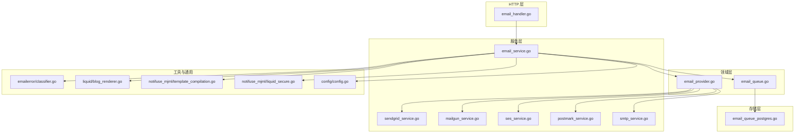
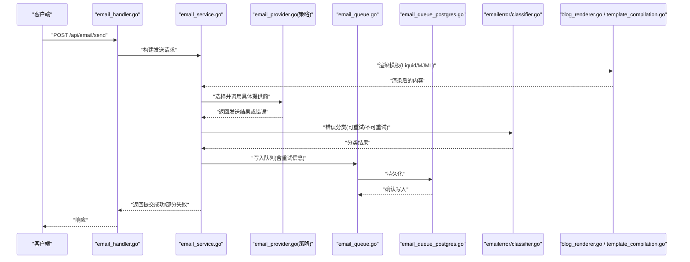
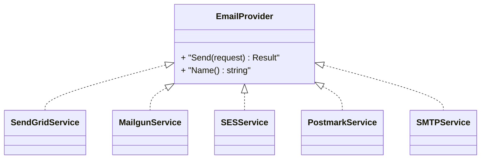
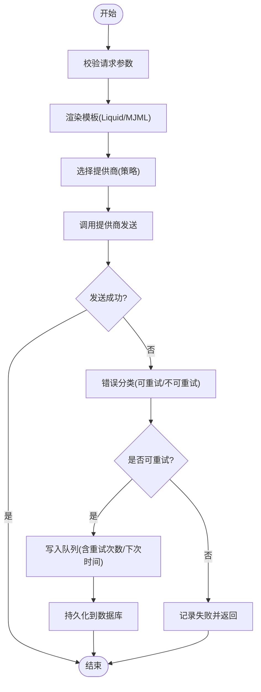
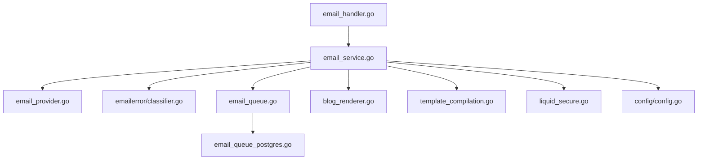

# 邮件服务

<cite>
**本文引用的文件**
- [internal/domain/email_provider.go](file://notifuse/internal/domain/email_provider.go)
- [internal/domain/email_queue.go](file://notifuse/internal/domain/email_queue.go)
- [internal/service/email_service.go](file://notifuse/internal/service/email_service.go)
- [internal/service/sendgrid_service.go](file://notifuse/internal/service/sendgrid_service.go)
- [internal/service/mailgun_service.go](file://notifuse/internal/service/mailgun_service.go)
- [internal/service/ses_service.go](file://notifuse/internal/service/ses_service.go)
- [internal/service/postmark_service.go](file://notifuse/internal/service/postmark_service.go)
- [internal/service/smtp_service.go](file://notifuse/internal/service/smtp_service.go)
- [pkg/emailerror/classifier.go](file://notifuse/pkg/emailerror/classifier.go)
- [pkg/liquid/blog_renderer.go](file://notifuse/pkg/liquid/blog_renderer.go)
- [pkg/notifuse_mjml/template_compilation.go](file://notifuse/pkg/notifuse_mjml/template_compilation.go)
- [pkg/notifuse_mjml/liquid_secure.go](file://notifuse/pkg/notifuse_mjml/liquid_secure.go)
- [internal/repository/email_queue_postgres.go](file://notifuse/internal/repository/email_queue_postgres.go)
- [internal/http/email_handler.go](file://notifuse/internal/http/email_handler.go)
- [config/config.go](file://notifuse/config/config.go)
</cite>

## 目录
1. [简介](#简介)
2. [项目结构](#项目结构)
3. [核心组件](#核心组件)
4. [架构总览](#架构总览)
5. [详细组件分析](#详细组件分析)
6. [依赖关系分析](#依赖关系分析)
7. [性能与并发](#性能与并发)
8. [故障排查指南](#故障排查指南)
9. [结论](#结论)
10. [附录：配置与使用示例](#附录配置与使用示例)

## 简介
本文件为 Notifuse 平台的邮件服务提供系统化文档，覆盖以下关键主题：
- 多提供商集成：SendGrid、Mailgun、AWS SES、Postmark、SMTP 等
- 模板渲染：Liquid 模板引擎与安全沙箱机制
- 批量发送处理：队列化、分片与并发控制
- 送达率追踪：错误分类、状态管理与回退策略
- 抽象层设计：策略模式实现与扩展点
- 发送流程：从 API 到队列、重试、错误分类与持久化
- 性能优化：并发、限流、连接池与批处理

## 项目结构
邮件相关代码主要分布在以下模块：
- 领域模型与接口定义：internal/domain
- 服务编排与业务逻辑：internal/service
- HTTP 入口与处理器：internal/http
- 错误分类器：pkg/emailerror
- 模板与渲染：pkg/liquid、pkg/notifuse_mjml
- 队列持久化：internal/repository
- 配置：config

图表来源
- [internal/http/email_handler.go](file://notifuse/internal/http/email_handler.go)
- [internal/service/email_service.go](file://notifuse/internal/service/email_service.go)
- [internal/domain/email_provider.go](file://notifuse/internal/domain/email_provider.go)
- [internal/domain/email_queue.go](file://notifuse/internal/domain/email_queue.go)
- [internal/repository/email_queue_postgres.go](file://notifuse/internal/repository/email_queue_postgres.go)
- [pkg/emailerror/classifier.go](file://notifuse/pkg/emailerror/classifier.go)
- [pkg/liquid/blog_renderer.go](file://notifuse/pkg/liquid/blog_renderer.go)
- [pkg/notifuse_mjml/template_compilation.go](file://notifuse/pkg/notifuse_mjml/template_compilation.go)
- [pkg/notifuse_mjml/liquid_secure.go](file://notifuse/pkg/notifuse_mjml/liquid_secure.go)
- [config/config.go](file://notifuse/config/config.go)

章节来源
- [internal/http/email_handler.go](file://notifuse/internal/http/email_handler.go)
- [internal/service/email_service.go](file://notifuse/internal/service/email_service.go)
- [internal/domain/email_provider.go](file://notifuse/internal/domain/email_provider.go)
- [internal/domain/email_queue.go](file://notifuse/internal/domain/email_queue.go)
- [internal/repository/email_queue_postgres.go](file://notifuse/internal/repository/email_queue_postgres.go)
- [pkg/emailerror/classifier.go](file://notifuse/pkg/emailerror/classifier.go)
- [pkg/liquid/blog_renderer.go](file://notifuse/pkg/liquid/blog_renderer.go)
- [pkg/notifuse_mjml/template_compilation.go](file://notifuse/pkg/notifuse_mjml/template_compilation.go)
- [pkg/notifuse_mjml/liquid_secure.go](file://notifuse/pkg/notifuse_mjml/liquid_secure.go)
- [config/config.go](file://notifuse/config/config.go)

## 核心组件
- 邮件提供商抽象层（策略模式）
  - 通过统一接口定义发送能力，各具体提供商实现该接口，便于替换与扩展。
  - 参考路径：[internal/domain/email_provider.go](file://notifuse/internal/domain/email_provider.go)
- 邮件队列与任务
  - 将待发送邮件持久化为队列项，支持重试、失败记录与状态流转。
  - 参考路径：[internal/domain/email_queue.go](file://notifuse/internal/domain/email_queue.go)
- 邮件服务编排
  - 负责模板渲染、参数校验、选择提供商、入队与结果汇总。
  - 参考路径：[internal/service/email_service.go](file://notifuse/internal/service/email_service.go)
- 具体提供商实现
  - SendGrid、Mailgun、SES、Postmark、SMTP 等。
  - 参考路径：
    - [internal/service/sendgrid_service.go](file://notifuse/internal/service/sendgrid_service.go)
    - [internal/service/mailgun_service.go](file://notifuse/internal/service/mailgun_service.go)
    - [internal/service/ses_service.go](file://notifuse/internal/service/ses_service.go)
    - [internal/service/postmark_service.go](file://notifuse/internal/service/postmark_service.go)
    - [internal/service/smtp_service.go](file://notifuse/internal/service/smtp_service.go)
- 错误分类器
  - 对各类提供商返回的错误进行标准化分类，用于重试与告警策略。
  - 参考路径：[pkg/emailerror/classifier.go](file://notifuse/pkg/emailerror/classifier.go)
- 模板与渲染
  - Liquid 模板引擎集成与安全沙箱；MJML 模板编译。
  - 参考路径：
    - [pkg/liquid/blog_renderer.go](file://notifuse/pkg/liquid/blog_renderer.go)
    - [pkg/notifuse_mjml/template_compilation.go](file://notifuse/pkg/notifuse_mjml/template_compilation.go)
    - [pkg/notifuse_mjml/liquid_secure.go](file://notifuse/pkg/notifuse_mjml/liquid_secure.go)
- 队列持久化
  - 基于数据库的队列实现，支持高可用与恢复。
  - 参考路径：[internal/repository/email_queue_postgres.go](file://notifuse/internal/repository/email_queue_postgres.go)
- HTTP 入口
  - 暴露邮件发送与批量发送的 API。
  - 参考路径：[internal/http/email_handler.go](file://notifuse/internal/http/email_handler.go)
- 配置
  - 加载各提供商凭据与全局选项。
  - 参考路径：[config/config.go](file://notifuse/config/config.go)

章节来源
- [internal/domain/email_provider.go](file://notifuse/internal/domain/email_provider.go)
- [internal/domain/email_queue.go](file://notifuse/internal/domain/email_queue.go)
- [internal/service/email_service.go](file://notifuse/internal/service/email_service.go)
- [internal/service/sendgrid_service.go](file://notifuse/internal/service/sendgrid_service.go)
- [internal/service/mailgun_service.go](file://notifuse/internal/service/mailgun_service.go)
- [internal/service/ses_service.go](file://notifuse/internal/service/ses_service.go)
- [internal/service/postmark_service.go](file://notifuse/internal/service/postmark_service.go)
- [internal/service/smtp_service.go](file://notifuse/internal/service/smtp_service.go)
- [pkg/emailerror/classifier.go](file://notifuse/pkg/emailerror/classifier.go)
- [pkg/liquid/blog_renderer.go](file://notifuse/pkg/liquid/blog_renderer.go)
- [pkg/notifuse_mjml/template_compilation.go](file://notifuse/pkg/notifuse_mjml/template_compilation.go)
- [pkg/notifuse_mjml/liquid_secure.go](file://notifuse/pkg/notifuse_mjml/liquid_secure.go)
- [internal/repository/email_queue_postgres.go](file://notifuse/internal/repository/email_queue_postgres.go)
- [internal/http/email_handler.go](file://notifuse/internal/http/email_handler.go)
- [config/config.go](file://notifuse/config/config.go)

## 架构总览
下图展示了从 HTTP 请求到最终投递的端到端流程，包括模板渲染、提供商选择、队列入队与错误分类。

图表来源
- [internal/http/email_handler.go](file://notifuse/internal/http/email_handler.go)
- [internal/service/email_service.go](file://notifuse/internal/service/email_service.go)
- [internal/domain/email_provider.go](file://notifuse/internal/domain/email_provider.go)
- [internal/domain/email_queue.go](file://notifuse/internal/domain/email_queue.go)
- [internal/repository/email_queue_postgres.go](file://notifuse/internal/repository/email_queue_postgres.go)
- [pkg/emailerror/classifier.go](file://notifuse/pkg/emailerror/classifier.go)
- [pkg/liquid/blog_renderer.go](file://notifuse/pkg/liquid/blog_renderer.go)
- [pkg/notifuse_mjml/template_compilation.go](file://notifuse/pkg/notifuse_mjml/template_compilation.go)

## 详细组件分析

### 邮件提供商抽象层与策略模式
- 设计要点
  - 定义统一的发送接口，屏蔽不同提供商的差异。
  - 每个提供商以独立实现接入，遵循开闭原则，新增提供商无需修改现有逻辑。
- 类关系图

图表来源
- [internal/domain/email_provider.go](file://notifuse/internal/domain/email_provider.go)
- [internal/service/sendgrid_service.go](file://notifuse/internal/service/sendgrid_service.go)
- [internal/service/mailgun_service.go](file://notifuse/internal/service/mailgun_service.go)
- [internal/service/ses_service.go](file://notifuse/internal/service/ses_service.go)
- [internal/service/postmark_service.go](file://notifuse/internal/service/postmark_service.go)
- [internal/service/smtp_service.go](file://notifuse/internal/service/smtp_service.go)

章节来源
- [internal/domain/email_provider.go](file://notifuse/internal/domain/email_provider.go)
- [internal/service/sendgrid_service.go](file://notifuse/internal/service/sendgrid_service.go)
- [internal/service/mailgun_service.go](file://notifuse/internal/service/mailgun_service.go)
- [internal/service/ses_service.go](file://notifuse/internal/service/ses_service.go)
- [internal/service/postmark_service.go](file://notifuse/internal/service/postmark_service.go)
- [internal/service/smtp_service.go](file://notifuse/internal/service/smtp_service.go)

### 邮件发送流程与队列处理
- 流程说明
  - 接收请求后，先完成模板渲染与参数校验。
  - 根据配置选择提供商，执行发送。
  - 若失败，依据错误分类决定重试策略，并将任务写入队列。
  - 队列持久化，后续由后台消费者拉取并重试。
- 流程图

图表来源
- [internal/service/email_service.go](file://notifuse/internal/service/email_service.go)
- [internal/domain/email_queue.go](file://notifuse/internal/domain/email_queue.go)
- [internal/repository/email_queue_postgres.go](file://notifuse/internal/repository/email_queue_postgres.go)
- [pkg/emailerror/classifier.go](file://notifuse/pkg/emailerror/classifier.go)
- [pkg/liquid/blog_renderer.go](file://notifuse/pkg/liquid/blog_renderer.go)
- [pkg/notifuse_mjml/template_compilation.go](file://notifuse/pkg/notifuse_mjml/template_compilation.go)

章节来源
- [internal/service/email_service.go](file://notifuse/internal/service/email_service.go)
- [internal/domain/email_queue.go](file://notifuse/internal/domain/email_queue.go)
- [internal/repository/email_queue_postgres.go](file://notifuse/internal/repository/email_queue_postgres.go)
- [pkg/emailerror/classifier.go](file://notifuse/pkg/emailerror/classifier.go)
- [pkg/liquid/blog_renderer.go](file://notifuse/pkg/liquid/blog_renderer.go)
- [pkg/notifuse_mjml/template_compilation.go](file://notifuse/pkg/notifuse_mjml/template_compilation.go)

### 模板渲染与 Liquid 安全沙箱
- 功能概述
  - 使用 Liquid 模板引擎进行内容渲染，结合 MJML 模板编译生成最终 HTML。
  - 引入安全沙箱限制危险操作，防止模板注入与资源滥用。
- 关键文件
  - 渲染入口与上下文：[pkg/liquid/blog_renderer.go](file://notifuse/pkg/liquid/blog_renderer.go)
  - MJML 模板编译：[pkg/notifuse_mjml/template_compilation.go](file://notifuse/pkg/notifuse_mjml/template_compilation.go)
  - Liquid 安全沙箱：[pkg/notifuse_mjml/liquid_secure.go](file://notifuse/pkg/notifuse_mjml/liquid_secure.go)

章节来源
- [pkg/liquid/blog_renderer.go](file://notifuse/pkg/liquid/blog_renderer.go)
- [pkg/notifuse_mjml/template_compilation.go](file://notifuse/pkg/notifuse_mjml/template_compilation.go)
- [pkg/notifuse_mjml/liquid_secure.go](file://notifuse/pkg/notifuse_mjml/liquid_secure.go)

### 错误分类与状态管理
- 目标
  - 将不同提供商的错误映射为标准化的分类，驱动重试与告警策略。
- 关键点
  - 网络超时、认证失败、配额超限、无效地址等分别归类。
  - 分类结果影响队列的重试次数与延迟策略。
- 参考文件
  - [pkg/emailerror/classifier.go](file://notifuse/pkg/emailerror/classifier.go)

章节来源
- [pkg/emailerror/classifier.go](file://notifuse/pkg/emailerror/classifier.go)

### 批量发送处理
- 设计思路
  - 将大批量收件人拆分为多个批次，按批次入队，避免单次请求过大。
  - 支持并发消费与速率限制，保障系统稳定与外部 API 限额。
- 相关文件
  - 队列模型与任务结构：[internal/domain/email_queue.go](file://notifuse/internal/domain/email_queue.go)
  - 队列持久化：[internal/repository/email_queue_postgres.go](file://notifuse/internal/repository/email_queue_postgres.go)
  - 服务编排：[internal/service/email_service.go](file://notifuse/internal/service/email_service.go)

章节来源
- [internal/domain/email_queue.go](file://notifuse/internal/domain/email_queue.go)
- [internal/repository/email_queue_postgres.go](file://notifuse/internal/repository/email_queue_postgres.go)
- [internal/service/email_service.go](file://notifuse/internal/service/email_service.go)

## 依赖关系分析
- 组件耦合
  - HTTP 层仅依赖服务层，服务层通过抽象接口依赖提供商，降低耦合度。
  - 错误分类器被服务层复用，确保一致的重试策略。
- 外部依赖
  - 各提供商 SDK/API、数据库（PostgreSQL）、模板引擎（Liquid/MJML）。
- 潜在循环依赖
  - 当前分层清晰，未见循环依赖迹象。

图表来源
- [internal/http/email_handler.go](file://notifuse/internal/http/email_handler.go)
- [internal/service/email_service.go](file://notifuse/internal/service/email_service.go)
- [internal/domain/email_provider.go](file://notifuse/internal/domain/email_provider.go)
- [internal/domain/email_queue.go](file://notifuse/internal/domain/email_queue.go)
- [internal/repository/email_queue_postgres.go](file://notifuse/internal/repository/email_queue_postgres.go)
- [pkg/emailerror/classifier.go](file://notifuse/pkg/emailerror/classifier.go)
- [pkg/liquid/blog_renderer.go](file://notifuse/pkg/liquid/blog_renderer.go)
- [pkg/notifuse_mjml/template_compilation.go](file://notifuse/pkg/notifuse_mjml/template_compilation.go)
- [pkg/notifuse_mjml/liquid_secure.go](file://notifuse/pkg/notifuse_mjml/liquid_secure.go)
- [config/config.go](file://notifuse/config/config.go)

章节来源
- [internal/http/email_handler.go](file://notifuse/internal/http/email_handler.go)
- [internal/service/email_service.go](file://notifuse/internal/service/email_service.go)
- [internal/domain/email_provider.go](file://notifuse/internal/domain/email_provider.go)
- [internal/domain/email_queue.go](file://notifuse/internal/domain/email_queue.go)
- [internal/repository/email_queue_postgres.go](file://notifuse/internal/repository/email_queue_postgres.go)
- [pkg/emailerror/classifier.go](file://notifuse/pkg/emailerror/classifier.go)
- [pkg/liquid/blog_renderer.go](file://notifuse/pkg/liquid/blog_renderer.go)
- [pkg/notifuse_mjml/template_compilation.go](file://notifuse/pkg/notifuse_mjml/template_compilation.go)
- [pkg/notifuse_mjml/liquid_secure.go](file://notifuse/pkg/notifuse_mjml/liquid_secure.go)
- [config/config.go](file://notifuse/config/config.go)

## 性能与并发
- 并发策略
  - 批量发送采用分片与并行消费，结合速率限制避免触发外部限额。
- 连接与资源
  - 合理设置 HTTP 连接池与超时，减少握手开销。
- 重试与退避
  - 指数退避与抖动，避免雪崩效应。
- 监控与指标
  - 记录发送耗时、成功率、错误分布与队列积压情况。

[本节为通用指导，不直接分析具体文件]

## 故障排查指南
- 常见问题定位
  - 模板渲染失败：检查 Liquid 变量与 MJML 语法，确认沙箱限制。
  - 提供商认证失败：核对凭据与权限范围。
  - 配额超限：调整发送速率与分批策略。
  - 队列堆积：检查消费者数量与重试策略。
- 参考文件
  - 错误分类器：[pkg/emailerror/classifier.go](file://notifuse/pkg/emailerror/classifier.go)
  - 队列持久化：[internal/repository/email_queue_postgres.go](file://notifuse/internal/repository/email_queue_postgres.go)
  - 服务编排：[internal/service/email_service.go](file://notifuse/internal/service/email_service.go)

章节来源
- [pkg/emailerror/classifier.go](file://notifuse/pkg/emailerror/classifier.go)
- [internal/repository/email_queue_postgres.go](file://notifuse/internal/repository/email_queue_postgres.go)
- [internal/service/email_service.go](file://notifuse/internal/service/email_service.go)

## 结论
Notifuse 邮件服务通过清晰的抽象层与策略模式，实现了多提供商的统一接入；借助队列与错误分类，构建了稳健的发送与重试体系；结合 Liquid 与 MJML 的安全渲染，保障了模板的可维护性与安全性。整体架构具备良好的可扩展性与可观测性，适合大规模生产环境使用。

[本节为总结，不直接分析具体文件]

## 附录：配置与使用示例
- 配置要点
  - 在配置文件中设置各提供商的凭据与默认选择。
  - 参考路径：[config/config.go](file://notifuse/config/config.go)
- 使用方式
  - 通过 HTTP 接口发起单封或批量发送请求。
  - 参考路径：[internal/http/email_handler.go](file://notifuse/internal/http/email_handler.go)
- 提供商实现参考
  - SendGrid：[internal/service/sendgrid_service.go](file://notifuse/internal/service/sendgrid_service.go)
  - Mailgun：[internal/service/mailgun_service.go](file://notifuse/internal/service/mailgun_service.go)
  - AWS SES：[internal/service/ses_service.go](file://notifuse/internal/service/ses_service.go)
  - Postmark：[internal/service/postmark_service.go](file://notifuse/internal/service/postmark_service.go)
  - SMTP：[internal/service/smtp_service.go](file://notifuse/internal/service/smtp_service.go)

章节来源
- [config/config.go](file://notifuse/config/config.go)
- [internal/http/email_handler.go](file://notifuse/internal/http/email_handler.go)
- [internal/service/sendgrid_service.go](file://notifuse/internal/service/sendgrid_service.go)
- [internal/service/mailgun_service.go](file://notifuse/internal/service/mailgun_service.go)
- [internal/service/ses_service.go](file://notifuse/internal/service/ses_service.go)
- [internal/service/postmark_service.go](file://notifuse/internal/service/postmark_service.go)
- [internal/service/smtp_service.go](file://notifuse/internal/service/smtp_service.go)