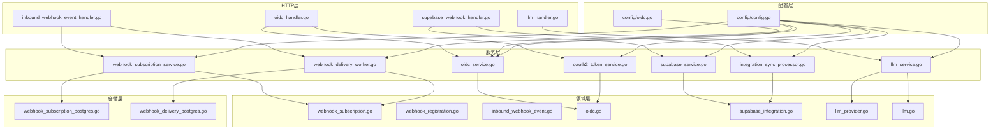
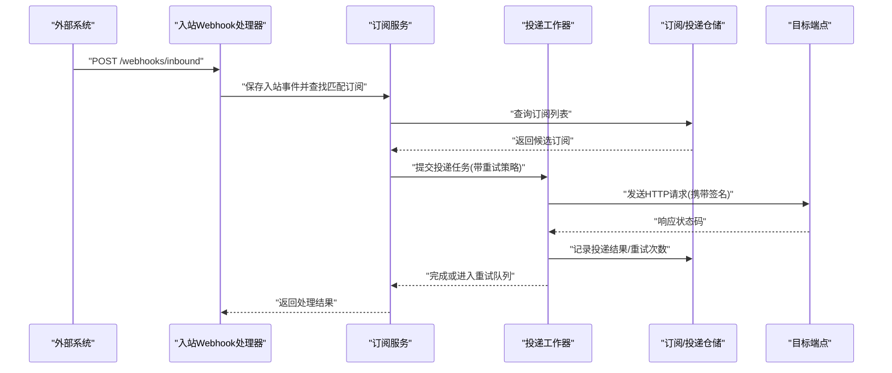
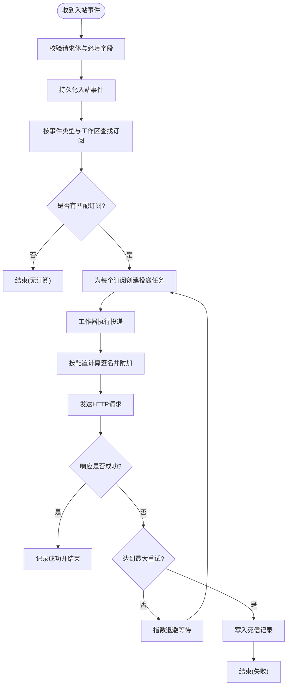
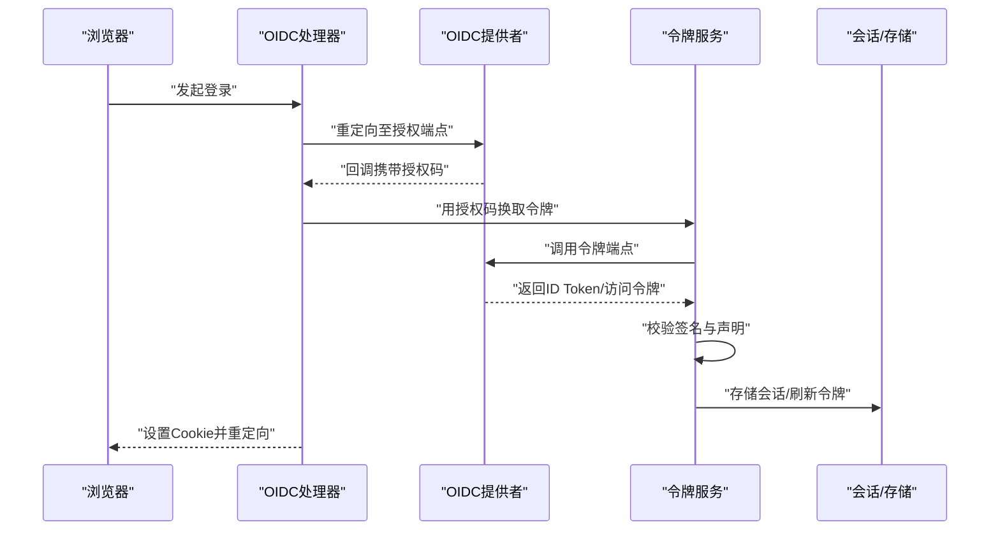
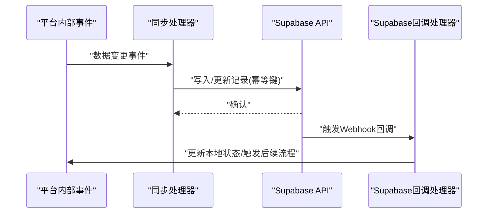
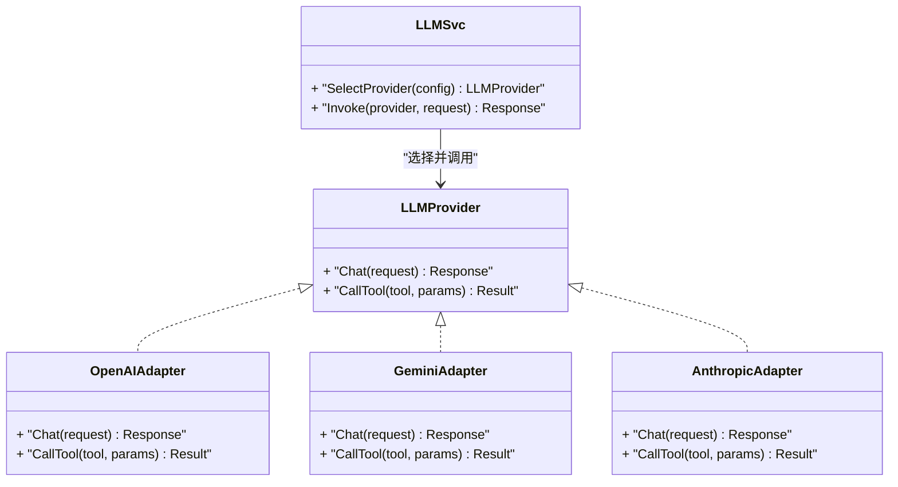
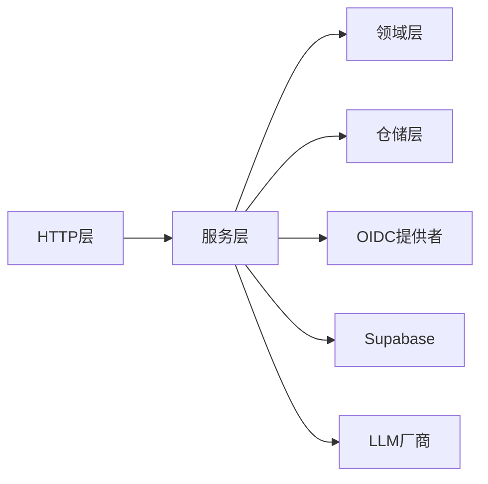

# 集成服务

<cite>
**本文引用的文件**   
- [internal/domain/webhook_subscription.go](file://notifuse/internal/domain/webhook_subscription.go)
- [internal/domain/webhook_registration.go](file://notifuse/internal/domain/webhook_registration.go)
- [internal/domain/inbound_webhook_event.go](file://notifuse/internal/domain/inbound_webhook_event.go)
- [internal/http/inbound_webhook_event_handler.go](file://notifuse/internal/http/inbound_webhook_event_handler.go)
- [internal/service/webhook_subscription_service.go](file://notifuse/internal/service/webhook_subscription_service.go)
- [internal/service/webhook_delivery_worker.go](file://notifuse/internal/service/webhook_delivery_worker.go)
- [internal/repository/webhook_subscription_postgres.go](file://notifuse/internal/repository/webhook_subscription_postgres.go)
- [internal/repository/webhook_delivery_postgres.go](file://notifuse/internal/repository/webhook_delivery_postgres.go)
- [internal/domain/oidc.go](file://notifuse/internal/domain/oidc.go)
- [internal/service/oidc_service.go](file://notifuse/internal/service/oidc_service.go)
- [internal/http/oidc_handler.go](file://notifuse/internal/http/oidc_handler.go)
- [internal/service/oauth2_token_service.go](file://notifuse/internal/service/oauth2_token_service.go)
- [internal/domain/supabase_integration.go](file://notifuse/internal/domain/supabase_integration.go)
- [internal/service/supabase_service.go](file://notifuse/internal/service/supabase_service.go)
- [internal/service/integration_sync_processor.go](file://notifuse/internal/service/integration_sync_processor.go)
- [internal/http/supabase_webhook_handler.go](file://notifuse/internal/http/supabase_webhook_handler.go)
- [internal/domain/llm_provider.go](file://notifuse/internal/domain/llm_provider.go)
- [internal/domain/llm.go](file://notifuse/internal/domain/llm.go)
- [internal/service/llm_service.go](file://notifuse/internal/service/llm_service.go)
- [internal/http/llm_handler.go](file://notifuse/internal/http/llm_handler.go)
- [config/config.go](file://notifuse/config/config.go)
- [config/oidc.go](file://notifuse/config/oidc.go)
</cite>

## 目录
1. [简介](#简介)
2. [项目结构](#项目结构)
3. [核心组件](#核心组件)
4. [架构总览](#架构总览)
5. [详细组件分析](#详细组件分析)
6. [依赖关系分析](#依赖关系分析)
7. [性能考虑](#性能考虑)
8. [故障排查指南](#故障排查指南)
9. [结论](#结论)
10. [附录](#附录)

## 简介
本文件面向Notifuse平台的“集成服务”模块，聚焦以下能力：
- Webhook订阅管理与事件处理（含签名验证）
- OIDC/OAuth2认证与令牌管理
- Supabase同步与外部Webhook回调
- LLM服务提供商的插件化适配
- 异步消息处理、错误重试机制
- 配置管理与密钥安全存储方案

文档以代码级为依据，提供架构图、时序图、流程图以及关键实现路径，帮助开发者快速理解并扩展平台集成能力。

## 项目结构
集成相关代码主要分布在以下层次：
- HTTP层：路由处理器，负责解析请求、鉴权、参数校验与响应
- 服务层：业务编排、策略选择、异步任务调度、重试与幂等控制
- 领域层：实体模型、接口定义与适配器契约
- 仓储层：PostgreSQL持久化
- 配置层：应用配置与OIDC配置加载

图表来源
- [internal/http/inbound_webhook_event_handler.go](file://notifuse/internal/http/inbound_webhook_event_handler.go)
- [internal/service/webhook_subscription_service.go](file://notifuse/internal/service/webhook_subscription_service.go)
- [internal/service/webhook_delivery_worker.go](file://notifuse/internal/service/webhook_delivery_worker.go)
- [internal/domain/webhook_subscription.go](file://notifuse/internal/domain/webhook_subscription.go)
- [internal/repository/webhook_subscription_postgres.go](file://notifuse/internal/repository/webhook_subscription_postgres.go)
- [internal/repository/webhook_delivery_postgres.go](file://notifuse/internal/repository/webhook_delivery_postgres.go)
- [internal/http/oidc_handler.go](file://notifuse/internal/http/oidc_handler.go)
- [internal/service/oidc_service.go](file://notifuse/internal/service/oidc_service.go)
- [internal/service/oauth2_token_service.go](file://notifuse/internal/service/oauth2_token_service.go)
- [internal/domain/oidc.go](file://notifuse/internal/domain/oidc.go)
- [internal/http/supabase_webhook_handler.go](file://notifuse/internal/http/supabase_webhook_handler.go)
- [internal/service/supabase_service.go](file://notifuse/internal/service/supabase_service.go)
- [internal/service/integration_sync_processor.go](file://notifuse/internal/service/integration_sync_processor.go)
- [internal/domain/supabase_integration.go](file://notifuse/internal/domain/supabase_integration.go)
- [internal/http/llm_handler.go](file://notifuse/internal/http/llm_handler.go)
- [internal/service/llm_service.go](file://notifuse/internal/service/llm_service.go)
- [internal/domain/llm_provider.go](file://notifuse/internal/domain/llm_provider.go)
- [internal/domain/llm.go](file://notifuse/internal/domain/llm.go)
- [config/config.go](file://notifuse/config/config.go)
- [config/oidc.go](file://notifuse/config/oidc.go)

章节来源
- [internal/http/inbound_webhook_event_handler.go](file://notifuse/internal/http/inbound_webhook_event_handler.go)
- [internal/service/webhook_subscription_service.go](file://notifuse/internal/service/webhook_subscription_service.go)
- [internal/service/webhook_delivery_worker.go](file://notifuse/internal/service/webhook_delivery_worker.go)
- [internal/domain/webhook_subscription.go](file://notifuse/internal/domain/webhook_subscription.go)
- [internal/repository/webhook_subscription_postgres.go](file://notifuse/internal/repository/webhook_subscription_postgres.go)
- [internal/repository/webhook_delivery_postgres.go](file://notifuse/internal/repository/webhook_delivery_postgres.go)
- [internal/http/oidc_handler.go](file://notifuse/internal/http/oidc_handler.go)
- [internal/service/oidc_service.go](file://notifuse/internal/service/oidc_service.go)
- [internal/service/oauth2_token_service.go](file://notifuse/internal/service/oauth2_token_service.go)
- [internal/domain/oidc.go](file://notifuse/internal/domain/oidc.go)
- [internal/http/supabase_webhook_handler.go](file://notifuse/internal/http/supabase_webhook_handler.go)
- [internal/service/supabase_service.go](file://notifuse/internal/service/supabase_service.go)
- [internal/service/integration_sync_processor.go](file://notifuse/internal/service/integration_sync_processor.go)
- [internal/domain/supabase_integration.go](file://notifuse/internal/domain/supabase_integration.go)
- [internal/http/llm_handler.go](file://notifuse/internal/http/llm_handler.go)
- [internal/service/llm_service.go](file://notifuse/internal/service/llm_service.go)
- [internal/domain/llm_provider.go](file://notifuse/internal/domain/llm_provider.go)
- [internal/domain/llm.go](file://notifuse/internal/domain/llm.go)
- [config/config.go](file://notifuse/config/config.go)
- [config/oidc.go](file://notifuse/config/oidc.go)

## 核心组件
- Webhook订阅与投递
  - 订阅模型与注册信息：用于描述目标端点、事件类型、工作区范围、签名算法与密钥等
  - 入站事件接收与入库：对外暴露统一入口，记录原始事件以便审计与重放
  - 投递工作器：按订阅规则匹配、并发投递、失败重试、退避与死信
- OIDC/OAuth2认证与令牌管理
  - 授权流程：支持标准授权码流程，服务端完成code交换、ID Token校验与用户会话建立
  - 令牌服务：刷新、缓存、过期检测与安全存储
- Supabase同步
  - 同步处理器：将平台内数据变更映射为Supabase可消费的事件或API调用
  - 回调处理：接收Supabase侧Webhook，触发本地状态更新
- LLM提供商插件
  - 适配器契约：统一的对话/工具调用接口，具体厂商通过适配器实现
  - 服务编排：根据配置选择具体提供商，封装重试、限流与遥测

章节来源
- [internal/domain/webhook_subscription.go](file://notifuse/internal/domain/webhook_subscription.go)
- [internal/domain/webhook_registration.go](file://notifuse/internal/domain/webhook_registration.go)
- [internal/domain/inbound_webhook_event.go](file://notifuse/internal/domain/inbound_webhook_event.go)
- [internal/service/webhook_subscription_service.go](file://notifuse/internal/service/webhook_subscription_service.go)
- [internal/service/webhook_delivery_worker.go](file://notifuse/internal/service/webhook_delivery_worker.go)
- [internal/service/oidc_service.go](file://notifuse/internal/service/oidc_service.go)
- [internal/service/oauth2_token_service.go](file://notifuse/internal/service/oauth2_token_service.go)
- [internal/service/supabase_service.go](file://notifuse/internal/service/supabase_service.go)
- [internal/service/integration_sync_processor.go](file://notifuse/internal/service/integration_sync_processor.go)
- [internal/service/llm_service.go](file://notifuse/internal/service/llm_service.go)
- [internal/domain/llm_provider.go](file://notifuse/internal/domain/llm_provider.go)
- [internal/domain/llm.go](file://notifuse/internal/domain/llm.go)

## 架构总览
整体采用分层+适配器模式：
- HTTP层仅做协议适配与参数校验，不承载复杂逻辑
- 服务层编排业务流程，协调仓储与外部系统
- 领域层定义稳定契约，屏蔽第三方差异
- 仓储层专注数据访问
- 配置层集中管理环境变量与敏感项

图表来源
- [internal/http/inbound_webhook_event_handler.go](file://notifuse/internal/http/inbound_webhook_event_handler.go)
- [internal/service/webhook_subscription_service.go](file://notifuse/internal/service/webhook_subscription_service.go)
- [internal/service/webhook_delivery_worker.go](file://notifuse/internal/service/webhook_delivery_worker.go)
- [internal/repository/webhook_subscription_postgres.go](file://notifuse/internal/repository/webhook_subscription_postgres.go)
- [internal/repository/webhook_delivery_postgres.go](file://notifuse/internal/repository/webhook_delivery_postgres.go)

## 详细组件分析

### Webhook订阅管理与事件处理
- 订阅模型与注册
  - 订阅包含：工作区标识、事件类型、目标URL、签名算法与密钥、过滤条件、启用状态等
  - 注册信息用于描述平台作为“供应商”时对外提供的Webhook能力
- 入站事件处理
  - 统一入口接收外部事件，落库后按事件类型与工作区筛选订阅
  - 对每个匹配订阅生成投递任务，交由工作器执行
- 投递与重试
  - 工作器负责并发投递、指数退避重试、最大重试次数与死信记录
  - 成功/失败均持久化投递结果，便于审计与重放
- 签名验证
  - 在投递前按订阅配置的算法与密钥计算签名，附加到请求头或查询参数
  - 建议目标端点对签名进行验签，确保请求来源可信

图表来源
- [internal/http/inbound_webhook_event_handler.go](file://notifuse/internal/http/inbound_webhook_event_handler.go)
- [internal/service/webhook_subscription_service.go](file://notifuse/internal/service/webhook_subscription_service.go)
- [internal/service/webhook_delivery_worker.go](file://notifuse/internal/service/webhook_delivery_worker.go)
- [internal/domain/webhook_subscription.go](file://notifuse/internal/domain/webhook_subscription.go)
- [internal/domain/inbound_webhook_event.go](file://notifuse/internal/domain/inbound_webhook_event.go)

章节来源
- [internal/domain/webhook_subscription.go](file://notifuse/internal/domain/webhook_subscription.go)
- [internal/domain/webhook_registration.go](file://notifuse/internal/domain/webhook_registration.go)
- [internal/domain/inbound_webhook_event.go](file://notifuse/internal/domain/inbound_webhook_event.go)
- [internal/http/inbound_webhook_event_handler.go](file://notifuse/internal/http/inbound_webhook_event_handler.go)
- [internal/service/webhook_subscription_service.go](file://notifuse/internal/service/webhook_subscription_service.go)
- [internal/service/webhook_delivery_worker.go](file://notifuse/internal/service/webhook_delivery_worker.go)
- [internal/repository/webhook_subscription_postgres.go](file://notifuse/internal/repository/webhook_subscription_postgres.go)
- [internal/repository/webhook_delivery_postgres.go](file://notifuse/internal/repository/webhook_delivery_postgres.go)

### OIDC/OAuth2认证与令牌管理
- 授权流程
  - 客户端跳转至OIDC提供者进行登录，服务端回调接收授权码
  - 使用授权码换取ID Token与访问令牌，校验签名与声明，建立本地会话
- 令牌管理
  - 令牌服务负责令牌的获取、刷新、缓存与过期检测
  - 敏感信息加密存储，避免明文泄露
- 配置
  - OIDC客户端ID、密钥、授权/令牌端点、作用域等通过配置注入

图表来源
- [internal/http/oidc_handler.go](file://notifuse/internal/http/oidc_handler.go)
- [internal/service/oidc_service.go](file://notifuse/internal/service/oidc_service.go)
- [internal/service/oauth2_token_service.go](file://notifuse/internal/service/oauth2_token_service.go)
- [internal/domain/oidc.go](file://notifuse/internal/domain/oidc.go)
- [config/oidc.go](file://notifuse/config/oidc.go)

章节来源
- [internal/http/oidc_handler.go](file://notifuse/internal/http/oidc_handler.go)
- [internal/service/oidc_service.go](file://notifuse/internal/service/oidc_service.go)
- [internal/service/oauth2_token_service.go](file://notifuse/internal/service/oauth2_token_service.go)
- [internal/domain/oidc.go](file://notifuse/internal/domain/oidc.go)
- [config/oidc.go](file://notifuse/config/oidc.go)

### Supabase同步与回调
- 同步处理器
  - 监听平台内数据变更，转换为Supabase可消费的格式
  - 支持批量与增量同步，保证幂等与去重
- 回调处理
  - 接收Supabase侧Webhook，触发本地状态更新或二次同步
- 配置
  - Supabase项目URL、匿名/服务密钥、表映射等通过配置注入

图表来源
- [internal/service/integration_sync_processor.go](file://notifuse/internal/service/integration_sync_processor.go)
- [internal/service/supabase_service.go](file://notifuse/internal/service/supabase_service.go)
- [internal/http/supabase_webhook_handler.go](file://notifuse/internal/http/supabase_webhook_handler.go)
- [internal/domain/supabase_integration.go](file://notifuse/internal/domain/supabase_integration.go)

章节来源
- [internal/service/integration_sync_processor.go](file://notifuse/internal/service/integration_sync_processor.go)
- [internal/service/supabase_service.go](file://notifuse/internal/service/supabase_service.go)
- [internal/http/supabase_webhook_handler.go](file://notifuse/internal/http/supabase_webhook_handler.go)
- [internal/domain/supabase_integration.go](file://notifuse/internal/domain/supabase_integration.go)

### LLM服务提供商（插件架构与适配器模式）
- 适配器契约
  - 领域层定义统一的LLM接口（如对话、工具调用），屏蔽不同厂商差异
  - 各厂商通过适配器实现该接口，服务层按配置选择具体实现
- 服务编排
  - 服务层负责实例化、重试、限流、遥测与错误分类
- 自定义提供商集成步骤
  - 在领域层新增适配器实现
  - 在服务层注册新提供商的选择逻辑
  - 在配置中增加对应密钥与端点
  - 编写单元测试覆盖典型场景与异常分支

图表来源
- [internal/domain/llm_provider.go](file://notifuse/internal/domain/llm_provider.go)
- [internal/domain/llm.go](file://notifuse/internal/domain/llm.go)
- [internal/service/llm_service.go](file://notifuse/internal/service/llm_service.go)
- [internal/http/llm_handler.go](file://notifuse/internal/http/llm_handler.go)

章节来源
- [internal/domain/llm_provider.go](file://notifuse/internal/domain/llm_provider.go)
- [internal/domain/llm.go](file://notifuse/internal/domain/llm.go)
- [internal/service/llm_service.go](file://notifuse/internal/service/llm_service.go)
- [internal/http/llm_handler.go](file://notifuse/internal/http/llm_handler.go)

## 依赖关系分析
- 组件耦合
  - HTTP层与服务层松耦合，通过接口传递上下文与结果
  - 服务层依赖领域契约，避免直接依赖第三方SDK细节
  - 仓储层仅关注数据访问，被服务层按需注入
- 外部依赖
  - OIDC提供者、Supabase、LLM厂商均为外部系统，通过适配器或服务隔离
- 潜在循环依赖
  - 当前分层清晰，未见明显循环；若新增跨层调用需保持单向依赖

图表来源
- [internal/http/inbound_webhook_event_handler.go](file://notifuse/internal/http/inbound_webhook_event_handler.go)
- [internal/service/webhook_subscription_service.go](file://notifuse/internal/service/webhook_subscription_service.go)
- [internal/service/oidc_service.go](file://notifuse/internal/service/oidc_service.go)
- [internal/service/supabase_service.go](file://notifuse/internal/service/supabase_service.go)
- [internal/service/llm_service.go](file://notifuse/internal/service/llm_service.go)

章节来源
- [internal/http/inbound_webhook_event_handler.go](file://notifuse/internal/http/inbound_webhook_event_handler.go)
- [internal/service/webhook_subscription_service.go](file://notifuse/internal/service/webhook_subscription_service.go)
- [internal/service/oidc_service.go](file://notifuse/internal/service/oidc_service.go)
- [internal/service/supabase_service.go](file://notifuse/internal/service/supabase_service.go)
- [internal/service/llm_service.go](file://notifuse/internal/service/llm_service.go)

## 性能考虑
- Webhook投递
  - 使用并发工作器与批处理提升吞吐
  - 指数退避与最大重试限制避免雪崩
  - 投递结果持久化，支持离线重放
- OIDC令牌
  - 令牌缓存减少网络往返
  - 刷新令牌在过期前主动续期
- Supabase同步
  - 增量同步与幂等键避免重复写入
  - 批量写入降低API调用次数
- LLM调用
  - 限流与熔断保护下游
  - 超时与重试策略按厂商配额调整

[本节为通用指导，无需源码引用]

## 故障排查指南
- Webhook未送达
  - 检查订阅是否启用、事件类型与工作区匹配
  - 查看投递日志与重试次数，定位目标端点返回的错误码
  - 核对签名算法与密钥是否与目标端点一致
- OIDC登录失败
  - 校验客户端ID/密钥与端点配置
  - 检查回调地址与作用域
  - 查看令牌服务日志，确认签名校验与声明有效性
- Supabase同步异常
  - 核对项目URL与密钥权限
  - 检查表映射与字段类型
  - 查看回调处理器的错误日志
- LLM调用失败
  - 确认提供商选择与密钥配置
  - 检查限流与配额，适当调整重试与超时

章节来源
- [internal/service/webhook_delivery_worker.go](file://notifuse/internal/service/webhook_delivery_worker.go)
- [internal/service/oauth2_token_service.go](file://notifuse/internal/service/oauth2_token_service.go)
- [internal/service/integration_sync_processor.go](file://notifuse/internal/service/integration_sync_processor.go)
- [internal/service/llm_service.go](file://notifuse/internal/service/llm_service.go)

## 结论
Notifuse集成服务通过分层与适配器模式，实现了可扩展的Webhook、OIDC、Supabase与LLM集成。服务层承担编排与容错职责，领域层提供稳定契约，仓储层专注数据访问。配合完善的配置管理与密钥安全存储，平台能够高效、可靠地对接多种外部系统。

[本节为总结性内容，无需源码引用]

## 附录
- 配置管理要点
  - 集中式配置加载，区分开发/生产环境
  - 敏感项（密钥、令牌）加密存储，运行时解密
  - 配置变更热重载与灰度发布策略
- 自定义提供商示例路径
  - 新增适配器实现：参考领域层LLM适配器契约
  - 服务层注册：在服务选择逻辑中增加新提供商
  - 配置项：在配置文件中添加对应密钥与端点
  - 测试：覆盖正常与异常分支，包括超时、限流与签名错误

章节来源
- [config/config.go](file://notifuse/config/config.go)
- [config/oidc.go](file://notifuse/config/oidc.go)
- [internal/domain/llm_provider.go](file://notifuse/internal/domain/llm_provider.go)
- [internal/service/llm_service.go](file://notifuse/internal/service/llm_service.go)