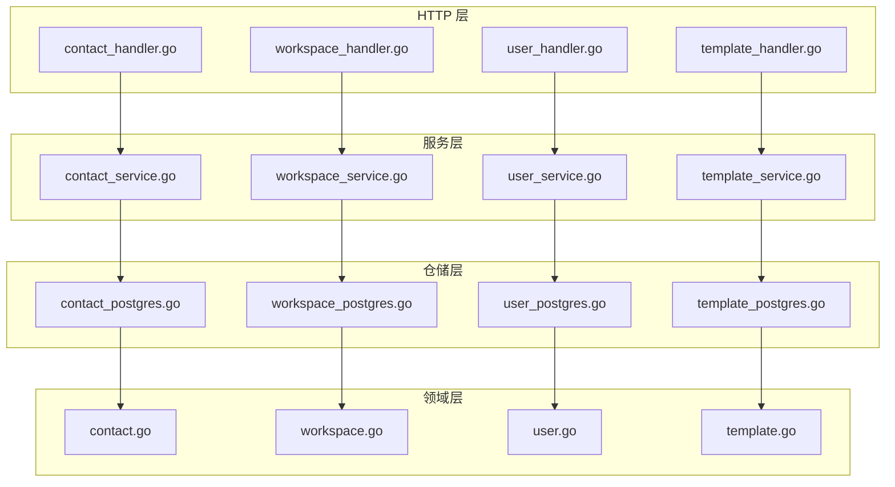
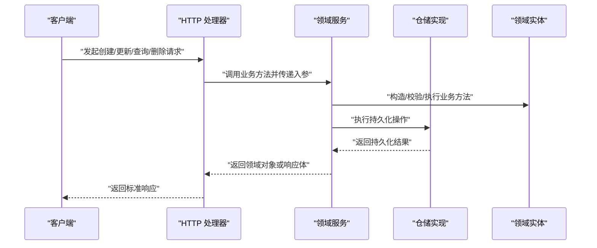
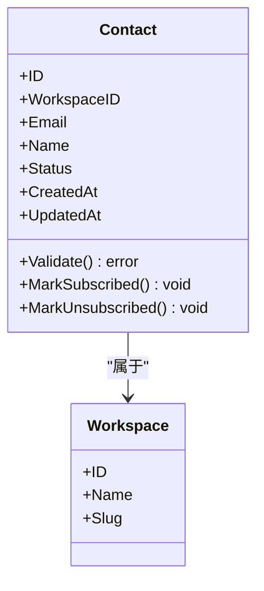
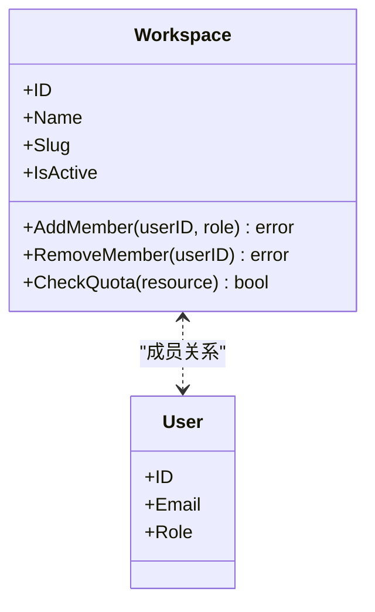
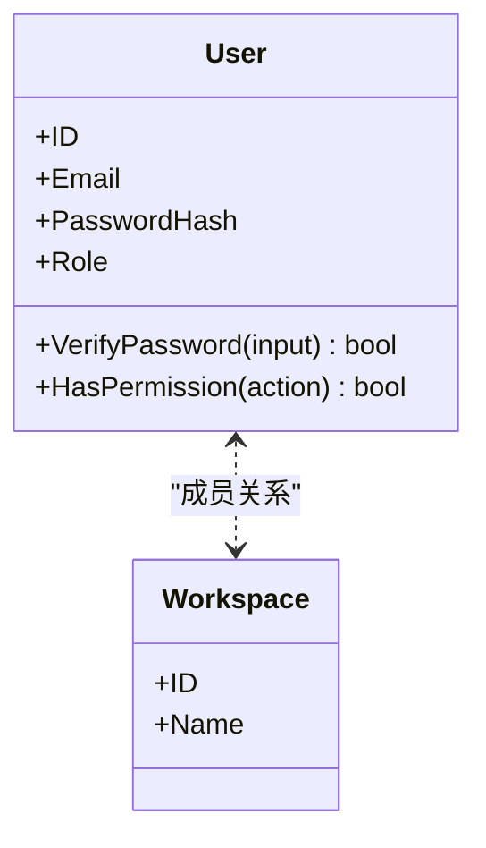
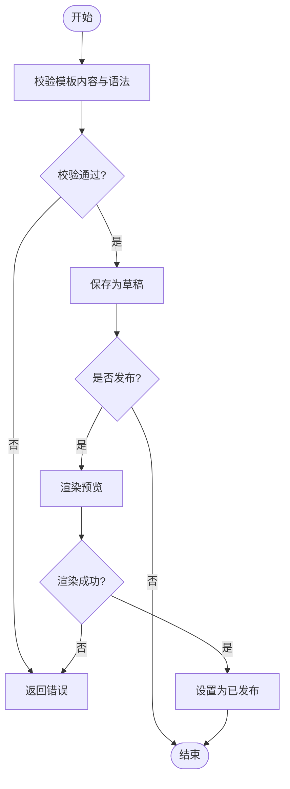
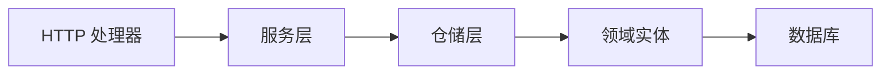

# 核心实体模型

<cite>
**本文引用的文件**   
- [contact.go](file://notifuse/internal/domain/contact.go)
- [workspace.go](file://notifuse/internal/domain/workspace.go)
- [user.go](file://notifuse/internal/domain/user.go)
- [template.go](file://notifuse/internal/domain/template.go)
- [contact_postgres.go](file://notifuse/internal/repository/contact_postgres.go)
- [workspace_postgres.go](file://notifuse/internal/repository/workspace_postgres.go)
- [user_postgres.go](file://notifuse/internal/repository/user_postgres.go)
- [template_postgres.go](file://notifuse/internal/repository/template_postgres.go)
- [contact_handler.go](file://notifuse/internal/http/contact_handler.go)
- [workspace_handler.go](file://notifuse/internal/http/workspace_handler.go)
- [user_handler.go](file://notifuse/internal/http/user_handler.go)
- [template_handler.go](file://notifuse/internal/http/template_handler.go)
- [contact_service.go](file://notifuse/internal/service/contact_service.go)
- [workspace_service.go](file://notifuse/internal/service/workspace_service.go)
- [user_service.go](file://notifuse/internal/service/user_service.go)
- [template_service.go](file://notifuse/internal/service/template_service.go)
</cite>

## 目录
1. [简介](#简介)
2. [项目结构](#项目结构)
3. [核心组件](#核心组件)
4. [架构总览](#架构总览)
5. [详细组件分析](#详细组件分析)
6. [依赖关系分析](#依赖关系分析)
7. [性能考虑](#性能考虑)
8. [故障排查指南](#故障排查指南)
9. [结论](#结论)
10. [附录](#附录)

## 简介
本文件聚焦 Notifuse 平台的核心领域实体：Contact（联系人）、Workspace（工作区）、User（用户）、Template（模板）。文档从设计模式、业务规则、属性与验证、生命周期管理、关系与约束、序列化/反序列化、数据库映射以及典型 CRUD 操作示例等维度进行系统化说明，帮助读者快速理解并正确使用这些实体。

## 项目结构
Notifuse 采用分层架构：HTTP 层处理请求路由与参数校验；Service 层封装业务逻辑；Repository 层负责数据持久化；Domain 层定义核心实体与领域方法。核心实体位于 domain 包，对应的持久化实现位于 repository 包，HTTP 处理器与服务分别位于 http 与 service 包。

图表来源
- [contact_handler.go](file://notifuse/internal/http/contact_handler.go)
- [workspace_handler.go](file://notifuse/internal/http/workspace_handler.go)
- [user_handler.go](file://notifuse/internal/http/user_handler.go)
- [template_handler.go](file://notifuse/internal/http/template_handler.go)
- [contact_service.go](file://notifuse/internal/service/contact_service.go)
- [workspace_service.go](file://notifuse/internal/service/workspace_service.go)
- [user_service.go](file://notifuse/internal/service/user_service.go)
- [template_service.go](file://notifuse/internal/service/template_service.go)
- [contact_postgres.go](file://notifuse/internal/repository/contact_postgres.go)
- [workspace_postgres.go](file://notifuse/internal/repository/workspace_postgres.go)
- [user_postgres.go](file://notifuse/internal/repository/user_postgres.go)
- [template_postgres.go](file://notifuse/internal/repository/template_postgres.go)
- [contact.go](file://notifuse/internal/domain/contact.go)
- [workspace.go](file://notifuse/internal/domain/workspace.go)
- [user.go](file://notifuse/internal/domain/user.go)
- [template.go](file://notifuse/internal/domain/template.go)

章节来源
- [contact.go](file://notifuse/internal/domain/contact.go)
- [workspace.go](file://notifuse/internal/domain/workspace.go)
- [user.go](file://notifuse/internal/domain/user.go)
- [template.go](file://notifuse/internal/domain/template.go)

## 核心组件
本节概述四个核心实体的职责与边界：
- Contact：代表订阅者或收件人，包含基础身份信息、标签、状态及所属工作区。
- Workspace：多租户隔离的基本单元，承载资源归属与权限上下文。
- User：系统用户，与工作区存在成员关系，具备认证与授权相关属性。
- Template：邮件模板，支持变量渲染与版本化管理，归属于特定工作区。

章节来源
- [contact.go](file://notifuse/internal/domain/contact.go)
- [workspace.go](file://notifuse/internal/domain/workspace.go)
- [user.go](file://notifuse/internal/domain/user.go)
- [template.go](file://notifuse/internal/domain/template.go)

## 架构总览
下图展示从 HTTP 请求到领域实体的完整调用链，体现分层解耦与职责分离。

图表来源
- [contact_handler.go](file://notifuse/internal/http/contact_handler.go)
- [workspace_handler.go](file://notifuse/internal/http/workspace_handler.go)
- [user_handler.go](file://notifuse/internal/http/user_handler.go)
- [template_handler.go](file://notifuse/internal/http/template_handler.go)
- [contact_service.go](file://notifuse/internal/service/contact_service.go)
- [workspace_service.go](file://notifuse/internal/service/workspace_service.go)
- [user_service.go](file://notifuse/internal/service/user_service.go)
- [template_service.go](file://notifuse/internal/service/template_service.go)
- [contact_postgres.go](file://notifuse/internal/repository/contact_postgres.go)
- [workspace_postgres.go](file://notifuse/internal/repository/workspace_postgres.go)
- [user_postgres.go](file://notifuse/internal/repository/user_postgres.go)
- [template_postgres.go](file://notifuse/internal/repository/template_postgres.go)
- [contact.go](file://notifuse/internal/domain/contact.go)
- [workspace.go](file://notifuse/internal/domain/workspace.go)
- [user.go](file://notifuse/internal/domain/user.go)
- [template.go](file://notifuse/internal/domain/template.go)

## 详细组件分析

### Contact（联系人）
- 属性与类型
  - 标识符：全局唯一 ID
  - 工作区关联：外键指向 Workspace
  - 基本信息：邮箱、姓名、自定义字段等
  - 状态与元数据：订阅状态、退订标记、时间戳等
- 验证规则
  - 邮箱格式校验
  - 必填字段非空校验
  - 长度与字符集限制
- 生命周期管理
  - 创建：生成唯一 ID、设置默认状态与时间戳
  - 更新：增量更新允许字段，保留审计字段
  - 软删除：通过状态标记而非物理删除
- 关系与约束
  - 与 Workspace 为多对一关系
  - 与列表、细分、事件等存在一对多关系（由其他实体引用）
- 序列化和反序列化
  - JSON 标签用于 API 输入输出
  - 数据库映射使用结构体标签与仓库层转换
- 业务方法
  - 状态变更：如订阅/退订
  - 有效性检查：邮箱合法性、去重策略
- 典型 CRUD 示例路径
  - 创建：[contact_handler.go](file://notifuse/internal/http/contact_handler.go)、[contact_service.go](file://notifuse/internal/service/contact_service.go)、[contact_postgres.go](file://notifuse/internal/repository/contact_postgres.go)
  - 更新：同上
  - 查询：同上
  - 删除：同上

图表来源
- [contact.go](file://notifuse/internal/domain/contact.go)
- [workspace.go](file://notifuse/internal/domain/workspace.go)

章节来源
- [contact.go](file://notifuse/internal/domain/contact.go)
- [contact_handler.go](file://notifuse/internal/http/contact_handler.go)
- [contact_service.go](file://notifuse/internal/service/contact_service.go)
- [contact_postgres.go](file://notifuse/internal/repository/contact_postgres.go)

### Workspace（工作区）
- 属性与类型
  - 标识符：全局唯一 ID
  - 名称与标识：显示名、URL 友好 slug
  - 配置与状态：主题、限额、启用/禁用标志
- 验证规则
  - 名称与 slug 唯一性
  - 长度与字符集限制
- 生命周期管理
  - 创建：初始化默认配置与审计字段
  - 更新：仅允许安全字段更新
  - 删除：级联清理或软删除策略
- 关系与约束
  - 与 User 为多对多（成员关系）
  - 与 Contact、Template 等为多对一（被多个子资源引用）
- 序列化和反序列化
  - JSON 标签用于 API 交互
  - 数据库映射在仓库层完成
- 业务方法
  - 成员管理：添加/移除成员、角色分配
  - 配额检查：资源用量与上限控制
- 典型 CRUD 示例路径
  - 创建：[workspace_handler.go](file://notifuse/internal/http/workspace_handler.go)、[workspace_service.go](file://notifuse/internal/service/workspace_service.go)、[workspace_postgres.go](file://notifuse/internal/repository/workspace_postgres.go)
  - 更新：同上
  - 查询：同上
  - 删除：同上

图表来源
- [workspace.go](file://notifuse/internal/domain/workspace.go)
- [user.go](file://notifuse/internal/domain/user.go)

章节来源
- [workspace.go](file://notifuse/internal/domain/workspace.go)
- [workspace_handler.go](file://notifuse/internal/http/workspace_handler.go)
- [workspace_service.go](file://notifuse/internal/service/workspace_service.go)
- [workspace_postgres.go](file://notifuse/internal/repository/workspace_postgres.go)

### User（用户）
- 属性与类型
  - 标识符：全局唯一 ID
  - 认证信息：邮箱、密码哈希、第三方身份绑定
  - 角色与权限：管理员、编辑者、观察者等
- 验证规则
  - 邮箱唯一性与格式校验
  - 密码强度与加密存储
- 生命周期管理
  - 注册：创建用户并初始化默认工作区或邀请流程
  - 更新：修改个人信息与偏好
  - 注销：软删除或禁用账户
- 关系与约束
  - 与 Workspace 的多对多成员关系
  - 与审计日志、通知中心等存在一对多关系
- 序列化和反序列化
  - 敏感字段在 API 输出中脱敏
  - 数据库映射在仓库层处理
- 业务方法
  - 认证辅助：密码校验、令牌签发
  - 权限判断：基于角色的访问控制
- 典型 CRUD 示例路径
  - 创建：[user_handler.go](file://notifuse/internal/http/user_handler.go)、[user_service.go](file://notifuse/internal/service/user_service.go)、[user_postgres.go](file://notifuse/internal/repository/user_postgres.go)
  - 更新：同上
  - 查询：同上
  - 删除：同上

图表来源
- [user.go](file://notifuse/internal/domain/user.go)
- [workspace.go](file://notifuse/internal/domain/workspace.go)

章节来源
- [user.go](file://notifuse/internal/domain/user.go)
- [user_handler.go](file://notifuse/internal/http/user_handler.go)
- [user_service.go](file://notifuse/internal/service/user_service.go)
- [user_postgres.go](file://notifuse/internal/repository/user_postgres.go)

### Template（模板）
- 属性与类型
  - 标识符：全局唯一 ID
  - 归属：工作区 ID
  - 内容：HTML/文本主体、变量占位符、语言与主题
  - 版本与状态：草稿、已发布、归档
- 验证规则
  - 模板语法校验（变量、条件、循环）
  - 必填字段与大小限制
- 生命周期管理
  - 创建：新建草稿模板
  - 发布：校验后切换为已发布状态
  - 回滚：支持版本回溯
- 关系与约束
  - 与 Workspace 为多对一
  - 与自动化、广播等发送场景存在引用关系
- 序列化和反序列化
  - JSON 标签用于 API 传输
  - 数据库映射在仓库层完成
- 业务方法
  - 渲染：结合上下文数据生成最终内容
  - 预览：沙箱渲染避免副作用
- 典型 CRUD 示例路径
  - 创建：[template_handler.go](file://notifuse/internal/http/template_handler.go)、[template_service.go](file://notifuse/internal/service/template_service.go)、[template_postgres.go](file://notifuse/internal/repository/template_postgres.go)
  - 更新：同上
  - 查询：同上
  - 删除：同上

图表来源
- [template.go](file://notifuse/internal/domain/template.go)
- [template_handler.go](file://notifuse/internal/http/template_handler.go)
- [template_service.go](file://notifuse/internal/service/template_service.go)
- [template_postgres.go](file://notifuse/internal/repository/template_postgres.go)

章节来源
- [template.go](file://notifuse/internal/domain/template.go)
- [template_handler.go](file://notifuse/internal/http/template_handler.go)
- [template_service.go](file://notifuse/internal/service/template_service.go)
- [template_postgres.go](file://notifuse/internal/repository/template_postgres.go)

## 依赖关系分析
- 耦合与内聚
  - 领域实体低耦合，依赖注入通过服务层与仓储接口实现
  - 仓储实现与数据库细节解耦，便于替换与测试
- 直接/间接依赖
  - HTTP 处理器依赖服务；服务依赖仓储；仓储依赖领域实体
  - 跨实体关系通过外键与业务方法维护一致性
- 外部依赖与集成点
  - 邮件发送、第三方身份提供商、缓存与消息队列等由服务层集成
- 接口契约与实现细节
  - 服务层暴露领域方法；仓储层提供持久化契约；领域层定义不变式与行为

图表来源
- [contact_handler.go](file://notifuse/internal/http/contact_handler.go)
- [workspace_handler.go](file://notifuse/internal/http/workspace_handler.go)
- [user_handler.go](file://notifuse/internal/http/user_handler.go)
- [template_handler.go](file://notifuse/internal/http/template_handler.go)
- [contact_service.go](file://notifuse/internal/service/contact_service.go)
- [workspace_service.go](file://notifuse/internal/service/workspace_service.go)
- [user_service.go](file://notifuse/internal/service/user_service.go)
- [template_service.go](file://notifuse/internal/service/template_service.go)
- [contact_postgres.go](file://notifuse/internal/repository/contact_postgres.go)
- [workspace_postgres.go](file://notifuse/internal/repository/workspace_postgres.go)
- [user_postgres.go](file://notifuse/internal/repository/user_postgres.go)
- [template_postgres.go](file://notifuse/internal/repository/template_postgres.go)
- [contact.go](file://notifuse/internal/domain/contact.go)
- [workspace.go](file://notifuse/internal/domain/workspace.go)
- [user.go](file://notifuse/internal/domain/user.go)
- [template.go](file://notifuse/internal/domain/template.go)

章节来源
- [contact.go](file://notifuse/internal/domain/contact.go)
- [workspace.go](file://notifuse/internal/domain/workspace.go)
- [user.go](file://notifuse/internal/domain/user.go)
- [template.go](file://notifuse/internal/domain/template.go)

## 性能考虑
- 索引与查询优化
  - 针对常用查询字段建立复合索引（如工作区 ID+邮箱）
  - 分页与游标查询避免全表扫描
- 事务与并发
  - 关键写操作使用事务保证一致性
  - 合理加锁避免竞态条件（如去重与配额检查）
- 缓存策略
  - 热点数据（如模板、工作区配置）可引入缓存层
- 批量操作
  - 大批量导入联系人时使用批量插入与分批提交

## 故障排查指南
- 常见错误
  - 唯一性冲突：邮箱或 slug 重复
  - 校验失败：字段格式或长度不合法
  - 权限不足：角色或成员关系缺失
- 定位步骤
  - 检查 HTTP 响应码与错误消息
  - 查看服务层日志与仓储层 SQL 执行计划
  - 确认数据库约束与索引状态
- 恢复建议
  - 回滚事务并修正输入
  - 清理脏数据并重建索引
  - 调整配额与权限配置

章节来源
- [contact_handler.go](file://notifuse/internal/http/contact_handler.go)
- [workspace_handler.go](file://notifuse/internal/http/workspace_handler.go)
- [user_handler.go](file://notifuse/internal/http/user_handler.go)
- [template_handler.go](file://notifuse/internal/http/template_handler.go)
- [contact_service.go](file://notifuse/internal/service/contact_service.go)
- [workspace_service.go](file://notifuse/internal/service/workspace_service.go)
- [user_service.go](file://notifuse/internal/service/user_service.go)
- [template_service.go](file://notifuse/internal/service/template_service.go)

## 结论
通过对 Contact、Workspace、User、Template 四大核心实体的深入分析，明确了其属性定义、验证规则、生命周期、关系约束、序列化机制与数据库映射。分层架构确保了高内聚低耦合，服务层与仓储层共同保障业务一致性与可扩展性。遵循本文档的最佳实践与排障建议，可有效提升系统的稳定性与可维护性。

## 附录
- 术语
  - 工作区：多租户隔离的资源边界
  - 联系人：订阅者或收件人的抽象
  - 模板：可渲染的邮件内容定义
  - 用户：系统使用者及其权限集合
- 参考路径
  - 领域实体：domain 包下的对应文件
  - 仓储实现：repository 包下的 *_postgres.go
  - 服务层：service 包下的 *_service.go
  - HTTP 处理器：http 包下的 *_handler.go