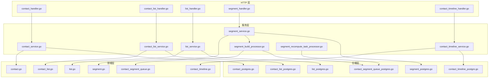
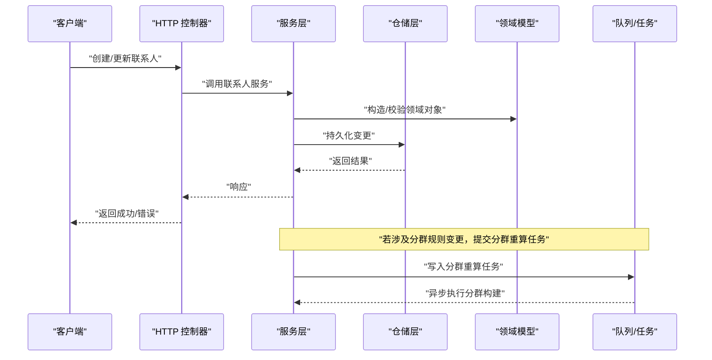
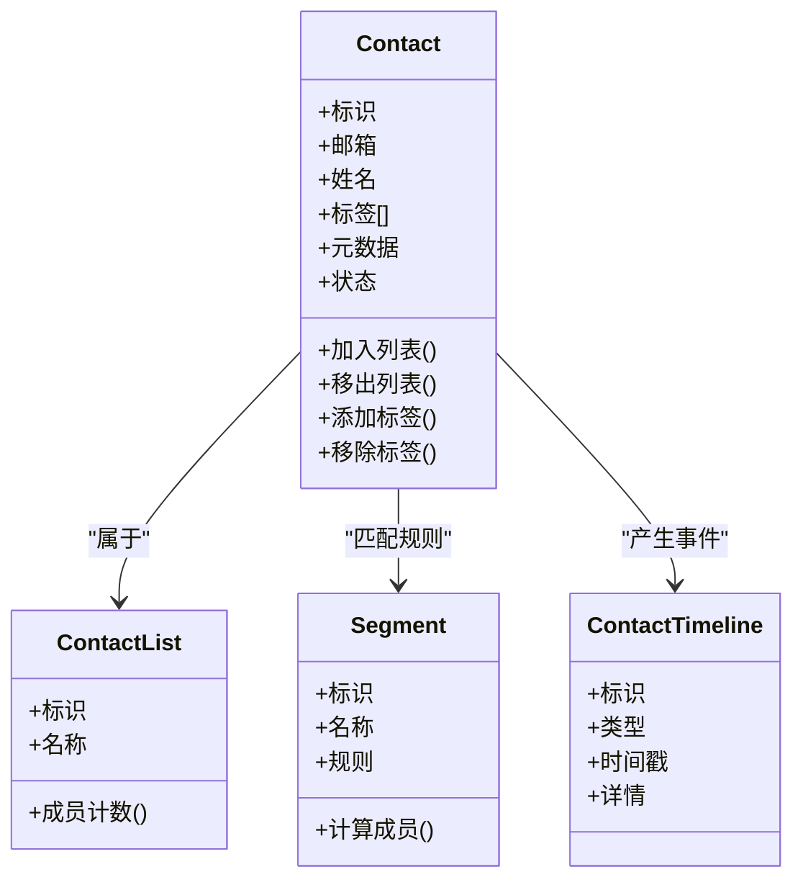
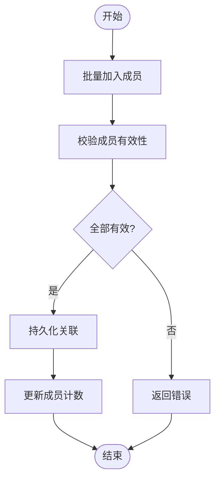
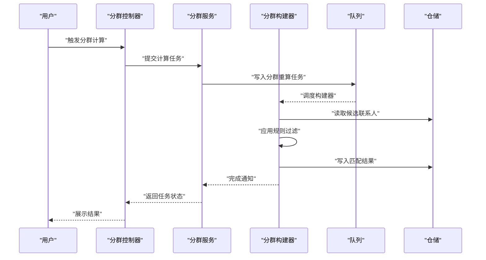
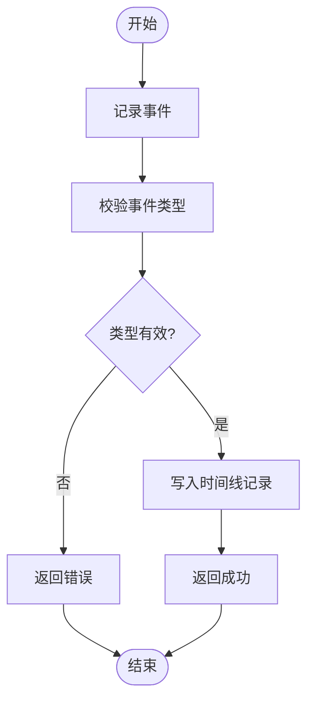
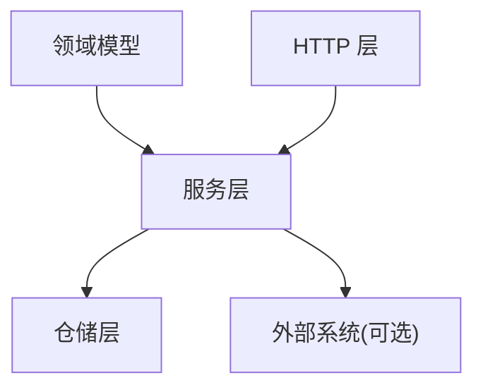

# 联系人管理模型

<cite>
**本文引用的文件**   
- [contact.go](file://notifuse/internal/domain/contact.go)
- [contact_list.go](file://notifuse/internal/domain/contact_list.go)
- [list.go](file://notifuse/internal/domain/list.go)
- [segment.go](file://notifuse/internal/domain/segment.go)
- [contact_timeline.go](file://notifuse/internal/domain/contact_timeline.go)
- [contact_segment_queue.go](file://notifuse/internal/domain/contact_segment_queue.go)
- [contact_postgres.go](file://notifuse/internal/repository/contact_postgres.go)
- [contact_list_postgres.go](file://notifuse/internal/repository/contact_list_postgres.go)
- [list_postgres.go](file://notifuse/internal/repository/list_postgres.go)
- [segment_postgres.go](file://notifuse/internal/repository/segment_postgres.go)
- [contact_timeline_postgre.go](file://notifuse/internal/repository/contact_timeline_postgre.go)
- [contact_segment_queue_postgres.go](file://notifuse/internal/repository/contact_segment_queue_postgres.go)
- [contact_service.go](file://notifuse/internal/service/contact_service.go)
- [contact_list_service.go](file://notifuse/internal/service/contact_list_service.go)
- [list_service.go](file://notifuse/internal/service/list_service.go)
- [segment_service.go](file://notifuse/internal/service/segment_service.go)
- [contact_timeline_service.go](file://notifuse/internal/service/contact_timeline_service.go)
- [segment_build_processor.go](file://notifuse/internal/service/segment_build_processor.go)
- [segment_recompute_task_processor.go](file://notifuse/internal/service/segment_recompute_task_processor.go)
- [contact_handler.go](file://notifuse/internal/http/contact_handler.go)
- [contact_list_handler.go](file://notifuse/internal/http/contact_list_handler.go)
- [list_handler.go](file://notifuse/internal/http/list_handler.go)
- [segment_handler.go](file://notifuse/internal/http/segment_handler.go)
- [contact_timeline_handler.go](file://notifuse/internal/http/contact_timeline_handler.go)
</cite>

## 目录
1. [简介](#简介)
2. [项目结构](#项目结构)
3. [核心组件](#核心组件)
4. [架构总览](#架构总览)
5. [详细组件分析](#详细组件分析)
6. [依赖关系分析](#依赖关系分析)
7. [性能考量](#性能考量)
8. [故障排查指南](#故障排查指南)
9. [结论](#结论)
10. [附录](#附录)

## 简介
本文件聚焦于 Notifuse 平台的“联系人管理”领域模型，围绕 ContactList（联系人列表）、List（列表）、Segment（分群）、ContactTimeline（联系人时间线）等实体进行系统化文档化。内容涵盖：
- 实体设计与职责边界
- 分组管理机制与动态分群规则
- 标签系统与分类方法
- 行为追踪与时间线记录机制
- 批量操作、分群计算、时间线查询的实现要点
- 数据导入导出与同步机制

## 项目结构
联系人管理相关代码采用分层组织：
- 领域层 domain：定义实体、值对象、领域事件与规则
- 仓储层 repository：持久化实现（PostgreSQL）
- 服务层 service：编排业务逻辑、跨聚合协调
- HTTP 层 http：对外暴露 API 接口

图表来源
- [contact_handler.go](file://notifuse/internal/http/contact_handler.go)
- [contact_list_handler.go](file://notifuse/internal/http/contact_list_handler.go)
- [list_handler.go](file://notifuse/internal/http/list_handler.go)
- [segment_handler.go](file://notifuse/internal/http/segment_handler.go)
- [contact_timeline_handler.go](file://notifuse/internal/http/contact_timeline_handler.go)
- [contact_service.go](file://notifuse/internal/service/contact_service.go)
- [contact_list_service.go](file://notifuse/internal/service/contact_list_service.go)
- [list_service.go](file://notifuse/internal/service/list_service.go)
- [segment_service.go](file://notifuse/internal/service/segment_service.go)
- [contact_timeline_service.go](file://notifuse/internal/service/contact_timeline_service.go)
- [segment_build_processor.go](file://notifuse/internal/service/segment_build_processor.go)
- [segment_recompute_task_processor.go](file://notifuse/internal/service/segment_recompute_task_processor.go)
- [contact_postgres.go](file://notifuse/internal/repository/contact_postgres.go)
- [contact_list_postgres.go](file://notifuse/internal/repository/contact_list_postgres.go)
- [list_postgres.go](file://notifuse/internal/repository/list_postgres.go)
- [segment_postgres.go](file://notifuse/internal/repository/segment_postgres.go)
- [contact_timeline_postgre.go](file://notifuse/internal/repository/contact_timeline_postgre.go)
- [contact_segment_queue_postgres.go](file://notifuse/internal/repository/contact_segment_queue_postgres.go)
- [contact.go](file://notifuse/internal/domain/contact.go)
- [contact_list.go](file://notifuse/internal/domain/contact_list.go)
- [list.go](file://notifuse/internal/domain/list.go)
- [segment.go](file://notifuse/internal/domain/segment.go)
- [contact_timeline.go](file://notifuse/internal/domain/contact_timeline.go)
- [contact_segment_queue.go](file://notifuse/internal/domain/contact_segment_queue.go)

章节来源
- [contact_handler.go](file://notifuse/internal/http/contact_handler.go)
- [contact_service.go](file://notifuse/internal/service/contact_service.go)
- [contact_postgres.go](file://notifuse/internal/repository/contact_postgres.go)
- [contact.go](file://notifuse/internal/domain/contact.go)

## 核心组件
本节概述联系人管理的关键实体与职责：
- Contact（联系人）：基础属性、标签、元数据、状态
- ContactList（联系人列表）：静态集合，用于将联系人归入固定分组
- List（列表）：通用列表抽象，可承载多种用途的集合
- Segment（分群）：基于规则的动态集合，支持条件表达式与增量重算
- ContactTimeline（联系人时间线）：按时间顺序记录联系人的关键行为与事件

这些实体通过服务层组合使用，由 HTTP 层暴露 API，并由仓储层完成持久化。

章节来源
- [contact.go](file://notifuse/internal/domain/contact.go)
- [contact_list.go](file://notifuse/internal/domain/contact_list.go)
- [list.go](file://notifuse/internal/domain/list.go)
- [segment.go](file://notifuse/internal/domain/segment.go)
- [contact_timeline.go](file://notifuse/internal/domain/contact_timeline.go)

## 架构总览
联系人管理的请求处理链路如下：
- HTTP 控制器接收请求并调用对应服务
- 服务层执行领域逻辑，必要时触发分群重算或写入时间线
- 仓储层负责与数据库交互，读写实体数据
- 分群构建器与任务处理器异步处理大规模分群计算

图表来源
- [contact_handler.go](file://notifuse/internal/http/contact_handler.go)
- [contact_service.go](file://notifuse/internal/service/contact_service.go)
- [contact_postgres.go](file://notifuse/internal/repository/contact_postgres.go)
- [contact.go](file://notifuse/internal/domain/contact.go)
- [segment_build_processor.go](file://notifuse/internal/service/segment_build_processor.go)
- [contact_segment_queue_postgres.go](file://notifuse/internal/repository/contact_segment_queue_postgres.go)

## 详细组件分析

### 联系人（Contact）
- 职责：维护联系人的基本信息、标签、自定义字段、状态与归属
- 关联：
  - 属于一个或多个 ContactList（静态分组）
  - 可能属于多个 Segment（动态分组）
  - 产生多条 ContactTimeline 记录（行为追踪）
- 典型操作：
  - 创建/更新/删除
  - 批量导入/导出
  - 标签增删改查
  - 加入/移出列表
  - 触发分群重算

图表来源
- [contact.go](file://notifuse/internal/domain/contact.go)
- [contact_list.go](file://notifuse/internal/domain/contact_list.go)
- [segment.go](file://notifuse/internal/domain/segment.go)
- [contact_timeline.go](file://notifuse/internal/domain/contact_timeline.go)

章节来源
- [contact.go](file://notifuse/internal/domain/contact.go)
- [contact_service.go](file://notifuse/internal/service/contact_service.go)
- [contact_postgres.go](file://notifuse/internal/repository/contact_postgres.go)

### 联系人列表（ContactList）
- 职责：提供静态分组能力，便于将联系人归入固定集合
- 特性：
  - 支持批量加入/移出
  - 统计成员数量
  - 与联系人双向关联
- 适用场景：
  - 运营活动受众
  - 区域/渠道划分
  - 临时分组

图表来源
- [contact_list_service.go](file://notifuse/internal/service/contact_list_service.go)
- [contact_list_postgres.go](file://notifuse/internal/repository/contact_list_postgres.go)
- [contact_list.go](file://notifuse/internal/domain/contact_list.go)

章节来源
- [contact_list.go](file://notifuse/internal/domain/contact_list.go)
- [contact_list_service.go](file://notifuse/internal/service/contact_list_service.go)
- [contact_list_postgres.go](file://notifuse/internal/repository/contact_list_postgres.go)

### 列表（List）
- 职责：通用列表抽象，承载不同业务场景下的集合语义
- 特性：
  - 与 ContactList 类似但更通用
  - 可承载不同资源类型的成员
- 适用场景：
  - 模板集
  - 工作流节点集合
  - 其他资源分组

章节来源
- [list.go](file://notifuse/internal/domain/list.go)
- [list_service.go](file://notifuse/internal/service/list_service.go)
- [list_postgres.go](file://notifuse/internal/repository/list_postgres.go)

### 分群（Segment）
- 职责：基于规则动态计算联系人集合
- 规则要素：
  - 条件表达式（如标签包含、字段匹配、时间范围等）
  - 布尔组合（与/或/非）
  - 可扩展的条件类型
- 计算流程：
  - 触发重算（手动或自动）
  - 生成任务并异步执行
  - 增量更新匹配结果
- 性能优化：
  - 索引策略（标签、字段、时间戳）
  - 分批扫描与游标推进
  - 缓存中间结果

图表来源
- [segment_handler.go](file://notifuse/internal/http/segment_handler.go)
- [segment_service.go](file://notifuse/internal/service/segment_service.go)
- [segment_build_processor.go](file://notifuse/internal/service/segment_build_processor.go)
- [segment_postgres.go](file://notifuse/internal/repository/segment_postgres.go)
- [contact_segment_queue_postgres.go](file://notifuse/internal/repository/contact_segment_queue_postgres.go)

章节来源
- [segment.go](file://notifuse/internal/domain/segment.go)
- [segment_service.go](file://notifuse/internal/service/segment_service.go)
- [segment_build_processor.go](file://notifuse/internal/service/segment_build_processor.go)
- [segment_postgres.go](file://notifuse/internal/repository/segment_postgres.go)

### 联系人时间线（ContactTimeline）
- 职责：记录联系人的关键行为与事件，形成可追溯的时间序列
- 事件类型示例：
  - 订阅/退订
  - 打开/点击
  - 发送/投递失败
  - 自定义事件
- 查询方式：
  - 按联系人 ID 分页查询
  - 按事件类型筛选
  - 按时间范围过滤

图表来源
- [contact_timeline_service.go](file://notifuse/internal/service/contact_timeline_service.go)
- [contact_timeline_postgre.go](file://notifuse/internal/repository/contact_timeline_postgre.go)
- [contact_timeline.go](file://notifuse/internal/domain/contact_timeline.go)

章节来源
- [contact_timeline.go](file://notifuse/internal/domain/contact_timeline.go)
- [contact_timeline_service.go](file://notifuse/internal/service/contact_timeline_service.go)
- [contact_timeline_postgre.go](file://notifuse/internal/repository/contact_timeline_postgre.go)

### 标签系统与分类方法
- 标签设计：
  - 扁平键值对或层级键
  - 支持批量增删改
  - 与分群规则联动（作为条件之一）
- 分类方法：
  - 静态分类：通过 ContactList 固定分组
  - 动态分类：通过 Segment 规则实时计算
  - 混合分类：结合两者满足复杂场景

章节来源
- [contact.go](file://notifuse/internal/domain/contact.go)
- [segment.go](file://notifuse/internal/domain/segment.go)
- [contact_list.go](file://notifuse/internal/domain/contact_list.go)

### 批量操作与导入导出
- 批量操作：
  - 批量加入/移出列表
  - 批量更新标签
  - 批量触发分群重算
- 导入导出：
  - CSV/JSON 格式
  - 去重与冲突策略
  - 事务性写入与回滚

章节来源
- [contact_service.go](file://notifuse/internal/service/contact_service.go)
- [contact_postgres.go](file://notifuse/internal/repository/contact_postgres.go)
- [contact_list_service.go](file://notifuse/internal/service/contact_list_service.go)

### 同步机制
- 外部系统集成：
  - 通过 Webhook 或 API 同步联系人
  - 增量同步与全量覆盖策略
- 内部一致性：
  - 事件驱动的分群重算
  - 任务队列保障最终一致性

章节来源
- [segment_recompute_task_processor.go](file://notifuse/internal/service/segment_recompute_task_processor.go)
- [contact_segment_queue_postgres.go](file://notifuse/internal/repository/contact_segment_queue_postgres.go)

## 依赖关系分析
- 低耦合高内聚：
  - 领域模型独立于存储与传输细节
  - 服务层编排领域与仓储
  - HTTP 层仅负责协议转换
- 潜在循环依赖：
  - 避免服务层直接引用 HTTP 层
  - 仓储层不依赖服务层
- 外部依赖：
  - PostgreSQL 持久化
  - 任务队列（可选）用于异步分群计算

图表来源
- [contact_service.go](file://notifuse/internal/service/contact_service.go)
- [contact_postgres.go](file://notifuse/internal/repository/contact_postgres.go)
- [contact_handler.go](file://notifuse/internal/http/contact_handler.go)

章节来源
- [contact_service.go](file://notifuse/internal/service/contact_service.go)
- [contact_postgres.go](file://notifuse/internal/repository/contact_postgres.go)
- [contact_handler.go](file://notifuse/internal/http/contact_handler.go)

## 性能考量
- 分群计算：
  - 使用索引加速条件匹配
  - 分批处理大集合，避免长事务
  - 增量重算减少重复计算
- 时间线写入：
  - 批量写入与合并
  - 分区表或归档策略
- 导入导出：
  - 流式处理大文件
  - 并发控制与限流

[本节为通用指导，无需特定文件来源]

## 故障排查指南
- 常见问题：
  - 分群计算超时：检查规则复杂度与索引
  - 时间线缺失：确认事件记录是否落库
  - 导入失败：核对字段映射与约束
- 定位手段：
  - 查看任务队列状态
  - 检查仓储层日志
  - 验证领域模型不变式

章节来源
- [segment_build_processor.go](file://notifuse/internal/service/segment_build_processor.go)
- [contact_timeline_service.go](file://notifuse/internal/service/contact_timeline_service.go)
- [contact_postgres.go](file://notifuse/internal/repository/contact_postgres.go)

## 结论
Notifuse 的联系人管理模型以清晰的领域分层为基础，结合静态列表与动态分群，提供了灵活的分组管理能力；时间线机制保障了行为可追溯；服务层与仓储层的解耦提升了可维护性与扩展性。通过合理的索引与异步任务，系统在大规模数据下仍保持良好性能。

[本节为总结，无需特定文件来源]

## 附录
- 示例路径（不含具体代码）：
  - 批量加入联系人到列表：[contact_list_service.go](file://notifuse/internal/service/contact_list_service.go)
  - 分群规则计算入口：[segment_build_processor.go](file://notifuse/internal/service/segment_build_processor.go)
  - 时间线查询接口：[contact_timeline_service.go](file://notifuse/internal/service/contact_timeline_service.go)
  - 联系人导入导出：[contact_service.go](file://notifuse/internal/service/contact_service.go)

[本节为参考路径，无需特定文件来源]