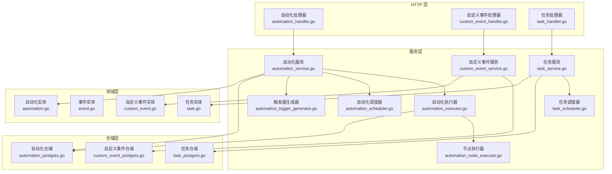
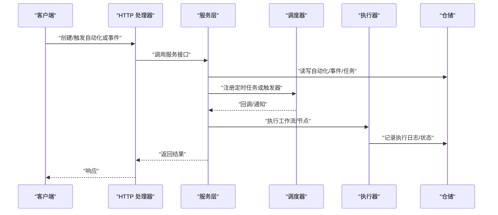
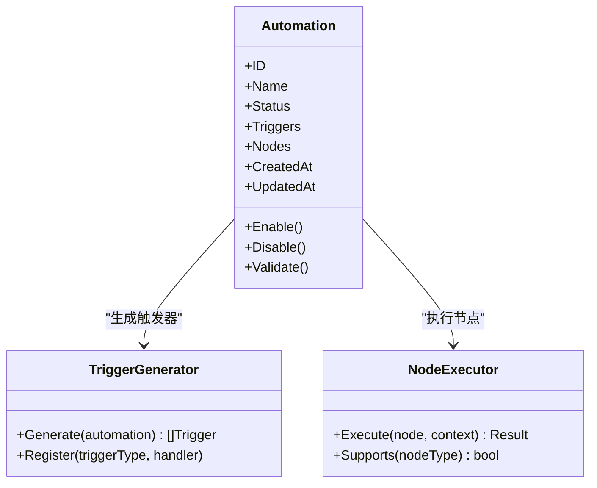
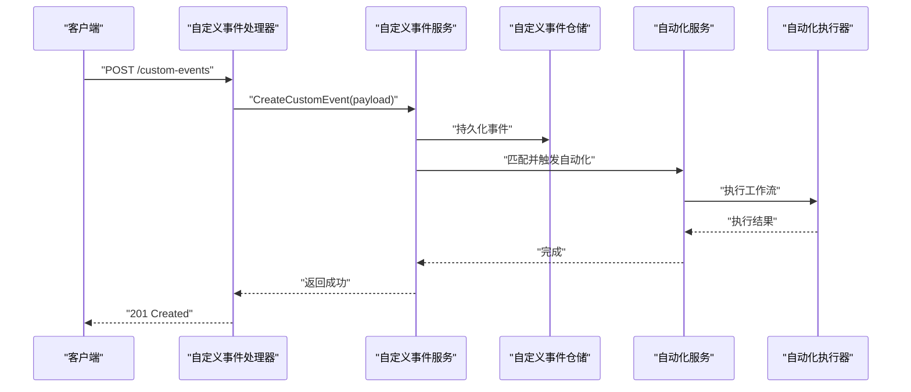
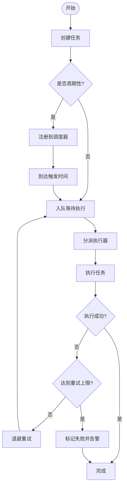
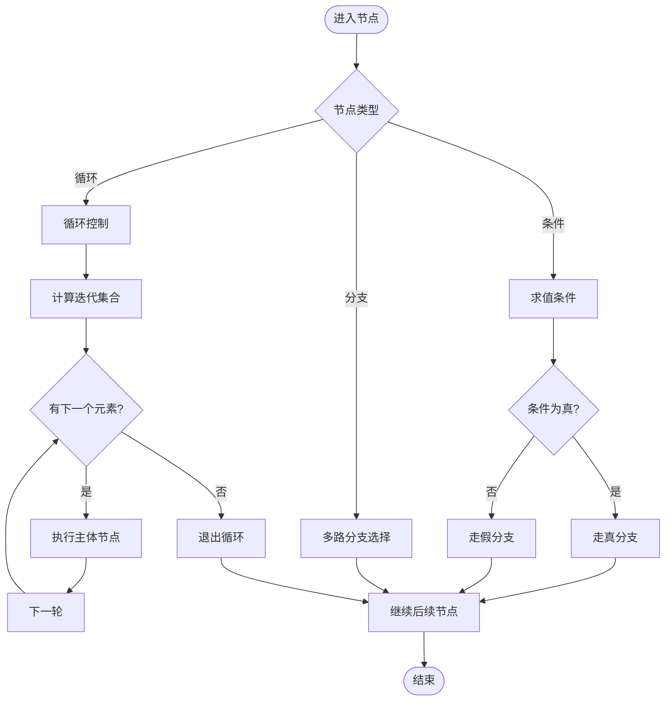
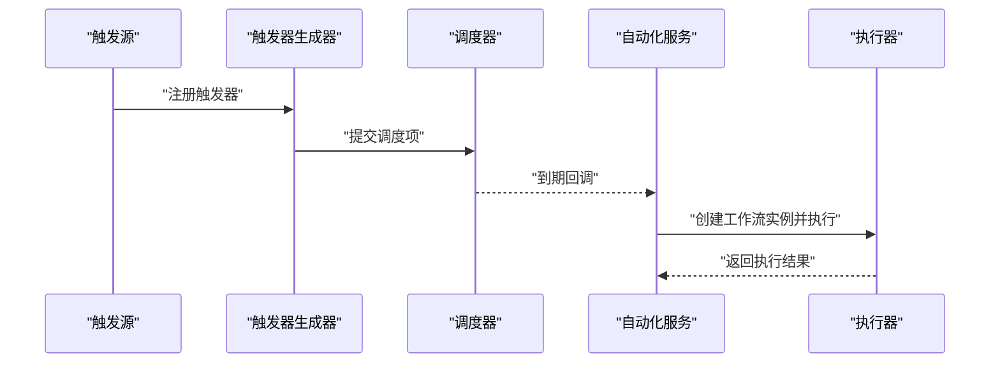
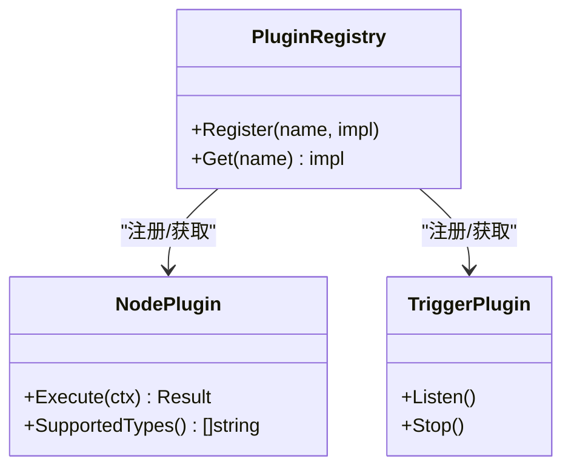
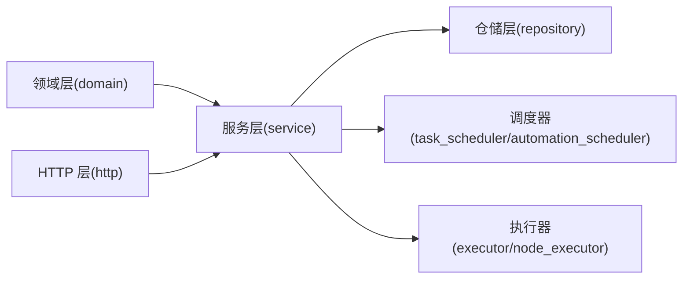

# 自动化领域模型

<cite>
**本文引用的文件**   
- [automation.go](file://notifuse/internal/domain/automation.go)
- [event.go](file://notifuse/internal/domain/event.go)
- [custom_event.go](file://notifuse/internal/domain/custom_event.go)
- [task.go](file://notifuse/internal/domain/task.go)
- [automation_service.go](file://notifuse/internal/service/automation_service.go)
- [automation_executor.go](file://notifuse/internal/service/automation_executor.go)
- [automation_node_executor.go](file://notifuse/internal/service/automation_node_executor.go)
- [automation_scheduler.go](file://notifuse/internal/service/automation_scheduler.go)
- [automation_trigger_generator.go](file://notifuse/internal/service/automation_trigger_generator.go)
- [task_service.go](file://notifuse/internal/service/task_service.go)
- [task_scheduler.go](file://notifuse/internal/service/task_scheduler.go)
- [custom_event_service.go](file://notifuse/internal/service/custom_event_service.go)
- [automation_handler.go](file://notifuse/internal/http/automation_handler.go)
- [custom_event_handler.go](file://notifuse/internal/http/custom_event_handler.go)
- [task_handler.go](file://notifuse/internal/http/task_handler.go)
- [automation_postgres.go](file://notifuse/internal/repository/automation_postgres.go)
- [custom_event_postgres.go](file://notifuse/internal/repository/custom_event_postgres.go)
- [task_postgres.go](file://notifuse/internal/repository/task_postgres.go)
</cite>

## 目录
1. [简介](#简介)
2. [项目结构](#项目结构)
3. [核心组件](#核心组件)
4. [架构总览](#架构总览)
5. [详细组件分析](#详细组件分析)
6. [依赖关系分析](#依赖关系分析)
7. [性能考虑](#性能考虑)
8. [故障排查指南](#故障排查指南)
9. [结论](#结论)
10. [附录](#附录)

## 简介
本文件面向 Notifuse 平台的“自动化”领域，系统化梳理并文档化以下实体与流程：
- 自动化工作流（Automation）
- 事件（Event）
- 任务（Task）
- 自定义事件（CustomEvent）

重点覆盖：
- 自动化工作流的触发机制、执行引擎、条件判断、分支逻辑与循环控制
- 事件的创建、订阅与处理机制
- 任务的调度、执行与监控方法
- 扩展点与插件机制的设计思路
- 结合代码路径的示例说明（不直接粘贴源码）

## 项目结构
自动化相关代码主要分布在以下层次：
- 领域层（domain）：定义实体与领域行为
- 服务层（service）：编排业务逻辑、调度与执行
- HTTP 层（http）：对外暴露 API
- 仓储层（repository）：持久化实现（PostgreSQL）

图表来源
- [automation_handler.go:1-200](file://notifuse/internal/http/automation_handler.go#L1-L200)
- [custom_event_handler.go:1-200](file://notifuse/internal/http/custom_event_handler.go#L1-L200)
- [task_handler.go:1-200](file://notifuse/internal/http/task_handler.go#L1-L200)
- [automation_service.go:1-200](file://notifuse/internal/service/automation_service.go#L1-L200)
- [automation_executor.go:1-200](file://notifuse/internal/service/automation_executor.go#L1-L200)
- [automation_node_executor.go:1-200](file://notifuse/internal/service/automation_node_executor.go#L1-L200)
- [automation_scheduler.go:1-200](file://notifuse/internal/service/automation_scheduler.go#L1-L200)
- [automation_trigger_generator.go:1-200](file://notifuse/internal/service/automation_trigger_generator.go#L1-L200)
- [task_service.go:1-200](file://notifuse/internal/service/task_service.go#L1-L200)
- [task_scheduler.go:1-200](file://notifuse/internal/service/task_scheduler.go#L1-L200)
- [custom_event_service.go:1-200](file://notifuse/internal/service/custom_event_service.go#L1-L200)
- [automation_postgres.go:1-200](file://notifuse/internal/repository/automation_postgres.go#L1-L200)
- [custom_event_postgres.go:1-200](file://notifuse/internal/repository/custom_event_postgres.go#L1-L200)
- [task_postgres.go:1-200](file://notifuse/internal/repository/task_postgres.go#L1-L200)

章节来源
- [automation_handler.go:1-200](file://notifuse/internal/http/automation_handler.go#L1-L200)
- [custom_event_handler.go:1-200](file://notifuse/internal/http/custom_event_handler.go#L1-L200)
- [task_handler.go:1-200](file://notifuse/internal/http/task_handler.go#L1-L200)
- [automation_service.go:1-200](file://notifuse/internal/service/automation_service.go#L1-L200)
- [automation_executor.go:1-200](file://notifuse/internal/service/automation_executor.go#L1-L200)
- [automation_node_executor.go:1-200](file://notifuse/internal/service/automation_node_executor.go#L1-L200)
- [automation_scheduler.go:1-200](file://notifuse/internal/service/automation_scheduler.go#L1-L200)
- [automation_trigger_generator.go:1-200](file://notifuse/internal/service/automation_trigger_generator.go#L1-L200)
- [task_service.go:1-200](file://notifuse/internal/service/task_service.go#L1-L200)
- [task_scheduler.go:1-200](file://notifuse/internal/service/task_scheduler.go#L1-L200)
- [custom_event_service.go:1-200](file://notifuse/internal/service/custom_event_service.go#L1-L200)
- [automation_postgres.go:1-200](file://notifuse/internal/repository/automation_postgres.go#L1-L200)
- [custom_event_postgres.go:1-200](file://notifuse/internal/repository/custom_event_postgres.go#L1-L200)
- [task_postgres.go:1-200](file://notifuse/internal/repository/task_postgres.go#L1-L200)

## 核心组件
本节聚焦自动化领域的四大核心实体及其职责边界。

- 自动化（Automation）
  - 描述：一个可执行的自动化工作流定义，包含触发器、节点图、状态与元数据等
  - 关键能力：保存/查询、版本管理、启用/禁用、运行时上下文注入
  - 参考路径：[automation.go](file://notifuse/internal/domain/automation.go)

- 事件（Event）
  - 描述：系统内标准化事件抽象，用于驱动自动化或作为内部通信载体
  - 关键能力：类型标识、载荷、时间戳、工作区隔离
  - 参考路径：[event.go](file://notifuse/internal/domain/event.go)

- 任务（Task）
  - 描述：可被调度的离散工作单元，支持一次性与周期性
  - 关键能力：调度策略、重试、优先级、执行结果记录
  - 参考路径：[task.go](file://notifuse/internal/domain/task.go)

- 自定义事件（CustomEvent）
  - 描述：由外部或业务侧主动投递的事件，供自动化消费
  - 关键能力：命名空间、键值载荷、幂等键、审计信息
  - 参考路径：[custom_event.go](file://notifuse/internal/domain/custom_event.go)

章节来源
- [automation.go:1-200](file://notifuse/internal/domain/automation.go#L1-L200)
- [event.go:1-200](file://notifuse/internal/domain/event.go#L1-L200)
- [task.go:1-200](file://notifuse/internal/domain/task.go#L1-L200)
- [custom_event.go:1-200](file://notifuse/internal/domain/custom_event.go#L1-L200)

## 架构总览
下图展示从触发到执行的关键链路：API 接收请求 → 服务编排 → 调度/执行 → 仓储持久化。

图表来源
- [automation_handler.go:1-200](file://notifuse/internal/http/automation_handler.go#L1-L200)
- [custom_event_handler.go:1-200](file://notifuse/internal/http/custom_event_handler.go#L1-L200)
- [task_handler.go:1-200](file://notifuse/internal/http/task_handler.go#L1-L200)
- [automation_service.go:1-200](file://notifuse/internal/service/automation_service.go#L1-L200)
- [automation_scheduler.go:1-200](file://notifuse/internal/service/automation_scheduler.go#L1-L200)
- [automation_executor.go:1-200](file://notifuse/internal/service/automation_executor.go#L1-L200)
- [automation_postgres.go:1-200](file://notifuse/internal/repository/automation_postgres.go#L1-L200)
- [custom_event_postgres.go:1-200](file://notifuse/internal/repository/custom_event_postgres.go#L1-L200)
- [task_postgres.go:1-200](file://notifuse/internal/repository/task_postgres.go#L1-L200)

## 详细组件分析

### 自动化工作流（Automation）
- 设计要点
  - 工作流以“节点图”组织，节点类型包括触发器、条件、动作、分支、循环等
  - 运行期通过上下文传递变量与中间结果，支持模板渲染
  - 提供“触发器生成器”将声明式规则转换为可调度项
- 关键流程
  - 创建/更新：校验结构、序列化存储
  - 启用/禁用：影响调度器是否纳入计划
  - 执行：解析节点图、按拓扑顺序执行、错误回滚/补偿策略
- 扩展点
  - 新增节点类型需实现统一接口并在注册表中登记
  - 条件表达式可通过表达式引擎扩展

图表来源
- [automation.go:1-200](file://notifuse/internal/domain/automation.go#L1-L200)
- [automation_trigger_generator.go:1-200](file://notifuse/internal/service/automation_trigger_generator.go#L1-L200)
- [automation_node_executor.go:1-200](file://notifuse/internal/service/automation_node_executor.go#L1-L200)

章节来源
- [automation.go:1-200](file://notifuse/internal/domain/automation.go#L1-L200)
- [automation_trigger_generator.go:1-200](file://notifuse/internal/service/automation_trigger_generator.go#L1-L200)
- [automation_node_executor.go:1-200](file://notifuse/internal/service/automation_node_executor.go#L1-L200)

### 事件（Event）与自定义事件（CustomEvent）
- 事件（Event）
  - 作为系统内标准事件载体，用于驱动自动化或跨模块通信
  - 典型生命周期：产生 → 路由 → 订阅者处理 → 结果落盘
- 自定义事件（CustomEvent）
  - 允许外部系统或业务侧投递事件，具备命名空间与幂等键
  - 提供 API 进行创建与查询，并可触发对应自动化

图表来源
- [custom_event_handler.go:1-200](file://notifuse/internal/http/custom_event_handler.go#L1-L200)
- [custom_event_service.go:1-200](file://notifuse/internal/service/custom_event_service.go#L1-L200)
- [custom_event_postgres.go:1-200](file://notifuse/internal/repository/custom_event_postgres.go#L1-L200)
- [automation_service.go:1-200](file://notifuse/internal/service/automation_service.go#L1-L200)
- [automation_executor.go:1-200](file://notifuse/internal/service/automation_executor.go#L1-L200)

章节来源
- [event.go:1-200](file://notifuse/internal/domain/event.go#L1-L200)
- [custom_event.go:1-200](file://notifuse/internal/domain/custom_event.go#L1-L200)
- [custom_event_handler.go:1-200](file://notifuse/internal/http/custom_event_handler.go#L1-L200)
- [custom_event_service.go:1-200](file://notifuse/internal/service/custom_event_service.go#L1-L200)
- [custom_event_postgres.go:1-200](file://notifuse/internal/repository/custom_event_postgres.go#L1-L200)
- [automation_service.go:1-200](file://notifuse/internal/service/automation_service.go#L1-L200)
- [automation_executor.go:1-200](file://notifuse/internal/service/automation_executor.go#L1-L200)

### 任务（Task）：调度、执行与监控
- 设计要点
  - 支持一次性与周期性任务；具备重试、超时、优先级与失败告警
  - 调度器负责拉取待执行任务、分配执行器、记录执行状态
- 关键流程
  - 创建任务：定义类型、参数、调度策略
  - 调度：周期扫描或基于事件触发
  - 执行：调用具体执行器，记录日志与指标
  - 监控：查询历史、重试、取消、重跑

图表来源
- [task_service.go:1-200](file://notifuse/internal/service/task_service.go#L1-L200)
- [task_scheduler.go:1-200](file://notifuse/internal/service/task_scheduler.go#L1-L200)
- [task_postgres.go:1-200](file://notifuse/internal/repository/task_postgres.go#L1-L200)

章节来源
- [task.go:1-200](file://notifuse/internal/domain/task.go#L1-L200)
- [task_service.go:1-200](file://notifuse/internal/service/task_service.go#L1-L200)
- [task_scheduler.go:1-200](file://notifuse/internal/service/task_scheduler.go#L1-L200)
- [task_postgres.go:1-200](file://notifuse/internal/repository/task_postgres.go#L1-L200)

### 自动化执行引擎：条件、分支与循环
- 条件判断
  - 在节点执行前对上下文进行求值，支持布尔表达式与函数库
- 分支逻辑
  - 根据条件选择不同子图路径，支持多路分支与默认分支
- 循环控制
  - 支持集合遍历与计数循环，具备最大迭代次数与短路退出

图表来源
- [automation_executor.go:1-200](file://notifuse/internal/service/automation_executor.go#L1-L200)
- [automation_node_executor.go:1-200](file://notifuse/internal/service/automation_node_executor.go#L1-L200)

章节来源
- [automation_executor.go:1-200](file://notifuse/internal/service/automation_executor.go#L1-L200)
- [automation_node_executor.go:1-200](file://notifuse/internal/service/automation_node_executor.go#L1-L200)

### 自动化触发机制
- 触发源
  - 定时触发（Cron/间隔）
  - 事件触发（系统事件/自定义事件）
  - Webhook 触发（外部回调）
- 触发器生成
  - 将工作流中的触发器声明转换为调度器可识别的任务或监听器
- 触发执行
  - 触发后构建上下文，启动执行器运行节点图

图表来源
- [automation_trigger_generator.go:1-200](file://notifuse/internal/service/automation_trigger_generator.go#L1-L200)
- [automation_scheduler.go:1-200](file://notifuse/internal/service/automation_scheduler.go#L1-L200)
- [automation_service.go:1-200](file://notifuse/internal/service/automation_service.go#L1-L200)
- [automation_executor.go:1-200](file://notifuse/internal/service/automation_executor.go#L1-L200)

章节来源
- [automation_trigger_generator.go:1-200](file://notifuse/internal/service/automation_trigger_generator.go#L1-L200)
- [automation_scheduler.go:1-200](file://notifuse/internal/service/automation_scheduler.go#L1-L200)
- [automation_service.go:1-200](file://notifuse/internal/service/automation_service.go#L1-L200)
- [automation_executor.go:1-200](file://notifuse/internal/service/automation_executor.go#L1-L200)

### 扩展点与插件机制
- 节点执行器插件
  - 通过统一接口注册新的节点类型（如 HTTP 调用、脚本执行、LLM 工具等）
- 触发器插件
  - 扩展新的触发源类型（如数据库变更、消息队列等）
- 表达式与函数库
  - 在条件求值中扩展内置函数与变量访问权限
- 任务执行器插件
  - 为任务类型注册不同的执行器，支持并行与限流

图表来源
- [automation_node_executor.go:1-200](file://notifuse/internal/service/automation_node_executor.go#L1-L200)
- [automation_trigger_generator.go:1-200](file://notifuse/internal/service/automation_trigger_generator.go#L1-L200)

章节来源
- [automation_node_executor.go:1-200](file://notifuse/internal/service/automation_node_executor.go#L1-L200)
- [automation_trigger_generator.go:1-200](file://notifuse/internal/service/automation_trigger_generator.go#L1-L200)

## 依赖关系分析
- 耦合与内聚
  - 服务层对领域实体低耦合，通过仓储接口交互
  - 执行器与节点类型解耦，便于扩展
- 外部依赖
  - 调度器依赖底层定时/队列能力
  - 仓储层依赖 PostgreSQL
- 潜在循环依赖
  - 当前分层清晰，未见明显循环引用

图表来源
- [automation_service.go:1-200](file://notifuse/internal/service/automation_service.go#L1-L200)
- [task_service.go:1-200](file://notifuse/internal/service/task_service.go#L1-L200)
- [custom_event_service.go:1-200](file://notifuse/internal/service/custom_event_service.go#L1-L200)
- [automation_scheduler.go:1-200](file://notifuse/internal/service/automation_scheduler.go#L1-L200)
- [task_scheduler.go:1-200](file://notifuse/internal/service/task_scheduler.go#L1-L200)
- [automation_executor.go:1-200](file://notifuse/internal/service/automation_executor.go#L1-L200)
- [automation_node_executor.go:1-200](file://notifuse/internal/service/automation_node_executor.go#L1-L200)
- [automation_handler.go:1-200](file://notifuse/internal/http/automation_handler.go#L1-L200)
- [custom_event_handler.go:1-200](file://notifuse/internal/http/custom_event_handler.go#L1-L200)
- [task_handler.go:1-200](file://notifuse/internal/http/task_handler.go#L1-L200)

章节来源
- [automation_service.go:1-200](file://notifuse/internal/service/automation_service.go#L1-L200)
- [task_service.go:1-200](file://notifuse/internal/service/task_service.go#L1-L200)
- [custom_event_service.go:1-200](file://notifuse/internal/service/custom_event_service.go#L1-L200)
- [automation_scheduler.go:1-200](file://notifuse/internal/service/automation_scheduler.go#L1-L200)
- [task_scheduler.go:1-200](file://notifuse/internal/service/task_scheduler.go#L1-L200)
- [automation_executor.go:1-200](file://notifuse/internal/service/automation_executor.go#L1-L200)
- [automation_node_executor.go:1-200](file://notifuse/internal/service/automation_node_executor.go#L1-L200)
- [automation_handler.go:1-200](file://notifuse/internal/http/automation_handler.go#L1-L200)
- [custom_event_handler.go:1-200](file://notifuse/internal/http/custom_event_handler.go#L1-L200)
- [task_handler.go:1-200](file://notifuse/internal/http/task_handler.go#L1-L200)

## 性能考虑
- 并发与吞吐
  - 任务与自动化执行应支持并发度配置与背压控制
- 资源限制
  - 对 I/O 密集型节点设置超时与重试退避
- 缓存与去重
  - 对重复事件/触发使用幂等键避免重复执行
- 观测性
  - 记录关键指标（耗时、成功率、失败原因）以便容量规划

## 故障排查指南
- 常见问题定位
  - 自动化未触发：检查触发器注册与调度器状态
  - 节点执行失败：查看节点日志与上下文变量
  - 任务堆积：检查执行器可用性与队列深度
- 建议操作
  - 启用更详细的日志级别
  - 使用监控面板观察延迟与错误率
  - 对失败任务进行重放与补偿

章节来源
- [automation_executor.go:1-200](file://notifuse/internal/service/automation_executor.go#L1-L200)
- [task_scheduler.go:1-200](file://notifuse/internal/service/task_scheduler.go#L1-L200)
- [automation_scheduler.go:1-200](file://notifuse/internal/service/automation_scheduler.go#L1-L200)

## 结论
Notifuse 的自动化领域模型围绕“工作流—事件—任务”三要素展开，通过清晰的层次划分与可扩展的执行引擎，实现了灵活的触发与执行能力。借助插件机制与统一的调度/执行框架，平台可在保持稳定的同时持续扩展新能力。

## 附录
- 示例路径（不展示源码，仅给出位置）
  - 自动化工作流定义与执行入口
    - [automation_service.go](file://notifuse/internal/service/automation_service.go)
    - [automation_executor.go](file://notifuse/internal/service/automation_executor.go)
  - 自定义事件创建与触发自动化
    - [custom_event_handler.go](file://notifuse/internal/http/custom_event_handler.go)
    - [custom_event_service.go](file://notifuse/internal/service/custom_event_service.go)
  - 任务创建与调度
    - [task_handler.go](file://notifuse/internal/http/task_handler.go)
    - [task_service.go](file://notifuse/internal/service/task_service.go)
    - [task_scheduler.go](file://notifuse/internal/service/task_scheduler.go)
  - 持久化实现
    - [automation_postgres.go](file://notifuse/internal/repository/automation_postgres.go)
    - [custom_event_postgres.go](file://notifuse/internal/repository/custom_event_postgres.go)
    - [task_postgres.go](file://notifuse/internal/repository/task_postgres.go)