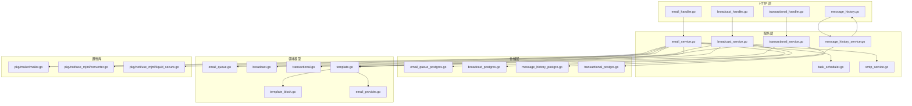
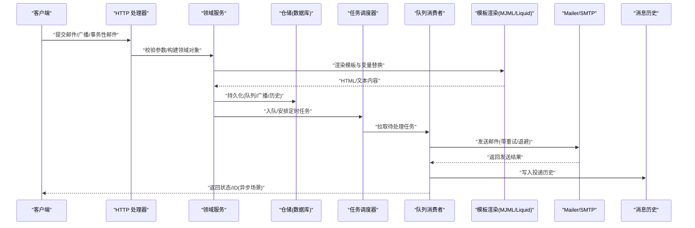
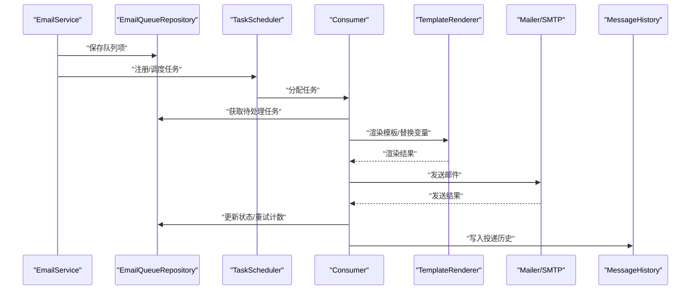
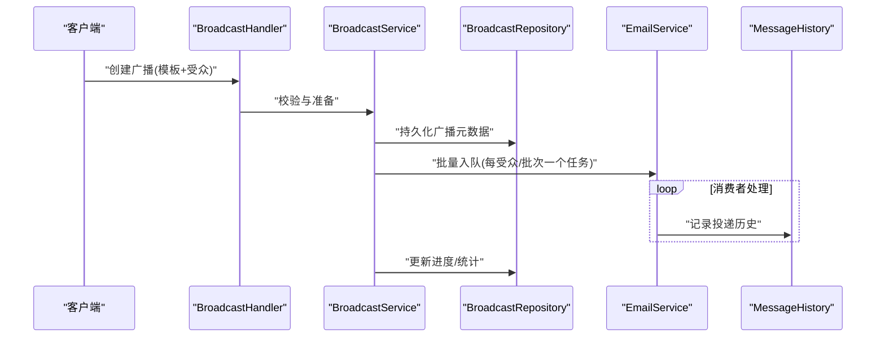
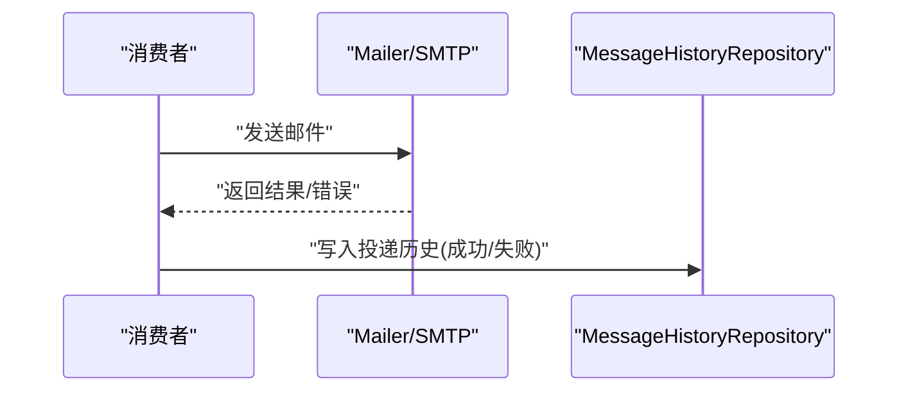
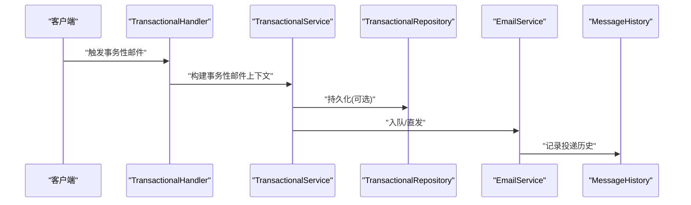
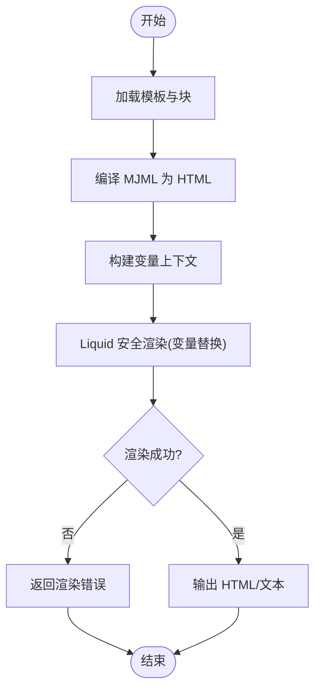
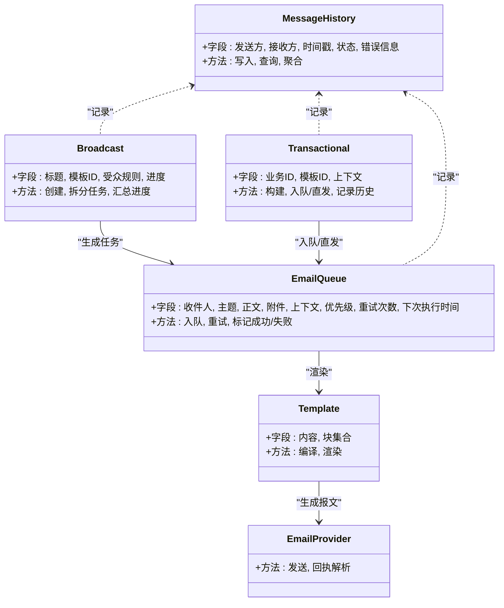

# 邮件领域模型

<cite>
**本文引用的文件**
- [email_queue.go](file://notifuse/internal/domain/email_queue.go)
- [broadcast.go](file://notifuse/internal/domain/broadcast.go)
- [message_history.go](file://notifuse/internal/domain/message_history.go)
- [transactional.go](file://notifuse/internal/domain/transactional.go)
- [template.go](file://notifuse/internal/domain/template.go)
- [template_block.go](file://notifuse/internal/domain/template_block.go)
- [email_provider.go](file://notifuse/internal/domain/email_provider.go)
- [email_queue_postgres.go](file://notifuse/internal/repository/email_queue_postgres.go)
- [broadcast_postgres.go](file://notifuse/internal/repository/broadcast_postgres.go)
- [message_history_postgre.go](file://notifuse/internal/repository/message_history_postgre.go)
- [transactional_postgre.go](file://notifuse/internal/repository/transactional_postgre.go)
- [email_service.go](file://notifuse/internal/service/email_service.go)
- [broadcast_service.go](file://notifuse/internal/service/broadcast_service.go)
- [message_history_service.go](file://notifuse/internal/service/message_history_service.go)
- [transactional_service.go](file://notifuse/internal/service/transactional_service.go)
- [task_scheduler.go](file://notifuse/internal/service/task_scheduler.go)
- [smtp_service.go](file://notifuse/internal/service/smtp_service.go)
- [mailer.go](file://notifuse/pkg/mailer/mailer.go)
- [liquid_secure.go](file://notifuse/pkg/notifuse_mjml/liquid_secure.go)
- [converter.go](file://notifuse/pkg/notifuse_mjml/converter.go)
- [email_handler.go](file://notifuse/internal/http/email_handler.go)
- [broadcast_handler.go](file://notifuse/internal/http/broadcast_handler.go)
- [message_history_handler.go](file://notifuse/internal/http/message_history_handler.go)
- [transactional_handler.go](file://notifuse/internal/http/transactional_handler.go)
</cite>

## 目录
1. [简介](#简介)
2. [项目结构](#项目结构)
3. [核心组件](#核心组件)
4. [架构总览](#架构总览)
5. [详细组件分析](#详细组件分析)
6. [依赖关系分析](#依赖关系分析)
7. [性能与并发](#性能与并发)
8. [故障排查指南](#故障排查指南)
9. [结论](#结论)
10. [附录：API 参考](#附录api-参考)

## 简介
本文件聚焦 Notifuse 平台的“邮件领域模型”，围绕以下实体与流程展开：
- EmailQueue（邮件队列）：异步发送的持久化任务，支持重试、优先级与状态机。
- Broadcast（广播发送）：面向大量受众的批量邮件活动，包含受众选择、模板渲染与进度追踪。
- MessageHistory（消息历史）：对每次投递尝试进行审计记录，便于追踪送达状态与问题定位。
- Transactional（事务性邮件）：即时触发的业务邮件（如注册确认、密码重置），强调低延迟与高可靠。

文档将解释这些实体的设计要点、数据流、处理生命周期（含队列消费、重试与错误处理）、模板渲染与变量替换机制、送达状态追踪与统计方法，并给出端到端流程图与代码级引用路径，帮助读者快速理解与扩展。

## 项目结构
邮件相关能力在内部按领域分层组织：
- domain：定义领域实体、枚举与不变式约束。
- repository：基于 Postgres 的持久化实现。
- service：编排领域逻辑、调度与外部服务调用。
- http：对外暴露 REST API。
- pkg/mailer 与 pkg/notifuse_mjml：通用邮件传输与模板渲染工具。

图表来源
- [email_handler.go](file://notifuse/internal/http/email_handler.go)
- [broadcast_handler.go](file://notifuse/internal/http/broadcast_handler.go)
- [message_history_handler.go](file://notifuse/internal/http/message_history_handler.go)
- [transactional_handler.go](file://notifuse/internal/http/transactional_handler.go)
- [email_service.go](file://notifuse/internal/service/email_service.go)
- [broadcast_service.go](file://notifuse/internal/service/broadcast_service.go)
- [message_history_service.go](file://notifuse/internal/service/message_history_service.go)
- [transactional_service.go](file://notifuse/internal/service/transactional_service.go)
- [task_scheduler.go](file://notifuse/internal/service/task_scheduler.go)
- [smtp_service.go](file://notifuse/internal/service/smtp_service.go)
- [email_queue_postgres.go](file://notifuse/internal/repository/email_queue_postgres.go)
- [broadcast_postgres.go](file://notifuse/internal/repository/broadcast_postgres.go)
- [message_history_postgre.go](file://notifuse/internal/repository/message_history_postgre.go)
- [transactional_postgre.go](file://notifuse/internal/repository/transactional_postgre.go)
- [email_queue.go](file://notifuse/internal/domain/email_queue.go)
- [broadcast.go](file://notifuse/internal/domain/broadcast.go)
- [message_history.go](file://notifuse/internal/domain/message_history.go)
- [transactional.go](file://notifuse/internal/domain/transactional.go)
- [template.go](file://notifuse/internal/domain/template.go)
- [template_block.go](file://notifuse/internal/domain/template_block.go)
- [email_provider.go](file://notifuse/internal/domain/email_provider.go)
- [mailer.go](file://notifuse/pkg/mailer/mailer.go)
- [converter.go](file://notifuse/pkg/notifuse_mjml/converter.go)
- [liquid_secure.go](file://notifuse/pkg/notifuse_mjml/liquid_secure.go)

章节来源
- [email_handler.go](file://notifuse/internal/http/email_handler.go)
- [broadcast_handler.go](file://notifuse/internal/http/broadcast_handler.go)
- [message_history_handler.go](file://notifuse/internal/http/message_history_handler.go)
- [transactional_handler.go](file://notifuse/internal/http/transactional_handler.go)
- [email_service.go](file://notifuse/internal/service/email_service.go)
- [broadcast_service.go](file://notifuse/internal/service/broadcast_service.go)
- [message_history_service.go](file://notifuse/internal/service/message_history_service.go)
- [transactional_service.go](file://notifuse/internal/service/transactional_service.go)
- [task_scheduler.go](file://notifuse/internal/service/task_scheduler.go)
- [smtp_service.go](file://notifuse/internal/service/smtp_service.go)
- [email_queue_postgres.go](file://notifuse/internal/repository/email_queue_postgres.go)
- [broadcast_postgres.go](file://notifuse/internal/repository/broadcast_postgres.go)
- [message_history_postgre.go](file://notifuse/internal/repository/message_history_postgre.go)
- [transactional_postgre.go](file://notifuse/internal/repository/transactional_postgre.go)
- [email_queue.go](file://notifuse/internal/domain/email_queue.go)
- [broadcast.go](file://notifuse/internal/domain/broadcast.go)
- [message_history.go](file://notifuse/internal/domain/message_history.go)
- [transactional.go](file://notifuse/internal/domain/transactional.go)
- [template.go](file://notifuse/internal/domain/template.go)
- [template_block.go](file://notifuse/internal/domain/template_block.go)
- [email_provider.go](file://notifuse/internal/domain/email_provider.go)
- [mailer.go](file://notifuse/pkg/mailer/mailer.go)
- [converter.go](file://notifuse/pkg/notifuse_mjml/converter.go)
- [liquid_secure.go](file://notifuse/pkg/notifuse_mjml/liquid_secure.go)

## 核心组件
本节从领域模型角度梳理四大核心实体及其职责边界。

- EmailQueue（邮件队列）
  - 职责：承载待发送的邮件任务，包含收件人、主题、正文、附件、模板上下文、优先级、重试次数、下次执行时间等。
  - 关键行为：入队、出队、重试、失败归档、状态迁移（待处理/处理中/成功/失败）。
  - 典型使用：事务性邮件与广播子任务均通过队列解耦发送过程。
  - 参考实现路径
    - 领域定义：[email_queue.go](file://notifuse/internal/domain/email_queue.go)
    - 持久化：[email_queue_postgres.go](file://notifuse/internal/repository/email_queue_postgres.go)
    - 服务编排：[email_service.go](file://notifuse/internal/service/email_service.go)

- Broadcast（广播发送）
  - 职责：管理一次面向多受众的邮件活动，包括受众筛选、模板渲染、分片与并发控制、进度与结果汇总。
  - 关键行为：创建广播、生成受众列表、拆分为多个 EmailQueue 任务、跟踪完成度与失败率。
  - 参考实现路径
    - 领域定义：[broadcast.go](file://notifuse/internal/domain/broadcast.go)
    - 持久化：[broadcast_postgres.go](file://notifuse/internal/repository/broadcast_postgres.go)
    - 服务编排：[broadcast_service.go](file://notifuse/internal/service/broadcast_service.go)

- MessageHistory（消息历史）
  - 职责：记录每一次投递尝试的结果，包括发送方、接收方、时间戳、状态码、错误信息、提供商回执等。
  - 关键行为：写入投递日志、查询历史、聚合统计（成功率、失败原因分布）。
  - 参考实现路径
    - 领域定义：[message_history.go](file://notifuse/internal/domain/message_history.go)
    - 持久化：[message_history_postgre.go](file://notifuse/internal/repository/message_history_postgre.go)
    - 服务编排：[message_history_service.go](file://notifuse/internal/service/message_history_service.go)

- Transactional（事务性邮件）
  - 职责：为业务事件触发即时邮件（如验证、通知），要求低延迟与强一致。
  - 关键行为：构建邮件、渲染模板、立即入队或直发、记录历史。
  - 参考实现路径
    - 领域定义：[transactional.go](file://notifuse/internal/domain/transactional.go)
    - 持久化：[transactional_postgre.go](file://notifuse/internal/repository/transactional_postgre.go)
    - 服务编排：[transactional_service.go](file://notifuse/internal/service/transactional_service.go)

章节来源
- [email_queue.go](file://notifuse/internal/domain/email_queue.go)
- [broadcast.go](file://notifuse/internal/domain/broadcast.go)
- [message_history.go](file://notifuse/internal/domain/message_history.go)
- [transactional.go](file://notifuse/internal/domain/transactional.go)
- [email_queue_postgres.go](file://notifuse/internal/repository/email_queue_postgres.go)
- [broadcast_postgres.go](file://notifuse/internal/repository/broadcast_postgres.go)
- [message_history_postgre.go](file://notifuse/internal/repository/message_history_postgre.go)
- [transactional_postgre.go](file://notifuse/internal/repository/transactional_postgre.go)
- [email_service.go](file://notifuse/internal/service/email_service.go)
- [broadcast_service.go](file://notifuse/internal/service/broadcast_service.go)
- [message_history_service.go](file://notifuse/internal/service/message_history_service.go)
- [transactional_service.go](file://notifuse/internal/service/transactional_service.go)

## 架构总览
下图展示从 HTTP 请求到最终投递的全链路，涵盖模板渲染、队列调度、重试与历史记录。

图表来源
- [email_handler.go](file://notifuse/internal/http/email_handler.go)
- [broadcast_handler.go](file://notifuse/internal/http/broadcast_handler.go)
- [message_history_handler.go](file://notifuse/internal/http/message_history_handler.go)
- [transactional_handler.go](file://notifuse/internal/http/transactional_handler.go)
- [email_service.go](file://notifuse/internal/service/email_service.go)
- [broadcast_service.go](file://notifuse/internal/service/broadcast_service.go)
- [message_history_service.go](file://notifuse/internal/service/message_history_service.go)
- [transactional_service.go](file://notifuse/internal/service/transactional_service.go)
- [task_scheduler.go](file://notifuse/internal/service/task_scheduler.go)
- [smtp_service.go](file://notifuse/internal/service/smtp_service.go)
- [mailer.go](file://notifuse/pkg/mailer/mailer.go)
- [converter.go](file://notifuse/pkg/notifuse_mjml/converter.go)
- [liquid_secure.go](file://notifuse/pkg/notifuse_mjml/liquid_secure.go)

## 详细组件分析

### EmailQueue（邮件队列）
- 设计要点
  - 状态机：待处理 → 处理中 → 成功/失败；失败时根据策略递增重试次数并设置下次执行时间。
  - 幂等与去重：通过唯一键或业务 ID 避免重复投递。
  - 优先级与批处理：支持按优先级排序与批量出队，提升吞吐。
- 生命周期
  - 入队：由事务性或广播服务创建任务并落库。
  - 调度：调度器周期性扫描可执行任务，交由消费者处理。
  - 消费：消费者加载任务、渲染模板、调用发送器、更新状态与历史。
  - 重试：指数退避或固定间隔，超过阈值转入死信或人工干预。
- 关键流程（序列图）

图表来源
- [email_service.go](file://notifuse/internal/service/email_service.go)
- [email_queue_postgres.go](file://notifuse/internal/repository/email_queue_postgres.go)
- [task_scheduler.go](file://notifuse/internal/service/task_scheduler.go)
- [smtp_service.go](file://notifuse/internal/service/smtp_service.go)
- [message_history_postgre.go](file://notifuse/internal/repository/message_history_postgre.go)
- [converter.go](file://notifuse/pkg/notifuse_mjml/converter.go)
- [liquid_secure.go](file://notifuse/pkg/notifuse_mjml/liquid_secure.go)

章节来源
- [email_queue.go](file://notifuse/internal/domain/email_queue.go)
- [email_queue_postgres.go](file://notifuse/internal/repository/email_queue_postgres.go)
- [email_service.go](file://notifuse/internal/service/email_service.go)
- [task_scheduler.go](file://notifuse/internal/service/task_scheduler.go)
- [smtp_service.go](file://notifuse/internal/service/smtp_service.go)
- [message_history_postgre.go](file://notifuse/internal/repository/message_history_postgre.go)
- [converter.go](file://notifuse/pkg/notifuse_mjml/converter.go)
- [liquid_secure.go](file://notifuse/pkg/notifuse_mjml/liquid_secure.go)

### Broadcast（广播发送）
- 设计要点
  - 受众建模：支持联系人列表、标签、细分条件等组合。
  - 分片与并发：将受众切分为批次，限制并发度以避免压垮下游。
  - 进度追踪：维护已发送/失败/总数，提供进度与报表。
- 生命周期
  - 创建广播：校验模板与受众，生成计划。
  - 任务拆分：为每个受众或批次创建 EmailQueue 任务。
  - 执行与汇总：消费者完成后更新广播进度与统计。
- 关键流程（序列图）

图表来源
- [broadcast_handler.go](file://notifuse/internal/http/broadcast_handler.go)
- [broadcast_service.go](file://notifuse/internal/service/broadcast_service.go)
- [broadcast_postgres.go](file://notifuse/internal/repository/broadcast_postgres.go)
- [email_service.go](file://notifuse/internal/service/email_service.go)
- [message_history_postgre.go](file://notifuse/internal/repository/message_history_postgre.go)

章节来源
- [broadcast.go](file://notifuse/internal/domain/broadcast.go)
- [broadcast_postgres.go](file://notifuse/internal/repository/broadcast_postgres.go)
- [broadcast_handler.go](file://notifuse/internal/http/broadcast_handler.go)
- [broadcast_service.go](file://notifuse/internal/service/broadcast_service.go)
- [email_service.go](file://notifuse/internal/service/email_service.go)
- [message_history_postgre.go](file://notifuse/internal/repository/message_history_postgre.go)

### MessageHistory（消息历史）
- 设计要点
  - 不可变审计：每条记录代表一次投递尝试，包含时间、状态、错误详情、提供商回执等。
  - 查询与聚合：支持按时间范围、状态、收件人、广播 ID 等维度查询与统计。
- 关键流程（时序片段）

图表来源
- [message_history_service.go](file://notifuse/internal/service/message_history_service.go)
- [message_history_postgre.go](file://notifuse/internal/repository/message_history_postgre.go)
- [smtp_service.go](file://notifuse/internal/service/smtp_service.go)

章节来源
- [message_history.go](file://notifuse/internal/domain/message_history.go)
- [message_history_postgre.go](file://notifuse/internal/repository/message_history_postgre.go)
- [message_history_service.go](file://notifuse/internal/service/message_history_service.go)

### Transactional（事务性邮件）
- 设计要点
  - 低延迟：优先直发或短队列，必要时走统一队列以保障可靠性。
  - 强一致性：确保入队与历史记录在同一事务内完成。
- 关键流程（序列图）

图表来源
- [transactional_handler.go](file://notifuse/internal/http/transactional_handler.go)
- [transactional_service.go](file://notifuse/internal/service/transactional_service.go)
- [transactional_postgre.go](file://notifuse/internal/repository/transactional_postgre.go)
- [email_service.go](file://notifuse/internal/service/email_service.go)
- [message_history_postgre.go](file://notifuse/internal/repository/message_history_postgre.go)

章节来源
- [transactional.go](file://notifuse/internal/domain/transactional.go)
- [transactional_postgre.go](file://notifuse/internal/repository/transactional_postgre.go)
- [transactional_handler.go](file://notifuse/internal/http/transactional_handler.go)
- [transactional_service.go](file://notifuse/internal/service/transactional_service.go)
- [email_service.go](file://notifuse/internal/service/email_service.go)
- [message_history_postgre.go](file://notifuse/internal/repository/message_history_postgre.go)

### 模板渲染与变量替换
- 渲染管线
  - 模板源：MJML 模板经编译转换为 HTML，同时保留文本版本。
  - 变量替换：基于 Liquid 的安全沙箱引擎，仅允许白名单函数与属性访问。
  - 块复用：模板块（Block）支持组合与继承，减少重复。
- 关键流程（流程图）

图表来源
- [template.go](file://notifuse/internal/domain/template.go)
- [template_block.go](file://notifuse/internal/domain/template_block.go)
- [converter.go](file://notifuse/pkg/notifuse_mjml/converter.go)
- [liquid_secure.go](file://notifuse/pkg/notifuse_mjml/liquid_secure.go)

章节来源
- [template.go](file://notifuse/internal/domain/template.go)
- [template_block.go](file://notifuse/internal/domain/template_block.go)
- [converter.go](file://notifuse/pkg/notifuse_mjml/converter.go)
- [liquid_secure.go](file://notifuse/pkg/notifuse_mjml/liquid_secure.go)

## 依赖关系分析
- 耦合与内聚
  - 领域模型与仓储分离清晰，服务层负责编排与跨域协作。
  - 模板渲染与发送器作为通用库被多处复用，降低重复实现。
- 外部依赖
  - 邮件提供商抽象（email_provider.go）便于接入多种后端（SMTP、SES、SendGrid 等）。
  - 数据库采用 Postgres，仓储层封装 SQL 细节。
- 潜在循环依赖
  - 当前分层避免了循环导入；若新增回调或事件总线需留意引入方向。

图表来源
- [email_queue.go](file://notifuse/internal/domain/email_queue.go)
- [broadcast.go](file://notifuse/internal/domain/broadcast.go)
- [message_history.go](file://notifuse/internal/domain/message_history.go)
- [transactional.go](file://notifuse/internal/domain/transactional.go)
- [template.go](file://notifuse/internal/domain/template.go)
- [email_provider.go](file://notifuse/internal/domain/email_provider.go)

章节来源
- [email_queue.go](file://notifuse/internal/domain/email_queue.go)
- [broadcast.go](file://notifuse/internal/domain/broadcast.go)
- [message_history.go](file://notifuse/internal/domain/message_history.go)
- [transactional.go](file://notifuse/internal/domain/transactional.go)
- [template.go](file://notifuse/internal/domain/template.go)
- [email_provider.go](file://notifuse/internal/domain/email_provider.go)

## 性能与并发
- 队列与调度
  - 批量出队与批处理：减少数据库往返与锁竞争。
  - 优先级队列：重要事务性邮件优先处理。
  - 指数退避重试：避免雪崩，结合最大重试上限。
- 并发控制
  - 广播分片：按受众规模自动分片，限制并发度。
  - 速率限制：针对 SMTP/第三方 API 的限流保护。
- 渲染优化
  - 模板预编译与缓存：减少 MJML 编译开销。
  - 变量上下文复用：相同上下文批量渲染。
- 存储优化
  - 历史表分区：按时间范围分区，提升查询性能。
  - 索引设计：按收件人、时间、状态建立复合索引。

[本节为通用指导，不直接分析具体文件]

## 故障排查指南
- 常见问题
  - 模板渲染失败：检查 Liquid 白名单与上下文字段是否齐全。
  - 发送失败：查看 MessageHistory 的错误信息与提供商回执。
  - 队列堆积：检查消费者数量、重试策略与下游限流。
- 诊断步骤
  - 通过 MessageHistory 过滤失败记录，定位错误类型。
  - 核对模板 ID 与块是否存在，验证上下文变量。
  - 观察调度器与消费者日志，确认任务分配与执行耗时。
- 恢复建议
  - 调整重试间隔与上限，必要时人工介入死信队列。
  - 扩容消费者实例或提高并发度，注意下游配额。

章节来源
- [message_history_service.go](file://notifuse/internal/service/message_history_service.go)
- [message_history_postgre.go](file://notifuse/internal/repository/message_history_postgre.go)
- [email_service.go](file://notifuse/internal/service/email_service.go)
- [task_scheduler.go](file://notifuse/internal/service/task_scheduler.go)

## 结论
Notifuse 的邮件领域模型通过清晰的实体划分与分层架构，实现了高可靠、可扩展的邮件发送能力。EmailQueue 提供统一的异步通道，Broadcast 支撑大规模受众分发，MessageHistory 保证可观测性与可追溯性，Transactional 满足即时业务需求。配合 MJML 模板与 Liquid 安全渲染，系统在功能与性能之间取得良好平衡。建议在生产环境持续监控队列积压、重试比例与渲染耗时，并结合分区与索引优化历史查询性能。

[本节为总结性内容，不直接分析具体文件]

## 附录：API 参考
- 邮件接口
  - 入口：[email_handler.go](file://notifuse/internal/http/email_handler.go)
  - 服务：[email_service.go](file://notifuse/internal/service/email_service.go)
- 广播接口
  - 入口：[broadcast_handler.go](file://notifuse/internal/http/broadcast_handler.go)
  - 服务：[broadcast_service.go](file://notifuse/internal/service/broadcast_service.go)
- 消息历史接口
  - 入口：[message_history_handler.go](file://notifuse/internal/http/message_history_handler.go)
  - 服务：[message_history_service.go](file://notifuse/internal/service/message_history_service.go)
- 事务性邮件接口
  - 入口：[transactional_handler.go](file://notifuse/internal/http/transactional_handler.go)
  - 服务：[transactional_service.go](file://notifuse/internal/service/transactional_service.go)

章节来源
- [email_handler.go](file://notifuse/internal/http/email_handler.go)
- [email_service.go](file://notifuse/internal/service/email_service.go)
- [broadcast_handler.go](file://notifuse/internal/http/broadcast_handler.go)
- [broadcast_service.go](file://notifuse/internal/service/broadcast_service.go)
- [message_history_handler.go](file://notifuse/internal/http/message_history_handler.go)
- [message_history_service.go](file://notifuse/internal/service/message_history_service.go)
- [transactional_handler.go](file://notifuse/internal/http/transactional_handler.go)
- [transactional_service.go](file://notifuse/internal/service/transactional_service.go)