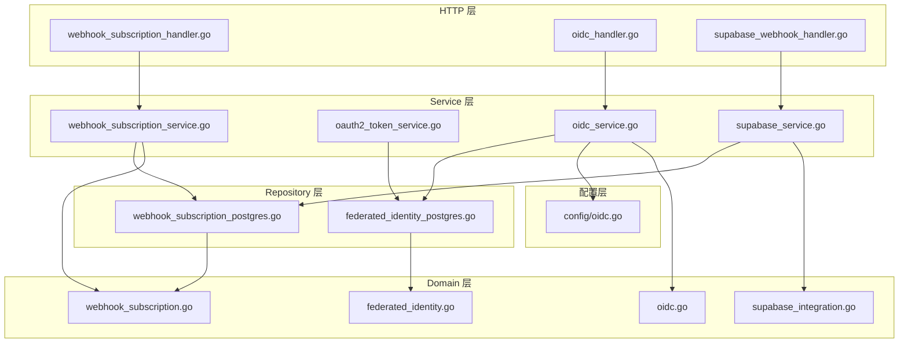
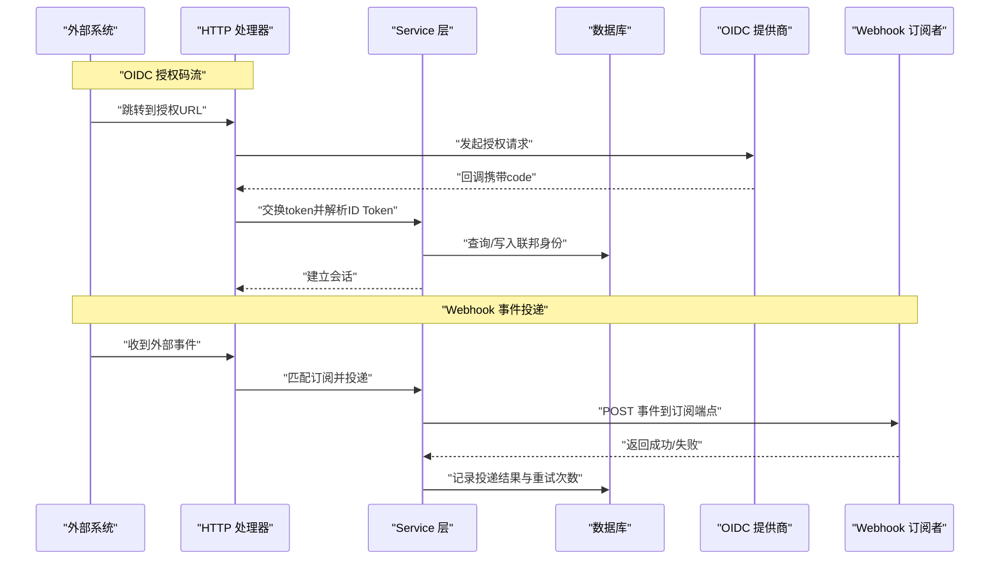
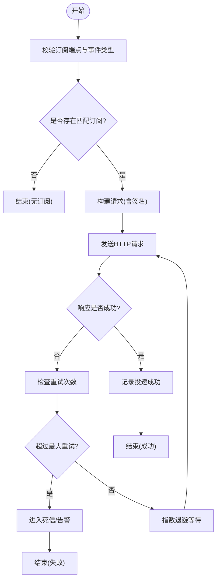
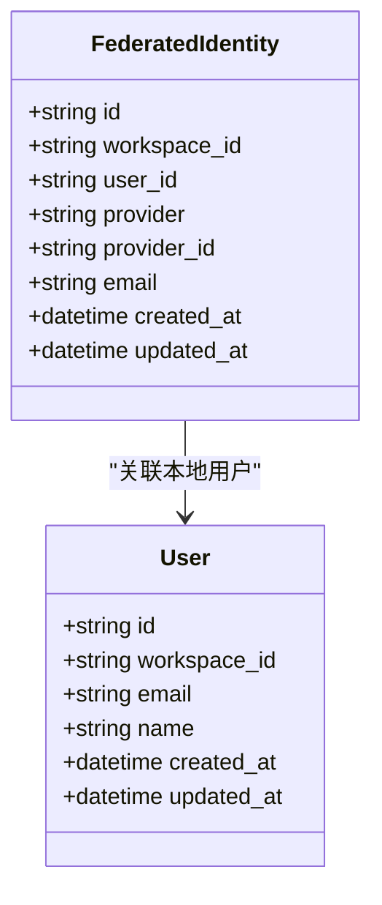
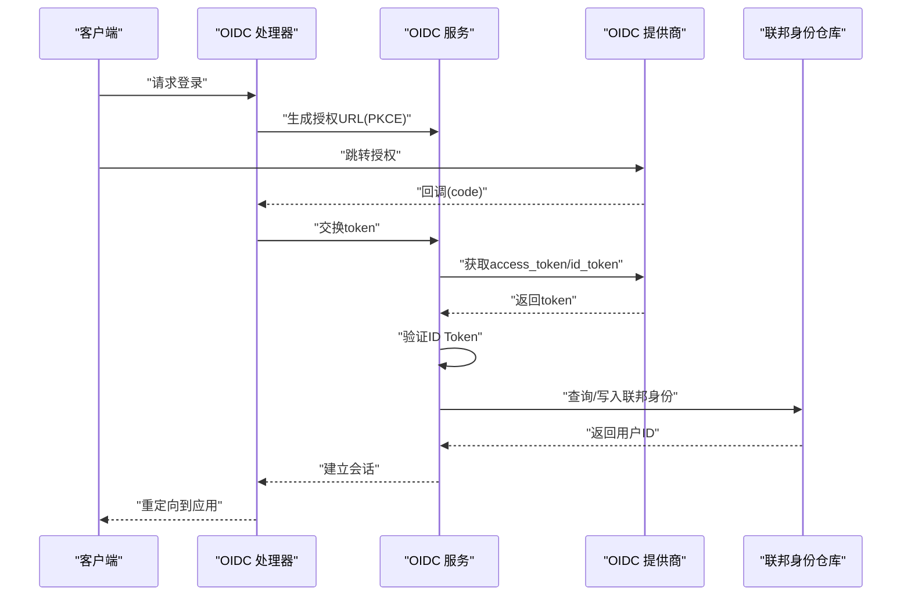
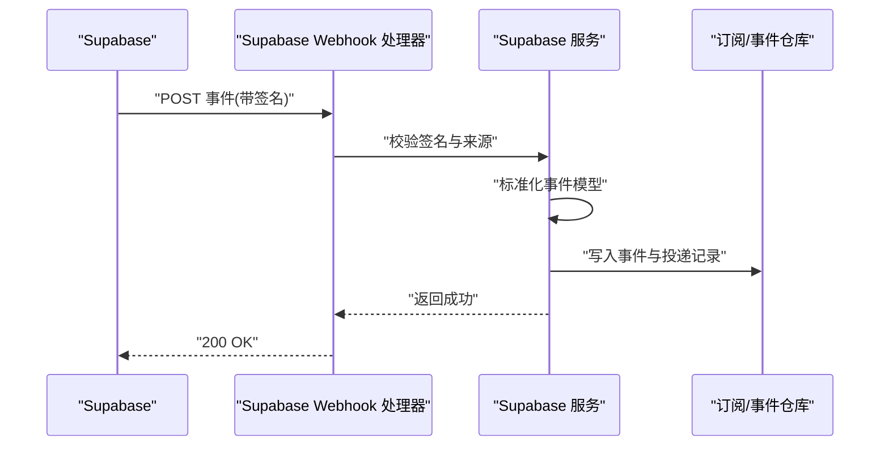
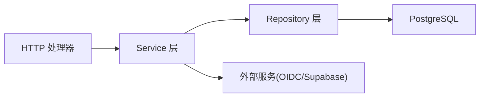

# 集成领域模型

<cite>
**本文引用的文件**   
- [internal/domain/webhook_subscription.go](file://notifuse/internal/domain/webhook_subscription.go)
- [internal/domain/federated_identity.go](file://notifuse/internal/domain/federated_identity.go)
- [internal/domain/oidc.go](file://notifuse/internal/domain/oidc.go)
- [internal/domain/supabase_integration.go](file://notifuse/internal/domain/supabase_integration.go)
- [internal/service/webhook_subscription_service.go](file://notifuse/internal/service/webhook_subscription_service.go)
- [internal/service/oauth2_token_service.go](file://notifuse/internal/service/oauth2_token_service.go)
- [internal/service/oidc_service.go](file://notifuse/internal/service/oidc_service.go)
- [internal/service/supabase_service.go](file://notifuse/internal/service/supabase_service.go)
- [internal/http/webhook_subscription_handler.go](file://notifuse/internal/http/webhook_subscription_handler.go)
- [internal/http/oidc_handler.go](file://notifuse/internal/http/oidc_handler.go)
- [internal/http/supabase_webhook_handler.go](file://notifuse/internal/http/supabase_webhook_handler.go)
- [internal/repository/webhook_subscription_postgres.go](file://notifuse/internal/repository/webhook_subscription_postgres.go)
- [internal/repository/federated_identity_postgres.go](file://notifuse/internal/repository/federated_identity_postgres.go)
- [config/oidc.go](file://notifuse/config/oidc.go)
</cite>

## 目录
1. [简介](#简介)
2. [项目结构](#项目结构)
3. [核心组件](#核心组件)
4. [架构总览](#架构总览)
5. [详细组件分析](#详细组件分析)
6. [依赖关系分析](#依赖关系分析)
7. [性能考量](#性能考量)
8. [故障排查指南](#故障排查指南)
9. [结论](#结论)
10. [附录](#附录)

## 简介
本文件聚焦于 Notifuse 平台的“集成领域模型”，围绕以下关键实体与流程进行系统化文档化：
- WebhookSubscription（Webhook 订阅）
- FederatedIdentity（联邦身份）
- OIDC（OpenID Connect）
- SupabaseIntegration（Supabase 集成）

目标包括：
- 解释外部系统集成接口设计与认证机制
- 文档化 Webhook 事件的发布与订阅模式
- 说明第三方服务的 OAuth2/OIDC 集成流程
- 提供具体代码示例路径，展示外部 API 调用、事件处理与回调机制
- 解释集成领域的错误处理与重试策略

## 项目结构
集成相关代码主要分布在 internal 下的 domain、service、http、repository 以及 config 等层次中。整体采用分层架构：
- HTTP 层：负责路由、请求校验、鉴权与响应封装
- Service 层：编排业务逻辑、协调外部服务、管理事务与重试
- Repository 层：数据持久化访问
- Domain 层：领域模型定义与约束
- Config 层：配置加载与校验

图表来源
- [internal/http/webhook_subscription_handler.go](file://notifuse/internal/http/webhook_subscription_handler.go)
- [internal/http/oidc_handler.go](file://notifuse/internal/http/oidc_handler.go)
- [internal/http/supabase_webhook_handler.go](file://notifuse/internal/http/supabase_webhook_handler.go)
- [internal/service/webhook_subscription_service.go](file://notifuse/internal/service/webhook_subscription_service.go)
- [internal/service/oauth2_token_service.go](file://notifuse/internal/service/oauth2_token_service.go)
- [internal/service/oidc_service.go](file://notifuse/internal/service/oidc_service.go)
- [internal/service/supabase_service.go](file://notifuse/internal/service/supabase_service.go)
- [internal/repository/webhook_subscription_postgres.go](file://notifuse/internal/repository/webhook_subscription_postgres.go)
- [internal/repository/federated_identity_postgres.go](file://notifuse/internal/repository/federated_identity_postgres.go)
- [internal/domain/webhook_subscription.go](file://notifuse/internal/domain/webhook_subscription.go)
- [internal/domain/federated_identity.go](file://notifuse/internal/domain/federated_identity.go)
- [internal/domain/oidc.go](file://notifuse/internal/domain/oidc.go)
- [internal/domain/supabase_integration.go](file://notifuse/internal/domain/supabase_integration.go)
- [config/oidc.go](file://notifuse/config/oidc.go)

章节来源
- [internal/http/webhook_subscription_handler.go](file://notifuse/internal/http/webhook_subscription_handler.go)
- [internal/http/oidc_handler.go](file://notifuse/internal/http/oidc_handler.go)
- [internal/http/supabase_webhook_handler.go](file://notifuse/internal/http/supabase_webhook_handler.go)
- [internal/service/webhook_subscription_service.go](file://notifuse/internal/service/webhook_subscription_service.go)
- [internal/service/oauth2_token_service.go](file://notifuse/internal/service/oauth2_token_service.go)
- [internal/service/oidc_service.go](file://notifuse/internal/service/oidc_service.go)
- [internal/service/supabase_service.go](file://notifuse/internal/service/supabase_service.go)
- [internal/repository/webhook_subscription_postgres.go](file://notifuse/internal/repository/webhook_subscription_postgres.go)
- [internal/repository/federated_identity_postgres.go](file://notifuse/internal/repository/federated_identity_postgres.go)
- [internal/domain/webhook_subscription.go](file://notifuse/internal/domain/webhook_subscription.go)
- [internal/domain/federated_identity.go](file://notifuse/internal/domain/federated_identity.go)
- [internal/domain/oidc.go](file://notifuse/internal/domain/oidc.go)
- [internal/domain/supabase_integration.go](file://notifuse/internal/domain/supabase_integration.go)
- [config/oidc.go](file://notifuse/config/oidc.go)

## 核心组件
本节对四个核心集成实体进行概述，并给出其职责边界与交互要点。

- WebhookSubscription（Webhook 订阅）
  - 职责：维护订阅者端点、签名密钥、事件类型过滤、状态控制、投递记录与失败重试策略
  - 关键能力：创建/更新/删除订阅；按事件类型匹配；生成签名；异步投递；失败重试与退避
  - 典型交互：HTTP 处理器接收事件或触发投递；Service 编排投递与重试；Repository 持久化订阅与投递记录

- FederatedIdentity（联邦身份）
  - 职责：存储用户与外部身份提供方（如 Google、GitHub、OIDC 提供商）的映射关系，支持多提供者绑定与解绑
  - 关键能力：根据 provider+providerId 查找用户；防止重复绑定；同步本地用户信息
  - 典型交互：OIDC 回调后写入或更新联邦身份；OAuth2 Token 服务用于刷新令牌

- OIDC（OpenID Connect）
  - 职责：实现授权码流、PKCE、ID Token 验证、UserInfo 拉取、会话建立
  - 关键能力：动态发现元数据；构建授权 URL；交换 token；解析 ID Token；缓存公钥
  - 典型交互：前端跳转至授权页；后端回调处理 code；写入会话与联邦身份

- SupabaseIntegration（Supabase 集成）
  - 职责：对接 Supabase 平台，包括模板、通知、Webhook 事件处理等
  - 关键能力：使用工作区级凭据访问 Supabase API；处理 Supabase 发来的 Webhook；将事件转换为内部事件
  - 典型交互：Supabase 回调到内部 Webhook 处理器；Service 转换并落库；必要时触发自动化或通知

章节来源
- [internal/domain/webhook_subscription.go](file://notifuse/internal/domain/webhook_subscription.go)
- [internal/domain/federated_identity.go](file://notifuse/internal/domain/federated_identity.go)
- [internal/domain/oidc.go](file://notifuse/internal/domain/oidc.go)
- [internal/domain/supabase_integration.go](file://notifuse/internal/domain/supabase_integration.go)

## 架构总览
下图展示了从外部系统到内部处理的端到端集成流程，涵盖 Webhook 订阅、OIDC 登录与 Supabase 回调。

图表来源
- [internal/http/oidc_handler.go](file://notifuse/internal/http/oidc_handler.go)
- [internal/service/oidc_service.go](file://notifuse/internal/service/oidc_service.go)
- [internal/repository/federated_identity_postgres.go](file://notifuse/internal/repository/federated_identity_postgres.go)
- [internal/http/webhook_subscription_handler.go](file://notifuse/internal/http/webhook_subscription_handler.go)
- [internal/service/webhook_subscription_service.go](file://notifuse/internal/service/webhook_subscription_service.go)
- [internal/repository/webhook_subscription_postgres.go](file://notifuse/internal/repository/webhook_subscription_postgres.go)

## 详细组件分析

### WebhookSubscription（Webhook 订阅）
- 设计要点
  - 订阅端点需具备唯一性与可达性校验
  - 支持事件类型白名单与通配符过滤
  - 签名机制：基于共享密钥对事件载荷进行 HMAC 签名，供订阅方验签
  - 投递策略：异步队列 + 指数退避重试；最大重试次数与死信记录
  - 幂等性：为每次投递生成唯一标识，避免重复处理

- 关键流程
  - 创建/更新订阅：校验端点格式、测试连通性、保存签名密钥
  - 事件匹配：根据事件类型与标签筛选匹配的订阅
  - 投递执行：构造请求头（含签名）、发送 POST、记录响应码与重试计数
  - 失败处理：达到阈值后标记失败并告警；可人工重放

图表来源
- [internal/service/webhook_subscription_service.go](file://notifuse/internal/service/webhook_subscription_service.go)
- [internal/repository/webhook_subscription_postgres.go](file://notifuse/internal/repository/webhook_subscription_postgres.go)
- [internal/domain/webhook_subscription.go](file://notifuse/internal/domain/webhook_subscription.go)

章节来源
- [internal/domain/webhook_subscription.go](file://notifuse/internal/domain/webhook_subscription.go)
- [internal/service/webhook_subscription_service.go](file://notifuse/internal/service/webhook_subscription_service.go)
- [internal/repository/webhook_subscription_postgres.go](file://notifuse/internal/repository/webhook_subscription_postgres.go)
- [internal/http/webhook_subscription_handler.go](file://notifuse/internal/http/webhook_subscription_handler.go)

### FederatedIdentity（联邦身份）
- 设计要点
  - 以 provider 与 providerId 作为联合主键，确保同一外部账户仅绑定一次
  - 支持多提供者并存，允许用户在不同提供者间切换
  - 同步外部用户画像字段（如邮箱、头像），保持本地用户信息一致

- 关键流程
  - 首次登录：根据 provider+providerId 查找，不存在则创建本地用户并写入联邦身份
  - 后续登录：直接关联本地用户，更新最后登录时间
  - 解绑：在安全策略允许下移除绑定关系

图表来源
- [internal/domain/federated_identity.go](file://notifuse/internal/domain/federated_identity.go)
- [internal/repository/federated_identity_postgres.go](file://notifuse/internal/repository/federated_identity_postgres.go)

章节来源
- [internal/domain/federated_identity.go](file://notifuse/internal/domain/federated_identity.go)
- [internal/repository/federated_identity_postgres.go](file://notifuse/internal/repository/federated_identity_postgres.go)

### OIDC（OpenID Connect）
- 设计要点
  - 支持动态发现（/.well-known/openid-configuration）
  - 授权码流 + PKCE，提升安全性
  - ID Token 校验：签名、过期、受众、签发者
  - UserInfo 拉取：补充用户信息
  - 会话管理：短期会话令牌与刷新策略

- 关键流程（序列图）

图表来源
- [internal/http/oidc_handler.go](file://notifuse/internal/http/oidc_handler.go)
- [internal/service/oidc_service.go](file://notifuse/internal/service/oidc_service.go)
- [internal/repository/federated_identity_postgres.go](file://notifuse/internal/repository/federated_identity_postgres.go)
- [config/oidc.go](file://notifuse/config/oidc.go)

章节来源
- [internal/http/oidc_handler.go](file://notifuse/internal/http/oidc_handler.go)
- [internal/service/oidc_service.go](file://notifuse/internal/service/oidc_service.go)
- [internal/repository/federated_identity_postgres.go](file://notifuse/internal/repository/federated_identity_postgres.go)
- [config/oidc.go](file://notifuse/config/oidc.go)

### SupabaseIntegration（Supabase 集成）
- 设计要点
  - 工作区级凭据：每个工作区独立配置 Supabase URL 与密钥
  - 事件转换：将 Supabase 事件标准化为内部事件模型
  - 安全校验：校验签名或来源 IP，防止伪造回调
  - 幂等处理：基于事件 ID 去重

- 关键流程（序列图）

图表来源
- [internal/http/supabase_webhook_handler.go](file://notifuse/internal/http/supabase_webhook_handler.go)
- [internal/service/supabase_service.go](file://notifuse/internal/service/supabase_service.go)
- [internal/repository/webhook_subscription_postgres.go](file://notifuse/internal/repository/webhook_subscription_postgres.go)
- [internal/domain/supabase_integration.go](file://notifuse/internal/domain/supabase_integration.go)

章节来源
- [internal/http/supabase_webhook_handler.go](file://notifuse/internal/http/supabase_webhook_handler.go)
- [internal/service/supabase_service.go](file://notifuse/internal/service/supabase_service.go)
- [internal/repository/webhook_subscription_postgres.go](file://notifuse/internal/repository/webhook_subscription_postgres.go)
- [internal/domain/supabase_integration.go](file://notifuse/internal/domain/supabase_integration.go)

## 依赖关系分析
- 耦合与内聚
  - HTTP 层仅负责协议适配与参数校验，业务编排下沉至 Service 层，保证高内聚低耦合
  - Service 层通过接口抽象依赖 Repository，便于替换存储实现与单元测试
  - Domain 层不依赖外部 IO，纯领域模型与约束，利于复用与测试

- 外部依赖
  - OIDC 提供商：网络 I/O，需考虑超时、重试与降级
  - Supabase API：网络 I/O，需考虑限流与幂等
  - 数据库：PostgreSQL，需关注连接池与事务边界

图表来源
- [internal/http/webhook_subscription_handler.go](file://notifuse/internal/http/webhook_subscription_handler.go)
- [internal/http/oidc_handler.go](file://notifuse/internal/http/oidc_handler.go)
- [internal/http/supabase_webhook_handler.go](file://notifuse/internal/http/supabase_webhook_handler.go)
- [internal/service/webhook_subscription_service.go](file://notifuse/internal/service/webhook_subscription_service.go)
- [internal/service/oidc_service.go](file://notifuse/internal/service/oidc_service.go)
- [internal/service/supabase_service.go](file://notifuse/internal/service/supabase_service.go)
- [internal/repository/webhook_subscription_postgres.go](file://notifuse/internal/repository/webhook_subscription_postgres.go)
- [internal/repository/federated_identity_postgres.go](file://notifuse/internal/repository/federated_identity_postgres.go)

章节来源
- [internal/http/webhook_subscription_handler.go](file://notifuse/internal/http/webhook_subscription_handler.go)
- [internal/http/oidc_handler.go](file://notifuse/internal/http/oidc_handler.go)
- [internal/http/supabase_webhook_handler.go](file://notifuse/internal/http/supabase_webhook_handler.go)
- [internal/service/webhook_subscription_service.go](file://notifuse/internal/service/webhook_subscription_service.go)
- [internal/service/oidc_service.go](file://notifuse/internal/service/oidc_service.go)
- [internal/service/supabase_service.go](file://notifuse/internal/service/supabase_service.go)
- [internal/repository/webhook_subscription_postgres.go](file://notifuse/internal/repository/webhook_subscription_postgres.go)
- [internal/repository/federated_identity_postgres.go](file://notifuse/internal/repository/federated_identity_postgres.go)

## 性能考量
- Webhook 投递
  - 使用异步队列与批处理降低瞬时压力
  - 指数退避与抖动避免雪崩效应
  - 连接池复用与 HTTP Keep-Alive 减少握手开销
- OIDC 流程
  - 缓存公钥与元数据，减少网络往返
  - 会话令牌短生命周期，配合刷新机制提高安全性与吞吐
- Supabase 集成
  - 事件标准化批量写入，减少事务开销
  - 幂等键去重，避免重复处理

[本节为通用指导，无需特定文件引用]

## 故障排查指南
- Webhook 投递失败
  - 检查订阅端点可达性与签名校验
  - 查看投递记录的重试次数与响应码
  - 确认订阅状态与事件类型过滤规则
- OIDC 登录异常
  - 核对 client_id、client_secret、redirect_uri 与域名白名单
  - 检查 ID Token 校验失败原因（签名、过期、受众）
  - 查看公钥缓存与元数据发现是否正常
- Supabase 回调问题
  - 校验签名与来源 IP
  - 确认事件 ID 去重逻辑
  - 检查工作区级凭据是否正确

章节来源
- [internal/service/webhook_subscription_service.go](file://notifuse/internal/service/webhook_subscription_service.go)
- [internal/service/oidc_service.go](file://notifuse/internal/service/oidc_service.go)
- [internal/service/supabase_service.go](file://notifuse/internal/service/supabase_service.go)

## 结论
本集成领域模型通过清晰的层次划分与明确的职责边界，实现了对外部系统的稳定接入与高效处理。Webhook 订阅提供了灵活的事件分发机制，OIDC 保障了安全的统一身份认证，Supabase 集成则将平台能力无缝融入工作区生态。结合完善的错误处理与重试策略，系统在可靠性与可扩展性方面具备良好的工程实践基础。

[本节为总结性内容，无需特定文件引用]

## 附录
- 代码示例路径（外部 API 调用、事件处理与回调机制）
  - Webhook 订阅创建与投递：参考 [internal/service/webhook_subscription_service.go](file://notifuse/internal/service/webhook_subscription_service.go)
  - OIDC 授权码流与 ID Token 校验：参考 [internal/service/oidc_service.go](file://notifuse/internal/service/oidc_service.go)
  - Supabase 回调处理与事件标准化：参考 [internal/service/supabase_service.go](file://notifuse/internal/service/supabase_service.go)
  - 联邦身份写入与查询：参考 [internal/repository/federated_identity_postgres.go](file://notifuse/internal/repository/federated_identity_postgres.go)
  - 订阅持久化与投递记录：参考 [internal/repository/webhook_subscription_postgres.go](file://notifuse/internal/repository/webhook_subscription_postgres.go)

章节来源
- [internal/service/webhook_subscription_service.go](file://notifuse/internal/service/webhook_subscription_service.go)
- [internal/service/oidc_service.go](file://notifuse/internal/service/oidc_service.go)
- [internal/service/supabase_service.go](file://notifuse/internal/service/supabase_service.go)
- [internal/repository/federated_identity_postgres.go](file://notifuse/internal/repository/federated_identity_postgres.go)
- [internal/repository/webhook_subscription_postgres.go](file://notifuse/internal/repository/webhook_subscription_postgres.go)