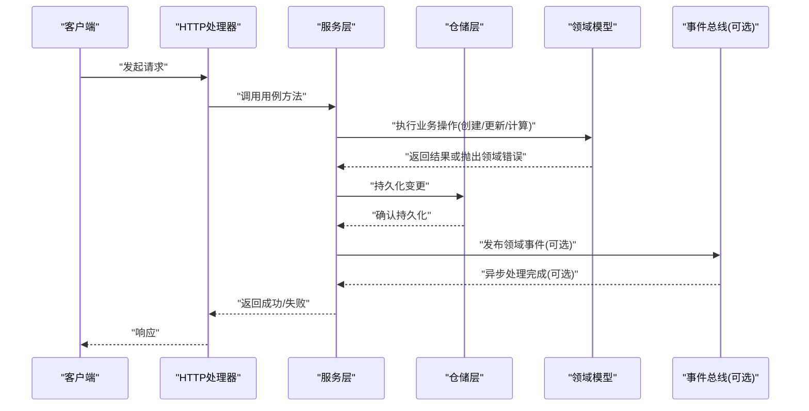
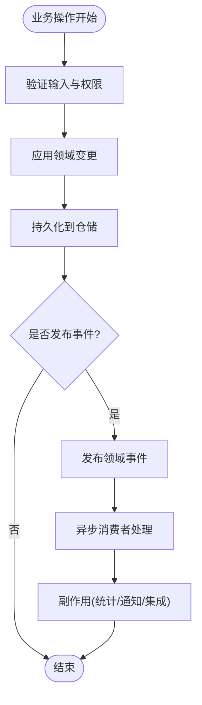
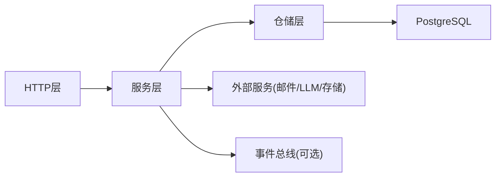

# 领域模型层

<cite>
**本文引用的文件**   
- [internal/domain/event.go](file://notifuse/internal/domain/event.go)
- [internal/domain/errors.go](file://notifuse/internal/domain/errors.go)
- [internal/domain/types.go](file://notifuse/internal/domain/types.go)
- [internal/domain/user.go](file://notifuse/internal/domain/user.go)
- [internal/domain/workspace.go](file://notifuse/internal/domain/workspace.go)
- [internal/domain/contact.go](file://notifuse/internal/domain/contact.go)
- [internal/domain/contact_list.go](file://notifuse/internal/domain/contact_list.go)
- [internal/domain/segment.go](file://notifuse/internal/domain/segment.go)
- [internal/domain/template.go](file://notifuse/internal/domain/template.go)
- [internal/domain/broadcast.go](file://notifuse/internal/domain/broadcast.go)
- [internal/domain/email_queue.go](file://notifuse/internal/domain/email_queue.go)
- [internal/domain/automation.go](file://notifuse/internal/domain/automation.go)
- [internal/domain/webhook_subscription.go](file://notifuse/internal/domain/webhook_subscription.go)
- [internal/domain/inbound_webhook_event.go](file://notifuse/internal/domain/inbound_webhook_event.go)
- [internal/domain/custom_event.go](file://notifuse/internal/domain/custom_event.go)
- [internal/domain/message_history.go](file://notifuse/internal/domain/message_history.go)
- [internal/domain/setting.go](file://notifuse/internal/domain/setting.go)
- [internal/domain/list.go](file://notifuse/internal/domain/list.go)
- [internal/domain/task.go](file://notifuse/internal/domain/task.go)
- [internal/domain/tree.go](file://notifuse/internal/domain/tree.go)
- [internal/domain/nullables.go](file://notifuse/internal/domain/nullables.go)
- [internal/domain/nullable_json.go](file://notifuse/internal/domain/nullable_json.go)
- [internal/domain/languages.go](file://notifuse/internal/domain/languages.go)
- [internal/domain/timezones.go](file://notifuse/internal/domain/timezones.go)
- [internal/repository/analytics_postgres.go](file://notifuse/internal/repository/analytics_postgres.go)
- [internal/repository/auth_repository.go](file://notifuse/internal/repository/auth_repository.go)
- [internal/repository/automation_postgres.go](file://notifuse/internal/repository/automation_postgres.go)
- [internal/repository/blog_postgres.go](file://notifuse/internal/repository/blog_postgres.go)
- [internal/repository/broadcast_postgres.go](file://notifuse/internal/repository/broadcast_postgres.go)
- [internal/repository/contact_list_postgres.go](file://notifuse/internal/repository/contact_list_postgres.go)
- [internal/repository/contact_postgres.go](file://notifuse/internal/repository/contact_postgres.go)
- [internal/repository/contact_segment_queue_postgres.go](file://notifuse/internal/repository/contact_segment_queue_postgres.go)
- [internal/repository/contact_timeline_postgre.go](file://notifuse/internal/repository/contact_timeline_postgre.go)
- [internal/repository/custom_event_postgres.go](file://notifuse/internal/repository/custom_event_postgres.go)
- [internal/repository/email_queue_postgres.go](file://notifuse/internal/repository/email_queue_postgres.go)
- [internal/repository/federated_identity_postgres.go](file://notifuse/internal/repository/federated_identity_postgres.go)
- [internal/repository/inbound_webhook_event_postgres.go](file://notifuse/internal/repository/inbound_webhook_event_postgres.go)
- [internal/repository/list_postgres.go](file://notifuse/internal/repository/list_postgres.go)
- [internal/repository/message_history_postgre.go](file://notifuse/internal/repository/message_history_postgre.go)
- [internal/repository/segment_postgres.go](file://notifuse/internal/repository/segment_postgres.go)
- [internal/repository/setting_repository.go](file://notifuse/internal/repository/setting_repository.go)
- [internal/repository/task_postgres.go](file://notifuse/internal/repository/task_postgres.go)
- [internal/repository/telemetry_postgres.go](file://notifuse/internal/repository/telemetry_postgres.go)
- [internal/repository/template_postgres.go](file://notifuse/internal/repository/template_postgres.go)
- [internal/repository/transactional_postgre.go](file://notifuse/internal/repository/transactional_postgre.go)
- [internal/repository/user_postgres.go](file://notifuse/internal/repository/user_postgres.go)
- [internal/repository/webhook_delivery_postgres.go](file://notifuse/internal/repository/webhook_delivery_postgres.go)
- [internal/repository/webhook_subscription_postgres.go](file://notifuse/internal/repository/webhook_subscription_postgres.go)
- [internal/repository/workspace_postgres.go](file://notifuse/internal/repository/workspace_postgres.go)
- [internal/service/automation_service.go](file://notifuse/internal/service/automation_service.go)
- [internal/service/automation_executor.go](file://notifuse/internal/service/automation_executor.go)
- [internal/service/automation_scheduler.go](file://notifuse/internal/service/automation_scheduler.go)
- [internal/service/automation_node_executor.go](file://notifuse/internal/service/automation_node_executor.go)
- [internal/service/automation_trigger_generator.go](file://notifuse/internal/service/automation_trigger_generator.go)
- [internal/service/broadcast_service.go](file://notifuse/internal/service/broadcast_service.go)
- [internal/service/contact_service.go](file://notifuse/internal/service/contact_service.go)
- [internal/service/contact_list_service.go](file://notifuse/internal/service/contact_list_service.go)
- [internal/service/custom_event_service.go](file://notifuse/internal/service/custom_event_service.go)
- [internal/service/email_service.go](file://notifuse/internal/service/email_service.go)
- [internal/service/inbound_reply_service_test.go](file://notifuse/internal/service/inbound_reply_service_test.go)
- [internal/service/inbound_reply_mailgun.go](file://notifuse/internal/service/inbound_reply_mailgun.go)
- [internal/service/inbound_reply_ses.go](file://notifuse/internal/service/inbound_reply_ses.go)
- [internal/service/inbound_webhook_event_service.go](file://notifuse/internal/service/inbound_webhook_event_service.go)
- [internal/service/integration_sync_processor.go](file://notifuse/internal/service/integration_sync_processor.go)
- [internal/service/list_service.go](file://notifuse/internal/service/list_service.go)
- [internal/service/segment_service.go](file://notifuse/internal/service/segment_service.go)
- [internal/service/segment_build_processor.go](file://notifuse/internal/service/segment_build_processor.go)
- [internal/service/segment_recompute_task_processor.go](file://notifuse/internal/service/segment_recompute_task_processor.go)
- [internal/service/system_notification_service.go](file://notifuse/internal/service/system_notification_service.go)
- [internal/service/task_service.go](file://notifuse/internal/service/task_service.go)
- [internal/service/task_scheduler.go](file://notifuse/internal/service/task_scheduler.go)
- [internal/service/template_service.go](file://notifuse/internal/service/template_service.go)
- [internal/service/transactional_service.go](file://notifuse/internal/service/transactional_service.go)
- [internal/service/user_service.go](file://notifuse/internal/service/user_service.go)
- [internal/service/webhook_delivery_worker.go](file://notifuse/internal/service/webhook_delivery_worker.go)
- [internal/service/webhook_subscription_service.go](file://notifuse/internal/service/webhook_subscription_service.go)
- [internal/service/workspace_service.go](file://notifuse/internal/service/workspace_service.go)
- [internal/http/automation_handler.go](file://notifuse/internal/http/automation_handler.go)
- [internal/http/broadcast_handler.go](file://notifuse/internal/http/broadcast_handler.go)
- [internal/http/contact_handler.go](file://notifuse/internal/http/contact_handler.go)
- [internal/http/contact_list_handler.go](file://notifuse/internal/http/contact_list_handler.go)
- [internal/http/custom_event_handler.go](file://notifuse/internal/http/custom_event_handler.go)
- [internal/http/email_handler.go](file://notifuse/internal/http/email_handler.go)
- [internal/http/inbound_webhook_event_handler.go](file://notifuse/internal/http/inbound_webhook_event_handler.go)
- [internal/http/list_handler.go](file://notifuse/internal/http/list_handler.go)
- [internal/http/segment_handler.go](file://notifuse/internal/http/segment_handler.go)
- [internal/http/settings_handler.go](file://notifuse/internal/http/settings_handler.go)
- [internal/http/setup_handler.go](file://notifuse/internal/http/setup_handler.go)
- [internal/http/supabase_webhook_handler.go](file://notifuse/internal/http/supabase_webhook_handler.go)
- [internal/http/task_handler.go](file://notifuse/internal/http/task_handler.go)
- [internal/http/template_handler.go](file://notifuse/internal/http/template_handler.go)
- [internal/http/transactional_handler.go](file://notifuse/internal/http/transactional_handler.go)
- [internal/http/user_handler.go](file://notifuse/internal/http/user_handler.go)
- [internal/http/webhook_registration_handler.go](file://notifuse/internal/http/webhook_registration_handler.go)
- [internal/http/webhook_subscription_handler.go](file://notifuse/internal/http/webhook_subscription_handler.go)
- [internal/http/workspace_handler.go](file://notifuse/internal/http/workspace_handler.go)
</cite>

## 目录
1. [简介](#简介)
2. [项目结构](#项目结构)
3. [核心组件](#核心组件)
4. [架构总览](#架构总览)
5. [详细组件分析](#详细组件分析)
6. [依赖分析](#依赖分析)
7. [性能考虑](#性能考虑)
8. [故障排查指南](#故障排查指南)
9. [结论](#结论)
10. [附录](#附录)

## 简介
本章节面向Notifuse平台的领域模型层，聚焦于：
- 领域实体、值对象与聚合根的设计原则与建模方法
- 领域行为与业务规则的封装策略，确保内聚性
- 领域事件设计与发布机制，支撑事件驱动架构
- 领域模型的验证规则与约束条件，保障数据完整性
- 领域实体的创建、更新与业务操作方法示例（以路径引用代替代码片段）
- 领域模型与数据传输对象(DTO)的映射关系与转换策略

## 项目结构
领域模型位于 internal/domain，围绕“工作区-用户-联系人-模板-广播-自动化-Webhook-任务”等核心概念组织。仓储实现位于 internal/repository，服务编排位于 internal/service，HTTP入口位于 internal/http。

```mermaid
graph TB
subgraph "领域层"
D_Event["event.go"]
D_Errors["errors.go"]
D_Types["types.go"]
D_User["user.go"]
D_Workspace["workspace.go"]
D_Contact["contact.go"]
D_List["list.go"]
D_Template["template.go"]
D_Broadcast["broadcast.go"]
D_EmailQueue["email_queue.go"]
D_Automation["automation.go"]
D_WebhookSub["webhook_subscription.go"]
D_InboundEvt["inbound_webhook_event.go"]
D_CustomEvt["custom_event.go"]
D_MsgHistory["message_history.go"]
D_Setting["setting.go"]
D_Task["task.go"]
D_Nulls["nullables.go / nullable_json.go"]
D_Lang["languages.go"]
D_TZ["timezones.go"]
D_Tree["tree.go"]
end
subgraph "仓储层"
R_Auto["automation_postgres.go"]
R_Bcast["broadcast_postgres.go"]
R_Cont["contact_postgres.go"]
R_ListPg["contact_list_postgres.go"]
R_Seg["segment_postgres.go"]
R_Tpl["template_postgres.go"]
R_WebhookSub["webhook_subscription_postgres.go"]
R_Inbound["inbound_webhook_event_postgres.go"]
R_Custom["custom_event_postgres.go"]
R_Msg["message_history_postgre.go"]
R_Setting["setting_repository.go"]
R_Task["task_postgres.go"]
R_User["user_postgres.go"]
R_WS["workspace_postgres.go"]
R_EmailQ["email_queue_postgres.go"]
R_Analytics["analytics_postgres.go"]
R_Auth["auth_repository.go"]
R_Fed["federated_identity_postgres.go"]
R_ListPg2["list_postgres.go"]
R_Telemetry["telemetry_postgres.go"]
R_Trans["transactional_postgre.go"]
R_Delivery["webhook_delivery_postgres.go"]
R_ContSegQ["contact_segment_queue_postgres.go"]
R_ContTL["contact_timeline_postgre.go"]
end
subgraph "服务层"
S_Auto["automation_service.go"]
S_AutoExec["automation_executor.go"]
S_AutoSch["automation_scheduler.go"]
S_AutoNode["automation_node_executor.go"]
S_AutoTrig["automation_trigger_generator.go"]
S_Bcast["broadcast_service.go"]
S_Cont["contact_service.go"]
S_ListSvc["contact_list_service.go"]
S_Seg["segment_service.go"]
S_Tpl["template_service.go"]
S_WebhookSub["webhook_subscription_service.go"]
S_InboundEvt["inbound_webhook_event_service.go"]
S_CustomEvt["custom_event_service.go"]
S_Email["email_service.go"]
S_Task["task_service.go"]
S_TaskSch["task_scheduler.go"]
S_WS["workspace_service.go"]
S_User["user_service.go"]
S_IntSync["integration_sync_processor.go"]
S_Notif["system_notification_service.go"]
S_Deliver["webhook_delivery_worker.go"]
S_SegBuild["segment_build_processor.go"]
S_SegRecomp["segment_recompute_task_processor.go"]
end
subgraph "HTTP入口"
H_Auto["automation_handler.go"]
H_Bcast["broadcast_handler.go"]
H_Cont["contact_handler.go"]
H_ListH["contact_list_handler.go"]
H_Seg["segment_handler.go"]
H_Tpl["template_handler.go"]
H_WebhookSub["webhook_subscription_handler.go"]
H_Inbound["inbound_webhook_event_handler.go"]
H_Custom["custom_event_handler.go"]
H_Email["email_handler.go"]
H_Task["task_handler.go"]
H_Settings["settings_handler.go"]
H_Setup["setup_handler.go"]
H_Supabase["supabase_webhook_handler.go"]
H_Trans["transactional_handler.go"]
H_User["user_handler.go"]
H_WS["workspace_handler.go"]
H_WebReg["webhook_registration_handler.go"]
end
H_Auto --> S_Auto
H_Bcast --> S_Bcast
H_Cont --> S_Cont
H_ListH --> S_ListSvc
H_Seg --> S_Seg
H_Tpl --> S_Tpl
H_WebhookSub --> S_WebhookSub
H_Inbound --> S_InboundEvt
H_Custom --> S_CustomEvt
H_Email --> S_Email
H_Task --> S_Task
H_Settings --> S_Task
H_Setup --> S_WS
H_Supabase --> S_InboundEvt
H_Trans --> S_Trans
H_User --> S_User
H_WS --> S_WS
H_WebReg --> S_WebhookSub
S_Auto --> R_Auto
S_Bcast --> R_Bcast
S_Cont --> R_Cont
S_ListSvc --> R_ListPg
S_Seg --> R_Seg
S_Tpl --> R_Tpl
S_WebhookSub --> R_WebhookSub
S_InboundEvt --> R_Inbound
S_CustomEvt --> R_Custom
S_Email --> R_EmailQ
S_Task --> R_Task
S_WS --> R_WS
S_User --> R_User
S_IntSync --> R_Auto
S_Notif --> R_Custom
S_Deliver --> R_Delivery
S_SegBuild --> R_Seg
S_SegRecomp --> R_Seg
R_Auto --> D_Automation
R_Bcast --> D_Broadcast
R_Cont --> D_Contact
R_ListPg --> D_List
R_Seg --> D_Contact
R_Tpl --> D_Template
R_WebhookSub --> D_WebhookSub
R_Inbound --> D_InboundEvt
R_Custom --> D_CustomEvt
R_EmailQ --> D_EmailQueue
R_Task --> D_Task
R_WS --> D_Workspace
R_User --> D_User
R_Analytics --> D_Types
R_Auth --> D_User
R_Fed --> D_User
R_ListPg2 --> D_List
R_Telemetry --> D_Types
R_Trans --> D_MessageHistory
R_Delivery --> D_WebhookSub
R_ContSegQ --> D_Contact
R_ContTL --> D_Contact
```

图表来源
- [internal/domain/event.go](file://notifuse/internal/domain/event.go)
- [internal/domain/errors.go](file://notifuse/internal/domain/errors.go)
- [internal/domain/types.go](file://notifuse/internal/domain/types.go)
- [internal/domain/user.go](file://notifuse/internal/domain/user.go)
- [internal/domain/workspace.go](file://notifuse/internal/domain/workspace.go)
- [internal/domain/contact.go](file://notifuse/internal/domain/contact.go)
- [internal/domain/contact_list.go](file://notifuse/internal/domain/contact_list.go)
- [internal/domain/segment.go](file://notifuse/internal/domain/segment.go)
- [internal/domain/template.go](file://notifuse/internal/domain/template.go)
- [internal/domain/broadcast.go](file://notifuse/internal/domain/broadcast.go)
- [internal/domain/email_queue.go](file://notifuse/internal/domain/email_queue.go)
- [internal/domain/automation.go](file://notifuse/internal/domain/automation.go)
- [internal/domain/webhook_subscription.go](file://notifuse/internal/domain/webhook_subscription.go)
- [internal/domain/inbound_webhook_event.go](file://notifuse/internal/domain/inbound_webhook_event.go)
- [internal/domain/custom_event.go](file://notifuse/internal/domain/custom_event.go)
- [internal/domain/message_history.go](file://notifuse/internal/domain/message_history.go)
- [internal/domain/setting.go](file://notifuse/internal/domain/setting.go)
- [internal/domain/list.go](file://notifuse/internal/domain/list.go)
- [internal/domain/task.go](file://notifuse/internal/domain/task.go)
- [internal/domain/tree.go](file://notifuse/internal/domain/tree.go)
- [internal/domain/nullables.go](file://notifuse/internal/domain/nullables.go)
- [internal/domain/nullable_json.go](file://notifuse/internal/domain/nullable_json.go)
- [internal/domain/languages.go](file://notifuse/internal/domain/languages.go)
- [internal/domain/timezones.go](file://notifuse/internal/domain/timezones.go)
- [internal/repository/automation_postgres.go](file://notifuse/internal/repository/automation_postgres.go)
- [internal/repository/broadcast_postgres.go](file://notifuse/internal/repository/broadcast_postgres.go)
- [internal/repository/contact_postgres.go](file://notifuse/internal/repository/contact_postgres.go)
- [internal/repository/contact_list_postgres.go](file://notifuse/internal/repository/contact_list_postgres.go)
- [internal/repository/segment_postgres.go](file://notifuse/internal/repository/segment_postgres.go)
- [internal/repository/template_postgres.go](file://notifuse/internal/repository/template_postgres.go)
- [internal/repository/webhook_subscription_postgres.go](file://notifuse/internal/repository/webhook_subscription_postgres.go)
- [internal/repository/inbound_webhook_event_postgres.go](file://notifuse/internal/repository/inbound_webhook_event_postgres.go)
- [internal/repository/custom_event_postgres.go](file://notifuse/internal/repository/custom_event_postgres.go)
- [internal/repository/email_queue_postgres.go](file://notifuse/internal/repository/email_queue_postgres.go)
- [internal/repository/task_postgres.go](file://notifuse/internal/repository/task_postgres.go)
- [internal/repository/user_postgres.go](file://notifuse/internal/repository/user_postgres.go)
- [internal/repository/workspace_postgres.go](file://notifuse/internal/repository/workspace_postgres.go)
- [internal/repository/analytics_postgres.go](file://notifuse/internal/repository/analytics_postgres.go)
- [internal/repository/auth_repository.go](file://notifuse/internal/repository/auth_repository.go)
- [internal/repository/federated_identity_postgres.go](file://notifuse/internal/repository/federated_identity_postgres.go)
- [internal/repository/list_postgres.go](file://notifuse/internal/repository/list_postgres.go)
- [internal/repository/telemetry_postgres.go](file://notifuse/internal/repository/telemetry_postgres.go)
- [internal/repository/transactional_postgre.go](file://notifuse/internal/repository/transactional_postgre.go)
- [internal/repository/webhook_delivery_postgres.go](file://notifuse/internal/repository/webhook_delivery_postgres.go)
- [internal/repository/contact_segment_queue_postgres.go](file://notifuse/internal/repository/contact_segment_queue_postgres.go)
- [internal/repository/contact_timeline_postgre.go](file://notifuse/internal/repository/contact_timeline_postgre.go)
- [internal/service/automation_service.go](file://notifuse/internal/service/automation_service.go)
- [internal/service/automation_executor.go](file://notifuse/internal/service/automation_executor.go)
- [internal/service/automation_scheduler.go](file://notifuse/internal/service/automation_scheduler.go)
- [internal/service/automation_node_executor.go](file://notifuse/internal/service/automation_node_executor.go)
- [internal/service/automation_trigger_generator.go](file://notifuse/internal/service/automation_trigger_generator.go)
- [internal/service/broadcast_service.go](file://notifuse/internal/service/broadcast_service.go)
- [internal/service/contact_service.go](file://notifuse/internal/service/contact_service.go)
- [internal/service/contact_list_service.go](file://notifuse/internal/service/contact_list_service.go)
- [internal/service/custom_event_service.go](file://notifuse/internal/service/custom_event_service.go)
- [internal/service/email_service.go](file://notifuse/internal/service/email_service.go)
- [internal/service/inbound_webhook_event_service.go](file://notifuse/internal/service/inbound_webhook_event_service.go)
- [internal/service/integration_sync_processor.go](file://notifuse/internal/service/integration_sync_processor.go)
- [internal/service/list_service.go](file://notifuse/internal/service/list_service.go)
- [internal/service/segment_service.go](file://notifuse/internal/service/segment_service.go)
- [internal/service/segment_build_processor.go](file://notifuse/internal/service/segment_build_processor.go)
- [internal/service/segment_recompute_task_processor.go](file://notifuse/internal/service/segment_recompute_task_processor.go)
- [internal/service/system_notification_service.go](file://notifuse/internal/service/system_notification_service.go)
- [notifuse/internal/service/task_service.go](file://notifuse/internal/service/task_service.go)
- [notifuse/internal/service/task_scheduler.go](file://notifuse/internal/service/task_scheduler.go)
- [internal/service/template_service.go](file://notifuse/internal/service/template_service.go)
- [internal/service/transactional_service.go](file://notifuse/internal/service/transactional_service.go)
- [internal/service/user_service.go](file://notifuse/internal/service/user_service.go)
- [internal/service/webhook_delivery_worker.go](file://notifuse/internal/service/webhook_delivery_worker.go)
- [internal/service/webhook_subscription_service.go](file://notifuse/internal/service/webhook_subscription_service.go)
- [internal/service/workspace_service.go](file://notifuse/internal/service/workspace_service.go)
- [internal/http/automation_handler.go](file://notifuse/internal/http/automation_handler.go)
- [internal/http/broadcast_handler.go](file://notifuse/internal/http/broadcast_handler.go)
- [internal/http/contact_handler.go](file://notifuse/internal/http/contact_handler.go)
- [internal/http/contact_list_handler.go](file://notifuse/internal/http/contact_list_handler.go)
- [internal/http/custom_event_handler.go](file://notifuse/internal/http/custom_event_handler.go)
- [internal/http/email_handler.go](file://notifuse/internal/http/email_handler.go)
- [internal/http/inbound_webhook_event_handler.go](file://notifuse/internal/http/inbound_webhook_event_handler.go)
- [internal/http/list_handler.go](file://notifuse/internal/http/list_handler.go)
- [internal/http/segment_handler.go](file://notifuse/internal/http/segment_handler.go)
- [internal/http/settings_handler.go](file://notifuse/internal/http/settings_handler.go)
- [internal/http/setup_handler.go](file://notifuse/internal/http/setup_handler.go)
- [internal/http/supabase_webhook_handler.go](file://notifuse/internal/http/supabase_webhook_handler.go)
- [internal/http/task_handler.go](file://notifuse/internal/http/task_handler.go)
- [internal/http/template_handler.go](file://notifuse/internal/http/template_handler.go)
- [internal/http/transactional_handler.go](file://notifuse/internal/http/transactional_handler.go)
- [internal/http/user_handler.go](file://notifuse/internal/http/user_handler.go)
- [internal/http/webhook_registration_handler.go](file://notifuse/internal/http/webhook_registration_handler.go)
- [internal/http/webhook_subscription_handler.go](file://notifuse/internal/http/webhook_subscription_handler.go)
- [internal/http/workspace_handler.go](file://notifuse/internal/http/workspace_handler.go)

章节来源
- [internal/domain/event.go](file://notifuse/internal/domain/event.go)
- [internal/domain/errors.go](file://notifuse/internal/domain/errors.go)
- [internal/domain/types.go](file://notifuse/internal/domain/types.go)
- [internal/domain/user.go](file://notifuse/internal/domain/user.go)
- [internal/domain/workspace.go](file://notifuse/internal/domain/workspace.go)
- [internal/domain/contact.go](file://notifuse/internal/domain/contact.go)
- [internal/domain/contact_list.go](file://notifuse/internal/domain/contact_list.go)
- [internal/domain/segment.go](file://notifuse/internal/domain/segment.go)
- [internal/domain/template.go](file://notifuse/internal/domain/template.go)
- [internal/domain/broadcast.go](file://notifuse/internal/domain/broadcast.go)
- [internal/domain/email_queue.go](file://notifuse/internal/domain/email_queue.go)
- [internal/domain/automation.go](file://notifuse/internal/domain/automation.go)
- [internal/domain/webhook_subscription.go](file://notifuse/internal/domain/webhook_subscription.go)
- [internal/domain/inbound_webhook_event.go](file://notifuse/internal/domain/inbound_webhook_event.go)
- [internal/domain/custom_event.go](file://notifuse/internal/domain/custom_event.go)
- [internal/domain/message_history.go](file://notifuse/internal/domain/message_history.go)
- [internal/domain/setting.go](file://notifuse/internal/domain/setting.go)
- [internal/domain/list.go](file://notifuse/internal/domain/list.go)
- [internal/domain/task.go](file://notifuse/internal/domain/task.go)
- [internal/domain/tree.go](file://notifuse/internal/domain/tree.go)
- [internal/domain/nullables.go](file://notifuse/internal/domain/nullables.go)
- [internal/domain/nullable_json.go](file://notifuse/internal/domain/nullable_json.go)
- [internal/domain/languages.go](file://notifuse/internal/domain/languages.go)
- [internal/domain/timezones.go](file://notifuse/internal/domain/timezones.go)

## 核心组件
本节概述领域层的关键构件及其职责边界：
- 领域事件(event.go)：定义事件类型、载荷结构与发布接口，作为跨边界的不可变事实载体
- 错误与异常(errors.go)：统一领域错误语义，便于上层处理与可观测性
- 通用类型(types.go)：时间戳、ID、分页、排序等基础类型，保证领域一致性
- 值对象(nullables.go, nullable_json.go, languages.go, timezones.go)：提供强类型的空值与枚举表达，减少无效状态
- 树形结构(tree.go)：用于模板块、自动化节点等层级结构的通用表示

章节来源
- [internal/domain/event.go](file://notifuse/internal/domain/event.go)
- [internal/domain/errors.go](file://notifuse/internal/domain/errors.go)
- [internal/domain/types.go](file://notifuse/internal/domain/types.go)
- [internal/domain/nullables.go](file://notifuse/internal/domain/nullables.go)
- [internal/domain/nullable_json.go](file://notifuse/internal/domain/nullable_json.go)
- [internal/domain/languages.go](file://notifuse/internal/domain/languages.go)
- [internal/domain/timezones.go](file://notifuse/internal/domain/timezones.go)
- [internal/domain/tree.go](file://notifuse/internal/domain/tree.go)

## 架构总览
领域模型遵循分层与DDD思想：
- HTTP层负责请求解析与响应序列化，不承载业务逻辑
- 服务层编排用例，协调多个仓储与领域对象，必要时发布领域事件
- 仓储层仅做持久化适配，不引入业务规则
- 领域层保持高内聚，通过方法暴露行为，并通过事件对外沟通

图表来源
- [internal/http/automation_handler.go](file://notifuse/internal/http/automation_handler.go)
- [internal/service/automation_service.go](file://notifuse/internal/service/automation_service.go)
- [internal/repository/automation_postgres.go](file://notifuse/internal/repository/automation_postgres.go)
- [internal/domain/automation.go](file://notifuse/internal/domain/automation.go)
- [internal/domain/event.go](file://notifuse/internal/domain/event.go)

## 详细组件分析

### 工作区与工作区用户
- 聚合根：工作区(workspace.go)，包含成员、权限、设置等上下文
- 实体：用户(user.go)，与工作区存在多对多关系，支持联合身份(federated_identity_postgres.go)
- 值对象：语言(languages.go)、时区(timezones.go)
- 典型操作：创建工作区、邀请成员、切换角色、读取设置
- 验证与约束：唯一键、外键约束、角色合法性、邮箱格式校验
- 示例路径：
  - 创建工作区：[internal/http/workspace_handler.go](file://notifuse/internal/http/workspace_handler.go) → [internal/service/workspace_service.go](file://notifuse/internal/service/workspace_service.go) → [internal/repository/workspace_postgres.go](file://notifuse/internal/repository/workspace_postgres.go)
  - 管理成员：[internal/http/workspace_handler.go](file://notifuse/internal/http/workspace_handler.go) → [internal/service/workspace_service.go](file://notifuse/internal/service/workspace_service.go) → [internal/repository/workspace_postgres.go](file://notifuse/internal/repository/workspace_postgres.go)

章节来源
- [internal/domain/workspace.go](file://notifuse/internal/domain/workspace.go)
- [internal/domain/user.go](file://notifuse/internal/domain/user.go)
- [internal/domain/languages.go](file://notifuse/internal/domain/languages.go)
- [internal/domain/timezones.go](file://notifuse/internal/domain/timezones.go)
- [internal/repository/federated_identity_postgres.go](file://notifuse/internal/repository/federated_identity_postgres.go)
- [internal/http/workspace_handler.go](file://notifuse/internal/http/workspace_handler.go)
- [internal/service/workspace_service.go](file://notifuse/internal/service/workspace_service.go)
- [internal/repository/workspace_postgres.go](file://notifuse/internal/repository/workspace_postgres.go)

### 联系人、列表与分群
- 聚合根：联系人(contact.go)、联系人群组(list.go)
- 实体：联系人详情、标签、元数据
- 值对象：地址、语言、时区、自定义字段(nullable_json.go)
- 分群(segment.go)：基于条件的动态分组，构建与重算由处理器驱动
- 典型操作：批量导入、去重合并、按分群筛选、增量同步
- 验证与约束：邮箱唯一性、必填字段、分群表达式合法性
- 示例路径：
  - 创建联系人：[internal/http/contact_handler.go](file://notifuse/internal/http/contact_handler.go) → [internal/service/contact_service.go](file://notifuse/internal/service/contact_service.go) → [internal/repository/contact_postgres.go](file://notifuse/internal/repository/contact_postgres.go)
  - 管理列表：[internal/http/contact_list_handler.go](file://notifuse/internal/http/contact_list_handler.go) → [internal/service/contact_list_service.go](file://notifuse/internal/service/contact_list_service.go) → [internal/repository/contact_list_postgres.go](file://notifuse/internal/repository/contact_list_postgres.go)
  - 分群构建：[internal/service/segment_service.go](file://notifuse/internal/service/segment_service.go) → [internal/service/segment_build_processor.go](file://notifuse/internal/service/segment_build_processor.go) → [internal/repository/segment_postgres.go](file://notifuse/internal/repository/segment_postgres.go)

章节来源
- [internal/domain/contact.go](file://notifuse/internal/domain/contact.go)
- [internal/domain/list.go](file://notifuse/internal/domain/list.go)
- [internal/domain/segment.go](file://notifuse/internal/domain/segment.go)
- [internal/domain/nullable_json.go](file://notifuse/internal/domain/nullable_json.go)
- [internal/http/contact_handler.go](file://notifuse/internal/http/contact_handler.go)
- [internal/service/contact_service.go](file://notifuse/internal/service/contact_service.go)
- [internal/repository/contact_postgres.go](file://notifuse/internal/repository/contact_postgres.go)
- [internal/http/contact_list_handler.go](file://notifuse/internal/http/contact_list_handler.go)
- [internal/service/contact_list_service.go](file://notifuse/internal/service/contact_list_service.go)
- [internal/repository/contact_list_postgres.go](file://notifuse/internal/repository/contact_list_postgres.go)
- [internal/service/segment_service.go](file://notifuse/internal/service/segment_service.go)
- [internal/service/segment_build_processor.go](file://notifuse/internal/service/segment_build_processor.go)
- [internal/repository/segment_postgres.go](file://notifuse/internal/repository/segment_postgres.go)

### 模板与消息历史
- 聚合根：模板(template.go)，支持块级结构(tree.go)
- 实体：消息历史(message_history.go)，记录发送轨迹与状态
- 值对象：主题、正文、附件、变量替换上下文
- 典型操作：模板版本化、渲染、发送、归档
- 验证与约束：模板语法、变量存在性、附件大小限制
- 示例路径：
  - 模板CRUD：[internal/http/template_handler.go](file://notifuse/internal/http/template_handler.go) → [internal/service/template_service.go](file://notifuse/internal/service/template_service.go) → [internal/repository/template_postgres.go](file://notifuse/internal/repository/template_postgres.go)
  - 消息历史：[internal/repository/message_history_postgre.go](file://notifuse/internal/repository/message_history_postgre.go)

章节来源
- [internal/domain/template.go](file://notifuse/internal/domain/template.go)
- [internal/domain/message_history.go](file://notifuse/internal/domain/message_history.go)
- [internal/domain/tree.go](file://notifuse/internal/domain/tree.go)
- [internal/http/template_handler.go](file://notifuse/internal/http/template_handler.go)
- [internal/service/template_service.go](file://notifuse/internal/service/template_service.go)
- [internal/repository/template_postgres.go](file://notifuse/internal/repository/template_postgres.go)
- [internal/repository/message_history_postgre.go](file://notifuse/internal/repository/message_history_postgre.go)

### 广播与邮件队列
- 聚合根：广播(broadcast.go)
- 实体：邮件队列(email_queue.go)
- 值对象：收件人集合、优先级、重试策略
- 典型操作：创建广播、选择目标、入队、重试、退避
- 验证与约束：目标有效性、频率限制、配额控制
- 示例路径：
  - 创建广播：[internal/http/broadcast_handler.go](file://notifuse/internal/http/broadcast_handler.go) → [internal/service/broadcast_service.go](file://notifuse/internal/service/broadcast_service.go) → [internal/repository/broadcast_postgres.go](file://notifuse/internal/repository/broadcast_postgres.go)
  - 邮件队列：[internal/repository/email_queue_postgres.go](file://notifuse/internal/repository/email_queue_postgres.go)

章节来源
- [internal/domain/broadcast.go](file://notifuse/internal/domain/broadcast.go)
- [internal/domain/email_queue.go](file://notifuse/internal/domain/email_queue.go)
- [internal/http/broadcast_handler.go](file://notifuse/internal/http/broadcast_handler.go)
- [internal/service/broadcast_service.go](file://notifuse/internal/service/broadcast_service.go)
- [internal/repository/broadcast_postgres.go](file://notifuse/internal/repository/broadcast_postgres.go)
- [internal/repository/email_queue_postgres.go](file://notifuse/internal/repository/email_queue_postgres.go)

### 自动化流程
- 聚合根：自动化(automation.go)
- 实体：触发器、节点、执行记录
- 值对象：条件表达式、动作参数、调度策略
- 典型操作：创建流程、注册触发器、调度执行、节点编排
- 验证与约束：循环检测、节点可达性、权限校验
- 示例路径：
  - 自动化编排：[internal/service/automation_service.go](file://notifuse/internal/service/automation_service.go) → [internal/service/automation_executor.go](file://notifuse/internal/service/automation_executor.go) → [internal/service/automation_scheduler.go](file://notifuse/internal/service/automation_scheduler.go) → [internal/service/automation_node_executor.go](file://notifuse/internal/service/automation_node_executor.go) → [internal/repository/automation_postgres.go](file://notifuse/internal/repository/automation_postgres.go)

章节来源
- [internal/domain/automation.go](file://notifuse/internal/domain/automation.go)
- [internal/service/automation_service.go](file://notifuse/internal/service/automation_service.go)
- [internal/service/automation_executor.go](file://notifuse/internal/service/automation_executor.go)
- [internal/service/automation_scheduler.go](file://notifuse/internal/service/automation_scheduler.go)
- [internal/service/automation_node_executor.go](file://notifuse/internal/service/automation_node_executor.go)
- [internal/repository/automation_postgres.go](file://notifuse/internal/repository/automation_postgres.go)

### Webhook订阅与事件
- 聚合根：Webhook订阅(webhook_subscription.go)
- 实体：入站Webhook事件(inbound_webhook_event.go)、自定义事件(custom_event.go)
- 值对象：签名、重试策略、过滤条件
- 典型操作：注册订阅、接收事件、匹配路由、投递回调
- 验证与约束：URL合法性、签名校验、速率限制
- 示例路径：
  - 订阅管理：[internal/http/webhook_subscription_handler.go](file://notifuse/internal/http/webhook_subscription_handler.go) → [internal/service/webhook_subscription_service.go](file://notifuse/internal/service/webhook_subscription_service.go) → [internal/repository/webhook_subscription_postgres.go](file://notifuse/internal/repository/webhook_subscription_postgres.go)
  - 入站事件：[internal/http/inbound_webhook_event_handler.go](file://notifuse/internal/http/inbound_webhook_event_handler.go) → [internal/service/inbound_webhook_event_service.go](file://notifuse/internal/service/inbound_webhook_event_service.go) → [internal/repository/inbound_webhook_event_postgres.go](file://notifuse/internal/repository/inbound_webhook_event_postgres.go)
  - 自定义事件：[internal/http/custom_event_handler.go](file://notifuse/internal/http/custom_event_handler.go) → [internal/service/custom_event_service.go](file://notifuse/internal/service/custom_event_service.go) → [internal/repository/custom_event_postgres.go](file://notifuse/internal/repository/custom_event_postgres.go)

章节来源
- [internal/domain/webhook_subscription.go](file://notifuse/internal/domain/webhook_subscription.go)
- [internal/domain/inbound_webhook_event.go](file://notifuse/internal/domain/inbound_webhook_event.go)
- [internal/domain/custom_event.go](file://notifuse/internal/domain/custom_event.go)
- [internal/http/webhook_subscription_handler.go](file://notifuse/internal/http/webhook_subscription_handler.go)
- [internal/service/webhook_subscription_service.go](file://notifuse/internal/service/webhook_subscription_service.go)
- [internal/repository/webhook_subscription_postgres.go](file://notifuse/internal/repository/webhook_subscription_postgres.go)
- [internal/http/inbound_webhook_event_handler.go](file://notifuse/internal/http/inbound_webhook_event_handler.go)
- [internal/service/inbound_webhook_event_service.go](file://notifuse/internal/service/inbound_webhook_event_service.go)
- [internal/repository/inbound_webhook_event_postgres.go](file://notifuse/internal/repository/inbound_webhook_event_postgres.go)
- [internal/http/custom_event_handler.go](file://notifuse/internal/http/custom_event_handler.go)
- [internal/service/custom_event_service.go](file://notifuse/internal/service/custom_event_service.go)
- [internal/repository/custom_event_postgres.go](file://notifuse/internal/repository/custom_event_postgres.go)

### 任务与系统通知
- 聚合根：任务(task.go)
- 实体：系统通知、遥测、分析
- 值对象：调度周期、优先级、重试次数
- 典型操作：创建定时任务、执行调度、收集指标
- 验证与约束：重复任务冲突、资源配额
- 示例路径：
  - 任务服务：[internal/service/task_service.go](file://notifuse/internal/service/task_service.go) → [internal/service/task_scheduler.go](file://notifuse/internal/service/task_scheduler.go) → [internal/repository/task_postgres.go](file://notifuse/internal/repository/task_postgres.go)
  - 系统通知：[internal/service/system_notification_service.go](file://notifuse/internal/service/system_notification_service.go)

章节来源
- [internal/domain/task.go](file://notifuse/internal/domain/task.go)
- [internal/service/task_service.go](file://notifuse/internal/service/task_service.go)
- [internal/service/task_scheduler.go](file://notifuse/internal/service/task_scheduler.go)
- [internal/repository/task_postgres.go](file://notifuse/internal/repository/task_postgres.go)
- [internal/service/system_notification_service.go](file://notifuse/internal/service/system_notification_service.go)

### 领域事件设计与发布机制
- 事件定义：在 event.go 中定义事件类型与载荷结构，确保不可变与可追溯
- 发布时机：在服务层完成关键业务变更后发布，如自动化执行完成、入站事件处理完毕、广播发送完成
- 消费方式：异步消费者监听事件并执行副作用（如统计、通知、外部集成）
- 幂等与顺序：事件携带唯一ID，消费者需实现幂等；必要时使用分区键保证顺序

图表来源
- [internal/domain/event.go](file://notifuse/internal/domain/event.go)
- [internal/service/automation_service.go](file://notifuse/internal/service/automation_service.go)
- [internal/service/inbound_webhook_event_service.go](file://notifuse/internal/service/inbound_webhook_event_service.go)
- [internal/service/broadcast_service.go](file://notifuse/internal/service/broadcast_service.go)

章节来源
- [internal/domain/event.go](file://notifuse/internal/domain/event.go)
- [internal/service/automation_service.go](file://notifuse/internal/service/automation_service.go)
- [internal/service/inbound_webhook_event_service.go](file://notifuse/internal/service/inbound_webhook_event_service.go)
- [internal/service/broadcast_service.go](file://notifuse/internal/service/broadcast_service.go)

### 领域模型的验证与约束
- 值对象校验：邮箱、URL、语言、时区等采用强类型与内置校验
- 实体不变式：唯一性、外键约束、状态机转换合法
- 分群表达式：语法与语义校验，避免非法查询
- 模板渲染：变量存在性与类型安全
- 错误语义：统一错误类型，便于上层捕获与提示

章节来源
- [internal/domain/nullables.go](file://notifuse/internal/domain/nullables.go)
- [internal/domain/nullable_json.go](file://notifuse/internal/domain/nullable_json.go)
- [internal/domain/languages.go](file://notifuse/internal/domain/languages.go)
- [internal/domain/timezones.go](file://notifuse/internal/domain/timezones.go)
- [internal/domain/errors.go](file://notifuse/internal/domain/errors.go)
- [internal/domain/segment.go](file://notifuse/internal/domain/segment.go)
- [internal/domain/template.go](file://notifuse/internal/domain/template.go)

### 领域模型与DTO的映射与转换
- 映射方向：HTTP请求体→服务层输入对象→领域实体；领域实体→服务层输出对象→HTTP响应体
- 转换策略：
  - 在HTTP层进行最小化的绑定与校验
  - 在服务层将输入转换为领域友好的结构
  - 领域层只暴露必要的查询方法与命令
  - 输出侧按需投影为DTO，避免泄露内部结构
- 示例路径：
  - 自动化：[internal/http/automation_handler.go](file://notifuse/internal/http/automation_handler.go) → [internal/service/automation_service.go](file://notifuse/internal/service/automation_service.go)
  - 联系人：[internal/http/contact_handler.go](file://notifuse/internal/http/contact_handler.go) → [internal/service/contact_service.go](file://notifuse/internal/service/contact_service.go)
  - 模板：[internal/http/template_handler.go](file://notifuse/internal/http/template_handler.go) → [internal/service/template_service.go](file://notifuse/internal/service/template_service.go)

章节来源
- [internal/http/automation_handler.go](file://notifuse/internal/http/automation_handler.go)
- [internal/service/automation_service.go](file://notifuse/internal/service/automation_service.go)
- [internal/http/contact_handler.go](file://notifuse/internal/http/contact_handler.go)
- [internal/service/contact_service.go](file://notifuse/internal/service/contact_service.go)
- [internal/http/template_handler.go](file://notifuse/internal/http/template_handler.go)
- [internal/service/template_service.go](file://notifuse/internal/service/template_service.go)

## 依赖分析
- 低耦合：HTTP与服务层通过接口交互，仓储实现解耦数据库细节
- 高内聚：领域对象集中维护自身状态与规则
- 外部依赖：PostgreSQL、第三方邮件/短信/LLM供应商通过服务层适配
- 潜在环：服务层不应反向依赖HTTP；仓储仅依赖领域类型

图表来源
- [internal/http/automation_handler.go](file://notifuse/internal/http/automation_handler.go)
- [internal/service/automation_service.go](file://notifuse/internal/service/automation_service.go)
- [internal/repository/automation_postgres.go](file://notifuse/internal/repository/automation_postgres.go)
- [internal/domain/event.go](file://notifuse/internal/domain/event.go)

章节来源
- [internal/http/automation_handler.go](file://notifuse/internal/http/automation_handler.go)
- [internal/service/automation_service.go](file://notifuse/internal/service/automation_service.go)
- [internal/repository/automation_postgres.go](file://notifuse/internal/repository/automation_postgres.go)
- [internal/domain/event.go](file://notifuse/internal/domain/event.go)

## 性能考虑
- 批量操作：联系人导入、分群重算采用批处理与流式写入
- 索引设计：高频查询字段建立复合索引，避免全表扫描
- 缓存策略：模板、配置、字典类数据短期缓存
- 异步化：耗时任务(发送、渲染、外部调用)走队列与重试
- 限流与熔断：外部API调用增加限流与降级

## 故障排查指南
- 常见错误：
  - 唯一键冲突：检查邮箱/名称唯一性
  - 外键缺失：关联对象是否存在
  - 表达式非法：分群/模板变量校验
  - 外部服务超时：重试与退避策略
- 定位步骤：
  - 查看领域错误类型与堆栈
  - 核对仓储SQL与索引命中
  - 检查事件消费日志与幂等键
  - 使用遥测与分析报表定位热点

章节来源
- [internal/domain/errors.go](file://notifuse/internal/domain/errors.go)
- [internal/repository/analytics_postgres.go](file://notifuse/internal/repository/analytics_postgres.go)
- [internal/repository/telemetry_postgres.go](file://notifuse/internal/repository/telemetry_postgres.go)

## 结论
Notifuse的领域模型层以清晰的聚合边界、强类型值对象与明确的领域事件为核心，结合服务层的编排与仓储层的持久化适配，实现了高内聚、低耦合的可扩展架构。通过严格的验证与约束、完善的错误语义以及事件驱动的扩展点，平台能够稳定支撑复杂的营销与自动化场景。

## 附录
- 术语
  - 聚合根：承载一组相关实体与值对象的边界，保证一致性
  - 值对象：无标识、不可变的领域概念，强调相等性与不变式
  - 领域事件：描述领域内已发生事实的不可变记录
- 参考路径
  - 领域事件定义：[internal/domain/event.go](file://notifuse/internal/domain/event.go)
  - 领域错误：[internal/domain/errors.go](file://notifuse/internal/domain/errors.go)
  - 通用类型：[internal/domain/types.go](file://notifuse/internal/domain/types.go)
  - 值对象与工具：[internal/domain/nullables.go](file://notifuse/internal/domain/nullables.go), [internal/domain/nullable_json.go](file://notifuse/internal/domain/nullable_json.go), [internal/domain/languages.go](file://notifuse/internal/domain/languages.go), [internal/domain/timezones.go](file://notifuse/internal/domain/timezones.go)
  - 树形结构：[internal/domain/tree.go](file://notifuse/internal/domain/tree.go)