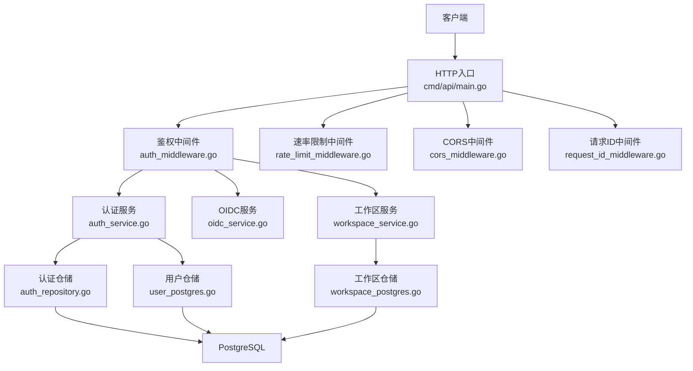
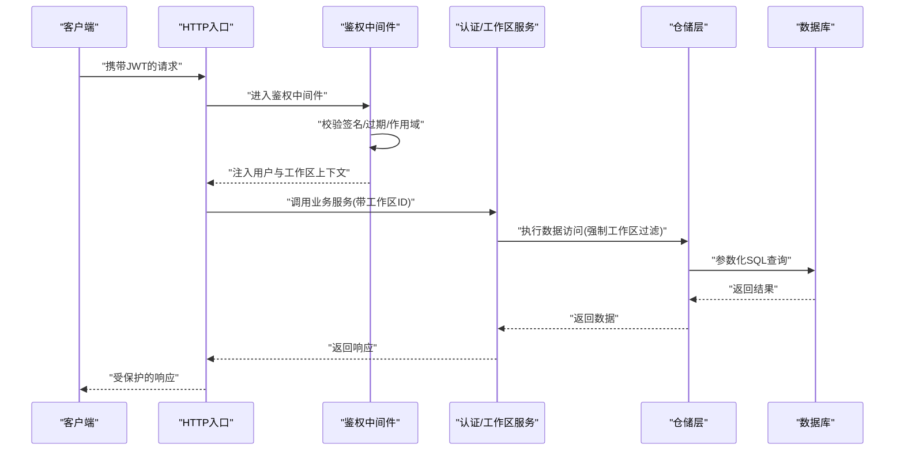
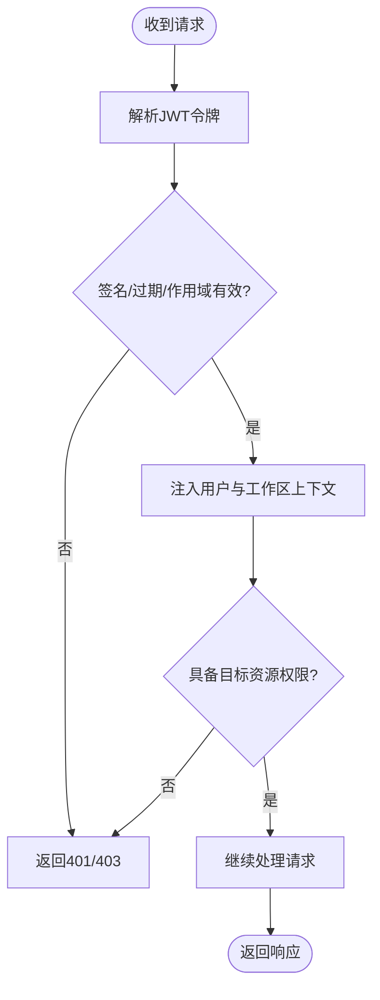
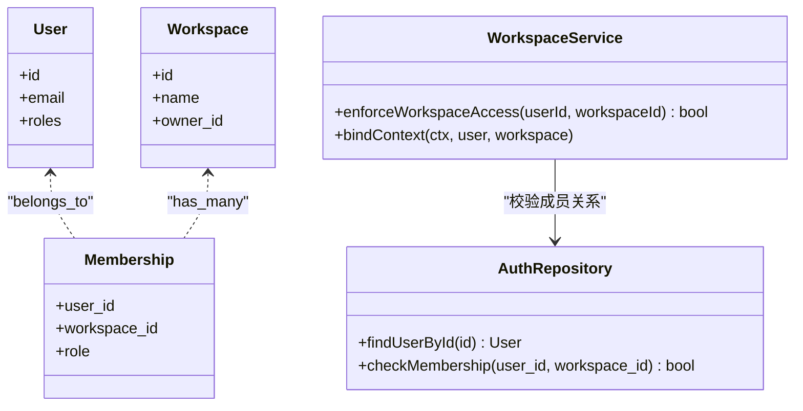
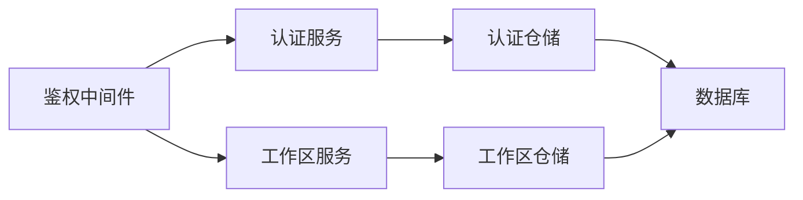

# 安全架构

<cite>
**本文引用的文件**   
- [cmd/api/main.go](file://notifuse/cmd/api/main.go)
- [config/config.go](file://notifuse/config/config.go)
- [config/oidc.go](file://notifuse/config/oidc.go)
- [internal/app/app.go](file://notifuse/internal/app/app.go)
- [internal/http/middleware/auth_middleware.go](file://notifuse/internal/http/middleware/auth_middleware.go)
- [internal/http/middleware/rate_limit_middleware.go](file://notifuse/internal/http/middleware/rate_limit_middleware.go)
- [internal/http/middleware/cors_middleware.go](file://notifuse/internal/http/middleware/cors_middleware.go)
- [internal/http/middleware/request_id_middleware.go](file://notifuse/internal/http/middleware/request_id_middleware.go)
- [internal/domain/user.go](file://notifuse/internal/domain/user.go)
- [internal/domain/workspace.go](file://notifuse/internal/domain/workspace.go)
- [internal/domain/federated_identity.go](file://notifuse/internal/domain/federated_identity.go)
- [internal/repository/auth_repository.go](file://notifuse/internal/repository/auth_repository.go)
- [internal/repository/user_postgres.go](file://notifuse/internal/repository/user_postgres.go)
- [internal/repository/workspace_postgres.go](file://notifuse/internal/repository/workspace_postgres.go)
- [internal/service/auth_service.go](file://notifuse/internal/service/auth_service.go)
- [internal/service/oauth2_token_service.go](file://notifuse/internal/service/oauth2_token_service.go)
- [internal/service/oidc_service.go](file://notifuse/internal/service/oidc_service.go)
- [internal/service/workspace_service.go](file://notifuse/internal/service/workspace_service.go)
- [pkg/crypto/crypto.go](file://notifuse/pkg/crypto/crypto.go)
- [pkg/ratelimiter/ratelimiter.go](file://notifuse/pkg/ratelimiter/ratelimiter.go)
- [pkg/safehttpclient/safehttpclient.go](file://notifuse/pkg/safehttpclient/safehttpclient.go)
- [openapi/components/security.yaml](file://notifuse/openapi/components/security.yaml)
- [SECURITY.md](file://notifuse/SECURITY.md)
</cite>

## 目录
1. [简介](#简介)
2. [项目结构](#项目结构)
3. [核心组件](#核心组件)
4. [架构总览](#架构总览)
5. [详细组件分析](#详细组件分析)
6. [依赖分析](#依赖分析)
7. [性能考虑](#性能考虑)
8. [故障排查指南](#故障排查指南)
9. [结论](#结论)
10. [附录](#附录)

## 简介
本安全架构文档面向Notifuse平台，聚焦多租户安全隔离、认证与授权体系、数据安全保护、API安全防护、威胁模型与防护策略，以及安全审计与日志记录方案。文档基于代码仓库中的实现进行梳理，确保读者能够理解系统如何在工程层面落实安全控制点。

## 项目结构
Notifuse后端采用分层架构：HTTP层负责路由与中间件；服务层封装业务逻辑；仓储层对接数据库；领域层定义实体与规则；配置与OpenAPI规范提供外部集成与安全约束说明。关键安全能力分布在以下位置：
- HTTP中间件：鉴权、速率限制、CORS、请求ID等
- 服务层：OAuth2/OIDC流程、JWT令牌管理、工作区权限校验
- 仓储层：按工作区隔离的数据访问
- 领域层：用户、工作区、联邦身份等实体
- 配置与OpenAPI：OIDC参数、安全方案声明

图表来源
- [cmd/api/main.go](file://notifuse/cmd/api/main.go)
- [internal/http/middleware/auth_middleware.go](file://notifuse/internal/http/middleware/auth_middleware.go)
- [internal/http/middleware/rate_limit_middleware.go](file://notifuse/internal/http/middleware/rate_limit_middleware.go)
- [internal/http/middleware/cors_middleware.go](file://notifuse/internal/http/middleware/cors_middleware.go)
- [internal/http/middleware/request_id_middleware.go](file://notifuse/internal/http/middleware/request_id_middleware.go)
- [internal/service/auth_service.go](file://notifuse/internal/service/auth_service.go)
- [internal/service/oidc_service.go](file://notifuse/internal/service/oidc_service.go)
- [internal/service/workspace_service.go](file://notifuse/internal/service/workspace_service.go)
- [internal/repository/auth_repository.go](file://notifuse/internal/repository/auth_repository.go)
- [internal/repository/user_postgres.go](file://notifuse/internal/repository/user_postgres.go)
- [internal/repository/workspace_postgres.go](file://notifuse/internal/repository/workspace_postgres.go)

章节来源
- [cmd/api/main.go](file://notifuse/cmd/api/main.go)
- [internal/app/app.go](file://notifuse/internal/app/app.go)

## 核心组件
- 认证与授权
  - OIDC/OAuth2集成：通过配置加载OIDC提供者信息，服务层完成授权码流与ID令牌验证。
  - JWT令牌签发与校验：在鉴权中间件中解析并校验令牌，注入当前用户与工作区上下文。
  - 角色与权限：结合用户与工作区成员关系，在服务层执行资源级访问控制。
- 多租户隔离
  - 工作区维度数据隔离：所有数据访问均携带工作区标识，仓储层强制按工作区过滤。
  - 跨工作区访问拦截：服务层拒绝未授权的工作区切换或越权操作。
- 数据安全
  - 敏感数据加密：使用加密库对敏感字段进行加解密。
  - 传输安全：HTTPS/TLS、严格CORS策略、安全的第三方HTTP客户端。
  - 存储安全：数据库连接安全、最小权限原则、字段级加密。
- API安全
  - 请求验证：OpenAPI安全方案与中间件校验。
  - 速率限制：全局与路径级限流。
  - SQL注入防护：参数化查询与ORM约束。
- 可观测性与审计
  - 请求ID贯穿链路，结构化日志记录关键事件（登录、授权失败、越权尝试）。

章节来源
- [config/oidc.go](file://notifuse/config/oidc.go)
- [internal/service/oidc_service.go](file://notifuse/internal/service/oidc_service.go)
- [internal/service/auth_service.go](file://notifuse/internal/service/auth_service.go)
- [internal/http/middleware/auth_middleware.go](file://notifuse/internal/http/middleware/auth_middleware.go)
- [internal/service/workspace_service.go](file://notifuse/internal/service/workspace_service.go)
- [internal/repository/workspace_postgres.go](file://notifuse/internal/repository/workspace_postgres.go)
- [pkg/crypto/crypto.go](file://notifuse/pkg/crypto/crypto.go)
- [pkg/safehttpclient/safehttpclient.go](file://notifuse/pkg/safehttpclient/safehttpclient.go)
- [pkg/ratelimiter/ratelimiter.go](file://notifuse/pkg/ratelimiter/ratelimiter.go)
- [openapi/components/security.yaml](file://notifuse/openapi/components/security.yaml)

## 架构总览
下图展示从客户端到数据库的端到端安全路径，包括认证、授权、隔离与审计的关键节点。

图表来源
- [internal/http/middleware/auth_middleware.go](file://notifuse/internal/http/middleware/auth_middleware.go)
- [internal/service/auth_service.go](file://notifuse/internal/service/auth_service.go)
- [internal/service/workspace_service.go](file://notifuse/internal/service/workspace_service.go)
- [internal/repository/workspace_postgres.go](file://notifuse/internal/repository/workspace_postgres.go)

## 详细组件分析

### 认证与授权体系
- OIDC/OAuth2集成
  - 配置项包含授权服务器URL、客户端ID/密钥、回调地址与作用域。
  - 服务层实现授权码流转、ID令牌获取与校验，必要时刷新令牌。
- JWT令牌管理
  - 中间件解析Authorization头，校验签名、有效期与作用域，将用户与工作区信息写入请求上下文。
  - 支持按工作区限定令牌的可用范围，防止令牌跨租户滥用。
- 角色与权限控制
  - 用户与工作区成员关系决定其在工作区内可访问的资源集合。
  - 服务层在执行写操作前进行RBAC检查，拒绝越权行为。

图表来源
- [internal/http/middleware/auth_middleware.go](file://notifuse/internal/http/middleware/auth_middleware.go)
- [internal/service/auth_service.go](file://notifuse/internal/service/auth_service.go)
- [internal/service/oidc_service.go](file://notifuse/internal/service/oidc_service.go)

章节来源
- [config/oidc.go](file://notifuse/config/oidc.go)
- [internal/service/oidc_service.go](file://notifuse/internal/service/oidc_service.go)
- [internal/service/auth_service.go](file://notifuse/internal/service/auth_service.go)
- [internal/http/middleware/auth_middleware.go](file://notifuse/internal/http/middleware/auth_middleware.go)

### 多租户安全隔离机制
- 工作区级别数据隔离
  - 所有数据表与查询均包含工作区标识，仓储层强制附加WHERE条件，避免跨租户读取。
  - 工作区服务负责校验当前用户是否属于该工作区，并在上下文中绑定工作区ID。
- 权限控制
  - 用户在工作区内的角色决定其对资源的操作权限，服务层在变更操作前进行二次校验。
- 边界与例外
  - 系统级元数据与平台配置需明确隔离策略，避免管理员越权访问其他租户数据。

图表来源
- [internal/domain/user.go](file://notifuse/internal/domain/user.go)
- [internal/domain/workspace.go](file://notifuse/internal/domain/workspace.go)
- [internal/service/workspace_service.go](file://notifuse/internal/service/workspace_service.go)
- [internal/repository/auth_repository.go](file://notifuse/internal/repository/auth_repository.go)

章节来源
- [internal/domain/workspace.go](file://notifuse/internal/domain/workspace.go)
- [internal/service/workspace_service.go](file://notifuse/internal/service/workspace_service.go)
- [internal/repository/workspace_postgres.go](file://notifuse/internal/repository/workspace_postgres.go)

### 数据安全保护措施
- 敏感数据加密
  - 使用加密库对敏感字段进行加解密，密钥管理与轮换策略由配置与环境变量控制。
- 传输安全
  - 强制HTTPS/TLS，服务端启用严格证书校验；CORS仅允许可信源；第三方HTTP客户端禁用不安全重定向与弱协议。
- 存储安全
  - 数据库连接使用TLS；应用层以参数化查询避免注入；最小权限账户访问数据库。

章节来源
- [pkg/crypto/crypto.go](file://notifuse/pkg/crypto/crypto.go)
- [pkg/safehttpclient/safehttpclient.go](file://notifuse/pkg/safehttpclient/safehttpclient.go)
- [internal/repository/workspace_postgres.go](file://notifuse/internal/repository/workspace_postgres.go)

### API安全防护机制
- 请求验证
  - OpenAPI安全方案声明JWT/Bearer等认证方式，中间件统一校验。
- 速率限制
  - 全局与路径级限流，防止暴力破解与滥用。
- SQL注入防护
  - 全部使用参数化查询与ORM约束，禁止拼接SQL字符串。

章节来源
- [openapi/components/security.yaml](file://notifuse/openapi/components/security.yaml)
- [internal/http/middleware/rate_limit_middleware.go](file://notifuse/internal/http/middleware/rate_limit_middleware.go)
- [pkg/ratelimiter/ratelimiter.go](file://notifuse/pkg/ratelimiter/ratelimiter.go)
- [internal/repository/workspace_postgres.go](file://notifuse/internal/repository/workspace_postgres.go)

### 安全威胁模型与防护措施
- 威胁类别
  - 越权访问（水平/垂直）：通过工作区上下文与服务层RBAC校验缓解。
  - 令牌泄露与重放：短生命周期JWT、作用域限制、HTTPS传输。
  - 注入攻击：参数化查询与输入校验。
  - 跨站脚本与XSS：模板渲染与输出编码（前端侧配合）。
  - 第三方集成风险：安全HTTP客户端与白名单域名。
- 防护措施
  - 中间件统一鉴权与限流；服务层强制工作区隔离；加密敏感数据；严格CORS与TLS。

[本节为概念性内容，不直接分析具体文件]

### 安全审计与日志记录
- 审计事件
  - 登录成功/失败、令牌刷新、权限拒绝、工作区切换、敏感操作（创建/删除）。
- 日志要求
  - 结构化JSON格式，包含请求ID、用户ID、工作区ID、动作、结果与错误码。
  - 脱敏策略：不记录密码、令牌、完整邮箱等敏感信息。
- 可观测性
  - 请求ID贯穿中间件与服务层，便于追踪与排障。

章节来源
- [internal/http/middleware/request_id_middleware.go](file://notifuse/internal/http/middleware/request_id_middleware.go)
- [internal/service/auth_service.go](file://notifuse/internal/service/auth_service.go)
- [internal/service/workspace_service.go](file://notifuse/internal/service/workspace_service.go)

## 依赖分析
- 组件耦合
  - 鉴权中间件依赖认证与工作区服务；服务层依赖仓储层；仓储层依赖数据库。
- 外部依赖
  - OIDC提供商、邮件/消息队列、对象存储等，均需遵循最小权限与网络白名单策略。
- 循环依赖
  - 分层清晰，避免服务层反向依赖HTTP层。

图表来源
- [internal/http/middleware/auth_middleware.go](file://notifuse/internal/http/middleware/auth_middleware.go)
- [internal/service/auth_service.go](file://notifuse/internal/service/auth_service.go)
- [internal/service/workspace_service.go](file://notifuse/internal/service/workspace_service.go)
- [internal/repository/auth_repository.go](file://notifuse/internal/repository/auth_repository.go)
- [internal/repository/workspace_postgres.go](file://notifuse/internal/repository/workspace_postgres.go)

章节来源
- [internal/app/app.go](file://notifuse/internal/app/app.go)

## 性能考虑
- 鉴权开销
  - JWT校验轻量，建议缓存公钥或JWK集以减少外部调用。
- 速率限制
  - 使用内存或Redis作为计数器后端，注意键空间隔离与过期策略。
- 数据库访问
  - 工作区过滤索引优化，避免全表扫描；批量操作减少往返。

[本节提供一般性指导，不直接分析具体文件]

## 故障排查指南
- 常见问题
  - 401/403：检查JWT签名、过期时间、作用域与工作区成员关系。
  - 跨租户数据泄漏：确认仓储层WHERE条件是否始终包含工作区ID。
  - 速率限制触发：检查限流策略与客户端重试逻辑。
- 定位方法
  - 使用请求ID串联日志；查看鉴权中间件与服务层日志；核对OpenAPI安全方案与实际实现一致性。

章节来源
- [internal/http/middleware/auth_middleware.go](file://notifuse/internal/http/middleware/auth_middleware.go)
- [internal/service/auth_service.go](file://notifuse/internal/service/auth_service.go)
- [internal/repository/workspace_postgres.go](file://notifuse/internal/repository/workspace_postgres.go)

## 结论
Notifuse的安全架构围绕“认证—授权—隔离—审计”展开，通过中间件与服务层的协同实现强隔离与细粒度权限控制。结合加密、传输安全与严格的API防护，平台在多租户环境下具备较高的安全性与可运维性。建议持续完善密钥轮换、审计告警与渗透测试流程，以应对不断演进的威胁面。

[本节为总结性内容，不直接分析具体文件]

## 附录
- 参考规范
  - OpenAPI安全方案：用于声明认证方式与作用域。
  - 安全策略文档：平台整体安全政策与合规要求。

章节来源
- [openapi/components/security.yaml](file://notifuse/openapi/components/security.yaml)
- [SECURITY.md](file://notifuse/SECURITY.md)