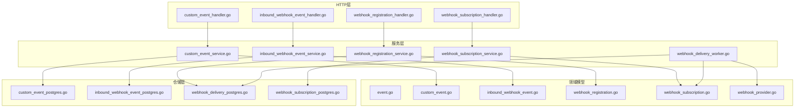
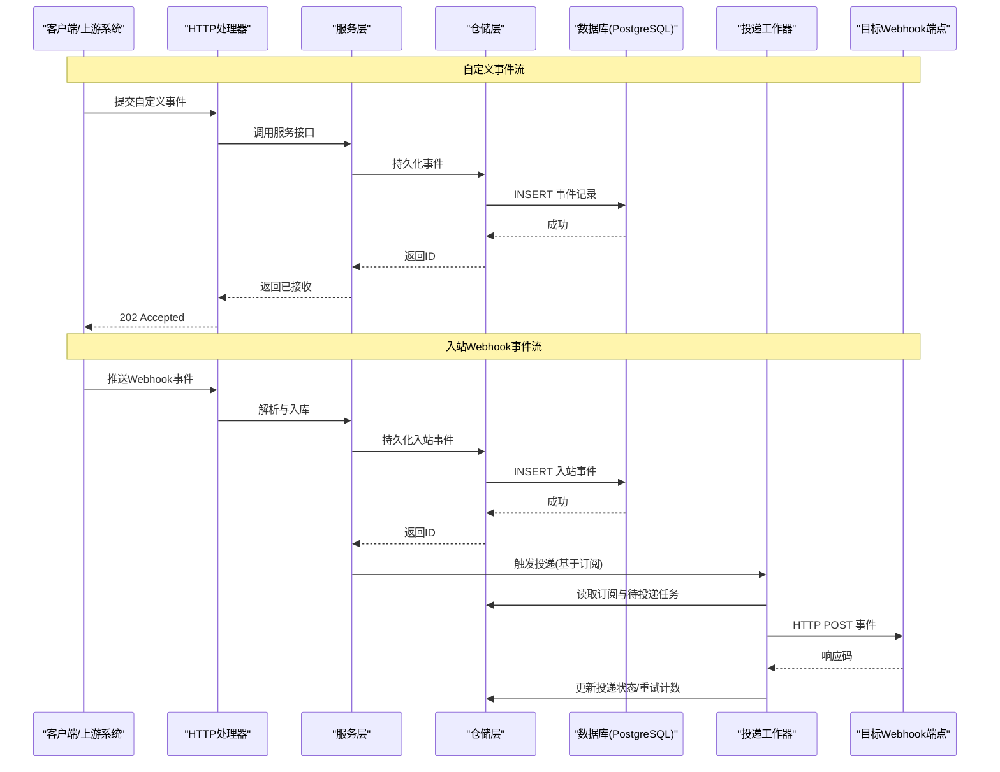
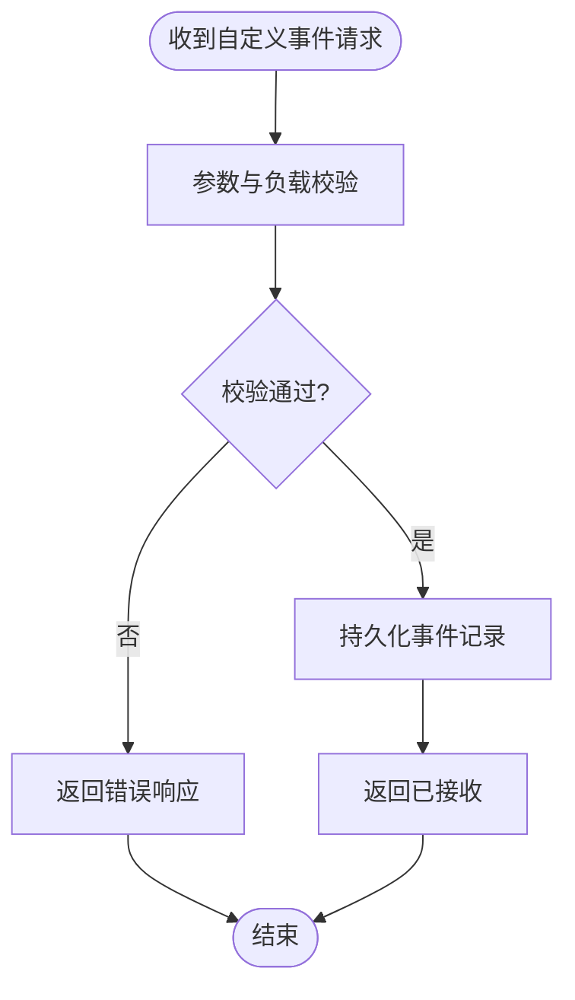
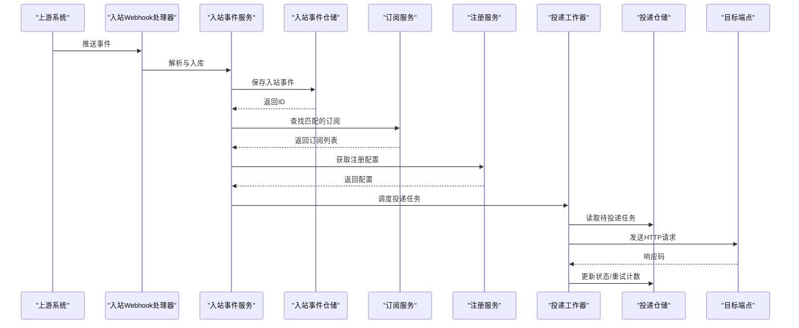
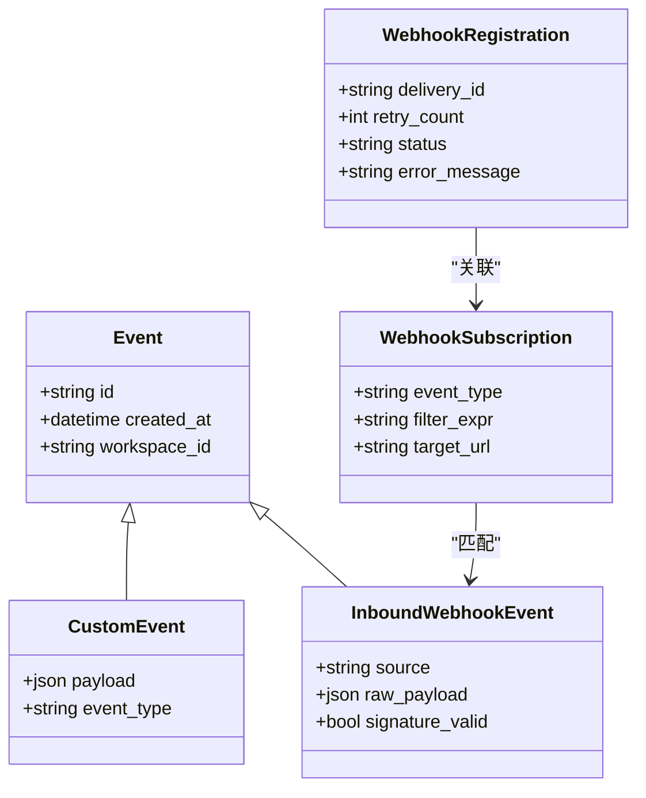
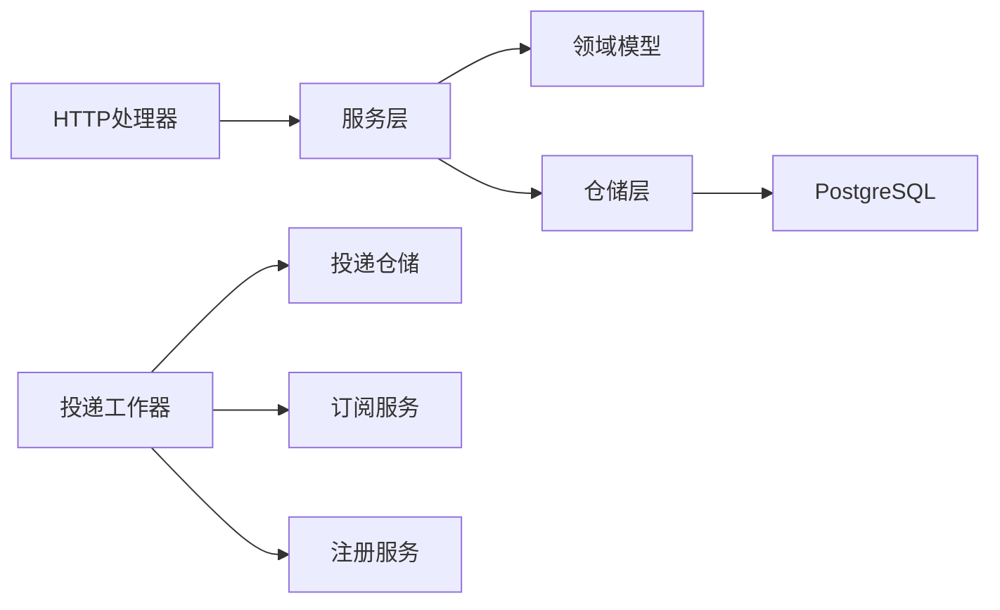

# 事件驱动架构

<cite>
**本文引用的文件**   
- [internal/domain/event.go](file://notifuse/internal/domain/event.go)
- [internal/domain/custom_event.go](file://notifuse/internal/domain/custom_event.go)
- [internal/domain/inbound_webhook_event.go](file://notifuse/internal/domain/inbound_webhook_event.go)
- [internal/domain/webhook_registration.go](file://notifuse/internal/domain/webhook_registration.go)
- [internal/domain/webhook_subscription.go](file://notifuse/internal/domain/webhook_subscription.go)
- [internal/domain/webhook_provider.go](file://notifuse/internal/domain/webhook_provider.go)
- [internal/http/custom_event_handler.go](file://notifuse/internal/http/custom_event_handler.go)
- [internal/http/inbound_webhook_event_handler.go](file://notifuse/internal/http/inbound_webhook_event_handler.go)
- [internal/http/webhook_registration_handler.go](file://notifuse/internal/http/webhook_registration_handler.go)
- [internal/http/webhook_subscription_handler.go](file://notifuse/internal/http/webhook_subscription_handler.go)
- [internal/service/custom_event_service.go](file://notifuse/internal/service/custom_event_service.go)
- [internal/service/inbound_webhook_event_service.go](file://notifuse/internal/service/inbound_webhook_event_service.go)
- [internal/service/webhook_delivery_worker.go](file://notifuse/internal/service/webhook_delivery_worker.go)
- [internal/service/webhook_registration_service.go](file://notifuse/internal/service/webhook_registration_service.go)
- [internal/service/webhook_subscription_service.go](file://notifuse/internal/service/webhook_subscription_service.go)
- [internal/repository/custom_event_postgres.go](file://notifuse/internal/repository/custom_event_postgres.go)
- [internal/repository/inbound_webhook_event_postgres.go](file://notifuse/internal/repository/inbound_webhook_event_postgres.go)
- [internal/repository/webhook_delivery_postgres.go](file://notifuse/internal/repository/webhook_delivery_postgres.go)
- [internal/repository/webhook_subscription_postgres.go](file://notifuse/internal/repository/webhook_subscription_postgres.go)
- [cmd/api/main.go](file://notifuse/cmd/api/main.go)
</cite>

## 目录
1. [简介](#简介)
2. [项目结构](#项目结构)
3. [核心组件](#核心组件)
4. [架构总览](#架构总览)
5. [详细组件分析](#详细组件分析)
6. [依赖关系分析](#依赖关系分析)
7. [性能考虑](#性能考虑)
8. [故障排查指南](#故障排查指南)
9. [结论](#结论)
10. [附录](#附录)

## 简介
本文件面向Notifuse平台的事件驱动架构，聚焦以下目标：
- 解释系统内部的事件总线设计与消息传递机制（发布/订阅、异步处理与负载均衡）
- 文档化Webhook事件的处理流程（注册、过滤规则、重试策略与失败处理）
- 说明自定义事件的定义、发布与消费机制（事件格式规范与数据验证）
- 阐述分布式环境下的事件一致性与幂等性保证
- 提供事件追踪与监控方案，辅助调试与分析事件链路
- 给出常见场景的最佳实践与性能优化建议

## 项目结构
Notifuse后端采用分层架构：HTTP层负责路由与请求校验；服务层编排业务逻辑；仓储层对接数据库；领域模型统一描述事件、Webhook订阅与投递状态。

图表来源
- [internal/http/custom_event_handler.go](file://notifuse/internal/http/custom_event_handler.go)
- [internal/http/inbound_webhook_event_handler.go](file://notifuse/internal/http/inbound_webhook_event_handler.go)
- [internal/http/webhook_registration_handler.go](file://notifuse/internal/http/webhook_registration_handler.go)
- [internal/http/webhook_subscription_handler.go](file://notifuse/internal/http/webhook_subscription_handler.go)
- [internal/service/custom_event_service.go](file://notifuse/internal/service/custom_event_service.go)
- [internal/service/inbound_webhook_event_service.go](file://notifuse/internal/service/inbound_webhook_event_service.go)
- [internal/service/webhook_delivery_worker.go](file://notifuse/internal/service/webhook_delivery_worker.go)
- [internal/service/webhook_registration_service.go](file://notifuse/internal/service/webhook_registration_service.go)
- [internal/service/webhook_subscription_service.go](file://notifuse/internal/service/webhook_subscription_service.go)
- [internal/repository/custom_event_postgres.go](file://notifuse/internal/repository/custom_event_postgres.go)
- [internal/repository/inbound_webhook_event_postgres.go](file://notifuse/internal/repository/inbound_webhook_event_postgres.go)
- [internal/repository/webhook_delivery_postgres.go](file://notifuse/internal/repository/webhook_delivery_postgres.go)
- [internal/repository/webhook_subscription_postgres.go](file://notifuse/internal/repository/webhook_subscription_postgres.go)
- [internal/domain/event.go](file://notifuse/internal/domain/event.go)
- [internal/domain/custom_event.go](file://notifuse/internal/domain/custom_event.go)
- [internal/domain/inbound_webhook_event.go](file://notifuse/internal/domain/inbound_webhook_event.go)
- [internal/domain/webhook_registration.go](file://notifuse/internal/domain/webhook_registration.go)
- [internal/domain/webhook_subscription.go](file://notifuse/internal/domain/webhook_subscription.go)
- [internal/domain/webhook_provider.go](file://notifuse/internal/domain/webhook_provider.go)

章节来源
- [cmd/api/main.go](file://notifuse/cmd/api/main.go)

## 核心组件
- 事件模型与通用能力
  - 事件基础结构与生命周期字段由领域模型定义，为所有事件类型提供统一基元。
- 自定义事件
  - 提供API用于创建与查询自定义事件，持久化到PostgreSQL，供下游消费者或自动化流程消费。
- Webhook事件
  - 支持外部系统通过回调URL推送事件；平台侧进行入库、匹配订阅、触发投递。
- Webhook订阅与注册
  - 订阅管理事件类型、过滤条件与目标URL；注册记录投递结果与重试状态。
- 投递工作器
  - 从队列中拉取待投递任务，按策略重试并更新状态。

章节来源
- [internal/domain/event.go](file://notifuse/internal/domain/event.go)
- [internal/domain/custom_event.go](file://notifuse/internal/domain/custom_event.go)
- [internal/domain/inbound_webhook_event.go](file://notifuse/internal/domain/inbound_webhook_event.go)
- [internal/domain/webhook_registration.go](file://notifuse/internal/domain/webhook_registration.go)
- [internal/domain/webhook_subscription.go](file://notifuse/internal/domain/webhook_subscription.go)
- [internal/domain/webhook_provider.go](file://notifuse/internal/domain/webhook_provider.go)
- [internal/service/custom_event_service.go](file://notifuse/internal/service/custom_event_service.go)
- [internal/service/inbound_webhook_event_service.go](file://notifuse/internal/service/inbound_webhook_event_service.go)
- [internal/service/webhook_delivery_worker.go](file://notifuse/internal/service/webhook_delivery_worker.go)
- [internal/service/webhook_registration_service.go](file://notifuse/internal/service/webhook_registration_service.go)
- [internal/service/webhook_subscription_service.go](file://notifuse/internal/service/webhook_subscription_service.go)

## 架构总览
下图展示了“自定义事件”和“入站Webhook事件”的端到端流转路径，包括发布、持久化、订阅匹配、投递与重试。

图表来源
- [internal/http/custom_event_handler.go](file://notifuse/internal/http/custom_event_handler.go)
- [internal/http/inbound_webhook_event_handler.go](file://notifuse/internal/http/inbound_webhook_event_handler.go)
- [internal/service/custom_event_service.go](file://notifuse/internal/service/custom_event_service.go)
- [internal/service/inbound_webhook_event_service.go](file://notifuse/internal/service/inbound_webhook_event_service.go)
- [internal/service/webhook_delivery_worker.go](file://notifuse/internal/service/webhook_delivery_worker.go)
- [internal/repository/custom_event_postgres.go](file://notifuse/internal/repository/custom_event_postgres.go)
- [internal/repository/inbound_webhook_event_postgres.go](file://notifuse/internal/repository/inbound_webhook_event_postgres.go)
- [internal/repository/webhook_delivery_postgres.go](file://notifuse/internal/repository/webhook_delivery_postgres.go)

## 详细组件分析

### 自定义事件：定义、发布与消费
- 定义与格式
  - 事件包含标准标识、时间戳、工作空间上下文与负载数据，负载以结构化JSON承载，便于模板渲染与过滤。
- 发布流程
  - HTTP处理器接收请求，服务层执行校验与持久化，仓储层写入数据库后返回接受状态。
- 消费机制
  - 下游可通过API查询事件，或通过自动化/订阅机制消费；也可作为Webhook事件的源数据参与匹配。

图表来源
- [internal/http/custom_event_handler.go](file://notifuse/internal/http/custom_event_handler.go)
- [internal/service/custom_event_service.go](file://notifuse/internal/service/custom_event_service.go)
- [internal/repository/custom_event_postgres.go](file://notifuse/internal/repository/custom_event_postgres.go)
- [internal/domain/custom_event.go](file://notifuse/internal/domain/custom_event.go)

章节来源
- [internal/domain/custom_event.go](file://notifuse/internal/domain/custom_event.go)
- [internal/http/custom_event_handler.go](file://notifuse/internal/http/custom_event_handler.go)
- [internal/service/custom_event_service.go](file://notifuse/internal/service/custom_event_service.go)
- [internal/repository/custom_event_postgres.go](file://notifuse/internal/repository/custom_event_postgres.go)

### Webhook事件：注册、过滤、投递与重试
- 注册与订阅
  - 注册表维护全局配置；订阅表维护事件类型、过滤条件与目标URL。
- 过滤规则
  - 基于事件类型与表达式对入站事件进行匹配，命中则生成投递任务。
- 投递与重试
  - 工作器按指数退避与最大重试次数策略重试，记录每次尝试的状态与响应码。
- 失败处理
  - 失败时保留原始负载与错误信息，支持人工干预与重放。

图表来源
- [internal/http/inbound_webhook_event_handler.go](file://notifuse/internal/http/inbound_webhook_event_handler.go)
- [internal/service/inbound_webhook_event_service.go](file://notifuse/internal/service/inbound_webhook_event_service.go)
- [internal/repository/inbound_webhook_event_postgres.go](file://notifuse/internal/repository/inbound_webhook_event_postgres.go)
- [internal/service/webhook_subscription_service.go](file://notifuse/internal/service/webhook_subscription_service.go)
- [internal/service/webhook_registration_service.go](file://notifuse/internal/service/webhook_registration_service.go)
- [internal/service/webhook_delivery_worker.go](file://notifuse/internal/service/webhook_delivery_worker.go)
- [internal/repository/webhook_delivery_postgres.go](file://notifuse/internal/repository/webhook_delivery_postgres.go)

章节来源
- [internal/domain/webhook_registration.go](file://notifuse/internal/domain/webhook_registration.go)
- [internal/domain/webhook_subscription.go](file://notifuse/internal/domain/webhook_subscription.go)
- [internal/domain/webhook_provider.go](file://notifuse/internal/domain/webhook_provider.go)
- [internal/http/inbound_webhook_event_handler.go](file://notifuse/internal/http/inbound_webhook_event_handler.go)
- [internal/service/inbound_webhook_event_service.go](file://notifuse/internal/service/inbound_webhook_event_service.go)
- [internal/service/webhook_subscription_service.go](file://notifuse/internal/service/webhook_subscription_service.go)
- [internal/service/webhook_registration_service.go](file://notifuse/internal/service/webhook_registration_service.go)
- [internal/service/webhook_delivery_worker.go](file://notifuse/internal/service/webhook_delivery_worker.go)
- [internal/repository/inbound_webhook_event_postgres.go](file://notifuse/internal/repository/inbound_webhook_event_postgres.go)
- [internal/repository/webhook_delivery_postgres.go](file://notifuse/internal/repository/webhook_delivery_postgres.go)

### 事件模型与数据结构
- 事件基类
  - 提供统一的标识、时间戳与工作空间上下文，确保跨模块一致性。
- 自定义事件
  - 扩展负载字段，支持任意JSON结构，便于下游灵活消费。
- 入站Webhook事件
  - 记录来源、签名校验结果与原始负载，便于审计与重放。
- 订阅与注册
  - 订阅定义事件类型、过滤条件与目标URL；注册记录投递结果与重试计数。

图表来源
- [internal/domain/event.go](file://notifuse/internal/domain/event.go)
- [internal/domain/custom_event.go](file://notifuse/internal/domain/custom_event.go)
- [internal/domain/inbound_webhook_event.go](file://notifuse/internal/domain/inbound_webhook_event.go)
- [internal/domain/webhook_subscription.go](file://notifuse/internal/domain/webhook_subscription.go)
- [internal/domain/webhook_registration.go](file://notifuse/internal/domain/webhook_registration.go)

章节来源
- [internal/domain/event.go](file://notifuse/internal/domain/event.go)
- [internal/domain/custom_event.go](file://notifuse/internal/domain/custom_event.go)
- [internal/domain/inbound_webhook_event.go](file://notifuse/internal/domain/inbound_webhook_event.go)
- [internal/domain/webhook_subscription.go](file://notifuse/internal/domain/webhook_subscription.go)
- [internal/domain/webhook_registration.go](file://notifuse/internal/domain/webhook_registration.go)

## 依赖关系分析
- 耦合与内聚
  - HTTP层仅做路由与输入校验，业务编排集中在服务层，仓储层专注数据访问，领域模型清晰分离，内聚度高、耦合度低。
- 直接依赖
  - 处理器依赖服务；服务依赖仓储与领域模型；工作器依赖投递仓储与订阅/注册服务。
- 外部依赖
  - PostgreSQL用于持久化；HTTP客户端用于向目标端点投递。

图表来源
- [internal/http/custom_event_handler.go](file://notifuse/internal/http/custom_event_handler.go)
- [internal/http/inbound_webhook_event_handler.go](file://notifuse/internal/http/inbound_webhook_event_handler.go)
- [internal/service/custom_event_service.go](file://notifuse/internal/service/custom_event_service.go)
- [internal/service/inbound_webhook_event_service.go](file://notifuse/internal/service/inbound_webhook_event_service.go)
- [internal/service/webhook_delivery_worker.go](file://notifuse/internal/service/webhook_delivery_worker.go)
- [internal/repository/custom_event_postgres.go](file://notifuse/internal/repository/custom_event_postgres.go)
- [internal/repository/inbound_webhook_event_postgres.go](file://notifuse/internal/repository/inbound_webhook_event_postgres.go)
- [internal/repository/webhook_delivery_postgres.go](file://notifuse/internal/repository/webhook_delivery_postgres.go)

章节来源
- [internal/http/custom_event_handler.go](file://notifuse/internal/http/custom_event_handler.go)
- [internal/http/inbound_webhook_event_handler.go](file://notifuse/internal/http/inbound_webhook_event_handler.go)
- [internal/service/custom_event_service.go](file://notifuse/internal/service/custom_event_service.go)
- [internal/service/inbound_webhook_event_service.go](file://notifuse/internal/service/inbound_webhook_event_service.go)
- [internal/service/webhook_delivery_worker.go](file://notifuse/internal/service/webhook_delivery_worker.go)

## 性能考虑
- 异步与并发
  - 将Webhook投递放入后台工作器，避免阻塞HTTP请求；多实例部署下通过数据库队列实现水平扩展。
- 批量与批处理
  - 在订阅匹配阶段尽量批量加载订阅与缓存热点配置，减少数据库往返。
- 超时与限流
  - 对外部HTTP调用设置合理超时与重试上限；必要时引入令牌桶或滑动窗口限流保护下游。
- 索引与查询
  - 针对事件类型、工作空间ID与投递状态建立合适索引，提升匹配与扫描效率。
- 序列化与传输
  - 使用紧凑的JSON结构，避免过大负载；必要时启用压缩与分页查询。

[本节为通用指导，不直接分析具体文件]

## 故障排查指南
- 常见问题定位
  - 检查订阅是否匹配事件类型与过滤条件
  - 查看投递记录的重试次数与最近错误信息
  - 确认目标端点的可达性与响应码
- 日志与追踪
  - 在关键路径输出结构化日志（事件ID、订阅ID、目标URL、重试次数）
  - 为每个事件分配唯一追踪ID，贯穿HTTP、服务与仓储层
- 回滚与重放
  - 基于入站事件与投递记录进行重放；失败任务可人工标记并重试

章节来源
- [internal/service/webhook_delivery_worker.go](file://notifuse/internal/service/webhook_delivery_worker.go)
- [internal/repository/webhook_delivery_postgres.go](file://notifuse/internal/repository/webhook_delivery_postgres.go)
- [internal/service/inbound_webhook_event_service.go](file://notifuse/internal/service/inbound_webhook_event_service.go)
- [internal/repository/inbound_webhook_event_postgres.go](file://notifuse/internal/repository/inbound_webhook_event_postgres.go)

## 结论
Notifuse的事件驱动架构通过清晰的领域模型与服务分层，实现了自定义事件与Webhook事件的可扩展处理。借助订阅匹配、重试策略与投递记录，系统在可靠性与可观测性方面具备良好基础。结合合理的并发、索引与限流策略，可在分布式环境下稳定运行。

[本节为总结性内容，不直接分析具体文件]

## 附录
- 最佳实践
  - 事件命名遵循“域.动作.对象”的约定，保持语义清晰
  - 负载设计遵循最小必要原则，避免携带敏感信息
  - 订阅过滤表达式保持简单可维护，复杂逻辑下沉至下游处理
  - 幂等键建议使用上游提供的唯一ID或计算哈希，避免重复处理
- 分布式一致性与幂等性
  - 使用唯一事件ID与幂等键，配合去重表或唯一约束防止重复投递
  - 投递状态机明确“待投递/进行中/成功/失败”，并通过事务保证状态更新原子性
  - 对于最终一致性，允许短暂延迟与补偿任务，定期巡检失败任务

[本节为通用指导，不直接分析具体文件]