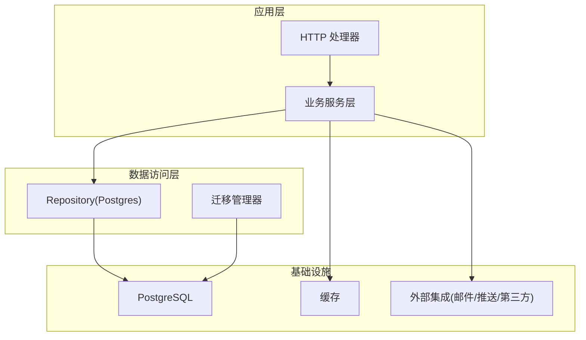
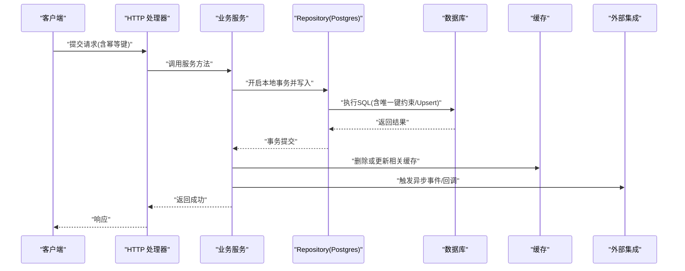
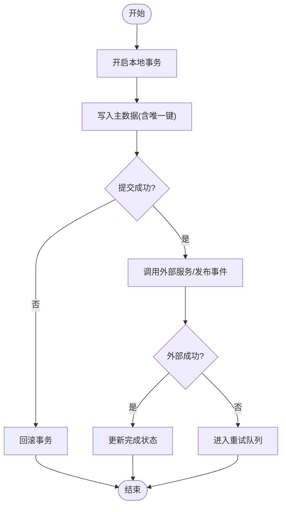
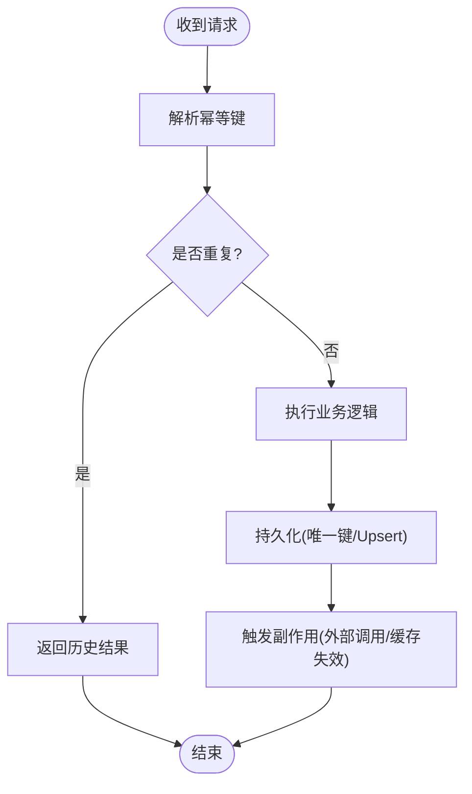
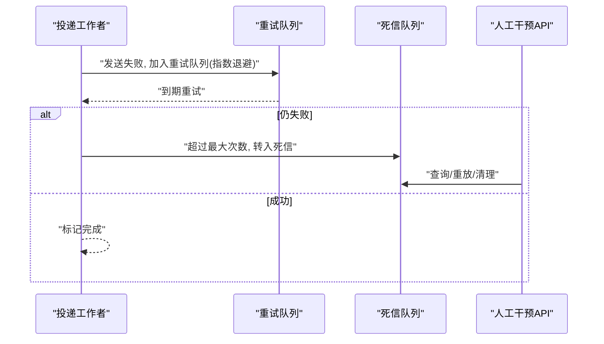
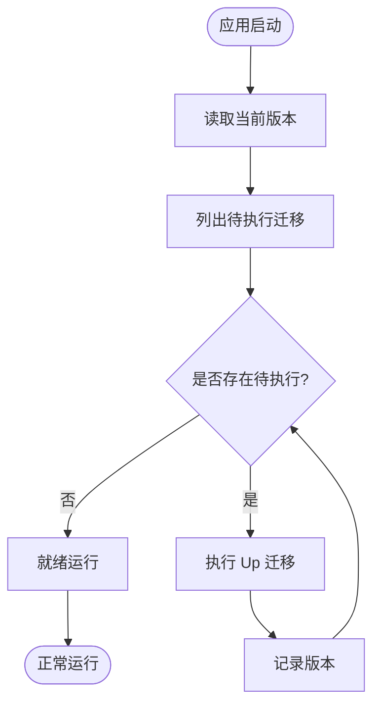
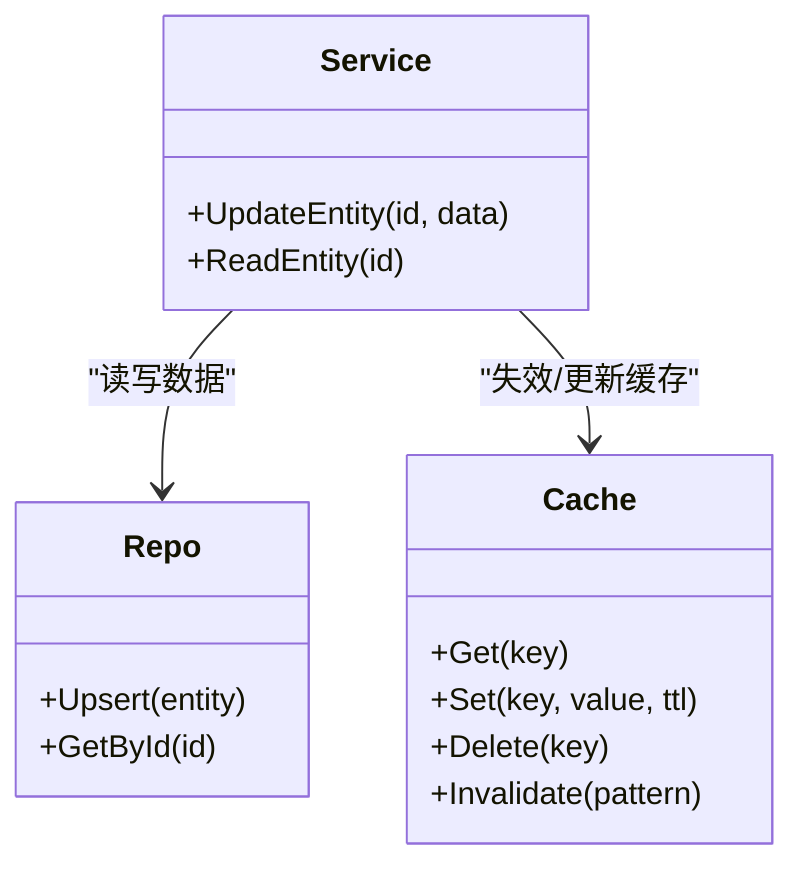
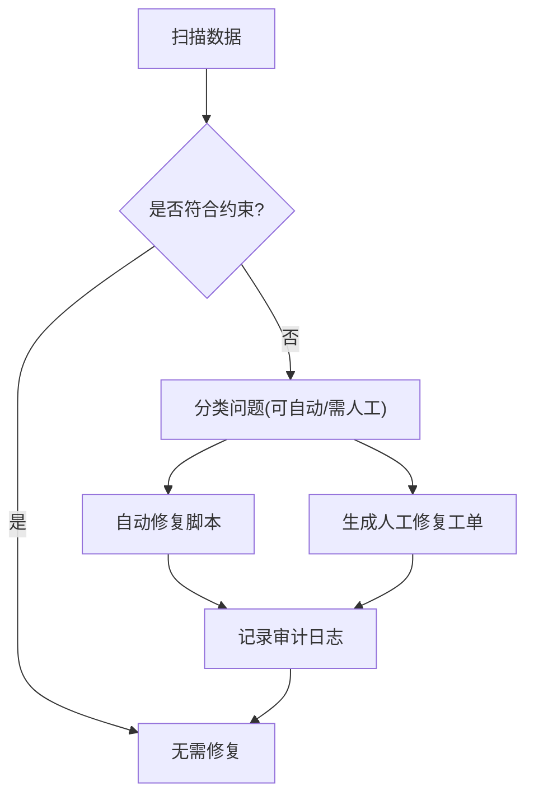
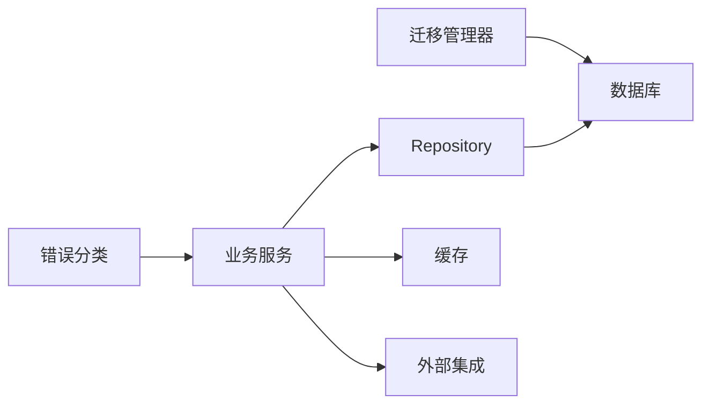

# 数据一致性机制

<cite>
**本文引用的文件**   
- [internal/database/init.go](file://notifuse/internal/database/init.go)
- [internal/migrations/manager.go](file://notifuse/internal/migrations/manager.go)
- [internal/migrations/version.go](file://notifuse/internal/migrations/version.go)
- [internal/migrations/interfaces.go](file://notifuse/internal/migrations/interfaces.go)
- [internal/repository/contact_postgres.go](file://notifuse/internal/repository/contact_postgres.go)
- [internal/service/email_service.go](file://notifuse/internal/service/email_service.go)
- [internal/service/webhook_delivery_worker.go](file://notifuse/internal/service/webhook_delivery_worker.go)
- [internal/service/integration_sync_processor.go](file://notifuse/internal/service/integration_sync_processor.go)
- [pkg/cache/cache.go](file://notifuse/pkg/cache/cache.go)
- [internal/domain/errors.go](file://notifuse/internal/domain/errors.go)
</cite>

## 目录
1. [简介](#简介)
2. [项目结构](#项目结构)
3. [核心组件](#核心组件)
4. [架构总览](#架构总览)
5. [详细组件分析](#详细组件分析)
6. [依赖关系分析](#依赖关系分析)
7. [性能考量](#性能考量)
8. [故障排查指南](#故障排查指南)
9. [结论](#结论)
10. [附录](#附录)

## 简介
本文件面向 Notifuse 平台的数据一致性机制，聚焦以下主题：
- 分布式事务与跨服务协调、本地事务管理
- 幂等性设计（唯一键约束、去重算法、重复请求处理）
- 重试机制（指数退避、死信队列、人工干预接口）
- 数据库迁移的版本管理与回滚策略
- 数据同步与缓存一致性（读写分离、缓存失效、增量同步）
- 数据完整性校验与修复工具使用指南

## 项目结构
Notifuse 后端采用分层架构：HTTP 层调用 Service 层，Service 通过 Repository 访问数据库；迁移由迁移管理器驱动；缓存与外部集成在独立包中。

[本节为概念性结构说明，不直接分析具体文件，故无“章节来源”]

## 核心组件
- 迁移管理器：负责版本发现、执行与回滚，保证数据结构平滑升级。
- 本地事务封装：在 Repository 层以单连接事务包裹多语句操作，确保原子性与一致性。
- 幂等写入：通过唯一键约束与 Upsert 模式避免重复写入。
- 任务与重试：基于工作队列与调度器实现可靠投递与失败重试。
- 缓存一致性：提供统一的缓存接口，支持失效与更新策略。
- 错误分类：统一错误类型便于重试判定与监控告警。

**章节来源**
- [internal/migrations/manager.go:1-200](file://notifuse/internal/migrations/manager.go#L1-L200)
- [internal/migrations/version.go:1-120](file://notifuse/internal/migrations/version.go#L1-L120)
- [internal/repository/contact_postgres.go:1-200](file://notifuse/internal/repository/contact_postgres.go#L1-L200)
- [pkg/cache/cache.go:1-200](file://notifuse/pkg/cache/cache.go#L1-L200)
- [internal/domain/errors.go:1-120](file://notifuse/internal/domain/errors.go#L1-L120)

## 架构总览
下图展示一次典型写操作的端到端路径，包括本地事务、缓存失效与外部集成调用。

**图表来源**
- [internal/repository/contact_postgres.go:1-200](file://notifuse/internal/repository/contact_postgres.go#L1-L200)
- [pkg/cache/cache.go:1-200](file://notifuse/pkg/cache/cache.go#L1-L200)
- [internal/service/email_service.go:1-200](file://notifuse/internal/service/email_service.go#L1-L200)

**章节来源**
- [internal/repository/contact_postgres.go:1-200](file://notifuse/internal/repository/contact_postgres.go#L1-L200)
- [pkg/cache/cache.go:1-200](file://notifuse/pkg/cache/cache.go#L1-L200)
- [internal/service/email_service.go:1-200](file://notifuse/internal/service/email_service.go#L1-L200)

## 详细组件分析

### 分布式事务与跨服务协调
- 本地事务：在 Repository 层使用单连接事务包裹多条 SQL，保证同一工作单元内的一致性。
- 跨服务协调：对于跨进程/服务的副作用（如发送邮件、调用第三方），采用“最终一致”模式：
  - 先持久化状态变更到数据库（本地事务）。
  - 再发布事件或调用外部服务；若失败，交由重试机制补偿。
- 补偿与对账：通过定时任务或后台作业进行对账，修正不一致状态。

**图表来源**
- [internal/repository/contact_postgres.go:1-200](file://notifuse/internal/repository/contact_postgres.go#L1-L200)
- [internal/service/webhook_delivery_worker.go:1-200](file://notifuse/internal/service/webhook_delivery_worker.go#L1-L200)

**章节来源**
- [internal/repository/contact_postgres.go:1-200](file://notifuse/internal/repository/contact_postgres.go#L1-L200)
- [internal/service/webhook_delivery_worker.go:1-200](file://notifuse/internal/service/webhook_delivery_worker.go#L1-L200)

### 幂等性设计
- 唯一键约束：在关键表上定义唯一索引，防止重复插入。
- Upsert 模式：使用“存在则更新、不存在则插入”的语义，结合幂等键避免重复处理。
- 去重算法：在消息/事件层面引入幂等键（如请求ID+资源ID），配合存储层唯一约束实现强幂等。
- 重复请求处理：服务端识别重复幂等键后直接返回已处理结果，避免二次副作用。

**图表来源**
- [internal/repository/contact_postgres.go:1-200](file://notifuse/internal/repository/contact_postgres.go#L1-L200)

**章节来源**
- [internal/repository/contact_postgres.go:1-200](file://notifuse/internal/repository/contact_postgres.go#L1-L200)

### 重试机制（指数退避、死信队列、人工干预）
- 指数退避：失败后按指数级延迟重试，降低瞬时压力与抖动。
- 死信队列：多次重试仍失败的记录转入死信队列，供后续人工处理。
- 人工干预接口：提供查询与重放接口，允许运维人员手动触发重试或标记处理完成。

**图表来源**
- [internal/service/webhook_delivery_worker.go:1-200](file://notifuse/internal/service/webhook_delivery_worker.go#L1-L200)

**章节来源**
- [internal/service/webhook_delivery_worker.go:1-200](file://notifuse/internal/service/webhook_delivery_worker.go#L1-L200)

### 数据库迁移的版本管理与回滚策略
- 版本管理：维护迁移版本号与已执行记录，启动时检测并顺序执行未执行的迁移。
- 可逆迁移：每个迁移尽量提供 Up/Down 能力，支持回滚。
- 平滑升级：分阶段迁移（新增字段/列默认值/双写/切换读源），避免停机与锁表。
- 回滚策略：优先执行 Down 迁移；若不可逆，提供数据修复脚本与人工确认流程。

**图表来源**
- [internal/migrations/manager.go:1-200](file://notifuse/internal/migrations/manager.go#L1-L200)
- [internal/migrations/version.go:1-120](file://notifuse/internal/migrations/version.go#L1-L120)

**章节来源**
- [internal/migrations/manager.go:1-200](file://notifuse/internal/migrations/manager.go#L1-L200)
- [internal/migrations/version.go:1-120](file://notifuse/internal/migrations/version.go#L1-L120)
- [internal/migrations/interfaces.go:1-120](file://notifuse/internal/migrations/interfaces.go#L1-L120)

### 数据同步与缓存一致性
- 读写分离：读路径可走只读副本，写路径走主库；通过事务隔离级别与复制延迟容忍度保障一致性。
- 缓存失效：写成功后主动删除或更新相关缓存键，避免脏读。
- 增量同步：对外部系统的数据变更采用增量拉取或订阅模式，减少全量同步开销。
- 一致性模型：根据场景选择强一致或最终一致，必要时引入版本号或时间戳比较。

**图表来源**
- [pkg/cache/cache.go:1-200](file://notifuse/pkg/cache/cache.go#L1-L200)
- [internal/repository/contact_postgres.go:1-200](file://notifuse/internal/repository/contact_postgres.go#L1-L200)

**章节来源**
- [pkg/cache/cache.go:1-200](file://notifuse/pkg/cache/cache.go#L1-L200)
- [internal/repository/contact_postgres.go:1-200](file://notifuse/internal/repository/contact_postgres.go#L1-L200)

### 数据完整性校验与修复工具
- 校验任务：定期扫描关键表，检查外键、唯一约束、枚举值范围等。
- 修复策略：对可自动修复的问题执行修复脚本；对需人工介入的问题生成工单。
- 审计日志：记录所有修复动作，便于追溯与回滚。

[本节为通用方法论说明，不直接分析具体文件，故无“章节来源”]

## 依赖关系分析
- 迁移模块依赖数据库连接与版本记录表，向上被应用初始化流程调用。
- Repository 依赖数据库连接池与事务上下文，向下依赖 SQL 引擎。
- Service 依赖 Repository 与缓存、外部集成，承担编排与一致性边界。
- 错误分类模块为各层提供统一错误类型，支撑重试与监控。

**图表来源**
- [internal/migrations/manager.go:1-200](file://notifuse/internal/migrations/manager.go#L1-L200)
- [internal/repository/contact_postgres.go:1-200](file://notifuse/internal/repository/contact_postgres.go#L1-L200)
- [pkg/cache/cache.go:1-200](file://notifuse/pkg/cache/cache.go#L1-L200)
- [internal/domain/errors.go:1-120](file://notifuse/internal/domain/errors.go#L1-L120)

**章节来源**
- [internal/migrations/manager.go:1-200](file://notifuse/internal/migrations/manager.go#L1-L200)
- [internal/repository/contact_postgres.go:1-200](file://notifuse/internal/repository/contact_postgres.go#L1-L200)
- [pkg/cache/cache.go:1-200](file://notifuse/pkg/cache/cache.go#L1-L200)
- [internal/domain/errors.go:1-120](file://notifuse/internal/domain/errors.go#L1-L120)

## 性能考量
- 批量写入与批处理：合并小事务，减少网络往返与锁竞争。
- 索引优化：为高频查询与唯一约束建立合适索引，避免全表扫描。
- 缓存命中率：合理设置 TTL 与失效粒度，避免雪崩。
- 重试风暴控制：指数退避上限、抖动随机化、熔断降级。
- 迁移期间锁表控制：大表变更采用在线DDL与分批策略。

[本节为通用指导，不直接分析具体文件，故无“章节来源”]

## 故障排查指南
- 常见错误分类：区分可重试（超时、限流）、不可重试（参数错误、权限不足）与需要人工干预（数据损坏）。
- 重试与死信：查看重试队列与死信队列中的失败记录，定位根因。
- 迁移异常：核对当前版本与待执行迁移列表，必要时执行回滚或修复脚本。
- 缓存不一致：比对缓存键与数据库最新值，强制失效并重建。

**章节来源**
- [internal/domain/errors.go:1-120](file://notifuse/internal/domain/errors.go#L1-L120)
- [internal/service/webhook_delivery_worker.go:1-200](file://notifuse/internal/service/webhook_delivery_worker.go#L1-L200)
- [internal/migrations/manager.go:1-200](file://notifuse/internal/migrations/manager.go#L1-L200)

## 结论
Notifuse 的数据一致性机制围绕“本地事务+最终一致”的核心思想构建：通过幂等键与唯一约束保障强幂等，借助迁移管理器实现平滑升级，利用重试与死信提升可靠性，并通过缓存失效与增量同步维持整体一致性。建议在生产环境持续完善对账与校验工具，形成闭环治理。

## 附录
- 术语
  - 幂等键：用于标识请求的唯一键，避免重复处理。
  - Upsert：存在则更新、不存在则插入的操作模式。
  - 死信队列：存放多次重试仍失败的任务，供人工处理。
- 最佳实践清单
  - 所有写操作必须幂等。
  - 外部副作用必须异步且可重试。
  - 迁移必须可逆或具备修复脚本。
  - 缓存失效优先于懒加载。
  - 关键路径增加对账与巡检。

[本节为补充信息，不直接分析具体文件，故无“章节来源”]