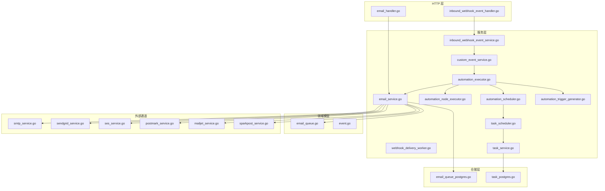
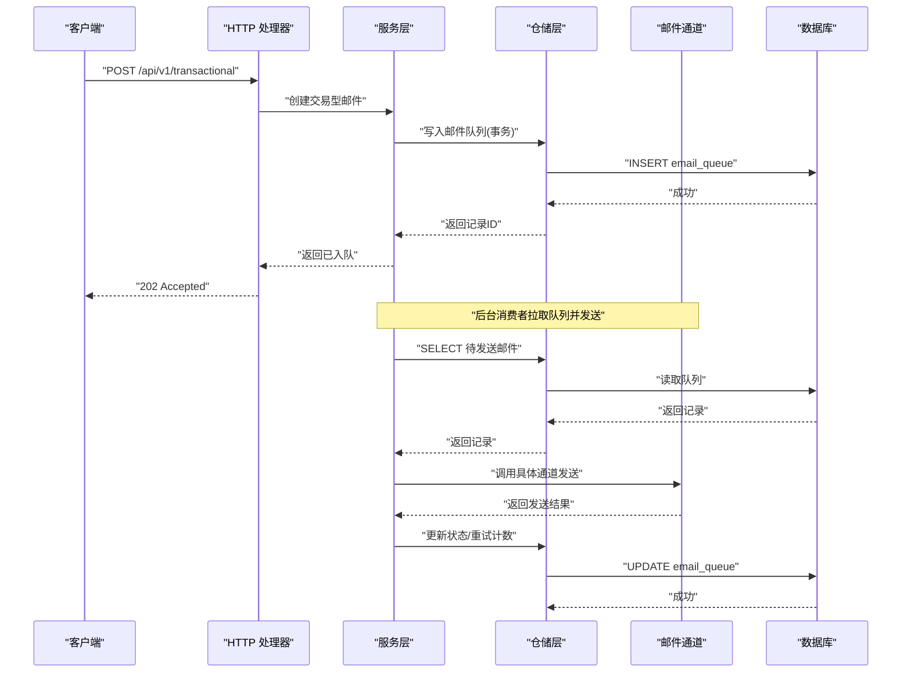
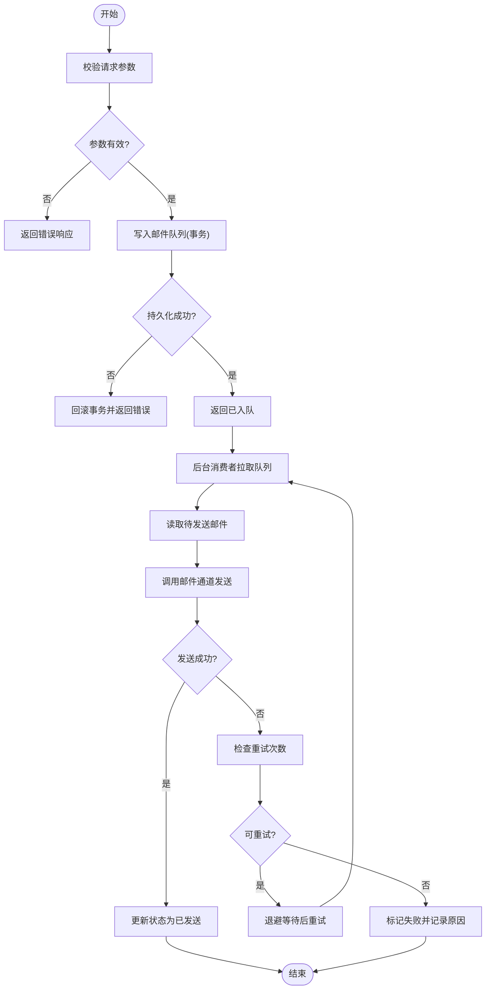
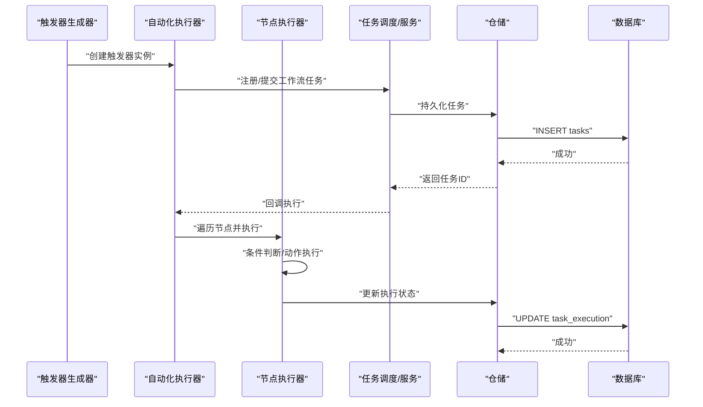
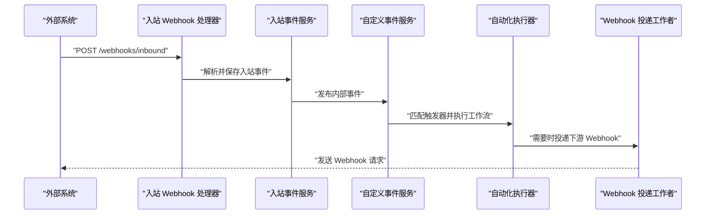
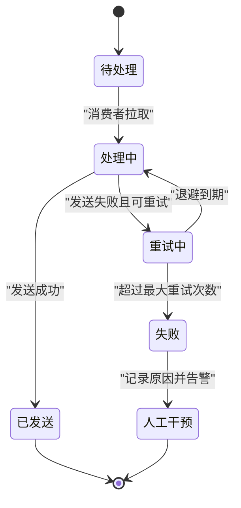
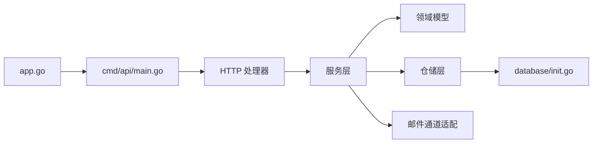

# 数据流设计

<cite>
**本文引用的文件**   
- [cmd/api/main.go](file://notifuse/cmd/api/main.go)
- [internal/app/app.go](file://notifuse/internal/app/app.go)
- [internal/http/email_handler.go](file://notifuse/internal/http/email_handler.go)
- [internal/service/email_service.go](file://notifuse/internal/service/email_service.go)
- [internal/domain/email_queue.go](file://notifuse/internal/domain/email_queue.go)
- [internal/repository/email_queue_postgres.go](file://notifuse/internal/repository/email_queue_postgres.go)
- [internal/service/smtp_service.go](file://notifuse/internal/service/smtp_service.go)
- [internal/service/sendgrid_service.go](file://notifuse/internal/service/sendgrid_service.go)
- [internal/service/ses_service.go](file://notifuse/internal/service/ses_service.go)
- [internal/service/postmark_service.go](file://notifuse/internal/service/postmark_service.go)
- [internal/service/mailjet_service.go](file://notifuse/internal/service/mailjet_service.go)
- [internal/service/sparkpost_service.go](file://notifuse/internal/service/sparkpost_service.go)
- [internal/domain/event.go](file://notifuse/internal/domain/event.go)
- [internal/service/automation_executor.go](file://notifuse/internal/service/automation_executor.go)
- [internal/service/automation_node_executor.go](file://notifuse/internal/service/automation_node_executor.go)
- [internal/service/automation_scheduler.go](file://notifuse/internal/service/automation_scheduler.go)
- [internal/service/automation_trigger_generator.go](file://notifuse/internal/service/automation_trigger_generator.go)
- [internal/service/custom_event_service.go](file://notifuse/internal/service/custom_event_service.go)
- [internal/http/inbound_webhook_event_handler.go](file://notifuse/internal/http/inbound_webhook_event_handler.go)
- [internal/service/inbound_webhook_event_service.go](file://notifuse/internal/service/inbound_webhook_event_service.go)
- [internal/service/webhook_delivery_worker.go](file://notifuse/internal/service/webhook_delivery_worker.go)
- [internal/service/task_scheduler.go](file://notifuse/internal/service/task_scheduler.go)
- [internal/service/task_service.go](file://notifuse/internal/service/task_service.go)
- [internal/repository/task_postgres.go](file://notifuse/internal/repository/task_postgres.go)
- [internal/database/init.go](file://notifuse/internal/database/init.go)
</cite>

## 目录
1. [引言](#引言)
2. [项目结构](#项目结构)
3. [核心组件](#核心组件)
4. [架构总览](#架构总览)
5. [详细组件分析](#详细组件分析)
6. [依赖分析](#依赖分析)
7. [性能考虑](#性能考虑)
8. [故障排查指南](#故障排查指南)
9. [结论](#结论)
10. [附录](#附录)

## 引言
本文件为 Notifuse 平台的数据流设计文档，聚焦以下目标：
- 描述邮件发送流程的端到端数据流向（从 API 请求到最终送达）。
- 解释自动化工作流的数据流转机制（触发器处理、条件判断、动作执行的时序关系）。
- 文档化事件驱动架构中的数据传递方式（消息队列、事件总线的使用）。
- 说明数据一致性保证机制（事务处理、幂等性设计与重试策略）。
- 提供关键业务流程的时序图与状态转换图，展示复杂业务场景下的数据流转过程。

## 项目结构
Notifuse 后端采用分层架构：HTTP 层负责路由与鉴权；服务层编排业务逻辑；领域模型定义核心实体；仓储层对接数据库；外部通道通过适配器实现（SMTP、SendGrid、SES、Postmark、Mailjet、SparkPost 等）。

图表来源
- [internal/http/email_handler.go](file://notifuse/internal/http/email_handler.go)
- [internal/service/email_service.go](file://notifuse/internal/service/email_service.go)
- [internal/domain/email_queue.go](file://notifuse/internal/domain/email_queue.go)
- [internal/repository/email_queue_postgres.go](file://notifuse/internal/repository/email_queue_postgres.go)
- [internal/service/smtp_service.go](file://notifuse/internal/service/smtp_service.go)
- [internal/service/sendgrid_service.go](file://notifuse/internal/service/sendgrid_service.go)
- [internal/service/ses_service.go](file://notifuse/internal/service/ses_service.go)
- [internal/service/postmark_service.go](file://notifuse/internal/service/postmark_service.go)
- [internal/service/mailjet_service.go](file://notifuse/internal/service/mailjet_service.go)
- [internal/service/sparkpost_service.go](file://notifuse/internal/service/sparkpost_service.go)
- [internal/http/inbound_webhook_event_handler.go](file://notifuse/internal/http/inbound_webhook_event_handler.go)
- [internal/service/inbound_webhook_event_service.go](file://notifuse/internal/service/inbound_webhook_event_service.go)
- [internal/service/custom_event_service.go](file://notifuse/internal/service/custom_event_service.go)
- [internal/service/automation_executor.go](file://notifuse/internal/service/automation_executor.go)
- [internal/service/automation_node_executor.go](file://notifuse/internal/service/automation_node_executor.go)
- [internal/service/automation_scheduler.go](file://notifuse/internal/service/automation_scheduler.go)
- [internal/service/automation_trigger_generator.go](file://notifuse/internal/service/automation_trigger_generator.go)
- [internal/service/webhook_delivery_worker.go](file://notifuse/internal/service/webhook_delivery_worker.go)
- [internal/service/task_scheduler.go](file://notifuse/internal/service/task_scheduler.go)
- [internal/service/task_service.go](file://notifuse/internal/service/task_service.go)
- [internal/repository/task_postgres.go](file://notifuse/internal/repository/task_postgres.go)

章节来源
- [cmd/api/main.go](file://notifuse/cmd/api/main.go)
- [internal/app/app.go](file://notifuse/internal/app/app.go)
- [internal/database/init.go](file://notifuse/internal/database/init.go)

## 核心组件
- HTTP 处理器：接收并校验请求，调用服务层执行业务逻辑。
- 服务层：编排领域模型、仓储与外部通道，实现事务边界与错误处理。
- 领域模型：定义邮件队列、事件、自动化工作流等核心数据结构。
- 仓储层：持久化数据，提供事务与查询能力。
- 外部通道：封装各邮件服务商或 SMTP 协议，统一发送接口。
- 任务调度与执行：基于定时任务与工作队列驱动异步处理。

章节来源
- [internal/http/email_handler.go](file://notifuse/internal/http/email_handler.go)
- [internal/service/email_service.go](file://notifuse/internal/service/email_service.go)
- [internal/domain/email_queue.go](file://notifuse/internal/domain/email_queue.go)
- [internal/repository/email_queue_postgres.go](file://notifuse/internal/repository/email_queue_postgres.go)
- [internal/service/smtp_service.go](file://notifuse/internal/service/smtp_service.go)
- [internal/service/sendgrid_service.go](file://notifuse/internal/service/sendgrid_service.go)
- [internal/service/ses_service.go](file://notifuse/internal/service/ses_service.go)
- [internal/service/postmark_service.go](file://notifuse/internal/service/postmark_service.go)
- [internal/service/mailjet_service.go](file://notifuse/internal/service/mailjet_service.go)
- [internal/service/sparkpost_service.go](file://notifuse/internal/service/sparkpost_service.go)

## 架构总览
整体采用“API -> 服务 -> 领域/仓储 -> 外部通道”的分层模式，并通过事件与任务系统解耦异步流程。

图表来源
- [internal/http/email_handler.go](file://notifuse/internal/http/email_handler.go)
- [internal/service/email_service.go](file://notifuse/internal/service/email_service.go)
- [internal/repository/email_queue_postgres.go](file://notifuse/internal/repository/email_queue_postgres.go)
- [internal/service/smtp_service.go](file://notifuse/internal/service/smtp_service.go)
- [internal/service/sendgrid_service.go](file://notifuse/internal/service/sendgrid_service.go)
- [internal/service/ses_service.go](file://notifuse/internal/service/ses_service.go)
- [internal/service/postmark_service.go](file://notifuse/internal/service/postmark_service.go)
- [internal/service/mailjet_service.go](file://notifuse/internal/service/mailjet_service.go)
- [internal/service/sparkpost_service.go](file://notifuse/internal/service/sparkpost_service.go)

## 详细组件分析

### 邮件发送流程（端到端）
- 入口：HTTP 处理器接收交易型邮件请求，进行参数校验与上下文解析。
- 服务编排：服务层将邮件写入队列，并在同一事务中落库，确保入队与后续消费的一致性。
- 通道选择：根据配置选择 SMTP 或云厂商通道（SendGrid、SES、Postmark、Mailjet、SparkPost）。
- 发送与回执：通道返回发送结果，服务层更新队列状态，失败时按策略重试。

图表来源
- [internal/http/email_handler.go](file://notifuse/internal/http/email_handler.go)
- [internal/service/email_service.go](file://notifuse/internal/service/email_service.go)
- [internal/domain/email_queue.go](file://notifuse/internal/domain/email_queue.go)
- [internal/repository/email_queue_postgres.go](file://notifuse/internal/repository/email_queue_postgres.go)
- [internal/service/smtp_service.go](file://notifuse/internal/service/smtp_service.go)
- [internal/service/sendgrid_service.go](file://notifuse/internal/service/sendgrid_service.go)
- [internal/service/ses_service.go](file://notifuse/internal/service/ses_service.go)
- [internal/service/postmark_service.go](file://notifuse/internal/service/postmark_service.go)
- [internal/service/mailjet_service.go](file://notifuse/internal/service/mailjet_service.go)
- [internal/service/sparkpost_service.go](file://notifuse/internal/service/sparkpost_service.go)

章节来源
- [internal/http/email_handler.go](file://notifuse/internal/http/email_handler.go)
- [internal/service/email_service.go](file://notifuse/internal/service/email_service.go)
- [internal/domain/email_queue.go](file://notifuse/internal/domain/email_queue.go)
- [internal/repository/email_queue_postgres.go](file://notifuse/internal/repository/email_queue_postgres.go)
- [internal/service/smtp_service.go](file://notifuse/internal/service/smtp_service.go)
- [internal/service/sendgrid_service.go](file://notifuse/internal/service/sendgrid_service.go)
- [internal/service/ses_service.go](file://notifuse/internal/service/ses_service.go)
- [internal/service/postmark_service.go](file://notifuse/internal/service/postmark_service.go)
- [internal/service/mailjet_service.go](file://notifuse/internal/service/mailjet_service.go)
- [internal/service/sparkpost_service.go](file://notifuse/internal/service/sparkpost_service.go)

### 自动化工作流数据流
- 触发器生成：根据事件或定时任务生成触发器实例。
- 执行器编排：加载工作流定义，顺序执行节点（条件判断、动作执行）。
- 动作类型：包括发送通知、调用 Webhook、更新联系人等。
- 调度与任务：使用任务调度器周期性扫描与分发工作流任务。

图表来源
- [internal/service/automation_trigger_generator.go](file://notifuse/internal/service/automation_trigger_generator.go)
- [internal/service/automation_executor.go](file://notifuse/internal/service/automation_executor.go)
- [internal/service/automation_node_executor.go](file://notifuse/internal/service/automation_node_executor.go)
- [internal/service/automation_scheduler.go](file://notifuse/internal/service/automation_scheduler.go)
- [internal/service/task_scheduler.go](file://notifuse/internal/service/task_scheduler.go)
- [internal/service/task_service.go](file://notifuse/internal/service/task_service.go)
- [internal/repository/task_postgres.go](file://notifuse/internal/repository/task_postgres.go)

章节来源
- [internal/service/automation_trigger_generator.go](file://notifuse/internal/service/automation_trigger_generator.go)
- [internal/service/automation_executor.go](file://notifuse/internal/service/automation_executor.go)
- [internal/service/automation_node_executor.go](file://notifuse/internal/service/automation_node_executor.go)
- [internal/service/automation_scheduler.go](file://notifuse/internal/service/automation_scheduler.go)
- [internal/service/task_scheduler.go](file://notifuse/internal/service/task_scheduler.go)
- [internal/service/task_service.go](file://notifuse/internal/service/task_service.go)
- [internal/repository/task_postgres.go](file://notifuse/internal/repository/task_postgres.go)

### 事件驱动架构与数据传递
- 自定义事件：通过自定义事件服务发布事件，供自动化触发器订阅。
- 入站 Webhook：接收外部系统事件，转换为内部事件并进入处理流水线。
- Webhook 投递：对下游系统的 Webhook 进行可靠投递与重试。

图表来源
- [internal/http/inbound_webhook_event_handler.go](file://notifuse/internal/http/inbound_webhook_event_handler.go)
- [internal/service/inbound_webhook_event_service.go](file://notifuse/internal/service/inbound_webhook_event_service.go)
- [internal/service/custom_event_service.go](file://notifuse/internal/service/custom_event_service.go)
- [internal/service/automation_executor.go](file://notifuse/internal/service/automation_executor.go)
- [internal/service/webhook_delivery_worker.go](file://notifuse/internal/service/webhook_delivery_worker.go)

章节来源
- [internal/http/inbound_webhook_event_handler.go](file://notifuse/internal/http/inbound_webhook_event_handler.go)
- [internal/service/inbound_webhook_event_service.go](file://notifuse/internal/service/inbound_webhook_event_service.go)
- [internal/service/custom_event_service.go](file://notifuse/internal/service/custom_event_service.go)
- [internal/service/automation_executor.go](file://notifuse/internal/service/automation_executor.go)
- [internal/service/webhook_delivery_worker.go](file://notifuse/internal/service/webhook_delivery_worker.go)

### 数据一致性与可靠性
- 事务处理：在写入队列或任务时开启事务，确保写操作的原子性。
- 幂等性设计：为入队与任务执行引入唯一键或去重表，避免重复处理。
- 重试策略：对临时性错误采用指数退避与最大重试次数控制，失败后记录原因并告警。
- 状态机：队列与任务均维护明确的状态字段，便于追踪与恢复。

图表来源
- [internal/domain/email_queue.go](file://notifuse/internal/domain/email_queue.go)
- [internal/repository/email_queue_postgres.go](file://notifuse/internal/repository/email_queue_postgres.go)
- [internal/repository/task_postgres.go](file://notifuse/internal/repository/task_postgres.go)

章节来源
- [internal/domain/email_queue.go](file://notifuse/internal/domain/email_queue.go)
- [internal/repository/email_queue_postgres.go](file://notifuse/internal/repository/email_queue_postgres.go)
- [internal/repository/task_postgres.go](file://notifuse/internal/repository/task_postgres.go)

## 依赖分析
- 组件耦合：HTTP 层仅依赖服务层；服务层依赖领域模型与仓储；仓储依赖数据库初始化与连接管理。
- 外部依赖：邮件通道以适配器形式接入，降低耦合度，便于扩展新通道。
- 循环依赖：未发现直接循环依赖；通过接口与分层隔离保持松耦合。

图表来源
- [internal/app/app.go](file://notifuse/internal/app/app.go)
- [cmd/api/main.go](file://notifuse/cmd/api/main.go)
- [internal/database/init.go](file://notifuse/internal/database/init.go)

章节来源
- [internal/app/app.go](file://notifuse/internal/app/app.go)
- [cmd/api/main.go](file://notifuse/cmd/api/main.go)
- [internal/database/init.go](file://notifuse/internal/database/init.go)

## 性能考虑
- 批量入队：在高并发场景下，建议批量写入队列以减少事务开销。
- 并行消费：消费者按分区或分片并行拉取，提升吞吐。
- 通道限流：对邮件通道实施速率限制，避免被上游服务商限流。
- 缓存热点：模板与配置缓存减少重复计算与 IO。
- 监控指标：跟踪入队延迟、发送成功率、重试次数与失败原因分布。

[本节为通用指导，不直接分析具体文件]

## 故障排查指南
- 入队失败：检查请求参数校验与服务层事务日志，确认数据库连接与权限。
- 发送失败：查看通道返回码与错误分类，区分网络错误、认证失败与内容问题。
- 重试风暴：核对重试策略与退避时间，避免雪崩效应。
- 自动化卡住：检查工作流节点执行日志与任务状态，定位阻塞点。
- Webhook 投递失败：检查签名验证、超时与重试上限，必要时启用降级与告警。

章节来源
- [internal/service/email_service.go](file://notifuse/internal/service/email_service.go)
- [internal/service/webhook_delivery_worker.go](file://notifuse/internal/service/webhook_delivery_worker.go)
- [internal/service/automation_executor.go](file://notifuse/internal/service/automation_executor.go)

## 结论
Notifuse 平台通过分层架构与事件驱动机制，实现了高内聚、低耦合的数据流设计。邮件发送链路具备事务保障与可靠重试，自动化工作流支持灵活的条件与动作组合，Webhook 投递提供稳定可靠的对外集成能力。建议在大规模部署中结合批处理、并行消费与限流策略，进一步提升系统吞吐与稳定性。

[本节为总结性内容，不直接分析具体文件]

## 附录
- 术语
  - 交易型邮件：由业务事件触发的单条邮件发送。
  - 自动化工作流：由触发器驱动的一系列节点执行流程。
  - 入站 Webhook：外部系统向平台推送的事件回调。
  - 出站 Webhook：平台向外部系统发起的事件回调。
- 参考路径
  - 邮件发送主流程：[internal/http/email_handler.go](file://notifuse/internal/http/email_handler.go)、[internal/service/email_service.go](file://notifuse/internal/service/email_service.go)
  - 自动化执行主流程：[internal/service/automation_executor.go](file://notifuse/internal/service/automation_executor.go)、[internal/service/automation_node_executor.go](file://notifuse/internal/service/automation_node_executor.go)
  - 事件与任务：[internal/service/custom_event_service.go](file://notifuse/internal/service/custom_event_service.go)、[internal/service/task_scheduler.go](file://notifuse/internal/service/task_scheduler.go)