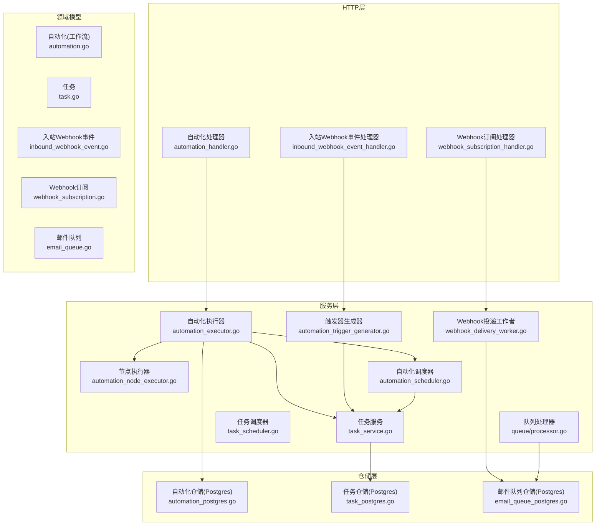
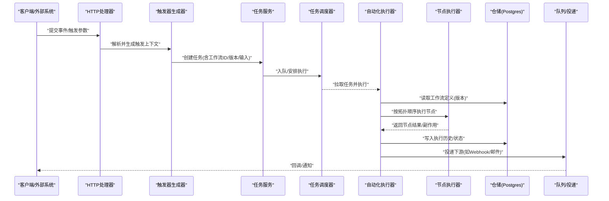
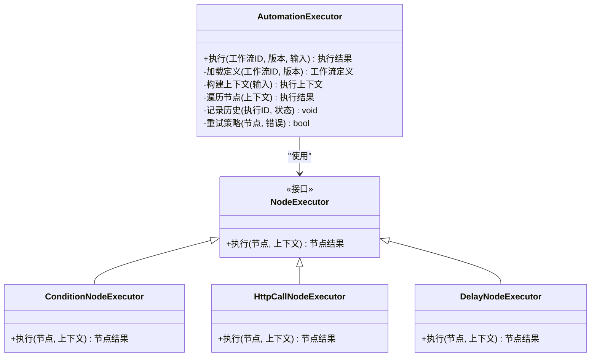
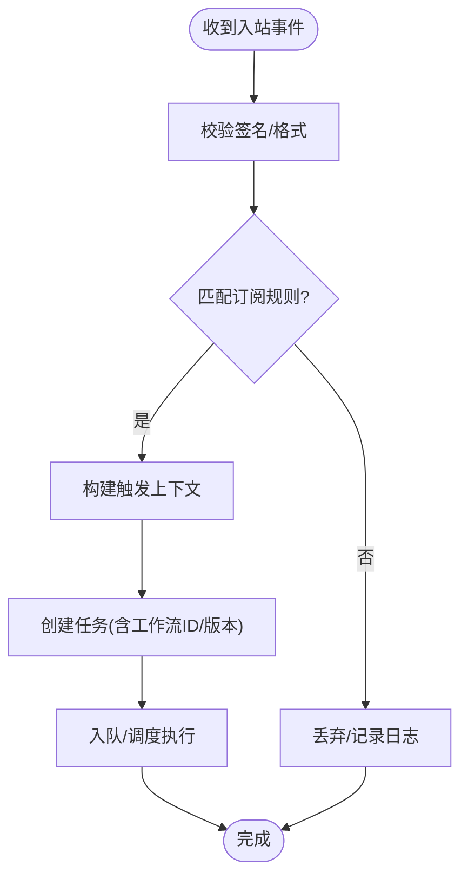
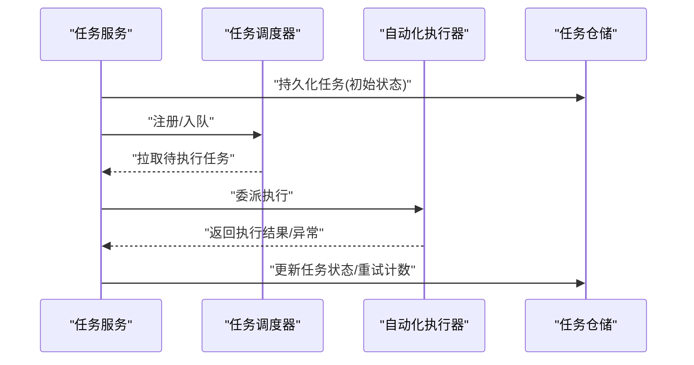
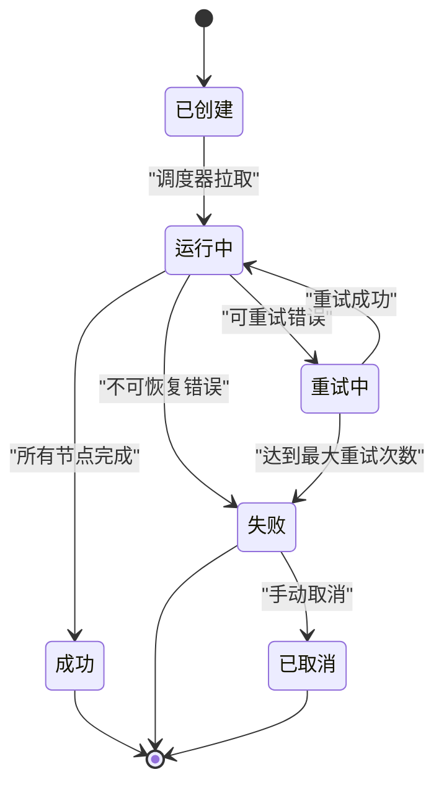
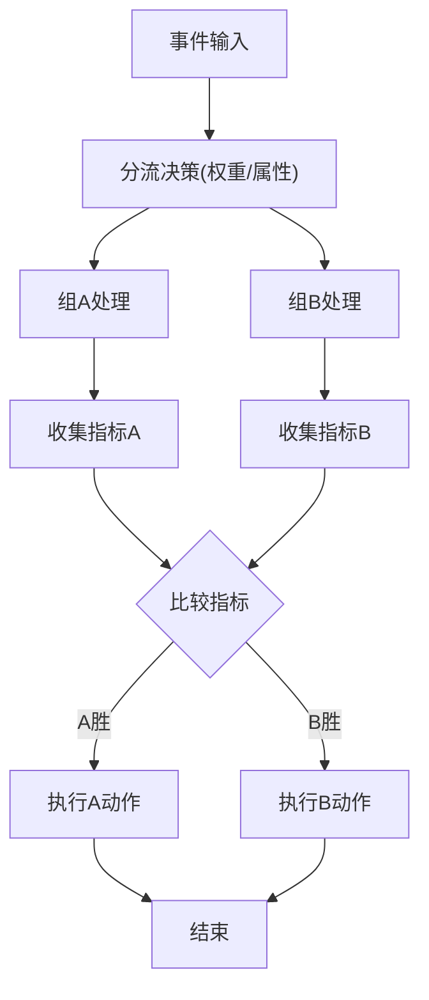
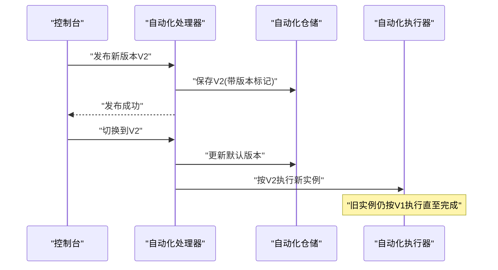
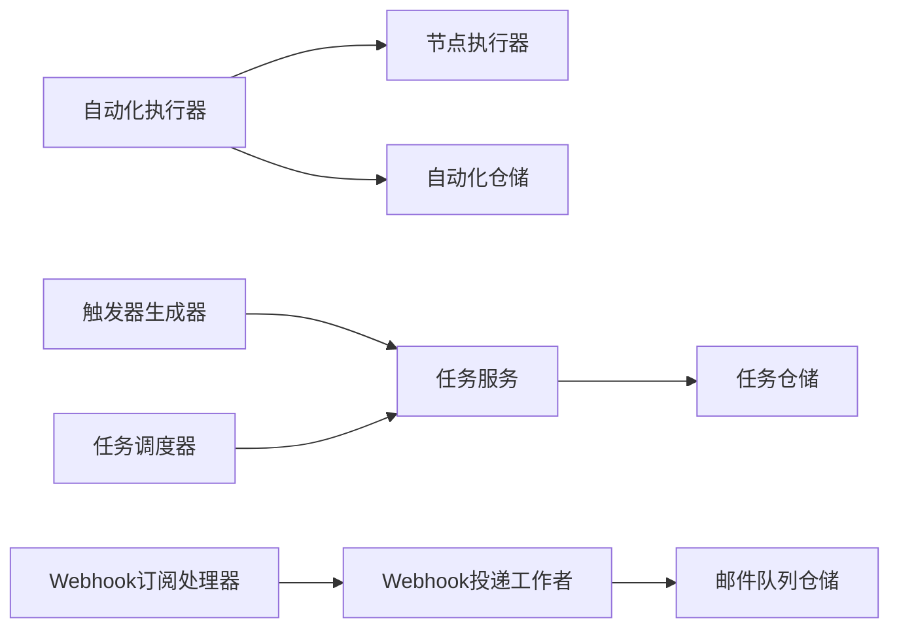

# 自动化工作流数据流

<cite>
**本文引用的文件**   
- [automation.go](file://notifuse/internal/domain/automation.go)
- [automation_executor.go](file://notifuse/internal/service/automation_executor.go)
- [automation_node_executor.go](file://notifuse/internal/service/automation_node_executor.go)
- [automation_scheduler.go](file://notifuse/internal/service/automation_scheduler.go)
- [automation_trigger_generator.go](file://notifuse/internal/service/automation_trigger_generator.go)
- [automation_handler.go](file://notifuse/internal/http/automation_handler.go)
- [automation_postgres.go](file://notifuse/internal/repository/automation_postgres.go)
- [task.go](file://notifuse/internal/domain/task.go)
- [task_service.go](file://notifuse/internal/service/task_service.go)
- [task_scheduler.go](file://notifuse/internal/service/task_scheduler.go)
- [task_postgres.go](file://notifuse/internal/repository/task_postgres.go)
- [inbound_webhook_event.go](file://notifuse/internal/domain/inbound_webhook_event.go)
- [inbound_webhook_event_handler.go](file://notifuse/internal/http/inbound_webhook_event_handler.go)
- [webhook_subscription.go](file://notifuse/internal/domain/webhook_subscription.go)
- [webhook_subscription_handler.go](file://notifuse/internal/http/webhook_subscription_handler.go)
- [webhook_delivery_worker.go](file://notifuse/internal/service/webhook_delivery_worker.go)
- [email_queue.go](file://notifuse/internal/domain/email_queue.go)
- [email_queue_postgres.go](file://notifuse/internal/repository/email_queue_postgres.go)
- [queue_processor.go](file://notifuse/internal/service/queue/processor.go)
</cite>

## 目录
1. [简介](#简介)
2. [项目结构](#项目结构)
3. [核心组件](#核心组件)
4. [架构总览](#架构总览)
5. [详细组件分析](#详细组件分析)
6. [依赖关系分析](#依赖关系分析)
7. [性能考量](#性能考量)
8. [故障排查指南](#故障排查指南)
9. [结论](#结论)
10. [附录](#附录)

## 简介
本文件面向Notifuse平台的“可视化工作流引擎”与“触发器系统”，系统化阐述其数据处理机制、执行顺序、条件分支与循环控制、事件监听与调度、状态管理与持久化（含执行历史、错误恢复、进度跟踪）、复杂场景的数据流转示例，以及版本控制与回滚的一致性保证。文档以代码级事实为依据，辅以图示帮助理解。

## 项目结构
Notifuse后端采用分层架构：HTTP层处理请求，服务层编排业务逻辑，领域模型定义数据结构与不变式，仓储层对接PostgreSQL，任务与队列子系统负责异步执行与重试。

图表来源
- [automation_handler.go](file://notifuse/internal/http/automation_handler.go)
- [automation_executor.go](file://notifuse/internal/service/automation_executor.go)
- [automation_node_executor.go](file://notifuse/internal/service/automation_node_executor.go)
- [automation_scheduler.go](file://notifuse/internal/service/automation_scheduler.go)
- [automation_trigger_generator.go](file://notifuse/internal/service/automation_trigger_generator.go)
- [inbound_webhook_event_handler.go](file://notifuse/internal/http/inbound_webhook_event_handler.go)
- [webhook_subscription_handler.go](file://notifuse/internal/http/webhook_subscription_handler.go)
- [webhook_delivery_worker.go](file://notifuse/internal/service/webhook_delivery_worker.go)
- [task_service.go](file://notifuse/internal/service/task_service.go)
- [task_scheduler.go](file://notifuse/internal/service/task_scheduler.go)
- [automation_postgres.go](file://notifuse/internal/repository/automation_postgres.go)
- [task_postgres.go](file://notifuse/internal/repository/task_postgres.go)
- [email_queue_postgres.go](file://notifuse/internal/repository/email_queue_postgres.go)
- [queue_processor.go](file://notifuse/internal/service/queue/processor.go)

章节来源
- [automation.go](file://notifuse/internal/domain/automation.go)
- [automation_executor.go](file://notifuse/internal/service/automation_executor.go)
- [automation_node_executor.go](file://notifuse/internal/service/automation_node_executor.go)
- [automation_scheduler.go](file://notifuse/internal/service/automation_scheduler.go)
- [automation_trigger_generator.go](file://notifuse/internal/service/automation_trigger_generator.go)
- [automation_handler.go](file://notifuse/internal/http/automation_handler.go)
- [automation_postgres.go](file://notifuse/internal/repository/automation_postgres.go)
- [task.go](file://notifuse/internal/domain/task.go)
- [task_service.go](file://notifuse/internal/service/task_service.go)
- [task_scheduler.go](file://notifuse/internal/service/task_scheduler.go)
- [task_postgres.go](file://notifuse/internal/repository/task_postgres.go)
- [inbound_webhook_event.go](file://notifuse/internal/domain/inbound_webhook_event.go)
- [inbound_webhook_event_handler.go](file://notifuse/internal/http/inbound_webhook_event_handler.go)
- [webhook_subscription.go](file://notifuse/internal/domain/webhook_subscription.go)
- [webhook_subscription_handler.go](file://notifuse/internal/http/webhook_subscription_handler.go)
- [webhook_delivery_worker.go](file://notifuse/internal/service/webhook_delivery_worker.go)
- [email_queue.go](file://notifuse/internal/domain/email_queue.go)
- [email_queue_postgres.go](file://notifuse/internal/repository/email_queue_postgres.go)
- [queue_processor.go](file://notifuse/internal/service/queue/processor.go)

## 核心组件
- 自动化（工作流）模型：定义工作流的拓扑、节点类型、连接关系、版本与元数据，用于序列化存储与运行时解析。
- 自动化执行器：加载工作流定义，构建执行上下文，按图遍历节点，管理分支与循环，记录执行历史与状态。
- 节点执行器：针对不同类型节点（如条件判断、HTTP调用、模板渲染、延迟等待等）提供具体执行策略。
- 自动化调度器：基于时间或外部信号周期性触发工作流实例。
- 触发器生成器：将外部事件（如入站Webhook、定时任务）转换为工作流触发参数并创建任务。
- 任务服务与调度器：统一的任务生命周期管理、重试、退避与失败处理。
- Webhook订阅与投递：订阅匹配、签名校验、投递重试与回执处理。
- 队列与持久化：通过PostgreSQL持久化工作流、任务、事件与队列项，保障可观测性与恢复能力。

章节来源
- [automation.go](file://notifuse/internal/domain/automation.go)
- [automation_executor.go](file://notifuse/internal/service/automation_executor.go)
- [automation_node_executor.go](file://notifuse/internal/service/automation_node_executor.go)
- [automation_scheduler.go](file://notifuse/internal/service/automation_scheduler.go)
- [automation_trigger_generator.go](file://notifuse/internal/service/automation_trigger_generator.go)
- [task_service.go](file://notifuse/internal/service/task_service.go)
- [task_scheduler.go](file://notifuse/internal/service/task_scheduler.go)
- [webhook_subscription.go](file://notifuse/internal/domain/webhook_subscription.go)
- [webhook_delivery_worker.go](file://notifuse/internal/service/webhook_delivery_worker.go)
- [email_queue.go](file://notifuse/internal/domain/email_queue.go)
- [email_queue_postgres.go](file://notifuse/internal/repository/email_queue_postgres.go)

## 架构总览
下图展示从事件到工作流执行的端到端数据流，包括触发、调度、执行、持久化与重试。

图表来源
- [inbound_webhook_event_handler.go](file://notifuse/internal/http/inbound_webhook_event_handler.go)
- [automation_trigger_generator.go](file://notifuse/internal/service/automation_trigger_generator.go)
- [task_service.go](file://notifuse/internal/service/task_service.go)
- [task_scheduler.go](file://notifuse/internal/service/task_scheduler.go)
- [automation_executor.go](file://notifuse/internal/service/automation_executor.go)
- [automation_node_executor.go](file://notifuse/internal/service/automation_node_executor.go)
- [automation_postgres.go](file://notifuse/internal/repository/automation_postgres.go)
- [webhook_delivery_worker.go](file://notifuse/internal/service/webhook_delivery_worker.go)

## 详细组件分析

### 工作流执行器与节点执行器
- 执行器职责
  - 加载指定版本的工作流定义，构建执行上下文（变量、输入输出）。
  - 依据图的拓扑进行节点遍历，支持条件分支与循环。
  - 维护执行状态（开始、进行中、成功、失败），持久化执行历史与中间结果。
  - 在节点失败时触发重试与补偿逻辑（若配置）。
- 节点执行器职责
  - 为不同节点类型实现具体执行策略（如条件判断、HTTP调用、模板渲染、延迟等待、并行扇出等）。
  - 对副作用操作（网络IO、外部API）进行超时、限流与错误分类。

图表来源
- [automation_executor.go](file://notifuse/internal/service/automation_executor.go)
- [automation_node_executor.go](file://notifuse/internal/service/automation_node_executor.go)

章节来源
- [automation_executor.go](file://notifuse/internal/service/automation_executor.go)
- [automation_node_executor.go](file://notifuse/internal/service/automation_node_executor.go)

### 触发器系统与事件处理
- 入站Webhook事件
  - 接收外部事件，校验签名与格式，映射为触发器输入。
  - 根据订阅规则匹配目标工作流，生成任务并交由任务服务。
- Webhook订阅
  - 管理订阅端点、过滤条件、重试策略与回执处理。
  - 投递失败时进入重试队列，按退避策略重投。

图表来源
- [inbound_webhook_event_handler.go](file://notifuse/internal/http/inbound_webhook_event_handler.go)
- [automation_trigger_generator.go](file://notifuse/internal/service/automation_trigger_generator.go)
- [webhook_subscription_handler.go](file://notifuse/internal/http/webhook_subscription_handler.go)
- [webhook_delivery_worker.go](file://notifuse/internal/service/webhook_delivery_worker.go)

章节来源
- [inbound_webhook_event.go](file://notifuse/internal/domain/inbound_webhook_event.go)
- [inbound_webhook_event_handler.go](file://notifuse/internal/http/inbound_webhook_event_handler.go)
- [webhook_subscription.go](file://notifuse/internal/domain/webhook_subscription.go)
- [webhook_subscription_handler.go](file://notifuse/internal/http/webhook_subscription_handler.go)
- [webhook_delivery_worker.go](file://notifuse/internal/service/webhook_delivery_worker.go)

### 任务与调度
- 任务服务
  - 统一管理任务的创建、状态机转换、重试与失败处理。
  - 与调度器协作，支持一次性与周期性任务。
- 任务调度器
  - 从队列中拉取任务，分配给执行器或工作流执行流程。
  - 支持并发度控制与背压。

图表来源
- [task_service.go](file://notifuse/internal/service/task_service.go)
- [task_scheduler.go](file://notifuse/internal/service/task_scheduler.go)
- [task_postgres.go](file://notifuse/internal/repository/task_postgres.go)

章节来源
- [task.go](file://notifuse/internal/domain/task.go)
- [task_service.go](file://notifuse/internal/service/task_service.go)
- [task_scheduler.go](file://notifuse/internal/service/task_scheduler.go)
- [task_postgres.go](file://notifuse/internal/repository/task_postgres.go)

### 状态管理与持久化
- 执行历史
  - 每次工作流实例的启动、节点执行、分支选择、循环迭代均记录历史，便于回溯与审计。
- 错误恢复
  - 节点级别失败可触发重试；工作流级别失败可进入补偿或人工干预流程。
- 进度跟踪
  - 通过任务与工作流实例的状态字段反映当前进度，供控制台与API查询。

图表来源
- [automation_executor.go](file://notifuse/internal/service/automation_executor.go)
- [task_service.go](file://notifuse/internal/service/task_service.go)
- [automation_postgres.go](file://notifuse/internal/repository/automation_postgres.go)
- [task_postgres.go](file://notifuse/internal/repository/task_postgres.go)

章节来源
- [automation_executor.go](file://notifuse/internal/service/automation_executor.go)
- [task_service.go](file://notifuse/internal/service/task_service.go)
- [automation_postgres.go](file://notifuse/internal/repository/automation_postgres.go)
- [task_postgres.go](file://notifuse/internal/repository/task_postgres.go)

### 复杂工作流场景数据流转示例
- AB测试
  - 入口：用户行为事件触发。
  - 分支：根据用户属性或随机权重分流至A/B组。
  - 并行：同时发送差异化内容，收集指标。
  - 汇聚：比较指标后决定胜出方案，触发后续动作。
- 多步骤序列
  - 线性执行多个节点（验证、转换、发送），任一失败即中断并记录错误位置。
- 条件分支
  - 基于动态表达式评估路径，支持嵌套条件与短路逻辑。

[此图为概念性示意，不直接映射具体源码文件]

### 版本控制与回滚机制
- 版本化
  - 工作流定义包含版本号，执行器按指定版本加载，确保一致性。
- 回滚
  - 新版本发布失败时，可通过切换回旧版本实例继续执行；历史执行记录保留以便对比。
- 一致性
  - 通过事务与幂等键避免重复执行；任务与工作流实例状态变更原子化。

图表来源
- [automation_handler.go](file://notifuse/internal/http/automation_handler.go)
- [automation_postgres.go](file://notifuse/internal/repository/automation_postgres.go)
- [automation_executor.go](file://notifuse/internal/service/automation_executor.go)

章节来源
- [automation_handler.go](file://notifuse/internal/http/automation_handler.go)
- [automation_postgres.go](file://notifuse/internal/repository/automation_postgres.go)
- [automation_executor.go](file://notifuse/internal/service/automation_executor.go)

## 依赖关系分析
- 组件耦合
  - 执行器强依赖节点执行器与仓储；触发器生成器依赖任务服务；调度器与任务服务解耦良好。
- 外部依赖
  - PostgreSQL作为唯一持久化后端；Webhook投递可能涉及外部HTTP服务。
- 潜在环依赖
  - 通过接口抽象（节点执行器）降低耦合，避免循环引用。

图表来源
- [automation_executor.go](file://notifuse/internal/service/automation_executor.go)
- [automation_node_executor.go](file://notifuse/internal/service/automation_node_executor.go)
- [automation_postgres.go](file://notifuse/internal/repository/automation_postgres.go)
- [automation_trigger_generator.go](file://notifuse/internal/service/automation_trigger_generator.go)
- [task_service.go](file://notifuse/internal/service/task_service.go)
- [task_scheduler.go](file://notifuse/internal/service/task_scheduler.go)
- [task_postgres.go](file://notifuse/internal/repository/task_postgres.go)
- [webhook_subscription_handler.go](file://notifuse/internal/http/webhook_subscription_handler.go)
- [webhook_delivery_worker.go](file://notifuse/internal/service/webhook_delivery_worker.go)
- [email_queue_postgres.go](file://notifuse/internal/repository/email_queue_postgres.go)

章节来源
- [automation_executor.go](file://notifuse/internal/service/automation_executor.go)
- [automation_node_executor.go](file://notifuse/internal/service/automation_node_executor.go)
- [automation_postgres.go](file://notifuse/internal/repository/automation_postgres.go)
- [automation_trigger_generator.go](file://notifuse/internal/service/automation_trigger_generator.go)
- [task_service.go](file://notifuse/internal/service/task_service.go)
- [task_scheduler.go](file://notifuse/internal/service/task_scheduler.go)
- [task_postgres.go](file://notifuse/internal/repository/task_postgres.go)
- [webhook_subscription_handler.go](file://notifuse/internal/http/webhook_subscription_handler.go)
- [webhook_delivery_worker.go](file://notifuse/internal/service/webhook_delivery_worker.go)
- [email_queue_postgres.go](file://notifuse/internal/repository/email_queue_postgres.go)

## 性能考量
- 并发与吞吐
  - 调度器与任务服务应支持水平扩展，合理设置并发度与队列深度。
- 重试与退避
  - 节点与任务级重试需配置指数退避与上限，避免雪崩。
- IO优化
  - 批量写入执行历史与状态，减少数据库往返。
- 缓存与索引
  - 对频繁查询的工作流定义与订阅规则建立合适索引；必要时引入内存缓存。

[本节为通用指导，不直接分析具体文件]

## 故障排查指南
- 常见问题定位
  - 检查任务状态与重试计数，确认是否达到最大重试次数。
  - 查看执行历史中的失败节点与错误信息，定位具体节点执行器问题。
  - 核对Webhook订阅的签名与过滤条件，确认事件是否被正确匹配。
- 恢复建议
  - 对于可重试错误，调整退避策略并重试；对于不可恢复错误，修正输入或节点配置后重新触发。
  - 利用版本切换快速回滚到稳定版本，保持业务连续性。

章节来源
- [automation_executor.go](file://notifuse/internal/service/automation_executor.go)
- [task_service.go](file://notifuse/internal/service/task_service.go)
- [webhook_subscription_handler.go](file://notifuse/internal/http/webhook_subscription_handler.go)
- [webhook_delivery_worker.go](file://notifuse/internal/service/webhook_delivery_worker.go)

## 结论
Notifuse的自动化工作流引擎通过清晰的层次划分与接口抽象，实现了可扩展的节点执行、可靠的触发与调度、完善的持久化与恢复能力。结合版本控制与回滚机制，平台能够在复杂场景中保持稳定与一致的数据流。

[本节为总结性内容，不直接分析具体文件]

## 附录
- 术语
  - 工作流：由节点与边构成的有向图，描述自动化流程。
  - 节点：最小执行单元，如条件、HTTP调用、模板渲染等。
  - 触发器：将外部事件转化为工作流执行参数的机制。
  - 任务：一次具体的执行实例，包含输入、状态与历史。
- 参考文件
  - 领域模型：[automation.go](file://notifuse/internal/domain/automation.go)、[task.go](file://notifuse/internal/domain/task.go)、[inbound_webhook_event.go](file://notifuse/internal/domain/inbound_webhook_event.go)、[webhook_subscription.go](file://notifuse/internal/domain/webhook_subscription.go)、[email_queue.go](file://notifuse/internal/domain/email_queue.go)
  - 服务层：[automation_executor.go](file://notifuse/internal/service/automation_executor.go)、[automation_node_executor.go](file://notifuse/internal/service/automation_node_executor.go)、[automation_scheduler.go](file://notifuse/internal/service/automation_scheduler.go)、[automation_trigger_generator.go](file://notifuse/internal/service/automation_trigger_generator.go)、[task_service.go](file://notifuse/internal/service/task_service.go)、[task_scheduler.go](file://notifuse/internal/service/task_scheduler.go)、[webhook_delivery_worker.go](file://notifuse/internal/service/webhook_delivery_worker.go)
  - HTTP层：[automation_handler.go](file://notifuse/internal/http/automation_handler.go)、[inbound_webhook_event_handler.go](file://notifuse/internal/http/inbound_webhook_event_handler.go)、[webhook_subscription_handler.go](file://notifuse/internal/http/webhook_subscription_handler.go)
  - 仓储层：[automation_postgres.go](file://notifuse/internal/repository/automation_postgres.go)、[task_postgres.go](file://notifuse/internal/repository/task_postgres.go)、[email_queue_postgres.go](file://notifuse/internal/repository/email_queue_postgres.go)
  - 队列处理：[queue_processor.go](file://notifuse/internal/service/queue/processor.go)