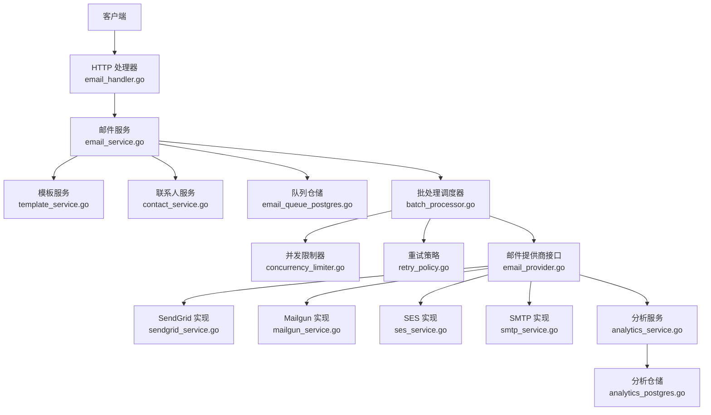
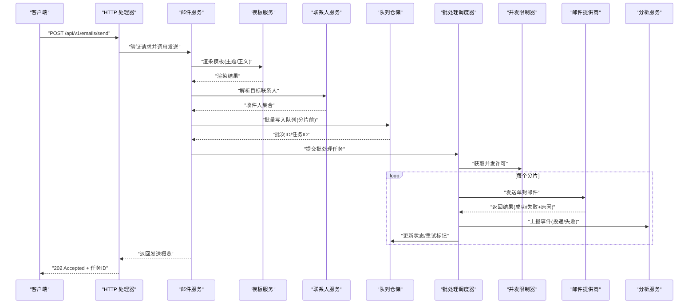
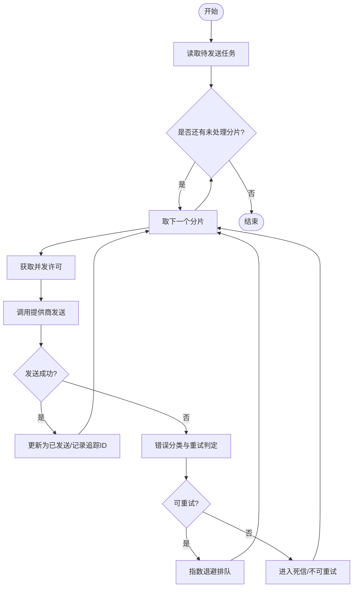
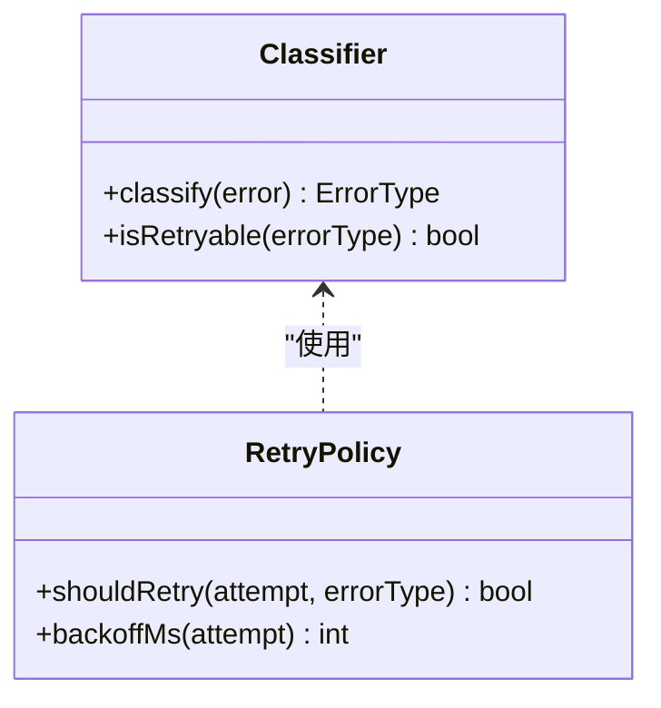
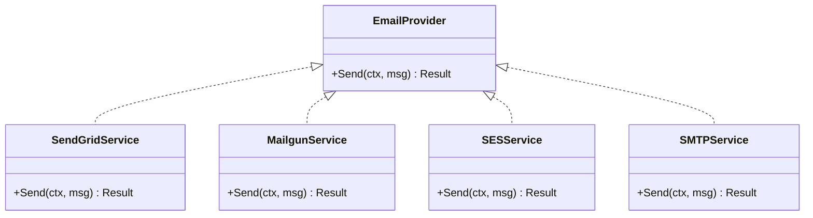
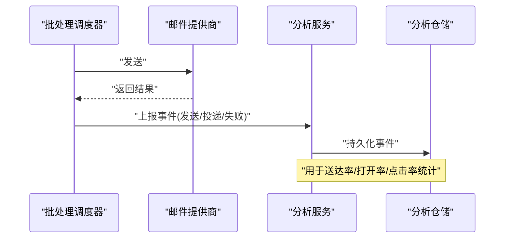
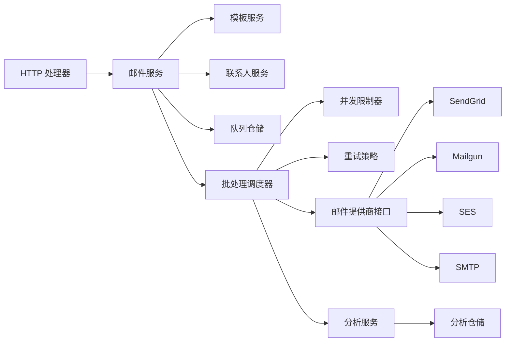

# 邮件发送流程

<cite>
**本文引用的文件**   
- [cmd/api/main.go](file://notifuse/cmd/api/main.go)
- [internal/http/email_handler.go](file://notifuse/internal/http/email_handler.go)
- [internal/service/email_service.go](file://notifuse/internal/service/email_service.go)
- [internal/domain/email_queue.go](file://notifuse/internal/domain/email_queue.go)
- [internal/repository/email_queue_postgres.go](file://notifuse/internal/repository/email_queue_postgres.go)
- [internal/service/queue/batch_processor.go](file://notifuse/internal/service/queue/batch_processor.go)
- [internal/service/queue/concurrency_limiter.go](file://notifuse/internal/service/queue/concurrency_limiter.go)
- [internal/service/queue/retry_policy.go](file://notifuse/internal/service/queue/retry_policy.go)
- [internal/domain/email_provider.go](file://notifuse/internal/domain/email_provider.go)
- [internal/domain/email_provider_sendgrid.go](file://notifuse/internal/domain/email_provider_sendgrid.go)
- [internal/domain/email_provider_mailgun.go](file://notifuse/internal/domain/email_provider_mailgun.go)
- [internal/domain/email_provider_ses.go](file://notifuse/internal/domain/email_provider_ses.go)
- [internal/domain/email_provider_smtp.go](file://notifuse/internal/domain/email_provider_smtp.go)
- [internal/service/sendgrid_service.go](file://notifuse/internal/service/sendgrid_service.go)
- [internal/service/mailgun_service.go](file://notifuse/internal/service/mailgun_service.go)
- [internal/service/ses_service.go](file://notifuse/internal/service/ses_service.go)
- [internal/service/smtp_service.go](file://notifuse/internal/service/smtp_service.go)
- [pkg/emailerror/classifier.go](file://notifuse/pkg/emailerror/classifier.go)
- [pkg/emailerror/error.go](file://notifuse/pkg/emailerror/error.go)
- [internal/domain/analytics.go](file://notifuse/internal/domain/analytics.go)
- [internal/service/analytics_service.go](file://notifuse/internal/service/analytics_service.go)
- [internal/repository/analytics_postgres.go](file://notifuse/internal/repository/analytics_postgres.go)
- [internal/domain/template.go](file://notifuse/internal/domain/template.go)
- [internal/service/template_service.go](file://notifuse/internal/service/template_service.go)
- [internal/domain/contact.go](file://notifuse/internal/domain/contact.go)
- [internal/service/contact_service.go](file://notifuse/internal/service/contact_service.go)
</cite>

## 目录
1. [简介](#简介)
2. [项目结构](#项目结构)
3. [核心组件](#核心组件)
4. [架构总览](#架构总览)
5. [详细组件分析](#详细组件分析)
6. [依赖关系分析](#依赖关系分析)
7. [性能与并发控制](#性能与并发控制)
8. [故障排查指南](#故障排查指南)
9. [结论](#结论)
10. [附录：提供商数据格式与错误处理](#附录提供商数据格式与错误处理)

## 简介
本文件面向Notifuse平台的“邮件发送流程”，从API请求接收到邮件最终送达，完整描述数据流转、模板渲染、队列处理、批量分片与限流、错误重试、状态跟踪与送达率统计等关键环节。文档同时给出关键时序图与流程图，帮助读者快速理解邮件生命周期与不同邮件提供商（SendGrid、Mailgun、AWS SES、SMTP）的集成要点。

## 项目结构
围绕邮件发送的核心代码分布在以下层次：
- HTTP层：接收并校验请求，落库创建任务或入队
- 服务层：编排业务逻辑（模板渲染、联系人解析、批量调度）
- 领域模型：定义邮箱队列、提供商接口、分析事件等
- 仓储层：持久化队列与分析指标
- 队列与批处理：分片、并发控制、重试策略
- 提供商适配：各邮件服务商的具体实现
- 错误分类：统一错误语义与分类

图表来源
- [internal/http/email_handler.go:1-200](file://notifuse/internal/http/email_handler.go#L1-L200)
- [internal/service/email_service.go:1-300](file://notifuse/internal/service/email_service.go#L1-L300)
- [internal/service/template_service.go:1-200](file://notifuse/internal/service/template_service.go#L1-L200)
- [internal/service/contact_service.go:1-200](file://notifuse/internal/service/contact_service.go#L1-L200)
- [internal/repository/email_queue_postgres.go:1-200](file://notifuse/internal/repository/email_queue_postgres.go#L1-L200)
- [internal/service/queue/batch_processor.go:1-200](file://notifuse/internal/service/queue/batch_processor.go#L1-L200)
- [internal/service/queue/concurrency_limiter.go:1-200](file://notifuse/internal/service/queue/concurrency_limiter.go#L1-L200)
- [internal/service/queue/retry_policy.go:1-200](file://notifuse/internal/service/queue/retry_policy.go#L1-L200)
- [internal/domain/email_provider.go:1-200](file://notifuse/internal/domain/email_provider.go#L1-L200)
- [internal/service/sendgrid_service.go:1-200](file://notifuse/internal/service/sendgrid_service.go#L1-L200)
- [internal/service/mailgun_service.go:1-200](file://notifuse/internal/service/mailgun_service.go#L1-L200)
- [internal/service/ses_service.go:1-200](file://notifuse/internal/service/ses_service.go#L1-L200)
- [internal/service/smtp_service.go:1-200](file://notifuse/internal/service/smtp_service.go#L1-L200)
- [internal/service/analytics_service.go:1-200](file://notifuse/internal/service/analytics_service.go#L1-L200)
- [internal/repository/analytics_postgres.go:1-200](file://notifuse/internal/repository/analytics_postgres.go#L1-L200)

章节来源
- [cmd/api/main.go:1-200](file://notifuse/cmd/api/main.go#L1-L200)
- [internal/http/email_handler.go:1-200](file://notifuse/internal/http/email_handler.go#L1-L200)
- [internal/service/email_service.go:1-300](file://notifuse/internal/service/email_service.go#L1-L300)

## 核心组件
- HTTP 处理器：负责鉴权、参数校验、调用服务层，返回响应
- 邮件服务：编排模板渲染、联系人解析、批量入队与调度
- 模板服务：加载模板、合并变量、生成HTML/文本内容
- 联系人服务：按列表/片段筛选目标收件人
- 队列仓储：持久化待发送邮件记录
- 批处理调度器：将大批量任务切分为分片，驱动并发执行
- 并发限制器：基于令牌桶/信号量控制并发度
- 重试策略：指数退避、最大重试次数、死信队列
- 邮件提供商接口与实现：抽象统一发送能力，具体对接各云厂商
- 分析服务与仓储：采集投递、打开、点击、退订、拒收等事件

章节来源
- [internal/http/email_handler.go:1-200](file://notifuse/internal/http/email_handler.go#L1-L200)
- [internal/service/email_service.go:1-300](file://notifuse/internal/service/email_service.go#L1-L300)
- [internal/service/template_service.go:1-200](file://notifuse/internal/service/template_service.go#L1-L200)
- [internal/service/contact_service.go:1-200](file://notifuse/internal/service/contact_service.go#L1-L200)
- [internal/repository/email_queue_postgres.go:1-200](file://notifuse/internal/repository/email_queue_postgres.go#L1-L200)
- [internal/service/queue/batch_processor.go:1-200](file://notifuse/internal/service/queue/batch_processor.go#L1-L200)
- [internal/service/queue/concurrency_limiter.go:1-200](file://notifuse/internal/service/queue/concurrency_limiter.go#L1-L200)
- [internal/service/queue/retry_policy.go:1-200](file://notifuse/internal/service/queue/retry_policy.go#L1-L200)
- [internal/domain/email_provider.go:1-200](file://notifuse/internal/domain/email_provider.go#L1-L200)
- [internal/service/sendgrid_service.go:1-200](file://notifuse/internal/service/sendgrid_service.go#L1-L200)
- [internal/service/mailgun_service.go:1-200](file://notifuse/internal/service/mailgun_service.go#L1-L200)
- [internal/service/ses_service.go:1-200](file://notifuse/internal/service/ses_service.go#L1-L200)
- [internal/service/smtp_service.go:1-200](file://notifuse/internal/service/smtp_service.go#L1-L200)
- [internal/service/analytics_service.go:1-200](file://notifuse/internal/service/analytics_service.go#L1-L200)
- [internal/repository/analytics_postgres.go:1-200](file://notifuse/internal/repository/analytics_postgres.go#L1-L200)

## 架构总览
下图展示一次典型批量邮件发送的生命周期：从API进入、模板渲染、联系人解析、批量入队、分片调度、并发限流、提供商发送、结果回写与分析上报。

图表来源
- [internal/http/email_handler.go:1-200](file://notifuse/internal/http/email_handler.go#L1-L200)
- [internal/service/email_service.go:1-300](file://notifuse/internal/service/email_service.go#L1-L300)
- [internal/service/template_service.go:1-200](file://notifuse/internal/service/template_service.go#L1-L200)
- [internal/service/contact_service.go:1-200](file://notifuse/internal/service/contact_service.go#L1-L200)
- [internal/repository/email_queue_postgres.go:1-200](file://notifuse/internal/repository/email_queue_postgres.go#L1-L200)
- [internal/service/queue/batch_processor.go:1-200](file://notifuse/internal/service/queue/batch_processor.go#L1-L200)
- [internal/service/queue/concurrency_limiter.go:1-200](file://notifuse/internal/service/queue/concurrency_limiter.go#L1-L200)
- [internal/domain/email_provider.go:1-200](file://notifuse/internal/domain/email_provider.go#L1-L200)
- [internal/service/sendgrid_service.go:1-200](file://notifuse/internal/service/sendgrid_service.go#L1-L200)
- [internal/service/mailgun_service.go:1-200](file://notifuse/internal/service/mailgun_service.go#L1-L200)
- [internal/service/ses_service.go:1-200](file://notifuse/internal/service/ses_service.go#L1-L200)
- [internal/service/smtp_service.go:1-200](file://notifuse/internal/service/smtp_service.go#L1-L200)
- [internal/service/analytics_service.go:1-200](file://notifuse/internal/service/analytics_service.go#L1-L200)

## 详细组件分析

### 请求接入与验证
- 入口由HTTP处理器接收，进行鉴权、参数校验、速率限制（如需要）
- 校验通过后，构造发送上下文（工作区、模板ID、变量、附件、提供商选择等）
- 立即落库创建任务记录，返回接受状态码与任务ID，便于后续查询进度

章节来源
- [internal/http/email_handler.go:1-200](file://notifuse/internal/http/email_handler.go#L1-L200)
- [cmd/api/main.go:1-200](file://notifuse/cmd/api/main.go#L1-L200)

### 模板渲染与联系人解析
- 模板服务根据模板ID加载模板，合并变量，输出HTML与纯文本
- 联系人服务根据列表/片段规则计算目标收件人集合，去重与清洗
- 若模板或联系人解析失败，直接返回错误并记录分析事件

章节来源
- [internal/service/template_service.go:1-200](file://notifuse/internal/service/template_service.go#L1-L200)
- [internal/domain/template.go:1-200](file://notifuse/internal/domain/template.go#L1-L200)
- [internal/service/contact_service.go:1-200](file://notifuse/internal/service/contact_service.go#L1-L200)
- [internal/domain/contact.go:1-200](file://notifuse/internal/domain/contact.go#L1-L200)

### 批量入队与分片策略
- 邮件服务将渲染后的邮件项批量写入队列表
- 批处理调度器按固定大小对任务进行分片（例如每片N封），以降低单次负载
- 分片后逐个提交到工作池，结合并发限制器控制并行度

图表来源
- [internal/service/email_service.go:1-300](file://notifuse/internal/service/email_service.go#L1-L300)
- [internal/repository/email_queue_postgres.go:1-200](file://notifuse/internal/repository/email_queue_postgres.go#L1-L200)
- [internal/service/queue/batch_processor.go:1-200](file://notifuse/internal/service/queue/batch_processor.go#L1-L200)
- [internal/service/queue/concurrency_limiter.go:1-200](file://notifuse/internal/service/queue/concurrency_limiter.go#L1-L200)
- [internal/service/queue/retry_policy.go:1-200](file://notifuse/internal/service/queue/retry_policy.go#L1-L200)

章节来源
- [internal/service/email_service.go:1-300](file://notifuse/internal/service/email_service.go#L1-L300)
- [internal/repository/email_queue_postgres.go:1-200](file://notifuse/internal/repository/email_queue_postgres.go#L1-L200)
- [internal/service/queue/batch_processor.go:1-200](file://notifuse/internal/service/queue/batch_processor.go#L1-L200)
- [internal/service/queue/concurrency_limiter.go:1-200](file://notifuse/internal/service/queue/concurrency_limiter.go#L1-L200)
- [internal/service/queue/retry_policy.go:1-200](file://notifuse/internal/service/queue/retry_policy.go#L1-L200)

### 并发控制与限流
- 并发限制器通过令牌桶或信号量控制同一时间窗口内的并发数
- 可按工作区或提供商维度设置不同的并发上限
- 当无可用许可时，任务等待或被拒绝（取决于策略）

章节来源
- [internal/service/queue/concurrency_limiter.go:1-200](file://notifuse/internal/service/queue/concurrency_limiter.go#L1-L200)

### 错误分类与重试
- 错误分类器将第三方错误映射为内部错误类型（网络、认证、配额、软失败、硬失败等）
- 重试策略支持指数退避、最大重试次数、抖动随机化
- 超过重试上限的任务进入死信队列，供人工干预

图表来源
- [pkg/emailerror/classifier.go:1-200](file://notifuse/pkg/emailerror/classifier.go#L1-L200)
- [pkg/emailerror/error.go:1-200](file://notifuse/pkg/emailerror/error.go#L1-L200)
- [internal/service/queue/retry_policy.go:1-200](file://notifuse/internal/service/queue/retry_policy.go#L1-L200)

章节来源
- [pkg/emailerror/classifier.go:1-200](file://notifuse/pkg/emailerror/classifier.go#L1-L200)
- [pkg/emailerror/error.go:1-200](file://notifuse/pkg/emailerror/error.go#L1-L200)
- [internal/service/queue/retry_policy.go:1-200](file://notifuse/internal/service/queue/retry_policy.go#L1-L200)

### 邮件提供商集成
- 统一接口定义发送方法，屏蔽底层差异
- 各提供商实现负责构建请求体、签名、上传附件、处理回调
- 发送完成后，将外部消息ID与状态回写到队列与分析系统

图表来源
- [internal/domain/email_provider.go:1-200](file://notifuse/internal/domain/email_provider.go#L1-L200)
- [internal/service/sendgrid_service.go:1-200](file://notifuse/internal/service/sendgrid_service.go#L1-L200)
- [internal/service/mailgun_service.go:1-200](file://notifuse/internal/service/mailgun_service.go#L1-L200)
- [internal/service/ses_service.go:1-200](file://notifuse/internal/service/ses_service.go#L1-L200)
- [internal/service/smtp_service.go:1-200](file://notifuse/internal/service/smtp_service.go#L1-L200)

章节来源
- [internal/domain/email_provider.go:1-200](file://notifuse/internal/domain/email_provider.go#L1-L200)
- [internal/service/sendgrid_service.go:1-200](file://notifuse/internal/service/sendgrid_service.go#L1-L200)
- [internal/service/mailgun_service.go:1-200](file://notifuse/internal/service/mailgun_service.go#L1-L200)
- [internal/service/ses_service.go:1-200](file://notifuse/internal/service/ses_service.go#L1-L200)
- [internal/service/smtp_service.go:1-200](file://notifuse/internal/service/smtp_service.go#L1-L200)

### 状态跟踪与送达率统计
- 分析服务在发送前后记录事件（创建、发送中、已投递、失败、退订、打开、点击等）
- 仓储层持久化事件，供报表与看板消费
- 送达率=已投递/已发送；打开率=打开/已投递；点击率=点击/已投递

图表来源
- [internal/service/analytics_service.go:1-200](file://notifuse/internal/service/analytics_service.go#L1-L200)
- [internal/repository/analytics_postgres.go:1-200](file://notifuse/internal/repository/analytics_postgres.go#L1-L200)
- [internal/domain/analytics.go:1-200](file://notifuse/internal/domain/analytics.go#L1-L200)

章节来源
- [internal/service/analytics_service.go:1-200](file://notifuse/internal/service/analytics_service.go#L1-L200)
- [internal/repository/analytics_postgres.go:1-200](file://notifuse/internal/repository/analytics_postgres.go#L1-L200)
- [internal/domain/analytics.go:1-200](file://notifuse/internal/domain/analytics.go#L1-L200)

## 依赖关系分析
- HTTP处理器依赖邮件服务
- 邮件服务依赖模板服务、联系人服务、队列仓储、批处理调度器
- 批处理调度器依赖并发限制器、重试策略、邮件提供商
- 邮件提供商依赖各自的服务实现
- 分析服务独立于发送路径，但被批处理调度器在关键节点调用

图表来源
- [internal/http/email_handler.go:1-200](file://notifuse/internal/http/email_handler.go#L1-L200)
- [internal/service/email_service.go:1-300](file://notifuse/internal/service/email_service.go#L1-L300)
- [internal/service/template_service.go:1-200](file://notifuse/internal/service/template_service.go#L1-L200)
- [internal/service/contact_service.go:1-200](file://notifuse/internal/service/contact_service.go#L1-L200)
- [internal/repository/email_queue_postgres.go:1-200](file://notifuse/internal/repository/email_queue_postgres.go#L1-L200)
- [internal/service/queue/batch_processor.go:1-200](file://notifuse/internal/service/queue/batch_processor.go#L1-L200)
- [internal/service/queue/concurrency_limiter.go:1-200](file://notifuse/internal/service/queue/concurrency_limiter.go#L1-L200)
- [internal/service/queue/retry_policy.go:1-200](file://notifuse/internal/service/queue/retry_policy.go#L1-L200)
- [internal/domain/email_provider.go:1-200](file://notifuse/internal/domain/email_provider.go#L1-L200)
- [internal/service/sendgrid_service.go:1-200](file://notifuse/internal/service/sendgrid_service.go#L1-L200)
- [internal/service/mailgun_service.go:1-200](file://notifuse/internal/service/mailgun_service.go#L1-L200)
- [internal/service/ses_service.go:1-200](file://notifuse/internal/service/ses_service.go#L1-L200)
- [internal/service/smtp_service.go:1-200](file://notifuse/internal/service/smtp_service.go#L1-L200)
- [internal/service/analytics_service.go:1-200](file://notifuse/internal/service/analytics_service.go#L1-L200)
- [internal/repository/analytics_postgres.go:1-200](file://notifuse/internal/repository/analytics_postgres.go#L1-L200)

## 性能与并发控制
- 分片大小：建议根据数据库连接池、磁盘IO与第三方限额动态调整
- 并发度：按工作区/提供商维度配置，避免触发供应商限流
- 重试策略：指数退避+抖动，减少雪崩效应
- 背压机制：当队列积压时，降低拉取速率或暂停新任务
- 监控指标：发送速率、失败率、平均延迟、重试次数、死信数量

[本节为通用指导，不直接分析具体文件]

## 故障排查指南
- 常见错误分类：网络超时、认证失败、配额超限、软失败（暂时性）、硬失败（永久性）
- 定位步骤：
  - 查看队列状态与重试计数
  - 检查提供商返回的错误码与消息
  - 核对模板渲染与联系人解析日志
  - 确认并发限制与限流配置
- 恢复策略：
  - 对软失败启用自动重试
  - 对硬失败进入死信并告警
  - 必要时降级至备用提供商

章节来源
- [pkg/emailerror/classifier.go:1-200](file://notifuse/pkg/emailerror/classifier.go#L1-L200)
- [pkg/emailerror/error.go:1-200](file://notifuse/pkg/emailerror/error.go#L1-L200)
- [internal/service/queue/retry_policy.go:1-200](file://notifuse/internal/service/queue/retry_policy.go#L1-L200)

## 结论
Notifuse的邮件发送流程以“服务编排+队列批处理+提供商抽象”为核心，通过分片与并发控制保障吞吐与稳定性，借助错误分类与重试策略提升可靠性，并通过分析服务沉淀可观测性与指标。该设计兼顾扩展性与可维护性，便于接入更多提供商与优化性能。

[本节为总结，不直接分析具体文件]

## 附录：提供商数据格式与错误处理
- SendGrid
  - 数据格式：遵循其API的请求体结构（收件人、主题、内容、附件、自定义头）
  - 错误处理：区分认证、配额、内容违规等错误，映射为内部错误类型
- Mailgun
  - 数据格式：表单字段与JSON混合，支持标签与追踪开关
  - 错误处理：依据错误码判断重试与死信
- AWS SES
  - 数据格式：SDK对象模型（Message、Destination、Content）
  - 错误处理：根据异常类型决定重试或失败
- SMTP
  - 数据格式：标准RFC 5322信封与报文
  - 错误处理：基于SMTP响应码分类

章节来源
- [internal/service/sendgrid_service.go:1-200](file://notifuse/internal/service/sendgrid_service.go#L1-L200)
- [internal/service/mailgun_service.go:1-200](file://notifuse/internal/service/mailgun_service.go#L1-L200)
- [internal/service/ses_service.go:1-200](file://notifuse/internal/service/ses_service.go#L1-L200)
- [internal/service/smtp_service.go:1-200](file://notifuse/internal/service/smtp_service.go#L1-L200)
- [pkg/emailerror/classifier.go:1-200](file://notifuse/pkg/emailerror/classifier.go#L1-L200)
- [pkg/emailerror/error.go:1-200](file://notifuse/pkg/emailerror/error.go#L1-L200)