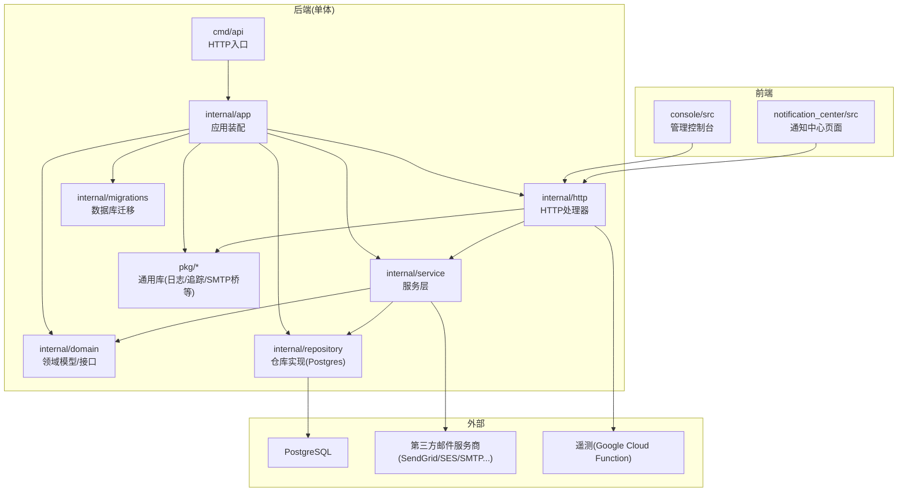
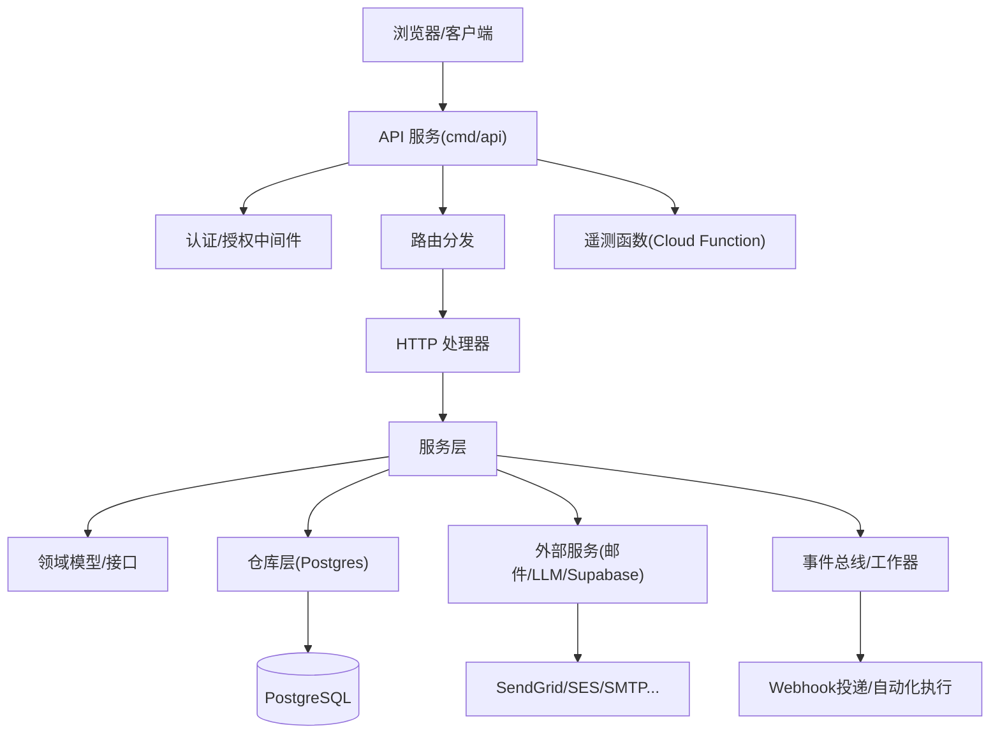
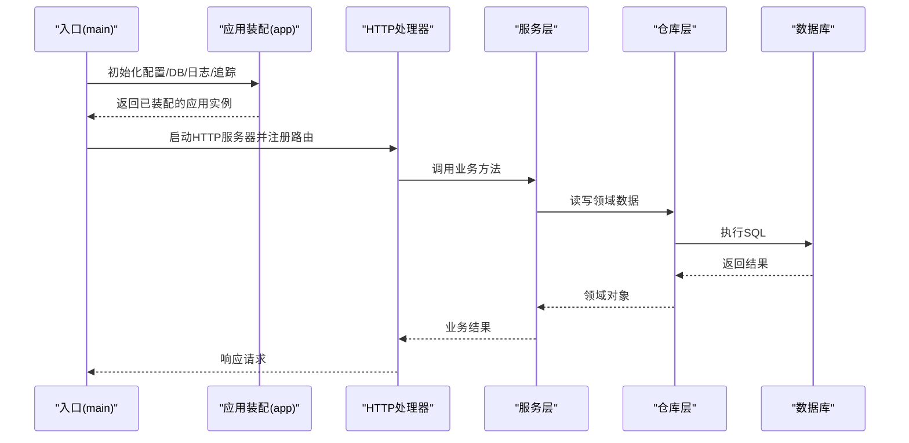
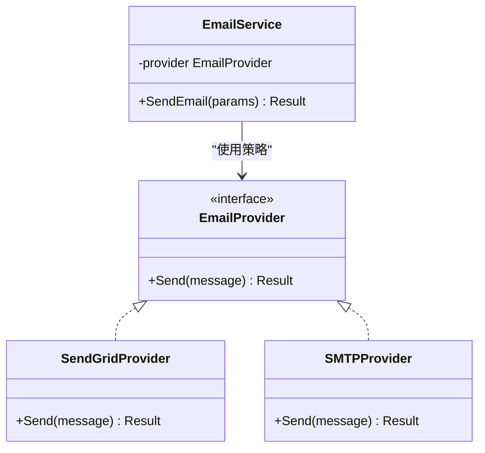
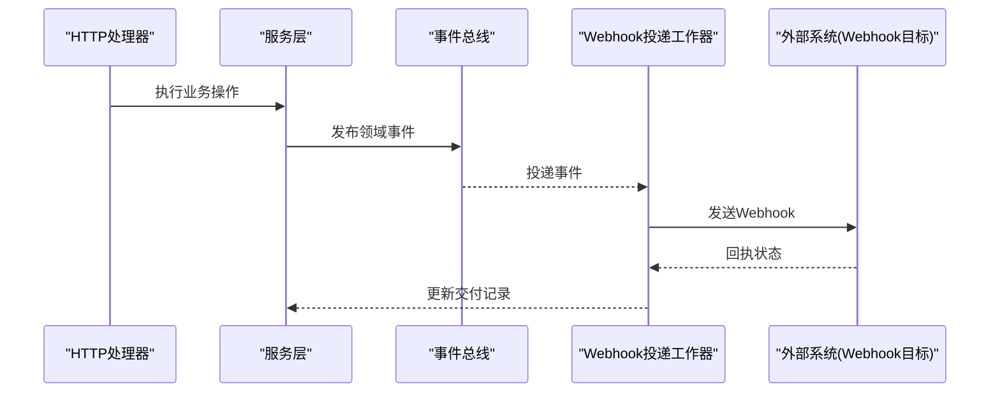
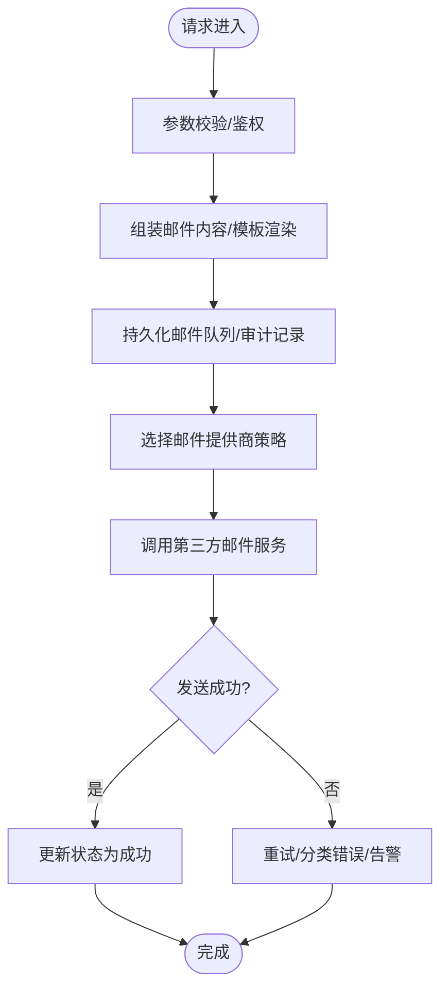
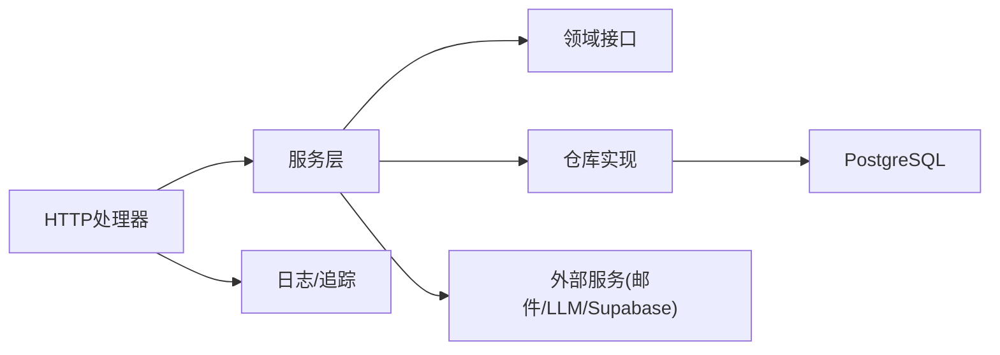
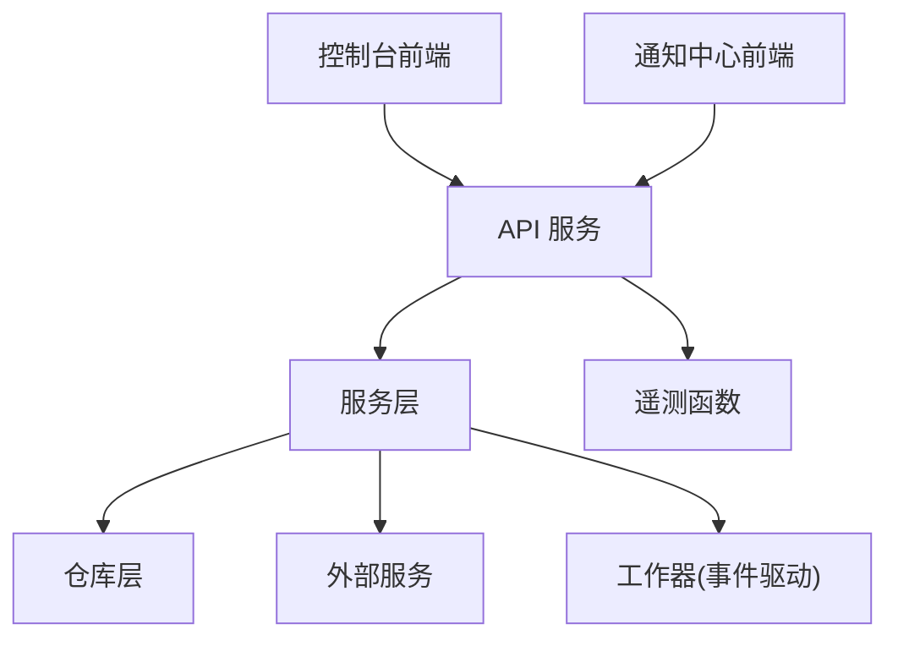
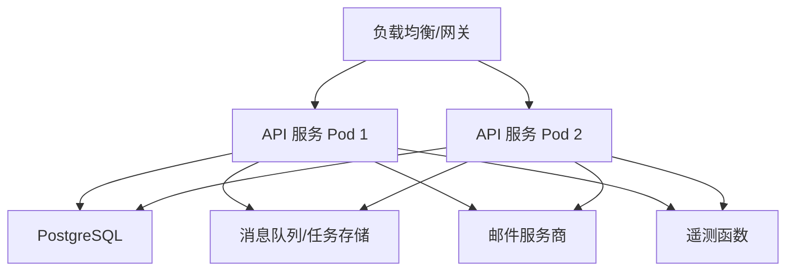

# 架构设计

<cite>
**本文引用的文件**   
- [cmd/api/main.go](file://notifuse/cmd/api/main.go)
- [internal/app/app.go](file://notifuse/internal/app/app.go)
- [config/config.go](file://notifuse/config/config.go)
- [internal/database/init.go](file://notifuse/internal/database/init.go)
- [internal/http/email_handler.go](file://notifuse/internal/http/email_handler.go)
- [internal/service/email_service.go](file://notifuse/internal/service/email_service.go)
- [internal/repository/email_queue_postgres.go](file://notifuse/internal/repository/email_queue_postgres.go)
- [internal/domain/email_provider.go](file://notifuse/internal/domain/email_provider.go)
- [internal/domain/email_provider_sendgrid.go](file://notifuse/internal/domain/email_provider_sendgrid.go)
- [internal/domain/email_provider_smtp.go](file://notifuse/internal/domain/email_provider_smtp.go)
- [internal/domain/event.go](file://notifuse/internal/domain/event.go)
- [internal/service/webhook_delivery_worker.go](file://notifuse/internal/service/webhook_delivery_worker.go)
- [internal/service/automation_executor.go](file://notifuse/internal/service/automation_executor.go)
- [pkg/tracing/tracer.go](file://notifuse/pkg/tracing/tracer.go)
- [pkg/logger/logger.go](file://notifuse/pkg/logger/logger.go)
- [compose.yaml](file://notifuse/compose.yaml)
- [Dockerfile](file://notifuse/Dockerfile)
</cite>

## 目录
1. [简介](#简介)
2. [项目结构](#项目结构)
3. [核心组件](#核心组件)
4. [架构总览](#架构总览)
5. [详细组件分析](#详细组件分析)
6. [依赖关系分析](#依赖关系分析)
7. [性能与可扩展性](#性能与可扩展性)
8. [故障排查指南](#故障排查指南)
9. [结论](#结论)
10. [附录](#附录)

## 简介
本架构设计文档面向 Notifuse 平台，系统性阐述其分层架构、微服务化边界、关键设计模式与横切关注点处理。重点覆盖：
- 分层职责：HTTP 处理器层、服务层、领域模型层、仓库层的解耦与协作
- 微服务与模块边界：API 服务、通知中心前端、遥测函数等
- 设计模式：策略（邮件提供商抽象）、工厂（动态组件创建）、观察者（事件驱动）
- 系统边界与数据流向：请求入口到持久化与外部投递的完整链路
- 基础设施与部署：容器化、数据库、消息队列与可观测性
- 横切关注点：认证授权、日志追踪、错误处理

## 项目结构
Notifuse 采用 Go 语言实现的后端单体应用，按“功能域 + 分层”组织代码；同时包含独立的前端控制台与通知中心页面，以及独立的遥测函数。

图表来源
- [cmd/api/main.go:1-200](file://notifuse/cmd/api/main.go#L1-L200)
- [internal/app/app.go:1-200](file://notifuse/internal/app/app.go#L1-L200)
- [internal/http/email_handler.go:1-200](file://notifuse/internal/http/email_handler.go#L1-L200)
- [internal/service/email_service.go:1-200](file://notifuse/internal/service/email_service.go#L1-L200)
- [internal/repository/email_queue_postgres.go:1-200](file://notifuse/internal/repository/email_queue_postgres.go#L1-L200)
- [internal/domain/email_provider.go:1-200](file://notifuse/internal/domain/email_provider.go#L1-L200)
- [compose.yaml:1-200](file://notifuse/compose.yaml#L1-L200)
- [Dockerfile:1-200](file://notifuse/Dockerfile#L1-L200)

章节来源
- [cmd/api/main.go:1-200](file://notifuse/cmd/api/main.go#L1-L200)
- [internal/app/app.go:1-200](file://notifuse/internal/app/app.go#L1-L200)
- [compose.yaml:1-200](file://notifuse/compose.yaml#L1-L200)
- [Dockerfile:1-200](file://notifuse/Dockerfile#L1-L200)

## 核心组件
- HTTP 处理器层：负责路由、鉴权中间件、参数校验、响应封装，调用服务层完成业务编排。
- 服务层：聚合领域逻辑、协调仓库与外部服务、编排异步任务与事件发布。
- 领域模型层：定义实体、值对象、领域接口（如邮件提供商策略接口），承载不变式与领域规则。
- 仓库层：对数据库访问进行抽象，提供事务、分页、复杂查询能力，屏蔽 SQL 细节。
- 通用库：日志、追踪、缓存、速率限制、安全客户端、SMTP 桥接、模板渲染等横切能力。

章节来源
- [internal/http/email_handler.go:1-200](file://notifuse/internal/http/email_handler.go#L1-L200)
- [internal/service/email_service.go:1-200](file://notifuse/internal/service/email_service.go#L1-L200)
- [internal/domain/email_provider.go:1-200](file://notifuse/internal/domain/email_provider.go#L1-L200)
- [internal/repository/email_queue_postgres.go:1-200](file://notifuse/internal/repository/email_queue_postgres.go#L1-L200)
- [pkg/logger/logger.go:1-200](file://notifuse/pkg/logger/logger.go#L1-L200)
- [pkg/tracing/tracer.go:1-200](file://notifuse/pkg/tracing/tracer.go#L1-L200)

## 架构总览
整体采用分层架构与模块化微服务组合：
- API 服务：Go 单体，暴露 REST/GraphQL/Webhook 接口，内部通过依赖注入装配各层。
- 控制台与通知中心：React 前端，分别用于管理与用户侧通知展示。
- 遥测函数：云函数将指标写入 BigQuery，供分析与告警。
- 外部依赖：PostgreSQL、第三方邮件服务商、OIDC/OAuth2 身份提供方。

图表来源
- [cmd/api/main.go:1-200](file://notifuse/cmd/api/main.go#L1-L200)
- [internal/app/app.go:1-200](file://notifuse/internal/app/app.go#L1-L200)
- [internal/http/email_handler.go:1-200](file://notifuse/internal/http/email_handler.go#L1-L200)
- [internal/service/email_service.go:1-200](file://notifuse/internal/service/email_service.go#L1-L200)
- [internal/repository/email_queue_postgres.go:1-200](file://notifuse/internal/repository/email_queue_postgres.go#L1-L200)
- [internal/service/webhook_delivery_worker.go:1-200](file://notifuse/internal/service/webhook_delivery_worker.go#L1-L200)
- [internal/service/automation_executor.go:1-200](file://notifuse/internal/service/automation_executor.go#L1-L200)

## 详细组件分析

### 分层架构与依赖注入
- 入口与装配：main 初始化配置、数据库连接、日志与追踪，构建应用上下文并注册路由与服务。
- 依赖注入：通过应用装配模块集中构造服务、仓库、中间件，避免散落的 new() 耦合。
- 配置加载：从环境变量/配置文件读取运行时参数，支持多环境切换。

图表来源
- [cmd/api/main.go:1-200](file://notifuse/cmd/api/main.go#L1-L200)
- [internal/app/app.go:1-200](file://notifuse/internal/app/app.go#L1-L200)
- [config/config.go:1-200](file://notifuse/config/config.go#L1-L200)
- [internal/database/init.go:1-200](file://notifuse/internal/database/init.go#L1-L200)

章节来源
- [cmd/api/main.go:1-200](file://notifuse/cmd/api/main.go#L1-L200)
- [internal/app/app.go:1-200](file://notifuse/internal/app/app.go#L1-L200)
- [config/config.go:1-200](file://notifuse/config/config.go#L1-L200)
- [internal/database/init.go:1-200](file://notifuse/internal/database/init.go#L1-L200)

### 策略模式：邮件提供商抽象
- 接口定义：统一发送接口，屏蔽不同供应商差异。
- 具体实现：SendGrid、SES、SMTP 等作为策略实现。
- 工厂选择：根据配置或租户设置动态选择策略实例。

图表来源
- [internal/domain/email_provider.go:1-200](file://notifuse/internal/domain/email_provider.go#L1-L200)
- [internal/domain/email_provider_sendgrid.go:1-200](file://notifuse/internal/domain/email_provider_sendgrid.go#L1-L200)
- [internal/domain/email_provider_smtp.go:1-200](file://notifuse/internal/domain/email_provider_smtp.go#L1-L200)
- [internal/service/email_service.go:1-200](file://notifuse/internal/service/email_service.go#L1-L200)

章节来源
- [internal/domain/email_provider.go:1-200](file://notifuse/internal/domain/email_provider.go#L1-L200)
- [internal/domain/email_provider_sendgrid.go:1-200](file://notifuse/internal/domain/email_provider_sendgrid.go#L1-L200)
- [internal/domain/email_provider_smtp.go:1-200](file://notifuse/internal/domain/email_provider_smtp.go#L1-L200)
- [internal/service/email_service.go:1-200](file://notifuse/internal/service/email_service.go#L1-L200)

### 工厂模式：动态组件创建
- 场景：根据配置动态创建邮件提供商、LLM 提供商、集成适配器。
- 机制：工厂函数/结构体接收配置，返回对应接口实现，便于测试替换与扩展。
- 优势：新增提供商无需改动上层调用方，遵循开闭原则。

章节来源
- [internal/domain/email_provider.go:1-200](file://notifuse/internal/domain/email_provider.go#L1-L200)
- [internal/service/email_service.go:1-200](file://notifuse/internal/service/email_service.go#L1-L200)

### 观察者模式：事件驱动与异步处理
- 事件定义：领域事件（如联系人变更、自动化触发）。
- 发布者：服务层在关键操作后发布事件。
- 订阅者：工作器监听事件并执行 Webhook 投递、自动化节点执行等。

图表来源
- [internal/domain/event.go:1-200](file://notifuse/internal/domain/event.go#L1-L200)
- [internal/service/webhook_delivery_worker.go:1-200](file://notifuse/internal/service/webhook_delivery_worker.go#L1-L200)
- [internal/service/automation_executor.go:1-200](file://notifuse/internal/service/automation_executor.go#L1-L200)

章节来源
- [internal/domain/event.go:1-200](file://notifuse/internal/domain/event.go#L1-L200)
- [internal/service/webhook_delivery_worker.go:1-200](file://notifuse/internal/service/webhook_delivery_worker.go#L1-L200)
- [internal/service/automation_executor.go:1-200](file://notifuse/internal/service/automation_executor.go#L1-L200)

### 数据流：发送邮件端到端流程

图表来源
- [internal/http/email_handler.go:1-200](file://notifuse/internal/http/email_handler.go#L1-L200)
- [internal/service/email_service.go:1-200](file://notifuse/internal/service/email_service.go#L1-L200)
- [internal/repository/email_queue_postgres.go:1-200](file://notifuse/internal/repository/email_queue_postgres.go#L1-L200)
- [internal/domain/email_provider.go:1-200](file://notifuse/internal/domain/email_provider.go#L1-L200)

章节来源
- [internal/http/email_handler.go:1-200](file://notifuse/internal/http/email_handler.go#L1-L200)
- [internal/service/email_service.go:1-200](file://notifuse/internal/service/email_service.go#L1-L200)
- [internal/repository/email_queue_postgres.go:1-200](file://notifuse/internal/repository/email_queue_postgres.go#L1-L200)

## 依赖关系分析
- 内聚与耦合：HTTP 层仅依赖服务层接口；服务层依赖领域接口与仓库接口；仓库实现依赖数据库驱动。
- 外部依赖：第三方邮件服务、OIDC/OAuth2、Supabase、遥测函数。
- 循环依赖：通过接口隔离避免循环引用；领域不依赖具体实现。

图表来源
- [internal/http/email_handler.go:1-200](file://notifuse/internal/http/email_handler.go#L1-L200)
- [internal/service/email_service.go:1-200](file://notifuse/internal/service/email_service.go#L1-L200)
- [internal/repository/email_queue_postgres.go:1-200](file://notifuse/internal/repository/email_queue_postgres.go#L1-L200)
- [pkg/logger/logger.go:1-200](file://notifuse/pkg/logger/logger.go#L1-L200)
- [pkg/tracing/tracer.go:1-200](file://notifuse/pkg/tracing/tracer.go#L1-L200)

章节来源
- [internal/http/email_handler.go:1-200](file://notifuse/internal/http/email_handler.go#L1-L200)
- [internal/service/email_service.go:1-200](file://notifuse/internal/service/email_service.go#L1-L200)
- [internal/repository/email_queue_postgres.go:1-200](file://notifuse/internal/repository/email_queue_postgres.go#L1-L200)

## 性能与可扩展性
- 水平扩展：API 服务无状态，可通过容器编排横向扩容；数据库连接池与只读副本提升吞吐。
- 异步化：邮件发送、Webhook 投递、自动化执行采用队列与工作器，削峰填谷。
- 缓存与限流：热点数据缓存、全局与租户级速率限制，保护下游与自身稳定性。
- 批处理与分页：批量写入、游标分页降低内存占用与数据库压力。
- 可观测性：分布式追踪贯穿请求链路，结合结构化日志与指标上报定位瓶颈。

[本节为通用指导，不涉及具体文件分析]

## 故障排查指南
- 认证失败：检查 OIDC/OAuth2 配置、令牌校验中间件与租户权限映射。
- 邮件发送失败：查看错误分类器与供应商回执，确认凭据、域名验证与 TLS 设置。
- Webhook 投递失败：核对签名校验、超时与重试策略，检查目标可达性与证书。
- 数据库问题：检查连接池、慢查询与锁等待，必要时启用只读副本分流。
- 追踪与日志：基于 TraceID 串联日志与指标，快速定位异常阶段。

章节来源
- [pkg/logger/logger.go:1-200](file://notifuse/pkg/logger/logger.go#L1-L200)
- [pkg/tracing/tracer.go:1-200](file://notifuse/pkg/tracing/tracer.go#L1-L200)

## 结论
Notifuse 通过清晰的分层与接口隔离，结合策略、工厂与观察者模式，实现了高内聚低耦合的系统结构。以事件驱动与异步工作器支撑高并发与弹性伸缩，配合完善的可观测性与横切能力，满足企业级通知与营销场景的可靠性与可维护性要求。

[本节为总结性内容，不涉及具体文件分析]

## 附录

### 系统边界与组件交互
- 边界：API 服务对外暴露接口；控制台与通知中心为前端应用；遥测函数为独立部署单元。
- 交互：前端通过 HTTP 调用 API；API 通过服务层协调领域与仓库；工作器异步处理事件；遥测函数收集指标。

图表来源
- [cmd/api/main.go:1-200](file://notifuse/cmd/api/main.go#L1-L200)
- [internal/service/webhook_delivery_worker.go:1-200](file://notifuse/internal/service/webhook_delivery_worker.go#L1-L200)

### 基础设施要求
- 运行时：Go 运行时、容器镜像（Dockerfile）。
- 数据层：PostgreSQL（连接参数、迁移脚本）。
- 外部服务：邮件服务商（SendGrid/SES/SMTP 等）、OIDC/OAuth2 提供商、Supabase。
- 可观测性：日志采集、分布式追踪、指标上报。

章节来源
- [compose.yaml:1-200](file://notifuse/compose.yaml#L1-L200)
- [Dockerfile:1-200](file://notifuse/Dockerfile#L1-L200)
- [internal/database/init.go:1-200](file://notifuse/internal/database/init.go#L1-L200)

### 部署拓扑图

图表来源
- [compose.yaml:1-200](file://notifuse/compose.yaml#L1-L200)
- [Dockerfile:1-200](file://notifuse/Dockerfile#L1-L200)