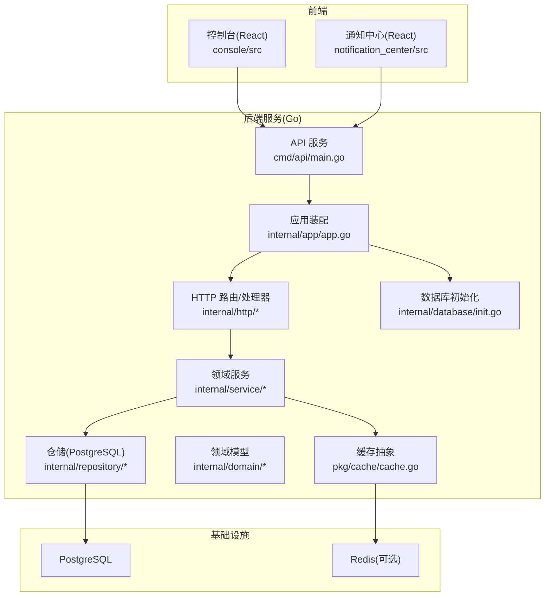
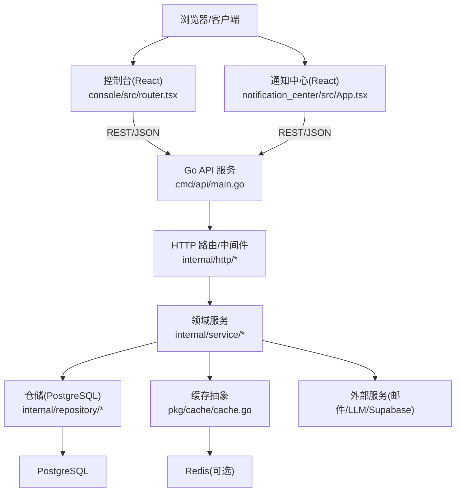
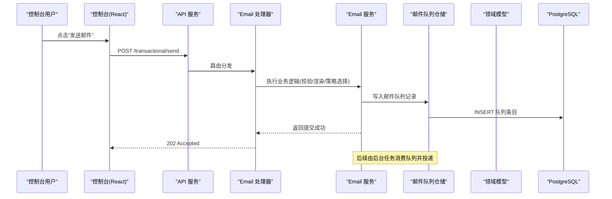
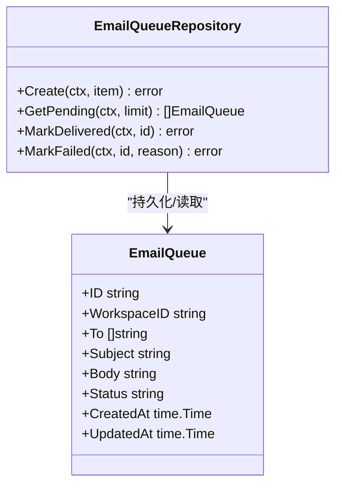
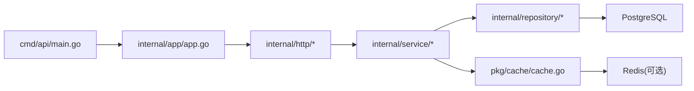

# 系统架构概览

<cite>
**本文引用的文件**   
- [cmd/api/main.go](file://notifuse/cmd/api/main.go)
- [internal/app/app.go](file://notifuse/internal/app/app.go)
- [config/config.go](file://notifuse/config/config.go)
- [internal/database/init.go](file://notifuse/internal/database/init.go)
- [pkg/cache/cache.go](file://notifuse/pkg/cache/cache.go)
- [internal/http/root_handler.go](file://notifuse/internal/http/root_handler.go)
- [internal/http/email_handler.go](file://notifuse/internal/http/email_handler.go)
- [internal/service/email_service.go](file://notifuse/internal/service/email_service.go)
- [internal/repository/email_queue_postgres.go](file://notifuse/internal/repository/email_queue_postgres.go)
- [internal/domain/email_queue.go](file://notifuse/internal/domain/email_queue.go)
- [notification_center/src/App.tsx](file://notifuse/notification_center/src/App.tsx)
- [console/src/router.tsx](file://notifuse/console/src/router.tsx)
- [compose.yaml](file://notifuse/compose.yaml)
- [Dockerfile](file://notifuse/Dockerfile)
</cite>

## 目录
1. [简介](#简介)
2. [项目结构](#项目结构)
3. [核心组件](#核心组件)
4. [架构总览](#架构总览)
5. [详细组件分析](#详细组件分析)
6. [依赖关系分析](#依赖关系分析)
7. [性能与可扩展性](#性能与可扩展性)
8. [故障排查指南](#故障排查指南)
9. [结论](#结论)
10. [附录](#附录)

## 简介
本文件为 Notifuse 平台的系统架构概览，面向产品、研发与运维读者，帮助快速理解整体架构、模块边界、通信机制与技术选型。Notifuse 采用“后端 Go 服务 + React 控制台 + 通知中心”的分层架构，围绕工作区（Workspace）进行多租户隔离，提供邮件发送、自动化、模板、联系人、Webhook、订阅等能力，并通过 OpenAPI 暴露标准接口。

## 项目结构
仓库采用按领域/层次混合组织方式：
- cmd：可执行程序入口（API 服务、HMAC 工具）
- internal：核心业务实现（应用层、HTTP 层、领域模型、仓储、服务、迁移、数据库初始化）
- pkg：通用库（缓存、日志、安全、SMTP、速率限制等）
- console：React 控制台前端（管理后台）
- notification_center：通知中心前端（用户侧通知展示）
- openapi：OpenAPI 规范定义
- telemetry：遥测采集函数
- tests：集成与端到端测试
- compose.yaml / Dockerfile：本地编排与容器化

图表来源
- [cmd/api/main.go:1-200](file://notifuse/cmd/api/main.go#L1-L200)
- [internal/app/app.go:1-200](file://notifuse/internal/app/app.go#L1-L200)
- [internal/http/root_handler.go:1-200](file://notifuse/internal/http/root_handler.go#L1-L200)
- [internal/service/email_service.go:1-200](file://notifuse/internal/service/email_service.go#L1-L200)
- [internal/repository/email_queue_postgres.go:1-200](file://notifuse/internal/repository/email_queue_postgres.go#L1-L200)
- [internal/domain/email_queue.go:1-200](file://notifuse/internal/domain/email_queue.go#L1-L200)
- [pkg/cache/cache.go:1-200](file://notifuse/pkg/cache/cache.go#L1-L200)
- [internal/database/init.go:1-200](file://notifuse/internal/database/init.go#L1-L200)

章节来源
- [cmd/api/main.go:1-200](file://notifuse/cmd/api/main.go#L1-L200)
- [internal/app/app.go:1-200](file://notifuse/internal/app/app.go#L1-L200)
- [compose.yaml:1-200](file://notifuse/compose.yaml#L1-L200)
- [Dockerfile:1-200](file://notifuse/Dockerfile#L1-L200)

## 核心组件
- API 服务与装配
  - 启动入口负责加载配置、初始化数据库连接、注册中间件与路由、启动 HTTP 服务器。
  - 应用装配集中构建依赖图，注入服务、仓储、缓存、迁移管理器。
- HTTP 层
  - 基于路径分派到各 Handler，承载认证、鉴权、请求校验、响应封装等横切关注点。
- 服务层
  - 聚合领域逻辑，协调仓储与外部服务（如邮件提供商、LLM、Supabase 等）。
- 仓储层
  - 以 PostgreSQL 为主要持久化存储，提供事务、分页、复杂查询能力。
- 领域模型
  - 描述实体、值对象与不变式，作为跨层契约。
- 缓存抽象
  - 统一缓存访问接口，便于替换实现或启用/禁用缓存。
- 数据库初始化
  - 执行版本化迁移，确保数据一致性。

章节来源
- [internal/app/app.go:1-200](file://notifuse/internal/app/app.go#L1-L200)
- [internal/http/root_handler.go:1-200](file://notifuse/internal/http/root_handler.go#L1-L200)
- [internal/service/email_service.go:1-200](file://notifuse/internal/service/email_service.go#L1-L200)
- [internal/repository/email_queue_postgres.go:1-200](file://notifuse/internal/repository/email_queue_postgres.go#L1-L200)
- [internal/domain/email_queue.go:1-200](file://notifuse/internal/domain/email_queue.go#L1-L200)
- [pkg/cache/cache.go:1-200](file://notifuse/pkg/cache/cache.go#L1-L200)
- [internal/database/init.go:1-200](file://notifuse/internal/database/init.go#L1-L200)

## 架构总览
下图展示了前后端分层、服务边界与关键外部依赖的交互关系。

图表来源
- [console/src/router.tsx:1-200](file://notifuse/console/src/router.tsx#L1-L200)
- [notification_center/src/App.tsx:1-200](file://notifuse/notification_center/src/App.tsx#L1-L200)
- [cmd/api/main.go:1-200](file://notifuse/cmd/api/main.go#L1-L200)
- [internal/http/email_handler.go:1-200](file://notifuse/internal/http/email_handler.go#L1-L200)
- [internal/service/email_service.go:1-200](file://notifuse/internal/service/email_service.go#L1-L200)
- [internal/repository/email_queue_postgres.go:1-200](file://notifuse/internal/repository/email_queue_postgres.go#L1-L200)
- [pkg/cache/cache.go:1-200](file://notifuse/pkg/cache/cache.go#L1-L200)

## 详细组件分析

### 邮件发送流程（示例）
该序列图展示从控制台发起邮件发送请求到最终落库与队列处理的关键调用链。

图表来源
- [console/src/router.tsx:1-200](file://notifuse/console/src/router.tsx#L1-L200)
- [internal/http/email_handler.go:1-200](file://notifuse/internal/http/email_handler.go#L1-L200)
- [internal/service/email_service.go:1-200](file://notifuse/internal/service/email_service.go#L1-L200)
- [internal/repository/email_queue_postgres.go:1-200](file://notifuse/internal/repository/email_queue_postgres.go#L1-L200)
- [internal/domain/email_queue.go:1-200](file://notifuse/internal/domain/email_queue.go#L1-L200)

章节来源
- [internal/http/email_handler.go:1-200](file://notifuse/internal/http/email_handler.go#L1-L200)
- [internal/service/email_service.go:1-200](file://notifuse/internal/service/email_service.go#L1-L200)
- [internal/repository/email_queue_postgres.go:1-200](file://notifuse/internal/repository/email_queue_postgres.go#L1-L200)
- [internal/domain/email_queue.go:1-200](file://notifuse/internal/domain/email_queue.go#L1-L200)

### 领域模型与仓储（邮件队列）

图表来源
- [internal/domain/email_queue.go:1-200](file://notifuse/internal/domain/email_queue.go#L1-L200)
- [internal/repository/email_queue_postgres.go:1-200](file://notifuse/internal/repository/email_queue_postgres.go#L1-L200)

章节来源
- [internal/domain/email_queue.go:1-200](file://notifuse/internal/domain/email_queue.go#L1-L200)
- [internal/repository/email_queue_postgres.go:1-200](file://notifuse/internal/repository/email_queue_postgres.go#L1-L200)

### 配置与环境
- 配置加载：集中式配置结构体，支持环境变量覆盖与默认值。
- 平台特性：通过配置开关控制功能（如 OIDC、SMTP 桥接、遥测等）。
- 根邮箱与 SMTP TLS：用于系统通知与出站邮件。

章节来源
- [config/config.go:1-200](file://notifuse/config/config.go#L1-L200)
- [config/platform.go:1-200](file://notifuse/config/platform.go#L1-L200)
- [config/root_email.go:1-200](file://notifuse/config/root_email.go#L1-L200)

## 依赖关系分析
- 直接依赖
  - API 服务依赖应用装配、HTTP 路由、服务层、仓储层、缓存抽象、数据库初始化。
  - 服务层依赖仓储与外部服务（邮件提供商、LLM、Supabase）。
  - 仓储层依赖 PostgreSQL。
  - 缓存抽象依赖 Redis（可选）。
- 间接依赖
  - 控制台与通知中心仅依赖 API 的 REST 接口，不感知内部实现细节。
- 可能的循环依赖
  - 通过清晰的层划分（HTTP -> Service -> Repository）避免循环引用。

图表来源
- [cmd/api/main.go:1-200](file://notifuse/cmd/api/main.go#L1-L200)
- [internal/app/app.go:1-200](file://notifuse/internal/app/app.go#L1-L200)
- [pkg/cache/cache.go:1-200](file://notifuse/pkg/cache/cache.go#L1-L200)

章节来源
- [cmd/api/main.go:1-200](file://notifuse/cmd/api/main.go#L1-L200)
- [internal/app/app.go:1-200](file://notifuse/internal/app/app.go#L1-L200)
- [pkg/cache/cache.go:1-200](file://notifuse/pkg/cache/cache.go#L1-L200)

## 性能与可扩展性
- 水平扩展
  - API 服务无状态设计，可通过多副本部署配合负载均衡器横向扩展。
  - 使用共享持久化（PostgreSQL）与可选缓存（Redis），保证实例间数据一致性与热点读加速。
- 负载均衡策略
  - 推荐基于健康检查的轮询或最少连接数策略；对长连接场景（如 Websocket）需考虑会话亲和或会话外置。
- 容器化部署
  - 使用 Dockerfile 构建镜像，结合 compose.yaml 在本地编排数据库与缓存依赖，生产环境建议采用 Kubernetes 或云托管服务。
- 异步与背压
  - 邮件队列与任务调度采用“入队 + 后台消费者”模式，提升吞吐与容错能力。
- 缓存策略
  - 热点配置、字典表、验证码等适合放入 Redis；注意缓存失效与一致性策略。

章节来源
- [compose.yaml:1-200](file://notifuse/compose.yaml#L1-L200)
- [Dockerfile:1-200](file://notifuse/Dockerfile#L1-L200)

## 故障排查指南
- 启动失败
  - 检查数据库连接参数、迁移是否成功执行。
  - 确认端口占用与网络可达性。
- 邮件发送失败
  - 查看队列状态与错误原因；核对第三方邮件服务商凭据与配额。
  - 检查重试与退避策略是否生效。
- 缓存异常
  - 验证 Redis 连通性与内存水位；必要时降级至直连数据库。
- 鉴权与权限
  - 核对 OIDC/OAuth2 配置与工作区成员权限。

章节来源
- [internal/database/init.go:1-200](file://notifuse/internal/database/init.go#L1-L200)
- [internal/service/email_service.go:1-200](file://notifuse/internal/service/email_service.go#L1-L200)
- [pkg/cache/cache.go:1-200](file://notifuse/pkg/cache/cache.go#L1-L200)

## 结论
Notifuse 采用清晰的分层与领域驱动设计，通过 Go 的高并发与强类型优势、PostgreSQL 的可靠性与丰富生态、Redis 的缓存加速以及 React 的前端体验，构建了可扩展、易维护的通知与营销平台。未来可在服务拆分、事件总线、可观测性与灰度发布等方面持续演进。

## 附录
- 技术栈选型要点
  - Go：高并发、低延迟、静态编译与简单部署。
  - PostgreSQL：ACID、JSONB、窗口函数与成熟生态。
  - Redis：高性能键值存储，适用于缓存、限流与消息队列辅助。
  - React：组件化、生态完善、利于控制台与通知中心的快速迭代。
- 参考入口
  - API 入口：[cmd/api/main.go](file://notifuse/cmd/api/main.go)
  - 应用装配：[internal/app/app.go](file://notifuse/internal/app/app.go)
  - 控制台路由：[console/src/router.tsx](file://notifuse/console/src/router.tsx)
  - 通知中心入口：[notification_center/src/App.tsx](file://notifuse/notification_center/src/App.tsx)