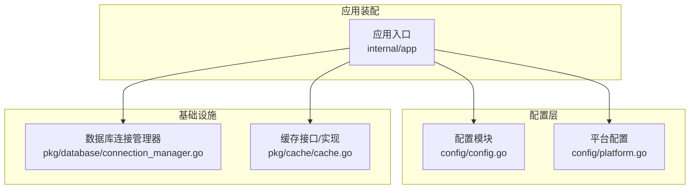
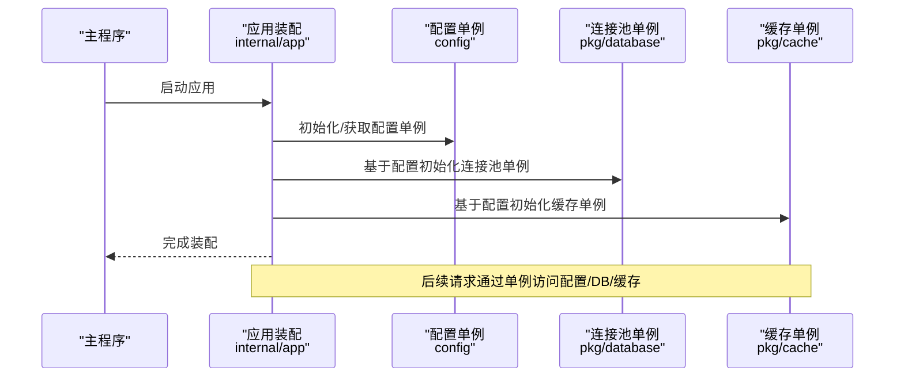
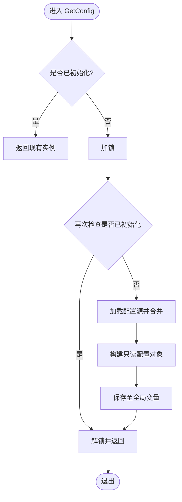
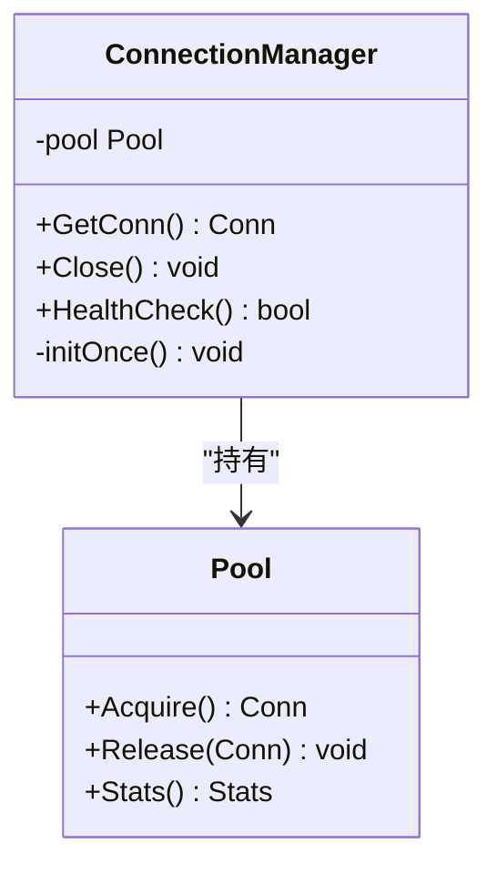
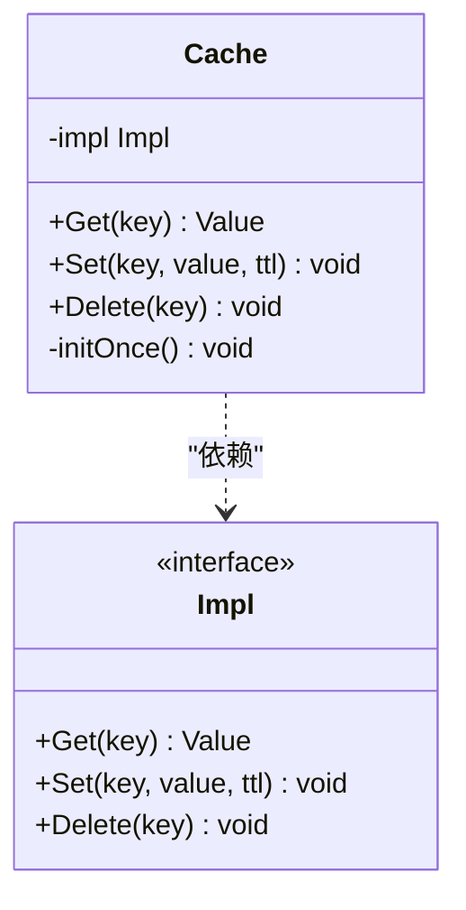
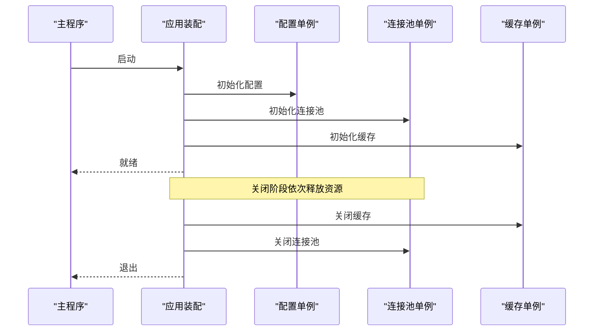
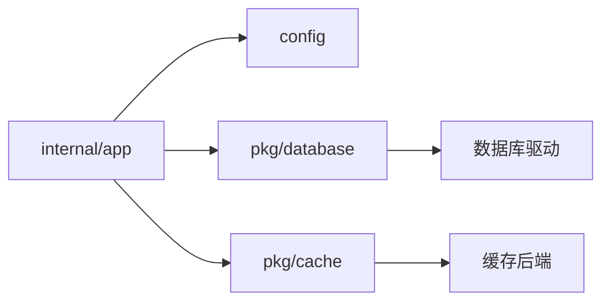

# 单例模式实现

<cite>
**本文引用的文件**   
- [config.go](file://notifuse/config/config.go)
- [platform.go](file://notifuse/config/platform.go)
- [connection_manager.go](file://notifuse/pkg/database/connection_manager.go)
- [cache.go](file://notifuse/pkg/cache/cache.go)
- [app.go](file://notifuse/internal/app/app.go)
</cite>

## 目录
1. [简介](#简介)
2. [项目结构](#项目结构)
3. [核心组件](#核心组件)
4. [架构总览](#架构总览)
5. [详细组件分析](#详细组件分析)
6. [依赖分析](#依赖分析)
7. [性能考虑](#性能考虑)
8. [故障排查指南](#故障排查指南)
9. [结论](#结论)
10. [附录](#附录)

## 简介
本文件面向 Notifuse 平台，系统化阐述单例模式在以下关键领域的应用与最佳实践：
- 配置管理：确保全局配置的唯一性与一致性
- 数据库连接池：通过单例集中管理连接资源，优化复用与生命周期
- 缓存系统：以单例提供全局一致的缓存访问点

文档将说明单例如何避免重复创建对象、节省内存、提供全局访问点，并给出线程安全、懒加载与生命周期管理的实现要点。为便于理解，文中包含架构图、类图、时序图与流程图等可视化表达。

## 项目结构
Notifuse 后端采用 Go 语言工程化组织，与单例相关的核心位置如下：
- 配置层：位于 config 包，负责加载、解析与应用级配置
- 基础设施层：pkg/database 提供数据库连接管理器；pkg/cache 提供缓存抽象
- 应用装配层：internal/app 负责初始化与注入各子系统

图表来源
- [app.go:1-200](file://notifuse/internal/app/app.go#L1-L200)
- [config.go:1-200](file://notifuse/config/config.go#L1-L200)
- [platform.go:1-200](file://notifuse/config/platform.go#L1-L200)
- [connection_manager.go:1-200](file://notifuse/pkg/database/connection_manager.go#L1-L200)
- [cache.go:1-200](file://notifuse/pkg/cache/cache.go#L1-L200)

章节来源
- [app.go:1-200](file://notifuse/internal/app/app.go#L1-L200)
- [config.go:1-200](file://notifuse/config/config.go#L1-L200)
- [platform.go:1-200](file://notifuse/config/platform.go#L1-L200)
- [connection_manager.go:1-200](file://notifuse/pkg/database/connection_manager.go#L1-L200)
- [cache.go:1-200](file://notifuse/pkg/cache/cache.go#L1-L200)

## 核心组件
- 配置单例（Config）
  - 职责：统一加载环境变量、配置文件与默认值，提供只读访问接口
  - 特性：线程安全、懒加载、不可变视图
- 数据库连接池单例（ConnectionManager）
  - 职责：维护唯一连接池实例，提供获取/释放连接的 API
  - 特性：连接复用、健康检查、优雅关闭
- 缓存单例（Cache）
  - 职责：提供全局一致的缓存读写能力
  - 特性：可插拔实现、过期策略、并发安全

章节来源
- [config.go:1-200](file://notifuse/config/config.go#L1-L200)
- [platform.go:1-200](file://notifuse/config/platform.go#L1-L200)
- [connection_manager.go:1-200](file://notifuse/pkg/database/connection_manager.go#L1-L200)
- [cache.go:1-200](file://notifuse/pkg/cache/cache.go#L1-L200)

## 架构总览
下图展示应用启动时，如何通过单例装配配置、数据库与缓存，并在请求处理中共享这些全局资源。

图表来源
- [app.go:1-200](file://notifuse/internal/app/app.go#L1-L200)
- [config.go:1-200](file://notifuse/config/config.go#L1-L200)
- [connection_manager.go:1-200](file://notifuse/pkg/database/connection_manager.go#L1-L200)
- [cache.go:1-200](file://notifuse/pkg/cache/cache.go#L1-L200)

## 详细组件分析

### 配置单例（Config）
- 设计要点
  - 懒加载：首次访问时加载配置，避免启动开销
  - 线程安全：使用互斥锁保护初始化与读取路径
  - 不可变性：对外暴露只读视图，防止运行时被意外修改
- 典型流程
  - 首次调用返回已存在实例或执行初始化
  - 从环境变量/配置文件合并得到最终配置
  - 提供按命名空间访问的查询方法
- 适用场景
  - 全局开关、日志级别、外部服务地址、功能开关等

图表来源
- [config.go:1-200](file://notifuse/config/config.go#L1-L200)

章节来源
- [config.go:1-200](file://notifuse/config/config.go#L1-L200)
- [platform.go:1-200](file://notifuse/config/platform.go#L1-L200)

### 数据库连接池单例（ConnectionManager）
- 设计要点
  - 单一连接池：进程内唯一实例，避免多实例导致连接泄漏
  - 懒加载：按需建立连接池，降低冷启动成本
  - 健康检查：定期探测连接可用性，自动剔除坏连接
  - 优雅关闭：应用退出时回收所有连接
- 典型流程
  - 根据配置参数（最大连接数、空闲超时等）创建连接池
  - 提供获取连接、归还连接、健康检查、关闭等方法
- 适用场景
  - 所有需要持久化存储的业务模块

图表来源
- [connection_manager.go:1-200](file://notifuse/pkg/database/connection_manager.go#L1-L200)

章节来源
- [connection_manager.go:1-200](file://notifuse/pkg/database/connection_manager.go#L1-L200)

### 缓存单例（Cache）
- 设计要点
  - 全局一致：同一进程内仅一个缓存实例，保证数据一致性
  - 可插拔：支持不同后端（内存、Redis 等），通过接口解耦
  - 并发安全：读写操作具备并发控制
- 典型流程
  - 首次访问时根据配置选择具体实现并初始化
  - 提供 Get/Set/Delete/TTL 等基础操作
- 适用场景
  - 热点数据缓存、会话信息、计算结果缓存等

图表来源
- [cache.go:1-200](file://notifuse/pkg/cache/cache.go#L1-L200)

章节来源
- [cache.go:1-200](file://notifuse/pkg/cache/cache.go#L1-L200)

### 应用装配与生命周期（internal/app）
- 职责
  - 在应用启动阶段完成配置、数据库、缓存的单例初始化
  - 将单例注入到各业务模块
  - 在应用退出时执行清理（如关闭数据库连接池）
- 生命周期
  - 启动：初始化顺序为 配置 → 数据库 → 缓存
  - 运行：各模块通过单例访问资源
  - 关闭：按相反顺序释放资源

图表来源
- [app.go:1-200](file://notifuse/internal/app/app.go#L1-L200)

章节来源
- [app.go:1-200](file://notifuse/internal/app/app.go#L1-L200)

## 依赖分析
- 耦合关系
  - internal/app 依赖 config、database、cache 三个子系统的单例
  - 业务模块通过内部 app 提供的上下文或依赖注入方式访问单例
- 外部依赖
  - 数据库驱动、缓存后端（如 Redis）通过接口隔离，便于替换与测试

图表来源
- [app.go:1-200](file://notifuse/internal/app/app.go#L1-L200)
- [connection_manager.go:1-200](file://notifuse/pkg/database/connection_manager.go#L1-L200)
- [cache.go:1-200](file://notifuse/pkg/cache/cache.go#L1-L200)

章节来源
- [app.go:1-200](file://notifuse/internal/app/app.go#L1-L200)
- [connection_manager.go:1-200](file://notifuse/pkg/database/connection_manager.go#L1-L200)
- [cache.go:1-200](file://notifuse/pkg/cache/cache.go#L1-L200)

## 性能考虑
- 减少对象创建与 GC 压力：单例避免重复构造昂贵对象（如连接池、模板引擎）
- 连接复用：数据库连接池提升吞吐、降低握手开销
- 缓存命中：热点数据常驻内存，显著降低下游 I/O 压力
- 懒加载：按需初始化，缩短冷启动时间
- 合理容量：依据 QPS 与延迟目标设置连接池大小与缓存 TTL

## 故障排查指南
- 配置未生效
  - 确认单例是否在正确时机初始化
  - 检查环境变量/配置文件优先级与键名拼写
- 连接池耗尽
  - 观察连接占用与归还路径，排查未归还的连接
  - 调整最大连接数与空闲超时
- 缓存不一致
  - 确认单例是否为进程内唯一实例
  - 校验 TTL 与更新策略
- 优雅关闭失败
  - 确保关闭顺序正确，避免在关闭后仍尝试获取资源

章节来源
- [connection_manager.go:1-200](file://notifuse/pkg/database/connection_manager.go#L1-L200)
- [cache.go:1-200](file://notifuse/pkg/cache/cache.go#L1-L200)
- [config.go:1-200](file://notifuse/config/config.go#L1-L200)

## 结论
通过在配置、数据库连接池与缓存系统中采用单例模式，Notifuse 实现了：
- 全局唯一且一致的资源访问点
- 高效的资源复用与生命周期管理
- 更好的可扩展性与可测试性（通过接口与依赖注入）

建议在生产环境结合监控指标（连接池使用率、缓存命中率、配置变更事件）持续优化。

## 附录
- 术语
  - 单例：全局唯一实例，提供全局访问点
  - 懒加载：在首次使用时才进行初始化
  - 线程安全：多线程环境下保证状态一致性
- 参考实现位置
  - 配置单例：[config.go](file://notifuse/config/config.go)
  - 平台配置：[platform.go](file://notifuse/config/platform.go)
  - 数据库连接池：[connection_manager.go](file://notifuse/pkg/database/connection_manager.go)
  - 缓存接口/实现：[cache.go](file://notifuse/pkg/cache/cache.go)
  - 应用装配：[app.go](file://notifuse/internal/app/app.go)