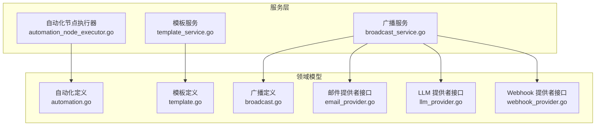
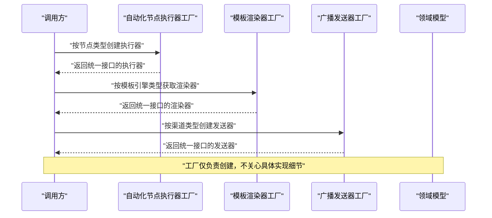
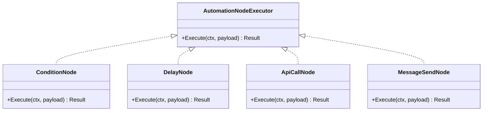
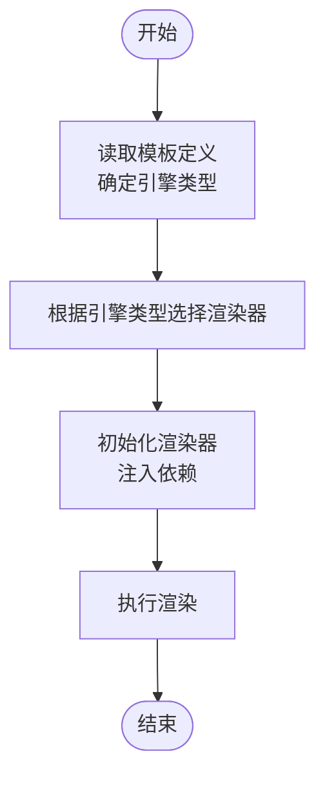
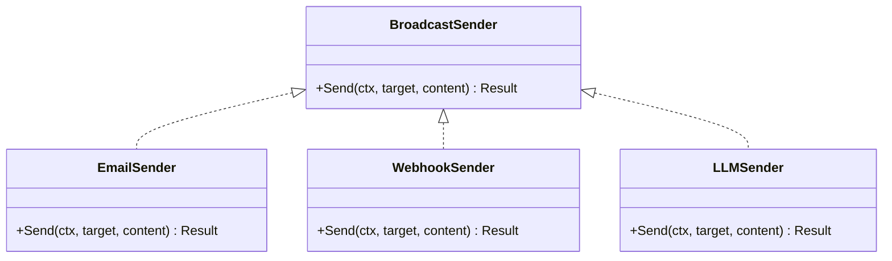
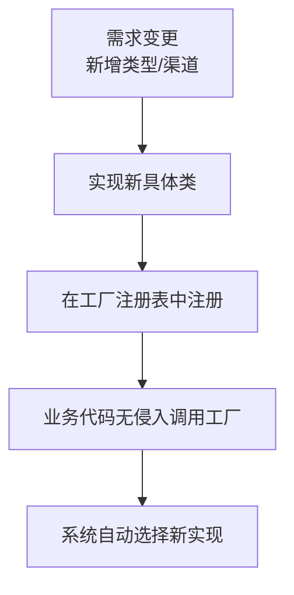
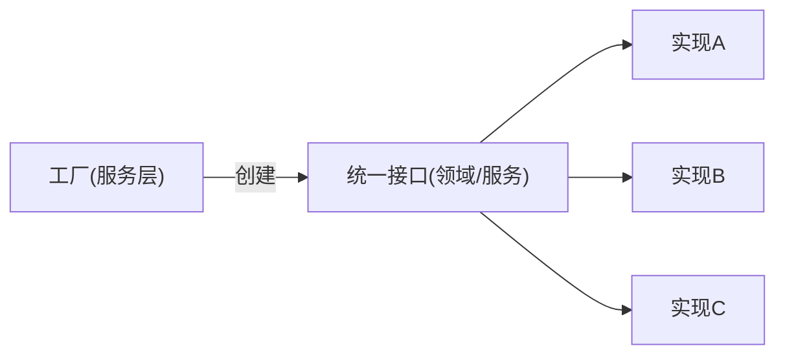

# 工厂模式实现

<cite>
**本文引用的文件**   
- [automation_node_executor.go](file://notifuse/internal/service/automation_node_executor.go)
- [automation_service.go](file://notifuse/internal/service/automation_service.go)
- [broadcast_service.go](file://notifuse/internal/service/broadcast_service.go)
- [template_service.go](file://notifuse/internal/service/template_service.go)
- [email_provider.go](file://notifuse/internal/domain/email_provider.go)
- [llm_provider.go](file://notifuse/internal/domain/llm_provider.go)
- [webhook_provider.go](file://notifuse/internal/domain/webhook_provider.go)
- [automation.go](file://notifuse/internal/domain/automation.go)
- [broadcast.go](file://notifuse/internal/domain/broadcast.go)
- [template.go](file://notifuse/internal/domain/template.go)
</cite>

## 目录
1. [简介](#简介)
2. [项目结构](#项目结构)
3. [核心组件](#核心组件)
4. [架构总览](#架构总览)
5. [详细组件分析](#详细组件分析)
6. [依赖分析](#依赖分析)
7. [性能考虑](#性能考虑)
8. [故障排查指南](#故障排查指南)
9. [结论](#结论)
10. [附录](#附录)

## 简介
本文件聚焦于 Notifuse 平台中“工厂模式”的实现与应用，围绕以下三个关键场景展开：
- 自动化节点创建：根据配置动态选择并实例化不同类型的自动化节点执行器。
- 模板渲染器工厂：按配置的模板引擎类型动态选择具体渲染器。
- 广播发送器工厂：根据目标渠道（如邮件、Webhook、LLM 等）动态选择具体发送器。

通过统一的接口与集中式注册机制，工厂模式显著简化了复杂对象的创建过程，提升了可扩展性与可维护性。

## 项目结构
Notifuse 后端采用分层组织方式：领域模型位于 internal/domain，服务层位于 internal/service，HTTP 处理器位于 internal/http。工厂模式主要应用于服务层，对领域对象进行统一装配与分发。

图表来源
- [automation_node_executor.go](file://notifuse/internal/service/automation_node_executor.go)
- [automation_service.go](file://notifuse/internal/service/automation_service.go)
- [template_service.go](file://notifuse/internal/service/template_service.go)
- [broadcast_service.go](file://notifuse/internal/service/broadcast_service.go)
- [automation.go](file://notifuse/internal/domain/automation.go)
- [template.go](file://notifuse/internal/domain/template.go)
- [broadcast.go](file://notifuse/internal/domain/broadcast.go)
- [email_provider.go](file://notifuse/internal/domain/email_provider.go)
- [llm_provider.go](file://notifuse/internal/domain/llm_provider.go)
- [webhook_provider.go](file://notifuse/internal/domain/webhook_provider.go)

章节来源
- [automation_node_executor.go](file://notifuse/internal/service/automation_node_executor.go)
- [automation_service.go](file://notifuse/internal/service/automation_service.go)
- [template_service.go](file://notifuse/internal/service/template_service.go)
- [broadcast_service.go](file://notifuse/internal/service/broadcast_service.go)
- [automation.go](file://notifuse/internal/domain/automation.go)
- [template.go](file://notifuse/internal/domain/template.go)
- [broadcast.go](file://notifuse/internal/domain/broadcast.go)
- [email_provider.go](file://notifuse/internal/domain/email_provider.go)
- [llm_provider.go](file://notifuse/internal/domain/llm_provider.go)
- [webhook_provider.go](file://notifuse/internal/domain/webhook_provider.go)

## 核心组件
- 自动化节点执行器工厂：负责根据自动化流程中的节点类型，动态创建对应的执行器实例，支持条件分支、延迟等待、API 调用、消息发送等多种节点类型。
- 模板渲染器工厂：根据模板定义的引擎类型（例如 Liquid、HTML 等），动态返回相应的渲染器实例，屏蔽底层差异。
- 广播发送器工厂：依据广播的目标渠道（邮件、Webhook、LLM 等），动态选择并初始化对应发送器，统一对外暴露发送接口。

这些工厂的共同特征：
- 以“类型标识 + 配置”作为输入，输出统一接口的具体实现。
- 通过集中注册表管理所有可用实现，新增类型无需修改已有逻辑。
- 将“创建细节”从业务逻辑中剥离，提升可读性与可测试性。

章节来源
- [automation_node_executor.go](file://notifuse/internal/service/automation_node_executor.go)
- [template_service.go](file://notifuse/internal/service/template_service.go)
- [broadcast_service.go](file://notifuse/internal/service/broadcast_service.go)

## 架构总览
下图展示了三大工厂在系统中的作用位置与交互关系。

图表来源
- [automation_node_executor.go](file://notifuse/internal/service/automation_node_executor.go)
- [template_service.go](file://notifuse/internal/service/template_service.go)
- [broadcast_service.go](file://notifuse/internal/service/broadcast_service.go)

## 详细组件分析

### 自动化节点执行器工厂
- 职责：根据自动化流程的节点类型，动态创建对应的执行器实例。
- 典型节点类型：条件判断、延迟等待、API 调用、消息发送、数据转换等。
- 设计要点：
  - 统一接口抽象：所有节点执行器实现同一接口，便于调度器统一编排。
  - 注册表驱动：新增节点类型只需注册新实现，无需改动调度逻辑。
  - 错误隔离：每个执行器内部处理自身异常，避免污染整体流程。

图表来源
- [automation_node_executor.go](file://notifuse/internal/service/automation_node_executor.go)
- [automation.go](file://notifuse/internal/domain/automation.go)

使用示例（路径引用）
- 工厂方法入口与注册表初始化：[automation_node_executor.go](file://notifuse/internal/service/automation_node_executor.go)
- 节点类型枚举与定义：[automation.go](file://notifuse/internal/domain/automation.go)

章节来源
- [automation_node_executor.go](file://notifuse/internal/service/automation_node_executor.go)
- [automation.go](file://notifuse/internal/domain/automation.go)

### 模板渲染器工厂
- 职责：根据模板定义的引擎类型，动态返回相应渲染器实例。
- 支持的引擎：Liquid、HTML 等（由模板定义决定）。
- 设计要点：
  - 统一渲染接口：不同引擎对外暴露一致的渲染方法签名。
  - 配置注入：渲染器按需注入依赖（如主题、变量解析器等）。
  - 缓存策略：可对编译后的模板进行缓存以提升性能。

图表来源
- [template_service.go](file://notifuse/internal/service/template_service.go)
- [template.go](file://notifuse/internal/domain/template.go)

使用示例（路径引用）
- 渲染器工厂与选择逻辑：[template_service.go](file://notifuse/internal/service/template_service.go)
- 模板定义与字段说明：[template.go](file://notifuse/internal/domain/template.go)

章节来源
- [template_service.go](file://notifuse/internal/service/template_service.go)
- [template.go](file://notifuse/internal/domain/template.go)

### 广播发送器工厂
- 职责：根据广播的目标渠道（邮件、Webhook、LLM 等），动态创建并返回对应的发送器。
- 典型渠道：
  - 邮件：基于邮件提供者接口（如 SMTP、SES、SendGrid 等）。
  - Webhook：基于 Webhook 提供者接口。
  - LLM：基于 LLM 提供者接口。
- 设计要点：
  - 统一发送接口：各渠道实现一致的方法签名，便于上层统一调用。
  - 凭据与连接管理：工厂负责按渠道加载配置并建立连接。
  - 错误分类：结合领域错误类型，提供清晰的失败原因。

图表来源
- [broadcast_service.go](file://notifuse/internal/service/broadcast_service.go)
- [email_provider.go](file://notifuse/internal/domain/email_provider.go)
- [webhook_provider.go](file://notifuse/internal/domain/webhook_provider.go)
- [llm_provider.go](file://notifuse/internal/domain/llm_provider.go)
- [broadcast.go](file://notifuse/internal/domain/broadcast.go)

使用示例（路径引用）
- 发送器工厂与渠道选择：[broadcast_service.go](file://notifuse/internal/service/broadcast_service.go)
- 邮件提供者接口：[email_provider.go](file://notifuse/internal/domain/email_provider.go)
- Webhook 提供者接口：[webhook_provider.go](file://notifuse/internal/domain/webhook_provider.go)
- LLM 提供者接口：[llm_provider.go](file://notifuse/internal/domain/llm_provider.go)
- 广播定义与字段：[broadcast.go](file://notifuse/internal/domain/broadcast.go)

章节来源
- [broadcast_service.go](file://notifuse/internal/service/broadcast_service.go)
- [email_provider.go](file://notifuse/internal/domain/email_provider.go)
- [webhook_provider.go](file://notifuse/internal/domain/webhook_provider.go)
- [llm_provider.go](file://notifuse/internal/domain/llm_provider.go)
- [broadcast.go](file://notifuse/internal/domain/broadcast.go)

### 概念性总览
工厂模式在本项目中的核心价值：
- 解耦：业务逻辑不再直接依赖具体实现类，降低耦合度。
- 扩展：新增节点类型、模板引擎或发送渠道时，仅需注册新实现，不影响既有代码。
- 可测：通过接口与工厂，可以方便地注入 Mock 实现进行单元测试。

## 依赖分析
- 低耦合：服务层通过接口与工厂与领域模型交互，避免直接依赖具体实现。
- 集中注册：工厂内部维护注册表，新增类型只需注册，无需修改调用点。
- 外部依赖：邮件、Webhook、LLM 等外部能力通过接口抽象，便于替换与测试。

图表来源
- [automation_node_executor.go](file://notifuse/internal/service/automation_node_executor.go)
- [template_service.go](file://notifuse/internal/service/template_service.go)
- [broadcast_service.go](file://notifuse/internal/service/broadcast_service.go)

章节来源
- [automation_node_executor.go](file://notifuse/internal/service/automation_node_executor.go)
- [template_service.go](file://notifuse/internal/service/template_service.go)
- [broadcast_service.go](file://notifuse/internal/service/broadcast_service.go)

## 性能考虑
- 渲染器缓存：对模板编译结果进行缓存，减少重复计算开销。
- 连接复用：为外部渠道（邮件、Webhook、LLM）建立连接池或复用客户端实例。
- 惰性初始化：仅在首次使用时初始化重型资源，避免启动耗时。
- 批量发送：广播发送器支持批量提交，降低网络往返次数。

## 故障排查指南
- 类型未注册：当请求的类型未在工厂注册表中注册时，应返回明确的错误信息，提示检查配置或实现是否已注册。
- 配置缺失：工厂在初始化具体实现前需校验必要配置项，缺失时应给出清晰提示。
- 外部依赖失败：对邮件、Webhook、LLM 等外部调用，需捕获并分类错误，便于定位问题来源。
- 日志与追踪：在工厂的关键路径添加结构化日志与链路追踪，便于快速诊断。

章节来源
- [automation_node_executor.go](file://notifuse/internal/service/automation_node_executor.go)
- [template_service.go](file://notifuse/internal/service/template_service.go)
- [broadcast_service.go](file://notifuse/internal/service/broadcast_service.go)

## 结论
通过在自动化节点创建、模板渲染器选择以及广播发送器分发中应用工厂模式，Notifuse 实现了高内聚、低耦合的可扩展架构。新增类型与渠道的成本被显著降低，同时保持了良好的可测试性与可维护性。建议持续完善注册表管理与错误分类，进一步提升系统的健壮性与可观测性。

## 附录
- 最佳实践
  - 保持工厂方法单一职责：只负责创建与组装，不包含业务逻辑。
  - 明确接口契约：确保所有实现遵循一致的参数与返回值约定。
  - 提供详尽的错误码与消息：便于前端与运维快速定位问题。
  - 编写单测覆盖：针对工厂的选择逻辑与各实现的边界条件进行充分测试。