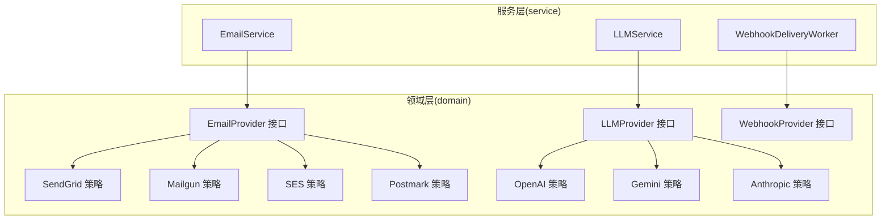
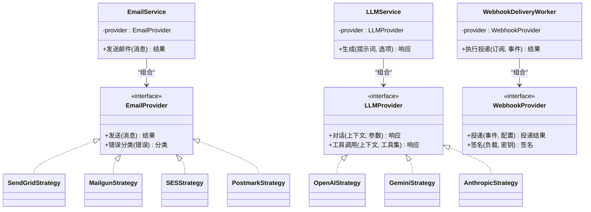
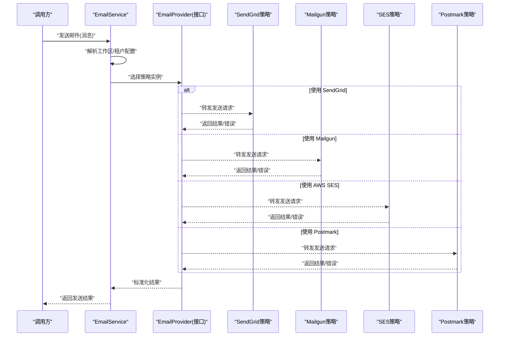
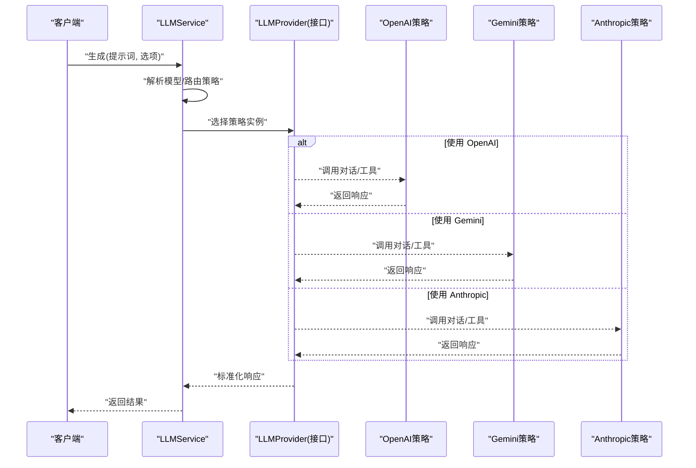
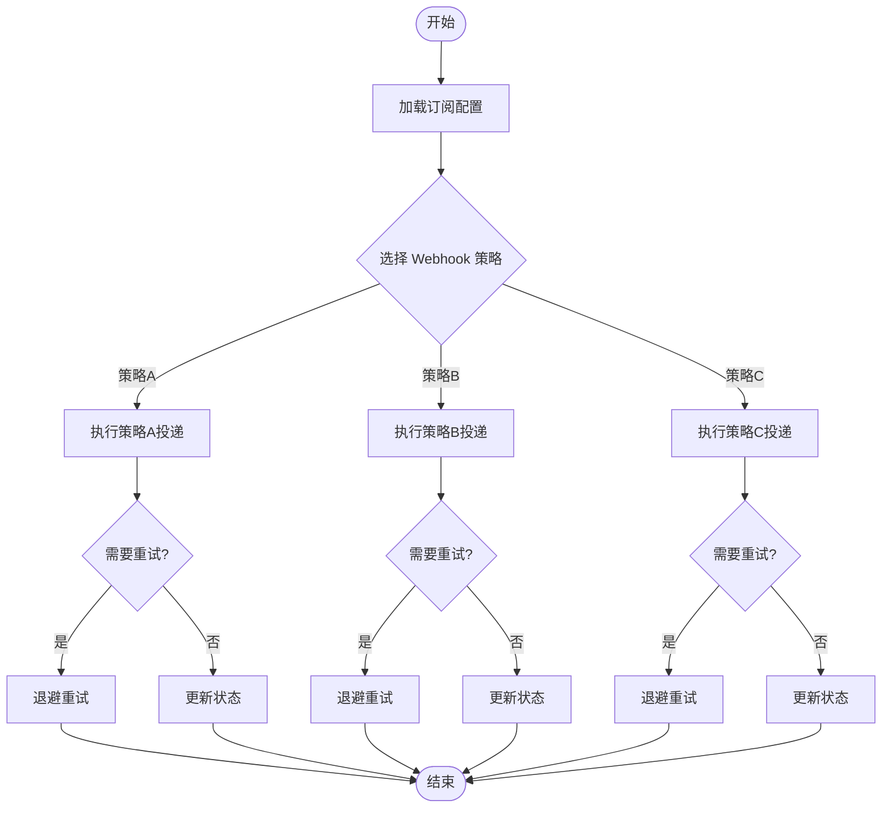
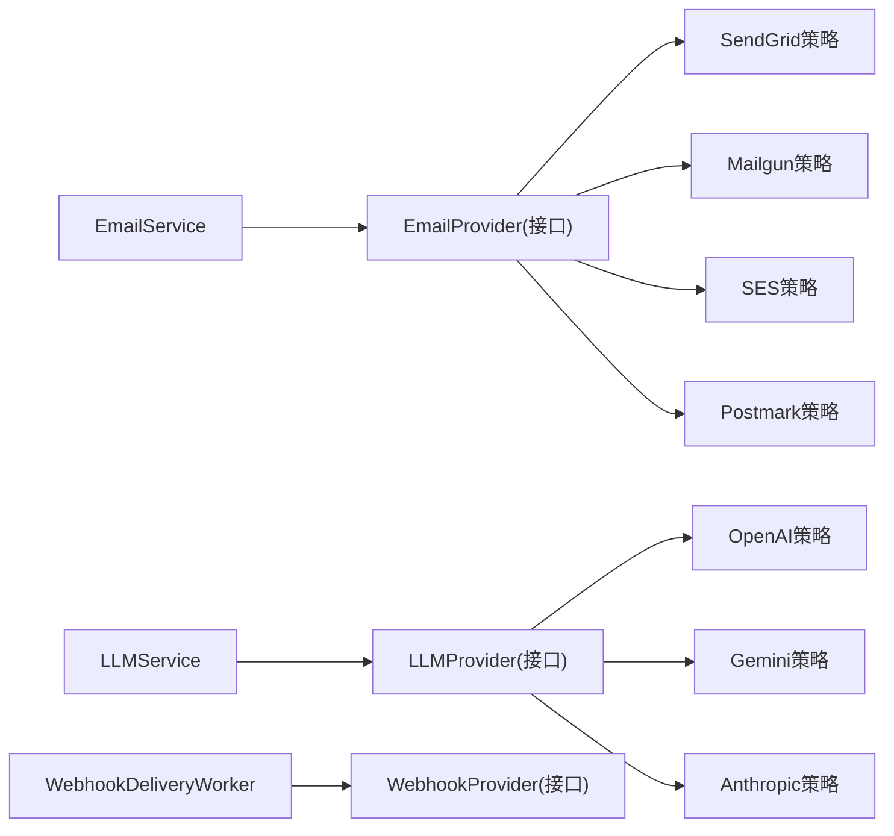

# 策略模式实现

<cite>
**本文引用的文件**   
- [internal/domain/email_provider.go](file://notifuse/internal/domain/email_provider.go)
- [internal/domain/email_provider_sendgrid.go](file://notifuse/internal/domain/email_provider_sendgrid.go)
- [internal/domain/email_provider_mailgun.go](file://notifuse/internal/domain/email_provider_mailgun.go)
- [internal/domain/email_provider_ses.go](file://notifuse/internal/domain/email_provider_ses.go)
- [internal/domain/email_provider_postmark.go](file://notifuse/internal/domain/email_provider_postmark.go)
- [internal/domain/llm_provider.go](file://notifuse/internal/domain/llm_provider.go)
- [internal/domain/llm_provider_openai.go](file://notifuse/internal/domain/llm_provider_openai.go)
- [internal/domain/llm_provider_gemini.go](file://notifuse/internal/domain/llm_provider_gemini.go)
- [internal/domain/llm_provider_anthropic.go](file://notifuse/internal/domain/llm_provider_anthropic.go)
- [internal/domain/webhook_provider.go](file://notifuse/internal/domain/webhook_provider.go)
- [internal/service/email_service.go](file://notifuse/internal/service/email_service.go)
- [internal/service/sendgrid_service.go](file://notifuse/internal/service/sendgrid_service.go)
- [internal/service/mailgun_service.go](file://notifuse/internal/service/mailgun_service.go)
- [internal/service/ses_service.go](file://notifuse/internal/service/ses_service.go)
- [internal/service/postmark_service.go](file://notifuse/internal/service/postmark_service.go)
- [internal/service/llm_service.go](file://notifuse/internal/service/llm_service.go)
- [internal/service/llm_service_openai.go](file://notifuse/internal/service/llm_service_openai.go)
- [internal/service/llm_service_gemini.go](file://notifuse/internal/service/llm_service_gemini.go)
- [internal/service/webhook_delivery_worker.go](file://notifuse/internal/service/webhook_delivery_worker.go)
</cite>

## 目录
1. [简介](#简介)
2. [项目结构](#项目结构)
3. [核心组件](#核心组件)
4. [架构总览](#架构总览)
5. [详细组件分析](#详细组件分析)
6. [依赖关系分析](#依赖关系分析)
7. [性能考量](#性能考量)
8. [故障排查指南](#故障排查指南)
9. [结论](#结论)
10. [附录](#附录)

## 简介
本文件系统性梳理 Notifuse 平台中策略模式的落地实践，重点覆盖以下领域：
- 邮件提供商抽象与统一接口（SendGrid、Mailgun、AWS SES、Postmark 等）
- LLM 提供商适配器（OpenAI、Gemini、Anthropic）的策略化实现
- Webhook 提供商的策略化投递机制
- 运行时动态选择策略的装配方式
- 扩展性与维护性优势说明

通过统一的接口定义与可插拔的策略实现，Notifuse 在新增第三方服务时仅需添加新策略类并注册，即可无缝接入系统。

## 项目结构
策略模式在本仓库中的主要落点位于 internal/domain 与 internal/service 两个层次：
- domain 层：定义统一接口与各具体策略类型（如 EmailProvider、LLMProvider、WebhookProvider）
- service 层：封装业务编排与外部调用细节，并通过组合持有策略实例，在运行时根据配置或上下文选择具体策略

图表来源
- [internal/domain/email_provider.go](file://notifuse/internal/domain/email_provider.go)
- [internal/domain/email_provider_sendgrid.go](file://notifuse/internal/domain/email_provider_sendgrid.go)
- [internal/domain/email_provider_mailgun.go](file://notifuse/internal/domain/email_provider_mailgun.go)
- [internal/domain/email_provider_ses.go](file://notifuse/internal/domain/email_provider_ses.go)
- [internal/domain/email_provider_postmark.go](file://notifuse/internal/domain/email_provider_postmark.go)
- [internal/domain/llm_provider.go](file://notifuse/internal/domain/llm_provider.go)
- [internal/domain/llm_provider_openai.go](file://notifuse/internal/domain/llm_provider_openai.go)
- [internal/domain/llm_provider_gemini.go](file://notifuse/internal/domain/llm_provider_gemini.go)
- [internal/domain/llm_provider_anthropic.go](file://notifuse/internal/domain/llm_provider_anthropic.go)
- [internal/domain/webhook_provider.go](file://notifuse/internal/domain/webhook_provider.go)
- [internal/service/email_service.go](file://notifuse/internal/service/email_service.go)
- [internal/service/llm_service.go](file://notifuse/internal/service/llm_service.go)
- [internal/service/webhook_delivery_worker.go](file://notifuse/internal/service/webhook_delivery_worker.go)

章节来源
- [internal/domain/email_provider.go](file://notifuse/internal/domain/email_provider.go)
- [internal/domain/llm_provider.go](file://notifuse/internal/domain/llm_provider.go)
- [internal/domain/webhook_provider.go](file://notifuse/internal/domain/webhook_provider.go)
- [internal/service/email_service.go](file://notifuse/internal/service/email_service.go)
- [internal/service/llm_service.go](file://notifuse/internal/service/llm_service.go)
- [internal/service/webhook_delivery_worker.go](file://notifuse/internal/service/webhook_delivery_worker.go)

## 核心组件
本节聚焦三类策略体系：邮件提供商、LLM 提供商、Webhook 提供商。每个体系均遵循“接口定义 + 多实现 + 运行时注入”的模式。

- 邮件提供商策略
  - 统一接口：定义发送事务邮件的核心方法签名（例如构建请求、发送、错误分类等）
  - 具体策略：SendGrid、Mailgun、SES、Postmark 等各自实现该接口
  - 服务编排：EmailService 持有 EmailProvider 接口引用，依据配置或工作区设置选择具体策略

- LLM 提供商策略
  - 统一接口：定义对话/补全/工具调用等通用能力
  - 具体策略：OpenAI、Gemini、Anthropic 分别实现
  - 服务编排：LLMService 组合 LLMProvider 接口，按模型或路由规则选择策略

- Webhook 提供商策略
  - 统一接口：定义事件序列化、签名、重试、状态回写等能力
  - 具体策略：不同下游系统或网关的实现
  - 投递编排：WebhookDeliveryWorker 基于订阅配置选择对应策略进行投递

章节来源
- [internal/domain/email_provider.go](file://notifuse/internal/domain/email_provider.go)
- [internal/domain/llm_provider.go](file://notifuse/internal/domain/llm_provider.go)
- [internal/domain/webhook_provider.go](file://notifuse/internal/domain/webhook_provider.go)
- [internal/service/email_service.go](file://notifuse/internal/service/email_service.go)
- [internal/service/llm_service.go](file://notifuse/internal/service/llm_service.go)
- [internal/service/webhook_delivery_worker.go](file://notifuse/internal/service/webhook_delivery_worker.go)

## 架构总览
下图展示策略模式在三个关键域中的协作关系：上层服务仅依赖接口，具体策略在启动期或运行期被装配与选择。

图表来源
- [internal/domain/email_provider.go](file://notifuse/internal/domain/email_provider.go)
- [internal/domain/email_provider_sendgrid.go](file://notifuse/internal/domain/email_provider_sendgrid.go)
- [internal/domain/email_provider_mailgun.go](file://notifuse/internal/domain/email_provider_mailgun.go)
- [internal/domain/email_provider_ses.go](file://notifuse/internal/domain/email_provider_ses.go)
- [internal/domain/email_provider_postmark.go](file://notifuse/internal/domain/email_provider_postmark.go)
- [internal/domain/llm_provider.go](file://notifuse/internal/domain/llm_provider.go)
- [internal/domain/llm_provider_openai.go](file://notifuse/internal/domain/llm_provider_openai.go)
- [internal/domain/llm_provider_gemini.go](file://notifuse/internal/domain/llm_provider_gemini.go)
- [internal/domain/llm_provider_anthropic.go](file://notifuse/internal/domain/llm_provider_anthropic.go)
- [internal/domain/webhook_provider.go](file://notifuse/internal/domain/webhook_provider.go)
- [internal/service/email_service.go](file://notifuse/internal/service/email_service.go)
- [internal/service/llm_service.go](file://notifuse/internal/service/llm_service.go)
- [internal/service/webhook_delivery_worker.go](file://notifuse/internal/service/webhook_delivery_worker.go)

## 详细组件分析

### 邮件提供商策略（SendGrid、Mailgun、AWS SES、Postmark）
- 统一接口设计
  - 定义发送事务邮件的统一方法族，屏蔽各厂商差异（认证、限流、错误码映射等）
  - 提供错误分类能力，便于上层统一处理失败场景
- 具体策略实现
  - SendGrid/Mailgun/SES/Postmark 各自实现接口，封装 HTTP/SDK 调用、重试、幂等、追踪等细节
- 运行时选择
  - EmailService 持有 EmailProvider 接口，根据工作区配置或租户策略选择具体实现
  - 支持热切换与灰度发布（通过配置中心或数据库驱动）

图表来源
- [internal/service/email_service.go](file://notifuse/internal/service/email_service.go)
- [internal/domain/email_provider.go](file://notifuse/internal/domain/email_provider.go)
- [internal/domain/email_provider_sendgrid.go](file://notifuse/internal/domain/email_provider_sendgrid.go)
- [internal/domain/email_provider_mailgun.go](file://notifuse/internal/domain/email_provider_mailgun.go)
- [internal/domain/email_provider_ses.go](file://notifuse/internal/domain/email_provider_ses.go)
- [internal/domain/email_provider_postmark.go](file://notifuse/internal/domain/email_provider_postmark.go)

章节来源
- [internal/domain/email_provider.go](file://notifuse/internal/domain/email_provider.go)
- [internal/domain/email_provider_sendgrid.go](file://notifuse/internal/domain/email_provider_sendgrid.go)
- [internal/domain/email_provider_mailgun.go](file://notifuse/internal/domain/email_provider_mailgun.go)
- [internal/domain/email_provider_ses.go](file://notifuse/internal/domain/email_provider_ses.go)
- [internal/domain/email_provider_postmark.go](file://notifuse/internal/domain/email_provider_postmark.go)
- [internal/service/email_service.go](file://notifuse/internal/service/email_service.go)

### LLM 提供商策略（OpenAI、Gemini、Anthropic）
- 统一接口设计
  - 抽象对话、补全、工具调用等通用能力，屏蔽不同模型的 API 差异
- 具体策略实现
  - OpenAI/Gemini/Anthropic 分别实现接口，处理鉴权、速率限制、结构化输出等
- 运行时选择
  - LLMService 组合 LLMProvider 接口，根据模型名、路由规则或 A/B 实验选择策略

图表来源
- [internal/service/llm_service.go](file://notifuse/internal/service/llm_service.go)
- [internal/domain/llm_provider.go](file://notifuse/internal/domain/llm_provider.go)
- [internal/domain/llm_provider_openai.go](file://notifuse/internal/domain/llm_provider_openai.go)
- [internal/domain/llm_provider_gemini.go](file://notifuse/internal/domain/llm_provider_gemini.go)
- [internal/domain/llm_provider_anthropic.go](file://notifuse/internal/domain/llm_provider_anthropic.go)

章节来源
- [internal/domain/llm_provider.go](file://notifuse/internal/domain/llm_provider.go)
- [internal/domain/llm_provider_openai.go](file://notifuse/internal/domain/llm_provider_openai.go)
- [internal/domain/llm_provider_gemini.go](file://notifuse/internal/domain/llm_provider_gemini.go)
- [internal/domain/llm_provider_anthropic.go](file://notifuse/internal/domain/llm_provider_anthropic.go)
- [internal/service/llm_service.go](file://notifuse/internal/service/llm_service.go)

### Webhook 提供商策略
- 统一接口设计
  - 定义事件投递、签名、重试、状态回写等通用能力
- 具体策略实现
  - 针对不同下游系统或网关，实现各自的投递协议与错误处理
- 运行时选择
  - WebhookDeliveryWorker 根据订阅配置选择策略，执行投递与重试

图表来源
- [internal/service/webhook_delivery_worker.go](file://notifuse/internal/service/webhook_delivery_worker.go)
- [internal/domain/webhook_provider.go](file://notifuse/internal/domain/webhook_provider.go)

章节来源
- [internal/domain/webhook_provider.go](file://notifuse/internal/domain/webhook_provider.go)
- [internal/service/webhook_delivery_worker.go](file://notifuse/internal/service/webhook_delivery_worker.go)

### 运行时动态选择策略（示例路径）
- 邮件发送流程
  - 入口：[internal/service/email_service.go](file://notifuse/internal/service/email_service.go)
  - 策略接口：[internal/domain/email_provider.go](file://notifuse/internal/domain/email_provider.go)
  - 具体策略：
    - [internal/domain/email_provider_sendgrid.go](file://notifuse/internal/domain/email_provider_sendgrid.go)
    - [internal/domain/email_provider_mailgun.go](file://notifuse/internal/domain/email_provider_mailgun.go)
    - [internal/domain/email_provider_ses.go](file://notifuse/internal/domain/email_provider_ses.go)
    - [internal/domain/email_provider_postmark.go](file://notifuse/internal/domain/email_provider_postmark.go)
- LLM 生成流程
  - 入口：[internal/service/llm_service.go](file://notifuse/internal/service/llm_service.go)
  - 策略接口：[internal/domain/llm_provider.go](file://notifuse/internal/domain/llm_provider.go)
  - 具体策略：
    - [internal/domain/llm_provider_openai.go](file://notifuse/internal/domain/llm_provider_openai.go)
    - [internal/domain/llm_provider_gemini.go](file://notifuse/internal/domain/llm_provider_gemini.go)
    - [internal/domain/llm_provider_anthropic.go](file://notifuse/internal/domain/llm_provider_anthropic.go)
- Webhook 投递流程
  - 入口：[internal/service/webhook_delivery_worker.go](file://notifuse/internal/service/webhook_delivery_worker.go)
  - 策略接口：[internal/domain/webhook_provider.go](file://notifuse/internal/domain/webhook_provider.go)

章节来源
- [internal/service/email_service.go](file://notifuse/internal/service/email_service.go)
- [internal/domain/email_provider.go](file://notifuse/internal/domain/email_provider.go)
- [internal/domain/email_provider_sendgrid.go](file://notifuse/internal/domain/email_provider_sendgrid.go)
- [internal/domain/email_provider_mailgun.go](file://notifuse/internal/domain/email_provider_mailgun.go)
- [internal/domain/email_provider_ses.go](file://notifuse/internal/domain/email_provider_ses.go)
- [internal/domain/email_provider_postmark.go](file://notifuse/internal/domain/email_provider_postmark.go)
- [internal/service/llm_service.go](file://notifuse/internal/service/llm_service.go)
- [internal/domain/llm_provider.go](file://notifuse/internal/domain/llm_provider.go)
- [internal/domain/llm_provider_openai.go](file://notifuse/internal/domain/llm_provider_openai.go)
- [internal/domain/llm_provider_gemini.go](file://notifuse/internal/domain/llm_provider_gemini.go)
- [internal/domain/llm_provider_anthropic.go](file://notifuse/internal/domain/llm_provider_anthropic.go)
- [internal/service/webhook_delivery_worker.go](file://notifuse/internal/service/webhook_delivery_worker.go)
- [internal/domain/webhook_provider.go](file://notifuse/internal/domain/webhook_provider.go)

## 依赖关系分析
- 松耦合
  - 服务层仅依赖接口，不感知具体实现；新增策略无需修改调用方
- 内聚性
  - 每个策略类负责单一外部系统的适配逻辑，职责清晰
- 可能的循环依赖
  - 当前分层清晰（domain 无 service 依赖），未见循环导入风险
- 外部依赖
  - 各策略内部可能依赖第三方 SDK/HTTP 客户端，建议通过依赖注入隔离

图表来源
- [internal/service/email_service.go](file://notifuse/internal/service/email_service.go)
- [internal/domain/email_provider.go](file://notifuse/internal/domain/email_provider.go)
- [internal/domain/email_provider_sendgrid.go](file://notifuse/internal/domain/email_provider_sendgrid.go)
- [internal/domain/email_provider_mailgun.go](file://notifuse/internal/domain/email_provider_mailgun.go)
- [internal/domain/email_provider_ses.go](file://notifuse/internal/domain/email_provider_ses.go)
- [internal/domain/email_provider_postmark.go](file://notifuse/internal/domain/email_provider_postmark.go)
- [internal/service/llm_service.go](file://notifuse/internal/service/llm_service.go)
- [internal/domain/llm_provider.go](file://notifuse/internal/domain/llm_provider.go)
- [internal/domain/llm_provider_openai.go](file://notifuse/internal/domain/llm_provider_openai.go)
- [internal/domain/llm_provider_gemini.go](file://notifuse/internal/domain/llm_provider_gemini.go)
- [internal/domain/llm_provider_anthropic.go](file://notifuse/internal/domain/llm_provider_anthropic.go)
- [internal/service/webhook_delivery_worker.go](file://notifuse/internal/service/webhook_delivery_worker.go)
- [internal/domain/webhook_provider.go](file://notifuse/internal/domain/webhook_provider.go)

章节来源
- [internal/service/email_service.go](file://notifuse/internal/service/email_service.go)
- [internal/service/llm_service.go](file://notifuse/internal/service/llm_service.go)
- [internal/service/webhook_delivery_worker.go](file://notifuse/internal/service/webhook_delivery_worker.go)
- [internal/domain/email_provider.go](file://notifuse/internal/domain/email_provider.go)
- [internal/domain/llm_provider.go](file://notifuse/internal/domain/llm_provider.go)
- [internal/domain/webhook_provider.go](file://notifuse/internal/domain/webhook_provider.go)

## 性能考量
- 连接复用与池化
  - 各策略应复用 HTTP 客户端连接，避免频繁握手开销
- 超时与熔断
  - 为外部调用设置合理超时与熔断阈值，防止雪崩
- 并发与限流
  - 结合令牌桶/漏桶控制并发与速率，避免触发上游限流
- 批处理与合并
  - 对批量发送场景采用批处理减少往返次数
- 缓存与去重
  - 对幂等键进行缓存，避免重复投递

## 故障排查指南
- 常见症状
  - 发送失败：检查策略配置（密钥、域名、区域）、网络连通性、上游限流
  - 延迟升高：观察重试与退避策略是否过于激进
  - 状态不一致：核对状态回写与幂等键
- 定位步骤
  - 确认选择策略是否正确（工作区/租户配置）
  - 查看策略日志与指标（耗时、错误码分布）
  - 复现最小用例，逐步缩小范围
- 恢复手段
  - 快速切流至备用策略（如从 SendGrid 切换到 Mailgun）
  - 降级策略（关闭非关键功能、降低并发）

## 结论
通过策略模式，Notifuse 将邮件、LLM、Webhook 等外部依赖解耦为可插拔组件，显著提升了系统的可扩展性与可维护性。新增供应商只需实现统一接口并在装配阶段注册，即可在不改动既有业务代码的前提下完成集成。配合合理的超时、重试、限流与监控，可在保证稳定性的同时持续演进。

## 附录
- 最佳实践清单
  - 明确接口边界与错误语义
  - 以配置驱动策略选择，支持灰度与回滚
  - 为每个策略编写单元测试与集成测试
  - 记录关键指标（成功率、P95/P99 延迟、错误分类）
  - 对外部依赖进行 Mock，确保测试稳定性