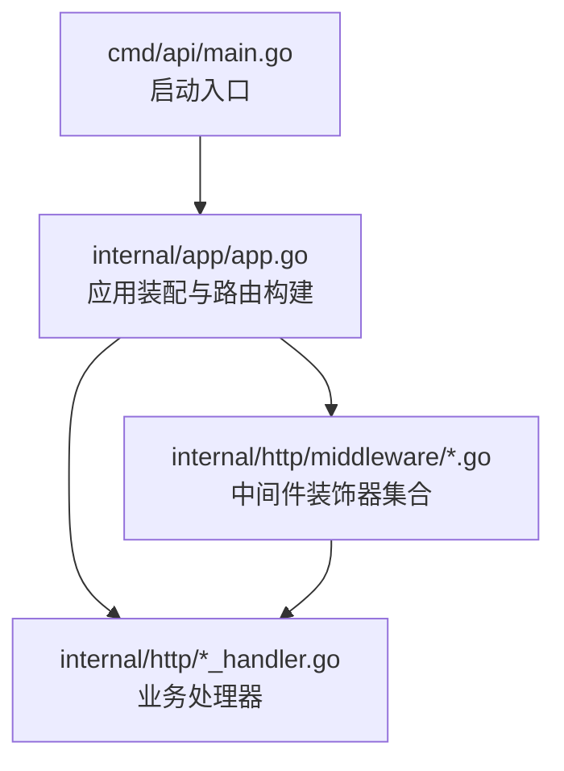
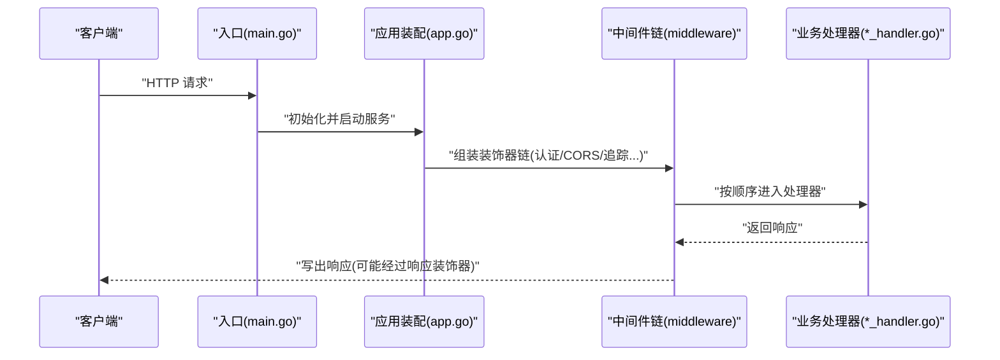
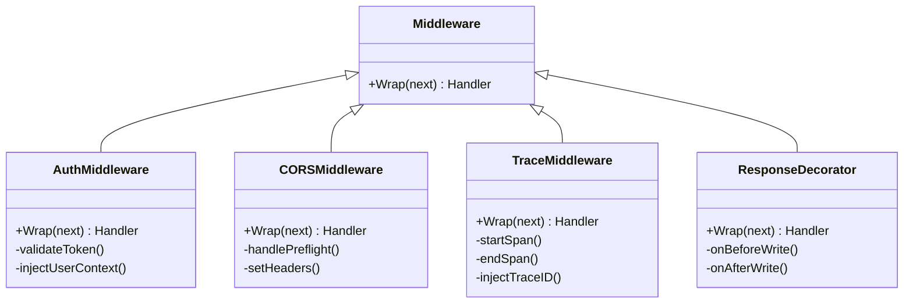
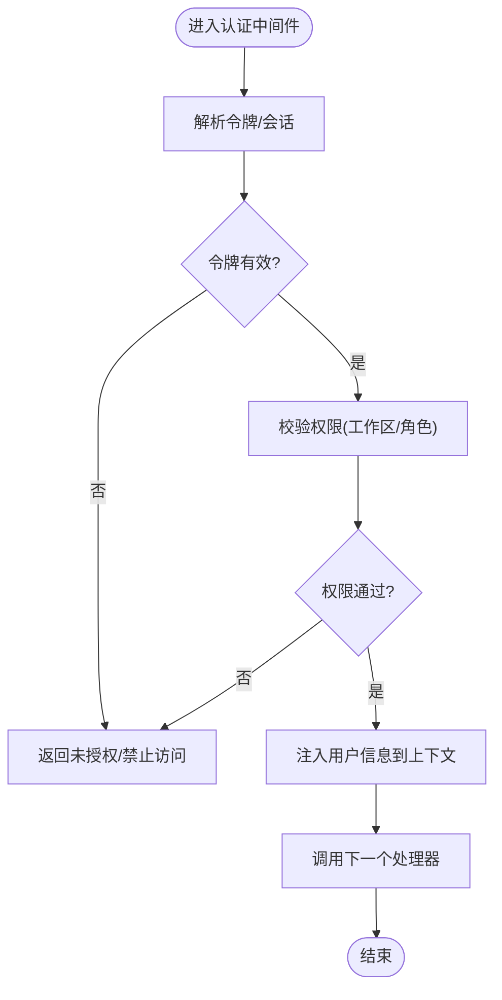
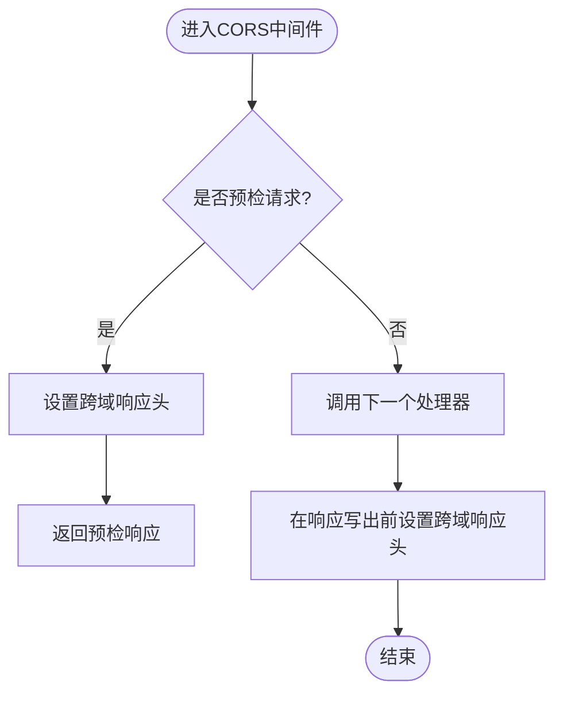
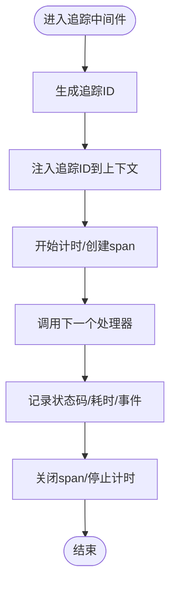
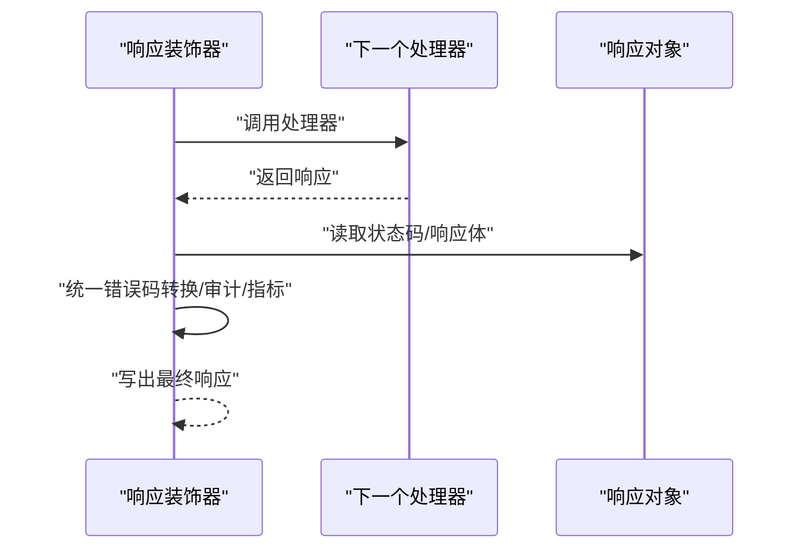
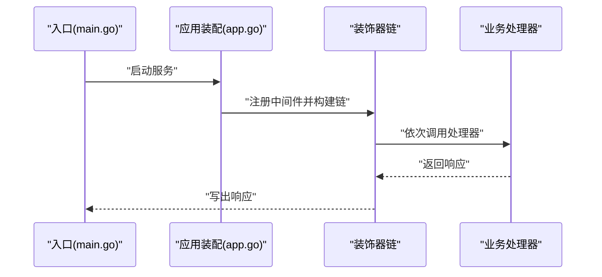

# 装饰器模式实现

<cite>
**本文引用的文件**   
- [main.go](file://notifuse/cmd/api/main.go)
- [app.go](file://notifuse/internal/app/app.go)
- [middleware.go](file://notifuse/internal/http/middleware/middleware.go)
- [auth.go](file://notifuse/internal/http/middleware/auth.go)
- [cors.go](file://notifuse/internal/http/middleware/cors.go)
- [trace.go](file://notifuse/internal/http/middleware/trace.go)
- [analytics_handler.go](file://notifuse/internal/http/analytics_handler.go)
- [automation_handler.go](file://notifuse/internal/http/automation_handler.go)
- [blog_handler.go](file://notifuse/internal/http/blog_handler.go)
- [broadcast_handler.go](file://notifuse/internal/http/broadcast_handler.go)
- [contact_handler.go](file://notifuse/internal/http/contact_handler.go)
- [list_handler.go](file://notifuse/internal/http/list_handler.go)
- [llm_handler.go](file://notifuse/internal/http/llm_handler.go)
- [message_history_handler.go](file://notifuse/internal/http/message_history_handler.go)
- [oidc_handler.go](file://notifuse/internal/http/oidc_handler.go)
- [public_handler.go](file://notifuse/internal/http/public_handler.go)
- [root_handler.go](file://notifuse/internal/http/root_handler.go)
- [segment_handler.go](file://notifuse/internal/http/segment_handler.go)
- [settings_handler.go](file://notifuse/internal/http/settings_handler.go)
- [setup_handler.go](file://notifuse/internal/http/setup_handler.go)
- [supabase_webhook_handler.go](file://notifuse/internal/http/supabase_webhook_handler.go)
- [task_handler.go](file://notifuse/internal/http/task_handler.go)
- [template_block_handler.go](file://notifuse/internal/http/template_block_handler.go)
- [template_handler.go](file://notifuse/internal/http/template_handler.go)
- [transactional_handler.go](file://notifuse/internal/http/transactional_handler.go)
- [user_handler.go](file://notifuse/internal/http/user_handler.go)
- [webhook_registration_handler.go](file://notifuse/internal/http/webhook_registration_handler.go)
- [webhook_subscription_handler.go](file://notifuse/internal/http/webhook_subscription_handler.go)
- [workspace_handler.go](file://notifuse/internal/http/workspace_handler.go)
</cite>

## 目录
1. [简介](#简介)
2. [项目结构](#项目结构)
3. [核心组件](#核心组件)
4. [架构总览](#架构总览)
5. [详细组件分析](#详细组件分析)
6. [依赖关系分析](#依赖关系分析)
7. [性能考量](#性能考量)
8. [故障排查指南](#故障排查指南)
9. [结论](#结论)
10. [附录](#附录)

## 简介
本文件围绕 Notifuse 平台中基于装饰器模式的 HTTP 中间件体系进行系统化文档化，重点解释：
- 装饰器模式在请求处理链中的应用，如何实现横切关注点（认证、CORS、追踪等）的解耦与灵活组合。
- 认证中间件、CORS 处理中间件、追踪中间件的装饰器实现思路与调用顺序。
- 响应处理的装饰器模式应用，包括统一错误包装、日志记录、指标上报等。
- 中间件接口的定义、具体中间件的实现、注册与调用机制。
- 通过代码级图示展示类/函数关系、调用序列与数据流。

## 项目结构
Notifuse 后端采用 Go 语言实现，HTTP 层位于 internal/http 目录，中间件集中在 internal/http/middleware。入口程序在 cmd/api/main.go，应用初始化与路由装配在 internal/app/app.go。各业务处理器位于 internal/http 下的 *_handler.go 文件中。

图表来源
- [main.go:1-200](file://notifuse/cmd/api/main.go#L1-L200)
- [app.go:1-200](file://notifuse/internal/app/app.go#L1-L200)

章节来源
- [main.go:1-200](file://notifuse/cmd/api/main.go#L1-L200)
- [app.go:1-200](file://notifuse/internal/app/app.go#L1-L200)

## 核心组件
- 中间件接口与装饰器抽象：定义统一的中间件签名，支持对下一个处理器的包装，形成可组合的请求/响应处理链。
- 认证中间件：负责鉴权、会话校验、权限检查，并在失败时返回标准错误响应。
- CORS 中间件：根据配置动态设置跨域相关响应头，支持预检请求处理。
- 追踪中间件：为每个请求生成唯一标识，注入上下文，记录耗时与关键事件，便于分布式追踪。
- 响应装饰器：在响应写出前后执行通用逻辑，如统一错误码转换、审计日志、指标统计。

章节来源
- [middleware.go:1-200](file://notifuse/internal/http/middleware/middleware.go#L1-L200)
- [auth.go:1-200](file://notifuse/internal/http/middleware/auth.go#L1-L200)
- [cors.go:1-200](file://notifuse/internal/http/middleware/cors.go#L1-L200)
- [trace.go:1-200](file://notifuse/internal/http/middleware/trace.go#L1-L200)

## 架构总览
下图展示了从入口到业务处理器的完整装饰器链，以及中间件如何以装饰器方式包裹处理器，形成“洋葱模型”的请求/响应处理流程。

图表来源
- [main.go:1-200](file://notifuse/cmd/api/main.go#L1-L200)
- [app.go:1-200](file://notifuse/internal/app/app.go#L1-L200)
- [middleware.go:1-200](file://notifuse/internal/http/middleware/middleware.go#L1-L200)
- [analytics_handler.go:1-200](file://notifuse/internal/http/analytics_handler.go#L1-L200)
- [automation_handler.go:1-200](file://notifuse/internal/http/automation_handler.go#L1-L200)
- [blog_handler.go:1-200](file://notifuse/internal/http/blog_handler.go#L1-L200)
- [broadcast_handler.go:1-200](file://notifuse/internal/http/broadcast_handler.go#L1-L200)
- [contact_handler.go:1-200](file://notifuse/internal/http/contact_handler.go#L1-L200)
- [list_handler.go:1-200](file://notifuse/internal/http/list_handler.go#L1-L200)
- [llm_handler.go:1-200](file://notifuse/internal/http/llm_handler.go#L1-L200)
- [message_history_handler.go:1-200](file://notifuse/internal/http/message_history_handler.go#L1-L200)
- [oidc_handler.go:1-200](file://notifuse/internal/http/oidc_handler.go#L1-L200)
- [public_handler.go:1-200](file://notifuse/internal/http/public_handler.go#L1-L200)
- [root_handler.go:1-200](file://notifuse/internal/http/root_handler.go#L1-L200)
- [segment_handler.go:1-200](file://notifuse/internal/http/segment_handler.go#L1-L200)
- [settings_handler.go:1-200](file://notifuse/internal/http/settings_handler.go#L1-L200)
- [setup_handler.go:1-200](file://notifuse/internal/http/setup_handler.go#L1-L200)
- [supabase_webhook_handler.go:1-200](file://notifuse/internal/http/supabase_webhook_handler.go#L1-L200)
- [task_handler.go:1-200](file://notifuse/internal/http/task_handler.go#L1-L200)
- [template_block_handler.go:1-200](file://notifuse/internal/http/template_block_handler.go#L1-L200)
- [template_handler.go:1-200](file://notifuse/internal/http/template_handler.go#L1-L200)
- [transactional_handler.go:1-200](file://notifuse/internal/http/transactional_handler.go#L1-L200)
- [user_handler.go:1-200](file://notifuse/internal/http/user_handler.go#L1-L200)
- [webhook_registration_handler.go:1-200](file://notifuse/internal/http/webhook_registration_handler.go#L1-L200)
- [webhook_subscription_handler.go:1-200](file://notifuse/internal/http/webhook_subscription_handler.go#L1-L200)
- [workspace_handler.go:1-200](file://notifuse/internal/http/workspace_handler.go#L1-L200)

## 详细组件分析

### 中间件接口与装饰器抽象
- 目标：定义统一的中间件签名，使任意横切逻辑可以以装饰器形式包裹处理器。
- 关键点：
  - 中间件接收“下一个处理器”作为参数，返回新的处理器，形成链式组合。
  - 可在进入下一个处理器前修改请求上下文或拒绝请求；在返回后修改响应或记录指标。
  - 支持将公共能力（如用户信息、追踪ID）注入上下文，供后续处理器使用。

图表来源
- [middleware.go:1-200](file://notifuse/internal/http/middleware/middleware.go#L1-L200)
- [auth.go:1-200](file://notifuse/internal/http/middleware/auth.go#L1-L200)
- [cors.go:1-200](file://notifuse/internal/http/middleware/cors.go#L1-L200)
- [trace.go:1-200](file://notifuse/internal/http/middleware/trace.go#L1-L200)

章节来源
- [middleware.go:1-200](file://notifuse/internal/http/middleware/middleware.go#L1-L200)

### 认证中间件（Auth）
- 职责：
  - 解析并验证令牌或会话。
  - 校验访问权限（如工作区级别、角色）。
  - 失败时返回标准错误响应（如未授权、禁止访问）。
  - 成功时将用户信息注入上下文，供后续处理器使用。
- 装饰器行为：
  - 在进入下一个处理器之前完成鉴权。
  - 在响应阶段可选择追加安全相关头部或审计日志。

图表来源
- [auth.go:1-200](file://notifuse/internal/http/middleware/auth.go#L1-L200)

章节来源
- [auth.go:1-200](file://notifuse/internal/http/middleware/auth.go#L1-L200)

### CORS 处理中间件（CORS）
- 职责：
  - 根据配置动态设置跨域相关响应头（允许源、方法、头、凭据等）。
  - 处理浏览器预检请求（OPTIONS），直接返回 204 或 200。
- 装饰器行为：
  - 在请求进入前设置请求上下文中的跨域策略。
  - 在响应写出前确保响应头正确设置。

图表来源
- [cors.go:1-200](file://notifuse/internal/http/middleware/cors.go#L1-L200)

章节来源
- [cors.go:1-200](file://notifuse/internal/http/middleware/cors.go#L1-L200)

### 追踪中间件（Trace）
- 职责：
  - 为每个请求生成唯一追踪 ID。
  - 将追踪 ID 注入上下文，供后续处理器和日志系统使用。
  - 记录请求开始/结束时间、状态码、耗时等指标。
- 装饰器行为：
  - 在进入下一个处理器前创建 span 或计时器。
  - 在响应写出后关闭 span、上报指标。

图表来源
- [trace.go:1-200](file://notifuse/internal/http/middleware/trace.go#L1-L200)

章节来源
- [trace.go:1-200](file://notifuse/internal/http/middleware/trace.go#L1-L200)

### 响应处理的装饰器模式
- 目标：在响应写出前后执行通用逻辑，如统一错误码转换、审计日志、指标统计、压缩等。
- 关键点：
  - 在调用下一个处理器前准备响应写入环境（如缓冲、标记）。
  - 在处理器返回后读取状态码与响应体，进行必要转换或记录。
  - 保证不影响业务处理器的正常逻辑，仅做横切增强。

图表来源
- [middleware.go:1-200](file://notifuse/internal/http/middleware/middleware.go#L1-L200)

章节来源
- [middleware.go:1-200](file://notifuse/internal/http/middleware/middleware.go#L1-L200)

### 中间件的注册与调用机制
- 注册：
  - 在应用装配阶段（app.go）集中注册中间件，按期望顺序组合成装饰器链。
  - 常见顺序：CORS -> 追踪 -> 认证 -> 业务处理器。
- 调用：
  - 入口（main.go）启动服务后，所有请求均经过已注册的装饰器链。
  - 每个中间件决定是继续调用下一个处理器，还是提前终止并返回响应。

图表来源
- [main.go:1-200](file://notifuse/cmd/api/main.go#L1-L200)
- [app.go:1-200](file://notifuse/internal/app/app.go#L1-L200)

章节来源
- [main.go:1-200](file://notifuse/cmd/api/main.go#L1-L200)
- [app.go:1-200](file://notifuse/internal/app/app.go#L1-L200)

### 具体处理器示例（装饰器链的应用）
以下处理器均受认证、CORS、追踪等中间件的保护与增强。它们专注于业务逻辑，无需关心横切关注点的实现细节。

- 分析处理器：[analytics_handler.go](file://notifuse/internal/http/analytics_handler.go)
- 自动化处理器：[automation_handler.go](file://notifuse/internal/http/automation_handler.go)
- 博客处理器：[blog_handler.go](file://notifuse/internal/http/blog_handler.go)
- 广播处理器：[broadcast_handler.go](file://notifuse/internal/http/broadcast_handler.go)
- 联系人处理器：[contact_handler.go](file://notifuse/internal/http/contact_handler.go)
- 列表处理器：[list_handler.go](file://notifuse/internal/http/list_handler.go)
- LLM 处理器：[llm_handler.go](file://notifuse/internal/http/llm_handler.go)
- 消息历史处理器：[message_history_handler.go](file://notifuse/internal/http/message_history_handler.go)
- OIDC 处理器：[oidc_handler.go](file://notifuse/internal/http/oidc_handler.go)
- 公开处理器：[public_handler.go](file://notifuse/internal/http/public_handler.go)
- 根处理器：[root_handler.go](file://notifuse/internal/http/root_handler.go)
- 分段处理器：[segment_handler.go](file://notifuse/internal/http/segment_handler.go)
- 设置处理器：[settings_handler.go](file://notifuse/internal/http/settings_handler.go)
- 初始化处理器：[setup_handler.go](file://notifuse/internal/http/setup_handler.go)
- Supabase Webhook 处理器：[supabase_webhook_handler.go](file://notifuse/internal/http/supabase_webhook_handler.go)
- 任务处理器：[task_handler.go](file://notifuse/internal/http/task_handler.go)
- 模板块处理器：[template_block_handler.go](file://notifuse/internal/http/template_block_handler.go)
- 模板处理器：[template_handler.go](file://notifuse/internal/http/template_handler.go)
- 事务性处理器：[transactional_handler.go](file://notifuse/internal/http/transactional_handler.go)
- 用户处理器：[user_handler.go](file://notifuse/internal/http/user_handler.go)
- Webhook 注册处理器：[webhook_registration_handler.go](file://notifuse/internal/http/webhook_registration_handler.go)
- Webhook 订阅处理器：[webhook_subscription_handler.go](file://notifuse/internal/http/webhook_subscription_handler.go)
- 工作区处理器：[workspace_handler.go](file://notifuse/internal/http/workspace_handler.go)

章节来源
- [analytics_handler.go:1-200](file://notifuse/internal/http/analytics_handler.go#L1-L200)
- [automation_handler.go:1-200](file://notifuse/internal/http/automation_handler.go#L1-L200)
- [blog_handler.go:1-200](file://notifuse/internal/http/blog_handler.go#L1-L200)
- [broadcast_handler.go:1-200](file://notifuse/internal/http/broadcast_handler.go#L1-L200)
- [contact_handler.go:1-200](file://notifuse/internal/http/contact_handler.go#L1-L200)
- [list_handler.go:1-200](file://notifuse/internal/http/list_handler.go#L1-L200)
- [llm_handler.go:1-200](file://notifuse/internal/http/llm_handler.go#L1-L200)
- [message_history_handler.go:1-200](file://notifuse/internal/http/message_history_handler.go#L1-L200)
- [oidc_handler.go:1-200](file://notifuse/internal/http/oidc_handler.go#L1-L200)
- [public_handler.go:1-200](file://notifuse/internal/http/public_handler.go#L1-L200)
- [root_handler.go:1-200](file://notifuse/internal/http/root_handler.go#L1-L200)
- [segment_handler.go:1-200](file://notifuse/internal/http/segment_handler.go#L1-L200)
- [settings_handler.go:1-200](file://notifuse/internal/http/settings_handler.go#L1-L200)
- [setup_handler.go:1-200](file://notifuse/internal/http/setup_handler.go#L1-L200)
- [supabase_webhook_handler.go:1-200](file://notifuse/internal/http/supabase_webhook_handler.go#L1-L200)
- [task_handler.go:1-200](file://notifuse/internal/http/task_handler.go#L1-L200)
- [template_block_handler.go:1-200](file://notifuse/internal/http/template_block_handler.go#L1-L200)
- [template_handler.go:1-200](file://notifuse/internal/http/template_handler.go#L1-L200)
- [transactional_handler.go:1-200](file://notifuse/internal/http/transactional_handler.go#L1-L200)
- [user_handler.go:1-200](file://notifuse/internal/http/user_handler.go#L1-L200)
- [webhook_registration_handler.go:1-200](file://notifuse/internal/http/webhook_registration_handler.go#L1-L200)
- [webhook_subscription_handler.go:1-200](file://notifuse/internal/http/webhook_subscription_handler.go#L1-L200)
- [workspace_handler.go:1-200](file://notifuse/internal/http/workspace_handler.go#L1-L200)

## 依赖关系分析
- 入口与应用装配：
  - main.go 负责启动服务与生命周期管理。
  - app.go 负责中间件注册、路由绑定与处理器实例化。
- 中间件与处理器：
  - middleware 包提供通用装饰器能力。
  - auth、cors、trace 等中间件分别实现特定横切逻辑。
  - 处理器只关注业务逻辑，通过上下文获取中间件注入的信息（如用户、追踪ID）。

```mermaid
graph TB
subgraph "入口与装配"
M["main.go"] --> A["app.go"]
end
subgraph "中间件"
MW["middleware.go"]
AUTH["auth.go"]
CORS["cors.go"]
TRACE["trace.go"]
end
subgraph "处理器"
H1["analytics_handler.go"]
H2["automation_handler.go"]
H3["blog_handler.go"]
H4["broadcast_handler.go"]
H5["contact_handler.go"]
H6["list_handler.go"]
H7["llm_handler.go"]
H8["message_history_handler.go"]
H9["oidc_handler.go"]
H10["public_handler.go"]
H11["root_handler.go"]
H12["segment_handler.go"]
H13["settings_handler.go"]
H14["setup_handler.go"]
H15["supabase_webhook_handler.go"]
H16["task_handler.go"]
H17["template_block_handler.go"]
H18["template_handler.go"]
H19["transactional_handler.go"]
H20["user_handler.go"]
H21["webhook_registration_handler.go"]
H22["webhook_subscription_handler.go"]
H23["workspace_handler.go"]
end
A --> MW
MW --> AUTH
MW --> CORS
MW --> TRACE
A --> H1
A --> H2
A --> H3
A --> H4
A --> H5
A --> H6
A --> H7
A --> H8
A --> H9
A --> H10
A --> H11
A --> H12
A --> H13
A --> H14
A --> H15
A --> H16
A --> H17
A --> H18
A --> H19
A --> H20
A --> H21
A --> H22
A --> H23
```

图表来源
- [main.go:1-200](file://notifuse/cmd/api/main.go#L1-L200)
- [app.go:1-200](file://notifuse/internal/app/app.go#L1-L200)
- [middleware.go:1-200](file://notifuse/internal/http/middleware/middleware.go#L1-L200)
- [auth.go:1-200](file://notifuse/internal/http/middleware/auth.go#L1-L200)
- [cors.go:1-200](file://notifuse/internal/http/middleware/cors.go#L1-L200)
- [trace.go:1-200](file://notifuse/internal/http/middleware/trace.go#L1-L200)
- [analytics_handler.go:1-200](file://notifuse/internal/http/analytics_handler.go#L1-L200)
- [automation_handler.go:1-200](file://notifuse/internal/http/automation_handler.go#L1-L200)
- [blog_handler.go:1-200](file://notifuse/internal/http/blog_handler.go#L1-L200)
- [broadcast_handler.go:1-200](file://notifuse/internal/http/broadcast_handler.go#L1-L200)
- [contact_handler.go:1-200](file://notifuse/internal/http/contact_handler.go#L1-L200)
- [list_handler.go:1-200](file://notifuse/internal/http/list_handler.go#L1-L200)
- [llm_handler.go:1-200](file://notifuse/internal/http/llm_handler.go#L1-L200)
- [message_history_handler.go:1-200](file://notifuse/internal/http/message_history_handler.go#L1-L200)
- [oidc_handler.go:1-200](file://notifuse/internal/http/oidc_handler.go#L1-L200)
- [public_handler.go:1-200](file://notifuse/internal/http/public_handler.go#L1-L200)
- [root_handler.go:1-200](file://notifuse/internal/http/root_handler.go#L1-L200)
- [segment_handler.go:1-200](file://notifuse/internal/http/segment_handler.go#L1-L200)
- [settings_handler.go:1-200](file://notifuse/internal/http/settings_handler.go#L1-L200)
- [setup_handler.go:1-200](file://notifuse/internal/http/setup_handler.go#L1-L200)
- [supabase_webhook_handler.go:1-200](file://notifuse/internal/http/supabase_webhook_handler.go#L1-L200)
- [task_handler.go:1-200](file://notifuse/internal/http/task_handler.go#L1-L200)
- [template_block_handler.go:1-200](file://notifuse/internal/http/template_block_handler.go#L1-L200)
- [template_handler.go:1-200](file://notifuse/internal/http/template_handler.go#L1-L200)
- [transactional_handler.go:1-200](file://notifuse/internal/http/transactional_handler.go#L1-L200)
- [user_handler.go:1-200](file://notifuse/internal/http/user_handler.go#L1-L200)
- [webhook_registration_handler.go:1-200](file://notifuse/internal/http/webhook_registration_handler.go#L1-L200)
- [webhook_subscription_handler.go:1-200](file://notifuse/internal/http/webhook_subscription_handler.go#L1-L200)
- [workspace_handler.go:1-200](file://notifuse/internal/http/workspace_handler.go#L1-L200)

章节来源
- [main.go:1-200](file://notifuse/cmd/api/main.go#L1-L200)
- [app.go:1-200](file://notifuse/internal/app/app.go#L1-L200)
- [middleware.go:1-200](file://notifuse/internal/http/middleware/middleware.go#L1-L200)
- [auth.go:1-200](file://notifuse/internal/http/middleware/auth.go#L1-L200)
- [cors.go:1-200](file://notifuse/internal/http/middleware/cors.go#L1-L200)
- [trace.go:1-200](file://notifuse/internal/http/middleware/trace.go#L1-L200)

## 性能考量
- 中间件顺序优化：
  - 将轻量且通用的中间件（如 CORS、追踪）放在外层，减少重复计算。
  - 认证中间件应尽早拦截非法请求，避免进入深层业务逻辑。
- 上下文传递：
  - 避免在上下文中存储过大对象，必要时使用引用或延迟加载。
- 响应装饰器：
  - 仅在需要时读取响应体，避免不必要的缓冲与复制。
- 追踪开销：
  - 控制采样率与上报频率，避免在高并发下造成额外压力。

## 故障排查指南
- 认证失败：
  - 检查令牌格式、有效期与签名。
  - 确认权限策略与工作区隔离是否正确。
- CORS 问题：
  - 核对允许的源、方法与头配置。
  - 确认预检请求路径与响应头是否正确设置。
- 追踪缺失：
  - 检查追踪 ID 是否注入上下文。
  - 确认日志与指标上报链路是否正常。
- 响应异常：
  - 查看响应装饰器是否覆盖或篡改了状态码与响应体。
  - 确认错误码转换规则是否符合预期。

章节来源
- [auth.go:1-200](file://notifuse/internal/http/middleware/auth.go#L1-L200)
- [cors.go:1-200](file://notifuse/internal/http/middleware/cors.go#L1-L200)
- [trace.go:1-200](file://notifuse/internal/http/middleware/trace.go#L1-L200)
- [middleware.go:1-200](file://notifuse/internal/http/middleware/middleware.go#L1-L200)

## 结论
通过装饰器模式，Notifuse 平台实现了横切关注点与业务逻辑的清晰解耦。认证、CORS、追踪等中间件以统一接口组合，形成可插拔的请求/响应处理链。该设计不仅提升了系统的可维护性与可扩展性，也为后续新增横切功能提供了简洁一致的扩展点。

## 附录
- 最佳实践建议：
  - 明确中间件职责边界，避免在一个中间件中实现过多逻辑。
  - 使用上下文传递最小必要信息，保持处理器间的松耦合。
  - 为每个中间件编写单元测试，覆盖正常与异常路径。
  - 在生产环境开启合理的追踪采样与指标收集，便于问题定位与性能优化。