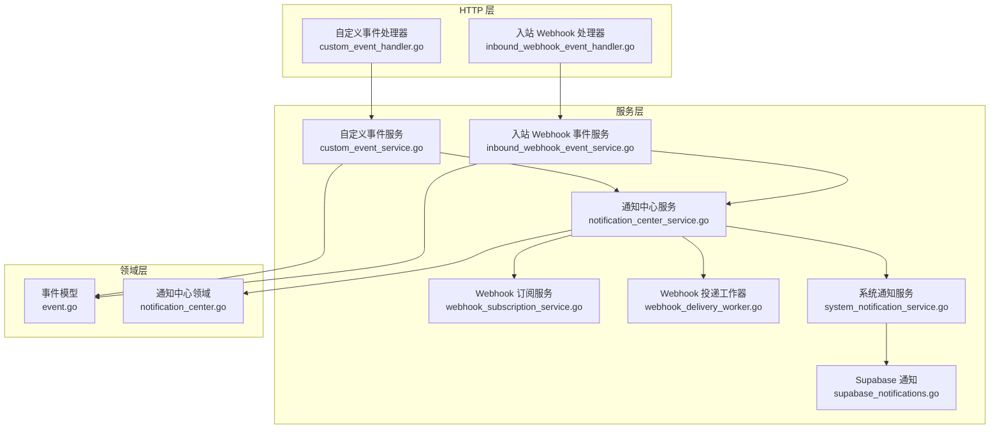
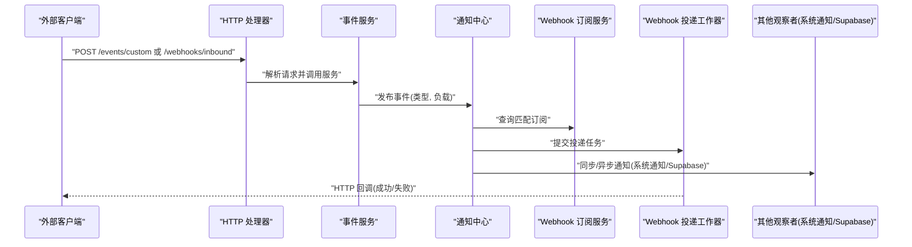
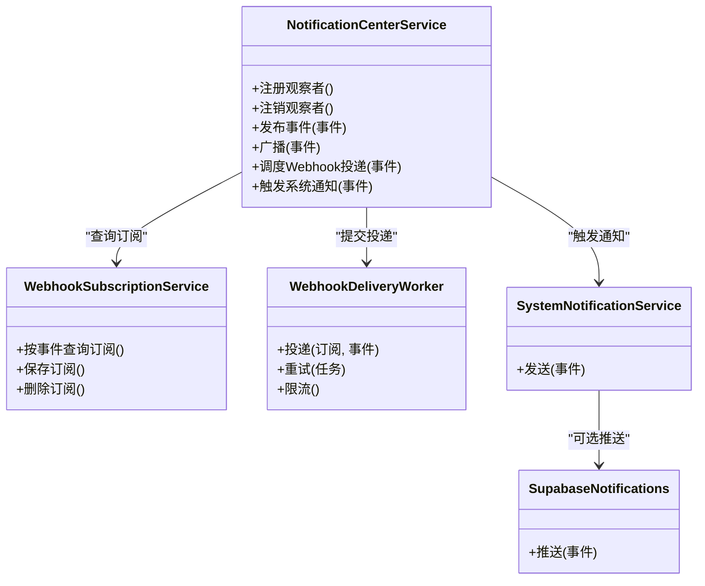
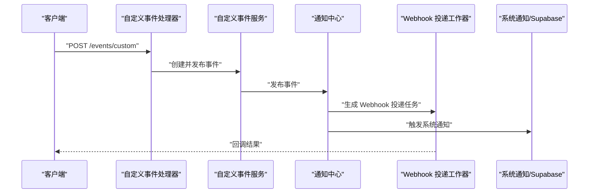
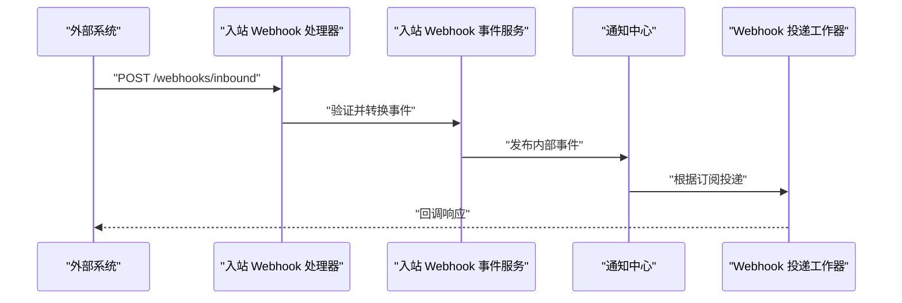
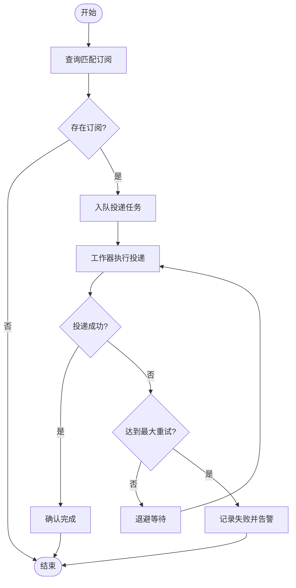
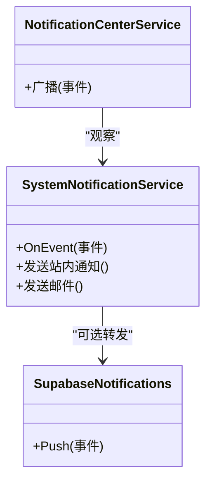
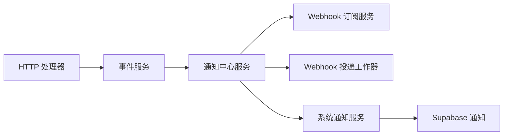

# 观察者模式实现

<cite>
**本文引用的文件**   
- [notification_center_service.go](file://notifuse/internal/service/notification_center_service.go)
- [notification_center_service_test.go](file://notifuse/internal/service/notification_center_service_test.go)
- [notification_center.go](file://notifuse/internal/domain/notification_center.go)
- [event.go](file://notifuse/internal/domain/event.go)
- [custom_event_service.go](file://notifuse/internal/service/custom_event_service.go)
- [custom_event_handler.go](file://notifuse/internal/http/custom_event_handler.go)
- [inbound_webhook_event_service.go](file://notifuse/internal/service/inbound_webhook_event_service.go)
- [inbound_webhook_event_handler.go](file://notifuse/internal/http/inbound_webhook_event_handler.go)
- [webhook_subscription_service.go](file://notifuse/internal/service/webhook_subscription_service.go)
- [webhook_delivery_worker.go](file://notifuse/internal/service/webhook_delivery_worker.go)
- [supabase_notifications.go](file://notifuse/internal/service/supabase_notifications.go)
- [system_notification_service.go](file://notifuse/internal/service/system_notification_service.go)
</cite>

## 目录
1. [简介](#简介)
2. [项目结构](#项目结构)
3. [核心组件](#核心组件)
4. [架构总览](#架构总览)
5. [详细组件分析](#详细组件分析)
6. [依赖关系分析](#依赖关系分析)
7. [性能考虑](#性能考虑)
8. [故障排查指南](#故障排查指南)
9. [结论](#结论)
10. [附录](#附录)

## 简介
本文件面向 Notifuse 平台，系统性阐述观察者模式在事件驱动架构中的落地实践。重点覆盖：
- 通知中心服务的观察者模式设计与应用
- Webhook 事件处理机制（订阅、分发、投递）
- 系统事件的发布-订阅流程与扩展点
- 通过具体代码路径展示“事件定义—观察者注册—事件触发—处理”的完整链路
- 说明如何通过观察者模式实现模块间松耦合通信与业务解耦

## 项目结构
围绕观察者模式的关键代码主要分布在以下层次：
- 领域层：事件模型与通知中心接口/能力定义
- 服务层：事件发布、Webhook 订阅与投递、通知中心编排
- HTTP 层：外部事件入口（自定义事件、入站 Webhook）
- 集成层：第三方通知通道（如 Supabase）

图表来源
- [custom_event_handler.go](file://notifuse/internal/http/custom_event_handler.go)
- [inbound_webhook_event_handler.go](file://notifuse/internal/http/inbound_webhook_event_handler.go)
- [custom_event_service.go](file://notifuse/internal/service/custom_event_service.go)
- [inbound_webhook_event_service.go](file://notifuse/internal/service/inbound_webhook_event_service.go)
- [notification_center_service.go](file://notifuse/internal/service/notification_center_service.go)
- [webhook_subscription_service.go](file://notifuse/internal/service/webhook_subscription_service.go)
- [webhook_delivery_worker.go](file://notifuse/internal/service/webhook_delivery_worker.go)
- [system_notification_service.go](file://notifuse/internal/service/system_notification_service.go)
- [supabase_notifications.go](file://notifuse/internal/service/supabase_notifications.go)
- [event.go](file://notifuse/internal/domain/event.go)
- [notification_center.go](file://notifuse/internal/domain/notification_center.go)

章节来源
- [custom_event_handler.go](file://notifuse/internal/http/custom_event_handler.go)
- [inbound_webhook_event_handler.go](file://notifuse/internal/http/inbound_webhook_event_handler.go)
- [custom_event_service.go](file://notifuse/internal/service/custom_event_service.go)
- [inbound_webhook_event_service.go](file://notifuse/internal/service/inbound_webhook_event_service.go)
- [notification_center_service.go](file://notifuse/internal/service/notification_center_service.go)
- [webhook_subscription_service.go](file://notifuse/internal/service/webhook_subscription_service.go)
- [webhook_delivery_worker.go](file://notifuse/internal/service/webhook_delivery_worker.go)
- [system_notification_service.go](file://notifuse/internal/service/system_notification_service.go)
- [supabase_notifications.go](file://notifuse/internal/service/supabase_notifications.go)
- [event.go](file://notifuse/internal/domain/event.go)
- [notification_center.go](file://notifuse/internal/domain/notification_center.go)

## 核心组件
- 事件模型（Event）：承载事件类型、负载数据、上下文等元信息，作为发布-订阅的数据载体。
- 通知中心（NotificationCenter）：维护观察者集合，提供注册/注销与广播能力；内部可结合 Webhook 订阅与投递逻辑完成跨模块分发。
- 自定义事件服务（CustomEventService）：对外暴露“发布自定义事件”的能力，供业务域调用。
- 入站 Webhook 事件服务（InboundWebhookEventService）：将外部系统回调转换为平台内部事件并进入通知中心。
- Webhook 订阅服务（WebhookSubscriptionService）：管理订阅关系（主题/事件类型到目标端点的映射）。
- Webhook 投递工作器（WebhookDeliveryWorker）：负责按策略重试、限流、签名校验等将事件投递给订阅方。
- 系统通知服务（SystemNotificationService）：封装系统级通知（站内信、邮件等），可作为观察者之一。
- Supabase 通知（SupabaseNotifications）：将通知推送至 Supabase 渠道，亦为观察者之一。

章节来源
- [event.go](file://notifuse/internal/domain/event.go)
- [notification_center.go](file://notifuse/internal/domain/notification_center.go)
- [notification_center_service.go](file://notifuse/internal/service/notification_center_service.go)
- [custom_event_service.go](file://notifuse/internal/service/custom_event_service.go)
- [inbound_webhook_event_service.go](file://notifuse/internal/service/inbound_webhook_event_service.go)
- [webhook_subscription_service.go](file://notifuse/internal/service/webhook_subscription_service.go)
- [webhook_delivery_worker.go](file://notifuse/internal/service/webhook_delivery_worker.go)
- [system_notification_service.go](file://notifuse/internal/service/system_notification_service.go)
- [supabase_notifications.go](file://notifuse/internal/service/supabase_notifications.go)

## 架构总览
下图展示了从外部事件进入，到通知中心广播，再到各观察者（含 Webhook 投递）处理的端到端流程。

图表来源
- [custom_event_handler.go](file://notifuse/internal/http/custom_event_handler.go)
- [inbound_webhook_event_handler.go](file://notifuse/internal/http/inbound_webhook_event_handler.go)
- [custom_event_service.go](file://notifuse/internal/service/custom_event_service.go)
- [inbound_webhook_event_service.go](file://notifuse/internal/service/inbound_webhook_event_service.go)
- [notification_center_service.go](file://notifuse/internal/service/notification_center_service.go)
- [webhook_subscription_service.go](file://notifuse/internal/service/webhook_subscription_service.go)
- [webhook_delivery_worker.go](file://notifuse/internal/service/webhook_delivery_worker.go)
- [system_notification_service.go](file://notifuse/internal/service/system_notification_service.go)
- [supabase_notifications.go](file://notifuse/internal/service/supabase_notifications.go)

## 详细组件分析

### 通知中心服务（NotificationCenterService）
- 职责
  - 维护观察者列表与订阅关系
  - 提供事件广播接口
  - 协调 Webhook 订阅查询与投递任务生成
  - 触发系统通知与第三方通知
- 关键行为
  - 注册/注销观察者
  - 按事件类型路由到对应观察者
  - 对 Webhook 投递进行批量化与并发控制
- 错误与容错
  - 单个观察者失败不影响整体广播
  - 针对 Webhook 投递具备重试与退避策略

图表来源
- [notification_center_service.go](file://notifuse/internal/service/notification_center_service.go)
- [webhook_subscription_service.go](file://notifuse/internal/service/webhook_subscription_service.go)
- [webhook_delivery_worker.go](file://notifuse/internal/service/webhook_delivery_worker.go)
- [system_notification_service.go](file://notifuse/internal/service/system_notification_service.go)
- [supabase_notifications.go](file://notifuse/internal/service/supabase_notifications.go)

章节来源
- [notification_center_service.go](file://notifuse/internal/service/notification_center_service.go)
- [notification_center_service_test.go](file://notifuse/internal/service/notification_center_service_test.go)
- [notification_center.go](file://notifuse/internal/domain/notification_center.go)

### 自定义事件（Custom Event）发布流程
- 入口
  - HTTP 处理器接收自定义事件请求
  - 服务层校验并持久化（如需）后，调用通知中心发布
- 关键点
  - 事件类型标准化
  - 负载结构统一
  - 发布成功后返回确认

图表来源
- [custom_event_handler.go](file://notifuse/internal/http/custom_event_handler.go)
- [custom_event_service.go](file://notifuse/internal/service/custom_event_service.go)
- [notification_center_service.go](file://notifuse/internal/service/notification_center_service.go)
- [webhook_delivery_worker.go](file://notifuse/internal/service/webhook_delivery_worker.go)
- [system_notification_service.go](file://notifuse/internal/service/system_notification_service.go)
- [supabase_notifications.go](file://notifuse/internal/service/supabase_notifications.go)

章节来源
- [custom_event_handler.go](file://notifuse/internal/http/custom_event_handler.go)
- [custom_event_service.go](file://notifuse/internal/service/custom_event_service.go)
- [notification_center_service.go](file://notifuse/internal/service/notification_center_service.go)

### 入站 Webhook 事件处理流程
- 入口
  - 外部系统回调到入站 Webhook 端点
  - 服务层解析载荷、去重、落库后，转为平台内部事件并进入通知中心
- 关键点
  - 幂等性保障（基于事件标识）
  - 安全校验（签名/白名单）
  - 异常隔离与告警

图表来源
- [inbound_webhook_event_handler.go](file://notifuse/internal/http/inbound_webhook_event_handler.go)
- [inbound_webhook_event_service.go](file://notifuse/internal/service/inbound_webhook_event_service.go)
- [notification_center_service.go](file://notifuse/internal/service/notification_center_service.go)
- [webhook_delivery_worker.go](file://notifuse/internal/service/webhook_delivery_worker.go)

章节来源
- [inbound_webhook_event_handler.go](file://notifuse/internal/http/inbound_webhook_event_handler.go)
- [inbound_webhook_event_service.go](file://notifuse/internal/service/inbound_webhook_event_service.go)
- [notification_center_service.go](file://notifuse/internal/service/notification_center_service.go)

### Webhook 订阅与投递
- 订阅管理
  - 支持按事件类型/工作空间维度订阅
  - 支持启用/禁用、重试策略配置
- 投递策略
  - 异步队列/工作器消费
  - 指数退避重试、超时控制、失败记录
  - 可选签名与 TLS 校验

图表来源
- [webhook_subscription_service.go](file://notifuse/internal/service/webhook_subscription_service.go)
- [webhook_delivery_worker.go](file://notifuse/internal/service/webhook_delivery_worker.go)

章节来源
- [webhook_subscription_service.go](file://notifuse/internal/service/webhook_subscription_service.go)
- [webhook_delivery_worker.go](file://notifuse/internal/service/webhook_delivery_worker.go)

### 系统通知与第三方通知（观察者示例）
- 系统通知服务
  - 作为观察者监听平台事件，写入站内通知、触发邮件等
- Supabase 通知
  - 作为观察者将事件推送到 Supabase 通道，便于前端实时展示

图表来源
- [system_notification_service.go](file://notifuse/internal/service/system_notification_service.go)
- [supabase_notifications.go](file://notifuse/internal/service/supabase_notifications.go)
- [notification_center_service.go](file://notifuse/internal/service/notification_center_service.go)

章节来源
- [system_notification_service.go](file://notifuse/internal/service/system_notification_service.go)
- [supabase_notifications.go](file://notifuse/internal/service/supabase_notifications.go)
- [notification_center_service.go](file://notifuse/internal/service/notification_center_service.go)

## 依赖关系分析
- 低耦合
  - HTTP 层仅依赖服务层，不直接感知观察者细节
  - 服务层通过通知中心抽象事件广播，避免硬编码依赖
- 内聚性
  - 通知中心聚焦于“注册/广播”，Webhook 订阅与投递由专门服务协作
- 外部依赖
  - Supabase 通知作为可选通道，通过服务层注入，便于替换与测试

图表来源
- [custom_event_handler.go](file://notifuse/internal/http/custom_event_handler.go)
- [inbound_webhook_event_handler.go](file://notifuse/internal/http/inbound_webhook_event_handler.go)
- [custom_event_service.go](file://notifuse/internal/service/custom_event_service.go)
- [inbound_webhook_event_service.go](file://notifuse/internal/service/inbound_webhook_event_service.go)
- [notification_center_service.go](file://notifuse/internal/service/notification_center_service.go)
- [webhook_subscription_service.go](file://notifuse/internal/service/webhook_subscription_service.go)
- [webhook_delivery_worker.go](file://notifuse/internal/service/webhook_delivery_worker.go)
- [system_notification_service.go](file://notifuse/internal/service/system_notification_service.go)
- [supabase_notifications.go](file://notifuse/internal/service/supabase_notifications.go)

章节来源
- [custom_event_handler.go](file://notifuse/internal/http/custom_event_handler.go)
- [inbound_webhook_event_handler.go](file://notifuse/internal/http/inbound_webhook_event_handler.go)
- [custom_event_service.go](file://notifuse/internal/service/custom_event_service.go)
- [inbound_webhook_event_service.go](file://notifuse/internal/service/inbound_webhook_event_service.go)
- [notification_center_service.go](file://notifuse/internal/service/notification_center_service.go)
- [webhook_subscription_service.go](file://notifuse/internal/service/webhook_subscription_service.go)
- [webhook_delivery_worker.go](file://notifuse/internal/service/webhook_delivery_worker.go)
- [system_notification_service.go](file://notifuse/internal/service/system_notification_service.go)
- [supabase_notifications.go](file://notifuse/internal/service/supabase_notifications.go)

## 性能考虑
- 异步投递
  - Webhook 投递采用工作器异步处理，降低主链路延迟
- 批量与并发
  - 订阅查询与投递可批量合并，合理设置并发度
- 重试与退避
  - 指数退避减少瞬时抖动，避免雪崩
- 限流与熔断
  - 对下游通道实施限流，失败快速失败并回退
- 幂等与去重
  - 入站 Webhook 事件需保证幂等，避免重复处理

[本节为通用指导，无需源码引用]

## 故障排查指南
- 常见问题
  - 事件未到达订阅方：检查订阅是否启用、事件类型是否匹配、投递任务状态
  - 投递频繁失败：查看重试次数、退避策略、目标端点健康状态
  - 系统通知缺失：确认观察者已注册、通道配置正确
- 定位手段
  - 查看投递工作器的失败记录与日志
  - 核对入站 Webhook 的签名校验与白名单
  - 使用通知中心的广播统计与指标

章节来源
- [notification_center_service_test.go](file://notifuse/internal/service/notification_center_service_test.go)
- [webhook_delivery_worker.go](file://notifuse/internal/service/webhook_delivery_worker.go)
- [inbound_webhook_event_service.go](file://notifuse/internal/service/inbound_webhook_event_service.go)

## 结论
通过通知中心服务的观察者模式实现，Notifuse 平台实现了：
- 清晰的发布-订阅边界，HTTP 与服务层无需关心具体消费者
- 可扩展的通知通道（Webhook、系统通知、Supabase 等）
- 高可用与弹性（异步投递、重试、限流）
- 良好的可观测性与可维护性（集中式事件模型与订阅管理）

[本节为总结，无需源码引用]

## 附录
- 事件定义参考
  - 事件模型字段与用途参见事件模型文件
- 观察者注册参考
  - 通知中心服务中注册/注销方法
- 事件触发与处理参考
  - 自定义事件与入站 Webhook 的服务与处理器文件
- 订阅与投递参考
  - Webhook 订阅管理与投递工作器文件

章节来源
- [event.go](file://notifuse/internal/domain/event.go)
- [notification_center_service.go](file://notifuse/internal/service/notification_center_service.go)
- [custom_event_service.go](file://notifuse/internal/service/custom_event_service.go)
- [inbound_webhook_event_service.go](file://notifuse/internal/service/inbound_webhook_event_service.go)
- [webhook_subscription_service.go](file://notifuse/internal/service/webhook_subscription_service.go)
- [webhook_delivery_worker.go](file://notifuse/internal/service/webhook_delivery_worker.go)