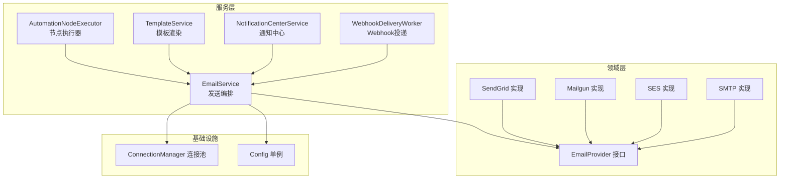
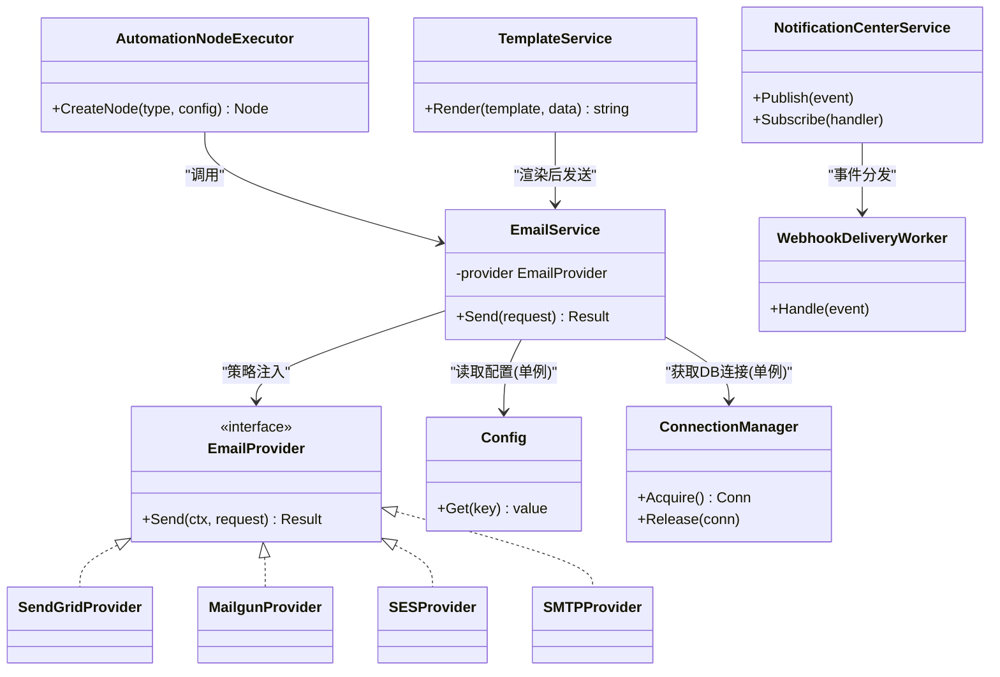
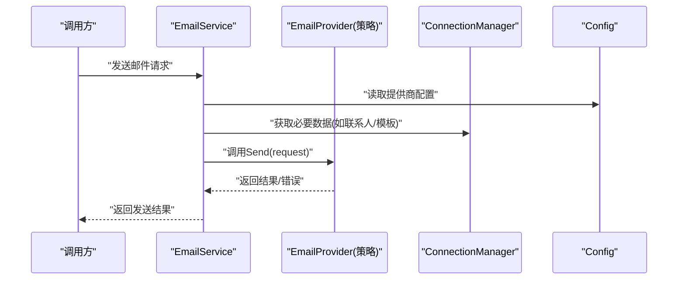
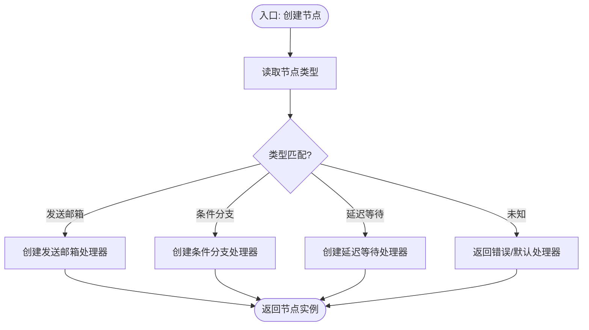
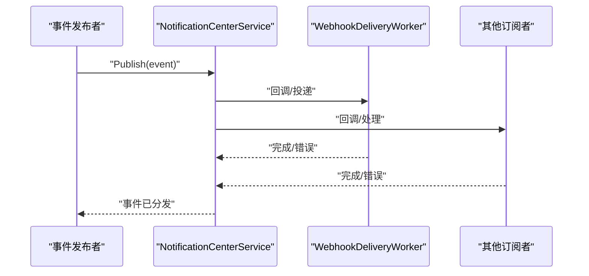
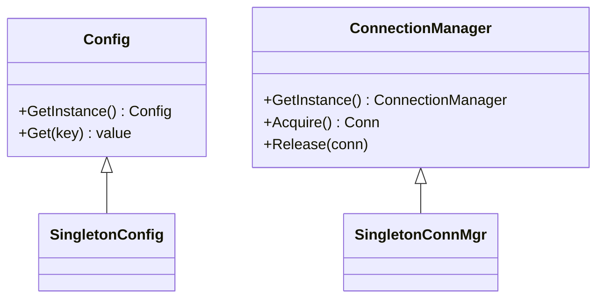
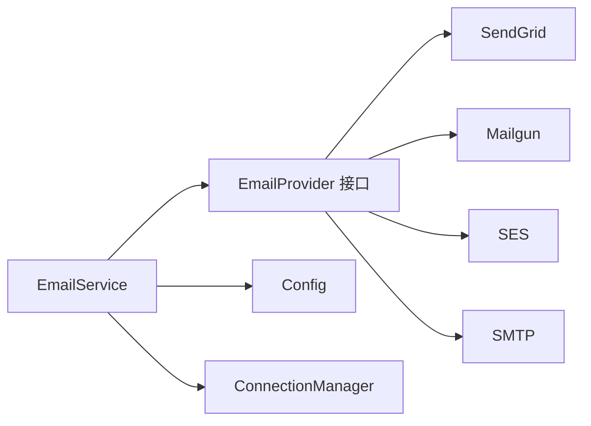

# 设计模式实现

<cite>
**本文引用的文件**   
- [email_provider.go](file://notifuse/internal/domain/email_provider.go)
- [email_provider_sendgrid.go](file://notifuse/internal/domain/email_provider_sendgrid.go)
- [email_provider_mailgun.go](file://notifuse/internal/domain/email_provider_mailgun.go)
- [email_provider_ses.go](file://notifuse/internal/domain/email_provider_ses.go)
- [email_provider_smtp.go](file://notifuse/internal/domain/email_provider_smtp.go)
- [email_service.go](file://notifuse/internal/service/email_service.go)
- [automation_node_executor.go](file://notifuse/internal/service/automation_node_executor.go)
- [template_service.go](file://notifuse/internal/service/template_service.go)
- [notification_center_service.go](file://notifuse/internal/service/notification_center_service.go)
- [webhook_delivery_worker.go](file://notifuse/internal/service/webhook_delivery_worker.go)
- [config.go](file://notifuse/config/config.go)
- [connection_manager.go](file://notifuse/pkg/database/connection_manager.go)
</cite>

## 目录
1. [简介](#简介)
2. [项目结构](#项目结构)
3. [核心组件](#核心组件)
4. [架构总览](#架构总览)
5. [详细组件分析](#详细组件分析)
6. [依赖分析](#依赖分析)
7. [性能考虑](#性能考虑)
8. [故障排查指南](#故障排查指南)
9. [结论](#结论)
10. [附录](#附录)

## 简介
本文件面向Notifuse平台，系统性梳理并文档化以下设计模式的落地实践：
- 策略模式：对邮件提供商（SendGrid、Mailgun、AWS SES、SMTP等）进行统一抽象与可插拔实现。
- 工厂模式：在自动化节点创建、模板渲染器选择等场景中动态构建对象。
- 观察者模式：在事件驱动架构中处理Webhook投递、状态变更通知等。
- 单例模式：在配置管理、连接池管理等全局资源上的应用。

文档包含类图、时序图与流程图，帮助读者从高层到代码级理解各模式的职责边界与协作方式。

## 项目结构
本次分析聚焦后端Go服务中与模式相关的核心模块：
- 领域层 domain：定义邮件提供商接口与各具体实现。
- 服务层 service：编排业务逻辑，使用工厂/策略/观察者/单例等模式组合能力。
- 配置与基础设施：提供全局配置与数据库连接池管理。

图表来源
- [email_provider.go:1-200](file://notifuse/internal/domain/email_provider.go#L1-L200)
- [email_provider_sendgrid.go:1-200](file://notifuse/internal/domain/email_provider_sendgrid.go#L1-L200)
- [email_provider_mailgun.go:1-200](file://notifuse/internal/domain/email_provider_mailgun.go#L1-L200)
- [email_provider_ses.go:1-200](file://notifuse/internal/domain/email_provider_ses.go#L1-L200)
- [email_provider_smtp.go:1-200](file://notifuse/internal/domain/email_provider_smtp.go#L1-L200)
- [email_service.go:1-300](file://notifuse/internal/service/email_service.go#L1-L300)
- [automation_node_executor.go:1-200](file://notifuse/internal/service/automation_node_executor.go#L1-L200)
- [template_service.go:1-200](file://notifuse/internal/service/template_service.go#L1-L200)
- [notification_center_service.go:1-200](file://notifuse/internal/service/notification_center_service.go#L1-L200)
- [webhook_delivery_worker.go:1-200](file://notifuse/internal/service/webhook_delivery_worker.go#L1-L200)
- [config.go:1-200](file://notifuse/config/config.go#L1-L200)
- [connection_manager.go:1-200](file://notifuse/pkg/database/connection_manager.go#L1-L200)

章节来源
- [email_provider.go:1-200](file://notifuse/internal/domain/email_provider.go#L1-L200)
- [email_service.go:1-300](file://notifuse/internal/service/email_service.go#L1-L300)
- [config.go:1-200](file://notifuse/config/config.go#L1-L200)
- [connection_manager.go:1-200](file://notifuse/pkg/database/connection_manager.go#L1-L200)

## 核心组件
- 邮件提供商抽象（策略模式）
  - 通过统一的EmailProvider接口屏蔽不同供应商差异，支持运行时切换。
- 邮件服务（编排者）
  - 根据配置或上下文选择具体提供商实例，负责重试、限流、指标上报等横切关注点。
- 自动化节点执行器（工厂模式）
  - 按节点类型动态创建对应处理器，便于扩展新节点类型。
- 模板服务（工厂模式）
  - 根据模板类型/引擎选择渲染器，如Liquid、MJML等。
- 通知中心与Webhook投递（观察者模式）
  - 事件发布后，订阅者（通知中心、Webhook投递器等）异步响应。
- 配置与连接池（单例模式）
  - 全局唯一配置对象；数据库连接池复用连接，避免重复创建开销。

章节来源
- [email_provider.go:1-200](file://notifuse/internal/domain/email_provider.go#L1-L200)
- [email_service.go:1-300](file://notifuse/internal/service/email_service.go#L1-L300)
- [automation_node_executor.go:1-200](file://notifuse/internal/service/automation_node_executor.go#L1-L200)
- [template_service.go:1-200](file://notifuse/internal/service/template_service.go#L1-L200)
- [notification_center_service.go:1-200](file://notifuse/internal/service/notification_center_service.go#L1-L200)
- [webhook_delivery_worker.go:1-200](file://notifuse/internal/service/webhook_delivery_worker.go#L1-L200)
- [config.go:1-200](file://notifuse/config/config.go#L1-L200)
- [connection_manager.go:1-200](file://notifuse/pkg/database/connection_manager.go#L1-L200)

## 架构总览
下图展示策略、工厂、观察者与单例在系统中的协作关系。

图表来源
- [email_provider.go:1-200](file://notifuse/internal/domain/email_provider.go#L1-L200)
- [email_provider_sendgrid.go:1-200](file://notifuse/internal/domain/email_provider_sendgrid.go#L1-L200)
- [email_provider_mailgun.go:1-200](file://notifuse/internal/domain/email_provider_mailgun.go#L1-L200)
- [email_provider_ses.go:1-200](file://notifuse/internal/domain/email_provider_ses.go#L1-L200)
- [email_provider_smtp.go:1-200](file://notifuse/internal/domain/email_provider_smtp.go#L1-L200)
- [email_service.go:1-300](file://notifuse/internal/service/email_service.go#L1-L300)
- [automation_node_executor.go:1-200](file://notifuse/internal/service/automation_node_executor.go#L1-L200)
- [template_service.go:1-200](file://notifuse/internal/service/template_service.go#L1-L200)
- [notification_center_service.go:1-200](file://notifuse/internal/service/notification_center_service.go#L1-L200)
- [webhook_delivery_worker.go:1-200](file://notifuse/internal/service/webhook_delivery_worker.go#L1-L200)
- [config.go:1-200](file://notifuse/config/config.go#L1-L200)
- [connection_manager.go:1-200](file://notifuse/pkg/database/connection_manager.go#L1-L200)

## 详细组件分析

### 策略模式：邮件提供商抽象
- 目标
  - 将不同邮件服务商的差异封装为同一接口，使上层无需关心具体实现。
- 关键角色
  - 抽象：EmailProvider 接口
  - 具体策略：SendGridProvider、MailgunProvider、SESProvider、SMTPProvider
  - 上下文：EmailService（选择并委托给具体策略）
- 适用场景
  - 多供应商切换、灰度发布、A/B测试、按租户选择最佳通道。
- 交互流程（时序）

图表来源
- [email_service.go:1-300](file://notifuse/internal/service/email_service.go#L1-L300)
- [email_provider.go:1-200](file://notifuse/internal/domain/email_provider.go#L1-L200)
- [email_provider_sendgrid.go:1-200](file://notifuse/internal/domain/email_provider_sendgrid.go#L1-L200)
- [email_provider_mailgun.go:1-200](file://notifuse/internal/domain/email_provider_mailgun.go#L1-L200)
- [email_provider_ses.go:1-200](file://notifuse/internal/domain/email_provider_ses.go#L1-L200)
- [email_provider_smtp.go:1-200](file://notifuse/internal/domain/email_provider_smtp.go#L1-L200)
- [config.go:1-200](file://notifuse/config/config.go#L1-L200)
- [connection_manager.go:1-200](file://notifuse/pkg/database/connection_manager.go#L1-L200)

章节来源
- [email_provider.go:1-200](file://notifuse/internal/domain/email_provider.go#L1-L200)
- [email_service.go:1-300](file://notifuse/internal/service/email_service.go#L1-L300)

### 工厂模式：动态组件创建
- 目标
  - 根据输入参数（如节点类型、模板引擎）动态创建对应对象，降低耦合，提升可扩展性。
- 典型场景
  - 自动化节点创建：根据节点类型创建“发送邮箱”、“条件分支”、“延迟等待”等处理器。
  - 模板渲染器选择：根据模板格式选择Liquid/MJML等渲染器。
- 流程图（自动化节点创建）

图表来源
- [automation_node_executor.go:1-200](file://notifuse/internal/service/automation_node_executor.go#L1-L200)
- [template_service.go:1-200](file://notifuse/internal/service/template_service.go#L1-L200)

章节来源
- [automation_node_executor.go:1-200](file://notifuse/internal/service/automation_node_executor.go#L1-L200)
- [template_service.go:1-200](file://notifuse/internal/service/template_service.go#L1-L200)

### 观察者模式：事件驱动架构
- 目标
  - 解耦事件生产者与消费者，支持多种订阅者异步处理同一事件。
- 典型场景
  - Webhook事件处理：当某业务事件发生时，通知所有已注册的Webhook订阅者。
  - 状态变更通知：例如邮件发送成功/失败、自动化任务完成等。
- 交互流程（时序）

图表来源
- [notification_center_service.go:1-200](file://notifuse/internal/service/notification_center_service.go#L1-L200)
- [webhook_delivery_worker.go:1-200](file://notifuse/internal/service/webhook_delivery_worker.go#L1-L200)

章节来源
- [notification_center_service.go:1-200](file://notifuse/internal/service/notification_center_service.go#L1-L200)
- [webhook_delivery_worker.go:1-200](file://notifuse/internal/service/webhook_delivery_worker.go#L1-L200)

### 单例模式：配置管理与连接池
- 目标
  - 保证全局唯一实例，避免重复初始化与资源竞争。
- 典型场景
  - 配置管理：全局读取系统配置（如默认提供商、超时、重试策略）。
  - 连接池管理：数据库连接复用，减少握手与鉴权开销。
- 类图片段（概念示意）

说明
- 该图为概念示意，用于表达单例语义；实际实现以各自模块为准。

章节来源
- [config.go:1-200](file://notifuse/config/config.go#L1-L200)
- [connection_manager.go:1-200](file://notifuse/pkg/database/connection_manager.go#L1-L200)

## 依赖分析
- 松耦合
  - EmailService仅依赖EmailProvider接口，新增提供商无需改动上层。
  - 自动化节点与模板渲染器通过工厂按需创建，新增类型只需注册。
- 内聚性
  - 每个具体提供商实现自包含，职责单一。
- 外部依赖
  - 配置与连接池作为基础设施被多处共享，需确保线程安全与生命周期管理。

图表来源
- [email_service.go:1-300](file://notifuse/internal/service/email_service.go#L1-L300)
- [email_provider.go:1-200](file://notifuse/internal/domain/email_provider.go#L1-L200)
- [email_provider_sendgrid.go:1-200](file://notifuse/internal/domain/email_provider_sendgrid.go#L1-L200)
- [email_provider_mailgun.go:1-200](file://notifuse/internal/domain/email_provider_mailgun.go#L1-L200)
- [email_provider_ses.go:1-200](file://notifuse/internal/domain/email_provider_ses.go#L1-L200)
- [email_provider_smtp.go:1-200](file://notifuse/internal/domain/email_provider_smtp.go#L1-L200)
- [config.go:1-200](file://notifuse/config/config.go#L1-L200)
- [connection_manager.go:1-200](file://notifuse/pkg/database/connection_manager.go#L1-L200)

章节来源
- [email_service.go:1-300](file://notifuse/internal/service/email_service.go#L1-L300)
- [email_provider.go:1-200](file://notifuse/internal/domain/email_provider.go#L1-L200)

## 性能考虑
- 策略模式
  - 选择成本极低（指针/接口调用），适合高频路径。
  - 可在EmailService中缓存策略实例，避免重复构造。
- 工厂模式
  - 工厂内部可对重型对象做懒加载或对象池，减少冷启动开销。
- 观察者模式
  - 建议采用异步队列/协程池派发事件，避免阻塞主流程。
  - 对订阅者增加超时与熔断保护，防止雪崩。
- 单例模式
  - 配置读取应加锁或只读内存映射；连接池需合理设置最大连接数与空闲回收策略。

[本节为通用指导，不直接分析具体文件]

## 故障排查指南
- 邮件发送失败
  - 检查配置是否正确（提供商密钥、域名、区域等）。
  - 查看具体提供商的错误码与重试策略。
  - 确认连接池是否耗尽，必要时扩容或优化查询。
- Webhook投递异常
  - 核对订阅者URL可达性与签名校验。
  - 观察事件分发队列堆积情况，调整并发与重试间隔。
- 自动化节点执行异常
  - 确认节点类型注册表是否包含新节点。
  - 检查上游依赖（模板渲染、第三方API）的可用性。

章节来源
- [email_service.go:1-300](file://notifuse/internal/service/email_service.go#L1-L300)
- [webhook_delivery_worker.go:1-200](file://notifuse/internal/service/webhook_delivery_worker.go#L1-L200)
- [automation_node_executor.go:1-200](file://notifuse/internal/service/automation_node_executor.go#L1-L200)

## 结论
通过将策略、工厂、观察者与单例模式有机结合，Notifuse在后端实现了高内聚、低耦合、易扩展的系统：
- 策略模式让邮件通道可插拔、可替换；
- 工厂模式简化了复杂对象的创建与组合；
- 观察者模式支撑了灵活的事件驱动体系；
- 单例模式保障了全局资源的稳定与高效。

[本节为总结性内容，不直接分析具体文件]

## 附录
- 示例参考路径（不包含代码内容）
  - 策略接口与实现：见 [email_provider.go](file://notifuse/internal/domain/email_provider.go)、[email_provider_sendgrid.go](file://notifuse/internal/domain/email_provider_sendgrid.go)、[email_provider_mailgun.go](file://notifuse/internal/domain/email_provider_mailgun.go)、[email_provider_ses.go](file://notifuse/internal/domain/email_provider_ses.go)、[email_provider_smtp.go](file://notifuse/internal/domain/email_provider_smtp.go)
  - 策略使用与编排：见 [email_service.go](file://notifuse/internal/service/email_service.go)
  - 工厂创建节点与模板：见 [automation_node_executor.go](file://notifuse/internal/service/automation_node_executor.go)、[template_service.go](file://notifuse/internal/service/template_service.go)
  - 观察者事件分发：见 [notification_center_service.go](file://notifuse/internal/service/notification_center_service.go)、[webhook_delivery_worker.go](file://notifuse/internal/service/webhook_delivery_worker.go)
  - 单例配置与连接池：见 [config.go](file://notifuse/config/config.go)、[connection_manager.go](file://notifuse/pkg/database/connection_manager.go)