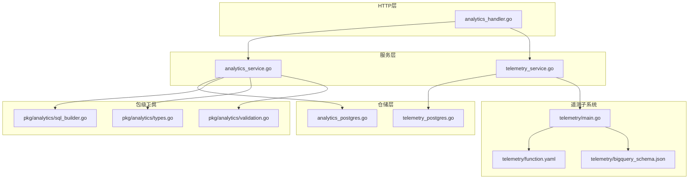
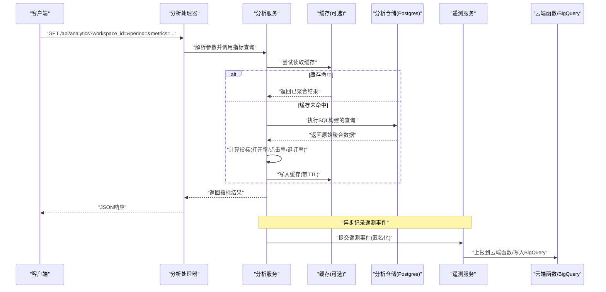
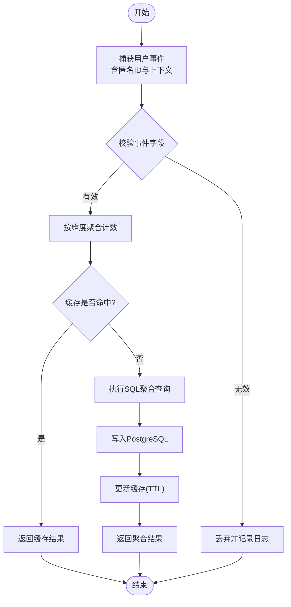
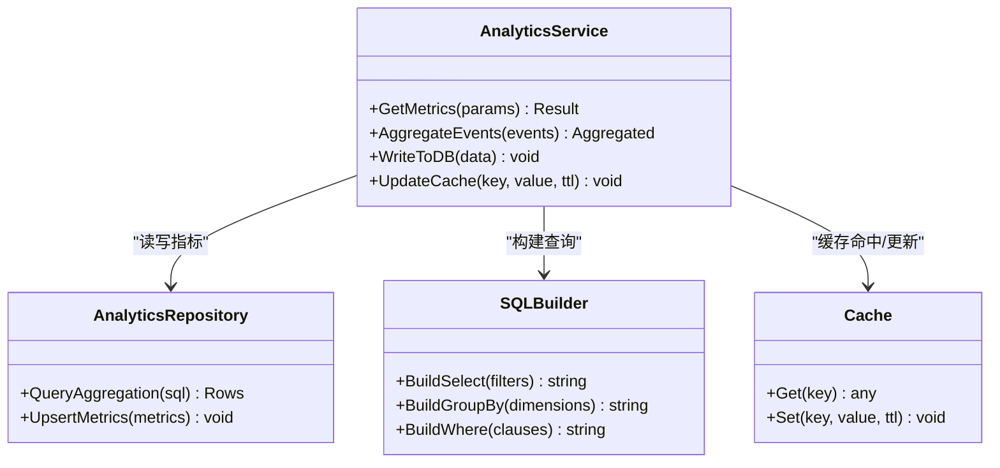
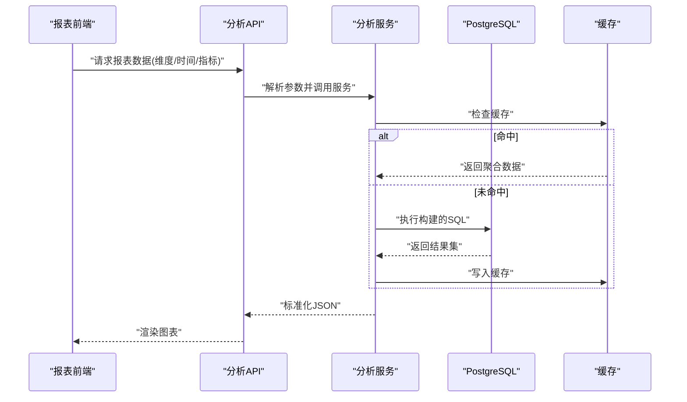
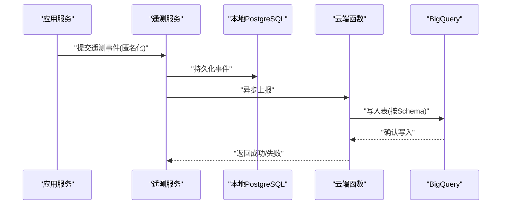
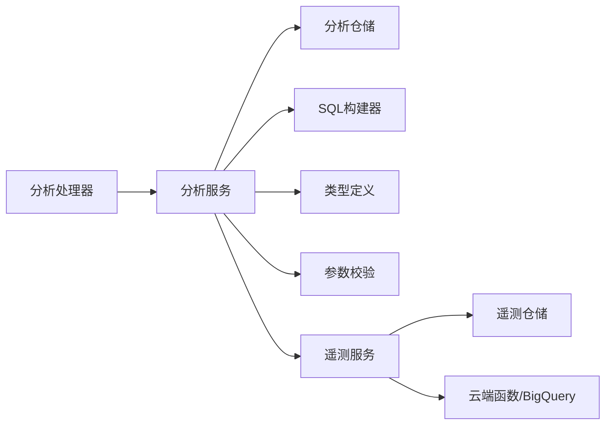

# 数据分析与追踪

<cite>
**本文引用的文件**   
- [analytics_handler.go](file://notifuse/internal/http/analytics_handler.go)
- [analytics_service.go](file://notifuse/internal/service/analytics_service.go)
- [analytics_postgres.go](file://notifuse/internal/repository/analytics_postgres.go)
- [sql_builder.go](file://notifuse/pkg/analytics/sql_builder.go)
- [types.go](file://notifuse/pkg/analytics/types.go)
- [validation.go](file://notifuse/pkg/analytics/validation.go)
- [telemetry_service.go](file://notifuse/internal/service/telemetry_service.go)
- [telemetry_postgres.go](file://notifuse/internal/repository/telemetry_postgres.go)
- [telemetry.go](file://notifuse/internal/domain/telemetry.go)
- [main.go](file://notifuse/cmd/api/main.go)
- [config.go](file://notifuse/config/config.go)
- [bigquery_schema.json](file://notifuse/telemetry/bigquery_schema.json)
- [function.yaml](file://notifuse/telemetry/function.yaml)
- [main.go](file://notifuse/telemetry/main.go)
</cite>

## 目录
1. [简介](#简介)
2. [项目结构](#项目结构)
3. [核心组件](#核心组件)
4. [架构总览](#架构总览)
5. [详细组件分析](#详细组件分析)
6. [依赖关系分析](#依赖关系分析)
7. [性能考量](#性能考量)
8. [故障排查指南](#故障排查指南)
9. [结论](#结论)
10. [附录](#附录) 

## 简介
本文件面向Notifuse平台的数据分析与追踪系统，聚焦以下目标：
- 邮件性能指标收集机制：打开率、点击率、退订率等关键指标的统计方法
- 用户行为追踪实现原理：事件捕获、数据聚合与存储策略
- 实时分析功能架构设计：数据流处理与缓存机制
- 报表生成系统工作原理：数据查询优化与可视化展示
- 遥测数据的收集与匿名化处理
- 数据分析API使用方法与自定义指标配置
- 性能监控最佳实践与故障排查指南

## 项目结构
与数据分析与追踪相关的代码主要分布在如下模块：
- HTTP层：接收前端或外部系统的分析请求，解析参数并调用服务层
- 服务层：封装业务逻辑，包括指标计算、查询构建、缓存与异步写入
- 仓储层：对接PostgreSQL进行持久化读写
- 包级工具：SQL构建器、类型定义与校验
- 遥测子系统：将遥测数据上报至云端（如BigQuery）并进行匿名化处理

图表来源
- [analytics_handler.go:1-200](file://notifuse/internal/http/analytics_handler.go#L1-L200)
- [analytics_service.go:1-200](file://notifuse/internal/service/analytics_service.go#L1-L200)
- [analytics_postgres.go:1-200](file://notifuse/internal/repository/analytics_postgres.go#L1-L200)
- [sql_builder.go:1-200](file://notifuse/pkg/analytics/sql_builder.go#L1-L200)
- [types.go:1-200](file://notifuse/pkg/analytics/types.go#L1-L200)
- [validation.go:1-200](file://notifuse/pkg/analytics/validation.go#L1-L200)
- [telemetry_service.go:1-200](file://notifuse/internal/service/telemetry_service.go#L1-L200)
- [telemetry_postgres.go:1-200](file://notifuse/internal/repository/telemetry_postgres.go#L1-L200)
- [main.go](file://notifuse/telemetry/main.go)
- [function.yaml](file://notifuse/telemetry/function.yaml)
- [bigquery_schema.json](file://notifuse/telemetry/bigquery_schema.json)

章节来源
- [analytics_handler.go:1-200](file://notifuse/internal/http/analytics_handler.go#L1-L200)
- [analytics_service.go:1-200](file://notifuse/internal/service/analytics_service.go#L1-L200)
- [analytics_postgres.go:1-200](file://notifuse/internal/repository/analytics_postgres.go#L1-L200)
- [sql_builder.go:1-200](file://notifuse/pkg/analytics/sql_builder.go#L1-L200)
- [types.go:1-200](file://notifuse/pkg/analytics/types.go#L1-L200)
- [validation.go:1-200](file://notifuse/pkg/analytics/validation.go#L1-L200)
- [telemetry_service.go:1-200](file://notifuse/internal/service/telemetry_service.go#L1-L200)
- [telemetry_postgres.go:1-200](file://notifuse/internal/repository/telemetry_postgres.go#L1-L200)
- [main.go](file://notifuse/telemetry/main.go)
- [function.yaml](file://notifuse/telemetry/function.yaml)
- [bigquery_schema.json](file://notifuse/telemetry/bigquery_schema.json)

## 核心组件
- 分析处理器（HTTP层）：负责接收分析相关请求，解析查询参数，调用服务层获取结果并返回。
- 分析服务（服务层）：封装指标计算、查询构建、缓存命中与回源、以及异步写入遥测数据。
- 分析仓储（PostgreSQL）：提供指标数据的持久化读写接口。
- SQL构建器与类型/校验（包级工具）：统一构建分析查询、定义指标类型与校验规则。
- 遥测服务与仓储：负责遥测数据的采集、匿名化、落库与上报。
- 遥测函数与Schema：云端函数入口与BigQuery表结构定义。

章节来源
- [analytics_handler.go:1-200](file://notifuse/internal/http/analytics_handler.go#L1-L200)
- [analytics_service.go:1-200](file://notifuse/internal/service/analytics_service.go#L1-L200)
- [analytics_postgres.go:1-200](file://notifuse/internal/repository/analytics_postgres.go#L1-L200)
- [sql_builder.go:1-200](file://notifuse/pkg/analytics/sql_builder.go#L1-L200)
- [types.go:1-200](file://notifuse/pkg/analytics/types.go#L1-L200)
- [validation.go:1-200](file://notifuse/pkg/analytics/validation.go#L1-L200)
- [telemetry_service.go:1-200](file://notifuse/internal/service/telemetry_service.go#L1-L200)
- [telemetry_postgres.go:1-200](file://notifuse/internal/repository/telemetry_postgres.go#L1-L200)
- [telemetry.go:1-200](file://notifuse/internal/domain/telemetry.go#L1-L200)
- [main.go](file://notifuse/telemetry/main.go)
- [function.yaml](file://notifuse/telemetry/function.yaml)
- [bigquery_schema.json](file://notifuse/telemetry/bigquery_schema.json)

## 架构总览
整体数据流从HTTP入口进入，经服务层进行指标计算与缓存决策，再访问数据库或触发遥测上报；报表侧通过统一的查询构建器生成高效SQL，结合缓存降低热点查询压力。

图表来源
- [analytics_handler.go:1-200](file://notifuse/internal/http/analytics_handler.go#L1-L200)
- [analytics_service.go:1-200](file://notifuse/internal/service/analytics_service.go#L1-L200)
- [analytics_postgres.go:1-200](file://notifuse/internal/repository/analytics_postgres.go#L1-L200)
- [sql_builder.go:1-200](file://notifuse/pkg/analytics/sql_builder.go#L1-L200)
- [telemetry_service.go:1-200](file://notifuse/internal/service/telemetry_service.go#L1-L200)
- [main.go](file://notifuse/telemetry/main.go)
- [function.yaml](file://notifuse/telemetry/function.yaml)
- [bigquery_schema.json](file://notifuse/telemetry/bigquery_schema.json)

## 详细组件分析

### 邮件性能指标收集机制
- 指标定义与范围
  - 打开率：基于“打开”事件计数与“发送成功”计数的比率
  - 点击率：基于“点击”事件计数与“打开”事件计数的比率
  - 退订率：基于“退订”事件计数与“发送成功”计数的比率
- 数据来源
  - 事件模型：包含事件类型、时间戳、关联实体ID（如工作区、联系人、模板等）
  - 投递状态：由邮件提供商回调或内部队列状态更新产生
- 统计方法
  - 按工作区、时间段、渠道维度聚合事件计数
  - 使用SQL构建器生成聚合查询，避免N+1问题
  - 对热点指标启用缓存，设置合理TTL以平衡实时性与性能
- 异常与边界
  - 去重策略：同一事件的幂等写入
  - 缺失数据：对未收到回调的事件采用默认值或延迟补偿
  - 时间窗口：支持小时/日/周/月等多粒度聚合

章节来源
- [types.go:1-200](file://notifuse/pkg/analytics/types.go#L1-L200)
- [sql_builder.go:1-200](file://notifuse/pkg/analytics/sql_builder.go#L1-L200)
- [analytics_service.go:1-200](file://notifuse/internal/service/analytics_service.go#L1-L200)
- [analytics_postgres.go:1-200](file://notifuse/internal/repository/analytics_postgres.go#L1-L200)

### 用户行为追踪实现原理
- 事件捕获
  - 前端或SDK在关键交互点触发事件上报（如页面浏览、按钮点击、订阅/退订）
  - 事件携带必要上下文（匿名ID、设备信息、来源URL等），不包含个人敏感信息
- 数据聚合
  - 服务层根据事件类型与时间窗口进行聚合，生成用户行为画像
  - 使用SQL构建器组合过滤条件与分组维度
- 存储策略
  - 热路径：短期缓存用于实时看板
  - 冷路径：PostgreSQL持久化，便于历史回溯与报表导出
  - 遥测上报：匿名化后异步写入云端，用于跨实例分析

图表来源
- [analytics_service.go:1-200](file://notifuse/internal/service/analytics_service.go#L1-L200)
- [sql_builder.go:1-200](file://notifuse/pkg/analytics/sql_builder.go#L1-L200)
- [analytics_postgres.go:1-200](file://notifuse/internal/repository/analytics_postgres.go#L1-L200)

章节来源
- [analytics_service.go:1-200](file://notifuse/internal/service/analytics_service.go#L1-L200)
- [sql_builder.go:1-200](file://notifuse/pkg/analytics/sql_builder.go#L1-L200)
- [analytics_postgres.go:1-200](file://notifuse/internal/repository/analytics_postgres.go#L1-L200)

### 实时分析功能架构设计
- 数据流处理
  - 高吞吐事件接入：HTTP入口快速解析与校验
  - 批处理与流式处理结合：热点指标走缓存，长尾指标走数据库
- 缓存机制
  - 键空间按工作区、时间窗口、指标维度划分
  - TTL策略：短TTL用于实时看板，长TTL用于报表预览
- 一致性保障
  - 先写库后更新缓存，避免脏读
  - 失败重试与降级：缓存不可用时直接回源数据库

图表来源
- [analytics_service.go:1-200](file://notifuse/internal/service/analytics_service.go#L1-L200)
- [analytics_postgres.go:1-200](file://notifuse/internal/repository/analytics_postgres.go#L1-L200)
- [sql_builder.go:1-200](file://notifuse/pkg/analytics/sql_builder.go#L1-L200)

章节来源
- [analytics_service.go:1-200](file://notifuse/internal/service/analytics_service.go#L1-L200)
- [analytics_postgres.go:1-200](file://notifuse/internal/repository/analytics_postgres.go#L1-L200)
- [sql_builder.go:1-200](file://notifuse/pkg/analytics/sql_builder.go#L1-L200)

### 报表生成系统工作原理
- 数据查询优化
  - 使用SQL构建器动态拼装WHERE/GROUP BY/HAVING子句，减少重复逻辑
  - 预聚合表与物化视图：针对高频报表维度建立中间表
  - 分页与限制：避免一次性拉取大量数据
- 可视化展示
  - 前端按维度渲染折线/柱状/饼图
  - 后端返回标准化JSON结构，包含时间序列与指标值

图表来源
- [analytics_handler.go:1-200](file://notifuse/internal/http/analytics_handler.go#L1-L200)
- [analytics_service.go:1-200](file://notifuse/internal/service/analytics_service.go#L1-L200)
- [analytics_postgres.go:1-200](file://notifuse/internal/repository/analytics_postgres.go#L1-L200)
- [sql_builder.go:1-200](file://notifuse/pkg/analytics/sql_builder.go#L1-L200)

章节来源
- [analytics_handler.go:1-200](file://notifuse/internal/http/analytics_handler.go#L1-L200)
- [analytics_service.go:1-200](file://notifuse/internal/service/analytics_service.go#L1-L200)
- [analytics_postgres.go:1-200](file://notifuse/internal/repository/analytics_postgres.go#L1-L200)
- [sql_builder.go:1-200](file://notifuse/pkg/analytics/sql_builder.go#L1-L200)

### 遥测数据的收集与匿名化处理
- 收集流程
  - 应用内埋点上报遥测事件（如版本、错误码、性能指标）
  - 服务层进行匿名化（移除IP、设备指纹等可识别信息）
  - 异步写入本地数据库并上报云端函数
- 云端处理
  - 云端函数接收事件，校验Schema并写入BigQuery
  - 表结构由Schema文件定义，保证字段一致性与演进兼容

图表来源
- [telemetry_service.go:1-200](file://notifuse/internal/service/telemetry_service.go#L1-L200)
- [telemetry_postgres.go:1-200](file://notifuse/internal/repository/telemetry_postgres.go#L1-L200)
- [telemetry.go:1-200](file://notifuse/internal/domain/telemetry.go#L1-L200)
- [main.go](file://notifuse/telemetry/main.go)
- [function.yaml](file://notifuse/telemetry/function.yaml)
- [bigquery_schema.json](file://notifuse/telemetry/bigquery_schema.json)

章节来源
- [telemetry_service.go:1-200](file://notifuse/internal/service/telemetry_service.go#L1-L200)
- [telemetry_postgres.go:1-200](file://notifuse/internal/repository/telemetry_postgres.go#L1-L200)
- [telemetry.go:1-200](file://notifuse/internal/domain/telemetry.go#L1-L200)
- [main.go](file://notifuse/telemetry/main.go)
- [function.yaml](file://notifuse/telemetry/function.yaml)
- [bigquery_schema.json](file://notifuse/telemetry/bigquery_schema.json)

### 数据分析API使用方法与自定义指标配置
- 通用查询参数
  - workspace_id：工作区标识
  - period：时间窗口（如最近1小时/日/周/月）
  - metrics：指标列表（如打开率、点击率、退订率）
  - dimensions：维度（如渠道、模板、地区）
- 自定义指标
  - 通过类型定义扩展新指标
  - 在SQL构建器中增加对应聚合逻辑
  - 在服务层注册新指标的计算与缓存键
- 示例流程
  - 前端发起GET请求，附带上述参数
  - 后端校验参数、构建SQL、执行查询并返回JSON

章节来源
- [types.go:1-200](file://notifuse/pkg/analytics/types.go#L1-L200)
- [validation.go:1-200](file://notifuse/pkg/analytics/validation.go#L1-L200)
- [sql_builder.go:1-200](file://notifuse/pkg/analytics/sql_builder.go#L1-L200)
- [analytics_service.go:1-200](file://notifuse/internal/service/analytics_service.go#L1-L200)
- [analytics_handler.go:1-200](file://notifuse/internal/http/analytics_handler.go#L1-L200)

## 依赖关系分析
- 组件耦合
  - HTTP层仅依赖服务层接口，保持低耦合
  - 服务层依赖仓储与SQL构建器，职责清晰
  - 遥测服务独立于分析服务，通过异步通道解耦
- 外部依赖
  - PostgreSQL作为主数据存储
  - 云端函数与BigQuery用于遥测上报与分析

图表来源
- [analytics_handler.go:1-200](file://notifuse/internal/http/analytics_handler.go#L1-L200)
- [analytics_service.go:1-200](file://notifuse/internal/service/analytics_service.go#L1-L200)
- [analytics_postgres.go:1-200](file://notifuse/internal/repository/analytics_postgres.go#L1-L200)
- [sql_builder.go:1-200](file://notifuse/pkg/analytics/sql_builder.go#L1-L200)
- [types.go:1-200](file://notifuse/pkg/analytics/types.go#L1-L200)
- [validation.go:1-200](file://notifuse/pkg/analytics/validation.go#L1-L200)
- [telemetry_service.go:1-200](file://notifuse/internal/service/telemetry_service.go#L1-L200)
- [telemetry_postgres.go:1-200](file://notifuse/internal/repository/telemetry_postgres.go#L1-L200)
- [main.go](file://notifuse/telemetry/main.go)
- [function.yaml](file://notifuse/telemetry/function.yaml)
- [bigquery_schema.json](file://notifuse/telemetry/bigquery_schema.json)

章节来源
- [analytics_handler.go:1-200](file://notifuse/internal/http/analytics_handler.go#L1-L200)
- [analytics_service.go:1-200](file://notifuse/internal/service/analytics_service.go#L1-L200)
- [analytics_postgres.go:1-200](file://notifuse/internal/repository/analytics_postgres.go#L1-L200)
- [sql_builder.go:1-200](file://notifuse/pkg/analytics/sql_builder.go#L1-L200)
- [types.go:1-200](file://notifuse/pkg/analytics/types.go#L1-L200)
- [validation.go:1-200](file://notifuse/pkg/analytics/validation.go#L1-L200)
- [telemetry_service.go:1-200](file://notifuse/internal/service/telemetry_service.go#L1-L200)
- [telemetry_postgres.go:1-200](file://notifuse/internal/repository/telemetry_postgres.go#L1-L200)
- [main.go](file://notifuse/telemetry/main.go)
- [function.yaml](file://notifuse/telemetry/function.yaml)
- [bigquery_schema.json](file://notifuse/telemetry/bigquery_schema.json)

## 性能考量
- 缓存策略
  - 热点指标短TTL缓存，降低数据库压力
  - 缓存键按维度与时间窗口哈希，避免冲突
- 查询优化
  - 使用SQL构建器生成高效聚合语句
  - 对常用维度建立索引与物化视图
- 异步与批处理
  - 遥测上报异步化，避免阻塞主流程
  - 批量写入数据库，减少事务开销
- 资源控制
  - 限流与熔断：防止突发流量导致雪崩
  - 超时与重试：提升稳定性

[本节为通用指导，不直接分析具体文件]

## 故障排查指南
- 常见问题
  - 指标缺失：检查事件上报链路、回调集成与去重逻辑
  - 缓存不一致：确认先写库后更新缓存的顺序与TTL设置
  - 查询缓慢：查看SQL执行计划、索引命中率与分页参数
  - 遥测上报失败：检查云端函数权限、网络连通性与Schema兼容性
- 定位步骤
  - 查看服务日志与错误码
  - 核对数据库记录与缓存内容
  - 验证云端函数日志与BigQuery写入状态
- 恢复措施
  - 清理过期缓存并重算
  - 修复索引或调整查询条件
  - 重新部署云端函数并校验Schema

章节来源
- [analytics_service.go:1-200](file://notifuse/internal/service/analytics_service.go#L1-L200)
- [analytics_postgres.go:1-200](file://notifuse/internal/repository/analytics_postgres.go#L1-L200)
- [telemetry_service.go:1-200](file://notifuse/internal/service/telemetry_service.go#L1-L200)
- [telemetry_postgres.go:1-200](file://notifuse/internal/repository/telemetry_postgres.go#L1-L200)
- [main.go](file://notifuse/telemetry/main.go)
- [function.yaml](file://notifuse/telemetry/function.yaml)
- [bigquery_schema.json](file://notifuse/telemetry/bigquery_schema.json)

## 结论
Notifuse的数据分析与追踪系统通过分层架构、SQL构建器与缓存机制，实现了高效的指标计算与实时分析能力。遥测子系统在保证隐私的前提下完成数据上报与云端分析。建议在生产环境持续优化索引、缓存策略与异步处理，以提升整体性能与稳定性。

[本节为总结性内容，不直接分析具体文件]

## 附录
- 配置项参考
  - 数据库连接、缓存TTL、遥测上报开关等可通过配置文件管理
- 环境变量
  - 工作区标识、云端函数地址、BigQuery项目信息等

章节来源
- [config.go:1-200](file://notifuse/config/config.go#L1-L200)
- [main.go](file://notifuse/cmd/api/main.go)