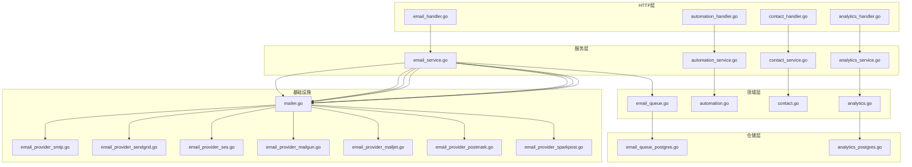
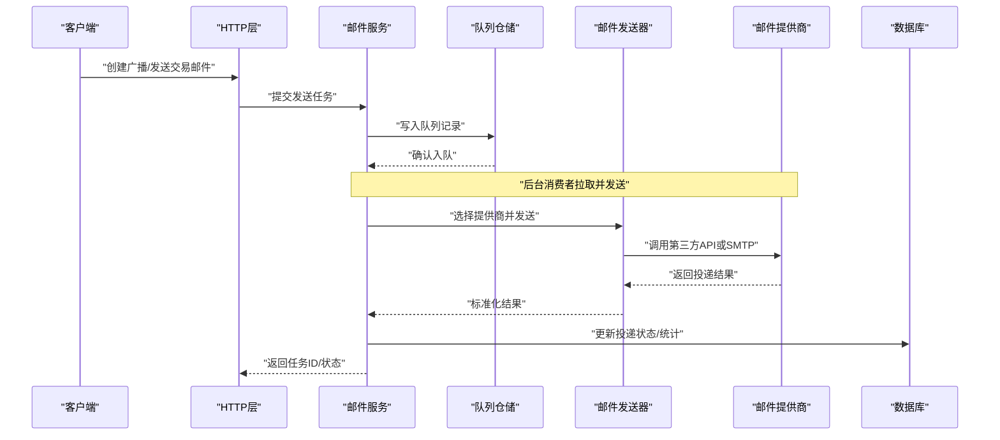
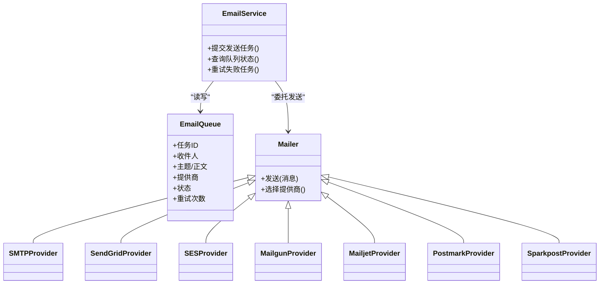
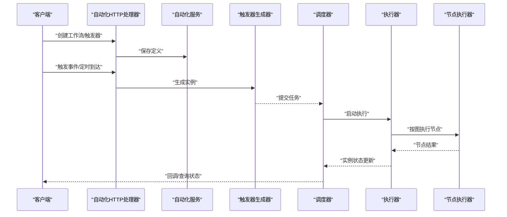
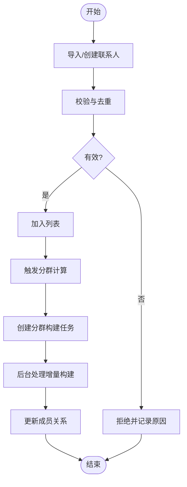
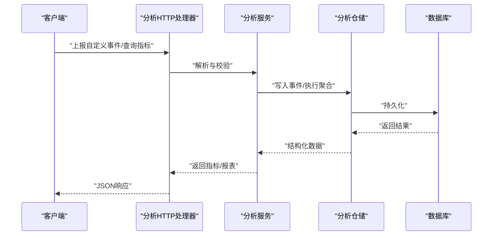
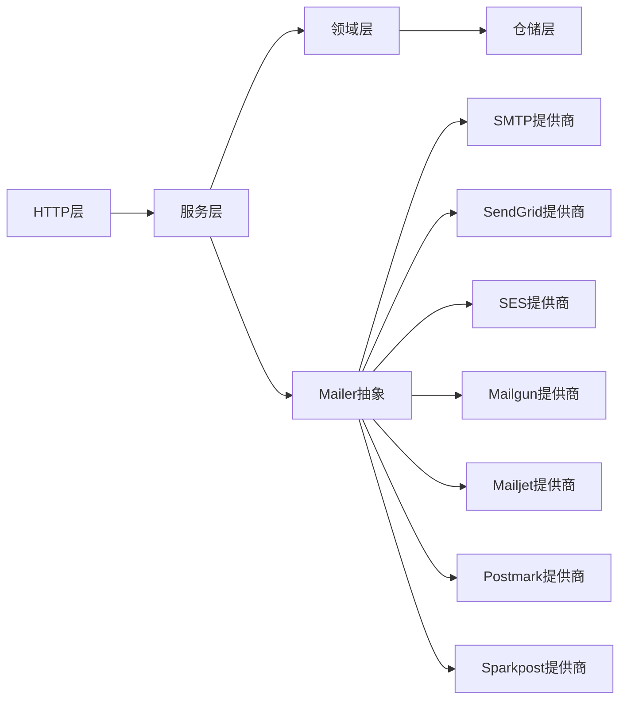

# 核心功能模块

<cite>
**本文引用的文件**   
- [cmd/api/main.go](file://notifuse/cmd/api/main.go)
- [internal/app/app.go](file://notifuse/internal/app/app.go)
- [config/config.go](file://notifuse/config/config.go)
- [internal/database/init.go](file://notifuse/internal/database/init.go)
- [internal/http/email_handler.go](file://notifuse/internal/http/email_handler.go)
- [internal/service/email_service.go](file://notifuse/internal/service/email_service.go)
- [internal/domain/email_queue.go](file://notifuse/internal/domain/email_queue.go)
- [internal/repository/email_queue_postgres.go](file://notifuse/internal/repository/email_queue_postgres.go)
- [pkg/mailer/mailer.go](file://notifuse/pkg/mailer/mailer.go)
- [internal/domain/email_provider_smtp.go](file://notifuse/internal/domain/email_provider_smtp.go)
- [internal/domain/email_provider_sendgrid.go](file://notifuse/internal/domain/email_provider_sendgrid.go)
- [internal/domain/email_provider_ses.go](file://notifuse/internal/domain/email_provider_ses.go)
- [internal/domain/email_provider_mailgun.go](file://notifuse/internal/domain/email_provider_mailgun.go)
- [internal/domain/email_provider_mailjet.go](file://notifuse/internal/domain/email_provider_mailjet.go)
- [internal/domain/email_provider_postmark.go](file://notifuse/internal/domain/email_provider_postmark.go)
- [internal/domain/email_provider_sparkpost.go](file://notifuse/internal/domain/email_provider_sparkpost.go)
- [internal/service/automation_service.go](file://notifuse/internal/service/automation_service.go)
- [internal/service/automation_executor.go](file://notifuse/internal/service/automation_executor.go)
- [internal/service/automation_scheduler.go](file://notifuse/internal/service/automation_scheduler.go)
- [internal/service/automation_node_executor.go](file://notifuse/internal/service/automation_node_executor.go)
- [internal/service/automation_trigger_generator.go](file://notifuse/internal/service/automation_trigger_generator.go)
- [internal/domain/automation.go](file://notifuse/internal/domain/automation.go)
- [internal/http/automation_handler.go](file://notifuse/internal/http/automation_handler.go)
- [internal/service/contact_service.go](file://notifuse/internal/service/contact_service.go)
- [internal/service/contact_list_service.go](file://notifuse/internal/service/contact_list_service.go)
- [internal/service/segment_service.go](file://notifuse/internal/service/segment_service.go)
- [internal/service/contact_segment_queue_processor.go](file://notifuse/internal/service/contact_segment_queue_processor.go)
- [internal/service/contact_segment_queue_task_processor.go](file://notifuse/internal/service/contact_segment_queue_task_processor.go)
- [internal/domain/contact.go](file://notifuse/internal/domain/contact.go)
- [internal/domain/contact_list.go](file://notifuse/internal/domain/contact_list.go)
- [internal/domain/segment.go](file://notifuse/internal/domain/segment.go)
- [internal/http/contact_handler.go](file://notifuse/internal/http/contact_handler.go)
- [internal/http/contact_list_handler.go](file://notifuse/internal/http/contact_list_handler.go)
- [internal/http/segment_handler.go](file://notifuse/internal/http/segment_handler.go)
- [internal/service/analytics_service.go](file://notifuse/internal/service/analytics_service.go)
- [internal/domain/analytics.go](file://notifuse/internal/domain/analytics.go)
- [internal/repository/analytics_postgres.go](file://notifuse/internal/repository/analytics_postgres.go)
- [internal/http/analytics_handler.go](file://notifuse/internal/http/analytics_handler.go)
- [openapi/openapi.yaml](file://notifuse/openapi/openapi.yaml)
- [openapi/paths/contacts.yaml](file://notifuse/openapi/paths/contacts.yaml)
- [openapi/paths/broadcasts.yaml](file://notifuse/openapi/paths/broadcasts.yaml)
- [openapi/paths/templates.yaml](file://notifuse/openapi/paths/templates.yaml)
- [openapi/paths/custom-events.yaml](file://notifuse/openapi/paths/custom-events.yaml)
- [openapi/paths/webhook-subscriptions.yaml](file://notifuse/openapi/paths/webhook-subscriptions.yaml)
- [openapi/components/security.yaml](file://notifuse/openapi/components/security.yaml)
</cite>

## 目录
1. [简介](#简介)
2. [项目结构](#项目结构)
3. [核心组件](#核心组件)
4. [架构总览](#架构总览)
5. [详细组件分析](#详细组件分析)
6. [依赖关系分析](#依赖关系分析)
7. [性能考虑](#性能考虑)
8. [故障排查指南](#故障排查指南)
9. [结论](#结论)
10. [附录](#附录)

## 简介
本文件面向Notifuse平台的核心功能模块，聚焦邮件营销系统、自动化工作流、联系人管理、数据分析四大模块。文档从设计理念、实现细节、API与配置、数据流转、协作关系、可扩展点与最佳实践等维度进行系统化说明，既为开发者提供深入的技术实现参考，也为用户给出可操作的使用指导。

## 项目结构
Notifuse采用分层与领域驱动相结合的组织方式：
- HTTP层：负责路由、鉴权、请求校验与响应封装
- 服务层：编排业务逻辑、跨域协调、事务边界
- 领域层：定义实体、值对象、领域事件与规则
- 仓储层：对接数据库（PostgreSQL）与外部存储
- 基础设施层：邮件发送、缓存、追踪、模板渲染、速率限制等通用能力
- OpenAPI：对外接口契约与鉴权方案

图表来源
- [cmd/api/main.go:1-200](file://notifuse/cmd/api/main.go#L1-L200)
- [internal/app/app.go:1-200](file://notifuse/internal/app/app.go#L1-L200)
- [internal/http/email_handler.go:1-200](file://notifuse/internal/http/email_handler.go#L1-L200)
- [internal/service/email_service.go:1-200](file://notifuse/internal/service/email_service.go#L1-L200)
- [internal/domain/email_queue.go:1-200](file://notifuse/internal/domain/email_queue.go#L1-L200)
- [internal/repository/email_queue_postgres.go:1-200](file://notifuse/internal/repository/email_queue_postgres.go#L1-L200)
- [pkg/mailer/mailer.go:1-200](file://notifuse/pkg/mailer/mailer.go#L1-L200)
- [internal/domain/email_provider_smtp.go:1-200](file://notifuse/internal/domain/email_provider_smtp.go#L1-L200)
- [internal/domain/email_provider_sendgrid.go:1-200](file://notifuse/internal/domain/email_provider_sendgrid.go#L1-L200)
- [internal/domain/email_provider_ses.go:1-200](file://notifuse/internal/domain/email_provider_ses.go#L1-L200)
- [internal/domain/email_provider_mailgun.go:1-200](file://notifuse/internal/domain/email_provider_mailgun.go#L1-L200)
- [internal/domain/email_provider_mailjet.go:1-200](file://notifuse/internal/domain/email_provider_mailjet.go#L1-L200)
- [internal/domain/email_provider_postmark.go:1-200](file://notifuse/internal/domain/email_provider_postmark.go#L1-L200)
- [internal/domain/email_provider_sparkpost.go:1-200](file://notifuse/internal/domain/email_provider_sparkpost.go#L1-L200)

章节来源
- [cmd/api/main.go:1-200](file://notifuse/cmd/api/main.go#L1-L200)
- [internal/app/app.go:1-200](file://notifuse/internal/app/app.go#L1-L200)
- [config/config.go:1-200](file://notifuse/config/config.go#L1-L200)
- [internal/database/init.go:1-200](file://notifuse/internal/database/init.go#L1-L200)

## 核心组件
- 邮件营销系统：支持多提供商（SMTP、SendGrid、SES、Mailgun、Mailjet、Postmark、SparkPost），具备队列持久化、重试与投递状态回写能力。
- 自动化工作流：基于触发器与节点执行器的流水线模型，支持定时、事件与外部Webhook触发，节点类型可扩展。
- 联系人管理：联系人、列表、分群（Segment）与增量构建任务，支持批量导入、去重与审计时间线。
- 数据分析：事件采集、指标聚合与可视化查询，覆盖打开、点击、退订、投递失败等关键指标。

章节来源
- [internal/service/email_service.go:1-200](file://notifuse/internal/service/email_service.go#L1-L200)
- [internal/service/automation_service.go:1-200](file://notifuse/internal/service/automation_service.go#L1-L200)
- [internal/service/contact_service.go:1-200](file://notifuse/internal/service/contact_service.go#L1-L200)
- [internal/service/analytics_service.go:1-200](file://notifuse/internal/service/analytics_service.go#L1-L200)

## 架构总览
整体采用“HTTP -> Service -> Domain -> Repository”的分层架构，结合领域事件与队列机制实现异步解耦。邮件发送通过统一Mailer抽象适配多家供应商；自动化引擎以调度器+执行器模式运行；联系人分群通过后台任务增量计算；分析服务将事件落库并提供聚合查询。

图表来源
- [internal/http/email_handler.go:1-200](file://notifuse/internal/http/email_handler.go#L1-L200)
- [internal/service/email_service.go:1-200](file://notifuse/internal/service/email_service.go#L1-L200)
- [internal/domain/email_queue.go:1-200](file://notifuse/internal/domain/email_queue.go#L1-L200)
- [internal/repository/email_queue_postgres.go:1-200](file://notifuse/internal/repository/email_queue_postgres.go#L1-L200)
- [pkg/mailer/mailer.go:1-200](file://notifuse/pkg/mailer/mailer.go#L1-L200)
- [internal/domain/email_provider_smtp.go:1-200](file://notifuse/internal/domain/email_provider_smtp.go#L1-L200)
- [internal/domain/email_provider_sendgrid.go:1-200](file://notifuse/internal/domain/email_provider_sendgrid.go#L1-L200)
- [internal/domain/email_provider_ses.go:1-200](file://notifuse/internal/domain/email_provider_ses.go#L1-L200)
- [internal/domain/email_provider_mailgun.go:1-200](file://notifuse/internal/domain/email_provider_mailgun.go#L1-L200)
- [internal/domain/email_provider_mailjet.go:1-200](file://notifuse/internal/domain/email_provider_mailjet.go#L1-L200)
- [internal/domain/email_provider_postmark.go:1-200](file://notifuse/internal/domain/email_provider_postmark.go#L1-L200)
- [internal/domain/email_provider_sparkpost.go:1-200](file://notifuse/internal/domain/email_provider_sparkpost.go#L1-L200)

## 详细组件分析

### 邮件营销系统
- 设计要点
  - 统一Mailer接口屏蔽不同提供商差异，便于扩展新渠道
  - 队列持久化保障可靠性，支持重试与幂等处理
  - 模板渲染与变量替换在发送前完成，确保内容一致性
- 关键流程
  - 创建发送任务 -> 入队 -> 消费者拉取 -> 选择提供商 -> 发送 -> 回调状态 -> 更新统计
- 配置项
  - 全局邮件设置、各提供商密钥与端点、TLS/认证策略、并发与限流参数
- API接口
  - 广播发送、交易型邮件、模板管理、订阅链接等
- 业务规则
  - 退订名单优先检查、重复地址去重、敏感字段脱敏、速率限制与配额控制
- 可扩展点
  - 新增邮件提供商实现统一接口
  - 自定义重试策略与错误分类
  - 模板渲染钩子与内容安全校验

图表来源
- [internal/service/email_service.go:1-200](file://notifuse/internal/service/email_service.go#L1-L200)
- [internal/domain/email_queue.go:1-200](file://notifuse/internal/domain/email_queue.go#L1-L200)
- [pkg/mailer/mailer.go:1-200](file://notifuse/pkg/mailer/mailer.go#L1-L200)
- [internal/domain/email_provider_smtp.go:1-200](file://notifuse/internal/domain/email_provider_smtp.go#L1-L200)
- [internal/domain/email_provider_sendgrid.go:1-200](file://notifuse/internal/domain/email_provider_sendgrid.go#L1-L200)
- [internal/domain/email_provider_ses.go:1-200](file://notifuse/internal/domain/email_provider_ses.go#L1-L200)
- [internal/domain/email_provider_mailgun.go:1-200](file://notifuse/internal/domain/email_provider_mailgun.go#L1-L200)
- [internal/domain/email_provider_mailjet.go:1-200](file://notifuse/internal/domain/email_provider_mailjet.go#L1-L200)
- [internal/domain/email_provider_postmark.go:1-200](file://notifuse/internal/domain/email_provider_postmark.go#L1-L200)
- [internal/domain/email_provider_sparkpost.go:1-200](file://notifuse/internal/domain/email_provider_sparkpost.go#L1-L200)

章节来源
- [internal/http/email_handler.go:1-200](file://notifuse/internal/http/email_handler.go#L1-L200)
- [internal/service/email_service.go:1-200](file://notifuse/internal/service/email_service.go#L1-L200)
- [internal/domain/email_queue.go:1-200](file://notifuse/internal/domain/email_queue.go#L1-L200)
- [internal/repository/email_queue_postgres.go:1-200](file://notifuse/internal/repository/email_queue_postgres.go#L1-L200)
- [pkg/mailer/mailer.go:1-200](file://notifuse/pkg/mailer/mailer.go#L1-L200)
- [openapi/paths/broadcasts.yaml:1-200](file://notifuse/openapi/paths/broadcasts.yaml#L1-L200)
- [openapi/paths/templates.yaml:1-200](file://notifuse/openapi/paths/templates.yaml#L1-L200)

### 自动化工作流
- 设计要点
  - 触发器生成器负责识别事件与时机，调度器负责任务排程与生命周期管理
  - 执行器按节点图顺序执行，支持条件分支、并行与错误恢复
  - 节点类型可扩展，如发送邮件、延迟、等待事件、调用Webhook等
- 关键流程
  - 注册工作流 -> 监听触发器 -> 生成实例 -> 调度执行 -> 节点执行 -> 状态同步
- 配置项
  - 工作流定义、触发器规则、节点参数、超时与重试策略
- API接口
  - 工作流CRUD、实例管理、触发器配置、执行历史查询
- 业务规则
  - 防抖与去重、上下文隔离、幂等执行、审计日志
- 可扩展点
  - 新增节点类型与触发器类型
  - 自定义执行上下文与中间件

图表来源
- [internal/http/automation_handler.go:1-200](file://notifuse/internal/http/automation_handler.go#L1-L200)
- [internal/service/automation_service.go:1-200](file://notifuse/internal/service/automation_service.go#L1-L200)
- [internal/service/automation_trigger_generator.go:1-200](file://notifuse/internal/service/automation_trigger_generator.go#L1-L200)
- [internal/service/automation_scheduler.go:1-200](file://notifuse/internal/service/automation_scheduler.go#L1-L200)
- [internal/service/automation_executor.go:1-200](file://notifuse/internal/service/automation_executor.go#L1-L200)
- [internal/service/automation_node_executor.go:1-200](file://notifuse/internal/service/automation_node_executor.go#L1-L200)
- [internal/domain/automation.go:1-200](file://notifuse/internal/domain/automation.go#L1-L200)

章节来源
- [internal/service/automation_service.go:1-200](file://notifuse/internal/service/automation_service.go#L1-L200)
- [internal/service/automation_executor.go:1-200](file://notifuse/internal/service/automation_executor.go#L1-L200)
- [internal/service/automation_scheduler.go:1-200](file://notifuse/internal/service/automation_scheduler.go#L1-L200)
- [internal/service/automation_node_executor.go:1-200](file://notifuse/internal/service/automation_node_executor.go#L1-L200)
- [internal/service/automation_trigger_generator.go:1-200](file://notifuse/internal/service/automation_trigger_generator.go#L1-L200)
- [internal/domain/automation.go:1-200](file://notifuse/internal/domain/automation.go#L1-L200)
- [internal/http/automation_handler.go:1-200](file://notifuse/internal/http/automation_handler.go#L1-L200)

### 联系人管理
- 设计要点
  - 联系人、列表与分群三层模型，支持标签、属性与时间线审计
  - 分群任务增量构建，避免全量扫描带来的性能压力
  - 批量导入与去重策略保证数据质量
- 关键流程
  - 导入/创建联系人 -> 加入列表 -> 分群计算 -> 任务队列 -> 结果落库
- 配置项
  - 导入格式、去重键、分群规则、任务批大小与并发度
- API接口
  - 联系人CRUD、列表管理、分群管理、时间线查询
- 业务规则
  - 邮箱有效性校验、退订状态优先、权限与工作区隔离
- 可扩展点
  - 自定义分群表达式与字段类型
  - 导入适配器与清洗插件

图表来源
- [internal/service/contact_service.go:1-200](file://notifuse/internal/service/contact_service.go#L1-L200)
- [internal/service/contact_list_service.go:1-200](file://notifuse/internal/service/contact_list_service.go#L1-L200)
- [internal/service/segment_service.go:1-200](file://notifuse/internal/service/segment_service.go#L1-L200)
- [internal/service/contact_segment_queue_processor.go:1-200](file://notifuse/internal/service/contact_segment_queue_processor.go#L1-L200)
- [internal/service/contact_segment_queue_task_processor.go:1-200](file://notifuse/internal/service/contact_segment_queue_task_processor.go#L1-L200)
- [internal/domain/contact.go:1-200](file://notifuse/internal/domain/contact.go#L1-L200)
- [internal/domain/contact_list.go:1-200](file://notifuse/internal/domain/contact_list.go#L1-L200)
- [internal/domain/segment.go:1-200](file://notifuse/internal/domain/segment.go#L1-L200)
- [internal/http/contact_handler.go:1-200](file://notifuse/internal/http/contact_handler.go#L1-L200)
- [internal/http/contact_list_handler.go:1-200](file://notifuse/internal/http/contact_list_handler.go#L1-L200)
- [internal/http/segment_handler.go:1-200](file://notifuse/internal/http/segment_handler.go#L1-L200)

章节来源
- [internal/service/contact_service.go:1-200](file://notifuse/internal/service/contact_service.go#L1-L200)
- [internal/service/contact_list_service.go:1-200](file://notifuse/internal/service/contact_list_service.go#L1-L200)
- [internal/service/segment_service.go:1-200](file://notifuse/internal/service/segment_service.go#L1-L200)
- [internal/service/contact_segment_queue_processor.go:1-200](file://notifuse/internal/service/contact_segment_queue_processor.go#L1-L200)
- [internal/service/contact_segment_queue_task_processor.go:1-200](file://notifuse/internal/service/contact_segment_queue_task_processor.go#L1-L200)
- [internal/domain/contact.go:1-200](file://notifuse/internal/domain/contact.go#L1-L200)
- [internal/domain/contact_list.go:1-200](file://notifuse/internal/domain/contact_list.go#L1-L200)
- [internal/domain/segment.go:1-200](file://notifuse/internal/domain/segment.go#L1-L200)
- [internal/http/contact_handler.go:1-200](file://notifuse/internal/http/contact_handler.go#L1-L200)
- [internal/http/contact_list_handler.go:1-200](file://notifuse/internal/http/contact_list_handler.go#L1-L200)
- [internal/http/segment_handler.go:1-200](file://notifuse/internal/http/segment_handler.go#L1-L200)

### 数据分析
- 设计要点
  - 事件驱动的数据采集，指标聚合与多维查询
  - 支持自定义事件与标准事件（打开、点击、退订、投递失败等）
  - 高性能SQL构建与分页查询
- 关键流程
  - 事件上报 -> 入库 -> 聚合计算 -> 查询接口返回
- 配置项
  - 事件命名规范、保留周期、聚合粒度与索引策略
- API接口
  - 自定义事件上报、指标查询、报表导出
- 业务规则
  - 事件去重、时区归一化、隐私合规与最小化采集
- 可扩展点
  - 新增指标维度与聚合函数
  - 接入外部BI/数据仓库

图表来源
- [internal/http/analytics_handler.go:1-200](file://notifuse/internal/http/analytics_handler.go#L1-L200)
- [internal/service/analytics_service.go:1-200](file://notifuse/internal/service/analytics_service.go#L1-L200)
- [internal/domain/analytics.go:1-200](file://notifuse/internal/domain/analytics.go#L1-L200)
- [internal/repository/analytics_postgres.go:1-200](file://notifuse/internal/repository/analytics_postgres.go#L1-L200)
- [openapi/paths/custom-events.yaml:1-200](file://notifuse/openapi/paths/custom-events.yaml#L1-L200)

章节来源
- [internal/service/analytics_service.go:1-200](file://notifuse/internal/service/analytics_service.go#L1-L200)
- [internal/domain/analytics.go:1-200](file://notifuse/internal/domain/analytics.go#L1-L200)
- [internal/repository/analytics_postgres.go:1-200](file://notifuse/internal/repository/analytics_postgres.go#L1-L200)
- [internal/http/analytics_handler.go:1-200](file://notifuse/internal/http/analytics_handler.go#L1-L200)
- [openapi/paths/custom-events.yaml:1-200](file://notifuse/openapi/paths/custom-events.yaml#L1-L200)

## 依赖关系分析
- 组件耦合
  - HTTP层仅依赖服务层接口，降低与具体实现的耦合
  - 服务层对领域模型强依赖，仓储层对数据库实现强依赖
  - 邮件发送通过统一Mailer抽象，屏蔽提供商差异
- 外部依赖
  - PostgreSQL作为主数据存储
  - 多家邮件提供商API或SMTP协议
  - 可选的缓存与追踪基础设施
- 潜在循环依赖
  - 通过接口与事件解耦避免循环引用
- 接口契约
  - OpenAPI定义对外接口与安全方案

图表来源
- [internal/http/email_handler.go:1-200](file://notifuse/internal/http/email_handler.go#L1-L200)
- [internal/service/email_service.go:1-200](file://notifuse/internal/service/email_service.go#L1-L200)
- [pkg/mailer/mailer.go:1-200](file://notifuse/pkg/mailer/mailer.go#L1-L200)
- [internal/domain/email_provider_smtp.go:1-200](file://notifuse/internal/domain/email_provider_smtp.go#L1-L200)
- [internal/domain/email_provider_sendgrid.go:1-200](file://notifuse/internal/domain/email_provider_sendgrid.go#L1-L200)
- [internal/domain/email_provider_ses.go:1-200](file://notifuse/internal/domain/email_provider_ses.go#L1-L200)
- [internal/domain/email_provider_mailgun.go:1-200](file://notifuse/internal/domain/email_provider_mailgun.go#L1-L200)
- [internal/domain/email_provider_mailjet.go:1-200](file://notifuse/internal/domain/email_provider_mailjet.go#L1-L200)
- [internal/domain/email_provider_postmark.go:1-200](file://notifuse/internal/domain/email_provider_postmark.go#L1-L200)
- [internal/domain/email_provider_sparkpost.go:1-200](file://notifuse/internal/domain/email_provider_sparkpost.go#L1-L200)

章节来源
- [openapi/openapi.yaml:1-200](file://notifuse/openapi/openapi.yaml#L1-L200)
- [openapi/components/security.yaml:1-200](file://notifuse/openapi/components/security.yaml#L1-L200)

## 性能考虑
- 邮件发送
  - 使用队列与消费者池提升吞吐，合理设置并发与重试间隔
  - 针对大附件与富媒体内容进行压缩与CDN加速
- 自动化执行
  - 节点执行采用有界并发与背压，防止雪崩
  - 长耗时节点拆分与异步化
- 联系人分群
  - 增量构建与窗口扫描，避免全表扫描
  - 索引优化与分批处理
- 数据分析
  - 预聚合与物化视图，减少实时计算压力
  - 查询分页与过滤条件前置

## 故障排查指南
- 常见问题
  - 邮件投递失败：检查提供商密钥、网络连通性与TLS配置
  - 自动化卡住：查看调度器日志与节点执行状态
  - 联系人分群缓慢：评估分群规则复杂度与索引命中
  - 指标缺失：确认事件上报链路是否完整
- 定位方法
  - 启用追踪与结构化日志，关联任务ID与实例ID
  - 检查队列积压与消费者健康状态
  - 核对OpenAPI鉴权与签名验证

章节来源
- [internal/service/email_service.go:1-200](file://notifuse/internal/service/email_service.go#L1-L200)
- [internal/service/automation_scheduler.go:1-200](file://notifuse/internal/service/automation_scheduler.go#L1-L200)
- [internal/service/contact_segment_queue_processor.go:1-200](file://notifuse/internal/service/contact_segment_queue_processor.go#L1-L200)
- [internal/service/analytics_service.go:1-200](file://notifuse/internal/service/analytics_service.go#L1-L200)

## 结论
Notifuse通过清晰的分层与领域建模，实现了高内聚、低耦合的核心能力。邮件营销、自动化、联系人管理与数据分析四大模块协同工作，形成完整的营销闭环。系统具备良好的可扩展性与运维友好性，适合持续演进与规模化部署。

## 附录
- 配置与环境
  - 全局配置入口与数据库初始化
- 使用示例路径
  - 邮件发送：[internal/http/email_handler.go](file://notifuse/internal/http/email_handler.go)
  - 自动化工作流：[internal/http/automation_handler.go](file://notifuse/internal/http/automation_handler.go)
  - 联系人管理：[internal/http/contact_handler.go](file://notifuse/internal/http/contact_handler.go)
  - 数据分析：[internal/http/analytics_handler.go](file://notifuse/internal/http/analytics_handler.go)
- API契约
  - 总入口：[openapi/openapi.yaml](file://notifuse/openapi/openapi.yaml)
  - 联系人：[openapi/paths/contacts.yaml](file://notifuse/openapi/paths/contacts.yaml)
  - 广播：[openapi/paths/broadcasts.yaml](file://notifuse/openapi/paths/broadcasts.yaml)
  - 模板：[openapi/paths/templates.yaml](file://notifuse/openapi/paths/templates.yaml)
  - 自定义事件：[openapi/paths/custom-events.yaml](file://notifuse/openapi/paths/custom-events.yaml)
  - Webhook订阅：[openapi/paths/webhook-subscriptions.yaml](file://notifuse/openapi/paths/webhook-subscriptions.yaml)
  - 安全方案：[openapi/components/security.yaml](file://notifuse/openapi/components/security.yaml)

章节来源
- [config/config.go:1-200](file://notifuse/config/config.go#L1-L200)
- [internal/database/init.go:1-200](file://notifuse/internal/database/init.go#L1-L200)
- [openapi/openapi.yaml:1-200](file://notifuse/openapi/openapi.yaml#L1-L200)
- [openapi/paths/contacts.yaml:1-200](file://notifuse/openapi/paths/contacts.yaml#L1-L200)
- [openapi/paths/broadcasts.yaml:1-200](file://notifuse/openapi/paths/broadcasts.yaml#L1-L200)
- [openapi/paths/templates.yaml:1-200](file://notifuse/openapi/paths/templates.yaml#L1-L200)
- [openapi/paths/custom-events.yaml:1-200](file://notifuse/openapi/paths/custom-events.yaml#L1-L200)
- [openapi/paths/webhook-subscriptions.yaml:1-200](file://notifuse/openapi/paths/webhook-subscriptions.yaml#L1-L200)
- [openapi/components/security.yaml:1-200](file://notifuse/openapi/components/security.yaml#L1-L200)