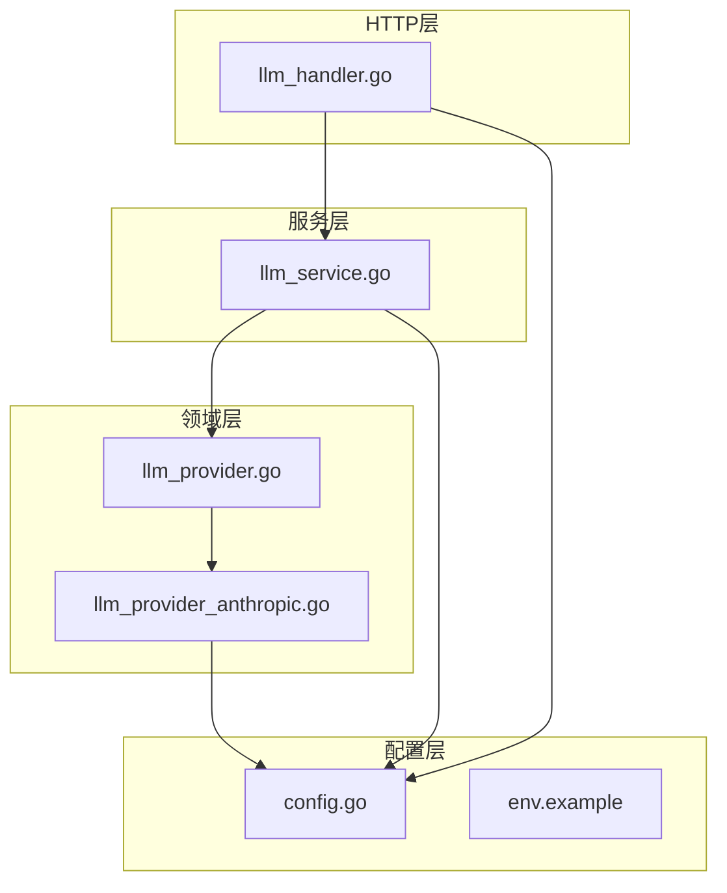
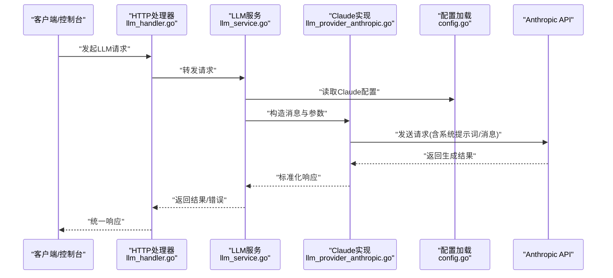
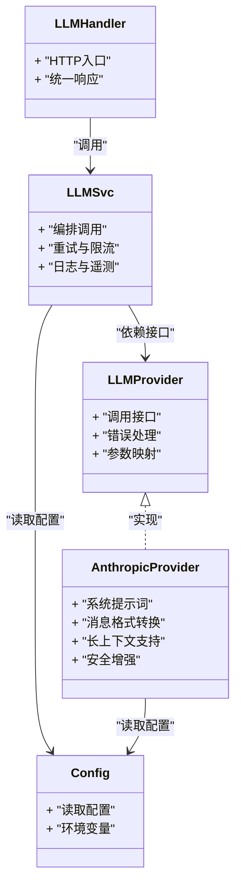

# Anthropic集成

<cite>
**本文引用的文件**   
- [llm_provider_anthropic.go](file://notifuse/internal/domain/llm_provider_anthropic.go)
- [llm_provider_anthropic_test.go](file://notifuse/internal/domain/llm_provider_anthropic_test.go)
- [llm_provider.go](file://notifuse/internal/domain/llm_provider.go)
- [llm_service.go](file://notifuse/internal/service/llm_service.go)
- [llm_handler.go](file://notifuse/internal/http/llm_handler.go)
- [config.go](file://notifuse/config/config.go)
- [env.example](file://notifuse/env.example)
</cite>

## 目录
1. [简介](#简介)
2. [项目结构](#项目结构)
3. [核心组件](#核心组件)
4. [架构总览](#架构总览)
5. [详细组件分析](#详细组件分析)
6. [依赖关系分析](#依赖关系分析)
7. [性能与速率限制](#性能与速率限制)
8. [故障排查指南](#故障排查指南)
9. [结论](#结论)
10. [附录：配置与使用示例](#附录配置与使用示例)

## 简介
本文件面向Notifuse平台中Anthropic Claude集成的实现与使用，覆盖以下主题：
- Claude API的配置方法（API密钥、账户相关设置）
- Claude模型特性（长上下文支持、安全性增强）
- 与标准OpenAI兼容的调用方式（消息格式、参数映射）
- Claude特有功能（系统提示词、输出格式控制）
- 邮件营销场景下的内容创作示例
- 错误处理、速率限制与安全考虑的实现细节

## 项目结构
与Anthropic Claude集成相关的代码主要分布在领域层与服务层：
- 领域层：定义LLM提供者接口及Claude具体实现
- 服务层：编排LLM调用流程
- HTTP层：暴露统一的LLM能力接口
- 配置层：加载环境变量与平台配置

图表来源
- [llm_handler.go](file://notifuse/internal/http/llm_handler.go)
- [llm_service.go](file://notifuse/internal/service/llm_service.go)
- [llm_provider.go](file://notifuse/internal/domain/llm_provider.go)
- [llm_provider_anthropic.go](file://notifuse/internal/domain/llm_provider_anthropic.go)
- [config.go](file://notifuse/config/config.go)
- [env.example](file://notifuse/env.example)

章节来源
- [llm_handler.go](file://notifuse/internal/http/llm_handler.go)
- [llm_service.go](file://notifuse/internal/service/llm_service.go)
- [llm_provider.go](file://notifuse/internal/domain/llm_provider.go)
- [llm_provider_anthropic.go](file://notifuse/internal/domain/llm_provider_anthropic.go)
- [config.go](file://notifuse/config/config.go)
- [env.example](file://notifuse/env.example)

## 核心组件
- 统一LLM提供者接口：抽象不同大模型的调用方式，屏蔽底层差异
- Anthropic Claude实现：负责将内部消息模型转换为Claude API请求，并解析响应
- LLM服务：编排调用流程，包括重试、限流、日志与错误转换
- HTTP处理器：对外暴露统一的LLM能力接口，供业务模块或控制台调用
- 配置加载：从环境变量与配置文件读取Claude相关参数

章节来源
- [llm_provider.go](file://notifuse/internal/domain/llm_provider.go)
- [llm_provider_anthropic.go](file://notifuse/internal/domain/llm_provider_anthropic.go)
- [llm_service.go](file://notifuse/internal/service/llm_service.go)
- [llm_handler.go](file://notifuse/internal/http/llm_handler.go)
- [config.go](file://notifuse/config/config.go)

## 架构总览
下图展示了从HTTP入口到Claude API的完整调用链，以及关键的数据流转。

图表来源
- [llm_handler.go](file://notifuse/internal/http/llm_handler.go)
- [llm_service.go](file://notifuse/internal/service/llm_service.go)
- [llm_provider_anthropic.go](file://notifuse/internal/domain/llm_provider_anthropic.go)
- [config.go](file://notifuse/config/config.go)

## 详细组件分析

### 统一LLM提供者接口
- 职责：定义跨供应商的统一调用契约，包含消息列表、模型选择、参数映射等
- 设计要点：
  - 以“消息”为核心抽象，屏蔽各供应商差异
  - 提供标准化的错误类型与返回值
  - 便于扩展新的LLM供应商

章节来源
- [llm_provider.go](file://notifuse/internal/domain/llm_provider.go)

### Anthropic Claude实现
- 职责：将内部消息模型转换为Claude API请求，并解析响应
- 关键能力：
  - 系统提示词：通过专用字段注入系统级指令
  - 消息格式：将内部消息序列映射为Claude的消息数组
  - 参数映射：温度、最大令牌数、停止条件等
  - 安全增强：遵循Claude的安全策略与合规要求
  - 长上下文：利用Claude的长上下文窗口能力，适合长文档与复杂任务
- 错误处理：
  - 网络错误、鉴权失败、配额超限、输入校验错误等
  - 将供应商错误转换为平台统一错误类型
- 速率限制：
  - 结合服务层的限流器进行请求节流
  - 对429/5xx等状态码进行退避重试

章节来源
- [llm_provider_anthropic.go](file://notifuse/internal/domain/llm_provider_anthropic.go)
- [llm_provider_anthropic_test.go](file://notifuse/internal/domain/llm_provider_anthropic_test.go)

### LLM服务编排
- 职责：协调HTTP处理器与LLM提供者，完成完整的调用生命周期
- 关键流程：
  - 参数校验与默认值填充
  - 读取配置（如模型、密钥、超时、重试次数）
  - 调用提供者并处理响应
  - 记录日志与遥测数据
  - 错误分类与重试策略
- 与限流器集成：
  - 在并发高时自动降级或排队
  - 避免触发供应商侧的速率限制

章节来源
- [llm_service.go](file://notifuse/internal/service/llm_service.go)

### HTTP处理器
- 职责：暴露统一的LLM能力接口，接收请求并返回响应
- 关键点：
  - 统一请求/响应格式
  - 鉴权与权限检查（由上层中间件保障）
  - 错误码规范化

章节来源
- [llm_handler.go](file://notifuse/internal/http/llm_handler.go)

### 配置与环境变量
- 职责：集中管理Claude相关配置项
- 常见配置项：
  - API密钥
  - 基础URL（可选）
  - 默认模型名称
  - 超时与重试参数
- 建议：
  - 通过环境变量注入敏感信息
  - 在生产环境使用安全的配置中心

章节来源
- [config.go](file://notifuse/config/config.go)
- [env.example](file://notifuse/env.example)

## 依赖关系分析
- 耦合关系：
  - HTTP处理器依赖服务层
  - 服务层依赖领域层提供者接口
  - Claude实现依赖配置层
- 可扩展性：
  - 新增其他LLM供应商只需实现统一接口
  - 服务层无需改动即可接入新供应商

图表来源
- [llm_provider.go](file://notifuse/internal/domain/llm_provider.go)
- [llm_provider_anthropic.go](file://notifuse/internal/domain/llm_provider_anthropic.go)
- [llm_service.go](file://notifuse/internal/service/llm_service.go)
- [llm_handler.go](file://notifuse/internal/http/llm_handler.go)
- [config.go](file://notifuse/config/config.go)

章节来源
- [llm_provider.go](file://notifuse/internal/domain/llm_provider.go)
- [llm_provider_anthropic.go](file://notifuse/internal/domain/llm_provider_anthropic.go)
- [llm_service.go](file://notifuse/internal/service/llm_service.go)
- [llm_handler.go](file://notifuse/internal/http/llm_handler.go)
- [config.go](file://notifuse/config/config.go)

## 性能与速率限制
- 速率限制策略：
  - 服务端限流：基于令牌桶或滑动窗口，防止突发流量
  - 供应商侧限制：对429/5xx进行指数退避重试
- 并发控制：
  - 限制并发调用数量，避免资源耗尽
  - 队列化等待，保证稳定性
- 缓存与复用：
  - 对相同请求可考虑短期缓存（需评估一致性）
  - 连接池与HTTP客户端复用
- 监控与告警：
  - 记录延迟、错误率、配额使用情况
  - 阈值告警与自动降级

[本节为通用指导，不直接分析具体文件]

## 故障排查指南
- 常见问题定位：
  - 鉴权失败：检查API密钥是否正确、是否过期
  - 配额超限：查看供应商控制台配额与用量
  - 输入过长：缩短消息或拆分请求
  - 超时：调整超时参数或优化网络
- 错误分类与处理：
  - 网络错误：重试与退避
  - 业务错误：提示用户修正输入
  - 系统错误：记录日志并告警
- 调试手段：
  - 开启详细日志
  - 捕获请求/响应摘要（脱敏）
  - 使用测试用例复现问题

章节来源
- [llm_provider_anthropic_test.go](file://notifuse/internal/domain/llm_provider_anthropic_test.go)

## 结论
Notifuse平台的Anthropic Claude集成通过统一的LLM提供者接口实现了良好的可扩展性与可维护性。Claude的长上下文与安全性增强使其非常适合复杂的邮件营销内容创作任务。配合完善的错误处理、速率限制与安全配置，可在生产环境中稳定运行。

[本节为总结性内容，不直接分析具体文件]

## 附录：配置与使用示例

### 配置方法
- 环境变量：
  - 设置Claude API密钥
  - 可选：基础URL、默认模型、超时与重试参数
- 配置文件：
  - 将敏感信息放入环境变量，非敏感配置写入配置文件
- 验证配置：
  - 启动后检查日志确认配置加载成功

章节来源
- [config.go](file://notifuse/config/config.go)
- [env.example](file://notifuse/env.example)

### 与OpenAI兼容的调用方式
- 消息格式：
  - 使用内部消息模型，按角色（系统、用户、助手）组织
- 参数映射：
  - 温度、最大令牌数、停止条件等映射到Claude对应参数
- 系统提示词：
  - 通过系统角色注入全局行为约束
- 输出格式控制：
  - 通过提示词与参数组合控制JSON/结构化输出

章节来源
- [llm_provider_anthropic.go](file://notifuse/internal/domain/llm_provider_anthropic.go)
- [llm_provider.go](file://notifuse/internal/domain/llm_provider.go)

### 邮件营销场景示例
- 目标：根据产品卖点与受众画像生成个性化邮件文案
- 步骤：
  - 准备系统提示词（品牌风格、合规要求）
  - 组装用户消息（产品信息、受众特征、语气偏好）
  - 设置参数（温度、最大长度、停止条件）
  - 调用LLM服务并解析响应
  - 渲染模板并发送
- 注意事项：
  - 控制输入长度，避免超出上下文窗口
  - 对敏感信息进行脱敏
  - 记录生成内容与版本以便审计

章节来源
- [llm_service.go](file://notifuse/internal/service/llm_service.go)
- [llm_handler.go](file://notifuse/internal/http/llm_handler.go)
- [llm_provider_anthropic.go](file://notifuse/internal/domain/llm_provider_anthropic.go)