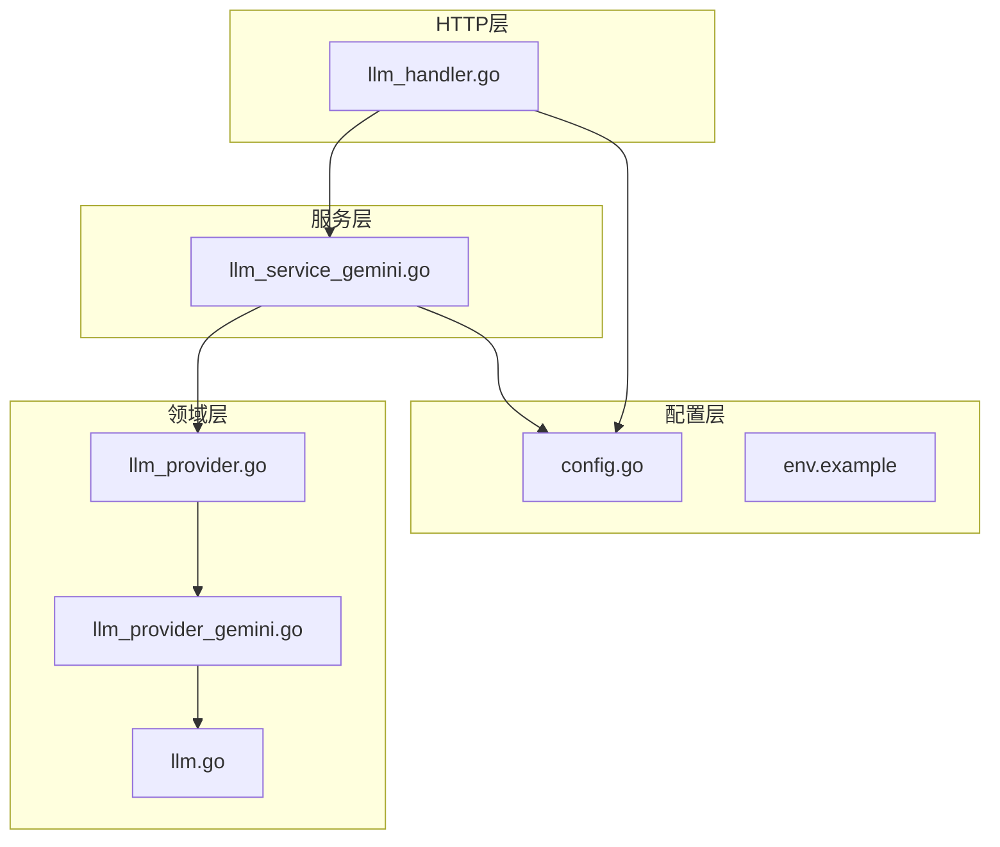
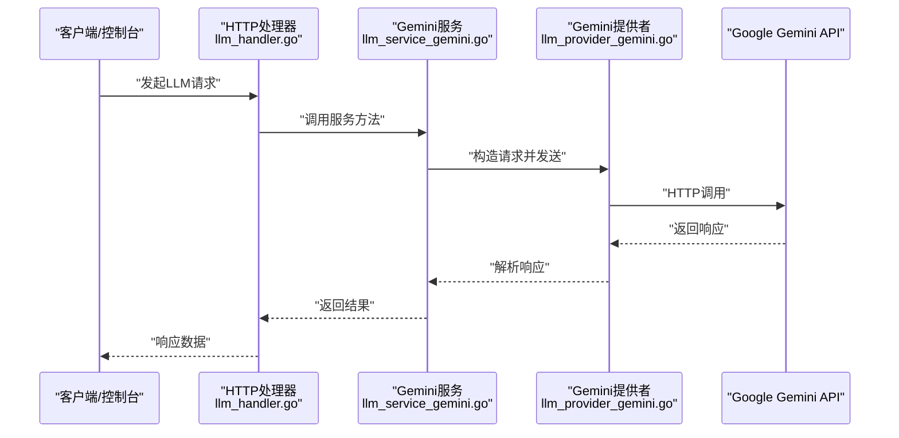
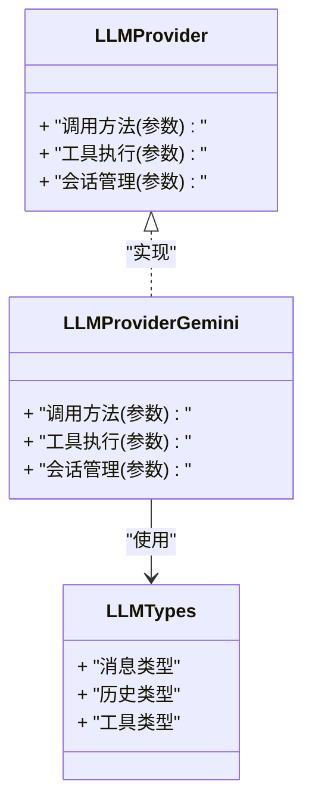
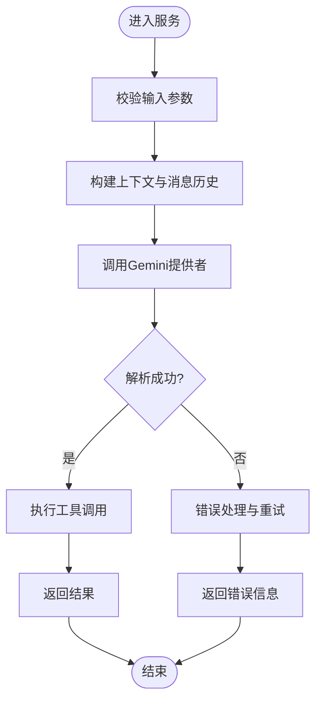
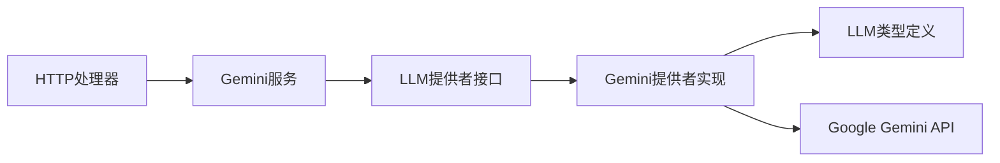

# Gemini集成

<cite>
**本文引用的文件**   
- [llm_provider_gemini.go](file://notifuse/internal/domain/llm_provider_gemini.go)
- [llm_provider_gemini_test.go](file://notifuse/internal/domain/llm_provider_gemini_test.go)
- [llm_service_gemini.go](file://notifuse/internal/service/llm_service_gemini.go)
- [llm_service_gemini_test.go](file://notifuse/internal/service/llm_service_gemini_test.go)
- [llm.go](file://notifuse/internal/domain/llm.go)
- [llm_provider.go](file://notifuse/internal/domain/llm_provider.go)
- [llm_handler.go](file://notifuse/internal/http/llm_handler.go)
- [config.go](file://notifuse/config/config.go)
- [env.example](file://notifuse/env.example)
</cite>

## 目录
1. [简介](#简介)
2. [项目结构](#项目结构)
3. [核心组件](#核心组件)
4. [架构总览](#架构总览)
5. [详细组件分析](#详细组件分析)
6. [依赖关系分析](#依赖关系分析)
7. [性能考虑](#性能考虑)
8. [故障排查指南](#故障排查指南)
9. [结论](#结论)
10. [附录](#附录)

## 简介
本文件面向Notifuse平台的Google Gemini集成，提供从配置到调用的完整说明。内容涵盖：
- API密钥获取、项目设置与权限配置
- Gemini模型特性（多模态、上下文窗口）
- 与OpenAI的差异（请求格式、响应结构）
- 思维链推理与多轮对话管理
- 在自动化工作流中的使用示例
- 性能优化建议与最佳实践

## 项目结构
Notifuse中与Gemini相关的代码主要分布在以下模块：
- 领域层：定义LLM提供者接口与Gemini实现
- 服务层：封装对Gemini的调用流程与工具执行
- HTTP层：暴露LLM相关API供控制台或外部系统调用
- 配置层：集中管理环境变量与平台配置

图表来源
- [llm_handler.go](file://notifuse/internal/http/llm_handler.go)
- [llm_service_gemini.go](file://notifuse/internal/service/llm_service_gemini.go)
- [llm_provider.go](file://notifuse/internal/domain/llm_provider.go)
- [llm_provider_gemini.go](file://notifuse/internal/domain/llm_provider_gemini.go)
- [llm.go](file://notifuse/internal/domain/llm.go)
- [config.go](file://notifuse/config/config.go)
- [env.example](file://notifuse/env.example)

章节来源
- [llm_handler.go](file://notifuse/internal/http/llm_handler.go)
- [llm_service_gemini.go](file://notifuse/internal/service/llm_service_gemini.go)
- [llm_provider.go](file://notifuse/internal/domain/llm_provider.go)
- [llm_provider_gemini.go](file://notifuse/internal/domain/llm_provider_gemini.go)
- [llm.go](file://notifuse/internal/domain/llm.go)
- [config.go](file://notifuse/config/config.go)
- [env.example](file://notifuse/env.example)

## 核心组件
- 领域接口与类型
  - 统一LLM提供者接口，屏蔽不同后端差异
  - 通用消息、历史、工具等类型定义
- Gemini提供者实现
  - 负责构建Gemini请求、处理多模态输入、解析响应
- Gemini服务封装
  - 编排调用流程、工具执行、错误处理与重试策略
- HTTP处理器
  - 暴露REST端点，接收前端或外部系统的LLM调用请求
- 配置与环境变量
  - 读取并校验Gemini相关配置项

章节来源
- [llm_provider.go](file://notifuse/internal/domain/llm_provider.go)
- [llm_provider_gemini.go](file://notifuse/internal/domain/llm_provider_gemini.go)
- [llm_service_gemini.go](file://notifuse/internal/service/llm_service_gemini.go)
- [llm_handler.go](file://notifuse/internal/http/llm_handler.go)
- [llm.go](file://notifuse/internal/domain/llm.go)
- [config.go](file://notifuse/config/config.go)
- [env.example](file://notifuse/env.example)

## 架构总览
下图展示从HTTP入口到Gemini服务的端到端调用路径，以及工具执行与返回结果的处理流程。

图表来源
- [llm_handler.go](file://notifuse/internal/http/llm_handler.go)
- [llm_service_gemini.go](file://notifuse/internal/service/llm_service_gemini.go)
- [llm_provider_gemini.go](file://notifuse/internal/domain/llm_provider_gemini.go)

## 详细组件分析

### 领域层：LLM提供者接口与类型
- 职责
  - 定义统一的LLM调用抽象，便于扩展新的提供商
  - 定义消息、历史、工具等通用数据结构
- 关键点
  - 接口方法覆盖文本生成、工具调用、会话管理等能力
  - 类型设计支持多模态输入与结构化输出

图表来源
- [llm_provider.go](file://notifuse/internal/domain/llm_provider.go)
- [llm_provider_gemini.go](file://notifuse/internal/domain/llm_provider_gemini.go)
- [llm.go](file://notifuse/internal/domain/llm.go)

章节来源
- [llm_provider.go](file://notifuse/internal/domain/llm_provider.go)
- [llm_provider_gemini.go](file://notifuse/internal/domain/llm_provider_gemini.go)
- [llm.go](file://notifuse/internal/domain/llm.go)

### 服务层：Gemini服务封装
- 职责
  - 编排调用流程：参数校验、上下文组装、工具执行、结果解析
  - 错误处理与重试策略
- 关键点
  - 将领域层的提供者与服务逻辑解耦
  - 支持在调用前后进行日志与遥测埋点

图表来源
- [llm_service_gemini.go](file://notifuse/internal/service/llm_service_gemini.go)
- [llm_provider_gemini.go](file://notifuse/internal/domain/llm_provider_gemini.go)

章节来源
- [llm_service_gemini.go](file://notifuse/internal/service/llm_service_gemini.go)
- [llm_service_gemini_test.go](file://notifuse/internal/service/llm_service_gemini_test.go)

### HTTP层：LLM处理器
- 职责
  - 暴露REST端点，接收并转发LLM请求
  - 统一响应格式与错误码
- 关键点
  - 鉴权与限流中间件可在此层接入
  - 与配置层联动，动态加载提供商参数

章节来源
- [llm_handler.go](file://notifuse/internal/http/llm_handler.go)

### 配置与环境变量
- 职责
  - 集中管理Gemini相关配置项（如API密钥、模型名称、超时等）
  - 提供默认值与校验逻辑
- 关键点
  - 通过环境变量注入敏感信息
  - 支持按工作区或全局范围切换提供商

章节来源
- [config.go](file://notifuse/config/config.go)
- [env.example](file://notifuse/env.example)

## 依赖关系分析
- 耦合度
  - HTTP层仅依赖服务层，服务层依赖领域层，领域层不反向依赖上层
- 外部依赖
  - Google Gemini API作为外部服务，通过HTTP协议交互
- 潜在风险
  - 网络异常与速率限制需在上层进行容错与退避

图表来源
- [llm_handler.go](file://notifuse/internal/http/llm_handler.go)
- [llm_service_gemini.go](file://notifuse/internal/service/llm_service_gemini.go)
- [llm_provider.go](file://notifuse/internal/domain/llm_provider.go)
- [llm_provider_gemini.go](file://notifuse/internal/domain/llm_provider_gemini.go)
- [llm.go](file://notifuse/internal/domain/llm.go)

章节来源
- [llm_handler.go](file://notifuse/internal/http/llm_handler.go)
- [llm_service_gemini.go](file://notifuse/internal/service/llm_service_gemini.go)
- [llm_provider.go](file://notifuse/internal/domain/llm_provider.go)
- [llm_provider_gemini.go](file://notifuse/internal/domain/llm_provider_gemini.go)
- [llm.go](file://notifuse/internal/domain/llm.go)

## 性能考虑
- 连接复用与超时控制
  - 合理设置HTTP连接池与读写超时，避免资源耗尽
- 批量与缓存
  - 对重复查询结果进行缓存；对高频短文本采用批处理
- 流式响应
  - 对于长文本生成，优先使用流式传输以降低首字节延迟
- 并发与限流
  - 结合令牌桶或滑动窗口限流，防止突发流量导致下游拒绝
- 监控与指标
  - 记录调用耗时、错误率与配额使用情况，建立告警阈值

[本节为通用指导，无需特定文件引用]

## 故障排查指南
- 常见问题
  - 认证失败：检查API密钥是否有效且未被禁用
  - 配额不足：确认项目配额与计费状态
  - 模型不可用：核对模型名称与地区可用性
  - 多模态上传失败：检查图片/视频大小与格式限制
- 定位步骤
  - 查看HTTP层日志，确认请求参数与响应体
  - 在服务层增加调试日志，追踪工具执行与重试次数
  - 在领域层验证请求构造是否符合Gemini规范
- 恢复策略
  - 启用指数退避重试
  - 降级到备用提供商或本地规则引擎

章节来源
- [llm_handler.go](file://notifuse/internal/http/llm_handler.go)
- [llm_service_gemini.go](file://notifuse/internal/service/llm_service_gemini.go)
- [llm_provider_gemini.go](file://notifuse/internal/domain/llm_provider_gemini.go)

## 结论
Notifuse通过清晰的层次化设计与统一的LLM提供者接口，实现了与Google Gemini的稳定集成。借助服务层的编排与领域层的抽象，系统具备良好的可扩展性与可维护性。在生产环境中，建议结合限流、缓存与监控等手段，确保高可用与高性能。

[本节为总结性内容，无需特定文件引用]

## 附录

### 配置方法（API密钥、项目与权限）
- 获取API密钥
  - 在Google Cloud控制台创建API密钥，并在项目中启用Gemini相关API
- 项目设置
  - 选择目标项目与区域，确保配额充足
- 权限配置
  - 为API密钥授予必要的API访问权限，必要时启用IAM角色
- 环境变量注入
  - 参考环境示例文件，将密钥与模型名注入至运行环境

章节来源
- [env.example](file://notifuse/env.example)
- [config.go](file://notifuse/config/config.go)

### Gemini模型特性
- 多模态支持
  - 支持文本、图像、音频等多模态输入，适合复杂场景的智能决策
- 上下文窗口
  - 根据所选模型的不同，上下文长度存在差异，需在业务中合理拆分与压缩历史

章节来源
- [llm_provider_gemini.go](file://notifuse/internal/domain/llm_provider_gemini.go)
- [llm.go](file://notifuse/internal/domain/llm.go)

### 与OpenAI的差异
- 请求格式
  - 字段命名、消息结构与工具定义方式存在差异，需按Gemini规范构造
- 响应结构
  - 返回字段与流式事件格式不同，解析逻辑需适配
- 工具调用
  - 工具注册与执行回调机制有别于OpenAI的工具函数约定

章节来源
- [llm_provider_gemini.go](file://notifuse/internal/domain/llm_provider_gemini.go)
- [llm_service_gemini.go](file://notifuse/internal/service/llm_service_gemini.go)

### 思维链推理与多轮对话管理
- 思维链推理
  - 通过提示词引导模型逐步推理，提升复杂任务的可解释性
- 多轮对话
  - 维护消息历史，结合工具执行结果更新上下文，保持对话连贯性

章节来源
- [llm_service_gemini.go](file://notifuse/internal/service/llm_service_gemini.go)
- [llm_provider_gemini.go](file://notifuse/internal/domain/llm_provider_gemini.go)

### 集成示例：自动化工作流中的智能决策
- 触发条件
  - 当收到新通知或工单时，触发LLM评估
- 决策流程
  - 收集上下文（用户画像、历史行为、知识库摘要）
  - 调用Gemini进行风险评估与建议生成
  - 根据返回结果执行后续动作（路由、升级、自动回复）
- 回退策略
  - 若Gemini不可用，则回退到规则引擎或人工审核队列

章节来源
- [llm_handler.go](file://notifuse/internal/http/llm_handler.go)
- [llm_service_gemini.go](file://notifuse/internal/service/llm_service_gemini.go)

### 测试与验证
- 单元测试
  - 针对Gemini提供者与服务方法进行断言，覆盖正常与异常路径
- 集成测试
  - 使用沙箱或Mock服务模拟Gemini响应，验证端到端流程

章节来源
- [llm_provider_gemini_test.go](file://notifuse/internal/domain/llm_provider_gemini_test.go)
- [llm_service_gemini_test.go](file://notifuse/internal/service/llm_service_gemini_test.go)