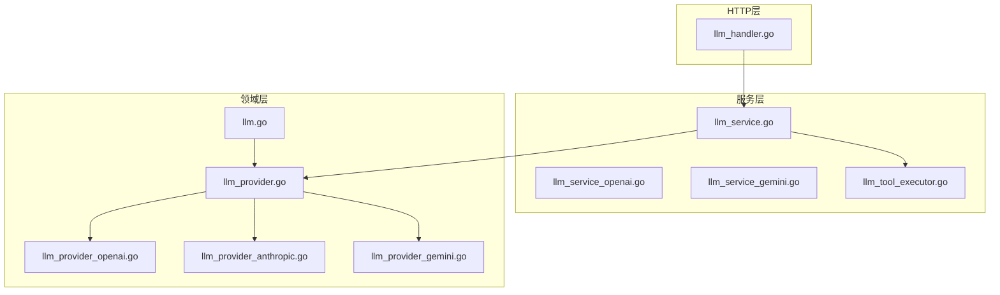
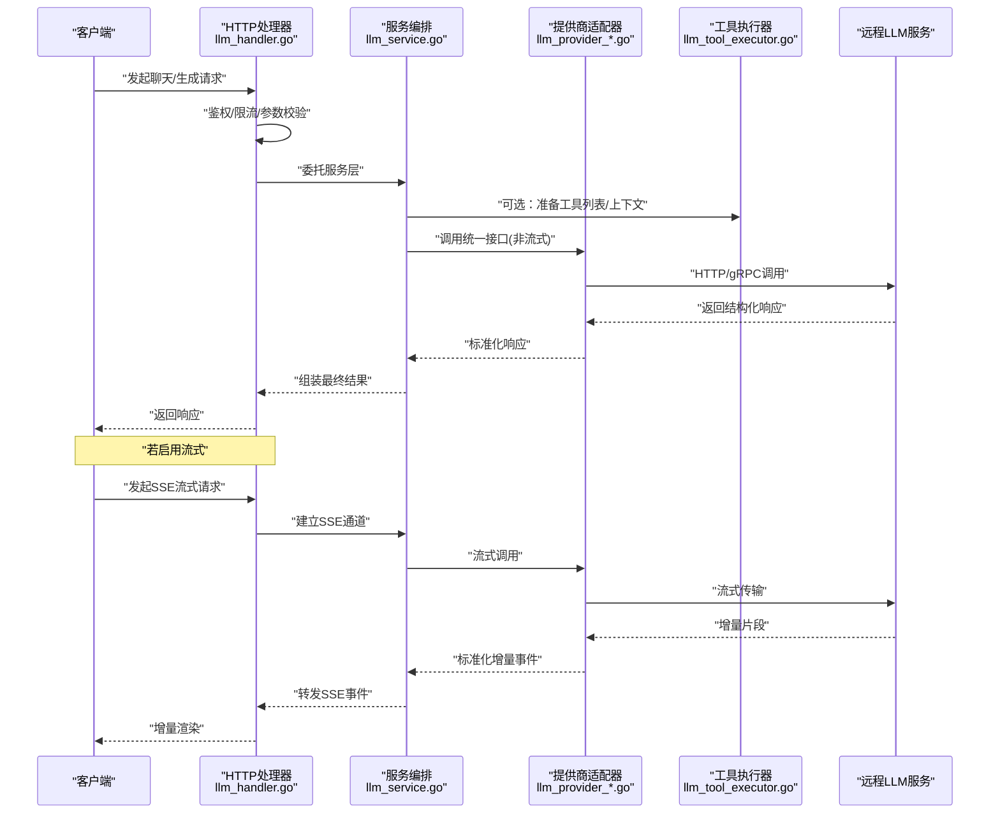
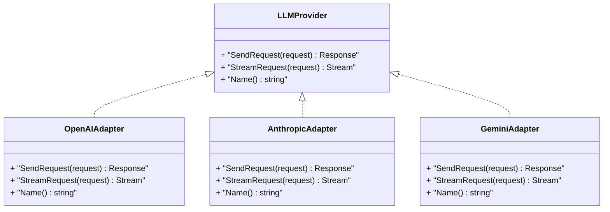
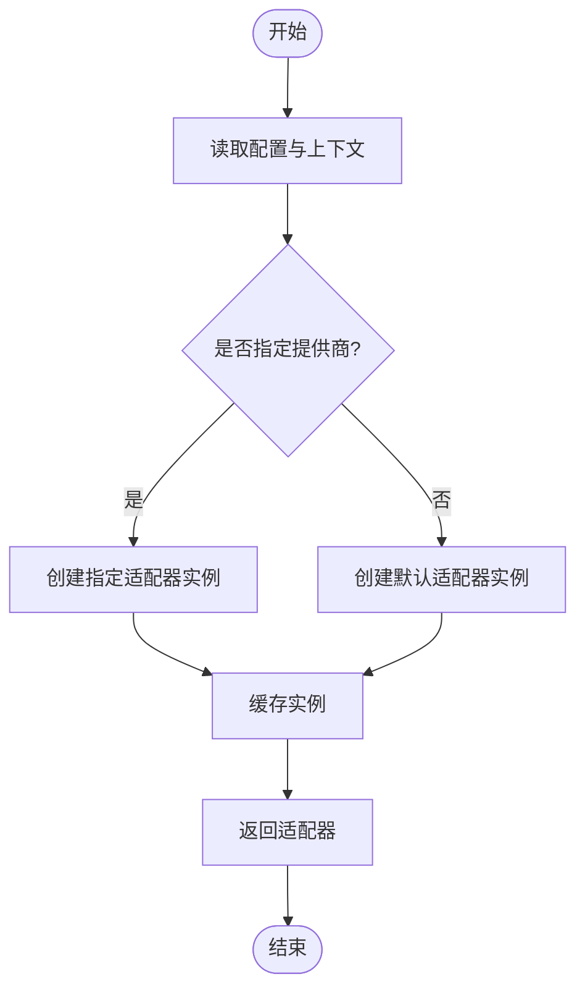
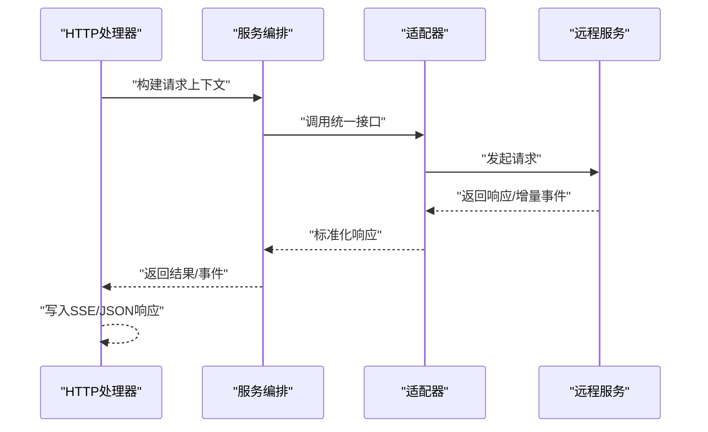
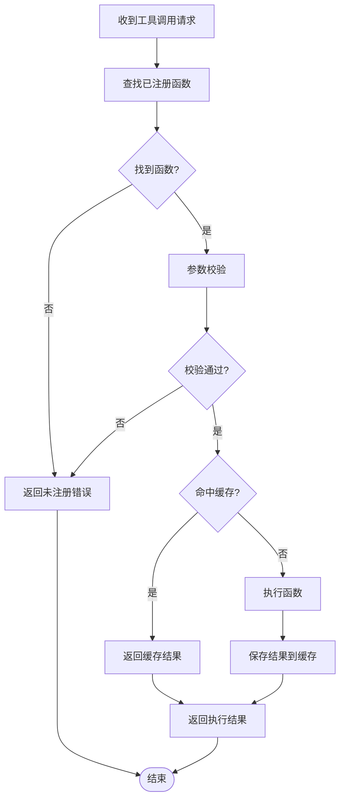
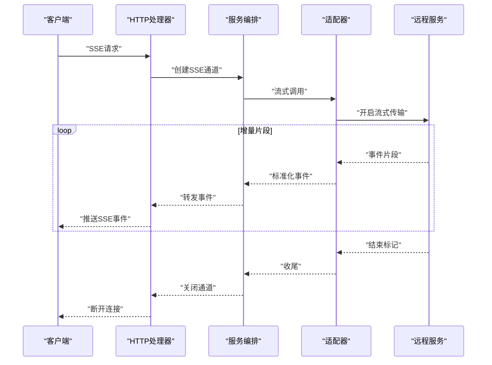
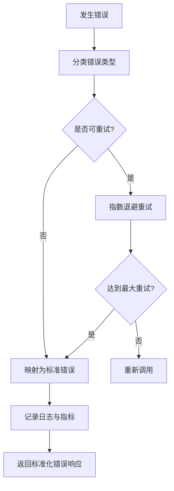
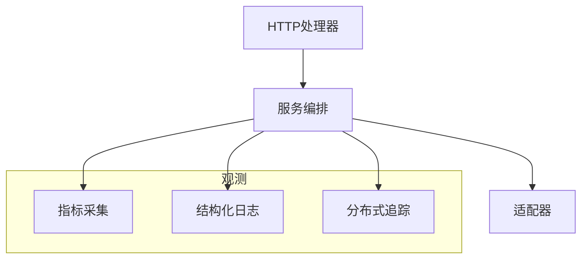
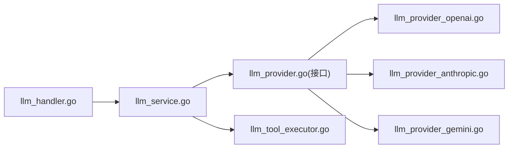

# LLM提供商架构设计

<cite>
**本文引用的文件**   
- [llm.go](file://notifuse/internal/domain/llm.go)
- [llm_provider.go](file://notifuse/internal/domain/llm_provider.go)
- [llm_provider_openai.go](file://notifuse/internal/domain/llm_provider_openai.go)
- [llm_provider_anthropic.go](file://notifuse/internal/domain/llm_provider_anthropic.go)
- [llm_provider_gemini.go](file://notifuse/internal/domain/llm_provider_gemini.go)
- [llm_handler.go](file://notifuse/internal/http/llm_handler.go)
- [llm_service.go](file://notifuse/internal/service/llm_service.go)
- [llm_service_openai.go](file://notifuse/internal/service/llm_service_openai.go)
- [llm_service_gemini.go](file://notifuse/internal/service/llm_service_gemini.go)
- [llm_tool_executor.go](file://notifuse/internal/service/llm_tool_executor.go)
</cite>

## 目录
1. [简介](#简介)
2. [项目结构](#项目结构)
3. [核心组件](#核心组件)
4. [架构总览](#架构总览)
5. [详细组件分析](#详细组件分析)
6. [依赖关系分析](#依赖关系分析)
7. [性能考虑](#性能考虑)
8. [故障排查指南](#故障排查指南)
9. [结论](#结论)
10. [附录](#附录)

## 简介
本文件面向Notifuse平台的LLM提供商抽象层与相关服务，系统性阐述以下主题：
- 接口定义、适配器模式与工厂模式的实现方式
- 请求处理器、响应解析器与错误处理机制
- 工具调用框架（函数注册、参数校验、结果缓存）
- 流式响应处理（SSE连接管理与增量渲染）
- 性能监控与日志记录
- 架构图与数据流图，帮助理解各组件交互

## 项目结构
围绕LLM能力的相关代码主要分布在以下三个层次：
- 领域层（domain）：定义LLM提供商统一接口与各厂商适配器的数据结构与行为
- HTTP层（http）：对外暴露HTTP API，负责请求路由、鉴权、限流、SSE流式输出等
- 服务层（service）：编排业务逻辑，封装对具体LLM实现的调用，提供工具执行、缓存、遥测等横切能力

图表来源
- [llm_handler.go](file://notifuse/internal/http/llm_handler.go)
- [llm_service.go](file://notifuse/internal/service/llm_service.go)
- [llm_service_openai.go](file://notifuse/internal/service/llm_service_openai.go)
- [llm_service_gemini.go](file://notifuse/internal/service/llm_service_gemini.go)
- [llm_tool_executor.go](file://notifuse/internal/service/llm_tool_executor.go)
- [llm_provider.go](file://notifuse/internal/domain/llm_provider.go)
- [llm_provider_openai.go](file://notifuse/internal/domain/llm_provider_openai.go)
- [llm_provider_anthropic.go](file://notifuse/internal/domain/llm_provider_anthropic.go)
- [llm_provider_gemini.go](file://notifuse/internal/domain/llm_provider_gemini.go)
- [llm.go](file://notifuse/internal/domain/llm.go)

章节来源
- [llm_handler.go](file://notifuse/internal/http/llm_handler.go)
- [llm_service.go](file://notifuse/internal/service/llm_service.go)
- [llm_provider.go](file://notifuse/internal/domain/llm_provider.go)

## 核心组件
- 统一接口与适配器
  - 通过领域层接口抽象不同LLM提供商的调用方式，使用适配器模式为OpenAI、Anthropic、Gemini等提供统一入口。
  - 工厂模式用于根据配置或运行时参数选择并创建具体适配器实例。
- 请求处理器
  - HTTP层接收外部请求，进行鉴权、参数校验、上下文注入，然后委派给服务层。
- 服务编排
  - 服务层组合领域适配器、工具执行器、缓存、遥测与日志，完成端到端流程。
- 工具调用框架
  - 提供函数注册表、参数校验、结果缓存与重试策略，支持在LLM对话中动态调用系统内能力。
- 流式响应
  - 基于SSE将增量内容逐步推送至客户端，支持断线重连与幂等恢复。
- 错误处理
  - 统一错误类型与映射，区分网络错误、认证失败、配额超限、模型不可用等场景，返回标准化响应。

章节来源
- [llm_provider.go](file://notifuse/internal/domain/llm_provider.go)
- [llm_provider_openai.go](file://notifuse/internal/domain/llm_provider_openai.go)
- [llm_provider_anthropic.go](file://notifuse/internal/domain/llm_provider_anthropic.go)
- [llm_provider_gemini.go](file://notifuse/internal/domain/llm_provider_gemini.go)
- [llm_handler.go](file://notifuse/internal/http/llm_handler.go)
- [llm_service.go](file://notifuse/internal/service/llm_service.go)
- [llm_tool_executor.go](file://notifuse/internal/service/llm_tool_executor.go)

## 架构总览
下图展示了从HTTP请求到具体LLM提供商的完整链路，包括工具调用与流式输出路径。

图表来源
- [llm_handler.go](file://notifuse/internal/http/llm_handler.go)
- [llm_service.go](file://notifuse/internal/service/llm_service.go)
- [llm_provider_openai.go](file://notifuse/internal/domain/llm_provider_openai.go)
- [llm_provider_anthropic.go](file://notifuse/internal/domain/llm_provider_anthropic.go)
- [llm_provider_gemini.go](file://notifuse/internal/domain/llm_provider_gemini.go)
- [llm_tool_executor.go](file://notifuse/internal/service/llm_tool_executor.go)

## 详细组件分析

### 接口定义与适配器模式
- 统一接口
  - 定义统一的“发送消息/流式生成”等方法，屏蔽底层差异。
- 适配器实现
  - OpenAI、Anthropic、Gemini分别实现统一接口，内部处理各自协议、鉴权、参数映射与响应解析。
- 工厂模式
  - 根据配置项（如provider名称、密钥、端点）创建对应适配器实例，便于扩展新厂商。

图表来源
- [llm_provider.go](file://notifuse/internal/domain/llm_provider.go)
- [llm_provider_openai.go](file://notifuse/internal/domain/llm_provider_openai.go)
- [llm_provider_anthropic.go](file://notifuse/internal/domain/llm_provider_anthropic.go)
- [llm_provider_gemini.go](file://notifuse/internal/domain/llm_provider_gemini.go)

章节来源
- [llm_provider.go](file://notifuse/internal/domain/llm_provider.go)
- [llm_provider_openai.go](file://notifuse/internal/domain/llm_provider_openai.go)
- [llm_provider_anthropic.go](file://notifuse/internal/domain/llm_provider_anthropic.go)
- [llm_provider_gemini.go](file://notifuse/internal/domain/llm_provider_gemini.go)

### 工厂模式与提供商选择
- 工厂职责
  - 读取配置（如默认提供商、工作区级覆盖），构造并缓存适配器实例。
- 选择策略
  - 优先按请求上下文中的提供商标识选择；未指定时回退到全局默认。
- 可扩展性
  - 新增提供商只需实现统一接口并在工厂注册，无需改动上层调用方。

图表来源
- [llm_service.go](file://notifuse/internal/service/llm_service.go)
- [llm_provider.go](file://notifuse/internal/domain/llm_provider.go)

章节来源
- [llm_service.go](file://notifuse/internal/service/llm_service.go)
- [llm_provider.go](file://notifuse/internal/domain/llm_provider.go)

### 请求处理器与响应解析器
- 请求处理
  - 校验输入、绑定上下文（用户/工作区）、注入追踪ID、限流与鉴权。
- 响应解析
  - 将各厂商响应转换为统一结构，包含文本、工具调用、元数据与统计信息。
- SSE流式
  - 将增量事件包装为标准事件格式，逐条推送至客户端。

图表来源
- [llm_handler.go](file://notifuse/internal/http/llm_handler.go)
- [llm_service.go](file://notifuse/internal/service/llm_service.go)
- [llm_provider_openai.go](file://notifuse/internal/domain/llm_provider_openai.go)

章节来源
- [llm_handler.go](file://notifuse/internal/http/llm_handler.go)
- [llm_service.go](file://notifuse/internal/service/llm_service.go)

### 工具调用框架（函数注册、参数验证、结果缓存）
- 函数注册
  - 集中维护可被LLM调用的工具清单，支持描述、参数Schema与权限控制。
- 参数验证
  - 基于Schema对入参进行强校验，拒绝非法输入并返回明确错误。
- 结果缓存
  - 对幂等工具调用进行键控缓存，避免重复计算与外部依赖压力。
- 执行流程
  - 当模型返回工具调用请求时，服务层调度执行器，执行后回填结果继续对话。

图表来源
- [llm_tool_executor.go](file://notifuse/internal/service/llm_tool_executor.go)
- [llm_service.go](file://notifuse/internal/service/llm_service.go)

章节来源
- [llm_tool_executor.go](file://notifuse/internal/service/llm_tool_executor.go)
- [llm_service.go](file://notifuse/internal/service/llm_service.go)

### 流式响应处理（SSE连接管理与增量渲染）
- 连接管理
  - 为每个流式请求建立独立SSE通道，支持心跳保活与超时控制。
- 增量渲染
  - 服务端将增量片段以事件形式推送，客户端按需拼接渲染。
- 错误与重试
  - 捕获网络抖动与上游错误，必要时触发指数退避重试或降级策略。

图表来源
- [llm_handler.go](file://notifuse/internal/http/llm_handler.go)
- [llm_service.go](file://notifuse/internal/service/llm_service.go)
- [llm_provider_openai.go](file://notifuse/internal/domain/llm_provider_openai.go)

章节来源
- [llm_handler.go](file://notifuse/internal/http/llm_handler.go)
- [llm_service.go](file://notifuse/internal/service/llm_service.go)

### 错误处理机制
- 错误分类
  - 网络错误、认证失败、配额限制、模型不可用、参数不合法、超时等。
- 统一映射
  - 将下游错误映射为平台标准错误码与消息，便于前端展示与监控告警。
- 重试与熔断
  - 对可重试错误采用指数退避；持续失败触发熔断，快速失败保护上游。

图表来源
- [llm_service.go](file://notifuse/internal/service/llm_service.go)
- [llm_provider_openai.go](file://notifuse/internal/domain/llm_provider_openai.go)
- [llm_provider_anthropic.go](file://notifuse/internal/domain/llm_provider_anthropic.go)
- [llm_provider_gemini.go](file://notifuse/internal/domain/llm_provider_gemini.go)

章节来源
- [llm_service.go](file://notifuse/internal/service/llm_service.go)
- [llm_provider_openai.go](file://notifuse/internal/domain/llm_provider_openai.go)
- [llm_provider_anthropic.go](file://notifuse/internal/domain/llm_provider_anthropic.go)
- [llm_provider_gemini.go](file://notifuse/internal/domain/llm_provider_gemini.go)

### 性能监控与日志记录
- 指标采集
  - 记录QPS、延迟分位、错误率、缓存命中率、工具调用次数与耗时。
- 分布式追踪
  - 为每次请求分配追踪ID，贯穿HTTP→服务→适配器→远端调用链路。
- 结构化日志
  - 输出关键步骤与上下文（用户/工作区/模型/令牌用量），便于排障与审计。

图表来源
- [llm_handler.go](file://notifuse/internal/http/llm_handler.go)
- [llm_service.go](file://notifuse/internal/service/llm_service.go)

章节来源
- [llm_handler.go](file://notifuse/internal/http/llm_handler.go)
- [llm_service.go](file://notifuse/internal/service/llm_service.go)

## 依赖关系分析
- 耦合与内聚
  - HTTP层仅依赖服务层接口，服务层依赖领域适配器接口，降低横向耦合。
- 直接/间接依赖
  - 服务层同时依赖工具执行器、缓存与遥测；适配器依赖具体HTTP客户端与序列化库。
- 循环依赖
  - 通过接口解耦，避免HTTP→服务→适配器之间的循环引用。
- 外部集成点
  - OpenAI/Anthropic/Gemini等第三方API；本地缓存与日志/追踪后端。

图表来源
- [llm_handler.go](file://notifuse/internal/http/llm_handler.go)
- [llm_service.go](file://notifuse/internal/service/llm_service.go)
- [llm_provider.go](file://notifuse/internal/domain/llm_provider.go)
- [llm_provider_openai.go](file://notifuse/internal/domain/llm_provider_openai.go)
- [llm_provider_anthropic.go](file://notifuse/internal/domain/llm_provider_anthropic.go)
- [llm_provider_gemini.go](file://notifuse/internal/domain/llm_provider_gemini.go)
- [llm_tool_executor.go](file://notifuse/internal/service/llm_tool_executor.go)

章节来源
- [llm_handler.go](file://notifuse/internal/http/llm_handler.go)
- [llm_service.go](file://notifuse/internal/service/llm_service.go)
- [llm_provider.go](file://notifuse/internal/domain/llm_provider.go)

## 性能考虑
- 连接复用与池化
  - 复用HTTP连接，减少握手开销；合理设置并发与超时。
- 流式优先
  - 长文本生成优先使用SSE，降低首字节延迟与内存占用。
- 缓存策略
  - 对幂等工具调用与热点查询进行键控缓存，结合TTL与失效策略。
- 背压与限流
  - 针对上游速率限制与配额，实施令牌桶/漏桶限流与优雅降级。
- 资源隔离
  - 按工作区或租户维度隔离配额与缓存，避免相互影响。

[本节为通用指导，不涉及具体文件]

## 故障排查指南
- 常见问题定位
  - 鉴权失败：检查密钥与工作区配置是否正确加载。
  - 模型不可用/配额超限：查看错误码与指标面板，确认配额与容量。
  - 流式中断：检查SSE心跳、代理超时与客户端重连逻辑。
  - 工具调用失败：核对函数注册、参数Schema与缓存一致性。
- 诊断手段
  - 打开调试日志，关注追踪ID与关键步骤耗时。
  - 复现最小用例，对比不同提供商的行为差异。
  - 使用指标看板观察错误率与延迟分布。

章节来源
- [llm_handler.go](file://notifuse/internal/http/llm_handler.go)
- [llm_service.go](file://notifuse/internal/service/llm_service.go)
- [llm_tool_executor.go](file://notifuse/internal/service/llm_tool_executor.go)

## 结论
本架构通过接口抽象与适配器/工厂模式，实现了多LLM提供商的统一接入与灵活切换；借助服务编排层整合工具调用、缓存、遥测与日志，形成稳定可扩展的LLM能力底座。流式SSE与完善的错误处理进一步提升了用户体验与系统韧性。建议在生产环境完善指标与告警，持续优化缓存命中率与重试策略，确保高可用与高性能。

[本节为总结性内容，不涉及具体文件]

## 附录
- 术语
  - 适配器：对不同LLM提供商的具体实现进行封装，暴露统一接口。
  - 工厂：根据配置或上下文创建并返回合适的适配器实例。
  - SSE：服务器发送事件，用于服务端向客户端推送增量数据。
- 扩展建议
  - 新增提供商：实现统一接口并在工厂注册，补充错误映射与指标埋点。
  - 增强工具框架：引入异步执行、并行调用与更细粒度的缓存键策略。

[本节为概念性说明，不涉及具体文件]