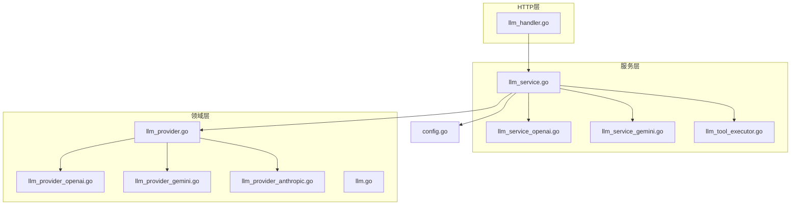
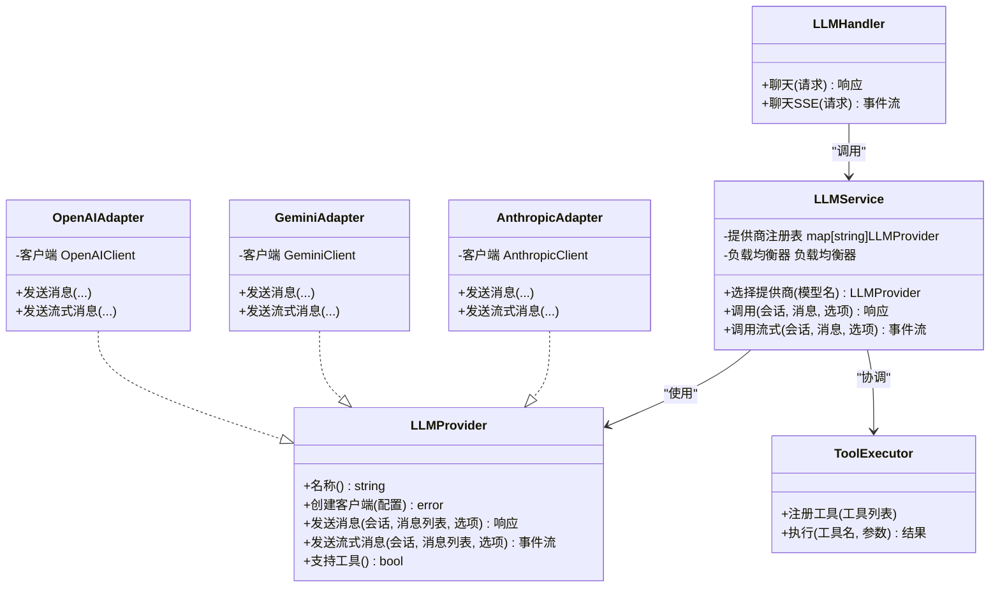
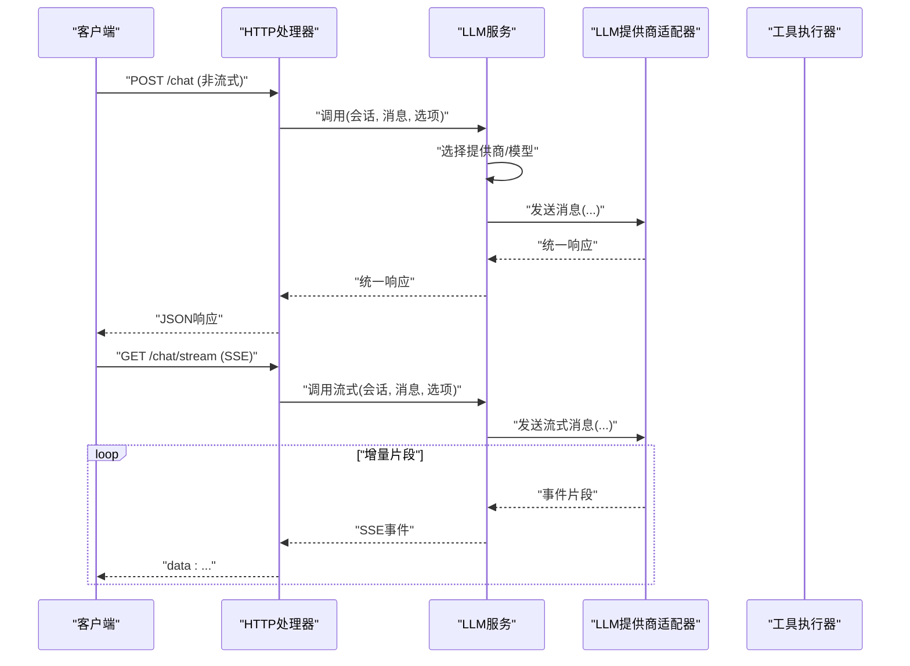
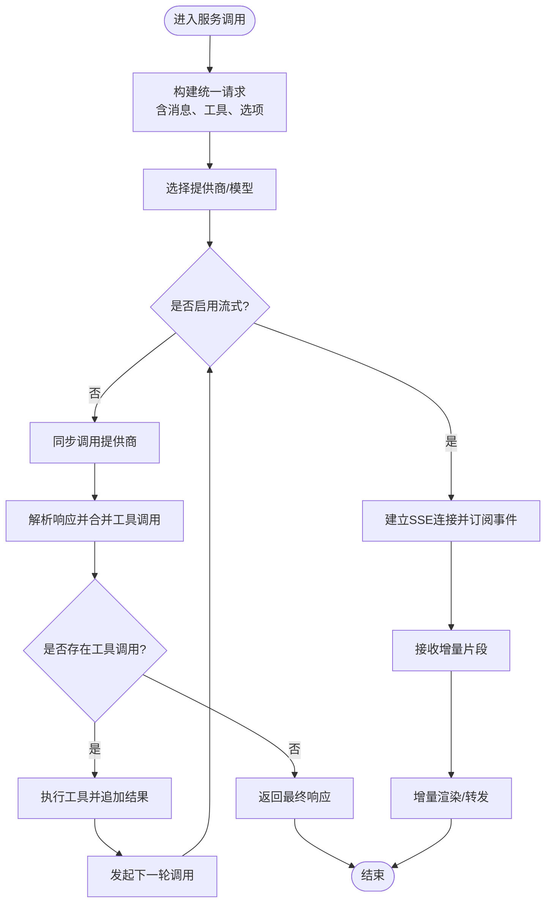
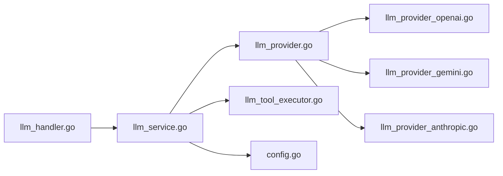

# LLM提供商集成

<cite>
**本文引用的文件**   
- [llm.go](file://notifuse/internal/domain/llm.go)
- [llm_provider.go](file://notifuse/internal/domain/llm_provider.go)
- [llm_provider_openai.go](file://notifuse/internal/domain/llm_provider_openai.go)
- [llm_provider_gemini.go](file://notifuse/internal/domain/llm_provider_gemini.go)
- [llm_provider_anthropic.go](file://notifuse/internal/domain/llm_provider_anthropic.go)
- [llm_service.go](file://notifuse/internal/service/llm_service.go)
- [llm_service_openai.go](file://notifuse/internal/service/llm_service_openai.go)
- [llm_service_gemini.go](file://notifuse/internal/service/llm_service_gemini.go)
- [llm_tool_executor.go](file://notifuse/internal/service/llm_tool_executor.go)
- [llm_handler.go](file://notifuse/internal/http/llm_handler.go)
- [config.go](file://notifuse/config/config.go)
</cite>

## 目录
1. [简介](#简介)
2. [项目结构](#项目结构)
3. [核心组件](#核心组件)
4. [架构总览](#架构总览)
5. [详细组件分析](#详细组件分析)
6. [依赖关系分析](#依赖关系分析)
7. [性能考量](#性能考量)
8. [故障排查指南](#故障排查指南)
9. [结论](#结论)
10. [附录](#附录)

## 简介
本文件面向Notifuse平台的LLM提供商集成系统，系统性阐述抽象层设计、适配器模式实现与主流AI服务（OpenAI、Gemini、Anthropic）的接入方式。文档覆盖接口定义、请求格式转换、响应解析、工具调用机制、流式响应处理、模型选择与负载均衡策略，并提供自定义提供商开发指南、实际集成示例与性能优化建议。

## 项目结构
围绕LLM能力的相关代码主要分布在以下两个层次：
- 领域层（domain）：定义统一的LLM接口与具体提供商适配器，屏蔽底层API差异。
- 服务层（service）：封装业务编排逻辑，包括会话管理、工具执行、流式输出等。
- HTTP层（http）：对外暴露REST/SSE接口，供控制台或外部客户端调用。
- 配置层（config）：集中管理各提供商的密钥与参数。

图表来源
- [llm_handler.go](file://notifuse/internal/http/llm_handler.go)
- [llm_service.go](file://notifuse/internal/service/llm_service.go)
- [llm_service_openai.go](file://notifuse/internal/service/llm_service_openai.go)
- [llm_service_gemini.go](file://notifuse/internal/service/llm_service_gemini.go)
- [llm_tool_executor.go](file://notifuse/internal/service/llm_tool_executor.go)
- [llm_provider.go](file://notifuse/internal/domain/llm_provider.go)
- [llm_provider_openai.go](file://notifuse/internal/domain/llm_provider_openai.go)
- [llm_provider_gemini.go](file://notifuse/internal/domain/llm_provider_gemini.go)
- [llm_provider_anthropic.go](file://notifuse/internal/domain/llm_provider_anthropic.go)
- [llm.go](file://notifuse/internal/domain/llm.go)
- [config.go](file://notifuse/config/config.go)

章节来源
- [llm_handler.go](file://notifuse/internal/http/llm_handler.go)
- [llm_service.go](file://notifuse/internal/service/llm_service.go)
- [llm_service_openai.go](file://notifuse/internal/service/llm_service_openai.go)
- [llm_service_gemini.go](file://notifuse/internal/service/llm_service_gemini.go)
- [llm_tool_executor.go](file://notifuse/internal/service/llm_tool_executor.go)
- [llm_provider.go](file://notifuse/internal/domain/llm_provider.go)
- [llm_provider_openai.go](file://notifuse/internal/domain/llm_provider_openai.go)
- [llm_provider_gemini.go](file://notifuse/internal/domain/llm_provider_gemini.go)
- [llm_provider_anthropic.go](file://notifuse/internal/domain/llm_provider_anthropic.go)
- [llm.go](file://notifuse/internal/domain/llm.go)
- [config.go](file://notifuse/config/config.go)

## 核心组件
- 统一LLM接口与消息模型：在领域层定义统一的对话接口、消息类型、工具定义与结果结构，确保上层对多提供商透明。
- 提供商适配器：为OpenAI、Gemini、Anthropic分别提供适配实现，负责将统一请求转换为各自API格式并解析响应。
- 服务编排：在服务层组合多个适配器，实现会话上下文维护、工具调用、流式输出与错误重试。
- HTTP处理器：将服务编排暴露为REST/SSE接口，支持前端实时渲染。
- 配置中心：集中读取与管理各提供商的密钥、端点、模型名等参数。

章节来源
- [llm.go](file://notifuse/internal/domain/llm.go)
- [llm_provider.go](file://notifuse/internal/domain/llm_provider.go)
- [llm_provider_openai.go](file://notifuse/internal/domain/llm_provider_openai.go)
- [llm_provider_gemini.go](file://notifuse/internal/domain/llm_provider_gemini.go)
- [llm_provider_anthropic.go](file://notifuse/internal/domain/llm_provider_anthropic.go)
- [llm_service.go](file://notifuse/internal/service/llm_service.go)
- [llm_service_openai.go](file://notifuse/internal/service/llm_service_openai.go)
- [llm_service_gemini.go](file://notifuse/internal/service/llm_service_gemini.go)
- [llm_tool_executor.go](file://notifuse/internal/service/llm_tool_executor.go)
- [llm_handler.go](file://notifuse/internal/http/llm_handler.go)
- [config.go](file://notifuse/config/config.go)

## 架构总览
整体采用“接口+适配器”的抽象层设计，服务层作为编排中枢，HTTP层仅做路由与协议适配。

图表来源
- [llm_provider.go](file://notifuse/internal/domain/llm_provider.go)
- [llm_provider_openai.go](file://notifuse/internal/domain/llm_provider_openai.go)
- [llm_provider_gemini.go](file://notifuse/internal/domain/llm_provider_gemini.go)
- [llm_provider_anthropic.go](file://notifuse/internal/domain/llm_provider_anthropic.go)
- [llm_service.go](file://notifuse/internal/service/llm_service.go)
- [llm_tool_executor.go](file://notifuse/internal/service/llm_tool_executor.go)
- [llm_handler.go](file://notifuse/internal/http/llm_handler.go)

## 详细组件分析

### 领域层：统一接口与消息模型
- 统一接口：定义跨提供商一致的对话方法、流式方法与工具支持能力。
- 消息模型：包含角色、内容、工具调用与结果等字段，用于在多提供商间传递语义。
- 工具定义：声明函数签名、参数Schema与描述，便于LLM进行函数调用。

章节来源
- [llm.go](file://notifuse/internal/domain/llm.go)
- [llm_provider.go](file://notifuse/internal/domain/llm_provider.go)

### 适配器：OpenAI、Gemini、Anthropic
- OpenAI适配器：将统一消息转换为OpenAI Chat Completions格式，支持流式SSE；将OpenAI的工具调用映射到内部工具执行器。
- Gemini适配器：将统一消息转换为Gemini生成内容格式，支持流式返回；处理Gemini特有的工具调用协议。
- Anthropic适配器：将统一消息转换为Anthropic Messages API格式，支持流式事件；解析其工具调用与结果结构。

图表来源
- [llm_handler.go](file://notifuse/internal/http/llm_handler.go)
- [llm_service.go](file://notifuse/internal/service/llm_service.go)
- [llm_provider_openai.go](file://notifuse/internal/domain/llm_provider_openai.go)
- [llm_provider_gemini.go](file://notifuse/internal/domain/llm_provider_gemini.go)
- [llm_provider_anthropic.go](file://notifuse/internal/domain/llm_provider_anthropic.go)

章节来源
- [llm_provider_openai.go](file://notifuse/internal/domain/llm_provider_openai.go)
- [llm_provider_gemini.go](file://notifuse/internal/domain/llm_provider_gemini.go)
- [llm_provider_anthropic.go](file://notifuse/internal/domain/llm_provider_anthropic.go)

### 服务编排：会话、工具与流式
- 会话管理：维护历史消息、系统提示与上下文窗口，避免越界与重复累积。
- 工具执行：在服务层注册工具集，当提供商返回工具调用时，交由工具执行器运行并将结果回填至下一轮消息。
- 流式处理：基于SSE将增量片段逐步推送给前端，减少首字节延迟。

图表来源
- [llm_service.go](file://notifuse/internal/service/llm_service.go)
- [llm_tool_executor.go](file://notifuse/internal/service/llm_tool_executor.go)

章节来源
- [llm_service.go](file://notifuse/internal/service/llm_service.go)
- [llm_tool_executor.go](file://notifuse/internal/service/llm_tool_executor.go)

### HTTP层：REST与SSE接口
- REST接口：接收聊天请求，调用服务层并返回完整JSON响应。
- SSE接口：以Server-Sent Events形式持续推送增量文本与元数据，适合实时展示。

章节来源
- [llm_handler.go](file://notifuse/internal/http/llm_handler.go)

### 配置与密钥管理
- 集中配置：通过配置模块加载各提供商的API密钥、端点、模型名、超时与并发限制等。
- 安全存储：建议在环境变量或密钥管理服务中注入敏感信息，避免硬编码。

章节来源
- [config.go](file://notifuse/config/config.go)

## 依赖关系分析
- 低耦合：HTTP层仅依赖服务层；服务层通过接口依赖领域层适配器；适配器之间相互独立。
- 可扩展性：新增提供商只需实现统一接口并在服务层注册，无需改动现有流程。
- 潜在循环：当前分层清晰，未见直接循环依赖；需警惕在工具执行器与服务层之间的双向引用。

图表来源
- [llm_handler.go](file://notifuse/internal/http/llm_handler.go)
- [llm_service.go](file://notifuse/internal/service/llm_service.go)
- [llm_provider.go](file://notifuse/internal/domain/llm_provider.go)
- [llm_provider_openai.go](file://notifuse/internal/domain/llm_provider_openai.go)
- [llm_provider_gemini.go](file://notifuse/internal/domain/llm_provider_gemini.go)
- [llm_provider_anthropic.go](file://notifuse/internal/domain/llm_provider_anthropic.go)
- [llm_tool_executor.go](file://notifuse/internal/service/llm_tool_executor.go)
- [config.go](file://notifuse/config/config.go)

章节来源
- [llm_handler.go](file://notifuse/internal/http/llm_handler.go)
- [llm_service.go](file://notifuse/internal/service/llm_service.go)
- [llm_provider.go](file://notifuse/internal/domain/llm_provider.go)
- [llm_tool_executor.go](file://notifuse/internal/service/llm_tool_executor.go)
- [config.go](file://notifuse/config/config.go)

## 性能考量
- 连接复用：HTTP客户端应复用连接池，降低TLS握手开销。
- 流式优先：长文本场景优先使用SSE，提升首字节时间与用户体验。
- 上下文裁剪：按窗口大小裁剪历史消息，避免超限与高成本。
- 并发控制：对同一会话限流，防止突发流量导致下游限流。
- 缓存策略：对相同输入可考虑短期缓存结果（注意隐私与一致性）。
- 重试与退避：对瞬时失败实施指数退避重试，提高鲁棒性。

[本节为通用指导，不直接分析具体文件]

## 故障排查指南
- 认证失败：检查配置中的API密钥与端点是否正确，确认网络可达与域名解析。
- 模型不存在：核对所选模型名称是否在提供商侧可用且权限充足。
- 工具调用异常：验证工具Schema与参数类型匹配，检查执行器返回值是否符合预期。
- 流式中断：关注SSE连接生命周期，必要时实现重连与断点续传。
- 速率限制：观察提供商返回的状态码与错误信息，调整并发与重试策略。

章节来源
- [llm_handler.go](file://notifuse/internal/http/llm_handler.go)
- [llm_service.go](file://notifuse/internal/service/llm_service.go)
- [llm_tool_executor.go](file://notifuse/internal/service/llm_tool_executor.go)

## 结论
通过统一的LLM接口与适配器模式，Notifuse平台实现了多提供商无缝切换与扩展。服务层负责会话、工具与流式编排，HTTP层提供REST与SSE接口，配置层统一管理密钥与参数。该架构具备良好的可维护性与扩展性，能够支撑未来更多AI服务的快速接入。

[本节为总结性内容，不直接分析具体文件]

## 附录

### 自定义LLM提供商开发指南
- 实现要求
  - 实现统一接口：提供名称、创建客户端、发送消息与流式消息等方法。
  - 请求转换：将统一消息与工具定义转换为提供商原生格式。
  - 响应解析：将提供商响应映射回统一结构，包括工具调用与结果。
  - 错误处理：标准化错误码与消息，便于上层统一处理。
- 注册与选择
  - 在服务层注册新提供商，并实现模型到提供商的映射策略。
  - 可选：实现负载均衡策略（如轮询、最少活跃连接、权重分配）。
- 测试方法
  - 单元测试：模拟提供商响应，验证请求构造与响应解析正确性。
  - 集成测试：使用沙箱或Mock服务端验证端到端流程。
  - 流式测试：验证SSE事件顺序、完整性与异常恢复。

章节来源
- [llm_provider.go](file://notifuse/internal/domain/llm_provider.go)
- [llm_service.go](file://notifuse/internal/service/llm_service.go)

### 工具调用机制说明
- 函数定义：在统一结构中声明函数名、描述与参数Schema。
- 参数传递：由服务层将工具定义附加到请求，提供商根据Schema生成调用。
- 结果处理：提供商返回工具调用后，服务层调用本地执行器并将结果追加到下一轮消息。

章节来源
- [llm.go](file://notifuse/internal/domain/llm.go)
- [llm_tool_executor.go](file://notifuse/internal/service/llm_tool_executor.go)

### 流式响应处理要点
- SSE连接管理：建立持久连接，处理心跳与断线重连。
- 增量渲染：前端按事件片段增量更新UI，避免整段等待。
- 错误与取消：支持上游取消与下游错误传播，保证资源释放。

章节来源
- [llm_handler.go](file://notifuse/internal/http/llm_handler.go)
- [llm_service.go](file://notifuse/internal/service/llm_service.go)

### 模型选择与负载均衡
- 选择策略：按用户偏好、成本、质量与可用性动态选择模型。
- 负载均衡：支持轮询、加权随机、最少负载等策略，结合健康检查剔除不可用节点。
- 降级与回退：主模型失败时自动切换到备用模型或提供商。

章节来源
- [llm_service.go](file://notifuse/internal/service/llm_service.go)

### 实际集成示例（路径指引）
- REST聊天：参考HTTP处理器中的聊天接口实现路径。
- SSE流式聊天：参考HTTP处理器中的SSE接口实现路径。
- 工具调用：参考服务层与工具执行器的协作路径。
- 多提供商切换：参考服务层的提供商注册与选择逻辑路径。

章节来源
- [llm_handler.go](file://notifuse/internal/http/llm_handler.go)
- [llm_service.go](file://notifuse/internal/service/llm_service.go)
- [llm_tool_executor.go](file://notifuse/internal/service/llm_tool_executor.go)