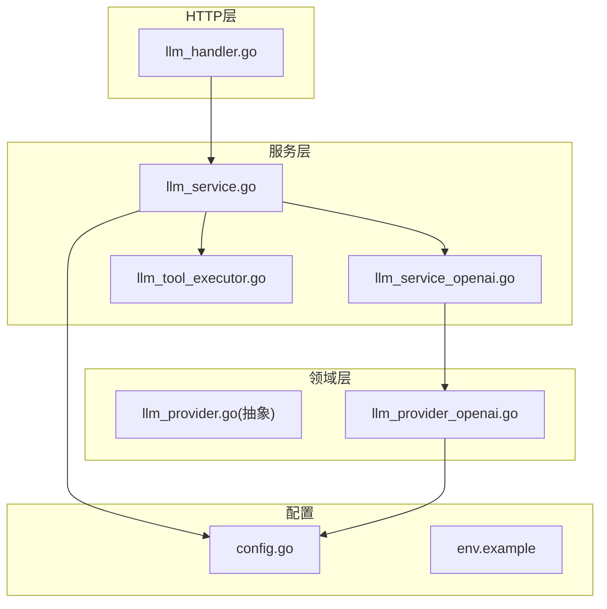
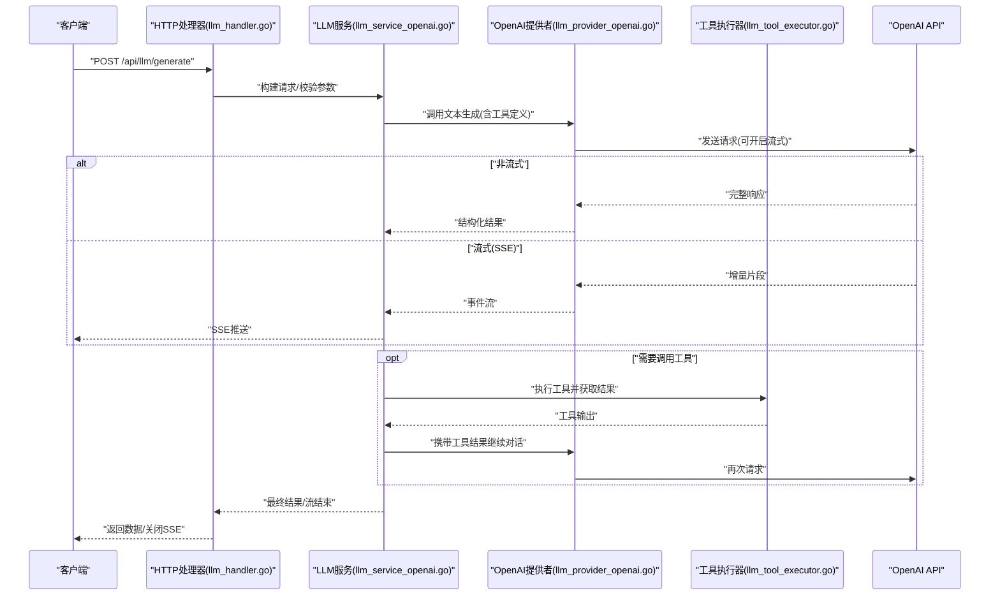
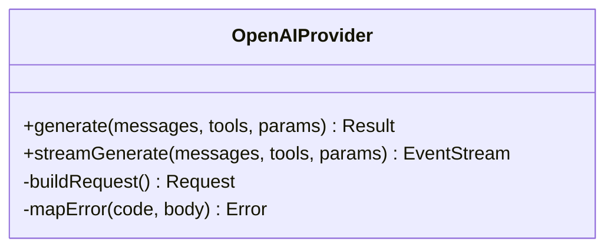
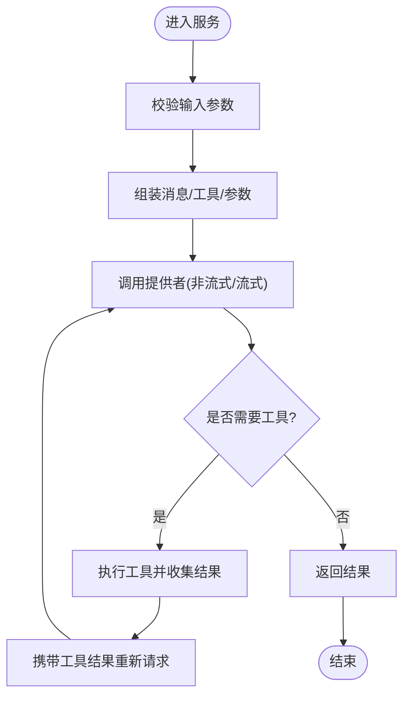
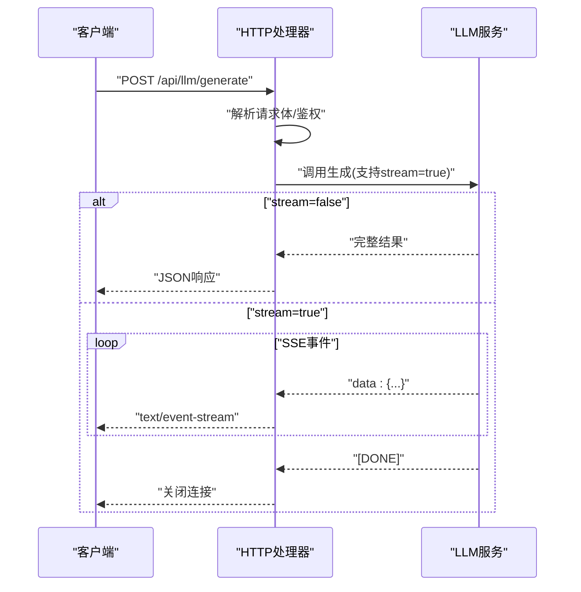
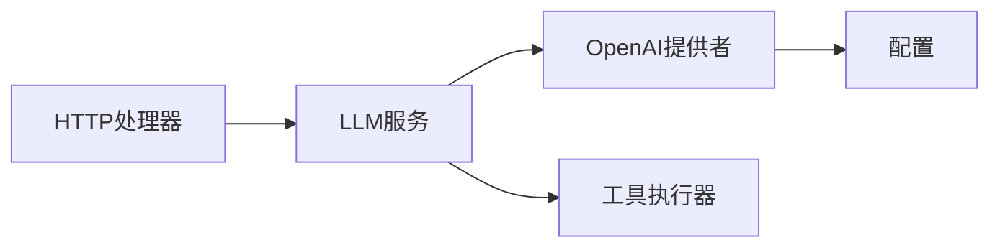

# OpenAI集成

<cite>
**本文引用的文件**   
- [llm_provider_openai.go](file://notifuse/internal/domain/llm_provider_openai.go)
- [llm_provider_openai_test.go](file://notifuse/internal/domain/llm_provider_openai_test.go)
- [llm_service_openai.go](file://notifuse/internal/service/llm_service_openai.go)
- [llm_service.go](file://notifuse/internal/service/llm_service.go)
- [llm_tool_executor.go](file://notifuse/internal/service/llm_tool_executor.go)
- [llm_handler.go](file://notifuse/internal/http/llm_handler.go)
- [config.go](file://notifuse/config/config.go)
- [env.example](file://notifuse/env.example)
</cite>

## 目录
1. [简介](#简介)
2. [项目结构](#项目结构)
3. [核心组件](#核心组件)
4. [架构总览](#架构总览)
5. [详细组件分析](#详细组件分析)
6. [依赖关系分析](#依赖关系分析)
7. [性能考虑](#性能考虑)
8. [故障排查指南](#故障排查指南)
9. [结论](#结论)
10. [附录](#附录)

## 简介
本文件面向Notifuse平台的OpenAI集成，提供从配置到使用的全链路文档。内容覆盖：
- OpenAI API密钥与模型选择、参数配置
- 文本生成接口（消息格式、温度控制、最大令牌数）
- 函数调用（工具定义、参数传递、结果处理）
- 流式响应（SSE连接与增量渲染）
- 在邮件模板中使用OpenAI进行内容生成的实践示例
- 错误处理策略与重试机制实现细节

## 项目结构
与OpenAI集成相关的代码主要分布在以下模块：
- domain层：OpenAI提供者抽象与具体实现
- service层：LLM服务编排、工具执行器
- http层：对外暴露的LLM相关HTTP接口
- config层：环境变量与配置加载

图表来源
- [llm_handler.go](file://notifuse/internal/http/llm_handler.go)
- [llm_service.go](file://notifuse/internal/service/llm_service.go)
- [llm_service_openai.go](file://notifuse/internal/service/llm_service_openai.go)
- [llm_provider_openai.go](file://notifuse/internal/domain/llm_provider_openai.go)
- [config.go](file://notifuse/config/config.go)
- [env.example](file://notifuse/env.example)

章节来源
- [llm_handler.go](file://notifuse/internal/http/llm_handler.go)
- [llm_service.go](file://notifuse/internal/service/llm_service.go)
- [llm_service_openai.go](file://notifuse/internal/service/llm_service_openai.go)
- [llm_provider_openai.go](file://notifuse/internal/domain/llm_provider_openai.go)
- [config.go](file://notifuse/config/config.go)
- [env.example](file://notifuse/env.example)

## 核心组件
- OpenAI提供者（domain层）
  - 负责与OpenAI REST API交互，包括非流式与流式请求、函数调用支持、错误映射等。
- LLM服务（service层）
  - 封装对提供者的调用，统一入参校验、上下文组装、重试与超时控制、流式事件转发。
- 工具执行器（service层）
  - 解析并执行外部工具（函数），将结果回传给模型以完成多轮对话。
- HTTP处理器（http层）
  - 暴露REST接口，接收前端或业务侧请求，转发至LLM服务，返回标准响应或SSE流。
- 配置（config层）
  - 读取API密钥、模型名称、超时、重试次数等环境变量。

章节来源
- [llm_provider_openai.go](file://notifuse/internal/domain/llm_provider_openai.go)
- [llm_service_openai.go](file://notifuse/internal/service/llm_service_openai.go)
- [llm_tool_executor.go](file://notifuse/internal/service/llm_tool_executor.go)
- [llm_handler.go](file://notifuse/internal/http/llm_handler.go)
- [config.go](file://notifuse/config/config.go)

## 架构总览
下图展示了从HTTP请求到OpenAI API的完整调用链，以及工具执行与流式响应的关键路径。

图表来源
- [llm_handler.go](file://notifuse/internal/http/llm_handler.go)
- [llm_service_openai.go](file://notifuse/internal/service/llm_service_openai.go)
- [llm_provider_openai.go](file://notifuse/internal/domain/llm_provider_openai.go)
- [llm_tool_executor.go](file://notifuse/internal/service/llm_tool_executor.go)

## 详细组件分析

### OpenAI提供者（domain层）
职责
- 构造OpenAI聊天补全请求，支持系统/用户/助手消息、工具定义与调用。
- 支持非流式与流式两种模式；流式模式下按事件类型分发增量内容、工具调用等。
- 将OpenAI错误码映射为内部错误类型，便于上层统一处理。

关键能力
- 模型选择：通过配置注入模型名。
- 参数控制：temperature、max_tokens、top_p、presence_penalty、frequency_penalty等。
- 函数调用：声明工具schema，解析tool_calls，回填结果后继续对话。
- 流式响应：基于SSE逐块消费响应，减少首字节延迟。

图表来源
- [llm_provider_openai.go](file://notifuse/internal/domain/llm_provider_openai.go)

章节来源
- [llm_provider_openai.go](file://notifuse/internal/domain/llm_provider_openai.go)
- [llm_provider_openai_test.go](file://notifuse/internal/domain/llm_provider_openai_test.go)

### LLM服务（service层）
职责
- 统一入口：聚合消息、工具、参数，调用OpenAI提供者。
- 重试与超时：对可重试错误实施指数退避重试，设置整体超时。
- 流式转发：将提供者的SSE事件透传到HTTP层，供前端增量渲染。
- 工具协调：当模型返回工具调用时，调度工具执行器并将结果回传。

图表来源
- [llm_service_openai.go](file://notifuse/internal/service/llm_service_openai.go)
- [llm_tool_executor.go](file://notifuse/internal/service/llm_tool_executor.go)

章节来源
- [llm_service_openai.go](file://notifuse/internal/service/llm_service_openai.go)
- [llm_service.go](file://notifuse/internal/service/llm_service.go)
- [llm_tool_executor.go](file://notifuse/internal/service/llm_tool_executor.go)

### HTTP处理器（http层）
职责
- 暴露REST接口，接收生成请求，解析JSON参数，调用LLM服务。
- 对于流式请求，设置SSE响应头并按事件类型写入数据块。
- 统一错误包装与状态码返回。

图表来源
- [llm_handler.go](file://notifuse/internal/http/llm_handler.go)
- [llm_service_openai.go](file://notifuse/internal/service/llm_service_openai.go)

章节来源
- [llm_handler.go](file://notifuse/internal/http/llm_handler.go)

### 配置与环境变量（config层）
- API密钥：用于认证OpenAI请求。
- 模型名称：指定使用的OpenAI模型。
- 其他参数：如超时、重试次数、默认temperature/max_tokens等。

建议的环境键名（参考示例）
- OPENAI_API_KEY
- OPENAI_MODEL
- OPENAI_TIMEOUT_SECONDS
- OPENAI_MAX_RETRIES
- OPENAI_DEFAULT_TEMPERATURE
- OPENAI_DEFAULT_MAX_TOKENS

章节来源
- [config.go](file://notifuse/config/config.go)
- [env.example](file://notifuse/env.example)

## 依赖关系分析
- HTTP处理器依赖LLM服务，不直接访问OpenAI。
- LLM服务依赖OpenAI提供者与工具执行器。
- OpenAI提供者仅依赖配置与HTTP客户端。
- 工具执行器由LLM服务按需调度，避免不必要的耦合。

图表来源
- [llm_handler.go](file://notifuse/internal/http/llm_handler.go)
- [llm_service_openai.go](file://notifuse/internal/service/llm_service_openai.go)
- [llm_provider_openai.go](file://notifuse/internal/domain/llm_provider_openai.go)
- [llm_tool_executor.go](file://notifuse/internal/service/llm_tool_executor.go)
- [config.go](file://notifuse/config/config.go)

章节来源
- [llm_handler.go](file://notifuse/internal/http/llm_handler.go)
- [llm_service_openai.go](file://notifuse/internal/service/llm_service_openai.go)
- [llm_provider_openai.go](file://notifuse/internal/domain/llm_provider_openai.go)
- [llm_tool_executor.go](file://notifuse/internal/service/llm_tool_executor.go)
- [config.go](file://notifuse/config/config.go)

## 性能考虑
- 流式优先：对长文本生成启用SSE，降低首字节延迟，提升用户体验。
- 合理设置max_tokens：避免过长生成导致超时与成本上升。
- temperature与top_p：根据场景调优创造性与稳定性。
- 重试与退避：对瞬时错误（限流、网络抖动）采用指数退避，避免雪崩。
- 连接复用与超时：确保HTTP客户端复用连接，合理设置读写超时。

[本节为通用指导，无需源码引用]

## 故障排查指南
常见问题与定位要点
- 401/403：检查API密钥是否正确、是否过期、权限是否足够。
- 429：触发限流，应增加重试间隔或降级策略。
- 400：参数非法（如model不存在、参数越界），核对请求体与模型能力。
- 5xx：服务端异常，结合日志与重试策略观察恢复情况。
- 流式中断：检查网络与代理，确认SSE头部与事件格式正确。

建议的日志与指标
- 记录每次请求的模型、token用量、耗时、错误码分布。
- 对工具执行失败进行告警与兜底返回。

章节来源
- [llm_provider_openai.go](file://notifuse/internal/domain/llm_provider_openai.go)
- [llm_service_openai.go](file://notifuse/internal/service/llm_service_openai.go)
- [llm_handler.go](file://notifuse/internal/http/llm_handler.go)

## 结论
Notifuse的OpenAI集成通过清晰的层次划分与可扩展设计，实现了统一的LLM接入能力。配合工具执行与流式响应，可在邮件模板生成等场景中提供高效、可控且低延迟的内容创作体验。建议在上线前完善监控与告警，并根据业务需求持续优化参数与重试策略。

[本节为总结性内容，无需源码引用]

## 附录

### 配置清单与说明
- OPENAI_API_KEY：必填，OpenAI API密钥。
- OPENAI_MODEL：必填，模型名称（例如gpt-4o-mini）。
- OPENAI_TIMEOUT_SECONDS：可选，请求超时秒数。
- OPENAI_MAX_RETRIES：可选，最大重试次数。
- OPENAI_DEFAULT_TEMPERATURE：可选，默认温度。
- OPENAI_DEFAULT_MAX_TOKENS：可选，默认最大令牌数。

章节来源
- [config.go](file://notifuse/config/config.go)
- [env.example](file://notifuse/env.example)

### 文本生成接口使用要点
- 消息格式：包含system、user、assistant三类角色消息。
- 温度控制：temperature影响创造性，范围通常为0~2。
- 最大令牌数：max_tokens限制生成长度，需结合模型上下文窗口。
- 其他参数：top_p、presence_penalty、frequency_penalty可按需调整。

章节来源
- [llm_service_openai.go](file://notifuse/internal/service/llm_service_openai.go)
- [llm_provider_openai.go](file://notifuse/internal/domain/llm_provider_openai.go)

### 函数调用（工具）使用要点
- 工具定义：声明工具名称、描述与参数schema。
- 参数传递：模型返回tool_calls，服务层解析并调用工具执行器。
- 结果处理：将工具输出作为消息追加，驱动模型继续生成。

章节来源
- [llm_tool_executor.go](file://notifuse/internal/service/llm_tool_executor.go)
- [llm_service_openai.go](file://notifuse/internal/service/llm_service_openai.go)
- [llm_provider_openai.go](file://notifuse/internal/domain/llm_provider_openai.go)

### 流式响应（SSE）实现要点
- 服务端：按事件类型写入data字段，结束时发送[DONE]。
- 客户端：建立EventSource或等效机制，增量渲染内容。
- 错误处理：捕获中断与解析错误，必要时重连或降级。

章节来源
- [llm_handler.go](file://notifuse/internal/http/llm_handler.go)
- [llm_service_openai.go](file://notifuse/internal/service/llm_service_openai.go)
- [llm_provider_openai.go](file://notifuse/internal/domain/llm_provider_openai.go)

### 邮件模板中的使用示例（步骤指引）
- 准备提示词：在模板中插入占位符，传入主题、受众、风格等上下文。
- 调用生成：通过HTTP接口发起请求，推荐开启流式以获得即时反馈。
- 渲染与保存：将生成结果写入模板变量，持久化或预览展示。
- 容错与回退：若生成失败，使用默认文案或缓存版本。

章节来源
- [llm_handler.go](file://notifuse/internal/http/llm_handler.go)
- [llm_service_openai.go](file://notifuse/internal/service/llm_service_openai.go)

### 错误处理与重试机制
- 可重试错误：网络错误、5xx、429等。
- 重试策略：指数退避+抖动，设置最大重试次数与总超时。
- 降级策略：达到阈值后返回缓存或默认内容，保障可用性。

章节来源
- [llm_service_openai.go](file://notifuse/internal/service/llm_service_openai.go)
- [llm_provider_openai.go](file://notifuse/internal/domain/llm_provider_openai.go)