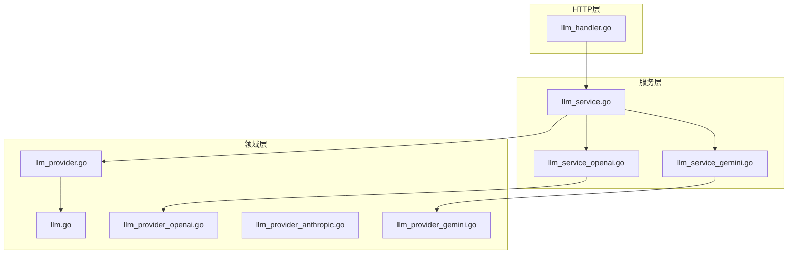
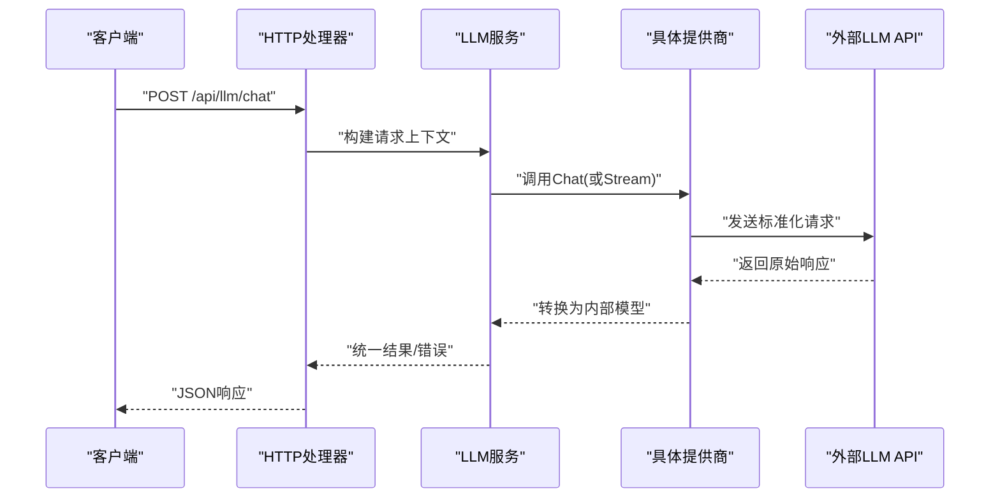
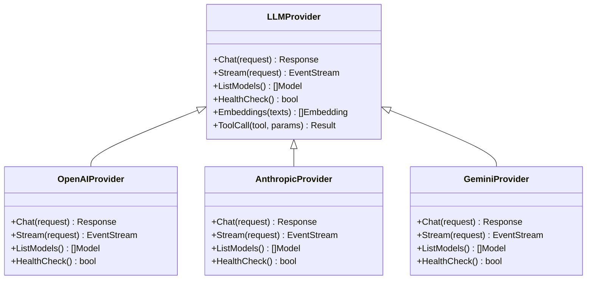
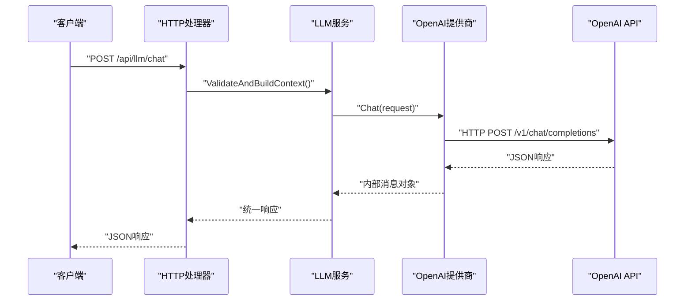
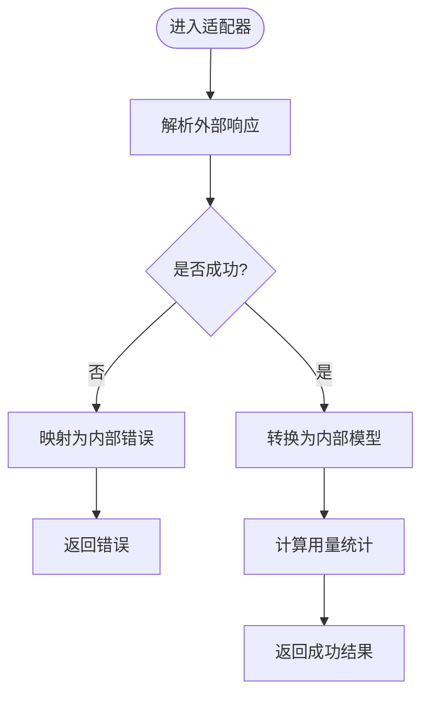
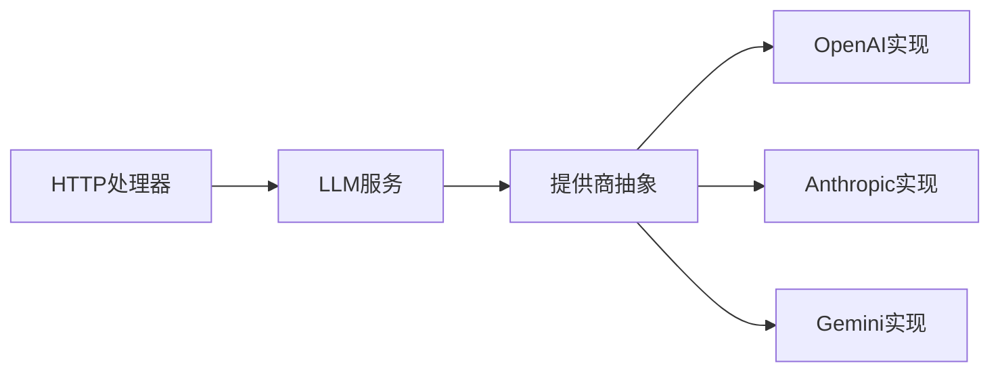

# 自定义LLM提供商开发

<cite>
**本文引用的文件**   
- [llm.go](file://notifuse/internal/domain/llm.go)
- [llm_provider.go](file://notifuse/internal/domain/llm_provider.go)
- [llm_service.go](file://notifuse/internal/service/llm_service.go)
- [llm_handler.go](file://notifuse/internal/http/llm_handler.go)
- [llm_provider_openai.go](file://notifuse/internal/domain/llm_provider_openai.go)
- [llm_provider_anthropic.go](file://notifuse/internal/domain/llm_provider_anthropic.go)
- [llm_provider_gemini.go](file://notifuse/internal/domain/llm_provider_gemini.go)
- [llm_service_openai.go](file://notifuse/internal/service/llm_service_openai.go)
- [llm_service_gemini.go](file://notifuse/internal/service/llm_service_gemini.go)
- [llm_test.go](file://notifuse/internal/domain/llm_test.go)
- [llm_provider_test.go](file://notifuse/internal/domain/llm_provider_test.go)
- [llm_service_test.go](file://notifuse/internal/service/llm_service_test.go)
- [llm_handler_test.go](file://notifuse/internal/http/llm_handler_test.go)
</cite>

## 目录
1. [简介](#简介)
2. [项目结构](#项目结构)
3. [核心组件](#核心组件)
4. [架构总览](#架构总览)
5. [详细组件分析](#详细组件分析)
6. [依赖分析](#依赖分析)
7. [性能考虑](#性能考虑)
8. [故障排查指南](#故障排查指南)
9. [结论](#结论)
10. [附录](#附录) 

## 简介
本指南面向希望在Notifuse平台中接入自定义大语言模型（LLM）提供商的开发者。文档围绕接口契约、实现流程、测试策略、API响应适配、部署配置与调试优化等方面，提供从入门到落地的完整路径。读者将了解：
- LLM提供商接口的必需方法与可选方法
- 如何从零实现一个自定义提供商并注册到服务层
- 如何编写单元测试与集成测试
- 如何将不同厂商的API响应统一为内部模型
- 如何在生产环境中配置与部署
- 如何进行性能优化与问题定位

## 项目结构
Notifuse后端采用分层设计：HTTP层处理请求，服务层编排业务逻辑，领域层定义数据模型与提供商抽象，具体提供商以插件式方式扩展。

图表来源
- [llm_handler.go](file://notifuse/internal/http/llm_handler.go)
- [llm_service.go](file://notifuse/internal/service/llm_service.go)
- [llm_service_openai.go](file://notifuse/internal/service/llm_service_openai.go)
- [llm_service_gemini.go](file://notifuse/internal/service/llm_service_gemini.go)
- [llm.go](file://notifuse/internal/domain/llm.go)
- [llm_provider.go](file://notifuse/internal/domain/llm_provider.go)
- [llm_provider_openai.go](file://notifuse/internal/domain/llm_provider_openai.go)
- [llm_provider_anthropic.go](file://notifuse/internal/domain/llm_provider_anthropic.go)
- [llm_provider_gemini.go](file://notifuse/internal/domain/llm_provider_gemini.go)

章节来源
- [llm_handler.go](file://notifuse/internal/http/llm_handler.go)
- [llm_service.go](file://notifuse/internal/service/llm_service.go)
- [llm.go](file://notifuse/internal/domain/llm.go)
- [llm_provider.go](file://notifuse/internal/domain/llm_provider.go)

## 核心组件
- 领域模型与类型定义：集中定义消息、对话历史、工具调用等数据结构，确保上层一致使用。
- 提供商抽象：定义统一的LLM提供商接口，屏蔽底层差异。
- 服务编排：负责选择具体提供商、参数校验、重试与错误映射、流式与非流式调用封装。
- HTTP处理器：暴露REST接口，接收用户请求并委托服务层处理。
- 具体提供商实现：OpenAI、Anthropic、Gemini等，各自负责协议细节与响应转换。

章节来源
- [llm.go](file://notifuse/internal/domain/llm.go)
- [llm_provider.go](file://notifuse/internal/domain/llm_provider.go)
- [llm_service.go](file://notifuse/internal/service/llm_service.go)
- [llm_handler.go](file://notifuse/internal/http/llm_handler.go)

## 架构总览
下图展示了从HTTP请求到具体LLM提供商调用的端到端流程，以及响应回传的路径。

图表来源
- [llm_handler.go](file://notifuse/internal/http/llm_handler.go)
- [llm_service.go](file://notifuse/internal/service/llm_service.go)
- [llm_provider_openai.go](file://notifuse/internal/domain/llm_provider_openai.go)
- [llm_provider_anthropic.go](file://notifuse/internal/domain/llm_provider_anthropic.go)
- [llm_provider_gemini.go](file://notifuse/internal/domain/llm_provider_gemini.go)

## 详细组件分析

### 提供商接口与实现要求
- 必需方法
  - Chat：非流式对话生成，输入包含模型标识、消息列表、系统提示、工具定义等；输出为统一的消息对象。
  - Stream：流式对话生成，按事件推送增量内容，便于前端实时渲染。
  - ListModels：列出可用模型（可选但推荐），用于UI展示与动态选择。
  - HealthCheck：健康检查（可选），用于负载均衡与健康探针。
- 可选方法
  - Embeddings：文本嵌入（可选）。
  - ToolCall：工具调用执行（可选，若平台支持函数调用）。
- 错误与状态码映射
  - 将各厂商的状态码与错误信息映射为内部错误类型，保证上层统一处理。
- 配置项
  - 基础URL、鉴权头、超时、重试次数、并发限制等。

章节来源
- [llm_provider.go](file://notifuse/internal/domain/llm_provider.go)
- [llm.go](file://notifuse/internal/domain/llm.go)

#### 类图：提供商抽象与具体实现

图表来源
- [llm_provider.go](file://notifuse/internal/domain/llm_provider.go)
- [llm_provider_openai.go](file://notifuse/internal/domain/llm_provider_openai.go)
- [llm_provider_anthropic.go](file://notifuse/internal/domain/llm_provider_anthropic.go)
- [llm_provider_gemini.go](file://notifuse/internal/domain/llm_provider_gemini.go)

### 服务编排与HTTP入口
- HTTP处理器职责
  - 解析请求体、校验必填字段、构造上下文（工作区、用户、权限）。
  - 调用服务层进行推理，并将结果序列化为标准响应。
- 服务层职责
  - 根据配置选择具体提供商实例。
  - 参数规范化、重试与熔断、指标上报。
  - 将提供商返回的内部模型转换为HTTP响应格式。

章节来源
- [llm_handler.go](file://notifuse/internal/http/llm_handler.go)
- [llm_service.go](file://notifuse/internal/service/llm_service.go)

#### 时序图：聊天接口调用链

图表来源
- [llm_handler.go](file://notifuse/internal/http/llm_handler.go)
- [llm_service.go](file://notifuse/internal/service/llm_service.go)
- [llm_service_openai.go](file://notifuse/internal/service/llm_service_openai.go)
- [llm_provider_openai.go](file://notifuse/internal/domain/llm_provider_openai.go)

### 响应适配与错误映射
- 数据转换
  - 将各厂商的content、choices、usage等字段映射为内部Message、Usage统计。
  - 对streaming事件进行分片合并，保持顺序与一致性。
- 错误映射
  - 将4xx/5xx状态码与错误码映射为内部错误类型，附带可诊断信息。
  - 对网络异常、超时、限流等进行分类，便于重试与降级策略。

章节来源
- [llm_provider_openai.go](file://notifuse/internal/domain/llm_provider_openai.go)
- [llm_provider_anthropic.go](file://notifuse/internal/domain/llm_provider_anthropic.go)
- [llm_provider_gemini.go](file://notifuse/internal/domain/llm_provider_gemini.go)

#### 流程图：响应适配与错误映射

图表来源
- [llm_provider_openai.go](file://notifuse/internal/domain/llm_provider_openai.go)
- [llm_provider_anthropic.go](file://notifuse/internal/domain/llm_provider_anthropic.go)
- [llm_provider_gemini.go](file://notifuse/internal/domain/llm_provider_gemini.go)

### 自定义提供商开发流程
- 步骤一：实现提供商接口
  - 在领域层新增实现文件，实现Chat、Stream、ListModels等方法。
  - 完成鉴权、请求构造、响应解析与错误映射。
- 步骤二：提供服务工厂或注册器
  - 在服务层增加提供商选择逻辑，依据配置创建对应实例。
- 步骤三：配置与注入
  - 通过环境变量或配置文件注入密钥、基础URL、超时等。
  - 在应用启动时完成依赖注入与初始化。
- 步骤四：测试验证
  - 编写单元测试覆盖正常路径与异常分支。
  - 编写集成测试对接真实或Mock的外部API。
- 步骤五：上线与监控
  - 部署前进行压测与容量规划。
  - 接入日志、指标与追踪，设置告警阈值。

章节来源
- [llm_provider.go](file://notifuse/internal/domain/llm_provider.go)
- [llm_service.go](file://notifuse/internal/service/llm_service.go)
- [llm_handler.go](file://notifuse/internal/http/llm_handler.go)

### 测试策略
- 单元测试
  - 针对提供商适配器进行断言，覆盖成功、失败、空响应、部分字段缺失等场景。
  - 使用mock对外部HTTP调用进行隔离，确保稳定复现。
- 集成测试
  - 使用沙箱或测试账户调用真实API，验证端到端链路。
  - 对流式接口进行事件完整性与顺序性校验。
- 回归与稳定性
  - 引入混沌工程用例，模拟网络抖动、超时、限流等。
  - 定期更新测试数据与期望值，避免漂移。

章节来源
- [llm_test.go](file://notifuse/internal/domain/llm_test.go)
- [llm_provider_test.go](file://notifuse/internal/domain/llm_provider_test.go)
- [llm_service_test.go](file://notifuse/internal/service/llm_service_test.go)
- [llm_handler_test.go](file://notifuse/internal/http/llm_handler_test.go)

### 实际示例：简化版自定义提供商
以下为一个最小可用的自定义提供商示例思路，帮助快速上手：
- 目标：实现一个名为“Dummy”的提供商，返回固定回复，便于本地联调。
- 要点：
  - 实现Chat方法，直接构造内部消息对象返回。
  - 实现Stream方法，按事件推送一条或多条增量内容。
  - 实现ListModels方法，返回若干固定模型ID。
  - 实现HealthCheck方法，返回true表示健康。
  - 在错误路径上，抛出内部错误类型以便上层统一处理。
- 参考路径
  - 领域接口与类型定义：[llm_provider.go](file://notifuse/internal/domain/llm_provider.go)、[llm.go](file://notifuse/internal/domain/llm.go)
  - 现有实现参考：[llm_provider_openai.go](file://notifuse/internal/domain/llm_provider_openai.go)、[llm_provider_anthropic.go](file://notifuse/internal/domain/llm_provider_anthropic.go)、[llm_provider_gemini.go](file://notifuse/internal/domain/llm_provider_gemini.go)
  - 服务层注册与选择：[llm_service.go](file://notifuse/internal/service/llm_service.go)

章节来源
- [llm_provider.go](file://notifuse/internal/domain/llm_provider.go)
- [llm.go](file://notifuse/internal/domain/llm.go)
- [llm_provider_openai.go](file://notifuse/internal/domain/llm_provider_openai.go)
- [llm_provider_anthropic.go](file://notifuse/internal/domain/llm_provider_anthropic.go)
- [llm_provider_gemini.go](file://notifuse/internal/domain/llm_provider_gemini.go)
- [llm_service.go](file://notifuse/internal/service/llm_service.go)

## 依赖分析
- 耦合关系
  - HTTP层仅依赖服务层，不感知具体提供商实现，符合单一职责原则。
  - 服务层通过配置选择具体提供商，降低硬编码耦合。
- 外部依赖
  - 各提供商实现依赖各自的HTTP客户端与鉴权库。
  - 建议统一使用安全HTTP客户端，具备重试、超时与连接池管理。
- 潜在循环依赖
  - 领域层不应依赖服务层或HTTP层，避免反向依赖。

图表来源
- [llm_handler.go](file://notifuse/internal/http/llm_handler.go)
- [llm_service.go](file://notifuse/internal/service/llm_service.go)
- [llm_provider.go](file://notifuse/internal/domain/llm_provider.go)
- [llm_provider_openai.go](file://notifuse/internal/domain/llm_provider_openai.go)
- [llm_provider_anthropic.go](file://notifuse/internal/domain/llm_provider_anthropic.go)
- [llm_provider_gemini.go](file://notifuse/internal/domain/llm_provider_gemini.go)

章节来源
- [llm_handler.go](file://notifuse/internal/http/llm_handler.go)
- [llm_service.go](file://notifuse/internal/service/llm_service.go)
- [llm_provider.go](file://notifuse/internal/domain/llm_provider.go)

## 性能考虑
- 连接复用与池化
  - 复用HTTP连接，减少握手开销。
  - 合理设置最大空闲连接数与单主机并发上限。
- 超时与重试
  - 区分读写超时与整体超时，避免长时间阻塞。
  - 对幂等请求启用指数退避重试，避免雪崩。
- 流式传输
  - 优先使用流式接口，降低首字节延迟，提升用户体验。
- 缓存与去重
  - 对相同请求进行短期缓存，减少重复调用。
- 资源控制
  - 基于工作区或租户维度进行速率限制与配额控制。
- 观测性
  - 记录关键指标：QPS、P99延迟、错误率、令牌消耗。
  - 接入分布式追踪，定位慢调用与瓶颈点。

## 故障排查指南
- 常见问题
  - 鉴权失败：检查密钥、基础URL、签名算法与时钟同步。
  - 429限流：调整重试策略与并发度，必要时申请配额提升。
  - 5xx服务端错误：观察上游健康状态与错误日志，必要时切换提供商。
  - 流式中断：检查网络稳定性与服务端事件完整性。
- 诊断手段
  - 开启详细日志，记录请求头、响应体摘要与耗时。
  - 使用追踪ID串联上下游调用。
  - 对关键路径添加断言与告警。
- 恢复策略
  - 自动降级至备用提供商或默认模型。
  - 对不可用节点进行快速剔除与再发现。

章节来源
- [llm_handler_test.go](file://notifuse/internal/http/llm_handler_test.go)
- [llm_service_test.go](file://notifuse/internal/service/llm_service_test.go)
- [llm_provider_test.go](file://notifuse/internal/domain/llm_provider_test.go)

## 结论
通过遵循统一的提供商接口与服务编排模式，Notifuse平台能够以低耦合的方式扩展多种LLM提供商。开发者只需关注协议适配与错误映射，即可快速接入新厂商。配合完善的测试与观测体系，可在保证质量的同时持续提升性能与可用性。

## 附录
- 配置项建议
  - 基础URL、鉴权头、超时、重试次数、并发限制、模型白名单。
- 最佳实践
  - 严格校验输入，避免越界与非法字符。
  - 对敏感信息进行脱敏与审计。
  - 版本化管理提供商实现，确保向后兼容。