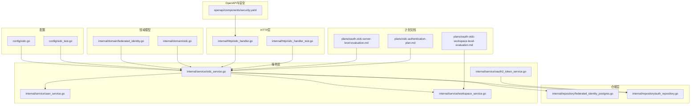
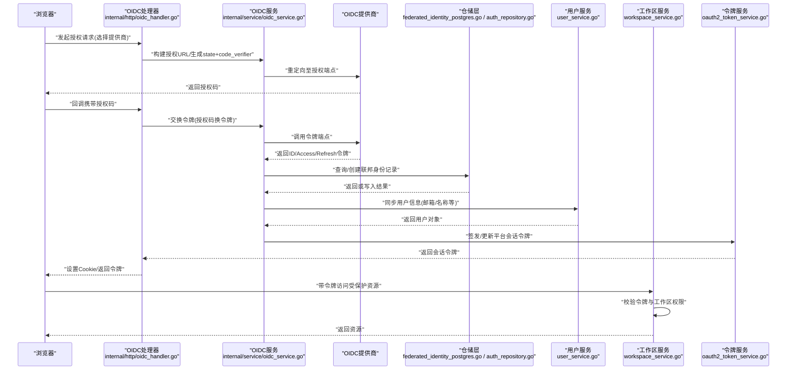
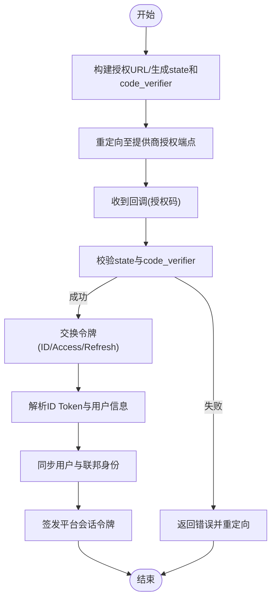
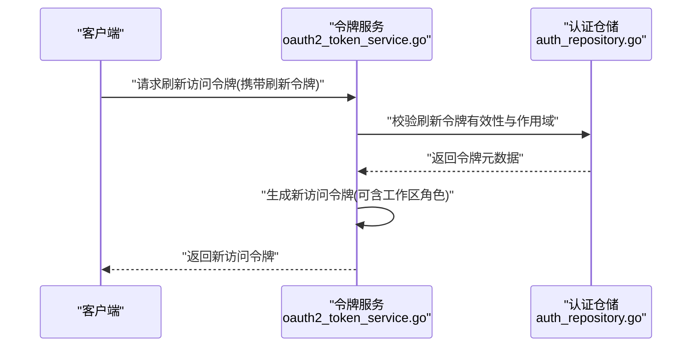
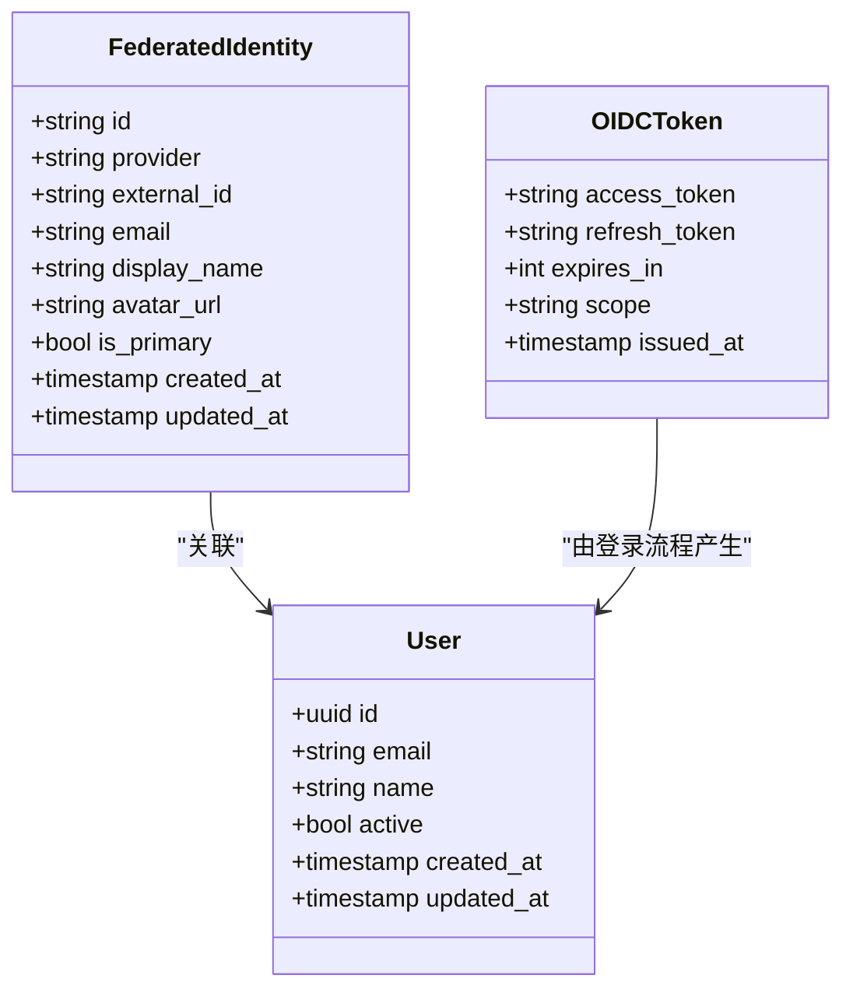
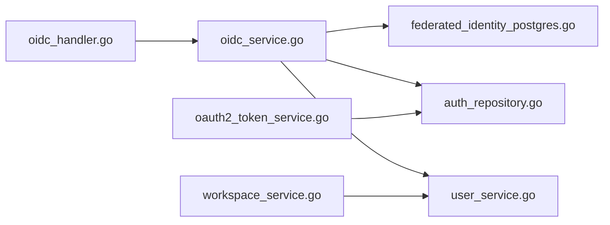

# OAuth2/OIDC认证集成

<cite>
**本文引用的文件**   
- [config/oidc.go](file://notifuse/config/oidc.go)
- [config/oidc_test.go](file://notifuse/config/oidc_test.go)
- [internal/domain/federated_identity.go](file://notifuse/internal/domain/federated_identity.go)
- [internal/domain/oidc.go](file://notifuse/internal/domain/oidc.go)
- [internal/http/oidc_handler.go](file://notifuse/internal/http/oidc_handler.go)
- [internal/http/oidc_handler_test.go](file://notifuse/internal/http/oidc_handler_test.go)
- [internal/service/oidc_service.go](file://notifuse/internal/service/oidc_service.go)
- [internal/service/oidc_service_test.go](file://notifuse/internal/service/oidc_service_test.go)
- [internal/service/oauth2_token_service.go](file://notifuse/internal/service/oauth2_token_service.go)
- [internal/service/oauth2_token_service_test.go](file://notifuse/internal/service/oauth2_token_service_test.go)
- [internal/repository/federated_identity_postgres.go](file://notifuse/internal/repository/federated_identity_postgres.go)
- [internal/repository/auth_repository.go](file://notifuse/internal/repository/auth_repository.go)
- [internal/service/user_service.go](file://notifuse/internal/service/user_service.go)
- [internal/service/workspace_service.go](file://notifuse/internal/service/workspace_service.go)
- [openapi/components/security.yaml](file://notifuse/openapi/components/security.yaml)
- [plans/oauth-oidc-server-level-evaluation.md](file://notifuse/plans/oauth-oidc-server-level-evaluation.md)
- [plans/oauth-oidc-workspace-level-evaluation.md](file://notifuse/plans/oauth-oidc-workspace-level-evaluation.md)
- [plans/oidc-authentication-plan.md](file://notifuse/plans/oidc-authentication-plan.md)
</cite>

## 目录
1. [简介](#简介)
2. [项目结构](#项目结构)
3. [核心组件](#核心组件)
4. [架构总览](#架构总览)
5. [详细组件分析](#详细组件分析)
6. [依赖关系分析](#依赖关系分析)
7. [性能考虑](#性能考虑)
8. [故障排查指南](#故障排查指南)
9. [结论](#结论)
10. [附录](#附录)

## 简介
本文件面向Notifuse平台的OAuth2/OIDC认证集成，覆盖以下主题：
- OIDC提供商配置（Google、GitHub、Azure AD等）
- OAuth2授权流程实现（授权码模式、隐式模式、客户端凭证模式）
- 用户身份联邦管理（多提供商账户关联与用户信息同步）
- 令牌管理与刷新机制（访问令牌、刷新令牌生命周期）
- 工作区级别的权限控制与角色映射
- 安全配置与故障排查
- 集成配置示例与测试用例指引

## 项目结构
与OIDC/OAuth2相关的代码主要分布在以下模块：
- 配置层：OIDC提供者配置加载与校验
- 领域模型：联邦身份、OIDC实体定义
- HTTP层：OIDC回调处理、状态校验、登录会话建立
- 服务层：OIDC流程编排、令牌交换与刷新、用户与联邦身份同步
- 仓储层：联邦身份持久化、认证相关数据存取
- OpenAPI与安全：API安全方案定义
- 计划文档：服务器级与工作区级OIDC策略评估

图表来源
- [config/oidc.go](file://notifuse/config/oidc.go)
- [internal/domain/federated_identity.go](file://notifuse/internal/domain/federated_identity.go)
- [internal/domain/oidc.go](file://notifuse/internal/domain/oidc.go)
- [internal/http/oidc_handler.go](file://notifuse/internal/http/oidc_handler.go)
- [internal/service/oidc_service.go](file://notifuse/internal/service/oidc_service.go)
- [internal/service/oauth2_token_service.go](file://notifuse/internal/service/oauth2_token_service.go)
- [internal/repository/federated_identity_postgres.go](file://notifuse/internal/repository/federated_identity_postgres.go)
- [internal/repository/auth_repository.go](file://notifuse/internal/repository/auth_repository.go)
- [openapi/components/security.yaml](file://notifuse/openapi/components/security.yaml)
- [plans/oauth-oidc-server-level-evaluation.md](file://notifuse/plans/oauth-oidc-server-level-evaluation.md)
- [plans/oauth-oidc-workspace-level-evaluation.md](file://notifuse/plans/oauth-oidc-workspace-level-evaluation.md)
- [plans/oidc-authentication-plan.md](file://notifuse/plans/oidc-authentication-plan.md)

章节来源
- [config/oidc.go](file://notifuse/config/oidc.go)
- [internal/domain/federated_identity.go](file://notifuse/internal/domain/federated_identity.go)
- [internal/domain/oidc.go](file://notifuse/internal/domain/oidc.go)
- [internal/http/oidc_handler.go](file://notifuse/internal/http/oidc_handler.go)
- [internal/service/oidc_service.go](file://notifuse/internal/service/oidc_service.go)
- [internal/service/oauth2_token_service.go](file://notifuse/internal/service/oauth2_token_service.go)
- [internal/repository/federated_identity_postgres.go](file://notifuse/internal/repository/federated_identity_postgres.go)
- [internal/repository/auth_repository.go](file://notifuse/internal/repository/auth_repository.go)
- [openapi/components/security.yaml](file://notifuse/openapi/components/security.yaml)
- [plans/oauth-oidc-server-level-evaluation.md](file://notifuse/plans/oauth-oidc-server-level-evaluation.md)
- [plans/oauth-oidc-workspace-level-evaluation.md](file://notifuse/plans/oauth-oidc-workspace-level-evaluation.md)
- [plans/oidc-authentication-plan.md](file://notifuse/plans/oidc-authentication-plan.md)

## 核心组件
- OIDC配置加载与校验：负责读取并验证各OIDC提供者的元数据、客户端ID/密钥、回调地址、作用域等。
- 联邦身份模型：抽象不同提供商的“外部身份”与本地用户的绑定关系，支持多提供商账户关联。
- OIDC处理器：处理浏览器端发起的授权请求与回调，完成PKCE/state校验、用户信息拉取与会话创建。
- OIDC服务：编排完整的登录流程，包括发现端点、构建授权URL、交换令牌、解析ID Token、更新用户与联邦身份。
- OAuth2令牌服务：封装访问令牌与刷新令牌的获取、存储、刷新与失效策略。
- 用户与服务工作区：将登录上下文与工作区权限结合，实现基于角色的访问控制（RBAC）。
- OpenAPI安全方案：在API规范中声明OAuth2/OIDC安全要求，便于前后端一致集成。

章节来源
- [config/oidc.go](file://notifuse/config/oidc.go)
- [internal/domain/federated_identity.go](file://notifuse/internal/domain/federated_identity.go)
- [internal/domain/oidc.go](file://notifuse/internal/domain/oidc.go)
- [internal/http/oidc_handler.go](file://notifuse/internal/http/oidc_handler.go)
- [internal/service/oidc_service.go](file://notifuse/internal/service/oidc_service.go)
- [internal/service/oauth2_token_service.go](file://notifuse/internal/service/oauth2_token_service.go)
- [internal/service/user_service.go](file://notifuse/internal/service/user_service.go)
- [internal/service/workspace_service.go](file://notifuse/internal/service/workspace_service.go)
- [openapi/components/security.yaml](file://notifuse/openapi/components/security.yaml)

## 架构总览
下图展示了从浏览器到后端服务的OIDC登录主流程，以及令牌刷新与权限校验的关键路径。

图表来源
- [internal/http/oidc_handler.go](file://notifuse/internal/http/oidc_handler.go)
- [internal/service/oidc_service.go](file://notifuse/internal/service/oidc_service.go)
- [internal/repository/federated_identity_postgres.go](file://notifuse/internal/repository/federated_identity_postgres.go)
- [internal/repository/auth_repository.go](file://notifuse/internal/repository/auth_repository.go)
- [internal/service/user_service.go](file://notifuse/internal/service/user_service.go)
- [internal/service/workspace_service.go](file://notifuse/internal/service/workspace_service.go)
- [internal/service/oauth2_token_service.go](file://notifuse/internal/service/oauth2_token_service.go)

## 详细组件分析

### OIDC配置与提供商管理
- 配置项涵盖：提供商标识、客户端ID/密钥、授权端点、令牌端点、用户信息端点、回调地址、作用域、是否启用、默认角色映射等。
- 支持动态加载多个提供商，并提供校验逻辑确保必填字段完整、端点可达性检查（可选）。
- 为后续工作区级策略预留扩展点（如按租户启用/禁用特定提供商）。

章节来源
- [config/oidc.go](file://notifuse/config/oidc.go)
- [config/oidc_test.go](file://notifuse/config/oidc_test.go)

### 领域模型：联邦身份与OIDC实体
- 联邦身份：记录外部提供商的用户唯一标识、邮箱、显示名、头像等，并与本地用户建立一对多或多对一关系。
- OIDC实体：封装ID Token、Access Token、Refresh Token及过期时间、作用域等信息。
- 通过统一接口屏蔽不同提供商的差异，便于上层服务复用。

章节来源
- [internal/domain/federated_identity.go](file://notifuse/internal/domain/federated_identity.go)
- [internal/domain/oidc.go](file://notifuse/internal/domain/oidc.go)

### HTTP层：OIDC回调处理
- 入口：接收来自提供商的回调，校验state与PKCE code_verifier一致性。
- 参数校验：授权码有效性、错误码处理、重定向URI白名单。
- 会话建立：根据OIDC服务返回的用户与会话令牌，设置响应头或Cookie。

章节来源
- [internal/http/oidc_handler.go](file://notifuse/internal/http/oidc_handler.go)
- [internal/http/oidc_handler_test.go](file://notifuse/internal/http/oidc_handler_test.go)

### 服务层：OIDC流程编排
- 发现与构建：根据配置构建授权URL，生成state与PKCE参数。
- 令牌交换：使用授权码向令牌端点换取ID/Access/Refresh令牌。
- 用户同步：解析ID Token，更新或创建本地用户与联邦身份记录。
- 错误处理：对网络异常、令牌无效、用户不存在等情况进行统一处理与日志记录。

图表来源
- [internal/service/oidc_service.go](file://notifuse/internal/service/oidc_service.go)
- [internal/repository/federated_identity_postgres.go](file://notifuse/internal/repository/federated_identity_postgres.go)
- [internal/repository/auth_repository.go](file://notifuse/internal/repository/auth_repository.go)

章节来源
- [internal/service/oidc_service.go](file://notifuse/internal/service/oidc_service.go)
- [internal/service/oidc_service_test.go](file://notifuse/internal/service/oidc_service_test.go)

### 令牌管理与刷新机制
- 访问令牌：短期有效，用于调用受保护API；由OIDC服务在登录后签发或缓存。
- 刷新令牌：长期有效，用于无感续期访问令牌；由令牌服务统一管理。
- 刷新流程：前端检测到访问令牌即将过期时，使用刷新令牌换取新的访问令牌；服务端校验刷新令牌有效性、作用域与租户上下文。
- 失效策略：支持主动吊销、批量失效、审计记录。

图表来源
- [internal/service/oauth2_token_service.go](file://notifuse/internal/service/oauth2_token_service.go)
- [internal/repository/auth_repository.go](file://notifuse/internal/repository/auth_repository.go)

章节来源
- [internal/service/oauth2_token_service.go](file://notifuse/internal/service/oauth2_token_service.go)
- [internal/service/oauth2_token_service_test.go](file://notifuse/internal/service/oauth2_token_service_test.go)
- [internal/repository/auth_repository.go](file://notifuse/internal/repository/auth_repository.go)

### 用户身份联邦管理
- 多提供商账户关联：同一本地用户可绑定多个外部身份（如Google与GitHub），通过邮箱或自定义唯一键进行合并。
- 信息同步：登录时增量更新用户资料（邮箱、姓名、头像等），保留本地敏感字段。
- 冲突处理：当邮箱冲突或重复绑定时，提供合并策略与管理员干预入口。

图表来源
- [internal/domain/federated_identity.go](file://notifuse/internal/domain/federated_identity.go)
- [internal/domain/oidc.go](file://notifuse/internal/domain/oidc.go)

章节来源
- [internal/domain/federated_identity.go](file://notifuse/internal/domain/federated_identity.go)
- [internal/repository/federated_identity_postgres.go](file://notifuse/internal/repository/federated_identity_postgres.go)

### 工作区级别权限控制与角色映射
- 工作区隔离：用户在不同工作区拥有独立的角色与权限集。
- 角色映射：可从OIDC提供商的组/角色声明映射到系统内置角色（如管理员、编辑者、观察者）。
- 策略评估：参考服务器级与工作区级评估文档，确定默认策略与覆盖规则。

章节来源
- [internal/service/workspace_service.go](file://notifuse/internal/service/workspace_service.go)
- [plans/oauth-oidc-server-level-evaluation.md](file://notifuse/plans/oauth-oidc-server-level-evaluation.md)
- [plans/oauth-oidc-workspace-level-evaluation.md](file://notifuse/plans/oauth-oidc-workspace-level-evaluation.md)

### OpenAPI安全方案
- 在OpenAPI规范中声明OAuth2/OIDC安全方案，明确授权码流程、作用域与令牌端点。
- 前端与服务端据此生成一致的鉴权中间件与SDK调用。

章节来源
- [openapi/components/security.yaml](file://notifuse/openapi/components/security.yaml)

## 依赖关系分析
- 低耦合高内聚：HTTP层仅负责协议交互与参数校验，业务编排下沉至服务层；仓储层专注数据存取。
- 关键依赖链：
  - OIDC处理器 → OIDC服务 → 仓储层（联邦身份/认证）
  - OIDC服务 → 用户服务（用户信息同步）
  - 令牌服务 → 认证仓储（刷新令牌校验）
  - 工作区服务 → 权限策略（角色映射与策略评估）

图表来源
- [internal/http/oidc_handler.go](file://notifuse/internal/http/oidc_handler.go)
- [internal/service/oidc_service.go](file://notifuse/internal/service/oidc_service.go)
- [internal/repository/federated_identity_postgres.go](file://notifuse/internal/repository/federated_identity_postgres.go)
- [internal/repository/auth_repository.go](file://notifuse/internal/repository/auth_repository.go)
- [internal/service/user_service.go](file://notifuse/internal/service/user_service.go)
- [internal/service/oauth2_token_service.go](file://notifuse/internal/service/oauth2_token_service.go)
- [internal/service/workspace_service.go](file://notifuse/internal/service/workspace_service.go)

章节来源
- [internal/http/oidc_handler.go](file://notifuse/internal/http/oidc_handler.go)
- [internal/service/oidc_service.go](file://notifuse/internal/service/oidc_service.go)
- [internal/service/oauth2_token_service.go](file://notifuse/internal/service/oauth2_token_service.go)
- [internal/service/user_service.go](file://notifuse/internal/service/user_service.go)
- [internal/service/workspace_service.go](file://notifuse/internal/service/workspace_service.go)
- [internal/repository/federated_identity_postgres.go](file://notifuse/internal/repository/federated_identity_postgres.go)
- [internal/repository/auth_repository.go](file://notifuse/internal/repository/auth_repository.go)

## 性能考虑
- 连接池与超时：对外部OIDC提供商的HTTP调用应配置合理的连接池与超时，避免雪崩。
- 缓存策略：对不常变化的提供商元数据（如公钥、端点）进行缓存，减少网络开销。
- 令牌刷新批处理：在高并发场景下，对刷新令牌的校验与签发进行限流与去抖。
- 数据库索引：联邦身份表建议对provider+external_id建立唯一索引，提升查找效率。

[本节为通用指导，无需具体文件引用]

## 故障排查指南
- 常见错误
  - state不一致或PKCE校验失败：检查回调地址与作用域配置，确认前端正确保存并传递code_verifier。
  - 授权码无效或已过期：确认回调窗口时长，必要时重新发起授权。
  - 用户未找到或邮箱冲突：检查联邦身份合并策略与管理员配置。
  - 刷新令牌失效：检查刷新令牌作用域、租户上下文与吊销列表。
- 日志与追踪
  - 在OIDC服务与令牌服务增加结构化日志，记录关键步骤与错误码。
  - 使用OpenTelemetry或类似工具对跨进程调用进行链路追踪。
- 测试与回归
  - 使用单元测试与集成测试覆盖授权码交换、令牌刷新、用户同步与权限判定路径。
  - 针对主流提供商（Google、GitHub、Azure AD）编写端到端测试用例。

章节来源
- [internal/service/oidc_service_test.go](file://notifuse/internal/service/oidc_service_test.go)
- [internal/service/oauth2_token_service_test.go](file://notifuse/internal/service/oauth2_token_service_test.go)
- [internal/http/oidc_handler_test.go](file://notifuse/internal/http/oidc_handler_test.go)

## 结论
Notifuse的OIDC/OAuth2集成采用分层架构，清晰分离配置、协议处理、业务编排与数据持久化。通过联邦身份模型与令牌服务，实现了多提供商账户关联与安全的令牌生命周期管理。结合工作区角色映射与OpenAPI安全方案，平台可在保证安全性的同时提供灵活的权限控制。建议在部署前完善提供商配置、开启必要的监控与日志，并通过端到端测试验证关键流程。

[本节为总结，无需具体文件引用]

## 附录

### 主流提供商配置要点
- Google
  - 需配置：客户端ID/密钥、授权端点、令牌端点、用户信息端点、回调地址、作用域（openid, email, profile等）。
  - 注意：回调地址必须与提供商控制台一致；建议使用HTTPS。
- GitHub
  - 需配置：客户端ID/密钥、授权端点、令牌端点、用户信息端点、回调地址、作用域（read:user, user:email等）。
  - 注意：GitHub可能要求额外步骤以获取用户邮箱。
- Azure AD
  - 需配置：应用注册ID/密钥、授权端点、令牌端点、用户信息端点、回调地址、作用域（openid, profile, email等）。
  - 注意：可通过组/角色声明映射到系统角色。

章节来源
- [config/oidc.go](file://notifuse/config/oidc.go)
- [plans/oidc-authentication-plan.md](file://notifuse/plans/oidc-authentication-plan.md)

### 集成配置示例与测试用例
- 配置示例
  - 在配置文件中添加提供商条目，包含必要字段与默认角色映射。
  - 为每个工作区指定启用的提供商与策略覆盖。
- 测试用例
  - 授权码模式：模拟浏览器跳转与回调，验证state/PKCE校验、令牌交换与用户同步。
  - 隐式模式：若启用，验证ID Token直接返回与前端安全存储。
  - 客户端凭证模式：适用于服务间调用，验证Access Token获取与作用域限制。
  - 刷新令牌：模拟访问令牌过期，验证刷新流程与权限继承。

章节来源
- [internal/service/oidc_service_test.go](file://notifuse/internal/service/oidc_service_test.go)
- [internal/service/oauth2_token_service_test.go](file://notifuse/internal/service/oauth2_token_service_test.go)
- [internal/http/oidc_handler_test.go](file://notifuse/internal/http/oidc_handler_test.go)
- [openapi/components/security.yaml](file://notifuse/openapi/components/security.yaml)