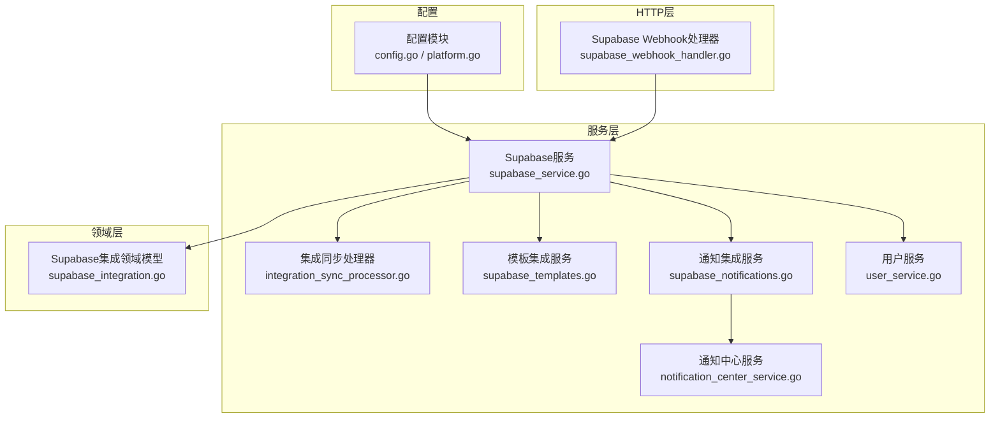
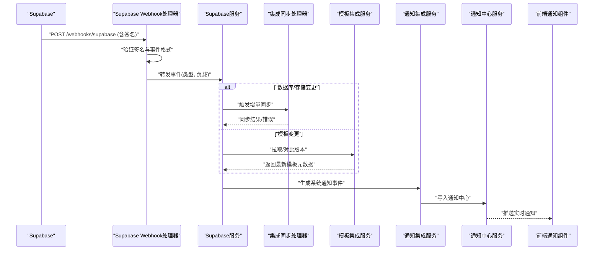
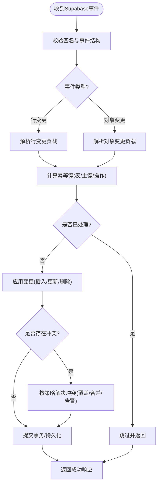
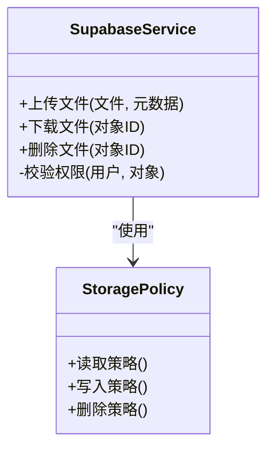
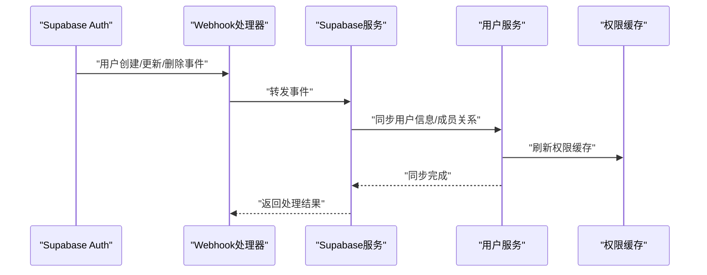
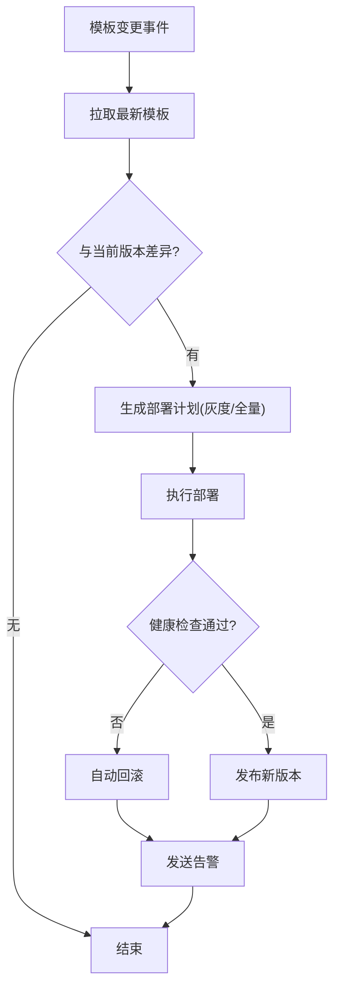
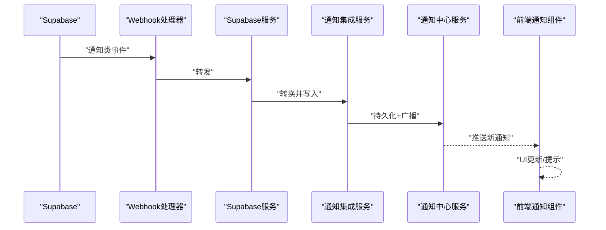
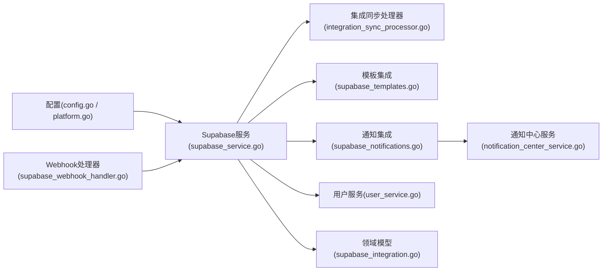

# Supabase集成

<cite>
**本文引用的文件**   
- [supabase_integration.go](file://notifuse/internal/domain/supabase_integration.go)
- [supabase_service.go](file://notifuse/internal/service/supabase_service.go)
- [supabase_templates.go](file://notifuse/internal/service/supabase_templates.go)
- [supabase_notifications.go](file://notifuse/internal/service/supabase_notifications.go)
- [supabase_webhook_handler.go](file://notifuse/internal/http/supabase_webhook_handler.go)
- [integration_sync_processor.go](file://notifuse/internal/service/integration_sync_processor.go)
- [config.go](file://notifuse/config/config.go)
- [platform.go](file://notifuse/config/platform.go)
- [notification_center_service.go](file://notifuse/internal/service/notification_center_service.go)
- [user_service.go](file://notifuse/internal/service/user_service.go)
- [template_service.go](file://notifuse/internal/service/template_service.go)
- [supabase_email_change.go](file://notifuse/pkg/templates/supabase_email_change.go)
</cite>

## 目录
1. [简介](#简介)
2. [项目结构](#项目结构)
3. [核心组件](#核心组件)
4. [架构总览](#架构总览)
5. [详细组件分析](#详细组件分析)
6. [依赖关系分析](#依赖关系分析)
7. [性能考虑](#性能考虑)
8. [故障排查指南](#故障排查指南)
9. [结论](#结论)
10. [附录](#附录)

## 简介
本文件面向Notifuse平台的Supabase集成功能，系统性说明以下方面：
- 数据库同步机制与实时数据变更监听、一致性保证
- 文件存储集成（上传、下载、删除）与权限控制
- 用户管理集成（注册、登录状态同步、权限继承）
- 模板管理系统与Supabase的集成（版本控制与部署策略）
- 通知中心前端组件集成（实时推送与UI更新）
- Supabase项目配置与安全设置建议
- 完整集成示例代码路径与常见问题解决方案

## 项目结构
Supabase相关能力在Notifuse后端以“领域模型 + 服务层 + HTTP处理器”的分层方式组织，并通过配置模块注入Supabase连接参数。关键位置如下：
- 领域层：定义Supabase集成实体与事件
- 服务层：封装Supabase客户端调用、同步处理、模板与通知集成
- HTTP层：接收Supabase Webhook并触发内部流程
- 配置层：提供Supabase连接与平台级开关

图表来源
- [config.go](file://notifuse/config/config.go)
- [platform.go](file://notifuse/config/platform.go)
- [supabase_webhook_handler.go](file://notifuse/internal/http/supabase_webhook_handler.go)
- [supabase_service.go](file://notifuse/internal/service/supabase_service.go)
- [integration_sync_processor.go](file://notifuse/internal/service/integration_sync_processor.go)
- [supabase_templates.go](file://notifuse/internal/service/supabase_templates.go)
- [supabase_notifications.go](file://notifuse/internal/service/supabase_notifications.go)
- [notification_center_service.go](file://notifuse/internal/service/notification_center_service.go)
- [user_service.go](file://notifuse/internal/service/user_service.go)
- [supabase_integration.go](file://notifuse/internal/domain/supabase_integration.go)

章节来源
- [config.go](file://notifuse/config/config.go)
- [platform.go](file://notifuse/config/platform.go)
- [supabase_webhook_handler.go](file://notifuse/internal/http/supabase_webhook_handler.go)
- [supabase_service.go](file://notifuse/internal/service/supabase_service.go)
- [integration_sync_processor.go](file://notifuse/internal/service/integration_sync_processor.go)
- [supabase_templates.go](file://notifuse/internal/service/supabase_templates.go)
- [supabase_notifications.go](file://notifuse/internal/service/supabase_notifications.go)
- [notification_center_service.go](file://notifuse/internal/service/notification_center_service.go)
- [user_service.go](file://notifuse/internal/service/user_service.go)
- [supabase_integration.go](file://notifuse/internal/domain/supabase_integration.go)

## 核心组件
- Supabase服务：统一封装对Supabase的调用，包括数据库、存储、Auth等能力；负责将外部事件转换为内部领域事件并调度后续处理。
- 集成同步处理器：基于Supabase变更事件进行增量同步，确保本地数据与远端一致。
- 模板集成服务：对接Supabase中的模板资源，实现版本化与部署策略。
- 通知集成服务：将Supabase侧的通知事件桥接到Notifuse通知中心，驱动前端实时更新。
- Supabase Webhook处理器：校验签名、解析事件、路由到对应服务。
- 配置模块：集中管理Supabase连接参数、功能开关与安全选项。

章节来源
- [supabase_service.go](file://notifuse/internal/service/supabase_service.go)
- [integration_sync_processor.go](file://notifuse/internal/service/integration_sync_processor.go)
- [supabase_templates.go](file://notifuse/internal/service/supabase_templates.go)
- [supabase_notifications.go](file://notifuse/internal/service/supabase_notifications.go)
- [supabase_webhook_handler.go](file://notifuse/internal/http/supabase_webhook_handler.go)
- [config.go](file://notifuse/config/config.go)
- [platform.go](file://notifuse/config/platform.go)

## 架构总览
下图展示从Supabase事件进入Notifuse后端的端到端流程，涵盖Webhook校验、事件分发、同步处理、模板/通知联动以及最终的前端推送。

图表来源
- [supabase_webhook_handler.go](file://notifuse/internal/http/supabase_webhook_handler.go)
- [supabase_service.go](file://notifuse/internal/service/supabase_service.go)
- [integration_sync_processor.go](file://notifuse/internal/service/integration_sync_processor.go)
- [supabase_templates.go](file://notifuse/internal/service/supabase_templates.go)
- [supabase_notifications.go](file://notifuse/internal/service/supabase_notifications.go)
- [notification_center_service.go](file://notifuse/internal/service/notification_center_service.go)

## 详细组件分析

### 数据库同步机制与一致性保证
- 事件来源：Supabase通过Webhook推送表或对象变更事件。
- 校验与路由：Webhook处理器先验签，再按事件类型路由至Supabase服务。
- 增量同步：集成同步处理器根据事件记录ID、时间戳与操作类型，执行幂等写入与冲突检测，避免重复与乱序导致的不一致。
- 一致性策略：采用“至少一次投递 + 幂等键”的组合，结合事务边界与重试退避，保障最终一致性。

图表来源
- [supabase_webhook_handler.go](file://notifuse/internal/http/supabase_webhook_handler.go)
- [integration_sync_processor.go](file://notifuse/internal/service/integration_sync_processor.go)
- [supabase_service.go](file://notifuse/internal/service/supabase_service.go)

章节来源
- [supabase_webhook_handler.go](file://notifuse/internal/http/supabase_webhook_handler.go)
- [integration_sync_processor.go](file://notifuse/internal/service/integration_sync_processor.go)
- [supabase_service.go](file://notifuse/internal/service/supabase_service.go)

### 文件存储集成（上传、下载、删除与权限）
- 上传：由Supabase服务封装上传接口，支持分片与断点续传（视Supabase配置），并在成功后触发通知与审计日志。
- 下载：服务端代理或直链访问，依据当前用户上下文与对象ACL进行鉴权。
- 删除：受RBAC与对象级策略约束，删除前进行存在性与引用检查。
- 权限控制：结合Supabase存储桶策略与Notifuse工作区/角色体系，实现最小权限原则。

图表来源
- [supabase_service.go](file://notifuse/internal/service/supabase_service.go)

章节来源
- [supabase_service.go](file://notifuse/internal/service/supabase_service.go)

### 用户管理集成（注册、登录状态同步、权限继承）
- 注册：当Supabase Auth创建用户时，通过Webhook同步至Notifuse用户服务，建立本地账户与工作区映射。
- 登录状态：会话刷新或登出事件触发状态同步，保持两端会话一致。
- 权限继承：基于工作区成员关系与角色，继承到业务权限；变更事件触发权限缓存刷新。

图表来源
- [supabase_webhook_handler.go](file://notifuse/internal/http/supabase_webhook_handler.go)
- [supabase_service.go](file://notifuse/internal/service/supabase_service.go)
- [user_service.go](file://notifuse/internal/service/user_service.go)

章节来源
- [supabase_webhook_handler.go](file://notifuse/internal/http/supabase_webhook_handler.go)
- [supabase_service.go](file://notifuse/internal/service/supabase_service.go)
- [user_service.go](file://notifuse/internal/service/user_service.go)

### 模板管理系统与Supabase集成（版本控制与部署）
- 版本控制：模板变更事件触发版本比对，仅当内容或元数据变化时才部署新版本。
- 部署策略：灰度发布与回滚策略在服务层编排，失败自动回滚并告警。
- 渲染链路：模板服务加载最新版本，供邮件/消息渲染使用。

图表来源
- [supabase_templates.go](file://notifuse/internal/service/supabase_templates.go)
- [template_service.go](file://notifuse/internal/service/template_service.go)

章节来源
- [supabase_templates.go](file://notifuse/internal/service/supabase_templates.go)
- [template_service.go](file://notifuse/internal/service/template_service.go)

### 通知中心前端组件集成（实时推送与UI更新）
- 事件桥接：Supabase通知事件经通知集成服务写入通知中心。
- 前端订阅：通知中心服务对外暴露实时通道（如WebSocket/SSE），前端组件订阅后即时渲染。
- 去重与聚合：服务端对同类型事件进行聚合，减少抖动与闪烁。

图表来源
- [supabase_notifications.go](file://notifuse/internal/service/supabase_notifications.go)
- [notification_center_service.go](file://notifuse/internal/service/notification_center_service.go)
- [supabase_webhook_handler.go](file://notifuse/internal/http/supabase_webhook_handler.go)

章节来源
- [supabase_notifications.go](file://notifuse/internal/service/supabase_notifications.go)
- [notification_center_service.go](file://notifuse/internal/service/notification_center_service.go)
- [supabase_webhook_handler.go](file://notifuse/internal/http/supabase_webhook_handler.go)

### 配置与安全设置建议
- 连接参数：在配置模块中集中管理Supabase URL、密钥、超时与重试策略。
- 功能开关：通过平台配置启用/禁用特定集成能力，便于灰度与回滚。
- 安全建议：
  - 使用最小权限的服务密钥，限制Webhook与存储访问范围
  - 开启Webhook签名校验，拒绝非法请求
  - 对敏感字段加密存储，传输强制TLS
  - 定期轮换密钥并审计访问日志

章节来源
- [config.go](file://notifuse/config/config.go)
- [platform.go](file://notifuse/config/platform.go)

## 依赖关系分析
Supabase相关模块之间的耦合关系如下：

图表来源
- [config.go](file://notifuse/config/config.go)
- [platform.go](file://notifuse/config/platform.go)
- [supabase_webhook_handler.go](file://notifuse/internal/http/supabase_webhook_handler.go)
- [supabase_service.go](file://notifuse/internal/service/supabase_service.go)
- [integration_sync_processor.go](file://notifuse/internal/service/integration_sync_processor.go)
- [supabase_templates.go](file://notifuse/internal/service/supabase_templates.go)
- [supabase_notifications.go](file://notifuse/internal/service/supabase_notifications.go)
- [notification_center_service.go](file://notifuse/internal/service/notification_center_service.go)
- [user_service.go](file://notifuse/internal/service/user_service.go)
- [supabase_integration.go](file://notifuse/internal/domain/supabase_integration.go)

章节来源
- [supabase_service.go](file://notifuse/internal/service/supabase_service.go)
- [supabase_webhook_handler.go](file://notifuse/internal/http/supabase_webhook_handler.go)
- [integration_sync_processor.go](file://notifuse/internal/service/integration_sync_processor.go)
- [supabase_templates.go](file://notifuse/internal/service/supabase_templates.go)
- [supabase_notifications.go](file://notifuse/internal/service/supabase_notifications.go)
- [notification_center_service.go](file://notifuse/internal/service/notification_center_service.go)
- [user_service.go](file://notifuse/internal/service/user_service.go)
- [supabase_integration.go](file://notifuse/internal/domain/supabase_integration.go)
- [config.go](file://notifuse/config/config.go)
- [platform.go](file://notifuse/config/platform.go)

## 性能考虑
- 事件批处理：对高频小事件进行聚合，降低数据库压力。
- 幂等与去重：利用幂等键与内存/分布式缓存快速判断重复事件。
- 异步化：将耗时操作（模板编译、渲染、通知广播）放入队列异步执行。
- 连接池与超时：合理设置Supabase客户端连接池大小与超时，避免雪崩。
- 限流与熔断：对上游事件与下游依赖实施限流与熔断保护。

[本节为通用指导，不直接分析具体文件]

## 故障排查指南
- Webhook未触发或签名校验失败
  - 检查Supabase侧Webhook地址与签名算法配置
  - 确认Notifuse侧签名校验逻辑与密钥一致
  - 参考：[supabase_webhook_handler.go](file://notifuse/internal/http/supabase_webhook_handler.go)
- 同步不一致或重复数据
  - 核对幂等键生成规则与去重缓存
  - 查看重试与补偿任务执行情况
  - 参考：[integration_sync_processor.go](file://notifuse/internal/service/integration_sync_processor.go)
- 模板部署失败或回滚异常
  - 检查版本差异计算与健康检查逻辑
  - 查看部署计划与回滚策略日志
  - 参考：[supabase_templates.go](file://notifuse/internal/service/supabase_templates.go), [template_service.go](file://notifuse/internal/service/template_service.go)
- 通知未推送或前端未更新
  - 确认通知事件写入与广播链路
  - 检查前端订阅通道与重连逻辑
  - 参考：[supabase_notifications.go](file://notifuse/internal/service/supabase_notifications.go), [notification_center_service.go](file://notifuse/internal/service/notification_center_service.go)
- 用户状态不同步
  - 核对Auth事件类型与用户服务映射
  - 检查权限缓存刷新时机
  - 参考：[user_service.go](file://notifuse/internal/service/user_service.go)

章节来源
- [supabase_webhook_handler.go](file://notifuse/internal/http/supabase_webhook_handler.go)
- [integration_sync_processor.go](file://notifuse/internal/service/integration_sync_processor.go)
- [supabase_templates.go](file://notifuse/internal/service/supabase_templates.go)
- [template_service.go](file://notifuse/internal/service/template_service.go)
- [supabase_notifications.go](file://notifuse/internal/service/supabase_notifications.go)
- [notification_center_service.go](file://notifuse/internal/service/notification_center_service.go)
- [user_service.go](file://notifuse/internal/service/user_service.go)

## 结论
Notifuse对Supabase的集成围绕“事件驱动 + 幂等同步 + 分层解耦”展开：通过Webhook接入变更事件，服务层统一编排同步、模板与通知流程，并以配置化与可观测性保障稳定性与安全性。建议在上线前完善签名校验、幂等键设计、监控告警与演练回滚流程。

[本节为总结性内容，不直接分析具体文件]

## 附录

### 集成示例代码路径
- Webhook入口与事件分发
  - [supabase_webhook_handler.go](file://notifuse/internal/http/supabase_webhook_handler.go)
- Supabase服务封装
  - [supabase_service.go](file://notifuse/internal/service/supabase_service.go)
- 同步处理器
  - [integration_sync_processor.go](file://notifuse/internal/service/integration_sync_processor.go)
- 模板集成
  - [supabase_templates.go](file://notifuse/internal/service/supabase_templates.go)
  - [template_service.go](file://notifuse/internal/service/template_service.go)
- 通知集成
  - [supabase_notifications.go](file://notifuse/internal/service/supabase_notifications.go)
  - [notification_center_service.go](file://notifuse/internal/service/notification_center_service.go)
- 用户同步
  - [user_service.go](file://notifuse/internal/service/user_service.go)
- 领域模型
  - [supabase_integration.go](file://notifuse/internal/domain/supabase_integration.go)
- 配置与平台开关
  - [config.go](file://notifuse/config/config.go)
  - [platform.go](file://notifuse/config/platform.go)
- 邮件变更模板（示例）
  - [supabase_email_change.go](file://notifuse/pkg/templates/supabase_email_change.go)

### 常见配置项清单（建议）
- Supabase连接
  - 基础URL、匿名与服务密钥、超时、重试次数
- Webhook
  - 签名算法、白名单IP、回调路径
- 存储
  - 桶名、访问策略、最大文件大小
- 功能开关
  - 启用/禁用同步、模板、通知等能力

[本节为通用清单，不直接分析具体文件]